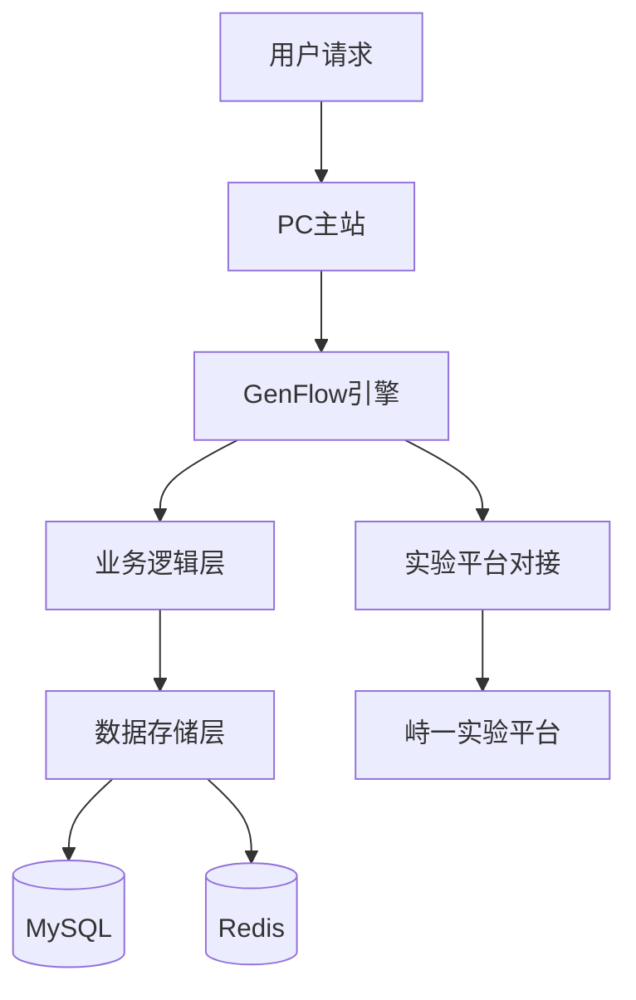

文库AI Coding实践

#### 🧑‍🏫 案例作者：[@徐飞](https://ku.baidu-int.com?t=mention&mt=contact&id=b9a81680-fce0-11f0-b639-2ddf8f79c700)
#### 🎬 案例场景：开发
#### 🔧 使用工具：Comate
#### 📒 案例概要：本文由文库研发部徐飞分享百度Comate与Zulu智能体的AI Coding实践。详解Comate的代码补全与优化功能，以及Zulu的MCP协议集成、规则驱动开发（含Go项目代码风格规范、分层架构职责文件）及iCafe文档生成案例。指出AI Coding正从工具升级重构为“人机协作”研发范式，显著提升代码生成质量与工程完整性。
# 🧑‍🏫 实践分享人：文库研发部 [@徐飞](https://ku.baidu-int.com?t=mention&mt=contact&id=9dd095b0-e163-11f0-92c4-8f9db8128263)
# 📅 分享时间：25年H2

**更多案例👉 **[🔥AI实践案例库](https://ku.baidu-int.com/knowledge/HFVrC7hq1Q/pKzJfZczuc/WjGjiS_SK_/_U6EhhLx7F5_DI?t=mention&mt=doc&dt=doc)** 欢迎星标本文、评论区点赞、投币、留言**

 [🔍点击此处了解更多AI+社区](https://ku.baidu-int.com/knowledge/HFVrC7hq1Q/pKzJfZczuc/WjGjiS_SK_/opdELIFv2_oFZg)** **[👗社区如流群](https://applink-infoflow.baidu.com/share/contact/open/?token=ZDbWqAs7nQEaXdmgxb6vizK7WFPKWNeibo75Ua-D0_M)

# **百度内AI Coding：从工具革新到研发范式重构的实践探索**


——Comate、Zulu功能配置与深度使用指南

### **AI Coding的时代命题**
在AI重构研发流程的今天，百度通过**Comate**与**Zulu**两大智能体，重新定义了“人机协作”的边界。这不仅是工具的升级，更是研发范式的革命：从“人写代码”转向“AI辅助决策”，从“经验驱动”转向“数据与规则驱动”。

### **一、Comate：从代码补全到全流程智能辅助**
**1. 核心功能与配置实践**


Comate作为基于文心大模型的智能编码助手，支持100+种语言，覆盖主流IDE（VS Code、IntelliJ等）。其核心能力包括：

* **实时代码补全**：在输入`for`循环时，Comate可自动生成完整代码块，支持`Tab`键逐行采纳或`Ctrl+↓`多行采纳。
* **注释生成代码**：输入中文注释（如“生成一个计算斐波那契数列的函数”），Comate可生成结构清晰的代码，并支持注释自动生成。
* **代码解释与优化**：选中复杂算法（如快速排序），Comate可生成逐行注释，并提供调优建议（如将递归改为迭代以减少栈溢出风险）。


**实战案例**：

用go实现算法：为保护用户隐私，只保留用户名前后n位，其他位用*号替代

用go实现算法：通过加密算法，将用户user_id转换成一个定长的字符串


### **二、Zulu：从指令式对话到协同式开发**
**1. Zulu的核心升级与配置**

Zulu作为Comate的进化版

* **MCP（Model Context Protocol）集成**：一键接入百度AI搜索、飞桨PaddlePaddle等模型服务，实时调用外部知识（如查询NASA行星轨道数据生成3D模拟代码）。
* **规则驱动开发**：通过`.mdr`规则文件，将项目规范（如命名习惯、目录结构）转化为机器可读的约束，使AI生成代码更贴合团队标准。

**实战案例**：

帮你读懂代码：filecreate.go，绘制本文件流程图，要求包含所有调用函数内部逻辑

```
flowchart TD
    A[NewFileCreate] --> B[OnInit]
    B -->|参数校验| C{校验通过?}
    C -->|是| D[OnExecute]
    C -->|否| E[返回参数错误]
    D --> F{遍历文件列表}
    F -->|用户上传| G[dealUserUpload]
    F -->|资料库文件| H[dealUserLibrary]
    H --> H1[GetDocStoreInfo]
    H1 --> H2{文档类型判断}
    H2 -->|普通文档| H3[GetDownloadUrl]
    H2 -->|可编辑文档| H4[GetEditDocUrl]
    H4 --> H5[parseDownloadURL]
    F -->|网盘文件| I[dealNeidisk]
    I --> I1[GetSingleFileInfo]
    F -->|外部链接| J[dealLink]
    G & H5 & I & J --> K[WenChainCreateDoc]
    K --> L[构造返回结果]
    
    style A fill:#f9f,stroke:#333
    style D fill:#bbf,stroke:#333
    style G fill:#9f9,stroke:#333
    style H fill:#9f9,stroke:#333
    style I fill:#9f9,stroke:#333
    style J fill:#9f9,stroke:#333

```


帮你读懂代码：找出项目中海报回调相关的代码


**2. Zulu Rules：让AI“懂”你的代码库**


**规则编写三步法**：

1. **定义项目概述**：在规则文件中用一句话说明项目目标（如“这是一个处理异步数据流的工具库”）。
2. **明确模块与接口**：列出核心模块（如`controller`、`dao`）及其职责，定义标准接口格式（如`Interface`）。
3. **设定代码风格与规范**：

    * 命名规范、编码格式等；
    * 设定标准的日志规范；
    * 错误处理统一使用`Error`对象；
    * 禁止某些行为（也可以要求AI必须执行某些行为，但尽量减少这样的规则使用，有时AI自己的发挥会带来不少惊喜）。

**实战****案例**：

案例一：**代码风格规则**

```
---
description: 
globs: 
alwaysApply: true
---

# Golang 项目编码风格
- 单行最大长度建议不超过 120 个字符。
- 包名 (Package names): 简短、小写，例如 `stringutil`, `userdao`。
- 变量名 (Variable names): 使用驼峰式 (camelCase)。对于常见的缩写词，如 `ID`, `URL`, `IP`，在命名中保持全大写或全小写的一致性，团队推荐全大写，例如 `userID`, `ipAddr`, `requestURL`。
- 接口名 (Interface names): 通常以 `er` 结尾 (如 `Reader`, `Writer`)，或者使用描述性的名称。
- 函数/方法名 (Function/Method names): 驼峰式。导出函数首字母大写，非导出函数首字母小写。
- 导入包需要分组，顺序为：标准库、第三方库、项目内部库。组间空一行。
- 示例:
  ```go
  import (
      "context"
      "fmt"
      "log"

      "[github.com/gin-gonic/gin](https://github.com/gin-gonic/gin)"
      "go.uber.org/zap"

      "icoding.baidu.com/baidu/gdp/models"
      "icoding.baidu.com/baidu/gdp/mysql"
  )
  ```

## 日志使用
日志函数第一个参数通常应为 context.Context。
日志打印需要使用包："icode.baidu.com/baidu/wenku-go/aibizcomm/library/resource"
使用resource.LoggerService()记录日志
日志打印中的业务字段使用包："icode.baidu.com/baidu/gdp/logit"
使用logit的方法补充日志字段
日志级别及方法包含且仅包含：Debug、Trace、Notice、Warning、Error、Fatal
关键业务步骤记录Notice级别日志
错误一般记录Warning级别日志，严重的错误记录Error级别日志，谨慎使用Fatal级别日志
敏感信息（如密码、密钥）在打印日志前必须脱敏。
说明: 此规则将作为整个项目的基础编码准则，AI 在生成或修改任何 Go 代码时都应遵循。
日志使用示例：
```go
import (
    "icode.baidu.com/baidu/gdp/logit"

    "icode.baidu.com/baidu/wenku-go/aibizcomm/library/resource"
)

// 在Service层使用日志
func (s *CompanyServiceImpl) CreateCompany(ctx context.Context, company *model.CompanyBO) (int64, error) {
    resource.LoggerService().Debug(ctx, "CompanyServiceImpl.CreateCompany start", logit.AutoField("company", company))
    
    id, err := s.companyDAO.Create(ctx, company.Convert2CompanyDO())
    if err != nil {
        resource.LoggerService().Warning(ctx, "CompanyServiceImpl.CreateCompany failed", logit.AutoField("company", company), logit.Error("err", err))
        return 0, err
    }
    
    resource.LoggerService().Notice(ctx, "CompanyServiceImpl.CreateCompany success", logit.AutoField("id", id))
    return id, nil
}
```

## 错误处理
通用错误码的包："icode.baidu.com/baidu/wenku-go/golib/wkerror"
错误码优先使用包中预订好的，如果没有匹配的，必须要在文件中创建新的错误信息。在使用时，禁止在其他文件中设定错误码，只能引用包内errors.go 文件中的错误码
```go
import "icode.baidu.com/baidu/wenku-go/golib/wkerror"

func (s *CompanyServiceImpl) CreateCompany(ctx context.Context, company *model.CompanyBO) (int64, error) {
    if company.Name == "" {
        return 0, wkerror.New(wkerror.ErrorCodeParamsError, "company name error")
    }
    return id, nil
}
```

* 禁止使用相对路径导入项目内部包。
* 避免在库代码或可被复用的模块中使用 panic，除非是不可恢复的程序错误。
```


案例二：**项目架构层级职责规范（这里可以看到@的用法，可以关联其他规则）**

```
---
description: 
globs: 
alwaysApply: true
---

# 项目架构层级职责规范

## 数据访问层 (DAO)
- **路径匹配:** `**/model/dao/**/*.go`
- **核心职责:** 封装所有与数据存储（主要是数据库）的直接交互逻辑。提供数据的持久化和检索能力。
- **应该做 (Should Do):**
    - 包含针对特定数据库表或数据模型的 CRUD (创建、读取、更新、删除) 操作方法。(具体用法参考 `@dao-style.mdr`)
    - **必须**使用项目内部的 `library/resource/gorm.go` 和 `"icode.baidu.com/baidu/wenku-go/golib/gormadapter"` 进行查询构建、执行和事务管理。(具体用法参考 `@dao-style.mdr`)
    - 方法的入参和出参通常是领域模型对象 (与数据库表结构映射的 Go struct) 或基本数据类型。
- **不应该做 (Should NOT Do):**
    - **严禁**包含任何业务逻辑、业务规则校验或流程编排。
    - **严禁**直接调用其他 Service、Usecase 或 RPC Client。
    - **严禁**处理 HTTP 请求或构造 HTTP 响应。
    - **避免**进行复杂的、与业务场景紧密耦合的数据转换；如果需要转换，也应是简单的数据格式整理。

## 业务逻辑层 (Service / Usecase)
- **路径匹配:** `**/model/service/**/*.go`
- **核心职责:** 实现项目的核心业务逻辑、业务规则和流程编排。
- **应该做 (Should Do):**
    - 调用 DAO/Repository 层的方法来获取或持久化数据。
    - 调用 RPC Client 层与其他微服务进行交互。
    - 实现具体的业务规则、数据校验 (通常是业务层面的校验)、数据转换和组合。
    - 管理跨多个 DAO 操作的数据库事务 (事务的开启、提交、回滚应在此层处理，具体参考) 。
    - 定义并返回业务层特定的错误 (参考 `@code-style.mdr`)。
- **不应该做 (Should NOT Do):**
    - **严禁**直接使用 `library/resource/gorm.go` 或编写原生 SQL (所有数据库操作必须通过 DAO/Repository 层)。
    - **严禁**直接处理 HTTP 请求参数解析或 HTTP 响应构造 (这属于 Controller/Handler 层的职责)。
    - **避免**包含与特定通信协议 (如 HTTP, gRPC) 相关的代码。

## lib 通用工具层 (Library / Util)
- **路径匹配:** `**/library/**/*.go`
- **核心职责:** 封装数据库、redis、日志、微服务、消息队列、日志、微服务、风控以及其他基础数据处理的工具等
- **应该做 (Should Do):**
    - 工具要保持通用性，接口或函数的实现尽量保持无状态。
    - 工具函数应保持单一职责
    - **必须**函数第一个参数应为 context.Context。
- **不应该做 (Should NOT Do):**
    - **严禁**包含特定于某个业务用例的业务逻辑 (这些逻辑应放在 Service/Usecase 层)。 Library 应保持通用性。
    - **严禁**工具层禁止直接调用DAO层

## 表现层 (Controller / Router)
- **路径匹配:** `**/httpserver/controller/**/*.go`, `**/httpserver/controller/service/**/*.go`, `**/httpserver/router.go`, `**/httpserver/subrouter/*.go`
- **核心职责:** 处理外部传入的请求 (如 HTTP, gRPC)，解析输入参数，调用 Service/Usecase 层执行业务逻辑，并根据执行结果构造和返回响应。
- **应该做 (Should Do):**
    - HTTP请求的入口路由与Controller的对应关系维护在 `**/httpserver/router.go`
    - 可以使用在 `**/httpserver/router.go` 路由中注册子路由，子路由对应路径为 `**/httpserver/subrouter/*.go`
    - 负责请求的接收、鉴权（可委托给中间件）、参数校验 (格式、存在性等基础校验)。(参考 `@controller-style.mdr`)
    - 调用相应的 Service/Usecase 层方法来执行核心业务逻辑。
    - 将 Service/Usecase 层返回的业务错误或数据，转换为特定协议的响应码和响应体 (例如，HTTP 状态码、JSON 响应)。
    - 负责响应数据的格式化。
- **不应该做 (Should NOT Do):**
    - **严禁**包含任何实际的业务处理逻辑 (所有业务逻辑必须委托给 Service/Usecase 层)。
    - **严禁**直接调用 DAO/Repository 层 (这些操作应由 Service/Usecase 层封装)。
    - **严禁**直接调用微服务、外部http接口或者使用rpc、ral请求 (这些操作应由 Service/Usecase 层封装)。
    - **避免**进行复杂的数据库查询或事务管理。

## 配置层 （Conf）
- **路径匹配:** `**/conf/*.toml`, `**/conf/**/*.toml`
- **核心职责:** 维护代码库用到的配置文件。
- **应该做 (Should Do):**
    - 配置文件需要严格遵循toml语法规范
```
架构层级里提到的dao层以及controller层的具体规则如下（注意规则要与层级规则保持一致）：

```
---
description: 
globs: 
alwaysApply: true
---
# DAO层编码规范

## 文件结构
- 每个数据表对应一个独立的包
- 包名应与表名相关(小写)
- 包内包含：
  - 模型定义文件(model struct)
  - DAO接口及实现文件
  - 数据库连接文件(如db.go)

## 模型定义
```go
type ModelName struct {
    Field1 type \`gorm:"column:field1"\`
    Field2 type \`gorm:"column:field2"\`
    // ...
}

// 必须定义TableName方法
func (ModelName) TableName() string {
    return "table_name"
}
```

## DAO接口规范
1. **必须**单独一个db.go文件定义DB Gorm，返回对象为`"icode.baidu.com/baidu/wenku-go/golib/gormadapter"`库的*gormadapter.GormDB
```go
// 必须声明一个名为DBName的数据库
func DB() *gormadapter.GormDB {
    return resource.Gorm().DBName
}
```

2. **必须**定义接口：
```go
type DaoModelName interface {
    Create(ctx context.Context, data *ModelName) error
    Update(ctx context.Context, id uint64, updates map[string]interface{}) error
    GetByID(ctx context.Context, id uint64) (*ModelName, error)
    // 其他自定义查询方法
}
```

3. 实现接口：
```go
type daoModelName struct{}

func NewModelNameDAO() DaoModelName {
    return &daoModelName{}
}

// 示例方法实现
func (d *daoModelName) Create(ctx context.Context, data *ModelName) error {
    // 参数校验
    if data.Field1 == "" {
        return errors.New("field1 is required")
    }
    
    // 数据库操作
    err := DB().WithContext(ctx).Create(data).Error
    if err != nil {
        resource.LoggerService().Error(ctx, "create failed", 
            logit.AutoField("data", data),
            logit.Error("err", err))
        return wkerror.New(wkerror.ErrorCodeDbQueryError, "create failed")
    }
    
    return nil
}
```

## 最佳实践
1. **上下文传递**：所有方法必须接收context.Context参数
2. **错误处理**：使用项目定义的wkerror返回标准错误
3. **日志记录**：关键操作需记录日志
4. **参数校验**：方法入口进行必要参数校验
5. **字段选择**：明确指定查询/更新字段
6. **事务处理**：跨表操作使用事务

## 示例CRUD模板
```go
// Create
func (d *daoModelName) Create(ctx context.Context, data *ModelName) error {
    // 校验+日志+错误处理
}

// Update
func (d *daoModelName) Update(ctx context.Context, id uint64, updates map[string]interface{}) error {
    // 字段选择+条件+日志
}

// GetByID 
func (d *daoModelName) GetByID(ctx context.Context, id uint64) (*ModelName, error) {
    // 单条查询+错误处理
}

// 复杂查询
func (d *daoModelName) ListByCondition(ctx context.Context, cond map[string]interface{}) ([]ModelName, error) {
    // 构建查询条件+排序+分页
}
```

```
```
---
description: 
globs: 
alwaysApply: true
---

# Controller层编码规范

## 文件结构
- 每个业务功能对应一个独立的.go文件
- 文件命名采用功能名+动词形式，如`createnote.go`
- 包名为业务领域名称，如`note`

## 基本模式
```go
package [业务领域]

import (
    "context"
    "icode.baidu.com/baidu/gdp/ghttp"
    "icode.baidu.com/baidu/wenku-go/aibizcomm/model/service/[业务领域]"
    "icode.baidu.com/baidu/wenku-go/golib/mservice/msserver" 
    "icode.baidu.com/baidu/wenku-go/golib/wkhttp/frame"
)

func New[功能名]() ghttp.HandlerFunc {
    return frame.NewMServiceJSONFrame(
        msserver.NewMSHTTPJSONExecutorNewer(
            func(ctx context.Context, req [请求参数类型]) (*[响应类型], error) {
                res, err := [业务领域].New[功能名]().[功能方法](ctx, req)
                return res, err
            },
        ),
    )
}
```

## 职责要求
1. 必须使用标准框架封装：
- frame.NewMServiceJSONFrame
- msserver.NewMSHTTPJSONExecutorNewer

2. 必须委托业务逻辑给service层处理

3. 必须包含context传递

4. 禁止：
- **严禁**直接处理业务逻辑
- **严禁**直接访问DAO层
5. 建议：
- 保持controller简洁，只做参数传递
- 每个文件只处理一个功能
- 命名清晰表达功能意图
```
### **三、Zulu MCP：打破数据孤岛的智能枢纽**
**1. MCP的核心价值**

MCP（Model Context Protocol）是百度提出的模型上下文管理协议，支持：

* **多实例配置**：同时接入百度AI搜索、文心大模型、私有化部署的飞桨模型；
* **实时状态监控**：在IDE中查看模型调用日志、运行详情。


**2. MCP使用实践**

**从iapi文档直接生成接口代码**

1. 添加iapi的MCP；


2. 配置iapi的MCP的用户名及token，见图1中的配置项，用户名即百度邮箱前缀，iapi_token的生成见下图2、图3；


3. 更新MCP，启动MCP Server；


4. 通过iapi链接生成完整接口


示例：根据iapi文档生成接口：[https://iapi.baidu-int.com/web/project/355719/apis/api-4728527](https://iapi.baidu-int.com/web/project/355719/apis/api-4728527) （这里直接将链接换成你需要生成的iapi协作链接试试看吧）


如果想要AI继续完善代码，直接在对话框输入1、2、3就可以执行模型推荐的接下来的工作


**从icafe卡片写技术文档**

1. 添加iCafeCodingAgent卡的mcp


2. 配置用户名和密码，用户名即邮箱前缀，密码是通过[获取虚拟密码](https://ku.baidu-int.com/knowledge/HFVrC7hq1Q/_SKPgSwp2G/NbX2gitgSF/4cc48b299a6846?t=mention&mt=doc&dt=doc)获取的


示例：根据icafe：{{icafeId}}的内容，写技术文档


```
# GenFlow 919版本需求技术设计文档

## 1. 需求概述

**需求编号**: wk-web-51249  
**需求标题**: GenFlow 919版本需求  
**需求状态**: 测试中  
**需求类型**: Feature  
**PM负责人**: XXX
**研发负责人**: XX, XX, XX  
**QA负责人**: XX, XX  

**业务目标**: 提升DAU（日活跃用户数）  
**实验平台**: 峙一实验平台（原Sample）  
**流量策略**: 小流量  

## 2. 架构设计

### 2.1 系统架构图


### 2.2 技术栈
- **前端**: React/Vue + TypeScript
- **后端**: Go (基于现有项目技术栈)
- **数据库**: MySQL + Redis
- **消息队列**: NMQ/Kafka
- **监控**: Logit + Pandora

## 3. 模块设计

### 3.1 GenFlow集成模块
```go
// GenFlow 919版本适配接口
type GenFlow919Adapter interface {
    ProcessWorkflow(ctx context.Context, input *WorkflowInput) (*WorkflowOutput, error)
    ValidateConfig(config *Config) error
    GetMetrics() *Metrics
}
```

### 3.2 实验平台对接模块
```go
// 峙一实验平台客户端
type ShiyiExperimentClient struct {
    baseURL    string
    appKey     string
    appSecret  string
    httpClient *http.Client
}

func (c *ShiyiExperimentClient) GetExperimentConfig(experimentID string) (*ExperimentConfig, error) {
    // 实现实验配置获取逻辑
}
```

### 3.3 流量控制模块
```go
// 流量控制管理器
type TrafficControlManager struct {
    experimentClient *ShiyiExperimentClient
    cache           *redis.Client
}

func (m *TrafficControlManager) ShouldServe(userID string, experimentID string) (bool, error) {
    // 实现小流量控制逻辑
}
```

## 4. 数据库设计

### 4.1 核心表结构
```sql
CREATE TABLE genflow_919_experiments (
    id BIGINT AUTO_INCREMENT PRIMARY KEY,
    experiment_id VARCHAR(100) NOT NULL,
    user_id VARCHAR(100) NOT NULL,
    group_type ENUM('control', 'treatment') NOT NULL,
    created_at TIMESTAMP DEFAULT CURRENT_TIMESTAMP,
    updated_at TIMESTAMP DEFAULT CURRENT_TIMESTAMP ON UPDATE CURRENT_TIMESTAMP,
    INDEX idx_experiment_user (experiment_id, user_id),
    INDEX idx_created_at (created_at)
);

CREATE TABLE genflow_919_metrics (
    id BIGINT AUTO_INCREMENT PRIMARY KEY,
    experiment_id VARCHAR(100) NOT NULL,
    metric_name VARCHAR(100) NOT NULL,
    metric_value DECIMAL(15,4) NOT NULL,
    timestamp TIMESTAMP DEFAULT CURRENT_TIMESTAMP,
    INDEX idx_experiment_metric (experiment_id, metric_name),
    INDEX idx_timestamp (timestamp)
);
```

## 5. 接口设计

### 5.1 RESTful API
```http
POST /api/v1/genflow/process
Content-Type: application/json
Authorization: Bearer <token>

{
    "workflow_id": "workflow_001",
    "input_data": {...},
    "user_id": "user_123"
}

响应:
{
    "success": true,
    "data": {...},
    "experiment_group": "treatment"
}
```

### 5.2 监控接口
```http
GET /api/v1/metrics/experiment/{experiment_id}
响应:
{
    "dau": 15000,
    "conversion_rate": 0.15,
    "avg_session_duration": 180
}
```

## 6. 部署方案

### 6.1 环境配置
```yaml
# app.toml
[genflow_919]
enabled = true
experiment_id = "genflow_919_v1"
traffic_percentage = 10

[shiyi_experiment]
base_url = "https://shiyi-experiment.baidu-int.com"
app_key = "${APP_KEY}"
app_secret = "${APP_SECRET}"
```

### 6.2 部署流程
1. **开发环境**: 功能开发和单元测试
2. **测试环境**: 集成测试和性能测试
3. **预发环境**: 全流量验证
4. **生产环境**: 小流量灰度发布

## 7. 监控与告警

### 7.1 关键监控指标
- 请求成功率 > 99.9%
- 平均响应时间 < 100ms
- P95响应时间 < 200ms
- 错误率 < 0.1%

### 7.2 告警规则
```yaml
rules:
  - alert: GenFlowHighErrorRate
    expr: rate(genflow_errors_total[5m]) > 0.05
    for: 5m
    labels:
      severity: critical
    annotations:
      summary: "GenFlow错误率过高"
```

## 8. 测试策略

### 8.1 单元测试
- 核心算法测试覆盖率 > 90%
- 边界条件测试
- 异常场景测试

### 8.2 集成测试
- 实验平台对接测试
- 数据库操作测试
- 流量控制测试

### 8.3 性能测试
- 单机QPS > 1000
- 并发用户数 > 1000
- 内存使用 < 512MB

## 9. 风险评估与应对

### 9.1 技术风险
- **风险**: 实验平台接口不稳定
- **应对**: 实现熔断机制和降级策略

### 9.2 业务风险
- **风险**: 小流量实验影响用户体验
- **应对**: 快速回滚机制和监控告警

## 10. 排期计划

| 阶段 | 时间 | 负责人 |
|------|------|--------|
| 技术设计 | 2025-09-03 | 研发团队 |
| 开发实现 | 2025-09-04 至 2025-09-10 | XX,XX,XX |
| 测试验证 | 2025-09-11 至 2025-09-16 | XX,XX |
| 上线发布 | 2025-09-17 | 全体 |

## 11. 附录

### 11.1 相关文档
- [需求文档](https://ku.baidu-int.com/knowledge/HFVrC7hq1Q/w1BEtm_LUD/WJBO3quvVJ/N-X3NpjRiztKl2)
- [接口文档](待补充)
- [测试用例](待补充)

### 11.2 代码规范
- 遵循现有项目代码规范
- 添加必要的注释和文档
- 完成代码Review流程
```
### 四、AI Coding的未来图景展望
1. 聚焦需求文档撰写的专业工程师：未来将涌现出专精于需求分析与文档架构的工程师群体，他们通过需求捕捉、场景建模，实现文档生成的标准化输出。
2. 专注视觉交互设计的创新工程师：交互设计领域将形成以AI辅助为核心的创作生态，工程师可借助智能工具完成从原型设计到动态效果的全链路可视化开发。
3. 资源数据整合的架构工程师：数据工程领域将催生新型架构师角色，他们通过AI驱动的集成平台实现多源异构数据的自动化治理与价值挖掘。

结语：

AI Coding技术并非要取代开发者，而是为开发者注入"超能力"。随着文心大模型等基础架构的持续突破，AI Coding将重构软件研发范式——从重复性编码劳动转向创造性问题解决，使开发者能够突破传统生产力边界，实现研发效能的指数级跃升。这种变革将推动整个行业从"人力密集型"开发模式向"智慧驱动型"创新生态演进，最终让每位开发者都具备"十倍效能"的超级生产力。

# [AI+社区首页](https://ku.baidu-int.com/knowledge/HFVrC7hq1Q/pKzJfZczuc/WjGjiS_SK_/opdELIFv2_oFZg)
## [📒 查看/分享更多案例](https://ku.baidu-int.com/knowledge/HFVrC7hq1Q/pKzJfZczuc/WjGjiS_SK_/_U6EhhLx7F5_DI)
更多厂内AI实践案例、案例投递入口

## [📪 创作者投稿](https://ku.baidu-int.com/share/shr5MRDhohjq9dAlY9MCQ/fomaWTzCTogCK4wkc3&spaceId=spcC9AM3yK7rD)
产研干货文章、AI洞察、个人AI技巧

## [🔧 AI工具箱](https://tools.baidu-int.com/)
厂内外热门工具，一键使用

###### **🌟欢迎星标本文、评论区点赞、投币、留言**   [👗社区如流群](https://applink-infoflow.baidu.com/share/contact/open/?token=ZDbWqAs7nQEaXdmgxb6vizK7WFPKWNeibo75Ua-D0_M)    👆更多AI板块点击上方，即刻跳转
更多案例
