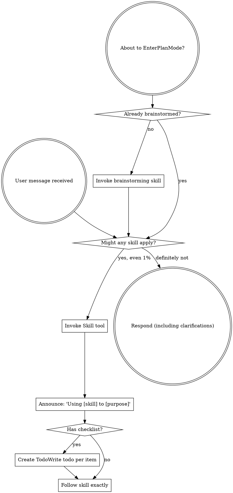

Skills 调用顺序实现机制

#### 🧑‍🏫 案例作者：[@闫世锋](https://ku.baidu-int.com?t=mention&mt=contact&id=422c2e80-f2cb-11f0-80f0-91056ee5134c)
#### 🎬 案例分类：其他、通用
#### 🔧 使用工具：Claude
#### 📒 案例概要：本文档介绍Superpowers框架的声明式技能调用顺序机制。核心是通过元数据声明、检查清单和优先级规则（而非硬编码）管理技能执行流程。关键机制包括：强制性优先级模型（过程技能优先于实现技能）、依赖声明确保调用链、检查清单驱动原子化步骤流转、标准化工作流模型。该系统强制关键步骤（如设计）不可跳过，通过子代理实现并行安全与审查隔离，保证流程一致性与可维护性。
## 核心概念：声明式顺序控制
与传统编程中的"代码逻辑控制"不同，Superpowers 采用**声明式约束**来管理技能调用顺序。这意味着：

* **不是**通过 `if-else` 或函数调用链来硬编码顺序
* **而是**通过元数据声明、检查清单（Checklist）和优先级规则来引导 AI 的行为

这种设计让系统更灵活、可扩展，同时保证了关键步骤不被跳过。

---

## 四大实现机制
### 1. 强制性优先级模型（Skill Priority）
当多个技能同时满足触发条件时，框架通过**内置优先级规则**确定调用顺序：

### **中文**
### **原文**
```
---

名称：使用超能力

描述：在开始任何对话时使用 - 明确如何查找和使用技能，要求在回复任何内容（包括澄清问题）之前调用技能工具

---

<极其重要>

如果您认为某个技能哪怕只有 1% 的可能性适用于您正在做的事情，您也绝对必须调用该技能。

如果某个技能适用于您的任务，您别无选择。您必须使用它。

这没有商量的余地。这不是可选项。您无法用任何理由逃避。

</极其重要>

## 如何访问技能

**在 Claude Code 中：** 使用 `Skill` 工具。当您调用一个技能时，其内容将被加载并显示给您 - 请直接按照提示操作。切勿对技能文件使用读取工具。

**在其他环境中：** 请查看平台文档，了解技能的加载方式。

# 使用技能

## 规则

**在任何响应或操作之前，调用相关或请求的技能。** 即使技能只有 1% 的适用概率，也应该调用该技能进行检查。如果调用的技能不适用于当前情况，则无需使用。

```dot

digraph skill_flow {

"用户消息已收到" [shape=doublecircle];

"即将进入计划模式？" [shape=doublecircle];

"已经进行头脑风暴了吗？" [shape=diamond];

"调用头脑风暴技能" [shape=box];

"是否有任何技能适用？" [shape=diamond];

"调用技能工具" [shape=box];

"公告：'使用 [技能] 执行 [目的]'" [shape=box];

“是否有清单？” [形状=菱形]；

“创建待办事项，逐项写入待办事项” [形状=方框]；

“严格按照技能操作” [形状=方框]；

“回复（包括澄清）” [形状=双圆]；

“即将进入计划模式？” -> “已进行头脑风暴？”；

“已进行头脑风暴？” -> “调用头脑风暴技能” [标签="否"]；

“已进行头脑风暴？” -> “是否有任何技能适用？” [标签="是"]；

“调用头脑风暴技能” -> “是否有任何技能适用？”；

“已收到用户消息” -> “是否有任何技能适用？”；

“是否有任何技能适用？” -> “调用技能工具” [标签="是，即使只有 1%"]；

“是否有任何技能适用？” -> “回复（包括澄清）” [label="绝对不行"];

“调用技能工具” -> “宣布：‘使用[技能]实现[目的]’”;

“宣布：‘使用[技能]实现[目的]’” -> “有清单吗？”;

“有清单吗？” -> “创建待办事项，逐项编写待办事项” [label="是"];

“有清单吗？” -> “严格按照技能执行” [label="否"];

“创建待办事项，逐项编写待办事项” -> “严格按照技能执行”;

}
```

## 危险信号

这些想法意味着停止——你在为自己找借口：

| 想法 | 现实 |

|---------|---------|

| “这只是一个简单的问题” | 问题即任务。检查技能。 |

| “我需要更多背景信息” |技能检查应在提出疑问之前进行。|

| “让我先浏览一下代码库” | 技能告诉你如何浏览。请先检查技能。|

| “我可以快速查看 git/files” | 文件缺乏上下文。请检查技能。|

| “让我先收集信息” | 技能告诉你如何收集信息。|

| “这不需要正式的技能” | 如果存在相关技能，请使用它。|

| “我记得这项技能” | 技能会不断发展。请阅读最新版本。|

| “这不算作一项任务” | 行动即任务。请检查技能。|

| “这项技能有点过头了” | 简单的事情也会变得复杂。请使用它。|

| “我先做这件事” | 在做任何事情之前都要检查技能。|

| “这感觉很高效” | 缺乏条理的行动会浪费时间。技能可以避免这种情况。|

| “我知道那是什么意思” | 了解概念 ≠ 使用技能。调用它。|

## 技能优先级

当多种技能适用时，请按以下顺序使用：

1. **流程技能优先**（头脑风暴、调试）——这些技能决定了如何着手完成任务

2. **实现技能其次**（前端设计、MCP 构建器）——这些技能指导执行

“让我们构建 X”→ 先进行头脑风暴，然后是实现技能。

“修复此错误”→ 先进行调试，然后是领域特定技能。

## 技能类型

**严格型**（TDD、调试）：严格遵循。不要随意改变规则。

**灵活型**（模式）：根据上下文调整原则。

技能本身会告诉你属于哪种类型。

## 用户说明

说明的是“做什么”，而不是“怎么做”。“添加 X”或“修复 Y”并不意味着可以跳过工作流程。
```


```
---
name: using-superpowers
description: Use when starting any conversation - establishes how to find and use skills, requiring Skill tool invocation before ANY response including clarifying questions
---

<EXTREMELY-IMPORTANT>
If you think there is even a 1% chance a skill might apply to what you are doing, you ABSOLUTELY MUST invoke the skill.

IF A SKILL APPLIES TO YOUR TASK, YOU DO NOT HAVE A CHOICE. YOU MUST USE IT.

This is not negotiable. This is not optional. You cannot rationalize your way out of this.
</EXTREMELY-IMPORTANT>

## How to Access Skills

**In Claude Code:** Use the `Skill` tool. When you invoke a skill, its content is loaded and presented to you—follow it directly. Never use the Read tool on skill files.

**In other environments:** Check your platform's documentation for how skills are loaded.

# Using Skills

## The Rule

**Invoke relevant or requested skills BEFORE any response or action.** Even a 1% chance a skill might apply means that you should invoke the skill to check. If an invoked skill turns out to be wrong for the situation, you don't need to use it.



## Red Flags

These thoughts mean STOP—you're rationalizing:

| Thought | Reality |
|---------|---------|
| "This is just a simple question" | Questions are tasks. Check for skills. |
| "I need more context first" | Skill check comes BEFORE clarifying questions. |
| "Let me explore the codebase first" | Skills tell you HOW to explore. Check first. |
| "I can check git/files quickly" | Files lack conversation context. Check for skills. |
| "Let me gather information first" | Skills tell you HOW to gather information. |
| "This doesn't need a formal skill" | If a skill exists, use it. |
| "I remember this skill" | Skills evolve. Read current version. |
| "This doesn't count as a task" | Action = task. Check for skills. |
| "The skill is overkill" | Simple things become complex. Use it. |
| "I'll just do this one thing first" | Check BEFORE doing anything. |
| "This feels productive" | Undisciplined action wastes time. Skills prevent this. |
| "I know what that means" | Knowing the concept ≠ using the skill. Invoke it. |

## Skill Priority

When multiple skills could apply, use this order:

1. **Process skills first** (brainstorming, debugging) - these determine HOW to approach the task
2. **Implementation skills second** (frontend-design, mcp-builder) - these guide execution

"Let's build X" → brainstorming first, then implementation skills.
"Fix this bug" → debugging first, then domain-specific skills.

## Skill Types

**Rigid** (TDD, debugging): Follow exactly. Don't adapt away discipline.

**Flexible** (patterns): Adapt principles to context.

The skill itself tells you which.

## User Instructions

Instructions say WHAT, not HOW. "Add X" or "Fix Y" doesn't mean skip workflows.

```
#### 第一优先级：过程技能（Process Skills）
**代表技能**：

* `brainstorming`（头脑风暴）
* `systematic-debugging`（系统化调试）

**执行逻辑**：
这些技能定义了"如何思考"问题。在任何代码变更前，AI **必须**先调用这些技能来：

* 收集上下文信息
* 分析需求
* 设计方案

#### 第二优先级：实现技能（Implementation Skills）
**代表技能**：

* `frontend-design`
* `mcp-builder`
* `writing-plans`

**执行逻辑**：
只有在过程技能产生的方案获得批准后，AI 才会被允许加载这些具体领域的执行技能。

#### 实例：典型工作流
```
用户："让我们构建一个登录系统"
    ↓
AI 自动触发：brainstorming（先思考设计）
    ↓
设计获批后
    ↓
AI 触发：writing-plans（制定实施计划）
    ↓
AI 触发：executing-plans 或 subagent-driven-development（执行实施）
```
**关键规则**：AI 在遇到"构建 X"类请求时，**不能**直接跳到编码，必须先经过设计阶段。

---

### 2. 依赖声明机制（REQUIRED SUB-SKILL）
技能通过 SKILL.md 文件中的元数据声明依赖关系，建立**强制性的前置或后置调用链**。

#### 前置依赖示例
在 `executing-plans/SKILL.md` 中：

```
**Required workflow skills:**
- **superpowers:using-git-worktrees** - REQUIRED: Set up isolated workspace before starting
```
**语义解读**：

* 在开始执行计划前，AI **必须**先调用 `using-git-worktrees` 技能
* 这确保代码在隔离的 Git 工作树中执行，避免污染主分支

#### 后置衔接示例
在 `writing-plans/SKILL.md` 末尾：

```
## Execution Handoff

After saving the plan, offer execution choice:
- **superpowers:subagent-driven-development**
- **superpowers:executing-plans**
```
**语义解读**：

* 写完实施计划后，必须衔接到执行阶段
* AI 会自动提示用户选择执行方式

#### 在计划文件中声明依赖
每个生成的实施计划（`docs/plans/*.md`）必须包含此标头：

```
# Feature Implementation Plan

> **For Claude:** REQUIRED SUB-SKILL: Use superpowers:executing-plans to implement this plan task-by-task.
```
**作用**：当 AI 读取该计划文件时，会自动识别并调用 `executing-plans` 技能。

---

### 3. 基于检查清单的原子化流转（Checklist-Driven）
Superpowers 极度依赖 **Checklist** 机制来确保步骤不被跳过。

#### Checklist 工作流程
```
graph TD
    A["AI 调用技能"] --> B["读取技能的 Checklist"]
    B --> C["转换为 TodoWrite 任务列表"]
    C --> D["按顺序逐项完成"]
    D --> E["检查点：向用户汇报"]
    E -->|获批| F["继续下一项"]
    E -->|需修改| G["修正当前项"]

```
#### 实际示例：brainstorming 技能
在 `brainstorming/SKILL.md` 中定义了以下 Checklist：

```
## Checklist

You MUST create a task for each of these items and complete them in order:

1. **Explore project context** — check files, docs, recent commits
2. **Ask clarifying questions** — one at a time, understand purpose/constraints
3. **Propose 2-3 approaches** — with trade-offs and your recommendation
4. **Present design** — in sections scaled to their complexity
5. **Write design doc** — save to `docs/plans/YYYY-MM-DD-<topic>-design.md`
6. **Transition to implementation** — invoke writing-plans skill
```
**强制规则**：

* AI 必须将这 6 个步骤转换为待办事项
* **只有完成第 N 步，才能进入第 N+1 步**
* 不允许跳过或并行处理

---

### 4. 标准化工作流模型（Standard Workflow）
对于常见的开发任务，Superpowers 定义了**推荐且强制执行**的标准调用序列：

#### 完整开发流程
```
graph TD
    A[用户提出需求] --> B[brainstorming: 设计方案]
    B --> C[using-git-worktrees: 创建隔离分支]
    C --> D[writing-plans: 制定实施计划]
    D --> E{选择执行方式}
    E -->|同会话| F[subagent-driven-development]
    E -->|并行会话| G[executing-plans]
    F --> H[finishing-a-development-branch]
    G --> H
    H --> I[完成：合并/PR/保留]
```
#### 各阶段技能职责
|阶段|技能|输入|输出|
|-|-|-|-|
|设计|`brainstorming`|用户需求|设计文档（`docs/plans/*-design.md`）|
|环境|`using-git-worktrees`|设计文档|隔离的 Git 工作树|
|规划|`writing-plans`|设计文档|实施计划（`docs/plans/*-plan.md`）|
|执行|`subagent-driven-development` 或 `executing-plans`|实施计划|已实现且通过测试的代码|
|收尾|`finishing-a-development-branch`|完成的代码|合并到主分支/PR/清理|

---

## 实战案例：完整调用链分析
### 场景：用户请求"添加用户登录功能"
#### 阶段 1：自动触发 brainstorming
**触发条件**：用户描述了一个需要实现的功能。

**AI 行为**：

```
我正在使用 brainstorming 技能来探索这个需求...

（内部 Checklist 展开）
☐ 探索项目上下文（读取现有文件、最近提交）
☐ 提出澄清问题（一次一个）
☐ 提出 2-3 种方案（含权衡）
☐ 展示设计（分段）
☐ 编写设计文档
☐ 调用 writing-plans 技能
```
**输出**：`docs/plans/2026-03-03-user-login-design.md`

---

#### 阶段 2：衔接到 using-git-worktrees
**触发条件**：设计获批，需要开始编码前的环境准备。

**AI 行为**：

```
# 创建隔离的工作树
git worktree add ../login-feature feature/user-login
cd ../login-feature

# 验证测试基线
npm test  # 确保起点是干净的
```
---

#### 阶段 3：调用 writing-plans
**触发条件**：brainstorming 的第 6 步强制调用。

**AI 行为**：

```
# User Login Implementation Plan

> **For Claude:** REQUIRED SUB-SKILL: Use superpowers:executing-plans

## Task 1: Database Schema
**Files:** 
- Create: `migrations/001_add_users_table.sql`
- Test: `tests/db/test_users_schema.py`

**Step 1: Write failing test**
...
```
**输出**：`docs/plans/2026-03-03-user-login-plan.md`

---

#### 阶段 4：执行实施（两种方式）
##### 方式 A：subagent-driven-development（推荐）
**特点**：同会话执行，每个任务由独立子代理完成，两阶段审查（规格 → 质量）。

**流程**：

```
1. 读取计划，提取所有任务
2. 为 Task 1 启动实现子代理
3. 实现子代理：编写代码 → 测试 → 自审 → 提交
4. 启动规格审查子代理：检查是否符合计划
5. 启动质量审查子代理：检查代码质量
6. 标记 Task 1 完成，继续 Task 2
```
##### 方式 B：executing-plans（并行会话）
**特点**：在独立会话中批量执行，每批次后向用户汇报。

**流程**：

```
1. 加载计划
2. 执行前 3 个任务（一批）
3. 向用户汇报进度
4. 获得反馈后，继续下一批
```
---

#### 阶段 5：调用 finishing-a-development-branch
**触发条件**：所有任务完成。

**AI 行为**：

```
实施完成。您希望如何处理？

1. 合并回 main 分支（本地）
2. 推送并创建 Pull Request
3. 保留分支（稍后处理）
4. 丢弃这些工作
```
---

## 自定义技能顺序：最佳实践
### 在自定义技能中声明依赖
假设您要创建一个新技能 `security-audit`，希望它在实施前强制执行：

**步骤 1**：创建 `skills/security-audit/SKILL.md`

```
---
name: security-audit
description: Perform security checks before implementation
---

# Security Audit

## Required Pre-Skills
**This skill should be invoked AFTER brainstorming and BEFORE writing-plans.**

## Checklist
1. Check for SQL injection vulnerabilities
2. Review authentication logic
3. Validate input sanitization
4. Confirm HTTPS enforcement

## Post-Audit
After completing the audit:
- Document findings in `docs/security/YYYY-MM-DD-audit.md`
- **REQUIRED:** Only proceed to writing-plans if no critical issues found
```
**步骤 2**：在 `brainstorming/SKILL.md` 末尾添加：

```
## Transition to implementation
Before invoking writing-plans:
- If project involves user data: **REQUIRED SUB-SKILL: security-audit**
```
### 验证技能顺序
创建测试用例（参考 `tests/explicit-skill-requests/`）：

```
#!/bin/bash
# test-security-audit-order.sh

echo "Testing security audit is called before implementation..."
echo "Expected: brainstorming → security-audit → writing-plans"

# 触发测试对话
# （具体实现依赖您的测试框架）
```
---

## 常见问题与误区
### Q1：如果我觉得某个技能不适用我的场景，可以跳过吗？
**回答**：不可以。Superpowers 的核心原则是：

> IF A SKILL APPLIES TO YOUR TASK, YOU DO NOT HAVE A CHOICE. YOU MUST USE IT.
**原因**：

* 看似简单的任务往往隐藏复杂性
* 跳过流程会导致技术债务积累
* 系统性保障比个案判断更可靠

---

### Q2：技能太多会不会降低效率？
**回答**：不会，因为：

1. **并行无影响**：子代理架构允许并行执行无依赖的任务
2. **前期投入，后期收益**：遵循流程能避免返工和调试
3. **自动化检查**：Checklist 机制减少人工确认次数

---

### Q3：如何调试技能调用顺序？
**方法**：

1. **查看 AI 的声明**：AI 会明确说明"我正在使用 XX 技能"
2. **检查 TodoWrite 列表**：查看当前待办事项的顺序
3. **阅读技能源码**：直接查看 `SKILL.md` 中的依赖声明
4. **使用流程图**：许多技能包含 `.dot` 格式的流程图

---

## 核心设计原则总结
### 1. 技能优先（Skills-First）
AI 在执行任何操作前，会先搜索并遵循技能指令。这确保了：

* 流程的一致性
* 最佳实践的强制执行
* 知识的中心化管理

---

### 2. 声明式约束（Declarative Constraints）
通过元数据而非代码逻辑控制顺序，带来：

* **可维护性**：修改流程只需更新 SKILL.md
* **可扩展性**：新增技能无需修改框架核心
* **可理解性**：流程对人类和 AI 同样清晰

---

### 3. 检查点机制（Checkpoint-Based）
每个技能的 Checklist 形成天然的检查点：

* 防止步骤遗漏
* 支持增量验证
* 便于失败恢复

---

### 4. 子代理隔离（Subagent Isolation）
每个任务由独立的子代理处理：

* **无上下文污染**：每个任务的代理从零开始
* **并行安全**：子代理间无干扰
* **审查分离**：实现者和审查者角色独立

# [AI+社区首页](https://ku.baidu-int.com/knowledge/HFVrC7hq1Q/pKzJfZczuc/WjGjiS_SK_/opdELIFv2_oFZg)
## [📒 查看/分享更多案例](https://ku.baidu-int.com/knowledge/HFVrC7hq1Q/pKzJfZczuc/WjGjiS_SK_/_U6EhhLx7F5_DI)
更多厂内AI实践案例、案例投递入口

## [📪 创作者投稿](https://ku.baidu-int.com/share/shr5MRDhohjq9dAlY9MCQ/fomaWTzCTogCK4wkc3&spaceId=spcC9AM3yK7rD)
产研干货文章、AI洞察、个人AI技巧

## [🔧 AI工具箱](https://tools.baidu-int.com/)
厂内外热门工具，一键使用

###### **🌟欢迎星标本文、评论区点赞、投币、留言**   [👗社区如流群](https://applink-infoflow.baidu.com/share/contact/open/?token=ZDbWqAs7nQEaXdmgxb6vizK7WFPKWNeibo75Ua-D0_M)    👆更多AI内容点击上方，即刻跳转
