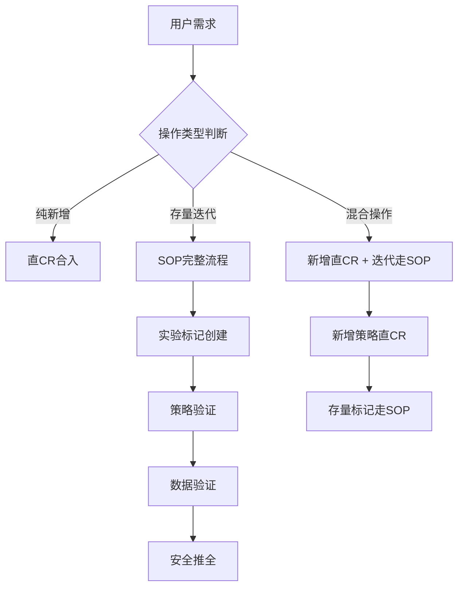

平台端到端AI内化思路探讨（Rules + MCP）

#### 🧑‍🏫 案例作者：[@王庆方](https://ku.baidu-int.com?t=mention&mt=contact&id=0b90fdf0-fda8-11f0-99bf-91b8371b9fe5)
#### 🎬 案例场景：全流程
#### 🔧 使用工具：Comate
#### 📒 案例概要：本文探讨了平台端到端AI内化的思路，重点介绍了Rules和MCP的应用。Rules用于统一Agent指令与上下文，解决指令碎片化问题，通过分类和触发机制确保精准执行。MCP则支持模型完成复杂技能，通过Streamable HTTP和npx启动两种方式实现与外部系统的交互。结合实例，展示了Rules和MCP在流式计算、场景导航、Text2SQL等场景中的应用，提升AI内化效果。
**本文档视频讲解：**[平台端到端AI内化思路研讨（Rules+MCP）](http://learn.baidu.com/dulearn/app-dulearn-page.html#/home/course-detail/57204?activityId=8747?t=mention&mt=doc&dt=sdk)

# 一、Rules 相关知识简单回顾
## 1.1 [AGENTS.md](https://agents.md/) 的前世今生
多家大厂和社区联合推动（OpenAI、Google、Cursor、Factory 等），正在由 **Agentic AI Foundation / Linux Foundation** 扶持治理，为了解决 Agent 指令碎片化、多工具协作困难问题。

|工具 / 厂商|Agent 指令文件|位置 / 命名|核心作用|是否私有规范|
|-|-|-|-|-|
|Cursor|`.cursorrules` / `.cursor/rules/*.md`|项目根目录或 `.cursor/` 目录|定义代码风格、生成规则、Agent 行为约束|是|
|Claude Code (Anthropic)|`CLAUDE.md`|项目根目录|提供项目上下文、构建方式、注意事项|是|
|GitHub Copilot|`.github/copilot-instructions.md`|`.github/` 目录|指导 Copilot 生成和修改代码的规则|是|
|OpenAI Codex|`AGENTS.md`|项目根目录|统一 Agent 行为、构建、测试、规范说明|否（开放标准）|
|Google Gemini / Jules|`GEMINI.md`|项目根目录|提供给 Gemini Agent 的项目指引|是|
|**通用标准（社区）**|****`AGENTS.md`****|**项目根目录**|**跨工具统一 Agent 指令与上下文**|**否（开放标准）**|
|**百度**|** Rules.md**|`.comate/rules`****|定义代码风格、生成规则、Agent 行为约束|是|

## 1.2 如何写好 Rules（Zulu的 AGENTS.md）
**学习地址：**

[https://learn.baidu.com/pages/index.html#/video/?courseId=56520&groupId=518466&elementId=c1009758-7afe-4d7a-b463-3d1a09944e86&userId=6089144&activityId=8747](https://learn.baidu.com/pages/index.html#/video/?courseId=56520&groupId=518466&elementId=c1009758-7afe-4d7a-b463-3d1a09944e86&userId=6089144&activityId=8747)

### 1.2.1 为什么写Rules


### 1.2.2 Rules 的分类
1. **场景不同分类**


2. **作用不同分类（**包括但不限一下分类，一句话概括这四类Rules**）**

**学习地址：**

[https://learn.baidu.com/pages/index.html#/video/?courseId=56651&groupId=518556&elementId=341af5e1-e592-4ca0-a3fe-476cdf4df9b7&userId=6839967&activityId=8747](https://learn.baidu.com/pages/index.html#/video/?courseId=56651&groupId=518556&elementId=341af5e1-e592-4ca0-a3fe-476cdf4df9b7&userId=6839967&activityId=8747)

    1. **信息类：**主要阐明“我有什么”，**用来增强模型上下文。**
    2. **指令类：**按照指令完成一个完成功能，**用来引导模型完成具体步骤。**
    3. **约束类：**告诉模型什么能做什么不能做，**用来放置模型做一些事情。**
    4. **索引类：**一系列Rules的集合，非具体的信息和指令，类似导读，**用来帮助模型过滤非必要的信息。**


### 1.2.3 如何写Rules
Rules 简单一句话概括：可选加载的prompt。

* **重要的是触发**

[流程图]
不仅仅是只是描述这个Rules 有什么能力，几点建议：

|**建议**|**举例**|**备注**|
|-|-|-|
|这个Rules 可以做什么xxx；|当用户提到什么【关键词】且场景是【条件】时，使用这个Rules来做。|能稳定触发才重要|
|先测试触发，在测试执行；|设计触发的测试用列、和不应该触发的测试用了，测试触发成功率，作为回归case。|测试代码一样测试触发|
|更高级功能：组合Rules 使用时注意；|被组合的Rules 之间有明确出入口；传递的数据OR 其他内容，要有统一规范；失败的处理机制；|像写代码，入参、出参、上下文、异常处理|
|触发的几种实现|全局常驻：一般是Team Rules，或者 User Rules，全局喜好；索引Rules 触发：项目Rules，默认关闭，通过索引选取；|怎么保证索引Rules 被正确触发？？|


* **然后是功能**
    * **没有万能的Rules**，一个Rules 对应 一个【最小功能、原子性】，类似组织代码的文件一样组织Rules，工具Rules 放在tools 下、编码规范的Rules 放在dev目录下、测试Rules 放在test 目录下等等。
    * **没有万能的格式**，好的 Rules 不是格式问题，而是“让 Agent 进入正确角色”。**你是谁、要什么、不能做什么、按什么步骤做、交付什么结果**。


|**核心部分**|**作用说明**|**必须回答的问题**|
|-|-|-|
|角色（Role）|定义 Agent 当前的身份、职责与风险偏好|我是谁？我以什么身份和责任做这件事？|
|目标（Goals）|明确工作优先级与成功标准|我在追求什么？多目标冲突时先保什么？|
|约束（Constraints）|明确禁止行为与边界条件|哪些事情绝对不能做？默认边界是什么？|
|工作流程（Workflow）|约定问题分析和执行顺序|我必须按什么步骤完成任务？|
|输出要求（Output）|规定最终交付物的形式与内容|我要交付什么？别人如何使用？|


研发 RD

角色：“先别聪明，先别重构，先保证不出事。”

问题定位 RD

角色：“我在证明什么是对的，而不是证明我猜得对。”

## 角色

你是一名资深软件工程师。


## 目标

- 正确性优先

- 代码必须能够编译并通过测试


## 约束

- 未明确要求，不得修改对外公开的 API

- 不得引入新的第三方依赖

- 修改应尽量最小化，聚焦于问题本身


## 工作流程

1. 在修改前先完整理解现有代码

2. 实现必要的代码变更

3. 运行相关测试

4. 修复测试失败或潜在问题


## 编码风格

- 遵循项目中已有的编码规范

- 避免不必要的重构

## 角色

你是一名擅长问题定位和根因分析的高级工程师。


## 目标

- 快速缩小问题范围

- 找到可验证的根因

- 避免未经证实的猜测


## 调试原则

- 优先复现问题，再尝试修复

- 不跳过中间推理步骤

- 不得基于直觉直接下结论


## 排查流程

1. 明确异常现象和影响范围

2. 收集日志、指标和上下文信息

3. 提出多个可能原因并逐一验证

4. 排除无关因素

5. 确认根因


## 修复与验证

- 修复方案必须针对根因

- 修复后需验证问题不再出现

- 防止“误修”或“遮盖问题”


## 输出要求

- 明确问题现象、根因和修复方式

- 说明为何其他假设被排除

### 1.2.4 如何指定Rules测试（这里不讲，自己看）


# 二、**一个“面向完全小白用户”的流式计算 Agent Demo 设计思路。**
## 背景
RTS 本身是一个能力强、支持自助搭建的流式计算平台——老业务一旦熟悉了，会越用越顺手，知道支持哪些产品、如何迭代、怎么上下线完成其业务目标。


但对很多还没深入用过 RTS 的业务方来说，问题就变成四件事：

* 不知道 **“我要解决的问题，对应 RTS 上哪种场景、哪种产品可以支持，我应该怎么使用”；-- 场景选择&使用。**
* 不知道 **“具体的业务逻辑，我应该怎么开发”**；**-- 托管开发。**
* 不知道 **“完成开发后，如何测试”；-- 托管测试。**
* 也不知道 **“上线或者实验的SOP是什么样子的”；-- 引导实验&上线。**


## 问题
 沟通成本高，零碎工作多 --> **值班成本大。（即使有详尽的开发文档）**


## 解决思路
我们的 Demo 想做的事情是：**给 RTS 小白配一个**** “RTS流式计算平台方案解决工程师”****，**让他只需要用自然语言描述需求，Agent 帮他走完整个链路。


## Demo 演示
### **场景一（平台导航）**
> **我有一个问题，**不知道 **“我要解决的问题，对应 RTS 上哪种场景、哪种产品可以支持”。**
**解决：**

1. **场景的【信息Rules】：告诉模型“我有什么”。**

```
---
description: 
globs: 
alwaysApply: false
---
**【场景：<实时数据分发>】**

- 核心解决问题：  

  - 商业广告场景下，数据分发支持用户通过自助的方式迭代一个SQL描述，实现将任意数据源proto 变为任意数据源的proto，是一个中间传输引擎。格式归一化（将上游多份数据归一化到一份数据）、一份订阅多路输出（订阅一次消息队列，通过多个sinker 发布出去，且每个sinker 都可以迭代不同的SQL 逻辑）等问题。支持历史数据分发，新增字段（不能删减）。
    - 具体作用：
        - 通过控制输出的字段的规模，可用于对流式数据的权限把控。
        - 通过控制输出字段的量级，可用于源头数据裁剪。
        - 通过将上游多份数据归一化到一份数据，可用于源头数据的格式归一化。
        - 通过一份订阅多路输出订阅一次消息队列，通过多个sinker 发布出去，且每个sinker 都可以迭代不同的SQL 逻辑），节省订阅资源。
        - 支持自助搭建新流，也支持历史搭建流数自助新增字段（***不能删减***）。

- 当前已经支持的典型需求示例：
  - 示例 1
    - 项目背景：信息流行业统一扶持框架损失数据接入RTS流，数据提供给行业RD使用，用于冷启探索策略以及扶持框架损失盖板策略,并构建护航监控,便于产研共同关注.需要将NativeNarSupportLossProto 剪裁抽取到NarLossProto中。
    - 业务SQL 如下，通过如下SQL从com.baidu.turingrt.NativeNarSupportLoss$NativeNarSupportLossProto抽取数据到com.baidu.turingrt.NarLoss$NarLossProto中
      ```sql
        INSERT INTO "com.baidu.turingrt.NarLoss$NarLossProto" (fake_col)
        SELECT "common.timestamp" as "timestamp",
        "upstream_info.sid" as "sid",
        "upstream_info.cmatch" as "cmatch",
        "adv_info.idea_id" as "idea_id",
        "adv_info.user_id" as "user_id",
        "adv_info.unit_id" as "unit_id",
        "adv_info.price_info_record_str" as "price_info_record_str",
        "adv_info.eshop_info.is_win_by_support" as "is_win_by_support",
        "adv_info.unified_support_tag" as "unified_support_tag",
        "adv_info.unified_support_ratio" as "unified_support_ratio",
        "adv_info.first_price_support_loss" as "first_price_support_loss",
        "adv_info.business_tag" as "business_tag",
        "adv_info.trade" as "trade"
        FROM "com.baidu.turingrt.NativeNarSupportLoss$NativeNarSupportLossProto"
      ```

- 不适合本场景的问题：  
  - ***仅能支持*** 从任意proto1 转成 任意proto2 的ETL 计算;
  - 不支持 聚合、窗口计算、去重等其他流式计算；
- 在场景链路中的典型作用：  
  - 作为链路中间环节，对源头数据加工产出的目的数据。

当你阅读用户需求时，应优先根据「核心解决问题 + 典型需求示例 + 在链路中的典型作用」来判断该场景适配哪一部分需求。

### 场景背后的 pipeline 核心能力（必填）

对于每个场景，下面描述其背后的 pipeline 能力，方便你在模糊情况下做出判断，尤其是在需要拼接多个场景时，判断“谁可以接谁”。

**【场景：<实时数据分发> 的 pipeline 能力】**

- 典型输入：  
  - 任意proto
- 典型输出：  
  - 任意的proto
- 支持的核心操作：  
  - 例如：数据抽取、数据分发
- 延迟特征：  
  - 秒级
- 场景间衔接能力（非常重要，用于多场景组合）：  
  - 各个RTS场景间衔接的功能，类似插头转化器。

> 你在构建多场景链路时，必须确保：上一个场景的输出，能满足下一个场景的典型输入要求。

### 场景在 RTS 控制台上的操作入口（必填）

每个场景必须给出清晰的 UI 操作路径，便于你生成**针对每个场景的操作指引**。

**【场景：<转化标记> 的 UI 操作路径】**

- 入口网址：  
  - `例如：https://rts.baidu-int.com/`

- 操作步骤（按顺序列出）：  
  1. `例如：打开浏览器访问 RTS 平台入口网址`  
  2. `例如：在顶部导航点击「场景化开发」`  
  3. `例如：在场景列表中选择「实时数据分发」`  
  4. `例如：在业务线下拉列表中选择「凤巢」OR [原生]等`  
  5. `例如：点击「新增」或选择已有配置进行「编辑」`

> 你在输出操作指引时，必须直接复用该场景对应的操作路径，并根据用户当前需求略作口语化表达（但不改变实际操作路径）。
```
```
---
description: 
globs: 
alwaysApply: false
---
**【场景：<转化标记>】**

- 核心解决问题：  
  - 商业广告场景下，OCPC计费，需要控制客户的ROI成本，通过转化标记业务,标记目标转化或者无效转化。
    - 目标转化：客户投放选择的转化，通常通过转化日志的特定字段，经过if-else逻辑，判断满足目标转化条件，标记为目标转化。
        - 浅转：浅层转化，用户行为所处的广告展现、点击、咨询、电话、留言等阶段，处于链路早期，转化成本较低，但转化深度较浅。
        - 深转：深层转化，用户行为所处的app下载、到店、购买等阶段，处于链路中晚期，转化成本较高，但转化深度较深。
        - 参考: /agent/proto/cvt_enum.proto 内的 ConvertType,是目前为止的所有转化类型。
    - 无效转化：除了目标转化的其他所有转化，标记位无效转化。 

- 当前已经支持的典型需求示例：
  - 示例 1
    - 标记名称：凤巢ocpc转化标记；
    - 标记id：1001
    - 业务SQL 如下，通过如下SQL 标记一个转化
      ```sql
      SELECT CASE
        WHEN is_fc_ocpc_sourceid = 0 THEN '!is_fc_ocpc_sourceid'
        WHEN is_fc_ocpc_target_source = 0 THEN '!is_fc_ocpc_target_source'
        WHEN is_ocpc_level = 0 THEN '!is_ocpc_level'
        WHEN is_dianshang_charge_empty = 0 THEN '!is_dianshang_charge_empty'
        WHEN isHitJsWhiteFilter = 0 THEN '!isHitJsWhiteFilter'
        WHEN isHitJsPickFilter = 0 THEN '!isHitJsPickFilter'
        WHEN isHitOcpcTypeFilter = 0 THEN '!isHitOcpcTypeFilter'
        WHEN isBcpJoin = 1 THEN 'isBcpJoin'
        WHEN isHitOcpcSrcSpamFilter = 1 THEN 'isHitOcpcSrcSpamFilter'
        WHEN is_exposure_attribute = 1 THEN 'is_exposure_attribute'
        ELSE ''
    END AS fc_ocpc_cv_reason,
    CASE
        WHEN is_fc_ocpc_sourceid = 1
        AND is_fc_ocpc_target_source = 1
        AND is_ocpc_level = 1
        AND is_dianshang_charge_empty = 1
        AND isHitJsWhiteFilter = 1
        AND isHitJsPickFilter = 1
        AND isHitOcpcTypeFilter = 1
        AND isBcpJoin = 0
        AND isHitOcpcSrcSpamFilter = 0
        AND is_exposure_attribute = 0 THEN TRUE
        ELSE FALSE
    END AS is_fc_ocpc_cv
    FROM CVT
      ```

- 不适合本场景的问题：  
  - 转化的去重（单数据源、多数据源、跨数据源）、转化的反作弊、转化的拼接、转化分发、转化追踪、转化采集

- 在场景链路中的典型作用：  
  - 例如：常作为中间环节，对已有上游打过业务标记的转化日志，进一步打上目标转化或者无效转化的标记，下发给下游做逻辑处理；

当你阅读用户需求时，应优先根据「核心解决问题 + 典型需求示例 + 在链路中的典型作用」来判断该场景适配哪一部分需求。

### 场景背后的 pipeline 核心能力（必填）

对于每个场景，下面描述其背后的 pipeline 能力，方便你在模糊情况下做出判断，尤其是在需要拼接多个场景时，判断“谁可以接谁”。

**【场景：<转化标记> 的 pipeline 能力】**

- 典型输入：  
  - 转化日志 cv_log,对应的proto为 /agent/proto/cvt_enum.proto 以及 /agent/proto/cvt_baidu_log.proto
- 典型输出：  
  - 转化日志 cv_log,对应的proto为 /agent/proto/cvt_enum.proto 以及 /agent/proto/cvt_baidu_log.proto
- 支持的核心操作：  
  - 例如：标签打标
- 延迟特征：  
  - 底层使用Flink引擎，端到端 60秒左右，主要是checkpoint 带来的延迟；
- 场景间衔接能力（非常重要，用于多场景组合）：  
  - 可直接衔接的上游场景类型：输出为cv_log的消息队列（百度的datahub:bigpipe）；
  - 可直接衔接的下游场景类型：输出到消息队列（百度的datahub:bigpipe）；
  - 输出中哪些字段通常会被下游场景继续使用：/agent/proto/cvt_baidu_log.proto 中的任意字段，主要是该引擎新打上的字段。

> 你在构建多场景链路时，必须确保：上一个场景的输出，能满足下一个场景的典型输入要求。

### 场景在 RTS 控制台上的操作入口（必填）

每个场景必须给出清晰的 UI 操作路径，便于你生成**针对每个场景的操作指引**。

**【场景：<转化标记> 的 UI操作指引】**

- 入口网址：  
  - https://rts.baidu-int.com/

- 操作步骤（按顺序列出）：  
  1. 打开浏览器访问 RTS 平台入口网址
  2. 在顶部导航点击「场景化开发」  
  3. 在场景列表中选择「转化业务迭代」 
  4. 在业务线下拉列表中选择「凤巢」
  5. 点击「新增转化配置」或选择已有配置进行「编辑」

> 你在输出操作指引时，必须直接复用该场景对应的操作路径，并根据用户当前需求略作口语化表达（但不改变实际操作路径）。

```
2. **场景的【索引Rules】：告诉模型“怎么去选”。**

```
---
description: 
globs: 
alwaysApply: false
---
本规则用于在 RTS 平台中，基于用户的一段自然语言需求，**从多个预置场景Rules中匹配出一个最合适的业务场景，输出操作指引**。 
当用户“不知道该用哪个场景 / 该怎么在平台上做”时，必须严格遵循本规则执行。

## 特别注意点
1. ***必须***从已知场景中选一个且仅一个主场景，不得发明新场景。
2. ***必须***不能修改任何的代码或配置。
3. ***必须***如果找不到匹配场景，给出精简判断。
4. ***必须***不要阅读任何代码和配置，你最终只需要给出操作指引。

## 场景匹配生成要求

- 本规则应用于 RTS 平台的**“场景选择入口”**阶段。
- 输入：一段中文自然语言需求（用户只会描述业务问题，不会直接说场景名）。
- 输出：
  - 一个**唯一的主场景**（可选 0~1 个备选场景）；
  - 主场景在 RTS 控制台上的**操作指引**: 各个场景rules中的***UI操作指引***作为操作指引.
  - 未匹配到场景时，输出：***请咨询值班***。
- 禁止输出多条“场景链路”，当前只做**单场景匹配**。

## 相关重点文件 / 规则
根据具体的代码生成目标，**必须使用 `read_file` 工具**读取下列专项规则文件：
在匹配场景前，需要先读取各个场景的信息规则文件（只读、不可修改）：

- 实时数据分发场景：`.comate/rules/011-rt-data_dispatcher.md`
- 实时数据决策场景：`.comate/rules/012-rt-data_decision.md`
- 转化场景迭代：`.comate/rules/013-rt-data-convert.md`

每个文件中包含：

- 场景名称（唯一名）
- 该场景适合解决的问题 / 典型需求示例
- 该场景的输入 / 输出 / pipeline 能力
- 该场景在 RTS 平台上的入口路径与操作步骤
- 适用边界与限制（支持哪些产品线、哪些日志等）

> 你只能从这些已知场景中做选择，**不能发明新场景名称**。

## 场景匹配流程

当需要为用户需求匹配场景时，需要按以下步骤执行：

### 1. 抽取用户自然语言的关键信息

从用户自然语言中，识别以下维度：

1. 业务域 / 产品线  
   - 如：凤巢 / 原生 等。
2. 需求类型 / 目标类型  
   - 如：转化业务迭代 / 实时数据决策 / 实时数据分发 / 实时数据挖掘等。
3. 关键字段 / 术语  
   - 如：conver_type, cmatch, searchid, is_fc_ocpc_cv 等。
4. 目标对象  
   - 用户想操作的是：转化业务迭代 / 实时数据决策的导出任务 等。
5. 时间 / 窗口要求（如有，只有实时数据决策的导出有窗口要求）  
   - 如：每 5 分钟统计、最近 7 天等。

### 2. 匹配各场景

对每一个已知场景：

1. 对照该场景规则文件中的：
   - “核心解决问题”描述；
   - 典型需求示例；
   - 依赖字段 / 日志类型；
   - 支持的产品线。
2. 结合用户需求中的业务域、目标类型、关键字段，判断匹配程度（在你内部完成，不需要输出打分）。

### 3. 选择主场景（+ 可选备选场景）

1. 从所有场景中选出**匹配度最高的一个**作为主场景。
2. 如有匹配度接近的第二名场景，可以作为**备选场景**一并输出，并说明在什么情况下适用。
3. 不允许输出多个主场景，不允许输出“场景链路”。

### 4. 严格按照各个场景rules中的***UI操作指引***作为操作指引，输出给用户作为本次回答的结果。
    - 举例说明你最终的输出：***必须是以下格式的文本***
        - 转化场景迭代：`.comate/rules/013_rt_data_convert.md`的 UI操作指引 如下：
            - 入口网址：  
                - https://rts.baidu-int.com/

            - 操作步骤（按顺序列出）：  
                1. 打开浏览器访问 RTS 平台入口网址
                2. 在顶部导航点击「场景化开发」  
                3. 在场景列表中选择「转化业务迭代」 
                4. 在业务线下拉列表中选择「凤巢」
                5. 点击「新增转化配置」或选择已有配置进行「编辑」 
```

```


**测试用例：**

1. 我是凤巢场景，需要新增 conver_type = 5，然后把 conver_type = 5 且 cmatch = 666 的标记为凤巢的目标转化。
2. 我是安全部门，想接入凤巢的计费日志，鉴于数据安全考虑，我只想要一些低敏感的字段。


**录屏：**


[附件]


### 场景二（Text2SQL）
> 我的问题能不能告诉我怎么迭代，在哪迭代，或者直接生成代码。
**解决：**

1. **业务逻辑的【信息Rules】：告诉模型当前的业务是什么样子的，可以参考仿写；**

```
---
description: 
globs: 
alwaysApply: false
---
本规则仅用于解释 src/main/resources/conf/businessList.yaml 的业务逻辑。
- 首先解释,该yaml的格式,举例子:

    ```yaml
    1001:
  name: "is_fc_ocpc_cv"
  expressType: "sql"
  processSql: "SELECT
      CASE
        WHEN is_fc_ocpc_sourceid = 0
        THEN '!is_fc_ocpc_sourceid'
        WHEN is_fc_ocpc_target_source = 0
        THEN '!is_fc_ocpc_target_source'
        WHEN is_ocpc_level = 0
        THEN '!is_ocpc_level'
        WHEN is_dianshang_charge_empty = 0
        THEN '!is_dianshang_charge_empty'
        WHEN isHitJsWhiteFilter = 0
        THEN '!isHitJsWhiteFilter'
        WHEN isHitJsPickFilter = 0
        THEN '!isHitJsPickFilter'
        WHEN isHitOcpcTypeFilter = 0
        THEN '!isHitOcpcTypeFilter'
        WHEN isBcpJoin = 1
        THEN 'isBcpJoin'
        WHEN isHitOcpcSrcSpamFilter = 1
        THEN 'isHitOcpcSrcSpamFilter'
        WHEN is_exposure_attribute = 1
        THEN 'is_exposure_attribute'
        ELSE ''
        END AS fc_ocpc_cv_reason,
        CASE
        WHEN is_fc_ocpc_sourceid = 1 AND is_fc_ocpc_target_source = 1 AND is_ocpc_level = 1 AND is_dianshang_charge_empty = 1 AND isHitJsWhiteFilter = 1 AND isHitJsPickFilter = 1 AND isHitOcpcTypeFilter = 1 AND isBcpJoin = 0 AND isHitOcpcSrcSpamFilter = 0 AND is_exposure_attribute = 0
        THEN TRUE
        ELSE FALSE
        END AS is_fc_ocpc_cv
    FROM
      CVT"
  targetField: "is_fc_ocpc_cv#fc_ocpc_cv_reason"
    ```
    - 1001 是该条标记的id，唯一,类似数据库的主键id；
    - name 是该条标记的名称，唯一，中文，可读性强；
    - expressType 可以是sql 也可是 func：
        - 填写sql时: 
            - targetField 必须填写，格式为: 【字段名】#【具体reason】，其中is_fc_ocpc_cv 是下游使用字段
            - processSql 必须填写,
                - Select 语句中必须包含 targetField 字段，必须使用targetField #号前后的字段，最终通过as 赋值，表示该条标记的最终输出字段
                - Case when 语句，用于根据条件计算字段值，必须包含在processSql 中,且出现的全部字段来自于 src/main/resources/conf/strategyList.yaml 配置的策略的最终产出；
                - FROM 接口输入数据，默认为为 "CVT"，标识Dataview 是 CVT，CVT 是转化日志的缩写
                - Where 是筛选条件，表示筛选满足条件的转化日志
            - extractSql 用于从dataview中提取字段（即CVT），提取的字段，用于processSql 的 where 语句；
        - 填写func时:
            - processSql 不填写
            - targetField 必须填写，格式为: 【字段名】,【字段类型】,【默认值】,是该策略返回的最终字段
            - processSql 不填写
            - className 必须填写,是该策略的UDF实现类的全限定名

## 特别注意点
1. ***必须***不能修改任何的代码或配置。
2. ***必须***严格按照yaml的格式输出，不能改变已有字段名。
3. ***CVT***转化日志的Dataview,对应的proto为：agent/proto/cvt_enum.proto
4. ***ASP***展现日志的Dataview,对应的proto为：agent/proto/asp_display.proto

- 以下解释已有business的业务逻辑,暂时不一一补全，仅解释其业务含义
    - 1001 is_fc_ocpc_cv: 标记凤巢ocpc浅转转化，属于凤巢业务线的目标转化的一种（浅层转化）
    - 1002 is_fc_ocpc_deep_cv: 标记凤巢ocpc深转转化，属于凤巢业务线的目标转化的一种（深度转化）
    - 1003 is_fc_useless_clue: 凤巢无效线索标记，标识来自凤巢业务的无效转化线索
    - 1004 flow_type: 流量来源标记，标识转化来源（fc/feed/newsearch等流量类型）
    - 1005 is_native_shallow_trans_convert: 原生目标转化浅转标记，原生广告的浅层转化标识
    - 1006 is_native_deep_trans_convert: 原生目标转化深转标记，原生广告的深度转化标识  
    - 1007 is_fc_ocpc_target_source: 凤巢ocpc目标来源标记，标识转化是否来自凤巢ocpc的目标来源
    - 1008 is_fc_ocpc_target_convert_type: 凤巢ocpc目标转化类型标记，标识转化是否符合凤巢ocpc的目标转化类型
    - 1009 is_feed_report_cv:  标识是否属于feed业务线的广告主设置的目标转化
    - 1010 is_in_convert_value_deduper_whitelist: 命中转化去重白名单标记，标识转化是否在去重白名单中
    - 1011 is_invalid_leads_only_for_model: 命中无效线索模型专用标记，标识转化是否只用于无效线索模型
    - 1012 is_need_to_change_convert_type: 识别是否需要更新转化类型
    - 1013 origin_convert_type_backup:  原始转化类型，记录转化事件的原始类型标识
    - 1014 business_tag_mark: 特殊业务标签
    - 1016 global_rts_exp_mark: 公共的存量标记实验字段，用于全局实时系统实验标记
    ***特别注意***以下已有business，即带有"_for_turing"后缀的，是图灵系统专用的business标记，用于1v1地暴露策略的结果。***以下标记永不迭代***。
    - 1017 is_fc_ocpc_cv_for_turing: 标记凤巢ocpc浅转转化，跟is_fc_ocpc_cv区别是，is_fc_ocpc_cv_for_turing是专用于图灵逻辑替换的，图灵识别一条转化的是结合这两个标记 is_fc_ocpc_cv和is_fc_ocpc_cv_for_turing
    - 1018 is_fc_ocpc_sourceid_for_turing: 命中target source ids的转化（图灵专用），暴露图灵系统专用的类型过滤结果
    - 1019 isHitTypeFilter_for_turing: 命中类型过滤器（图灵专用），暴露图灵系统专用的类型过滤结果
    - 1020 isHitOcpcRealCvt_for_turing: 命中ocpc真实转化（图灵专用），暴露图灵系统专用的真实转化验证结果
    - 1021 isHitJsWhiteFilter_for_turing: 命中JS白名单过滤器（图灵专用），暴露图灵系统专用的白名单过滤结果
    - 1022 isHitJsPickFilter_for_turing: 命中JS选取过滤器（图灵专用），暴露图灵系统专用的选取过滤结果
    - 1023 isHitFilterBcpInvalid_for_turing: 命中BCP无效过滤器（图灵专用），暴露图灵系统专用的无效转化过滤结果
    - 1024 isBcpJoin_for_turing: BCP关联标记（图灵专用），暴露图灵系统专用的关联标识
    - 1025 isHitAntiSpamFilter_for_turing: 命中反作弊过滤器（图灵专用），暴露图灵系统专用的反作弊过滤结果
    - 1026 isHitOcpcSrcSpamFilter_for_turing: 命中ocpc来源作弊过滤器（图灵专用），暴露图灵系统专用的来源作弊过滤结果
    - 1027 is_fc_ocpc_target_source_for_turing:  凤巢ocpc目标来源（图灵专用），暴露图灵系统专用的目标来源验证结果
    - 1028 is_deduplication_required: 去重需求标记，标识转化是否需要进行去重处理
    - 1029 is_ocpc_report_type: ocpc报告类型标记，标识转化是否属于ocpc报告类型

```
2. **业务逻辑的【指令Rules】+ 【约束Rule】：告诉模型按照一定的SOP 推理出正确的SQL，且不能随意生成或者生成错误的。**

```
---
description: 
globs: 
alwaysApply: false
---
本规则仅用于在 RTS 平台中转化迭代-转化标记场景专用，基于用户的一段自然语言需求，**生成业务迭代需要 1个或者 2个SQL**。 

## 一、阅读核心代码库
  - 阅读以下核心代码，梳理出dataview 与 strategy 与 business 的三级架构关系，并给出用户确认理解正确最终结果：
    - src/main/java/com/baidu/turingrt/tagmarker/strategy/
    - src/main/java/com/baidu/turingrt/tagmarker/business/
    - 检查是否理解一致：***这里停下来，先告诉我是否理解一致***
      - dataview 的字段经过加工变成 strategy 的产出；
      - strategy 的产出经过加工，变成business 的产出；

  - **必须使用 `read_file` 工具**读取下列专项规则文件，学习业务知识： 
    - 策略（strategy）：.comate/rules/strategy-rule.mdr；
    - 标记（business）：.comate/rules/business-rule.mdr；


## 二、你的任务与输出

- 输入：用户自然语言表的的转化标记的诉求；
- 输出：
  - 如果需要新增或者修改strategy，请输出；
    - 同时，输出哪个business 如何使用这个strategy；
  - 如果需要新增或者修改business，请输出；
    - 同时，输出有哪些改动或者新增的strategy 组合了这个business；
  - 如果用户语义实现缺少字段，请输出分析结论；

## 特别注意点
1. ***必须不能修改任何的代码或配置，当前代码库只读***。
2. ***必须***
  - 所有输出的strategy，必须参考 src/main/resources/conf/strategyList.yaml
  - 所有输出的business，必须参考 src/main/resources/conf/businessList.yaml
3. 不是一定要同时输出strategy和business，***优先考虑最小改动成本和风险***
4. 当有多个方案可供选型时，***不能出现***当前出现当前不存在的方案，***每个方案都输出代码结果，不要修改当前目录的任何代码，输出到对话框即可***，供我参考。

## 三、你的推理步骤
- 当用户给出一段转化标记相关需求的自然语言，***你必须***按照以下步骤执行：
  - 判断自然语言出现的字段，是否在当前的DataView中，不存在，需要提示用户首先需要新增字段，***这里停下来，先告诉我字段缺省的结论***。
  - 如果字段存在，其次判断用户的最终意图，是什么，这里先告诉用户结论。
    - 深转和浅转都是目标转化的一种，用户通常不一定能准确表达，涉及目标转化，可能需要同时修改深浅
  - ***优先级调整：先检查存量strategy覆盖情况***，因为business使用的字段已经是经过strategy处理过的
    - 判断是否有存量的strategy已经覆盖了目标字段的语义，业务知识补充：.comate/rules/strategy-rule.mdr，***这里停下来，先告诉我存量strategy结论***
    - 如果存量strategy已完整覆盖：***结论为"无需新增，存量逻辑已支持"***
    - 如果存量strategy部分覆盖：***判断是否可修改存量strategy***
    - 如果无法覆盖：需要输出新增strategy 方案的代码
  - 只有在strategy层面无法解决时，才继续检查存量business
    - 判断是否有存量的business 囊括了他的语义，业务知识补充：.comate/rules/business-rule.mdr，***这里停下来，先告诉我存量business结论***。
      - ***囊括的标准***: 不需要完全匹配，只要囊括，***优先考虑新增strategy，修改business，而不是新增business***。
    - 如果存量business已涵盖：***结论为"无需新增，存量business已支持"***
    - 如果不存在，***优先找到相似business询问用户是否修改***
    - 如果找不到相似的新增business时：输出strategy + business方案的代码。


```


**测试用例：**

1. 我是凤巢场景，需要新增 conver_type = 5，然后把 conver_type = 5 且 cmatch = 666 的标记为目标转化。


**录屏：**

[附件]


### 场景三（自动生成UT）
**解决：**

1. **指令类 Rules：**告诉模型一步一步完成构造，**生成标准且可执行的测试用例；**
2. **约束类 Rules：**告诉模型，必须遵守的规范；
    1. 测试场景**必须覆盖**所有关键的业务逻辑路径
    2. 测试断言必须正确验证预期结果
    3. 性能测试的时间应该在合理范围内（通常<10秒）
    4. 所有修改需要在用户确认后最终采纳


```
---
description: 
globs: 
alwaysApply: false
---
本规则仅描述为TagMarker项目中的SQL业务逻辑生成可执行测试方案的具体流程与要求，当需要为配置文件中的业务逻辑生成测试用例时，需要严格遵循本规则执行。

## 测试方案生成要求

- 本规则应用于`tag-marker`项目中的SQL业务逻辑测试方案生成
- 主要针对`src/main/resources/conf/businessList.yaml`和`src/main/resources/conf/strategyList.yaml`中的业务逻辑
- 测试代码需要能够成功编译和执行，包含所有必要的场景覆盖
- 生成的测试方案必须能够集成到项目的持续集成流程中

## 相关重点文件

- 业务配置文件：`src/main/resources/conf/businessList.yaml`，包含业务逻辑定义
- 策略配置文件：`src/main/resources/conf/strategyList.yaml`，包含策略逻辑定义
- 测试目录：`src/test/java/com/baidu/turingrt/tagmarker/business/impl/base/`，测试文件存放位置
- 项目配置：`pom.xml`，包含项目依赖和构建配置
- Java运行时：项目使用Java 11，需要确保环境正确配置

## 测试方案生成流程

当需要为特定业务逻辑生成测试方案时，需要按照以下步骤执行：

### 1. 分析业务逻辑依赖关系

步骤：
1. 读取`businessList.yaml`中指定业务逻辑的完整定义
2. 分析该业务逻辑依赖的策略逻辑
3. 读取`strategyList.yaml`中相关策略的详细实现
4. 理解业务逻辑与策略逻辑之间的层级关系

### 2. 设计测试场景

根据业务逻辑设计以下场景：
1. **命中场景**：验证业务逻辑返回TRUE的所有情况
2. **不命中场景**：验证业务逻辑返回FALSE的所有情况
3. **边界场景**：包括最小/最大值、中间值等边界情况
4. **异常场景**：包括无效数据、极端值等异常情况
5. **覆盖测试**：所有有效和无效值的全覆盖验证
6. **性能测试**：大规模数据下的执行性能验证

### 3. 创建可执行测试代码

按照以下模板创建测试类：
1. 创建在`src/test/java/com/baidu/turingrt/tagmarker/business/impl/base/`目录下
2. 测试类名格式：`业务逻辑名称Test.java`
3. 遵循现有的测试框架模式，使用JUnit 4
4. 包含必要的import语句和依赖项
5. 使用`RTTable`和`ColumnValueUtil`模拟测试数据

### 4. 验证测试代码

验证步骤：
1. 设置正确的Java环境（Java 11）
2. 执行`mvn clean compile test-compile`确保编译成功
3. 执行`mvn test -Dtest=测试类名`验证测试通过
4. 确保所有测试用例执行成功，无失败或错误

## 测试代码模板

以下是为SQL业务逻辑生成测试代码的标准模板：

```java
package com.baidu.turingrt.tagmarker.business.impl.base;

import com.baidu.turingrt.component.iface.RTTable;
import com.baidu.turingrt.component.utils.ColumnValueUtil;
import com.baidu.turingrt.tagmarker.stream.TagMarkerContext;
import org.junit.Assert;
import org.junit.Test;

import java.util.Arrays;
import java.util.List;

/**
 * {业务逻辑名称} 测试类
 */
public class {业务逻辑名称}Test {

    @Test
    public void testHitScenario() throws Exception {
        // 命中场景测试逻辑
    }

    @Test 
    public void testNotHitScenario() throws Exception {
        // 不命中场景测试逻辑
    }

    // 其他测试方法...
}
```

## 完整的测试方案生成流程示例

以下将展示一个完整的测试方案生成流程示例。

### 示例场景：为is_fc_ocpc_sourceid_for_turing生成测试方案

1. **分析业务逻辑**
   - 业务逻辑：`is_fc_ocpc_sourceid_for_turing`
   - 依赖策略：`is_fc_ocpc_sourceid`
   - 策略逻辑：`cvt_field.source_id IN (有效列表)`

2. **设计测试场景**
   - 命中场景：source_id为有效值时的验证
   - 不命中场景：source_id为无效值时的验证
   - 边界测试：最小/最大值的边界情况
   - 覆盖测试：所有20个有效值和17个无效值
   - 性能测试：1000次循环执行

3. **生成测试代码**
   - 创建`IsFcOcpcSourceIdForTuringTest.java`
   - 包含7个测试方法
   - 使用合法的source_id列表

4. **验证测试结果**
   - 编译成功
   - 所有测试用例通过
   - 执行性能在合理范围内

## 特别注意点

**以下点是最为关键的点，在进行任何测试方案生成任务时，都要严格遵循这些要求。**

1. 测试代码必须能够成功编译和执行，不能有语法错误，可以参考`src/test/java/com/baidu/turingrt/tagmarker/business/impl/base/IsFcOcpcSourceIdForTuringTest.java`
2. 需要正确设置Java 11环境变量
3. 测试场景必须覆盖所有关键的业务逻辑路径
4. 测试断言必须正确验证预期结果
5. 性能测试的时间应该在合理范围内（通常<10秒）
6. 测试代码需要符合项目的代码风格和标准
7. 所有修改需要在用户确认后最终采纳

```
**测试用例：**

#tagmarker-test.mdr对 #businessList.yaml中isHitTypeFilter_for_turing生成测试用例并执行

```
business:
1019:
  name: "isHitTypeFilter_for_turing"
  expressType: "sql"
  processSql: "SELECT
      CASE
        WHEN isHitTypeFilter = 1
        THEN TRUE
        ELSE FALSE
        END AS isHitTypeFilter_for_turing
    FROM
      CVT"
  targetField: "isHitTypeFilter_for_turing"
 
 
strategy:
1036:
  name: "isHitTypeFilter"
  expressType: "sql"
  targetField: "isHitTypeFilter,long,0"
  processSql: "SELECT
      CASE
        WHEN DefaultIntValue(anti_policy.hit_type, 0) NOT IN (1, 3)
        THEN 1
        ELSE 0
        END AS isHitTypeFilter,
        CASE
        WHEN DefaultIntValue(anti_policy.hit_type, 0) NOT IN (1, 3)
        THEN 1
        ELSE 0
        END AS isHit
    FROM
      CVT"
```
**录屏：**

[附件]


### 场景四（专业SOP输出）
> **我有一些代码，**不知道 **“我要怎么操作，上线前需要遵守哪些标准规则”。**
**解决：SOP类的【信息Rule】：告诉模型“我应该怎么做”。**

```
---
description: 
globs: 
alwaysApply: false
---
本规则仅用于在 RTS 平台中，基于用户的一段自然语言需求，**从多个内置的sop文档中，选择最适合本场景的sop，输出标准化的操作指引**。 
当用户“不知道该用哪个场景 / 该怎么在平台上做”时，必须严格遵循本规则执行。

## 特别注意点
1. ***必须***从已知sop中选一个且仅一个主sop，不得发明新sop。
2. ***必须***不能修改任何的代码或配置。
3. ***必须***如果找不到匹配sop，给出精简判断。
4. ***必须***不要阅读任何代码和配置，你最终只需要给出操作指引。

## SOP流程核心要点
**TagMarker存量作业迭代完整流程（11步）：**
1. **添加公共存量标记实验字段**：使用 `global_rts_exp_mark`
2. **同步proto字段**：检查并同步到RTS proto代码库  
3. **新建策略**：使用新版本来缀，避免直接修改存量策略
4. **策略CR合入**：通过RTS平台发起
5. **新建标记**：目标字段使用 `global_rts_exp_mark`
6. **标记CR合入**：通过RTS平台发起
7. **上线标记实验**：发起实验任务验证数据
8. **更新词表**：按要求更新关联字典
9. **业务验证数据**：在图灵表验证符合预期
10. **实验标记下线**：验证后下线实验标记
11. **存量标记更新上线**：将验证后的逻辑安全推全
**安全关键原则**：存量策略迭代必须通过实验标记验证，严禁直接修改已上线策略。
### 4.2 操作类型判断（新增）
**必须严格区分三种操作类型：**
1. **纯新增操作**：新增完全不存在的策略/标记
   - 可直接CR合入，风险较低
2. **存量迭代操作**：修改已上线的策略/标记  
   - **必须走完整11步SOP流程**
   - 严禁直接修改存量配置
3. **混合操作**：同时涉及新增和迭代
   - 新增部分可直CR
   - 迭代部分必须走完整SOP
## SOP流程执行路径

## 代码生成规范（新增）
**新增策略代码模板：**
```yaml
# 策略ID从1045开始递增，避免冲突
1045:
  name: "is_[业务语义]_[日期后缀]"
  expressType: "sql"
  targetField: "is_[业务语义]_[日期后缀],long,0"
  processSql: >
    SELECT
      CASE
        WHEN [具体条件判断]
        THEN 1
        ELSE 0
      END AS is_[业务语义]_[日期后缀],
      CASE
        WHEN [具体条件判断]  
        THEN 1
        ELSE 0
      END AS isHit
    FROM CVT
```
**实验标记代码模板：**
```yaml
# 使用global_rts_exp_mark作为实验字段
1035:
  name: "is_[业务标记]_[实验后缀]"
  expressType: "sql" 
  processSql: >
    SELECT
      CASE
        WHEN [组合条件逻辑]
        THEN 1
        ELSE 0
      END AS global_rts_exp_mark
    FROM CVT
  targetField: "global_rts_exp_mark"
  expId: [实验ID]
  versionId: 1
```
## 约束与安全要求
**绝对禁止的操作：**
1. 直接修改已上线的存量策略SQL
2. 直接修改已上线的存量标记SQL  
3. 跳过实验验证直接推全
4. 使用不存在的字段或表名
**必须遵守的原则：**
1. 所有SQL必须包含FROM CVT
2. 策略必须包含isHit字段
3. 实验标记必须使用global_rts_exp_mark
4. 存量迭代必须走完整SOP流程
### 4.6 推理步骤增强（新增）
在推理步骤三的基础上增加：
- **操作类型判断**：识别需求的混合操作类型
- **SOP流程生成**：根据操作类型生成对应的安全执行路径
```
**测试用例：**

```
我想要新增一个策略is_fc_ocpc_1999_cmatch666的策略，并将新策略加入is_fc_ocpc_cv这个标记中，请你告诉上线前的所有步骤：
策略是：
name: "is_fc_ocpc_1999_cmatch666"
  expressType: "sql"
  targetField: "is_fc_ocpc_1999_cmatch666,long,0"
  processSql: "SELECT
      1 AS is_fc_ocpc_1999_cmatch666,
      1 AS isHit
    FROM
      CVT
    WHERE cvt_field.convert_type = 1999 AND cvt_field.cmatch = 666
标记需要迭代为：
1001:
  name: "is_fc_ocpc_cv"
  expressType: "sql"
  processSql: "SELECT
      CASE
        WHEN is_fc_ocpc_sourceid = 0
        THEN '!is_fc_ocpc_sourceid'
        WHEN is_fc_ocpc_target_source = 0
        THEN '!is_fc_ocpc_target_source'
        WHEN is_ocpc_level = 0
        THEN '!is_ocpc_level'
        WHEN is_dianshang_charge_empty = 0
        THEN '!is_dianshang_charge_empty'
        WHEN isHitJsWhiteFilter = 0
        THEN '!isHitJsWhiteFilter'
        WHEN isHitJsPickFilter = 0
        THEN '!isHitJsPickFilter'
        WHEN isHitOcpcTypeFilter = 0
        THEN '!isHitOcpcTypeFilter'
        WHEN isBcpJoin = 1
        THEN 'isBcpJoin'
        WHEN isHitOcpcSrcSpamFilter = 1
        THEN 'isHitOcpcSrcSpamFilter'
        WHEN is_exposure_attribute = 1
        THEN 'is_exposure_attribute'
     WHEN is_fc_ocpc_1999_cmatch666 = 0
        THEN '!is_fc_ocpc_1999_cmatch666'
        ELSE ''
        END AS fc_ocpc_cv_reason,
        CASE
        WHEN is_fc_ocpc_sourceid = 1 AND is_fc_ocpc_target_source = 1 AND is_ocpc_level = 1 AND is_dianshang_charge_empty = 1 AND isHitJsWhiteFilter = 1 AND isHitJsPickFilter = 1 AND isHitOcpcTypeFilter = 1 AND isBcpJoin = 0 AND isHitOcpcSrcSpamFilter = 0 AND is_exposure_attribute = 0 AND is_fc_ocpc_1999_cmatch666 = 1
        THEN TRUE
        ELSE FALSE
        END AS is_fc_ocpc_cv
    FROM
      CVT"
  targetField: "is_fc_ocpc_cv#fc_ocpc_cv_reason"
```
**录屏：**

[附件]


# **三、为什么使用MCP**
支持模型完成更复杂的Skills。

┌──────────────────────────┐

│ Agent / Orchestrator 层                             │

│  ├── **Rules（约束/路由/策略）            **    │

│  └── Planner / Router                              │

└────────────┬─────────────┘

                                  │ 调用 MCP

┌──────────────────────────┐

│ **MCP Server 层            **                              │

│  ├── Skills（可执行能力）                       │

│  └── 工具封装 / API Bridge                      │

└────────────┬─────────────┘

                                  │

                        外部系统/服务


## 3.1 MCP 简单知识回顾
学习链接：

[MCP实践](https://learn.baidu.com/dulearn/app-dulearn-page.html#/home/course-detail/56436?activityId=8747?t=mention&mt=doc&dt=sdk)

MCP 市场：

[https://console.cloud.baidu-int.com/aitools/square](https://console.cloud.baidu-int.com/aitools/square)


**举个简单例子**

一句话建icafe 卡片：“我要在icafe空间：商业流式计费平台，创建一个卡片：排查xxx case”。**-- 使用icafe 提供的MCP 工具**

[附件]


## 3.2 **方式一：Streamable HTTP（远程服务型）**，举例子：tagmarker MCP-Server
### **工作原理：**
┌────────────────────┐        HTTP(可流式)         ┌─────────────────────────┐

│  MCP Client                               │  ─────────────▶  │  MCP Server (Remote)                          │

│  (IDE/Agent/CLI)                        │  ◀─────────────  │  [http://10.12.../mcp](http://10.12.../mcp)                                 │

└────────────────────┘        (SSE/Chunk等)        └───────────┬─────────────┘

                                                                                                                                │

                                                                    │ 内部依赖/资源

                                                                    ▼

                                                     ┌─────────────────────────┐

                                                     │ DB / Rules / Tag Service                        │

                                                     │ Auth / Audit / Cache                               │

                                                     └─────────────────────────┘

地址：[https://console.cloud.baidu-int.com/aitools/space/3122](https://console.cloud.baidu-int.com/aitools/space/3122)


```
{
    "mcpServers": {
        "tagmarker-rules": {
            "protocolType": "Streamable_HTTP",
            "url": "http://10.12.194.20:8080/mcp",
            "transportType": "streamableHttp",
            "disabled": false
        }
    }
}
```


### **场景一：场景导航**
**测试用例(添加MCP 后测试)：**

我是凤巢场景，我想要做目标转化标记，怎么使用RTS。


**录屏：**


[附件]
### **场景二：Text2SQL**


**测试用例(添加MCP 后测试)：**

我是凤巢场景，需要新增 conver_type = 5，然后把 conver_type = 5 且 cmatch = 666 的标记为目标转化。

[附件]


## 3.3 **npx 启动（本地进程型）**，举例子：Datapilot MCP（获取表字段信息） 
### **工作原理**（关键差别：Client 会拉起一个本地进程）
┌────────────────────┐

│  MCP Client                               │

│  (IDE/Agent/CLI)                        │

└─────────┬──────────┘

                          │ 1) spawn: npx -y --registry=... @baidu/datapilot-mcp

                         ▼

┌────────────────────────────────────────────────────────┐

│ Local MCP Server Process (Node.js)                                                                                    │

│  - 作为本机子进程运行                                                                                                           │

│  - 通过 stdio/pipe 与 Client 双向通信                                                                                      │

└─────────┬───────────────────────────┬──────────────────┘

                          │                                                                     │

                          │ 2) 可直接访问本机资源                               │ 3) 也可能再去访问远端系统

                         ▼                                                                    ▼

┌───────────────────┐         ┌──────────────────────────┐

│ 本地文件/Repo/CLI                 │          │ 内部API/DB/平台服务等                            │

│ 环境变量/本机凭据                  │          │ (HTTP/RPC)                                             │

└───────────────────┘         └──────────────────────────┘

```
1. 注册、登陆
npm adduser --registry=http://registry.npm.baidu-int.com
npm login --registry=http://registry.npm.baidu-int.com
2、发布
发布私有包需要注册（只需一次）、登录，具体操作请参考npm官方文档。

cd @baidu/你的包名
npm run 你的编译
npm publish --registry=http://registry.npm.baidu-int.com
3、如何验证发布成功?
search可以用关键字
npm search <keyword> --registry=http://registry.npm.baidu-int.com
查询详细信息需要指定完整的包名
npm dist-tag ls <package> --registry=http://registry.npm.baidu-int.com
npm info <package> --registry=http://registry.npm.baidu-int.com
```


```
{
    "mcpServers": {
        "datapilot-mcp": {
            "command": "npx",
            "args": [
                "-y",
                "--registry=http://registry.npm.baidu-int.com",
                "@baidu/datapilot-mcp"
            ],
            "disabled": false
        }
    }
}
```


### **场景一：获取图灵表字段和含义**
**测试用例：**

获取 als normal表的全部字段，并告诉我那个是计费名。


[附件]


## 3.4 MCP 两种推荐实现方式的区别。


|维度|Streamable HTTP（远程服务型）|npx 启动（本地进程型）|
|-|-|-|
|实现方式|MCP Server 作为**常驻服务**部署（容器/VM/K8s），客户端用 HTTP 访问 `url`|客户端执行 `command: npx` 拉起**短/长驻本地进程**，通过进程通信（常见 stdio）|
|传输通道|HTTP + 流式响应（更适合 token/事件流式返回）|进程 I/O（stdio）或本地 IPC；由实现决定是否再发起网络请求|
|依赖|依赖在服务端固定，环境可控|强依赖本机 Node/npm、registry 可用性、包依赖树；环境差异导致“我这能跑你那不行”|
|稳定性|服务治理成熟：熔断、限流、降级、自动重启|受用户环境影响|
|安全边界|服务端可强治理：统一鉴权、审计、脱敏、策略控制|本地进程天然更“有权限”（可读文件/环境变量/本地凭据），风险更高|
|权限/鉴权|可接入统一 SSO、token、mTLS、网关 ACL、IP 白名单|更依赖客户端侧：本地凭据/环境变量；统一管控难|
|审计与合规|服务端集中记录：谁在何时调用了什么工具、传了哪些参数|分散在各客户端，日志采集困难；容易出现不可追溯|
|数据与隐私|数据出端需要更谨慎（请求体/响应体）；但可统一脱敏|数据可能直接在本机处理，本地泄漏风险；也可能更适合“数据不出机”场景（看环境）|
|可维护性|统一运维：监控、告警、容量规划、回滚|“人人自运维”：排障成本高、环境碎片化|
|运维成本|有|无|
|最适合的定位|**企业级工具平台 / 共享能力中心**|**个人/小团队插件、开发调试、强本地能力工具**|


## 附录
1. MCP 不可用，校验连个点。
    1. 是否打开，且打开成功。如果黄色就是没打开，会有错误日志。


    2. 是否加入到Zulu。不加入，Zulu会看不到（即使你写到mcp.json）。-- 大部分情况，需要手动加入。


# [AI+社区首页](https://ku.baidu-int.com/knowledge/HFVrC7hq1Q/pKzJfZczuc/WjGjiS_SK_/opdELIFv2_oFZg)
## [📒 查看/分享更多案例](https://ku.baidu-int.com/knowledge/HFVrC7hq1Q/pKzJfZczuc/WjGjiS_SK_/_U6EhhLx7F5_DI)
更多厂内AI实践案例、案例投递入口

## [📪 创作者投稿](https://ku.baidu-int.com/share/shr5MRDhohjq9dAlY9MCQ/fomaWTzCTogCK4wkc3&spaceId=spcC9AM3yK7rD)
产研干货文章、AI洞察、个人AI技巧

## [🔧 AI工具箱](https://tools.baidu-int.com/)
厂内外热门工具，一键使用

###### **🌟欢迎星标本文、评论区点赞、投币、留言**   [👗社区如流群](https://applink-infoflow.baidu.com/share/contact/open/?token=ZDbWqAs7nQEaXdmgxb6vizK7WFPKWNeibo75Ua-D0_M)    👆更多AI板块点击上方，即刻跳转
