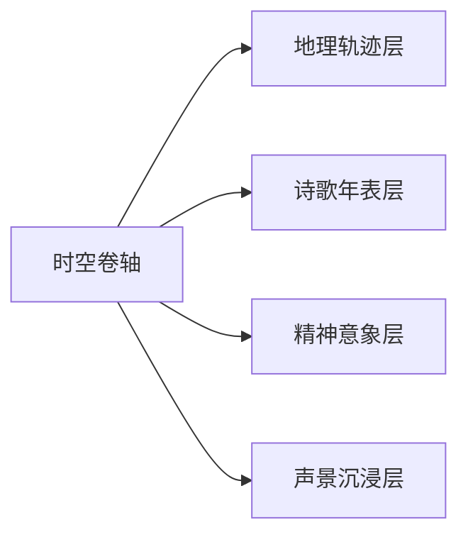

秒哒-如何做一个可落地投产的应用

#### 🧑‍🏫 案例作者：[@彭谷琪](https://ku.baidu-int.com?t=mention&mt=contact&id=422c2e80-f2cb-11f0-80f0-91056ee5134c)
#### 🎬 案例分类：全流程、需求、设计、开发、测试
#### 🔧 使用工具：秒哒
#### 📒 案例概要：本文通过具体的实践案例，从需求、修改、测试阶段，分享如何通过vibe coding做出一个真实可落地投产的应用。
刻意学习：多看多学多分析

* 多看：多看日常中遇到的每一个网页、APP、H5
* 多分析：多分析他们的功能设计、交互设计、UI 风格（面向什么用户、什么风格）
* 多学：多学习他们的审美、用户体验设计

## 如何做出“完整”的应用（功能）
**清晰明确的需求**

**从小模块逐个修改**

**活用深度思考**

给出明确具体的需求

减少给模型过度理解的空间

错误示例：“我要支付”；正确示例：“在哪调用支付”

小步快跑胜于一步到位

不要期待一个Prompt解决所有问题

要有耐心，多轮指导它完成

不确定？不知道怎么改的时候

请活用提问式，直到你找到最优解

让模型深度思考给你答案

### 清晰明确的需求
> 给到秒哒明确清晰的需求，描述你想要什么、面向谁、目标目的是什么，功能是什么、页面结构怎么设计等。
> 不建议套提示词模板，把需求/任务说透才是王道
|**需求情况**|**输入提示词示例（以奶茶微信小程序为例）**|
|-|-|
|你有清楚的需求|制作一个奶茶店点单微信小程序，这是一个连锁门店，用户可以选择门店进行下单并到店领取，用户选择商品加入到购物车，购物车可以编辑商品数量，同时支持选择支付结算，点击结算时调用微信支付，支付成功后进入订单详情页，页面上展示订单基本信息与取单号。同时有我的页面，用户可以查看我的订单和编辑个人信息。|
|你已有完整的设计想法|制作一个奶茶店点单微信小程序，这是一个连锁门店，用户可以选择门店进行下单并到店领取，用户选择商品加入到购物车，购物车可以编辑商品数量，同时支持选择支付结算，点击结算时调用微信支付，支付成功后进入订单详情页，页面上展示订单基本信息与取单号。同时有我的页面，用户可以查看我的订单和编辑个人信息。页面节后如下：

graph LR

%%节点A为应用默认进入页面

A[首页]-->|底部Tab切换 | B[点单]

A-->|底部Tab切换| C[我的]

B-->|点击商品| D[商品详情页]

D->|加入购物车| E[购物车页]

E-->|去结算| F[订单结算页]

F-->|提交订单| G[订单列表页]

C-->|点击头像| H[个人信息编辑]

C-->|点击订单| G

C-->|点击优惠卷| I[优惠卷]

G-->|点击订单| J[订单详情页]

J-->|返回| G

G-->|返回| C

I-->|返回| C

H-->|保存| C

F-->|返回| E

E-->|返回| B

D-->|返回| B

B-->|返回| A

C-->|返回| A

style A fill: #2563eb,stroke: #le40af,stroke-width: 3px, color: #fff|
|你没有明确的需求|使用秒哒【深度分析能力】对需求进行修改 |


#### 01明确的页面交互流程
建议使用mermaid流程图（大模型更容易理解的流程图设计语言）给到大模型，指明产品操作流程设计逻辑
页面结构辅助设计应用：[https://www.miaoda.cn/apps/app-88aoef83yhhd](https://www.miaoda.cn/apps/app-88aoef83yhhd)


设计页面结构，生成mermaid代码

给到mermaid代码的首轮生成效果

案例：[https://www.miaoda.cn/apps/app-88dsl3ljtq0x](https://www.miaoda.cn/apps/app-88dsl3ljtq0x)


给到mermaid代码完成页面层级设计

案例：[https://www.miaoda.cn/apps/app-7dctgfk77c3l](https://www.miaoda.cn/apps/app-7dctgfk77c3l)


#### 02多轮修改/修复
|反例|正例|
|-|-|
|微信支持完全用不了|点击支付时没有反应，这不符合预期，正确逻辑：点击支付后调起微信支付的支付页面，支付成功后返回订单页面并显示取餐号|
|移动端界面不美观，请进行优化|在不改变web端的情况下，整体优化移动端排版，确保每个模块在移动端的视觉完美展现，交互的流畅易用。务必确保不改变web端|

* 注：说明修复的LUI不能只说宽泛的概念或情绪，要**说明现状问题+预期**

### 小步快跑逐个修改
> 小步快跑胜于一步到位：不要期待一个Prompt解决所有问题。通过多轮对话，逐步引导秒哒为你完善应用
#### 01分版本实现
为提供应用生成的稳定性和准确率，可将你“大宏观”的产品设计分为多个版本实现，如先实现MVP版本，在依次叠加功能进行迭代新增。**不要一次性追求大而全**

如：我想做一个动态漫生成器，那这涉及到的基本流程为

用户输入需求-->生成分镜脚本->分镜编辑确认->分镜生成漫画->漫画转视频

|版本规划|功能|提示词示例|应用|
|-|-|-|-|
|1.0|1.分镜脚本生成2.漫画生成（含风格选择）||案例：https://www.miaoda.cn/apps/app-7tiadaok9jpd|
|2.0|1.视频生成|||
|后续版本|1.人物一致性2.配音生成3.音乐生成4.视频合成|||

#### 02逐个优化/拆解需求修改
可将你的“大需求”拆解成多个“小需求”逐项执行实现，不要追求一次性完成，一次提的需求越多会影响生成的稳定性。

如：我想为AI画廊增加点赞功能，1是增加社交、2是增加作品热度进行参考。那就需要的基础功能为：

1.账号体系，将作品与用户绑定、将生成记录与用户绑定

2.作品状态要分为公开和私密

3.广场上的作品要显示作者，也就是用户名

4.点赞的位置：那为了可以快捷点赞，就需要给作品hover态增加点赞按钮，同时详情页也可以点赞

5.点赞的能力：点赞+取消点赞，每个作品每个人仅可以点赞一次

案例：https:/[www.miaoda.cn/apps/app-7pgn4zrff7r5](http://www.miaoda.cn/apps/app-7pgn4zrff7r5)


|图示|操作|
|-|-|
||增加作者名显示|
||增加hover显示（点赞的第一个入口）|
||发现点赞功能没有加上，给到修复指示：点赞的数据是虚假数据，请改为真实的交互和真实数据|
||验证后发现入口缺失，补充其他点赞入口|


### 提问式生成-交给大模型
> 对功能逻辑不确定？对页面结构设计没有思路，请向大模型进行求助，让它给你解决方案进行选择
|图示|操作|
|-|-|
||灵感一闪，做了一个“鸭子探险”的小游戏，但想继续增加游戏玩法，却没头绪|
||“需求文档原文”以上是我的游戏设计，现在想丰富游戏升级体系，请帮我想怎么设计请将优化分为多个小版本执行|
||将小版本的需求直接扔给秒哒|

# 什么是“好”UI
你可能听过这样的感慨  “这个UI真不错”

你也可能发出过这样的感慨  “这应用挺好看”、 “这个好难用啊”

这都来自大家的主观感受，所有的感受都来源于 “应用的视觉设计”和“应用的交互设计”，可以统称为UI。

在现阶段互联网极度内卷的时代，**只是单纯的“能用”、“好用”已经无法满足用户的胃口**，大家在此基础上**更追求“好看”、“交互有创新”，甚至会单纯因为“好看”而用一个应用。**

那什么是好 UI，可以简单从 3 个点进行定义

##### 易操作
不用想就能上手

将用户的理解成本降为 0

##### 好审美
通用审美：色系、排版、有温度

用户审美：符合目标用户的审美

##### 能落地
了解技术边界、用户场景

不做“概念”设计

接下来就开始我们的“美”之旅（重点从好审美展开）

# 什么是“好看”的应用
> “简洁、舒服、愉悦”
##### 视觉一致性
1. 色系：颜色不超过 3 种主色，颜色之间相对融合不跳跃
2. 风格：风格全部一致，如均采用“可爱风”，不可进行风格混搭
3. 元素：元素设计规格都一致，如都圆角，不可圆角、直角混搭

##### 排版有逻辑
1. 留白：模块之间有间隔、有留白，给出视觉空间，不拥挤
2. 层级：标题、正文等层级分明，模块排版有规律，快速get重点
3. 多端适配：手机端、ipad、电脑等多端的适配、尺寸与排版合理

##### 有温度懂用户
1. 细节：注意细节设计照顾用户情绪，如报错/加载页面的处理
2. 惯性：交互逻辑符合用户认知、符合用户习惯，如返回的设计

反向案例


# 怎么用 Vide Coding 做出“好看”的应用
## 简易版（提示词）
### 01 全新应用
#### STEP 01 撰写原始提示词
提示词需包含以下基础内容：

1. 需求（什么应用、大概为了实现什么、基础功能描述）
2. 应用类型（网站、小程序、H5、小工具、小游戏）
3. 应用结构设想（几个页面、每个页面的基本要求）
4. 应用能力（需要集成哪些能力：登录、地图定位、微信支付等等）
5. 设计需求（呈现什么风格、什么色系、什么感觉）

##### 提示词参考
```
帮我生成一个北京特产购物微信小程序​的应用，有线下门店，可以在小程序上进行下单，下单时可以选择门店自提或者邮寄，完成微信支付后下单成功。
- 门店自提：需集成地图定位​展示门店具体位置，下单成功后需显示取货码，商家可在后台进行取货管理
- 邮寄：下单时需选择邮寄地址，除新疆、西藏、海南地区满128元包邮，下单成功后显示邮寄状态，商家可在后台上传快递单号
小程序菜单分为首页、商品、购物车、我的，页面说明如下：
- 首页：展示店铺介绍、福利活动等
- 商品：展示商品列表，可以按照分类查看、支持搜索，点击商品查看商品详情（照片、规格、介绍、价格）与进行加购
- 购物车：展示已加购的商品、并可以微信支付​下单结算
- 我的：包含基础信息、积分权益、我的订单等
```
#### STEP 02 提示词美观度部分专项优化
##### 提示词优化工具
建议选用以下大模型完成提示词优化，按需选用

百灵大模型

[https://ling.tbox.cn/](https://ling.tbox.cn/)

Deepseek

[https://chat.deepseek.com/](https://chat.deepseek.com/)

豆包

[https://www.doubao.com/](https://www.doubao.com/)

##### 优化咒语参考
```
“原始提示词”这个需求帮我再进行拓展升级，重点关注视觉上的呈现、排版结构与交互设计。
你可以模仿：“请创建一个为独立音乐人打造的个人品牌展示型网站，包含音乐作品试听、现场演出日程、乐迷互动留言板、专辑购买入口、社交媒体链接等核心模块。页面风格需突出个性与艺术气质，可选择复古磁带风、街头涂鸦风，或带有暗黑浪漫气息的夜店光感风格，整体设计应有粗颗粒纹理背景、霓虹标题、低饱和色调搭配高对比度组件。网站支持嵌入 Spotify / Apple Music 播放器，音乐页面提供分专辑/单曲浏览，演出页面需展示时间、地点、购票链接。建议使用卡片式布局与横向滑动组件增强浏览体验，整体兼顾移动端与桌面端适配，注意交互设计排版的美观，每栏的子板面居中，并列放置。”
```
##### **优化示例：北京特产购物微信小程序**
**输入提示词**

**输出结果（优化后提示词）**

“帮我生成一个北京特产购物微信小程序​的应用，有线下门店，可以在小程序上进行下单，下单时可以选择门店自提或者邮寄，完成微信支付后下单成功。

- 门店自提：需集成地图定位​展示门店具体位置，下单成功后需显示取货码，商家可在后台进行取货管理

- 邮寄：下单时需选择邮寄地址，除新疆、西藏、海南地区满128元包邮，下单成功后显示邮寄状态，商家可在后台上传快递单号

小程序菜单分为首页、商品、购物车、我的，页面说明如下：

- 首页：展示店铺介绍、福利活动等

- 商品：展示商品列表，可以按照分类查看、支持搜索，点击商品查看商品详情（照片、规格、介绍、价格）与进行加购

- 购物车：展示已加购的商品、并可以微信支付​下单结算

- 我的：包含基础信息、积分权益、我的订单等”这个需求帮我再进行拓展升级，重点关注视觉上的呈现、排版结构与交互设计。

你可以模仿：“请创建一个为独立音乐人打造的个人品牌展示型网站，包含音乐作品试听、现场演出日程、乐迷互动留言板、专辑购买入口、社交媒体链接等核心模块。页面风格需突出个性与艺术气质，可选择复古磁带风、街头涂鸦风，或带有暗黑浪漫气息的夜店光感风格，整体设计应有粗颗粒纹理背景、霓虹标题、低饱和色调搭配高对比度组件。网站支持嵌入 Spotify / Apple Music 播放器，音乐页面提供分专辑/单曲浏览，演出页面需展示时间、地点、购票链接。建议使用卡片式布局与横向滑动组件增强浏览体验，整体兼顾移动端与桌面端适配，注意交互设计排版的美观，每栏的子板面居中，并列放置。”

```
### **「京韵 · 食光」北京特产小程序 - 视觉升级方案**
**一、 核心设计理念**

*   **主题风格：新京式美学 & 数字胡同**
    *   **色彩体系：**
        *   **主色调：** 故宫**朱墙红**、**琉璃黄**。用于重要按钮、图标、价格，传递皇家底蕴与喜庆。
        *   **辅助色：** **青石灰**、**墨色**。用于背景、文字，营造沉稳与历史感。
        *   **点缀色：** **景泰蓝**。用于标签、优惠信息，增添精致与活力。
    *   **视觉元素：**
        *   **背景纹理：** 带有细微质感的**宣纸底纹**或**老城墙砖墙纹理**，提升整体质感。
        *   **图形图标：** 图标设计融合**故宫窗棂**、**云纹**、**中国结**等传统纹样，进行现代化简笔处理。
        *   **字体：** 标题可使用有设计感的书法字体（如汉仪尚巍手书），正文使用清晰的无衬线字体（如 PingFang SC），确保可读性。
**二、 页面视觉设计与功能拓展**
我们将采用**卡片式布局**与**横向滑动组件**作为核心交互骨架，增强浏览的趣味性与节奏感。
#### **1. 首页 - 「皇城根下」**

*   **视觉焦点：** 顶部通栏轮播图采用**宫门开启**的动效，缓缓展示最新的福利活动。
*   **核心模块：**
    *   **店铺寄语：** 以一卷徐徐展开的**圣旨**或**古籍书卷**的卡片形式，呈现店铺介绍，文字竖排，配以一枚“京韵”的红色印章。
    *   **活动专区：** 采用**横向滑动**的“琉璃瓦”卡片。每张卡片是一个活动，如“新客尝鲜礼”、“时令糕点限时购”。
    *   **精选分类：** 图标设计为**冰糖葫芦**（果脯）、**兔儿爷**（工艺品）、**铜锅**（美食）等北京特色符号，纵向排列，点击后带动感。
    *   **人气推荐：** 商品以**高低错落的宫灯**卡片形式展示，卡片阴影营造悬浮感，突出商品图片。
#### **2. 商品页 - 「京品大集」**
*   **顶部布局：**
    *   **搜索框：** 设计成**老式牌匾**的样式，内部有“搜索京味好物”的灰色 placeholder 文字。
    *   **分类导航：** 采用**横向滑动**的标签，选中状态为朱红色底，并有“红绸带”滑动动效。
*   **商品列表：**
    *   **瀑布流/双列卡片：** 商品卡片背景为微泛黄的**宣纸质感**，边框采用**简约窗棂**样式。
    *   **商品信息：** 商品名使用深灰色，价格使用醒目的**琉璃黄**，“包邮”标签使用**景泰蓝**色小气泡。
    *   **交互反馈：** 点击商品图片，有轻微的“放大落下”动效，模拟拿起一件物品的感觉。
#### **3. 商品详情页 - 「宝物细赏」**

*   **视觉呈现：**
    *   **图片轮播：** 轮播指示器设计成**中式折扇**的扇骨样式。
    *   **商品标题：** 衬于一块半透明的**墨色镇纸**背景上。
    *   **规格选择：** 规格按钮设计成**印章**样式，选中时如盖章般变为红色并带有“已选”字样。
    *   **商品介绍：** 内容区域采用**信笺**式的分隔线，图文并茂。
*   **底部操作栏：**
    *   融合了**故宫红墙**的色块，将“加入购物车”与“立即购买”按钮左右并列，视觉上非常稳固且醒目。
#### **4. 购物车页 - 「御前清单」**

*   **顶部提示：** 清晰展示包邮政策：“御赐恩典：除新疆、西藏、海南，满128元享京畿直送（包邮）”。
*   **商品列表：**
    *   每个商品项是一个独立的卡片。左侧商品图片带有**中国结**式的勾选框。
    *   数量加减按钮设计成**中式盘扣**的样式，极具特色。
*   **结算栏：**
    *   总计金额突出显示。结算按钮在金额足够时显示为**朱红色**并提示“御前结算”，不足时则为**青灰色**并显示“还差XX元享包邮”。
#### **5. 我的页面 - 「我的京韵」**
*   **个人头图：** 背景使用**抽象的水墨北京天际线**（央视大楼、中国尊与天坛祈年殿结合）。
*   **功能入口：** 采用**九宫格**或**横向滑动**的“玉玺”图标，代表“我的订单”、“积分权益”、“收货地址”、“客服”等。
*   **我的订单：**
    *   订单状态标签（待付款、待自提等）设计成**京剧脸谱**色块，如待付款用红色，待自提用蓝色。
*   **积分权益：**
    *   积分展示像一个**传统算盘**，用户滑动时可以模拟算珠滚动的动效。积分兑换商品以**卷轴**列表形式呈现。
#### **6. 门店自提与地图 - 「亲临宝地」**
*   **地图页面：** 不是简单的原生地图，而是定制了**手绘风格的北京地图**，重点标注出我们的门店位置，图标设计为**小小的宫门**。
*   **门店列表：** 点击宫门，弹出卡片，展示门店详情。卡片设计如**老北京门牌**，包含地址、营业时间、联系电话。
*   **路线规划：** 底部提供“一键导航”按钮，按钮样式为**一个指向远方的箭头路标**。
**三、 交互与动效细节**
*   **全局加载：** 加载动画是一个**旋转的兔儿爷**或**抖动的糖人**。
*   **下拉刷新：** 下拉时，顶部会出现一个**踩着单车送货的北京大爷**动画。
*   **加入购物车：** 商品图片会缩略成一个小图，沿着一条抛物线轨迹飞入底部的购物车图标。
*   **支付成功：** 支付成功后，页面会有**金色礼花**绽放的动效，并伴随一句“得嘞，您稍候！”的京味儿提示音（可选）。
**四、 技术实现建议**
*   **前端框架：** 使用微信小程序原生框架或 Taro、uni-app 等多端框架。
*   **地图服务：** 集成百度地图，实现门店定位与导航。
*   **支付：** 完美对接微信支付。
*   **后台管理：** 需要配套的后台管理系统，用于上下架商品、管理订单、处理物流信息、发布活动等。
通过以上从理念到细节的全面视觉升级，您的北京特产小程序将不再是一个冰冷的工具，而是一个充满文化温度、视觉惊喜和购物乐趣的线上“京味儿博物馆”，能极大地提升用户粘性和品牌价值。
```
#### STEP 03 提示词输入给秒哒
给秒哒什么：原始提示词（保核心功能）+优化后提示词（补充视觉升级）

```
“原始提示词” “优化后提示词”
```


### 02 老应用（已多轮修改）
#### STEP 01 应用现状整理
```
按照过往修改记录输出一份最新的产品需求文档
```


##### **优化示例：校园论坛 BBS 应用**
**输入咒语**

**秒哒输出**


```
产品名称：校园论坛BBS网站
产品目标：提供一个校园内部的交流平台，供学生、教师等校园用户发布和交流信息。
功能需求：
1.用户管理：
- 用户注册与登录（普通用户与管理员使用相同登录入口，登录后根据权限进行不同操作）。
- 管理员账号管理（超级管理员可以创建和管理其他管理员账号）。
2.帖子管理：
- 帖子发布与展示，优化后的帖子展现结构包括：帖子标题（居左）、板块标签（居右）、帖子详细内容（默认展示2行，超行展示为省略号）、发帖者信息（头像、昵称、匿名/实名标签、发布时间，居左）、点赞数与评论数（居右）。
- 帖子排序与筛选功能，可以按照最新发布、热门帖子、最多回复进行筛选，同时提供搜索功能。
- 管理员可以在帖子详情页进行加精、置顶、取消加精、取消置顶等操作。
3.板块管理：
- 超级管理员可以在管理后台进行板块管理，包括新增板块、修改板块名称、设定版主。
- 对于特定板块（如社团活动），用户发帖时需要进一步选择所属分类（如社团）。
4.管理后台：
- 提供管理后台界面，供超级管理员进行用户账号管理、帖子管理、板块管理等高级操作。
5.响应式设计：
- 优化移动端和web端的展示效果，调整字体大小等，确保在不同设备上都能良好显示。
修改记录：
- 优化了帖子的展现结构。
- 降低了页面头部区域的高度，减少了页面占幅。
- 增加了帖子排序和筛选功能，以及搜索功能。
- 修改了超级管理员账号密码，并解决了登录失败的问题。
- 管理员可以直接在帖子详情页内进行加精、置顶等操作。
- 发帖时选择社团活动板块需进一步选择所属社团。
- 超级管理员可在管理后台配置板块信息。
```
#### STEP 02 视觉风格升级提示词优化
##### 提示词优化工具
建议选用以下大模型完成提示词优化，按需选用

百灵大模型

[https://ling.tbox.cn/](https://ling.tbox.cn/)

Deepseek

[https://chat.deepseek.com/](https://chat.deepseek.com/)

豆包

[https://www.doubao.com/](https://www.doubao.com/)

##### 优化咒语参考
```
“秒哒输出的应用现状提示词”这个需求帮我再进行拓展升级，重点关注视觉上的呈现，在保留所有功能的基础上，提升视觉风格、排版结构、交互设计。
你可以模仿：“请创建一个为独立音乐人打造的个人品牌展示型网站，包含音乐作品试听、现场演出日程、乐迷互动留言板、专辑购买入口、社交媒体链接等核心模块。页面风格需突出个性与艺术气质，可选择复古磁带风、街头涂鸦风，或带有暗黑浪漫气息的夜店光感风格，整体设计应有粗颗粒纹理背景、霓虹标题、低饱和色调搭配高对比度组件。网站支持嵌入 Spotify / Apple Music 播放器，音乐页面提供分专辑/单曲浏览，演出页面需展示时间、地点、购票链接。建议使用卡片式布局与横向滑动组件增强浏览体验，整体兼顾移动端与桌面端适配，注意交互设计排版的美观，每栏的子板面居中，并列放置。”
```
##### **优化示例：李白的一生**
**输入提示词**

**输出结果（优化后提示词）**

“产品需求文档

项目名称：李白的传奇一生 网站

网站类型：信息展示类

网站名称：李白的传奇一生

网站描述：展示李白一生的轨迹及在每个轨迹所创作的古诗。用户可以在地图上点击查看李白在某个地方的轨迹事迹以及对应的古诗信息。网站详细描述了李白（701年－762年），字太白，号青莲居士，唐代伟大的浪漫主义诗人的一生。

网站功能：

* 地图展示：在地图上标出李白一生的主要轨迹点。
* 轨迹详情：点击地图上的轨迹点，展示李白在该地点的事迹和创作的古诗。
* 古诗展示：列出李白的代表作，如《蜀道难》、《将进酒》等，并提供诗文内容。

网站设计风格：中国山水风，体现古典与雅致的美感。地图设计需融入中国山水画元素，使整体风格与网站主题相契合。

目标用户：对中国古典文学、历史感兴趣的网友。学生、教育工作者及文化研究者。”这个需求帮我再进行拓展，重点关注视觉上的呈现，在保留所有功能的基础上，着重提升其艺术风格、视觉冲击力和用户体验。你可以模仿：“请创建一个为独立音乐人打造的个人品牌展示型网站，包含音乐作品试听、现场演出日程、乐迷互动留言板、专辑购买入口、社交媒体链接等核心模块。

页面风格需突出个性与艺术气质，可选择复古磁带风、街头涂鸦风，或带有暗黑浪漫气息的夜店光感风格，整体设计应有粗颗粒纹理背景、霓虹标题、低饱和色调搭配高对比度组件。

网站支持嵌入 Spotify / Apple Music 播放器，音乐页面提供分专辑/单曲浏览，演出页面需展示时间、地点、购票链接。

建议使用卡片式布局与横向滑动组件增强浏览体验，整体兼顾移动端与桌面端适配，注意交互设计排版的美观，每栏的子板面居中，并列放置。”

```
在完全保留原始功能基础上，以专业级数字文化产品标准重构视觉语言与用户体验，融合古典意境与现代交互美学：
### **升级版产品需求文档**
**项目名称**：谪仙行迹——李白的沉浸式时空漫游  
**网站类型**：文化叙事型数字博物馆（信息展示+情感化交互）  
**核心理念**：以“水墨为骨，数据为脉”，构建可游、可读、可聆的盛唐数字诗境  
### **一、视觉风格升级：三维水墨时空系统**
1. **主视觉语言**  
   - **动态山水底纹**：全站背景采用程序化生成的水墨粒子动画（参考《千里江山图》笔意），随滚动/光标产生涟漪、墨迹晕染、远山淡出等微交互  
   - **材质系统**：  
     - 绢本纹理：正文区采用半透明仿古宣纸叠加效果，文字如墨书浮现  
     - 青铜/青瓷UI组件：按钮与卡片边框融入唐代器物纹样（宝相花、卷草纹），悬停时泛起铜绿光泽  
     - 光影逻辑：模拟午后斜阳穿透窗棂的光影层次，重要信息区投射竹影窗格的光斑  
2. **色彩体系**  
   ```markdown
   主色： 
     - 天青 #4A90A4（盛唐官服色） 
     - 绛紫 #5D2E8C（夜宴烛光） 
   辅助色：
     - 赭石 #A3633A（古卷批注）
     - 月白 #F5F3E9（绢本留白）
   强调色：
     - 朱砂 #D34336（诗眼高亮/轨迹路径）
     - 流金 #FFD76F（重要事件光效）
   ```
   - **渐变逻辑**：所有色彩过渡模仿矿物颜料剥落感，采用非均匀渐变（如青→紫→墨的破碎式融合）
3. **字体系统**  
   - 标题：**方正清刻本悦宋**（宋版刻本刀痕感）+ 动态笔锋动画（落笔时墨迹扩散）  
   - 正文：**思源宋体** + 行距1.8em营造古籍呼吸感  
   - 交互文字：**汉仪尚巍手书**（重要按钮/诗题）搭配毛玻璃质感衬底  
### **二、空间化信息架构：四维叙事框架**

1. **主界面 - 折叠式立体地图**  
   - 采用**等距斜轴投影地图**，山脉以青绿山水笔触3D建模，长江为流动光带  
   - 轨迹点设计为**悬浮墨滴**，鼠标接近时自动展开为菱形诗笺卡片（卡片边缘做旧撕边效果）  
   - **季节模式切换**：春（杏花烟雨）/秋（红叶栈道）/冬（雪覆夔门）对应李白不同时期心境
2. **轨迹详情页 - 诗卷交互剧场**  
   - **空间分层结构**：  
     ```
     [前景] 动态诗轴（竖排文字自右向左徐展）  
     [中景] 3D微缩场景（如黄鹤楼送别场景，帆船可拖拽）  
     [背景] 地理信息层（唐代与现代地名双标注，卫星图做水墨晕染处理）  
     ```
   - **事件可视化**：  
     - 政治失意期 → 背景渐变为灰青色，文字出现墨点遮蔽特效  
     - 漫游期 → 地图边缘浮现水墨云气，诗句随机飘入视野  
3. **诗歌展示系统 - 动态装帧设计**  
   - **诗体自适应**：  
     - 乐府诗 → 竹简书卷形式，文字带竹节分隔符  
     - 绝句 → 四扇屏风布局，每句独立浮现  
     - 古风 → 仿长卷手卷，支持横向手势滑动  
   - **吟诵激活**：  
     - 长按诗句触发方言吟诵（可选四川/碎叶/长安腔）  
     - 声纹可视化：声波转化为墨色涟漪，与诗中意象联动（如“大江”触发金色浪纹）  
### **三、核心功能交互增强**
1. **地图探索系统**  
   - **墨迹导航**：初始界面为纯白生宣，鼠标移动如笔锋扫过渐显山水轮廓  
   - **时空缩放**：滚轮控制时间维度（青年/中年/晚年）与空间尺度（郡县级→洲际级）  
   - **足迹热度图**：在轨迹层下叠加半透明赭石色浓度云，显示停留时长与创作密度  
2. **诗歌矩阵**  
   - **多维筛选**：  
     - 情绪维度：激昂（金红）/孤寂（靛蓝）/超逸（青碧）  
     - 地理维度：按流域/关隘/都会分类  
     - 物质维度：涉及酒器/乐器/兵器等文物  
   - **诗境生成器**：输入现代地点，AI匹配李白诗中意境（如输入“重庆洪崖洞”→ 输出《巴女词》相关场景重构）  
3. **声景档案馆**（新增模块）  
   - 古乐器采样：复原唐代尺八、阮咸、羯鼓音源  
   - 诗歌空间音频：点击《早发白帝城》自动加载江水流声+猿啼采样，支持3D音效定位  
   - **声纹年谱**：将李白26首代表诗作的吟诵频率分析为色谱带，形成声纹人生轨迹  
### **四、响应式交互细节**
1. **移动端手势语言**  
   - 双指缩放 → 切换诗歌字体大小（小楷→榜书）  
   - 上滑抛投 → 翻页式浏览年谱事件  
   - 长按震动 → 触发诗句金石篆刻音效  
2. **桌面端深度交互**  
   - **Ctrl+拖动**：旋转三维诗境空间视角  
   - **Shift+悬停**：展开诗句的典故注释气泡（气泡形制为唐代铜镜）  
   - **空格键**：暂停/继续全局水墨动画  
3. **暗黑模式**  
   - 夜间自动切换「墨池模式」：背景转为玄黑，文字呈现银粉书写效果，轨迹线变为萤火微光  
### **五、情感化设计组件**
1. **「诗债」时间提醒**  
   - 每日酉时（17-19点）弹出仿古信笺：“今日宜读《将进酒》，君有三百杯未酬？”  
   - 配合铜壶滴漏动画与浊酒声效  
2. **「谪仙笔」创作工具**  
   - 用户可手写输入文字，实时转化为瘦金体/狂草风格  
   - 生成专属数字诗笺，可分享至社交媒体  
3. **「长安十二时辰」模式**  
   - 实时时钟映射唐代时辰，点击时辰自动定位李白当日活动轨迹  
   - 子时（23-1点）触发《静夜思》沉浸场景：月光随鼠标移动洒落  
### **六、技术实现建议**
1. **渲染引擎**  
   - Three.js + WebGL水墨着色器（实现宣纸渗透效果）  
   - Deck.gl地理图层 + 自定义唐代地图瓦片服务  
2. **动效曲线库**  
   ```typescript
   // 模仿毛笔提按的缓动函数
   const inkEase = cubicBezier(0.7, 0.15, 0.3, 0.95); 
   // 模拟宣纸吸水延迟
   transition: transform 1.2s inkEase, opacity 0.8s step-end;
   ```
3. **无障碍设计**  
   - 高对比模式：墨书转白描+朱砂批注  
   - 语音导航：切换为说书人口吻（“且听下回分解...”）  
### **七、视觉叙事动线示例**
```
[入口] 泼墨开场 → 墨滴渐变为三维地图 → 
[初唐] 碎叶城雪景模式 → 点击「铁杵磨针」图标 → 
[场景] 动态呈现老媪磨杵，诗句《上李邕》从杵尖生长而出 → 
[交互] 拖动铁杵改变磨杵速度 → 对应诗句字体从规整到狂放渐变 → 
[出口] 折扇收起动画 → 生成用户专属「李白精神基因报告」
```
### **交付价值升级**
1. **学术严谨性**：所有地理轨迹标注《李白全集编年笺注》版本依据  
2. **文化破圈**：  
   - AR模式：手机扫描现实场景触发对应李白诗句全息投影  
   - 诗酒盲盒：每月解锁一款唐代酒器3D模型+匹配诗作  
3. **可持续叙事**：预留「诗星对照」接口，未来可扩展至杜甫/苏轼等文人数字宇宙  
> 此方案将历史真实性转化为可感知的数字诗意，通过**物质性设计**（宣纸/青铜/墨迹）连接当代用户与唐代文化肌理，使信息展示升维为跨时空的情感对话，在每处交互细节埋藏诗性隐喻，实现“技术为表，文化为里”的沉浸式体验。
```
#### STEP 03  将提示词扔给秒哒
1. 对输出的提示词进行细微调整，删减非必要部分，按需求调整部分
2. 将修改/调整后的提示词扔给秒哒进行生成
3. 等待优化完毕


# 进阶版（设计+代码）
本节更适用于没有设计能力，但有深度UI定制化需求的开发者

> * 非设计师，但可以简用设计软件实现 UI 样式定制升级
> * 非程序员，但可以使用一些代码实现 动效/交互 的定制升级
> 
**请谨记三秘诀**

让大模型给你帮助

灵活运用 F12

 深度使用CSS

以下内容以“秒哒非编程黑客松大赛”官网应用进行举例

#### 有网站想抄：html to design
**适用场景**

1. 想要制作网站类应用
2. 有心仪的网站样式，想要直接复刻上手“抄”

**使用工具**

* 工具：Figma [https://www.figma.com/](https://www.figma.com/)
* 插件：html.to.design [https://www.figma.com/community/plugin/1159123024924461424/html-to-design-by-divriots-import-websites-to-figma-designs-web-html-css](https://www.figma.com/community/plugin/1159123024924461424/html-to-design-by-divriots-import-websites-to-figma-designs-web-html-css)

**操作方法**

|步骤|动作|图示|
|-|-|-|
|第一步|发现或找到喜欢、想“抄”的网站||
|第二步|创建或打开 Figma设计文件，打开“html.to.design”插件||
|第三步|输入网站链接，完成网站设计文件复刻||
|第四步-方案 1|将设计文件导出为 PNG 图片扔给为秒哒进行完整复刻制作| 将图片扔给秒哒进行复刻|
|第四步-方案 2|进入开发模式，复制特定模块的CSS扔给秒哒修改特定模块||

#### 有配色想精调
**适用场景**

1. 对于配色有极高定制化的需求
2. 有基础的审美和设计能力

**使用工具**

* 工具：Figma等设计工具 [https://www.figma.com/](https://www.figma.com/)

**操作方法**

|步骤|动作|图示|
|-|-|-|
|第一步-方案 1|进入设计软件，自行完成配色设计|配色设计（模块+字体）|
|第一步-方案 2|心仪的网站，按 F12 复制配色色号|配色（模块+字体）复制学习|
|第二步|选中模块将 CSS 扔给秒哒实现||


#### 有样式想定制
**适用场景**

1. 有想要的特定组件
2. 想减少在秒哒上使用的试错成本（避免影响整体功能逻辑），那可以先让大模型帮你试错

**使用工具**

* 工具：code类大模型产品（有代码预览模式）

**操作方法**

|步骤|动作|示例|
|-|-|-|
|第一步|明确想新增或优化的组件需求|我想给‘秒哒非编程黑客松’增加一个秒哒水印首轮我将需求交给秒哒，但是样式还不符合预期，这时候可以选择使用辅助工具进行优化F12一下， 复制这个组件的 CSS 代码|
|第二步|将需求描述给大模型，进行多轮修改，直至符合预期|将复制的 CSS 代码+优化需求，给到大模型多轮修改直到满足需求|
|第三步|复制 CSS 代码给到秒哒|将代码丢给秒哒生成|

#### 有排版没思路
**适用场景**

1. 特定模块的排版优化
2. 想减少在秒哒上使用的试错成本（避免影响整体功能逻辑），那可以先让大模型帮你试错有

**使用工具**

* 工具：多模态理解大模型+code类大模型产品（有代码预览模式）

**操作方法**

|步骤|动作|示例|
|-|-|-|
|第一步|明确有想调整的排版|‘秒哒非编程黑客松’要升级成 2 个赛道，但是排版没有头绪|
|第二步|将需求描述给大模型，让大模型给你方案|截个图+加背景信息+需求，给到多模态理解大模型转成 html 预览查看下我只需要这个排版结构，不需要这个 UI风格，所以此时不建议复制 CSS 进行实现截图转成自然语言进行描述|
|第三步|将优化后的排行需求给到秒哒实现（结合 GUI 进行选中实现）|将排版描述的提示词扔给秒哒|

#### 找动效去实现
**适用场景**

1. 有样式想定制，想追求高级的动效

**使用工具**

* 工具：开源开放的动效组件库[https://21st.dev/](https://21st.dev/)

**操作方法**

|步骤|动作|示例|
|-|-|-|
|第一步|进入开源开放库，寻找组件||
|第二步|复制部分代码，仅保留核心部分，扔给秒哒进行拓展实现|将代码丢给秒哒生成|

# 小结
1. Vibe Coding 极其重要的点就是【提示词】，让大模型理解清楚你的清楚，并完美呈现。如果你担心描述不明白，那就交给大模型帮你进行需求填充，再交给下一个大模型去执行开发落地
2. Vibe Coding 做得好，需要你清晰知晓当前的技术边界，哪些可能实现、哪些是现阶段技术做不到的。合理描述你的需求，功能有优先级，关注核心重点功能，做“小而精”
3. Vibe Coding 应用“美”，需要你有审美、懂用户体验，站在用户视觉去评估，是否符合目标用户的审美、用户是否用的流程、看的明白


# [AI+社区首页](https://ku.baidu-int.com/knowledge/HFVrC7hq1Q/pKzJfZczuc/WjGjiS_SK_/opdELIFv2_oFZg)
## [📒 查看/分享更多案例](https://ku.baidu-int.com/knowledge/HFVrC7hq1Q/pKzJfZczuc/WjGjiS_SK_/_U6EhhLx7F5_DI)
更多厂内AI实践案例、案例投递入口

## [📪 创作者投稿](https://ku.baidu-int.com/share/shr5MRDhohjq9dAlY9MCQ/fomaWTzCTogCK4wkc3&spaceId=spcC9AM3yK7rD)
产研干货文章、AI洞察、个人AI技巧

## [🔧 AI工具箱](https://tools.baidu-int.com/)
厂内外热门工具，一键使用

###### **🌟欢迎星标本文、评论区点赞、投币、留言**   [👗社区如流群](https://applink-infoflow.baidu.com/share/contact/open/?token=ZDbWqAs7nQEaXdmgxb6vizK7WFPKWNeibo75Ua-D0_M)    👆更多AI内容点击上方，即刻跳转
