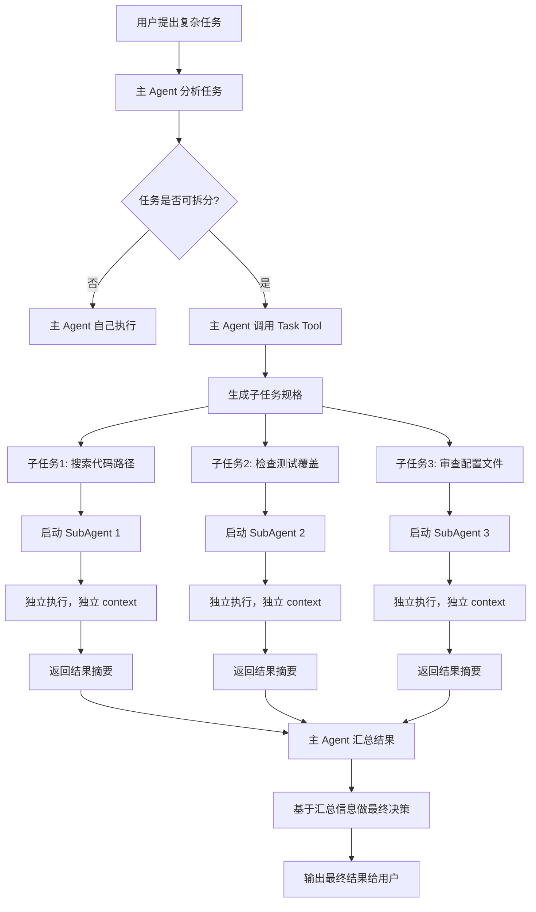

# Task Tool 与 SubAgent 的进程模型

> **核心问题**: 当一个编程任务足够复杂时，主 Agent 一个人的 context 不够用、精力也不够用。Claude Code 的 Task Tool 让主 Agent 能够分派子任务给独立的 SubAgent。为什么这种设计比"在主线程里多开几个协程"更合理？

---

## 1. Task Tool 定义

> **Task Tool**: Claude Code 提供的一种特殊工具，允许主 Agent 启动一个或多个独立的子 Agent（SubAgent），每个子 Agent 拥有自己的上下文、权限和工具链，独立完成子任务后将结果摘要返回给主 Agent。

Task Tool 解决的核心痛点是：

1. **Context 膨胀**：长任务会在主 Agent 的 context 中累积大量工具结果和中间状态，导致 token 浪费和注意力稀释。
2. **串行瓶颈**：多个独立子任务只能逐个执行，无法利用并行能力。
3. **错误隔离**：子任务失败可能污染主任务的状态，难以回滚。

Task Tool 的本质是"分治"：将一个大的、复杂的任务拆解为多个小的、独立的子任务，分别由专门的 SubAgent 执行。

---

## 2. SubAgent 进程模型

### 2.1 独立进程 vs 线程 vs 协程

> **SubAgent（子 Agent）**: 由主 Agent 通过 Task Tool 启动的独立执行单元。它拥有独立的 Context Window、独立的工具权限和独立的错误处理路径。

SubAgent 更像一个独立 worker 进程，而不是主线程里的协程。这个选择背后的权衡：

```
┌────────────────────────────────────────────────────────────────┐
│                     进程模型对比                                │
├──────────────┬──────────────┬──────────────┬──────────────────┤
│     维度      │   独立进程    │    线程       │    协程          │
├──────────────┼──────────────┼──────────────┼──────────────────┤
│ Context 隔离  │ 强隔离        │ 共享内存      │ 完全共享         │
│ 崩溃影响      │ 不影响其他     │ 可能影响全部   │ 影响全部        │
│ 权限分层      │ 每进程独立配置 │ 共享          │ 共享            │
│ 调度开销      │ 中等          │ 较低          │ 最低            │
│ 错误回收      │ 简单（kill）  │ 复杂          │ 复杂            │
│ 适用场景      │ Agent 子任务   │ I/O 密集型    │ 高并发轻量级     │
└──────────────┴──────────────┴──────────────┴──────────────────┘
```

Claude Code 选择进程模型的原因：

- **Context 隔离**：每个 SubAgent 有自己的 Context Window，不会污染主 Agent 的上下文。
- **崩溃安全**：一个 SubAgent 崩溃不会拖死主 Agent 或其他 SubAgent。
- **权限分层**：不同的 SubAgent 可以配置不同的工具权限，实现最小权限原则。

### 2.2 SubAgent 的核心属性

每个 SubAgent 启动时会获得以下独立属性：

```
┌────────────────────────────────────────────────────────────────┐
│                      SubAgent 实例                             │
│                                                                │
│  ┌──────────────────┐  ┌──────────────────┐                   │
│  │ Task Spec        │  │ Context Window   │                   │
│  │ (任务描述)        │  │ (独立上下文)      │                   │
│  │                  │  │                  │                   │
│  │ - 目标           │  │ - 独立的对话历史  │                   │
│  │ - 约束条件       │  │ - 独立的工具结果  │                   │
│  │ - 输出格式要求   │  │ - 独立的 token 预算│                   │
│  └──────────────────┘  └──────────────────┘                   │
│                                                                │
│  ┌──────────────────┐  ┌──────────────────┐                   │
│  │ Tool Chain       │  │ Permission Scope │                   │
│  │ (工具链)         │  │ (权限范围)        │                   │
│  │                  │  │                  │                   │
│  │ - 只读型: Read,  │  │ - 搜索型: 只读   │                   │
│  │   Glob, Grep     │  │   权限           │                   │
│  │ - 实现型: +Write,│  │ - 实现型: 读写   │                   │
│  │   Edit           │  │   权限           │
│  │ - 执行型: +Bash  │  │ - 执行型: 完整   │                   │
│  └──────────────────┘  └──────────────────┘                   │
│                                                                │
└────────────────────────────────────────────────────────────────┘
```

---

## 3. 工作流程

### 3.1 完整的 SubAgent 调用流程



### 3.2 通信机制

主 Agent 和 SubAgent 之间的通信遵循严格的协议：

```
┌─────────────────────────────────────────────────────────────────┐
│                   主 Agent ↔ SubAgent 通信                       │
│                                                                 │
│  主 Agent → SubAgent (任务下发):                                 │
│  ┌─────────────────────────────────────────────┐                │
│  │ {                                           │                │
│  │   "task": "查找所有使用 deprecated API 的文件",│                │
│  │   "constraints": ["仅搜索 src/ 目录"],        │                │
│  │   "output_format": "结构化列表",              │                │
│  │   "allowed_tools": ["Grep", "Glob", "Read"]  │                │
│  │ }                                           │                │
│  └─────────────────────────────────────────────┘                │
│                                                                 │
│  SubAgent → 主 Agent (结果返回):                                  │
│  ┌─────────────────────────────────────────────┐                │
│  │ {                                           │                │
│  │   "summary": "发现 12 个文件使用 deprecated API",│             │
│  │   "key_findings": [...],                    │                │
│  │   "files_affected": ["a.ts", "b.ts", ...],  │                │
│  │   "confidence": "high"                      │                │
│  │ }                                           │                │
│  └─────────────────────────────────────────────┘                │
│                                                                 │
│  关键设计：SubAgent 返回的是摘要，不是原始全量 context              │
└─────────────────────────────────────────────────────────────────┘
```

---

## 4. 并行 SubAgent 与并发控制

### 4.1 并行执行模型

> **Semaphore（信号量）**: 一种并发控制原语，用于限制同时运行的并发数量。在 SubAgent 场景中用于防止资源过载。

当主 Agent 分派多个独立子任务时，可以同时启动多个 SubAgent 并行执行：

```
时间线 ─────────────────────────────────────────────────────▶

主 Agent:  [分发任务] ─────────────────────── [汇总结果]

SubAgent1: [搜索代码] ████░░░░░░░░░░░░░░░░░░ [返回]
SubAgent2: [检查测试] ████████░░░░░░░░░░░░░░ [返回]
SubAgent3: [审查配置] ████████████░░░░░░░░░░ [返回]
SubAgent4: [分析依赖] ████████████████░░░░░░ [返回]

                  ↕ 无依赖，可并行执行
```

### 4.2 并发控制：Semaphore

并发不是无限制的。每个 SubAgent 都会消耗 Context Window 的 token 预算和 API 配额，因此需要并发控制：

```
┌─────────────────────────────────────────────────────────────────┐
│                    并发控制策略                                   │
│                                                                 │
│  最大并发数: max_concurrency = 3 (默认)                          │
│                                                                 │
│  待执行队列: [Task4, Task5, Task6]                              │
│                                                                 │
│  ┌──────────────────────────────────────────┐                   │
│  │           Semaphore(3)                   │                   │
│  │  ┌──────────┐ ┌──────────┐ ┌──────────┐ │                   │
│  │  │ Slot 1   │ │ Slot 2   │ │ Slot 3   │ │                   │
│  │  │SubAgent-1│ │SubAgent-2│ │SubAgent-3│ │                   │
│  │  │ 运行中   │ │ 运行中   │ │ 运行中   │ │                   │
│  │  └──────────┘ └──────────┘ └──────────┘ │                   │
│  └──────────────────────────────────────────┘                   │
│                                                                 │
│  当 SubAgent-1 完成时:                                          │
│  ┌──────────┐ ┌──────────┐ ┌──────────┐                        │
│  │ Slot 1   │ │ Slot 2   │ │ Slot 3   │                        │
│  │SubAgent-4│ │SubAgent-2│ │SubAgent-3│  ← Task4 从队列取出      │
│  │ 运行中   │ │ 运行中   │ │ 运行中   │                        │
│  └──────────┘ └──────────┘ └──────────┘                        │
└─────────────────────────────────────────────────────────────────┘
```

### 4.3 并发控制需要考虑的因素

| 因素 | 说明 | 典型限制 |
|------|------|----------|
| **API 配额** | 每个 SubAgent 都会调用 Anthropic API | RPM（每分钟请求数）限制 |
| **Token 预算** | 每个 SubAgent 有独立 context | 单 SubAgent 最多 50-100K token |
| **系统资源** | 进程创建和文件 I/O 消耗资源 | 建议不超过 5 个并行 |
| **任务依赖** | 某些子任务依赖其他子任务的结果 | 需要做拓扑排序 |

---

## 5. 优势与局限

### 5.1 优势

| 优势 | 详细说明 |
|------|----------|
| **保护主 Context** | 子任务的工具结果和中间分析不会污染主 Agent 的 Context Window |
| **并行加速** | 独立子任务可以同时执行，总耗时取决于最慢的子任务而非所有子任务之和 |
| **错误隔离** | 子任务失败不会影响主 Agent 的状态，主 Agent 可以选择重试或换策略 |
| **权限最小化** | 每个 SubAgent 可以只获得完成任务所需的最小工具集 |
| **专业化** | 不同类型的 SubAgent 可以使用不同的 system prompt 和工具链 |
| **可审计** | 每个 SubAgent 的执行轨迹独立记录，便于调试和回放 |

### 5.2 局限

| 局限 | 详细说明 | 缓解策略 |
|------|----------|----------|
| **启动开销** | 每个 SubAgent 需要初始化独立 context 和工具链 | 控制子任务粒度，避免过度拆分 |
| **通信成本** | 主 Agent 只能收到摘要，可能丢失细节 | 定义清晰的输出格式要求 |
| **依赖管理** | 有依赖关系的子任务不能简单并行 | 先做拓扑排序，分阶段执行 |
| **结果汇总** | 主 Agent 需要花 context 来消化多个子任务的结果 | 限制并行数量，摘要要结构化 |
| **调试复杂度** | 多个 SubAgent 的错误交织时难以定位 | 每个 SubAgent 独立日志，结构化错误信息 |

---

## 6. SubAgentManager Python 伪代码

```python
import asyncio
from dataclasses import dataclass, field
from typing import Any
from enum import Enum


class AgentType(Enum):
    """SubAgent 类型枚举"""
    SEARCHER = "searcher"      # 搜索型：只读工具
    IMPLEMENTER = "implementer"  # 实现型：读写工具
    REVIEWER = "reviewer"       # 审查型：只读 + 分析
    EXECUTOR = "executor"       # 执行型：完整工具链


@dataclass
class SubTaskSpec:
    """子任务规格定义"""
    task_id: str
    description: str
    agent_type: AgentType
    constraints: list[str] = field(default_factory=list)
    output_format: str = "structured_summary"
    timeout_seconds: int = 120


@dataclass
class SubAgentResult:
    """SubAgent 执行结果"""
    task_id: str
    summary: str
    key_findings: list[dict[str, Any]]
    success: bool
    error: str | None = None
    token_usage: int = 0


TOOL_SETS = {
    AgentType.SEARCHER: ["Glob", "Grep", "Read"],
    AgentType.IMPLEMENTER: ["Read", "Write", "Edit", "Glob", "Grep"],
    AgentType.REVIEWER: ["Read", "Glob", "Grep"],
    AgentType.EXECUTOR: ["Read", "Write", "Edit", "Bash", "Glob", "Grep"],
}


class SubAgentManager:
    """SubAgent 管理器：负责创建、调度和回收 SubAgent"""

    def __init__(self, max_concurrency: int = 3):
        self.max_concurrency = max_concurrency
        self.semaphore = asyncio.Semaphore(max_concurrency)
        self.active_agents: dict[str, asyncio.Task] = {}
        self.results: dict[str, SubAgentResult] = {}

    async def spawn(self, task_spec: SubTaskSpec) -> SubAgentResult:
        """启动一个 SubAgent 并等待结果"""
        # 通过信号量控制并发
        async with self.semaphore:
            print(f"[SubAgentManager] 启动 SubAgent: {task_spec.task_id}")
            self.active_agents[task_spec.task_id] = asyncio.current_task()

            try:
                result = await asyncio.wait_for(
                    self._run_subagent(task_spec),
                    timeout=task_spec.timeout_seconds,
                )
            except asyncio.TimeoutError:
                result = SubAgentResult(
                    task_id=task_spec.task_id,
                    summary="",
                    key_findings=[],
                    success=False,
                    error=f"超时 ({task_spec.timeout_seconds}s)",
                )
            finally:
                del self.active_agents[task_spec.task_id]

            self.results[task_spec.task_id] = result
            return result

    async def spawn_many(
        self, task_specs: list[SubTaskSpec]
    ) -> list[SubAgentResult]:
        """并行启动多个 SubAgent，等待全部完成"""
        coroutines = [self.spawn(spec) for spec in task_specs]
        results = await asyncio.gather(*coroutines)
        return list(results)

    async def _run_subagent(self, task_spec: SubTaskSpec) -> SubAgentResult:
        """单个 SubAgent 的内部执行逻辑"""
        # 1. 根据 agent_type 确定可用工具
        allowed_tools = TOOL_SETS[task_spec.agent_type]

        # 2. 初始化独立 context（不共享主 Agent 的 context）
        context = Context(
            system_prompt=self._build_system_prompt(task_spec),
            tools=allowed_tools,
        )

        # 3. 在独立 context 中运行消息循环
        context.add_user_message(task_spec.description)
        if task_spec.constraints:
            constraints_text = "\n".join(
                f"- {c}" for c in task_spec.constraints
            )
            context.add_user_message(f"约束条件:\n{constraints_text}")

        # 4. SubAgent 独立执行（简化版消息循环）
        while True:
            response = await call_model(context)
            if not response.has_tool_calls():
                break
            for tool_call in response.tool_calls:
                result = await execute_tool(tool_call)
                context.add_tool_result(tool_call, result)
            context.add_assistant_message(response)

        # 5. 返回结构化摘要（不返回全量 context）
        return SubAgentResult(
            task_id=task_spec.task_id,
            summary=response.text,
            key_findings=self._extract_key_findings(context),
            success=True,
            token_usage=context.total_tokens,
        )

    def _build_system_prompt(self, task_spec: SubTaskSpec) -> str:
        """根据任务类型构建 system prompt"""
        prompts = {
            AgentType.SEARCHER: (
                "你是一个搜索型 SubAgent。你的任务是搜索代码库，"
                "定位文件和代码片段。你只能使用只读工具。"
                "返回结构化的搜索结果摘要。"
            ),
            AgentType.IMPLEMENTER: (
                "你是一个实现型 SubAgent。你的任务是编写或修改代码。"
                "你可以读写文件。完成后返回修改摘要。"
            ),
            AgentType.REVIEWER: (
                "你是一个审查型 SubAgent。你的任务是审查代码质量。"
                "你只能使用只读工具。返回审查报告。"
            ),
            AgentType.EXECUTOR: (
                "你是一个执行型 SubAgent。你的任务是执行完整的"
                "开发操作，包括运行命令和修改文件。"
                "返回执行结果摘要。"
            ),
        }
        return prompts[task_spec.agent_type]

    def _extract_key_findings(self, context: Context) -> list[dict]:
        """从 context 中提取关键发现"""
        findings = []
        for tool_result in context.tool_results:
            if tool_result.is_important():
                findings.append({
                    "tool": tool_result.tool_name,
                    "summary": tool_result.summarize(),
                })
        return findings


# ============================================================
# 使用示例
# ============================================================

async def main():
    manager = SubAgentManager(max_concurrency=3)

    # 定义子任务
    tasks = [
        SubTaskSpec(
            task_id="search-1",
            description="查找所有使用 deprecated API 的文件",
            agent_type=AgentType.SEARCHER,
            constraints=["仅搜索 src/ 目录"],
        ),
        SubTaskSpec(
            task_id="review-1",
            description="审查 auth 模块的代码质量",
            agent_type=AgentType.REVIEWER,
        ),
        SubTaskSpec(
            task_id="implement-1",
            description="修复 login 函数中的 null check",
            agent_type=AgentType.IMPLEMENTER,
            constraints=["不修改接口签名"],
        ),
    ]

    # 并行执行所有子任务
    results = await manager.spawn_many(tasks)

    # 主 Agent 汇总结果
    for result in results:
        print(f"[{result.task_id}] 成功={result.success}")
        print(f"  摘要: {result.summary[:100]}...")


asyncio.run(main())
```

---

## 面试高频问题

### Q1: 为什么 SubAgent 选择进程模型而不是线程模型？这会带来什么额外的工程复杂度？

**A**: 进程模型的核心优势是强隔离：每个 SubAgent 有独立的 Context Window、独立的工具权限、独立的错误处理路径。一个 SubAgent 崩溃不会影响主 Agent 或其他 SubAgent。线程模型虽然开销更低，但在 Agent 场景中难以做到真正的隔离——共享内存意味着一个 SubAgent 的错误状态可能污染其他 SubAgent。额外的工程复杂度主要在通信和结果汇总上：主 Agent 和 SubAgent 之间需要结构化的通信协议，SubAgent 返回的必须是摘要而非全量 context，否则会把主 Agent 的 context 再次撑爆。

### Q2: 主 Agent 什么时候应该分派 SubAgent，什么时候自己执行？决策依据是什么？

**A**: 适合分派 SubAgent 的条件有三个：（1）子任务相对独立，不需要频繁与主任务交互；（2）子任务可以并行执行，能带来实质性的加速；（3）子任务的结果可以被结构化摘要，不会把主 context 撑爆。不适合分派的场景包括：子任务需要频繁参考主 context 中的信息、子任务之间有强依赖关系、子任务粒度太小导致启动开销占比过高。决策的关键是权衡"并行加速收益"和"通信 + 启动开销"。

### Q3: SubAgent 的结果如何返回？如果结果太长怎么办？

**A**: SubAgent 返回的是结构化摘要而非原始全量 context。摘要通常包括：任务完成状态、关键发现列表、受影响的文件路径、置信度评估等。如果子任务的结果确实很长（比如搜索到几百个匹配），SubAgent 应该做一次内部压缩：保留最重要的 N 条结果，其余用统计摘要代替。这和 Context Compaction 的思路一致——不是不传，而是有选择地传。

### Q4: 如果多个 SubAgent 之间存在依赖关系（比如 SubAgent B 需要 SubAgent A 的结果），系统如何处理？

**A**: 有依赖关系的子任务不能简单并行，需要先做依赖图的拓扑排序，然后分阶段执行。具体来说：（1）分析所有子任务之间的依赖关系，构建有向无环图（DAG）；（2）对 DAG 做拓扑排序，确定执行顺序；（3）每一层（没有互相依赖的任务集合）内的子任务可以并行执行；（4）上一层的结果通过摘要传递给下一层。Claude Code 的 Task Tool 支持这种分阶段调度，但需要主 Agent 在分发任务前就规划好依赖关系。
