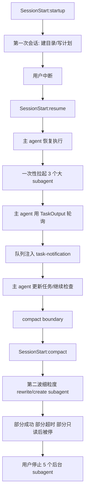
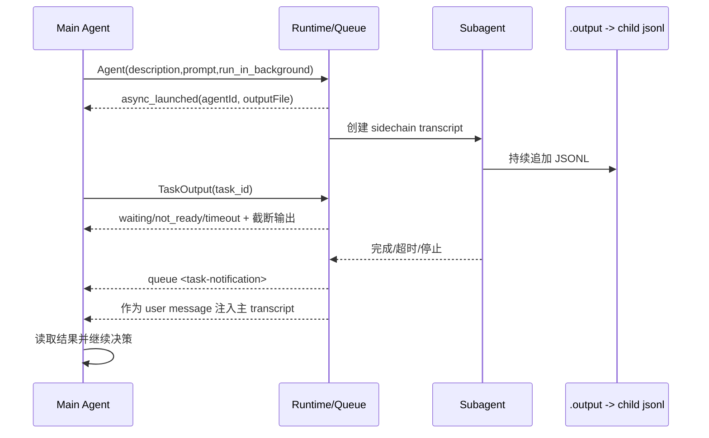

# Claude `--resume ccf8e533-28f9-4482-9bd7-6b3513f50597` 逐行索引版

这份文档只基于本机可见证据分析这个 session，不做超出日志的臆测。

配套高层摘要：
- `/Users/zhuji_m4pro/Agent_learn/06_references/claude_resume_ccf8e533_session_summary.md`

本次补充重点回答 4 个问题：

1. 每一步到底做了什么，关键行号在哪
2. 每个 subagent 是怎么被拉起的
3. subagent 实际上是什么，是不是“另一个 claudeoptions”
4. 主 agent 和 subagent 怎么通信，返回结果长什么样

## 1. 结论先行

最重要的结论先放前面：

- 这个 session 里的 subagent 不是另一个顶层 `claude --resume` 会话。
- 从日志可直接证实，它是主 agent 通过 `Agent` 工具拉起的 sidechain worker。
- 日志里给它的任务类型是 `local_agent`，子日志里标记为 `isSidechain:true`。
- 它有独立 `agentId`、独立 JSONL transcript、独立 `.meta.json`，但和主 agent 共用同一个 `sessionId`。
- `subagent_type:"general-purpose"` 是“子代理类别”，不是模型名。
- 这个 session 里，resume 之后主 agent 和大多数 subagent 的 `message.model` 都是 `glm-5-turbo`；超时结束时会出现 `model:"<synthetic>"`。这说明“模型”和“subagent_type”是两条不同维度。

最安全的表述是：

> subagent 是同一 session 里的 sidechain `local_agent` 执行上下文，由主 agent 的 `Agent` 工具异步拉起，并通过 `TaskOutput` 与队列通知机制回传状态和结果。

## 2. 证据文件在哪

主证据文件：

- 主日志：
  - `/Users/zhuji_m4pro/.claude/projects/-Users-zhuji-m4pro/ccf8e533-28f9-4482-9bd7-6b3513f50597.jsonl`
- 子日志目录：
  - `/Users/zhuji_m4pro/.claude/projects/-Users-zhuji-m4pro/ccf8e533-28f9-4482-9bd7-6b3513f50597/subagents/`
- 子日志元数据示例：
  - `/Users/zhuji_m4pro/.claude/projects/-Users-zhuji-m4pro/ccf8e533-28f9-4482-9bd7-6b3513f50597/subagents/agent-af8609e33b62096f7.meta.json`
  - 内容是：`{"agentType":"general-purpose"}`
- 输出文件目录：
  - `/private/tmp/claude-501/-Users-zhuji-m4pro/7a5fecbc-92cc-4782-9c73-e9b369c6ca11/tasks/`
  - 这里的 `*.output` 实际上是指向 `subagents/agent-<id>.jsonl` 的符号链接
- 会话索引：
  - `/Users/zhuji_m4pro/.claude/projects/-Users-zhuji-m4pro/sessions-index.json`
- 历史总表：
  - `/Users/zhuji_m4pro/.claude/history.jsonl`

Hook 脚本真实位置：

- wrapper:
  - `/Users/zhuji_m4pro/.claude/scripts/hooks/run-with-flags.js`
  - `/Users/zhuji_m4pro/.claude/scripts/hooks/run-with-flags-shell.sh`
- observe:
  - `/Users/zhuji_m4pro/.claude/skills/continuous-learning-v2/hooks/observe.sh`
- session/start-stop:
  - `/Users/zhuji_m4pro/.claude/scripts/hooks/session-start.js`
  - `/Users/zhuji_m4pro/.claude/scripts/hooks/session-end.js`
  - `/Users/zhuji_m4pro/.claude/scripts/hooks/check-console-log.js`
  - `/Users/zhuji_m4pro/.claude/scripts/hooks/evaluate-session.js`
  - `/Users/zhuji_m4pro/.claude/scripts/hooks/cost-tracker.js`
- pre/post tool:
  - `/Users/zhuji_m4pro/.claude/scripts/hooks/mcp-health-check.js`
  - `/Users/zhuji_m4pro/.claude/scripts/hooks/doc-file-warning.js`
  - `/Users/zhuji_m4pro/.claude/scripts/hooks/suggest-compact.js`
  - `/Users/zhuji_m4pro/.claude/scripts/hooks/insaits-security-wrapper.js`
  - `/Users/zhuji_m4pro/.claude/scripts/hooks/governance-capture.js`
  - `/Users/zhuji_m4pro/.claude/scripts/hooks/config-protection.js`
  - `/Users/zhuji_m4pro/.claude/scripts/hooks/quality-gate.js`
  - `/Users/zhuji_m4pro/.claude/scripts/hooks/post-bash-pr-created.js`
  - `/Users/zhuji_m4pro/.claude/scripts/hooks/post-bash-build-complete.js`

日志里还能看到一组外部 hook：

- `/Users/zhuji_m4pro/.comate/extensions/baidu.baidu-cc-2.1.76-rc.6/resources/hooks/duplicate-detector`
- `/Users/zhuji_m4pro/.comate/extensions/baidu.baidu-cc-2.1.76-rc.6/resources/hooks/data-report`

其中这两个在 session 末尾的 stop 阶段出现过 “No such file or directory” 非阻塞错误。

## 3. 整体流程图



单个 subagent 的可见通信链路：



## 4. 主线逐行索引

下面不是 927 行逐字复述，而是“关键控制点索引”。如果你沿着这些行看，能把整个 session 的控制流串起来。

| 主日志行号 | 发生了什么 | 说明 |
|---|---|---|
| 1-2 | `SessionStart:startup` | 会话最初启动 |
| 4-47 | 第一段会话 | 先建计划、建目录、被用户中断 |
| 47 | `[Request interrupted by user]` | 第一段中断 |
| 50 | `<synthetic> No response requested.` | 中断后的合成结束消息 |
| 51-52 | `SessionStart:resume` | 这是 `--resume ccf8...` 的直接证据 |
| 53 | 用户消息 `按照计划开始实施` | resume 后正式恢复执行 |
| 56-60 | 主 agent 先用 `Bash` 检查当前目录状态 | 恢复上下文 |
| 288-292 | `ExitPlanMode` 收尾 | 计划被用户批准后退出 plan mode |
| 293-296 | 启动 Agent 1 | `Write Week 1 Docker files`，异步返回 `agentId=af8609...` |
| 300-303 | 启动 Agent 2 | `Write Week 2+3 RL and inference files`，返回 `a8f5ac...` |
| 305-308 | 启动 Agent 3 | `Write Week 4+5+6 eval/interview/ref files`，返回 `a4ebb9...` |
| 355-360 | 主 agent 第一次 `TaskOutput` 等 Agent 1 | 行 358 明确写 `taskType:"local_agent"` |
| 386 | queue enqueue Agent 1 完成通知 | 结果摘要进入队列 |
| 388 | 队列通知被注入为主 transcript 的 `user` 消息 | 主 agent 真正“看到”子任务结果 |
| 389-390 | 主 agent 响应并继续检查其它 agent | 先承认 Agent 1 完成 |
| 432-437 | 检查 Agent 2/3 | Agent 2 返回 `No task found`，Agent 3 返回 `not_ready` |
| 449 | Agent 2 的完成通知被注入 | Week 2+3 写完 |
| 451-454 | 主 agent 用 `TaskUpdate` 标记任务完成 | 说明它把子任务结果折叠回主任务表 |
| 507-511 | 主 agent 阻塞等待 Agent 3 | 返回 `timeout`，状态还是 `running` |
| 514 | `compact_boundary` | 自动 compact 发生 |
| 515 | 压缩摘要消息 | `isCompactSummary:true` |
| 516-517 | `SessionStart:compact` | compact 之后重新开始一个压缩后的继续段 |
| 519-548 | compact 后主 agent 重新列文件/算行数 | 检查剩余工作 |
| 549 | Agent 3 队列通知 | `status=completed`，但 `result=Request timed out` |
| 551 | 主 agent 明确识别出缺文件和内容不足 | 于是进入第二轮 rewrite |
| 575-577 | 第二波先拉起 3 个大 rewrite agent | 改写 core+docker / RL+inference / interview+references |
| 599 / 603 / 749 | 上述 3 个大 rewrite agent 相继超时 | 其中部分有写入，部分只有 Read |
| 668-672 | 再拉 5 个单文件 rewrite agent | 对核心文件逐个重写 |
| 694-700 | 再拉 7 个文件级 rewrite agent | 覆盖 Week2/Week3/claude_code |
| 770-774 | 最后一波 5 个 agent | 包括 `project_reframing`、`self_check_list`、`whiteboard_diagrams`、`repos.md`、`blogs.md` |
| 795-908 | 多个细粒度 agent 完成通知 | 成功的单文件重写/新建在这段集中回流 |
| 919 | queue enqueue “5 background agents were stopped by the user” | 用户主动停止 5 个后台 agent |
| 921 | `agents_killed` system event | runtime 记录这次 kill |
| 923 | 停止通知注入为 `user` 消息 | 主 agent 接收并开始处理剩余状态 |

两个关键边界一定要记住：

- `resume` 证据在 51-52 行
- `compact` 证据在 514-517 行

## 5. subagent 是怎么被调用出来的

### 5.1 启动包长什么样

以 Agent 1 为例，主日志 293 行发出的 `Agent` 工具输入包含这些关键字段：

```json
{
  "name": "Agent",
  "input": {
    "description": "Write Week 1 Docker files",
    "mode": "bypassPermissions",
    "run_in_background": true,
    "subagent_type": "general-purpose",
    "prompt": "..."
  }
}
```

这说明：

- subagent 不是主 agent 自己“脑内分支”
- 它是一个显式工具调用出来的后台 worker
- `subagent_type` 是 runtime 传进去的类型标签

### 5.2 启动回执长什么样

Agent 1 的回执在主日志 296 行，结构核心是：

```json
{
  "status": "async_launched",
  "agentId": "af8609e33b62096f7",
  "description": "Write Week 1 Docker files",
  "outputFile": "/private/tmp/.../af8609e33b62096f7.output",
  "canReadOutputFile": true
}
```

这说明主 agent 拿到的第一手信息只有：

- 一个 `agentId`
- 一个输出文件路径
- “它已经在后台运行”的状态

主 agent 并不会在 launch 这一刻拿到最终结果。

### 5.3 子日志如何落地

Agent 1 的子日志：

- `/Users/zhuji_m4pro/.claude/projects/-Users-zhuji-m4pro/ccf8e533-28f9-4482-9bd7-6b3513f50597/subagents/agent-af8609e33b62096f7.jsonl`

这个文件第 1 行就是主 agent 传给它的完整 prompt，第 2-3 行开始是它自己的 assistant 回复和 tool use。

Agent 1 子日志前几行的意义：

- 第 1 行：`type:"user"`，内容就是主 agent 发给它的 prompt
- 第 2 行：子 agent 自己先解释“先检查目录结构”
- 第 3 行：开始自己的 `Bash`

因此，subagent 的本体不是一句“后台任务状态”，而是一份完整的独立 transcript。

## 6. subagent 实际上是什么

### 6.1 可直接证实的事实

从日志能直接证实：

1. 它由 `Agent` 工具启动，不是另开顶层会话。
2. `TaskOutput` 明确把它称为 `taskType:"local_agent"`。
3. 子日志每一行都带：
   - `isSidechain:true`
   - `agentId:"..."`
   - 与主 agent 相同的 `sessionId`
4. 子日志对应 `.meta.json` 只有：
   - `{"agentType":"general-purpose"}`

这四点加在一起，已经足够把它定性为：

> 同一 session 内的 sidechain local agent。

### 6.2 它不是“另一个 claudeoptions”

如果你说的“另一个 claudeoptions”是“另一个独立 CLI 会话 / 另一次 `claude --resume` / 另一个顶层 session”，那这份日志不支持这个判断。

原因：

- 没有看到第二个顶层 `SessionStart:resume`
- 没有看到独立的新 `sessionId`
- 没有看到单独的主会话目录
- 看到的是主日志里显式的 `Agent` 工具调用，以及子日志里的 `isSidechain:true`

更准确的说法是：

- 它像“另一个 worker”
- 但不是“另一个顶层 resume 会话”
- 更不是仅凭日志就能证明的“另一套 claude options 对象”

### 6.3 模型名和 subagent_type 不是一回事

这份 session 里有一个容易混淆的点：

- 早期主会话有 `claude-opus-4-5-20251101`
- resume 后主 agent 和绝大多数子 agent 都显示 `glm-5-turbo`
- 但子 agent 的类型字段仍然是 `general-purpose`

所以：

- `message.model` 说的是“这条消息是谁生成的”
- `subagent_type/agentType` 说的是“这个子代理是什么类别”

不能把 `general-purpose` 理解成模型名，也不能把 `glm-5-turbo` 理解成 subagent 类型。

## 7. 主 agent 和 subagent 如何通信

这份日志里，主从通信不是“可见的实时聊天流”，而是 3 层机制叠起来：

1. `Agent` 启动回执
2. `TaskOutput` 轮询读取
3. queue `<task-notification>` 注入

### 7.1 第一层：启动回执

主 agent 发 `Agent`，runtime 回：

- `status:"async_launched"`
- `agentId`
- `outputFile`

这一步只告诉主 agent：“任务已经被投出去”。

### 7.2 第二层：`TaskOutput` 轮询

主 agent 想看中间状态时，会发：

```json
{
  "name": "TaskOutput",
  "input": {
    "task_id": "af8609e33b62096f7",
    "block": true,
    "timeout": 600000
  }
}
```

然后主日志会出现：

- `waiting_for_task`
- `taskType:"local_agent"`

最后再返回一个 `tool_result`，常见有三种：

- `not_ready`
- `timeout`
- `No task found`

注意：

- `No task found` 不一定表示失败，也可能表示任务已经结束且被 runtime 清理
- `timeout` 不等于任务失败，只表示这次等待窗口结束时它还没给出最终结果

### 7.3 第三层：queue 完成通知

subagent 真正完成后，runtime 会把结果封成：

```xml
<task-notification>
  <task-id>...</task-id>
  <tool-use-id>...</tool-use-id>
  <output-file>...</output-file>
  <status>completed</status>
  <summary>...</summary>
  <result>...</result>
  <usage>...</usage>
</task-notification>
```

然后分两步进入主会话：

1. 先以 `queue-operation enqueue` 进入队列
2. 再以一个新的 `user` 消息注入主 transcript

主 agent 真正“收到子任务结果”的时刻，是第二步，也就是注入为 `user` 消息的时候。

### 7.4 `output_file` 是什么

`output_file` 不是一种额外格式，它实际上就是子日志的入口。

证据是：

- `/private/tmp/.../tasks/*.output`
- 都是指向 `subagents/agent-<id>.jsonl` 的符号链接

所以 `TaskOutput` 返回里说的 “Full output: ...output”，本质上就是“去看对应子日志”。

## 8. 返回结果到底长什么样

### 8.1 启动成功回执

Agent 1 的典型回执：

```text
Async agent launched successfully.
agentId: af8609e33b62096f7
output_file: /private/tmp/.../af8609e33b62096f7.output
```

结构化字段里对应：

- `status:"async_launched"`
- `agentId:"af8609e33b62096f7"`
- `outputFile:"/private/tmp/.../af8609e33b62096f7.output"`

### 8.2 运行中轮询结果

主日志 359 行的典型 `TaskOutput` 返回：

```xml
<retrieval_status>timeout</retrieval_status>
<task_id>af8609e33b62096f7</task_id>
<task_type>local_agent</task_type>
<status>running</status>
<output>[Truncated. Full output: ...]</output>
```

它的作用不是给最终结论，而是给“尾部片段 + 当前状态”。

### 8.3 正常完成通知

Agent 1 在 386 行进入队列，`result` 部分是一个很长的总结文本；它和子日志最后一条 assistant 文本高度一致。

这说明：

- queue 的 `<result>` 很可能直接来自子日志最终 assistant message
- 或者至少是 runtime 用其最终 message 生成的摘要

### 8.4 超时完成通知

最值得注意的是 Agent 3：

- 主日志 549 行：
  - `<status>completed</status>`
  - `<result>Request timed out</result>`
- 对应子日志最后一行是：
  - `model:"<synthetic>"`
  - `stop_reason:"stop_sequence"`
  - `text:"Request timed out"`

所以这里的 `completed` 表示“任务生命周期结束了”，不是“业务上成功了”。

### 8.5 被用户停止的 subagent

被停掉的 agent 最典型的特征是：

- 没有 queue 完成通知
- 子日志最后不是一个完整总结，而是停在某个 `progress` 行

例如 `a16d8492bfd01c3a3`：

- 只做了 `Read`
- 最后一行仍然是 `PostToolUse:Read` 的 `progress`
- 没有最终 `assistant/end_turn`

这类 agent 的“结果”实际上就是没有结果，只有中途状态。

## 9. Hook 调用是怎么嵌进去的

### 9.1 整个 session 的 hook 总量

主日志统计结果：

- `SessionStart`: 6
- `PreToolUse`: 302
- `PostToolUse`: 149
- `Stop`: 132

最常见的 hook 名：

- `Stop`: 132
- `PreToolUse:Bash`: 126
- `PreToolUse:Write`: 81
- `PostToolUse:Bash`: 56
- `PreToolUse:Agent`: 46
- `PostToolUse:Write`: 45
- `PostToolUse:Agent`: 23
- `PreToolUse:TaskUpdate`: 22
- `PreToolUse:TaskCreate`: 12
- `PostToolUse:TaskUpdate`: 11
- `PreToolUse:TaskOutput`: 8

### 9.2 这次 session 的 3 类关键 hook

#### A. `SessionStart`

有 3 个语义阶段，各出现 2 次：

- `SessionStart:startup`
- `SessionStart:resume`
- `SessionStart:compact`

这正好对应：

- 初始打开
- `--resume`
- compact 之后的继续段

#### B. `PreToolUse` / `PostToolUse`

主 agent 和 subagent 都会在工具前后触发 hook。

最典型的 `Write` 前链路，在子任务输出片段里能直接看到：

1. `duplicate-detector`
2. `doc-file-warning.js`
3. `suggest-compact.js`
4. `observe.sh`
5. `insaits-security-wrapper.js`
6. `governance-capture.js`
7. `config-protection.js`
8. `mcp-health-check.js`

`Write` 后链路常见是：

1. `data-report`
2. `quality-gate.js`
3. `governance-capture.js`
4. `observe.sh`
5. `callback`

这说明 hook 不是只挂在主 agent 上，subagent 自己执行工具时也跑完整的 hook 栈。

#### C. `Stop`

每轮主 agent 结束时会跑 stop hooks，典型链路：

1. `duplicate-detector --stop`
2. `data-report --stop`
3. `check-console-log.js`
4. `session-end.js`
5. `evaluate-session.js`
6. `cost-tracker.js`

主日志 918 行和 447 行都能看到这种 stop 汇总。

### 9.3 Hook 在这个 session 里的作用

按证据看，这些 hook 至少承担了 4 类事情：

1. 观测与记录：
   - `observe.sh`
   - `governance-capture.js`
   - `data-report`
2. 安全与保护：
   - `insaits-security-wrapper.js`
   - `config-protection.js`
   - `doc-file-warning.js`
3. 健康与质量：
   - `mcp-health-check.js`
   - `quality-gate.js`
   - `check-console-log.js`
4. 会话生命周期：
   - `session-start.js`
   - `session-end.js`
   - `evaluate-session.js`
   - `cost-tracker.js`

## 10. 第一波 3 个大 subagent 索引

| 启动行 | `agentId` | 描述 | 回执行 | 队列行 | 子日志终态 | 工具计数 | 结论 |
|---|---|---|---|---|---|---|---|
| 293 | `af8609e33b62096f7` | Write Week 1 Docker files | 296 | 386 | `assistant/end_turn` | `B3 R7 W8` | 正常完成，写了 8 个文件 |
| 300 | `a8f5acdf12efbc316` | Write Week 2+3 RL and inference files | 303 | 415 | `assistant/end_turn` | `B4 W15` | 正常完成，写了 15 个文件 |
| 305 | `a4ebb9b04a00995c0` | Write Week 4+5+6 eval/interview/ref files | 308 | 549 | `assistant/stop_sequence` + `<synthetic>` | `B3 R3 W9` | 任务生命周期结束，但结果是超时 |

对应的子日志结尾：

- `af8609...` 最后一行是完整总结，`stop_reason:"end_turn"`
- `a4ebb...` 最后一行是 `Request timed out`

## 11. 第二波细粒度 subagent 索引

说明：

- `queue line` 为空，基本就是没有完成通知
- `final` 为 `progress`，基本就是停在中间态
- `Wn` 表示子日志里看见了 `n` 次 `Write` 工具调用

| 启动行 | `agentId` | 描述 | 回执行 | queue line | final | 工具计数 | 结论 |
|---|---|---|---|---|---|---|---|
| 575 | `a0bf5737d072ca544` | Rewrite core + docker files | 584 | 599 | `assistant/stop_sequence` | `R6 W1` | 超时，至少写过 1 次 |
| 576 | `a4de91d21749e1c93` | Rewrite RL + inference files | 588 | 603 | `assistant/stop_sequence` | `R10` | 超时，无 `Write` |
| 577 | `adfa32187852c89ca` | Rewrite interview + references | 586 | 749 | `assistant/stop_sequence` | `R3 B2` | 超时，无 `Write` |
| 668 | `ad684a583d22192ba` | Rewrite four_core_abilities.md | 685 |  | `progress` | `R1` | 用户后来停止，只有读取 |
| 669 | `a16d8492bfd01c3a3` | Rewrite mindset.md | 691 |  | `progress` | `R1` | 用户后来停止，只有读取 |
| 670 | `a8d91eaa681521caf` | Rewrite namespace_cgroups.md | 683 | 819 | `assistant/end_turn` | `R1 W1 B1` | 正常完成 |
| 671 | `a250e64dafaaea39e` | Rewrite image_layers_cow.md | 687 | 875 | `assistant/end_turn` | `R1 W1 B1` | 正常完成 |
| 672 | `af9a1624d3362fcc2` | Rewrite container_orchestration.md | 689 |  | `progress` | `R1` | 用户后来停止，只有读取 |
| 694 | `a067c645c00aeec30` | Rewrite ppo_grpo.md | 721 | 897 | `assistant/end_turn` | `R1 W1 B1` | 正常完成 |
| 695 | `a713f01806b16d6a6` | Rewrite rollout_reward.md | 723 | 886 | `assistant/end_turn` | `R2 W1 B2` | 正常完成 |
| 696 | `a252a205c994a4ba8` | Rewrite verifier_design.md | 717 | 908 | `assistant/end_turn` | `R1 W1 B1` | 正常完成 |
| 697 | `ae6f297927da8aad0` | Rewrite prefill_decode.md | 725 | 796 | `assistant/end_turn` | `R1 W1 B1` | 正常完成 |
| 698 | `ad6b3d1f9e9c98ae0` | Rewrite kv_cache.md | 719 | 795 | `assistant/end_turn` | `R1 W1 B1` | 正常完成 |
| 699 | `a84b79205a1a2158c` | Rewrite batching.md | 727 | 738 | `assistant/end_turn` | `R1 W1 B1` | 正常完成 |
| 700 | `ac6a2a431f9fdd303` | Rewrite 4 claude_code files | 715 | 853 | `assistant/end_turn` | `R5 W4 B2` | 正常完成，写了 4 个文件 |
| 770 | `a8400a3a6fd7c8e64` | Rewrite project_reframing.md | 791 | 831 | `assistant/end_turn` | `R1 W1 B1` | 正常完成 |
| 771 | `a893c51b81ce4f47c` | Rewrite self_check_list.md | 787 |  | `progress` | `R1` | 用户后来停止 |
| 772 | `a81c47f67f39a091e` | Rewrite whiteboard_diagrams.md | 785 |  | `progress` | `R1` | 用户后来停止 |
| 773 | `ae062cfa4f1569d80` | Create repos.md | 789 | 842 | `assistant/end_turn` | `B2 W1` | 正常完成 |
| 774 | `a50c7e17862595a65` | Create blogs.md | 793 | 864 | `assistant/end_turn` | `R2 W1 B1` | 正常完成 |

最后被用户明确停止的 5 个后台 agent，主日志 919-923 行已经直接写出名字：

- `Rewrite four_core_abilities.md`
- `Rewrite container_orchestration.md`
- `Rewrite mindset.md`
- `Rewrite whiteboard_diagrams.md`
- `Rewrite self_check_list.md`

这 5 个和上表里“queue line 为空、final=progress”的 5 个刚好对应。

## 12. 从这个 session 可以稳定得出的协议结论

如果只按证据总结，这个 runtime 的 subagent 协议可以概括为：

1. 主 agent 通过 `Agent` 工具投递一个后台 `local_agent`
2. runtime 返回 `agentId + outputFile`
3. runtime 为该 agent 建立 sidechain transcript
4. 子 agent 在自己的 transcript 里独立执行 `Read/Bash/Write/...`
5. 主 agent 可用 `TaskOutput` 按 `task_id` 轮询
6. runtime 用队列把最终结果注入回主 transcript
7. 主 agent 再根据注入消息更新任务、继续调度或补救

这个协议的三个最关键可见对象分别是：

- `Agent`
- `TaskOutput`
- `<task-notification>`

## 13. 直接回答你的问题

### Q1. 每个 subagent 是怎么被调用的？

答：

- 主 agent 在主日志里发一个 `Agent` 工具调用
- 里面带 `description / prompt / run_in_background / subagent_type`
- runtime 回一个 `agentId`
- 子 agent 随后在 `subagents/agent-<id>.jsonl` 里开始独立工作

### Q2. subagent 实际上是什么？

答：

- 不是另一个顶层 `--resume`
- 不是新的独立 session
- 是同一 session 下的 sidechain `local_agent`
- 子日志元数据类型是 `general-purpose`

### Q3. 它是不是另一个 claudeoptions？

答：

- 从这份日志，不能严谨地把它叫做“另一个 claudeoptions”
- 最严谨的说法是：同一 runtime 拉起的另一个 sidechain worker
- 它有自己的 transcript、自己的 `agentId`，但不拥有新的顶层会话身份

### Q4. 返回结果是什么样？

答：

有 4 种常见形态：

1. launch ack：
   - `async_launched + agentId + outputFile`
2. mid-flight poll：
   - `not_ready / timeout / No task found`
3. completion queue：
   - `<task-notification><summary/><result/><usage/></task-notification>`
4. child final message：
   - 正常是 `assistant/end_turn`
   - 超时是 `<synthetic> Request timed out`
   - 被停则可能根本没有 final assistant

### Q5. 主 agent 和 subagent 如何通信？

答：

- 不是直接在主 transcript 里逐 token 对话
- 是通过 `output_file`、`TaskOutput` 和 queue 注入通信
- 所以它更像“后台任务系统 + transcript 文件 + 队列回调”，而不是普通聊天分支

## 14. 一句话总括

这个 `--resume ccf8e533-28f9-4482-9bd7-6b3513f50597` session 的结构非常清楚：

> 主 agent 恢复后先并行拉起 3 个大 subagent，靠 `TaskOutput` 轮询和队列通知收结果；compact 之后再拆成 18 个细粒度 subagent 做补写/重写；最终一部分正常结束，一部分超时，一部分被用户停止。整个 subagent 体系不是第二个顶层 Claude 会话，而是同一 session 内的 sidechain `local_agent` 协议。
