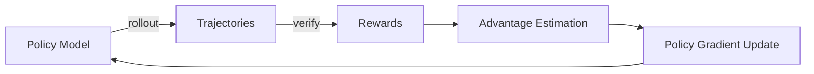

# Week 2: 强化学习与验证器 (RL & Verification)

> **本周定位**：从「会用 Agent」到「理解 Agent 如何被训练出来」。这一周是整个学习路线中数学密度最高的一周，但也是 Agent Infra 工程师面试区分度最大的部分。

---

## 本周目标

学完本周内容后，你应该能够：

1. **讲清 PPO/GRPO 的完整训练循环**：rollout -> reward -> update，每一步在做什么、为什么这样做
2. **理解 Verifier 的角色**：为什么 reward signal 的质量决定了 RL 训练的上限
3. **能读框架源码**：看到 verl / OpenRLHF / TRL 的代码结构，知道去哪里找关键逻辑
4. **能用通俗语言解释给非 ML 背景的人**：RL 训练大模型到底在做什么

### 核心思维模型

| 范式 | 训练闭环 | 直觉类比 |
|------|----------|----------|
| 监督学习（SFT） | 输入 -> 模型 -> 输出 -> 与标准答案计算损失 -> 更新参数 | 老师直接给标准答案，你照着学 |
| 强化学习（RLHF / RLAIF） | 输入 -> 模型 -> 输出 -> 环境验证 -> 得到分数 -> 更新参数 | 你先尝试，再根据反馈调整策略 |

> **Rollout**：模型基于当前策略生成一条完整轨迹（trajectory）的过程。类比：学生做一套完整的试卷。

> **Reward**：对 rollout 结果的评分。类比：老师给试卷打分。

> **Update**：根据 reward 信号更新模型参数，使好答案出现的概率增加，差答案出现的概率减少。类比：学生根据老师反馈调整学习方法。

---

## 学习路径

1. Day 1-2: [concepts/ppo_grpo.md](concepts/ppo_grpo.md) 和 [concepts/rollout_reward_update.md](concepts/rollout_reward_update.md)，先建立 PPO / GRPO 与完整数据流的心智模型。
2. Day 3-4: [concepts/verifier_design.md](concepts/verifier_design.md)，理解 reward signal 是怎么被工程化生产出来的。
3. Day 5-6: [papers/paper_list.md](papers/paper_list.md)，带着前两天的问题去看论文。
4. Day 7: [resources.md](resources.md)，把 verl / OpenRLHF / TRL 的代码入口和关键文件串起来。

---

## 必读论文清单

| # | 论文 | 为什么读 |
|---|------|----------|
| 1 | PPO (Schulman et al., 2017) | 理解 RL 训练最经典的优化算法，面试必问 |
| 2 | GRPO (DeepSeek-Math, 2024) | 理解为什么可以省掉 Critic，代码 RL 训练的主流选择 |
| 3 | SWE-RL / SWE-Gym | 理解如何用 RL 训练 coding agent，直接对口岗位 |
| 4 | Kimi-Researcher / WebDancer | 理解 agentic RL 在 deep research 场景的应用 |
| 5 | OpenRLHF | 理解工业级 RL 训练框架的设计取舍 |

> 详细论文导读见 [papers/paper_list.md](papers/paper_list.md)

---

## 必读框架代码结构

### 1. verl (字节跳动)

| 路径 | 作用 |
|------|------|
| `verl/trainer/ppo/` | PPO 训练入口与主循环 |
| `verl/trainer/ppo/core_algos/` | clip loss、advantage、KL 等核心算法 |
| `verl/trainer/ppo/ray_trainer.py` | 分布式 PPO 主循环 |
| `verl/trainer/grpo/` | GRPO 训练逻辑 |
| `verl/workers/actor.py` | 策略模型，负责生成 rollout |
| `verl/workers/critic.py` | 价值模型，负责估计 `V(s)` |
| `verl/workers/rollout.py` | rollout 生成与采样逻辑 |
| `verl/utils/` | 工具函数与公共组件 |

**关键文件**：
- `verl/trainer/ppo/core_algos/compute_advantage.py` — 看 GAE 是怎么算的
- `verl/trainer/ppo/core_algos/ppo_policy_loss.py` — 看 PPO clip loss 的实现
- `verl/workers/rollout.py` — 看 rollout 怎么生成

### 2. OpenRLHF

| 路径 | 作用 |
|------|------|
| `openrlhf/trainer/ppo_trainer.py` | PPO 训练主循环 |
| `openrlhf/trainer/dpo_trainer.py` | DPO 训练逻辑 |
| `openrlhf/trainer/grpo_trainer.py` | GRPO 训练逻辑 |
| `openrlhf/models/actor.py` | Actor 策略模型 |
| `openrlhf/models/critic.py` | Critic 价值模型 |
| `openrlhf/datasets/` | RL / SFT 数据集处理 |

**关键文件**：
- `openrlhf/trainer/ppo_trainer.py` — 看完整的 rollout -> reward -> update 循环
- `openrlhf/trainer/ppo_trainer.py#generate` — 看 rollout 怎么调用的

### 3. TRL (HuggingFace)

| 路径 | 作用 |
|------|------|
| `trl/trainer/ppo_trainer.py` | PPO 训练器 |
| `trl/trainer/dpo_trainer.py` | DPO 训练器 |
| `trl/trainer/grpo_trainer.py` | GRPO 训练器 |
| `trl/models/modeling_base.py` | HuggingFace 模型封装基础类 |
| `trl/core/ppo_function.py` | PPO 核心算法实现 |
| `trl/core/reward_model.py` | Reward Model 相关逻辑 |

**关键文件**：
- `trl/trainer/ppo_trainer.py` — TRL 的 PPO 实现，风格更接近 HuggingFace 生态

> 详细资源链接见 [resources.md](resources.md)

---

## 产出要求

学完本周内容后，你应该能产出以下内容：

### 1. 概念图（手绘或工具画都行）

画一张图，标注 PPO 训练循环中每个组件的角色：

### 2. 代码注释

选择 verl 或 OpenRLHF 的一个训练流程，在关键位置加上中文注释，说明这一步在做什么。

### 3. 自测清单

- [ ] 能解释为什么 PPO 需要 clip 机制
- [ ] 能解释 GRPO 为什么可以省掉 Critic
- [ ] 能画出 rollout -> reward -> update 的完整数据流
- [ ] 能说出至少 3 种 reward 的形式
- [ ] 能解释 reward hacking 是什么以及怎么防范
- [ ] 能说出 verl 和 OpenRLHF 在架构上的一个关键差异

---

## 与其他章节的关联

- **Week 1 (Docker)**：Docker 是 Verifier 的隔离执行环境 → 参见 [concepts/verifier_design.md](concepts/verifier_design.md)
- **Week 3 (Inference)**：RL 训练中的 rollout 生成本质上就是推理 → 参见 [../03_week3_inference_claude_code/README.md](../03_week3_inference_claude_code/README.md)
- **Week 4 (Eval)**：Verifier 的设计思路与 Eval 的设计思路高度重合 → 参见 [../04_week4_eval_deep_research/README.md](../04_week4_eval_deep_research/README.md)

---

## 面试高频问题

### Q1: 你怎么理解 Agent Infra 工程师这个岗位？它和模型训练工程师有什么区别？

**A**: Agent Infra 工程师关注的是 Agent 从训练到部署的全链路基础设施。模型训练工程师关注的是模型本身的训练效果（loss 下降、指标提升），而 Agent Infra 工程师关注的是：

1. **训练基础设施**：RL 训练的 rollout 生成、reward 信号采集、分布式训练
2. **推理基础设施**：KV Cache 管理、batching 策略、推理引擎优化
3. **验证基础设施**：Verifier 的设计、自动化评估、安全沙箱
4. **Agent 运行时**：Tool 调度、上下文管理、多 Agent 协作

核心区别：模型训练工程师是「造引擎的」，Agent Infra 工程师是「修路、建站、做调度的」。

### Q2: 为什么 RL 训练大模型这么重要？不能只用 SFT 吗？

**A**: SFT（Supervised Fine-Tuning）只能让模型学会模仿训练数据中的模式，但它有几个根本局限：

1. **天花板是训练数据的质量**：SFT 无法超越训练数据的水平
2. **无法探索**：模型只能学到训练数据中有的回答方式，无法发现更好的策略
3. **reward signal 缺失**：SFT 不知道什么是「好」的回答，只知道什么回答在训练数据中出现

RL 训练通过 rollout -> reward -> update 循环，让模型自己探索出更好的策略。特别是对于 Agent 场景（如代码生成、工具调用），可以通过运行测试、验证结果来获得客观的 reward signal，实现超越训练数据的效果。

### Q3: verl 和 OpenRLHF 你更推荐哪个？为什么？

**A**: 这取决于场景：

- **verl**：基于 Ray 的分布式架构，适合大规模集群训练。字节跳动内部使用，对 GPU 集群的利用率优化较好。但学习曲线较陡。
- **OpenRLHF**：设计更简洁，当前更准确的技术栈是 Ray + vLLM + DeepSpeed + HuggingFace Transformers。代码结构更清晰，适合学习 RL 训练的原理。
- **TRL**：HuggingFace 生态的一部分，与 HF 的模型和数据集无缝集成，适合原型验证和小规模实验。

对于学习目的，推荐先读 OpenRLHF 的代码，再去看 verl 的分布式优化。

### Q4: Reward hacking 是什么？在 Agent RL 训练中怎么防范？

**A**: Reward hacking 是指模型学会了「欺骗 reward function」而不是真正完成任务。

例如：
- 代码任务中，模型生成了通过测试但不正确的代码（如硬编码返回值）
- 文本任务中，模型学会了生成 reward model 喜欢的模板化回答

防范方法：
1. **多维度 reward**：不只看测试通过率，还看代码质量、风格、安全性
2. **对抗验证**：用对抗性测试用例验证 rollout 的真实性
3. **人类抽查**：定期人工审核高质量 rollout
4. **reward model 定期更新**：防止模型对 reward model 过拟合

→ 详见 [concepts/rollout_reward_update.md](concepts/rollout_reward_update.md) 中的 reward hacking 部分
