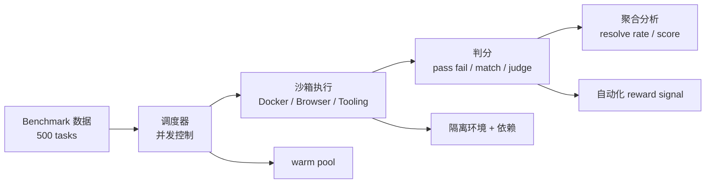
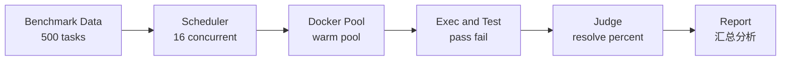

# Week 4: 评测 Pipeline + Deep Research

> **本周定位**：从「训练 Agent」到「评测 Agent」。这一周将你学过的 Docker、RL、推理引擎全部串联起来，回答面试中最高频的问题 ——「你怎么搭评测 infra」。

---

## 本周目标

学完本周内容后，你应该能够：

1. **讲清主流 Agent 评测 benchmark**：SWE-bench、HLE、GAIA、BrowseComp 各测什么、怎么测、对 infra 有什么要求
2. **画出完整的评测 pipeline**：从数据准备到容器调度到自动判分，每一步怎么工程化
3. **理解 Deep Research 架构**：从 OpenAI 到开源实现，掌握通用模式
4. **讲清 Deep Research 五层优化**：I/O 缓存、并发调度、推理侧、算法侧、环境复用，每一层怎么做、为什么做
5. **把项目用基建视角重讲一遍**：120→30 分钟的提效不是重点，重点是 infra 设计决策

### 核心思维模型

评测 = 大规模、高并发、可复现的 `rollout -> verify -> reward` 循环。

> **Benchmark**: 一套标准化的测试集和评测流程，用于衡量 AI 系统在特定任务上的能力。类比：高考 —— 统一试卷、统一评分标准、横向对比。

> **Resolve Rate**: 在 SWE-bench 等代码评测中，模型生成的 patch 成功通过所有测试用例的比例。类比：考试及格率。

---

## 学习路径

1. Day 1-2: 读 [benchmarks/swe_bench.md](benchmarks/swe_bench.md)、[benchmarks/hle.md](benchmarks/hle.md)、[benchmarks/gaia_browsecomp.md](benchmarks/gaia_browsecomp.md)，先建立 benchmark 全景图。
2. Day 3-4: 读 [deep_research/architecture_comparison.md](deep_research/architecture_comparison.md) 和 [deep_research/five_layer_optimization.md](deep_research/five_layer_optimization.md)，把 Deep Research 架构和优化层次讲清。
3. Day 5: 结合 Week 1 Docker 和 Week 2 Verifier 设计，思考如何搭一个完整评测 infra。
4. Day 6: 用 [project_reframing.md](../05_interview_prep/project_reframing.md) 练项目重讲。
5. Day 7: 用 [whiteboard_diagrams.md](../05_interview_prep/whiteboard_diagrams.md) 和 [self_check_list.md](../05_interview_prep/self_check_list.md) 做白板图和自测。

---

## 评测 Benchmark 矩阵

在深入学习每个 benchmark 之前，先建立全局视图：

| Benchmark | 测什么 | 数据来源 | 评测方式 | 对 infra 的核心要求 |
|-----------|--------|----------|----------|-------------------|
| SWE-bench | 代码生成/修复 | GitHub issue + PR | patch → 测试 → pass/fail | Docker 容器、测试执行 |
| HLE | 推理上限 | 专家出题 | 答案匹配 / LLM 判分 | 无特殊要求 |
| GAIA | 综合助手能力 | 人工标注 | 答案匹配 | Web 浏览、工具调用 |
| BrowseComp | Web 信息获取 | 真实网站 | 答案提取 | 浏览器自动化、真实网络 |

> **关键洞察**：不同的 benchmark 对 infra 的要求差异巨大。SWE-bench 需要完整的代码编译+测试环境，GAIA/BrowseComp 需要真实的网络和浏览器环境。作为 infra 工程师，你要能根据 benchmark 的特点设计对应的评测 infra。

---

## 评测 Infra 的三个核心问题

无论面对什么 benchmark，评测 infra 都要回答三个问题：

### 1. 怎么并发？

500 个 test instance，每个执行 2-5 分钟时，吞吐差距会非常夸张：

| 执行方式 | 估算耗时 |
|----------|----------|
| 串行 | `500 x 5min = 2500min = 41.7 小时` |
| 并发 16 | `2500 / 16 = 156min = 2.6 小时` |
| 并发 64 | `2500 / 64 = 39min` |

关键设计：
- 容器池（warm pool）预启动。
- 任务队列 + 调度器。
- 资源限制（每个容器 CPU / memory 上限）。
- 参见 [../01_week1_docker/README.md](../01_week1_docker/README.md)。

### 2. 怎么复现？

同一个 patch 跑两次结果必须一致。关键设计只有四个：

- 固定 `base_commit`。
- 固定依赖版本。
- 使用不可变镜像。
- 固定环境变量。

参见 [../02_week2_rl_verification/concepts/verifier_design.md](../02_week2_rl_verification/concepts/verifier_design.md)。

### 3. 怎么自动判分？

模型生成 patch 后，要走完 `应用 -> 跑测试 -> pass/fail` 的自动闭环。关键设计包括：

- 测试用例可靠性，尤其是 flaky test 处理。
- 超时机制。
- 结果格式标准化。

参见 [../02_week2_rl_verification/README.md](../02_week2_rl_verification/README.md)。

---

## Deep Research 为什么重要

> **Deep Research**: 一种 Agent 架构模式，通过多轮搜索、阅读、综合来回答复杂的、需要深度调研的问题。与单轮对话不同，Deep Research 可能需要几十分钟来回答一个问题。

Deep Research 是 Agent 基建的「终极压力测试」，因为它同时考验：

| Infra 能力 | 典型压力点 |
|------------|------------|
| Docker 并发 | 16+ rollout 同时跑 |
| 推理引擎优化 | KV Cache / Prefix / Batching |
| I/O 缓存 | 语义缓存 / 本地知识库 |
| 调度系统 | 并发控制 / 资源分配 |
| 评测闭环 | answer quality 自动判分 |
| 成本控制 | 推理成本 / 搜索成本优化 |

能讲清 Deep Research 的优化，就等于证明了你理解 Agent Infra 的全部核心问题。

---

## 本周与其他章节的关联

| 关联章节 | 关联点 |
|----------|--------|
| Week 1 Docker | 评测 infra 的隔离环境就是 Docker 容器 → 参见 [01_week1_docker/](../01_week1_docker/README.md) |
| Week 2 RL | 评测产出 reward signal，reward signal 反哺 RL 训练 → 参见 [02_week2_rl_verification/](../02_week2_rl_verification/README.md) |
| Week 3 推理引擎 | Deep Research 的优化依赖推理引擎能力 → 参见 [03_week3_inference_claude_code/](../03_week3_inference_claude_code/README.md) |
| 面试准备 | 项目重讲 + 白板图 + 自检 → 参见 [05_interview_prep/](../05_interview_prep/) |

---

## 产出要求

学完本周内容后，你应该能产出以下内容：

### 1. 评测 Pipeline 架构图

画一张图，标注评测 infra 的完整链路：

### 2. Deep Research 优化方案

针对五层优化，每一层至少能说出两个具体的技术方案。

### 3. Benchmark 选择建议

针对不同的 Agent 场景，能推荐合适的 benchmark 和对应的 infra 方案。

---

## 面试高频问题

### Q1: 你怎么搭一个评测 infra？

**A**: 评测 infra 的核心是三件事：**并发、复现、自动判分**。

1. **并发**：用 Docker 容器池（warm pool）预启动容器，配合任务队列做调度。16-64 并发是常见规模，具体取决于 GPU/CPU 资源。
2. **复现**：每个测试 instance 在独立容器中执行，固定 base commit、依赖版本、环境变量。容器镜像不可变。
3. **自动判分**：根据 benchmark 类型选择判分方式。SWE-bench 是跑测试看 pass/fail，HLE 是答案匹配或 LLM 判分，GAIA 是答案匹配。

参考架构：调度器（Ray/K8s）→ 容器池（Docker）→ 执行器（测试运行器）→ 判分器（规则引擎/LLM judge）→ 聚合器（统计 resolve rate）。

### Q2: SWE-bench 和 HLE 分别测什么能力？为什么要用不同的 benchmark？

**A**: SWE-bench 测的是 Agent 的**工程实现能力** —— 给一个真实的 GitHub issue，模型能否生成正确的代码修复。它考验的是代码理解、问题定位、代码生成、测试验证的完整链路。

HLE 测的是 Agent 的**推理上限** —— 面对专家级极难问题，模型的推理能力到哪里。它考验的是逻辑推理、知识整合、复杂问题分解。

用不同 benchmark 的原因是它们测的是正交的能力维度。一个模型可能 SWE-bench 得分很高（善于写代码），但 HLE 得分很低（推理能力弱）。全面评测需要覆盖多个维度。

### Q3: Deep Research 场景对 infra 的挑战是什么？

**A**: Deep Research 的挑战在于它是所有 Agent 场景中**时间最长、步骤最多、资源消耗最大**的。

1. **长时运行**：一个 Deep Research 任务可能需要 5-30 分钟，涉及几十轮搜索+阅读+综合
2. **大量推理**：每一步搜索都需要 LLM 推理（query 改写、结果筛选、综合总结），推理成本极高
3. **大量 I/O**：频繁的网络请求（搜索 API、网页抓取）、文件读写
4. **需要缓存**：重复的搜索请求、重复的网页访问需要缓存来降低成本和延迟
5. **需要并发**：如果要同时跑多条 rollout 做对比，需要并行推理能力

所以 Deep Research 是 Agent Infra 的「终极压力测试」。

### Q4: 如果让你从零搭一个 SWE-bench 评测系统，你会怎么做？

**A**: 分四步：

1. **数据准备**：从 SWE-bench 数据集中提取 instance，每个 instance 包含 repo、base_commit、problem_statement、test_patch
2. **容器管理**：为每个 instance 创建 Docker 容器，checkout 到 base_commit，安装依赖，形成可复现的执行环境
3. **执行与判分**：将模型生成的 patch 应用到容器中，运行测试命令，收集测试结果（pass/fail）
4. **聚合与报告**：统计 resolve rate，分析失败 case 的原因

关键工程决策：warm pool 预启动容器（节省启动时间）、Copy-on-Write 共享基础层（节省磁盘）、超时机制（防止 hang）、flaky test 过滤。

→ 详见 [benchmarks/swe_bench.md](benchmarks/swe_bench.md)
