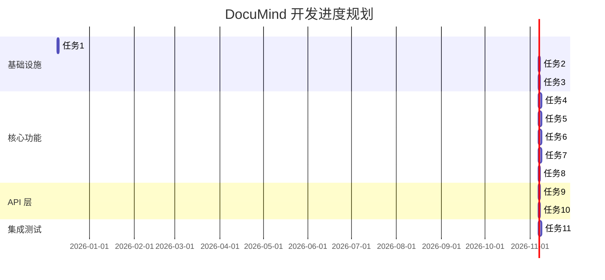

comate实战-从0搭建智能文档问答系统

#### 🧑‍🏫 案例作者：[@范天祥](https://ku.baidu-int.com?t=mention&mt=contact&id=48b861d0-fcec-11f0-8b32-2b417cd5d90f)
#### 🎬 案例场景：全流程
#### 🔧 使用工具：Comate
#### 📒 案例概要：本文分享了使用comate从0搭建智能文档问答系统的全过程，通过langchain搭建Agentic RAG，采用chromem作为向量化数据库。详细介绍了需求对齐、原型设计、详细设计、项目开发、自测及问题修复等阶段，展示了如何利用comate提升开发效率，并总结了开发过程中的经验和教训。
# 背景
为了深入体验comate在研发流程的提效能力，计划不自己写一行代码全程通过comate完成智能文档问答系统的需求对齐、原型设计、详细设计、项目开发、自测及问题修复。

# 技术路径
技术实现上基于langchain搭建Agentic RAG，向量化数据库采用chromem。

# 实战过程
## 需求对齐
**我的初版需求：**

* **总体需求**：实现智能文档问答系统
* **技术选型**：基于langchain搭建Agentic RAG，向量化数据库采用chromem，后端语言为python，后端框架为FastAPI
* **功能需求**：1 支持语料文档上传；2 文本类型支持text、pdf、markdown；3 支持向量化检索能力，在用户咨询问题时可以根据已录入的语料进行检索给出最终结果；4 如果没有检索到相关语料，不可以自由发挥，返回没有相关参考信息提示即可；5 支持多轮对话的能力。

**让comate完善我的需求：**

**我的输入：**上述需求内容+分析下我的需求，分析下是否需要完善，如果需要请给出完善后的需求。

**遇到的问题：**第一轮直接输出设计去了，没按照要求完善需求，经过再次强调给出完善后的需求如下：


```
【基础功能需求】
1. 文档管理
   - 支持单个和批量上传 text、pdf、markdown 格式文档
   - 支持查看已上传文档列表
   - 支持删除指定文档
   - PDF 文档仅支持文本提取，暂不支持扫描件 OCR

2. 智能问答
   - 基于向量检索，返回 Top-3 最相关文档片段
   - 回答中标注信息来源（文档名称）
   - 相似度低于阈值时，返回"未找到相关参考信息"
   - 禁止基于无关内容自由发挥

3. 多轮对话
   - 保留最近 10 轮对话历史
   - 支持上下文理解和指代消歧
   - 支持清空历史，开启新对话

【性能需求】
- 单文档大小限制：≤ 50MB
- 文档库规模：支持 500 份文档
- 响应时间：问答 ≤ 5 秒

【用户体验】
- 显示系统处理状态（如"检索中..."）
- 提供清晰的错误提示
- 无相关结果时，提示换个方式提问

【部署需求】
- 本地开发环境运行
- 暂不需要用户认证和权限管理
```
## 输出原型
**我的输入：**根据我的需求，为我设计一版原型，可以直接为我生成html页面，我再根据你的html页面给出优化建议。


输出第一版原型如下：


**我的输入：**再加下新功能：1 需要可以看到已上传文档的信息预览；2 支持按照名称搜索文档。需要更改的点：1 快捷信息中不能有这份文档的主要内容是什么，因为这里的对话框是面向全部文档进行检索的。

优化后的原型如下：


## 详细设计
**我的输入：**请根据需求、原型输出概要设计，包含整体架构、核心业务流程、项目目录，详细的业务实现暂不输出。注意所有设计图都用mermaid实现。输出概要设计到当前项目根目录下。

**comate生成**（由于生成设计篇幅较长，这里只保留核心设计部分）：

整体架构图：

```
graph TB
    subgraph "表现层 Presentation Layer"
        A[Web 前端界面<br/>HTML/CSS/JavaScript]
    end
    
    subgraph "应用层 Application Layer"
        B[FastAPI 服务层]
        B1[文档管理服务<br/>DocumentService]
        B2[向量化服务<br/>EmbeddingService]
        B3[RAG 问答服务<br/>RAGService]
        B4[会话管理服务<br/>SessionService]
        B --> B1
        B --> B2
        B --> B3
        B --> B4
    end
    
    subgraph "领域层 Domain Layer"
        C1[文档处理<br/>Document Processor]
        C2[文本分割<br/>Text Splitter]
        C3[向量检索<br/>Vector Retriever]
        C4[上下文管理<br/>Context Manager]
        C5[Prompt 构建<br/>Prompt Builder]
    end
    
    subgraph "基础设施层 Infrastructure Layer"
        D1[ChromaDB<br/>向量数据库]
        D2[LLM API<br/>大语言模型]
        D3[文件存储<br/>Local Storage]
        D4[日志系统<br/>Logging]
    end
    
    A --> B
    B1 --> C1
    B2 --> C2
    B3 --> C3
    B3 --> C5
    B4 --> C4
    
    C1 --> D3
    C2 --> D1
    C3 --> D1
    C5 --> D2
    
    style A fill:#e1f5ff
    style B fill:#fff3e0
    style B1 fill:#fff9c4
    style B2 fill:#fff9c4
    style B3 fill:#fff9c4
    style B4 fill:#fff9c4
    style D1 fill:#f3e5f5
    style D2 fill:#f3e5f5
    style D3 fill:#f3e5f5
    style D4 fill:#f3e5f5
```
组件交互流程：

```
graph LR
    User[用户] -->|HTTP 请求| Frontend[前端界面]
    Frontend -->|REST API| FastAPI[FastAPI 服务]
    
    FastAPI -->|上传文档| DocService[文档管理服务]
    FastAPI -->|提问| RAGService[RAG 问答服务]
    
    DocService -->|解析| Parser[文档解析器]
    Parser -->|分块| Splitter[文本分割器]
    Splitter -->|向量化| Embedding[Embedding 模型]
    Embedding -->|存储| ChromaDB[(ChromaDB)]
    
    RAGService -->|检索| ChromaDB
    ChromaDB -->|相关文档| RAGService
    RAGService -->|构建 Prompt| LLM[大语言模型]
    LLM -->|生成回答| RAGService
    RAGService -->|返回结果| Frontend
    Frontend -->|展示| User
    
    style User fill:#e3f2fd
    style ChromaDB fill:#f3e5f5
    style LLM fill:#fff3e0
```
数据流向图：

```
flowchart LR
    A[用户上传文档] --> B[文档解析器]
    B --> C{文档类型}
    C -->|TXT| D[纯文本处理]
    C -->|PDF| E[PyMuPDF 解析]
    C -->|MD| F[Markdown 解析]
    
    D --> G[文本分割]
    E --> G
    F --> G
    
    G --> H[Embedding 向量化]
    H --> I[(ChromaDB 存储)]
    
    J[用户提问] --> K[问题向量化]
    K --> L[向量相似度检索]
    I --> L
    L --> M{相似度判断}
    
    M -->|>= 阈值| N[提取相关文档]
    M -->|< 阈值| O[返回无结果提示]
    
    N --> P[构建 RAG Prompt]
    P --> Q[调用 LLM]
    Q --> R[生成回答]
    R --> S[标注来源]
    S --> T[返回用户]
    O --> T
    
    style A fill:#e3f2fd
    style I fill:#f3e5f5
    style Q fill:#fff3e0
    style T fill:#e8f5e9
```
文档上传与向量化流程：

```
sequenceDiagram
    participant U as 用户
    participant F as 前端
    participant API as FastAPI
    participant DS as 文档服务
    participant Parser as 文档解析器
    participant Splitter as 文本分割器
    participant Embed as Embedding服务
    participant DB as ChromaDB
    participant FS as 文件系统

    U->>F: 选择文档上传
    F->>F: 前端验证（格式、大小）
    F->>API: POST /upload (multipart/form-data)
    
    API->>DS: 调用文档上传服务
    DS->>FS: 保存原始文件
    FS-->>DS: 返回文件路径
    
    DS->>Parser: 解析文档内容
    alt PDF 文档
        Parser->>Parser: PyMuPDF 提取文本
    else TXT/MD 文档
        Parser->>Parser: 直接读取内容
    end
    Parser-->>DS: 返回文档文本
    
    DS->>Splitter: 文本分块
    Splitter->>Splitter: RecursiveTextSplitter<br/>chunk_size=500, overlap=50
    Splitter-->>DS: 返回文本块列表
    
    DS->>Embed: 批量向量化
    loop 每个文本块
        Embed->>Embed: 调用 Embedding 模型
        Embed->>DB: 存储向量 + 元数据
    end
    DB-->>Embed: 确认存储成功
    Embed-->>DS: 向量化完成
    
    DS-->>API: 返回成功结果
    API-->>F: 返回文档信息
    F-->>U: 显示上传成功提示
    
    Note over U,DB: 文档已完成向量化，可供检索使用
```
智能问答流程（RAG）

```
sequenceDiagram
    participant U as 用户
    participant F as 前端
    participant API as FastAPI
    participant RS as RAG服务
    participant SM as 会话管理
    participant Embed as Embedding服务
    participant DB as ChromaDB
    participant Prompt as Prompt构建器
    participant LLM as 大语言模型

    U->>F: 输入问题
    F->>API: POST /query
    Note over F,API: {question, session_id}
    
    API->>RS: 调用问答服务
    RS->>SM: 获取会话历史
    SM-->>RS: 返回历史对话（最近10轮）
    
    RS->>Embed: 问题向量化
    Embed-->>RS: 返回问题向量
    
    RS->>DB: 向量相似度检索
    Note over RS,DB: Top-K=5, threshold=0.5
    DB-->>RS: 返回相关文档片段
    
    alt 找到相关文档
        RS->>Prompt: 构建 RAG Prompt
        Note over Prompt: System: 基于文档回答<br/>Context: 检索到的文档<br/>History: 对话历史<br/>Question: 用户问题
        
        Prompt-->>RS: 返回完整 Prompt
        RS->>LLM: 调用大模型生成
        LLM-->>RS: 返回答案
        
        RS->>RS: 提取文档来源
        RS->>SM: 保存本轮对话
    else 未找到相关文档
        RS->>RS: 生成无结果提示
        Note over RS: "未找到相关参考信息<br/>请尝试换个方式提问"
    end
    
    RS-->>API: 返回回答 + 来源
    API-->>F: JSON 响应
    F-->>U: 展示回答和来源
```
多轮对话流程

```
flowchart TD
    A[用户发起第1轮对话] --> B[创建 Session ID]
    B --> C[问题向量化]
    C --> D[检索相关文档]
    D --> E[构建 Prompt<br/>无历史上下文]
    E --> F[LLM 生成回答]
    F --> G[保存到会话历史]
    
    G --> H[用户发起第2轮对话]
    H --> I[使用相同 Session ID]
    I --> J[问题向量化]
    J --> K[检索相关文档]
    K --> L[构建 Prompt<br/>包含上一轮历史]
    L --> M[LLM 生成回答]
    M --> N[追加到会话历史]
    
    N --> O{继续对话?}
    O -->|是| P[发起第N轮对话]
    O -->|否| Q[结束会话]
    
    P --> R[检查历史长度]
    R --> S{是否超过10轮?}
    S -->|是| T[保留最近10轮<br/>丢弃旧对话]
    S -->|否| U[保留全部历史]
    T --> V[构建 Prompt]
    U --> V
    V --> W[LLM 生成回答]
    W --> N
    
    style B fill:#e3f2fd
    style G fill:#fff3e0
    style N fill:#fff3e0
    style Q fill:#e8f5e9
```
完整目录树：

```
DocuMind/
├── backend/                      # 后端代码
│   ├── app/                      # 应用主目录
│   │   ├── __init__.py
│   │   ├── main.py              # FastAPI 应用入口
│   │   ├── config.py            # 配置文件
│   │   │
│   │   ├── api/                 # API 路由层
│   │   │   ├── __init__.py
│   │   │   ├── v1/
│   │   │   │   ├── __init__.py
│   │   │   │   ├── documents.py    # 文档管理接口
│   │   │   │   ├── query.py        # 问答接口
│   │   │   │   └── sessions.py     # 会话管理接口
│   │   │   └── deps.py          # 依赖注入
│   │   │
│   │   ├── core/                # 核心业务层
│   │   │   ├── __init__.py
│   │   │   ├── document_service.py    # 文档管理服务
│   │   │   ├── embedding_service.py   # 向量化服务
│   │   │   ├── rag_service.py         # RAG 问答服务
│   │   │   └── session_service.py     # 会话管理服务
│   │   │
│   │   ├── domain/              # 领域层
│   │   │   ├── __init__.py
│   │   │   ├── document_processor.py  # 文档处理器
│   │   │   ├── text_splitter.py       # 文本分割器
│   │   │   ├── vector_retriever.py    # 向量检索器
│   │   │   ├── context_manager.py     # 上下文管理器
│   │   │   └── prompt_builder.py      # Prompt 构建器
│   │   │
│   │   ├── models/              # 数据模型
│   │   │   ├── __init__.py
│   │   │   ├── document.py      # 文档模型
│   │   │   ├── message.py       # 消息模型
│   │   │   └── session.py       # 会话模型
│   │   │
│   │   ├── schemas/             # API 数据结构（Pydantic）
│   │   │   ├── __init__.py
│   │   │   ├── document.py      # 文档相关 Schema
│   │   │   ├── query.py         # 查询相关 Schema
│   │   │   └── response.py      # 统一响应 Schema
│   │   │
│   │   ├── utils/               # 工具类
│   │   │   ├── __init__.py
│   │   │   ├── file_handler.py  # 文件处理工具
│   │   │   ├── logger.py        # 日志工具
│   │   │   └── validators.py    # 验证工具
│   │   │
│   │   └── middleware/          # 中间件
│   │       ├── __init__.py
│   │       ├── error_handler.py # 错误处理
│   │       └── cors.py          # CORS 配置
│   │
│   ├── tests/                   # 测试目录
│   │   ├── __init__.py
│   │   ├── test_document.py
│   │   ├── test_query.py
│   │   └── test_rag.py
│   │
│   ├── data/                    # 数据目录
│   │   ├── documents/           # 上传的文档
│   │   ├── chromadb/            # ChromaDB 持久化
│   │   └── sessions/            # 会话数据（可选）
│   │
│   ├── logs/                    # 日志目录
│   │   └── app.log
│   │
│   ├── requirements.txt         # Python 依赖
│   └── .env.example             # 环境变量示例
│
├── frontend/                    # 前端代码（可选独立前端）
│   ├── index.html               # 主页面
│   ├── css/
│   │   └── styles.css
│   ├── js/
│   │   ├── app.js
│   │   └── api.js
│   └── assets/
│       └── images/
│
├── docs/                        # 文档目录
│   ├── 需求文档.md
│   ├── 概要设计.md
│   └── API文档.md
│
├── prototype.html               # 原型页面
├── .gitignore
├── README.md
└── docker-compose.yml           # Docker 编排（可选）
```
目录结构说明：

```
graph TB
    subgraph "后端 Backend"
        A[app/main.py<br/>应用入口] --> B[api/<br/>路由层]
        B --> C[core/<br/>服务层]
        C --> D[domain/<br/>领域层]
        D --> E[models/<br/>数据模型]
        
        A --> F[middleware/<br/>中间件]
        A --> G[schemas/<br/>数据结构]
        C --> H[utils/<br/>工具类]
    end
    
    subgraph "数据存储 Data"
        I[data/documents<br/>文档存储]
        J[data/chromadb<br/>向量数据]
        K[data/sessions<br/>会话数据]
    end
    
    subgraph "测试 Tests"
        L[tests/<br/>单元测试]
    end
    
    D --> I
    D --> J
    C --> K
    
    style A fill:#e3f2fd
    style C fill:#fff3e0
    style D fill:#f3e5f5
    style I fill:#e8f5e9
```
**整体的设计大部分都满足我的需求，需要调整的部分不多。**

**遇到的问题：**这里发现在概要设计中还实现了核心实体数据结构、数据库表结构、api设计，其实这已经算是详细设计的部分了，这里可能是我上问的输入比较模糊，没有给出概要设计、详细设计的边界导致的，既然已经输出了详细设计，那就针对详细设计的问题再继续优化。

**对于与llm交互的部分、数据存储、服务部署的部分我上文中是缺少信息的，因此我又补充了我的信息**：1 llm交互依赖远端大模型，与连接openapi一样，配置好baseurl、model（包含对话model、embeddingmodel）、apikey即可使用；2 除了向量数据、文档存储之外，其他保存的信息可以使用sqlite；3 服务部署在我本地即可，暂不需要容器化部署。


这次更新后整体设计基本满足我的需求，**但还是会输出像扩展项设计、日志与监控、安全设计等我没有指定的冗余部分**


## 开发实战
**我的输入**：请根据当前设计，拆分开发todo list，每个todo list完成后需要有单元测试，并保证单测通过。输出todo list到项目根目录下，后续按照该todo list开发。

comate生成的todolist:

```
# DocuMind 开发任务清单

## 📋 项目信息
- **项目名称**：DocuMind - 智能文档问答系统
- **开发模式**：TDD（测试驱动开发）
- **完成标准**：每个任务完成后必须通过单元测试

---

## ?? 开发原则

1. **测试先行**：每个功能模块完成后必须编写并通过单元测试
2. **增量开发**：按照任务顺序逐步完成，确保每步都可运行
3. **代码质量**：遵循 PEP 8 规范，添加必要的类型注解和文档字符串
4. **版本控制**：每完成一个大任务提交一次代码

---

## 📊 任务概览



---

## 🔧 任务详细清单

### 阶段一：基础设施搭建（3 天）

#### ✅ 任务 1：项目初始化与目录结构
**优先级**：🔴 高  
**预计工时**：4 小时  
**依赖**：无

**开发内容**：
- [ ] 1.1 创建项目目录结构
  ```bash
  backend/
  ├── app/
  │   ├── __init__.py
  │   ├── api/
  │   ├── core/
  │   ├── domain/
  │   ├── models/
  │   ├── schemas/
  │   ├── utils/
  │   └── middleware/
  ├── tests/
  ├── data/
  ├── logs/
  └── requirements.txt
  ```

- [ ] 1.2 创建 `requirements.txt`
  ```txt
  fastapi==0.104.1
  uvicorn==0.24.0
  pydantic==2.5.0
  pydantic-settings==2.1.0
  sqlalchemy==2.0.23
  chromadb==0.4.18
  langchain==0.1.0
  langchain-community==0.0.10
  pymupdf==1.23.8
  python-multipart==0.0.6
  httpx==0.25.2
  pytest==7.4.3
  pytest-asyncio==0.21.1
  pytest-cov==4.1.0
  ```

- [ ] 1.3 创建 `.gitignore`
- [ ] 1.4 创建 `README.md` 项目说明文档

**单元测试**：
- [ ] `tests/test_project_structure.py`
  - 测试所有必需目录是否存在
  - 测试 `__init__.py` 文件是否正确创建

**验收标准**：
- ✅ 项目目录结构完整
- ✅ 依赖文件正确配置
- ✅ 测试通过

---

#### ✅ 任务 2：配置管理模块
**优先级**：🔴 高  
**预计工时**：4 小时  
**依赖**：任务 1

**开发内容**：
- [ ] 2.1 创建 `app/config.py`
  - 定义 `Settings` 类（使用 Pydantic BaseSettings）
  - 包含所有配置项：
    - 服务配置（host, port, debug）
    - LLM API 配置（base_url, api_key, model）
    - Embedding API 配置
    - 数据库路径配置
    - 文档处理配置
    - 检索参数配置
  - 实现配置单例模式

- [ ] 2.2 创建 `.env.example`
  - 提供所有配置项的示例

- [ ] 2.3 创建 `app/utils/logger.py`
  - 配置日志系统
  - 支持文件输出和控制台输出
  - 日志轮转配置

**单元测试**：
- [ ] `tests/test_config.py`
  - 测试配置加载
  - 测试默认值
  - 测试环境变量覆盖
  - 测试配置验证

**验收标准**：
- ✅ 配置类正确加载 .env 文件
- ✅ 日志系统正常工作
- ✅ 测试覆盖率 > 80%

---

#### ✅ 任务 3：数据库初始化
**优先级**：🔴 高  
**预计工时**：6 小时  
**依赖**：任务 2

**开发内容**：
- [ ] 3.1 创建 `app/database.py`
  - SQLite 数据库连接管理
  - SQLAlchemy engine 和 session 配置
  - 数据库初始化函数

- [ ] 3.2 创建 `app/models/__init__.py`
  - 定义 Base 基类

- [ ] 3.3 创建 `app/models/document.py`
  - Document 模型（对应 documents 表）
  - 字段：id, filename, file_type, file_size, upload_time, file_path, status, chunk_count

- [ ] 3.4 创建 `app/models/session.py`
  - Session 模型（对应 sessions 表）
  - 字段：session_id, create_time, update_time, message_count

- [ ] 3.5 创建 `app/models/message.py`
  - Message 模型（对应 messages 表）
  - 字段：id, session_id, role, content, sources, timestamp

- [ ] 3.6 创建数据库迁移脚本
  - 自动创建表结构

**单元测试**：
- [ ] `tests/test_database.py`
  - 测试数据库连接
  - 测试表创建
  - 测试 CRUD 操作
  - 测试事务回滚

- [ ] `tests/test_models.py`
  - 测试每个模型的创建
  - 测试模型关系
  - 测试字段验证

**验收标准**：
- ✅ SQLite 数据库正常创建
- ✅ 所有表结构正确
- ✅ 模型 CRUD 操作正常
- ✅ 测试覆盖率 > 85%

---

### 阶段二：核心功能模块（9 天）

#### ✅ 任务 4：文档处理模块
**优先级**：🔴 高  
**预计工时**：2 天  
**依赖**：任务 3

**开发内容**：
- [ ] 4.1 创建 `app/domain/document_processor.py`
  - 文档解析器基类 `DocumentProcessor`
  - PDF 解析器 `PDFProcessor`（使用 PyMuPDF）
  - TXT 解析器 `TXTProcessor`
  - Markdown 解析器 `MarkdownProcessor`
  - 文档类型自动识别

- [ ] 4.2 创建 `app/utils/file_handler.py`
  - 文件保存函数
  - 文件类型验证
  - 文件大小检查
  - 文件路径生成（UUID 命名）

- [ ] 4.3 创建 `app/utils/validators.py`
  - 文件格式验证器
  - 文件大小验证器
  - 文件名安全性检查

**单元测试**：
- [ ] `tests/test_document_processor.py`
  - 测试 PDF 文本提取
  - 测试 TXT 文件读取
  - 测试 Markdown 解析
  - 测试错误文件处理
  - 准备测试文件（sample.pdf, sample.txt, sample.md）

- [ ] `tests/test_file_handler.py`
  - 测试文件保存
  - 测试文件验证
  - 测试路径生成

**验收标准**：
- ✅ 能正确解析 PDF、TXT、MD 文件
- ✅ 文件处理异常能正确捕获
- ✅ 测试覆盖率 > 85%

---

#### ✅ 任务 5：文本分割与向量化服务
**优先级**：🔴 高  
**预计工时**：2 天  
**依赖**：任务 4

**开发内容**：
- [ ] 5.1 创建 `app/domain/text_splitter.py`
  - 封装 LangChain 的 RecursiveCharacterTextSplitter
  - 配置 chunk_size=500, chunk_overlap=50
  - 添加元数据（chunk_index, document_id）

- [ ] 5.2 创建 `app/core/embedding_service.py`
  - `EmbeddingService` 类
  - 远端 Embedding API 调用封装
  - 支持批量向量化
  - 实现重试机制
  - 错误处理和日志记录

- [ ] 5.3 创建 `app/utils/api_client.py`
  - 通用 HTTP 客户端封装（使用 httpx）
  - 支持异步调用
  - 请求超时配置
  - 重试策略

- [ ] 5.4 ChromaDB 初始化
  - 创建 `app/domain/vector_store.py`
  - ChromaDB 客户端初始化
  - Collection 创建和管理

**单元测试**：
- [ ] `tests/test_text_splitter.py`
  - 测试文本分块
  - 测试 overlap 功能
  - 测试元数据添加
  - 测试不同长度文本

- [ ] `tests/test_embedding_service.py`
  - Mock Embedding API 响应
  - 测试单个文本向量化
  - 测试批量向量化
  - 测试错误重试
  - 测试超时处理

- [ ] `tests/test_vector_store.py`
  - 测试 ChromaDB 连接
  - 测试向量存储
  - 测试向量检索

**验收标准**：
- ✅ 文本能正确分块
- ✅ 向量化 API 调用正常
- ✅ ChromaDB 存储和检索正常
- ✅ 测试覆盖率 > 80%

---

#### ✅ 任务 6：向量检索模块
**优先级**：?? 高  
**预计工时**：2 天  
**依赖**：任务 5

**开发内容**：
- [ ] 6.1 创建 `app/domain/vector_retriever.py`
  - `VectorRetriever` 类
  - 实现语义检索功能
  - 配置 Top-K 和相似度阈值
  - 结果排序和过滤
  - 返回结果格式化（包含文档元数据）

- [ ] 6.2 优化检索策略
  - 实现元数据过滤
  - 支持多条件检索
  - 结果去重

**单元测试**：
- [ ] `tests/test_vector_retriever.py`
  - 准备测试向量数据
  - 测试相似度检索
  - 测试 Top-K 返回
  - 测试阈值过滤
  - 测试无结果情况
  - 测试元数据返回

**验收标准**：
- ✅ 检索功能正常
- ✅ 相似度计算准确
- ✅ 结果排序正确
- ✅ 测试覆盖率 > 85%

---

#### ✅ 任务 7：RAG 问答服务
**优先级**：🔴 高  
**预计工时**：2 天  
**依赖**：任务 6

**开发内容**：
- [ ] 7.1 创建 `app/domain/prompt_builder.py`
  - `PromptBuilder` 类
  - RAG Prompt 模板定义
  - 动态构建 Prompt（Context + History + Question）
  - 支持自定义 System Prompt

- [ ] 7.2 创建 `app/core/rag_service.py`
  - `RAGService` 类
  - 整合检索和生成流程：
    1. 问题向量化
    2. 向量检索
    3. 构建 Prompt
    4. 调用 LLM
    5. 提取来源信息
  - 处理无结果情况
  - 错误处理

- [ ] 7.3 LLM API 调用封装
  - 在 `app/utils/api_client.py` 中添加 LLM 调用
  - 支持流式和非流式响应
  - 处理 API 错误

**单元测试**：
- [ ] `tests/test_prompt_builder.py`
  - 测试 Prompt 构建
  - 测试变量替换
  - 测试历史对话格式化

- [ ] `tests/test_rag_service.py`
  - Mock 向量检索结果
  - Mock LLM API 响应
  - 测试完整 RAG 流程
  - 测试无相关文档情况
  - 测试来源标注

**验收标准**：
- ✅ RAG 流程完整运行
- ✅ Prompt 构建正确
- ✅ LLM 调用正常
- ✅ 来源信息准确
- ✅ 测试覆盖率 > 80%

---

#### ✅ 任务 8：会话管理服务
**优先级**：🟡 中  
**预计工时**：1 天  
**依赖**：任务 3

**开发内容**：
- [ ] 8.1 创建 `app/domain/context_manager.py`
  - `ContextManager` 类
  - 会话历史格式化
  - 历史长度控制（最多 10 轮）
  - 上下文压缩（可选）

- [ ] 8.2 创建 `app/core/session_service.py`
  - `SessionService` 类
  - 会话创建
  - 会话查询
  - 消息保存
  - 消息查询
  - 会话清空

**单元测试**：
- [ ] `tests/test_context_manager.py`
  - 测试历史格式化
  - 测试长度限制
  - 测试历史截断

- [ ] `tests/test_session_service.py`
  - 测试会话 CRUD
  - 测试消息保存
  - 测试历史查询
  - 测试会话清空

**验收标准**：
- ✅ 会话管理功能完整
- ✅ 历史长度控制正确
- ✅ 数据库操作正常
- ✅ 测试覆盖率 > 85%

---

### 阶段三：API 接口层（2 天）

#### ✅ 任务 9：文档管理 API
**优先级**：🔴 高  
**预计工时**：1 天  
**依赖**：任务 4, 5

**开发内容**：
- [ ] 9.1 创建 `app/schemas/document.py`
  - `DocumentUploadResponse` Schema
  - `DocumentListResponse` Schema
  - `DocumentDetailResponse` Schema

- [ ] 9.2 创建 `app/schemas/response.py`
  - 统一响应格式 `ApiResponse`
  - 成功/失败响应封装

- [ ] 9.3 创建 `app/core/document_service.py`
  - `DocumentService` 类
  - 整合文档上传流程：
    1. 文件保存
    2. 文档解析
    3. 文本分割
    4. 向量化
    5. 存储到 ChromaDB
    6. 保存元数据到 SQLite
  - 文档列表查询
  - 文档删除（级联删除向量）

- [ ] 9.4 创建 `app/api/v1/documents.py`
  - POST `/api/v1/documents/upload` - 上传文档
  - GET `/api/v1/documents` - 获取文档列表
  - GET `/api/v1/documents/{id}` - 获取文档详情
  - DELETE `/api/v1/documents/{id}` - 删除文档

- [ ] 9.5 创建 `app/middleware/error_handler.py`
  - 全局异常处理
  - 统一错误响应格式

**单元测试**：
- [ ] `tests/test_document_service.py`
  - 测试完整上传流程
  - 测试文档查询
  - 测试文档删除

- [ ] `tests/test_document_api.py`
  - 测试 API 端点
  - 测试文件上传
  - 测试参数验证
  - 测试错误处理
  - 使用 FastAPI TestClient

**验收标准**：
- ✅ 文档上传完整流程正常
- ✅ API 响应格式统一
- ✅ 错误处理完善
- ✅ 测试覆盖率 > 80%

---

#### ✅ 任务 10：问答 API
**优先级**：🔴 高  
**预计工时**：1 天  
**依赖**：任务 7, 8

**开发内容**：
- [ ] 10.1 创建 `app/schemas/query.py`
  - `QueryRequest` Schema
  - `QueryResponse` Schema
  - `SessionHistoryResponse` Schema

- [ ] 10.2 创建 `app/api/v1/query.py`
  - POST `/api/v1/query` - 提问接口
  - 整合完整问答流程：
    1. 获取会话历史
    2. 调用 RAG 服务
    3. 保存对话记录
    4. 返回结果

- [ ] 10.3 创建 `app/api/v1/sessions.py`
  - GET `/api/v1/sessions/{id}` - 获取会话历史
  - DELETE `/api/v1/sessions/{id}` - 清空会话

- [ ] 10.4 创建 `app/api/v1/__init__.py`
  - 注册所有路由

- [ ] 10.5 创建 `app/main.py`
  - FastAPI 应用初始化
  - 路由注册
  - 中间件配置
  - CORS 配置
  - 启动事件（数据库初始化）

**单元测试**：
- [ ] `tests/test_query_api.py`
  - 测试问答接口
  - 测试会话管理
  - Mock LLM 响应
  - 测试多轮对话
  - 测试无相关文档情况

**验收标准**：
- ✅ 问答 API 正常工作
- ✅ 多轮对话功能正常
- ✅ 会话管理完善
- ✅ 测试覆盖率 > 80%

---

### 阶段四：集成测试与优化（2 天）

#### ✅ 任务 11：集成测试与系统优化
**优先级**：🟡 中  
**预计工时**：2 天  
**依赖**：任务 9, 10

**开发内容**：
- [ ] 11.1 端到端集成测试
  - 完整上传-问答流程测试
  - 多用户并发测试
  - 性能基准测试

- [ ] 11.2 添加系统 API
  - GET `/api/health` - 健康检查
  - GET `/api/stats` - 系统统计
    - 文档总数
    - 向量总数
    - 会话数量

- [ ] 11.3 性能优化
  - 数据库查询优化
  - 向量检索性能优化
  - 添加缓存机制（可选）

- [ ] 11.4 日志完善
  - 添加关键操作日志
  - 性能日志
  - 错误日志

- [ ] 11.5 文档完善
  - API 接口文档（Swagger 自动生成）
  - 部署文档
  - 开发者文档

**集成测试**：
- [ ] `tests/test_integration.py`
  - 测试完整业务流程
  - 测试系统边界情况
  - 测试并发场景

- [ ] `tests/test_performance.py`
  - 测试响应时间
  - 测试并发性能
  - 测试内存占用

**验收标准**：
- ✅ 所有单元测试通过
- ✅ 集成测试通过
- ✅ 代码覆盖率 > 80%
- ✅ API 文档完整
- ✅ 性能指标达标

---

## 📝 开发规范

### 代码规范
1. **PEP 8**：遵循 Python 代码风格指南
2. **类型注解**：所有函数添加类型注解
3. **文档字符串**：使用 Google 风格的 docstring
4. **异常处理**：合理的异常捕获和处理
5. **日志记录**：关键操作添加日志

### 测试规范
1. **测试覆盖率**：每个模块 > 80%
2. **测试命名**：`test_<功能>_<场景>`
3. **测试隔离**：使用 fixture 和 mock
4. **测试数据**：使用独立的测试数据
5. **清理机制**：测试后清理数据

### Git 提交规范
```
<type>: <subject>

<body>

<footer>
```

**Type 类型**：
- `feat`: 新功能
- `fix`: 修复 bug
- `docs`: 文档更新
- `style`: 代码格式调整
- `refactor`: 重构
- `test`: 测试相关
- `chore`: 构建/工具相关

**示例**：
```
feat: 实现文档上传功能

- 添加 PDF/TXT/MD 文件解析
- 实现文件验证和存储
- 完成文本分割和向量化

Closes #1
```

---

## 🧪 测试命令

### 运行所有测试
```bash
pytest tests/ -v
```

### 运行特定测试文件
```bash
pytest tests/test_document_processor.py -v
```

### 查看测试覆盖率
```bash
pytest tests/ --cov=app --cov-report=html
```

### 运行性能测试
```bash
pytest tests/test_performance.py -v --durations=10
```

---

## 🚀 启动与验证

### 开发环境启动
```bash
# 激活虚拟环境
source venv/bin/activate

# 启动服务
cd backend
uvicorn app.main:app --reload --host 0.0.0.0 --port 8000
```

### 验证检查清单
- [ ] 服务正常启动（http://localhost:8000）
- [ ] API 文档可访问（http://localhost:8000/docs）
- [ ] 健康检查通过（http://localhost:8000/api/health）
- [ ] 文档上传功能正常
- [ ] 问答功能正常
- [ ] 所有单元测试通过
- [ ] 测试覆盖率 > 80%

---

## 📊 进度跟踪

### 完成度统计
| 阶段 | 任务数 | 已完成 | 进度 |
|-----|-------|--------|------|
| 基础设施 | 3 | 0 | 0% |
| 核心功能 | 5 | 0 | 0% |
| API 层 | 2 | 0 | 0% |
| 集成测试 | 1 | 0 | 0% |
| **总计** | **11** | **0** | **0%** |

### 里程碑
- [ ] **M1**：基础设施完成（任务 1-3）- 预计 3 天
- [ ] **M2**：核心功能完成（任务 4-8）- 预计 9 天
- [ ] **M3**：API 层完成（任务 9-10）- 预计 2 天
- [ ] **M4**：项目完成（任务 11）- 预计 2 天

**总预计工时**：16 天

---

## 🎯 验收标准

### 功能验收
- ✅ 支持 PDF、TXT、MD 文档上传
- ✅ 文档自动向量化
- ✅ 智能问答功能正常
- ✅ 多轮对话支持
- ✅ 来源标注准确

### 质量验收
- ✅ 单元测试覆盖率 > 80%
- ✅ 集成测试通过
- ✅ 无严重 bug
- ✅ 代码符合规范
- ✅ API 文档完整

### 性能验收
- ✅ 文档上传 < 3s
- ✅ 问答响应 < 5s
- ✅ 向量检索 < 500ms
- ✅ 支持 10+ 并发

---

## 📚 参考资料

### 开发文档
- [FastAPI 官方文档](https://fastapi.tiangolo.com/)
- [LangChain 官方文档](https://python.langchain.com/)
- [ChromaDB 官方文档](https://docs.trychroma.com/)
- [Pytest 官方文档](https://docs.pytest.org/)

### 项目文档
- `需求文档.md`
- `概要设计.md`
- `prototype.html`

---

## 🔄 更新日志

| 日期 | 版本 | 更新内容 |
|-----|------|----------|
| 2025-12-10 | v1.0 | 初始版本，制定开发任务清单 |

---

**开始开发前请确保**：
1. ✅ 已阅读需求文档和概要设计
2. ✅ 已准备 LLM 和 Embedding API Key
3. ✅ 已创建 Python 虚拟环境
4. ✅ 已理解 TDD 开发流程

**祝开发顺利！** 🚀
```
**我的输入**：开始按照todolist开发，先完成阶段1、阶段2的开发。


**遇到的问题：**实现的太慢了，速度比其他竞品如claude code慢非常多。比如当前任务分析处理甚至过了2**0min**没任何进展：


继续后还会遇到服务器异常报错，再次继续可以了。


**我的输入**：继续完成剩余阶段的开发

comate:


**到此为止开发任务已全部完成**

## 自测及问题修复
**我的输入：**安装依赖并启动测试

comate：遇到了python依赖版本兼容问题


手动完成python3.11.9的安装

**我的输入**：我已经手动把python版本安装未3.11.9，继续安装依赖并启动测试


启动项目：cd backend && source venv/bin/activate && uvicorn app.main:app --reload --host 0.0.0.0 --port 8000


目前还缺少前端（**之前的todo list没有把前端的工作任务列出来**），因此需要让comate根据之前设计的原型以及设计文档完成前端代码的开发。

**我的输入：**请根据当前原型，设计文档，以及后端的api，完成前端代码的开发。

comate: 已完成前端功能开发


启动测试下：cd frontend && npm run dev


**目前前后端都已启动，开始做整体联调，目前遇到的问题：**

1. **上传文件报错：后端代码实现bug**
2. **调用千帆embedding api报错：后端代码实现bug**

**利用comate完成问题修复后，终于实现第一版可用版本了：**


多轮的功能也是正常可用的：


**后续优化：**调整了下前端的布局，新增了查看上传文档信息功能，功能符合预期，**在新增查看上传文档信息功能时把向量化查询的接口改坏了**，后续修复后可正常使用。

# 效果展示
[附件]
# 使用心得
**总体来说，使用zulu+sonnet 4.5实现一个新项目初版还是没太大问题的，几乎完整的覆盖了需求、原型、设计、前后端开发、前后端联调流程，但整体实现对比claude code还是太慢了，基于初版项目做一些功能优化效果不尽如人意，调试成本较高。**

**遇到的问题汇总：**

1. **工作不稳定**：开发实现**比较慢，失败率较高**，经常会卡在某个分析步骤不动，还会有如下报错：


下面这种情况只能通过重启解决。


2. **需求设计分不清楚**：在聊需求时直接给输出实现的方案设计了。
3. **设计过度**：已经明确了要写包含xxx部分的概要设计，最终还是输出了详细设计，包含了详细的表结构、api接口，还有日志、监控等额外的设计。
4. **功能优化不够稳定**：如在初版基础上，让前端给对话框加个滑动，整体功能加个文件内容预览等，本质上实现不难，但是**一次实现成功概率较低**，为前端的对话框加个滑动甚至经过**10****轮+****的调试优化都无法达到效果（见左图）**。使用claude code可以一次改对（见右图）


5. **总结文档过多**：每轮任务都会生成几个测试或者总结文档在项目的根目录下，影响项目整体结构，建议可以统一都在一个固定路径下，如doc目录。


**使用提效tips：**

1. **不要一口气吃成胖子**：要开发比较大的项目时，要耐心的一步步对coding工具进行引导，从需求、原型、设计、开发、测试整体依次开展，每个阶段都需要精细化打磨，和大模型【聊】出需求、原型、设计，并生成todo list，按照todo list进行开发、测试。
2. **提供足够的上下文**：不要假设大模型"懂"你的项目，可以根据你的需求提供：项目的技术栈和架构模式、当前正在处理的模块/领域、相关的代码片段或文件结构、你遇到的具体问题和已尝试的方案等，让大模型更能理解你要做什么。
3. **善用"对比"和"评审"**：不要让大模型直接生成最终方案，特别是在自己不太了解该领域技能时，让大模型输出多种方案，给出优缺点分析，经过你对给出方案深入了解后，再总体评估，和大模型讨论出最终方案。
4. **及时清理上下文**：过长的上下文，会导致当前对话上下文过长，浪费token的同时还容易给大模型造成幻觉，尽量完成任务后重新打开新的窗口，使用干净的上下文，让大模型更专注解决【眼前事】。


# [AI+社区首页](https://ku.baidu-int.com/knowledge/HFVrC7hq1Q/pKzJfZczuc/WjGjiS_SK_/opdELIFv2_oFZg)
## [📒 查看/分享更多案例](https://ku.baidu-int.com/knowledge/HFVrC7hq1Q/pKzJfZczuc/WjGjiS_SK_/_U6EhhLx7F5_DI)
更多厂内AI实践案例、案例投递入口

## [📪 创作者投稿](https://ku.baidu-int.com/share/shr5MRDhohjq9dAlY9MCQ/fomaWTzCTogCK4wkc3&spaceId=spcC9AM3yK7rD)
产研干货文章、AI洞察、个人AI技巧

## [🔧 AI工具箱](https://tools.baidu-int.com/)
厂内外热门工具，一键使用

###### **🌟欢迎星标本文、评论区点赞、投币、留言**   [👗社区如流群](https://applink-infoflow.baidu.com/share/contact/open/?token=ZDbWqAs7nQEaXdmgxb6vizK7WFPKWNeibo75Ua-D0_M)    👆更多AI板块点击上方，即刻跳转
