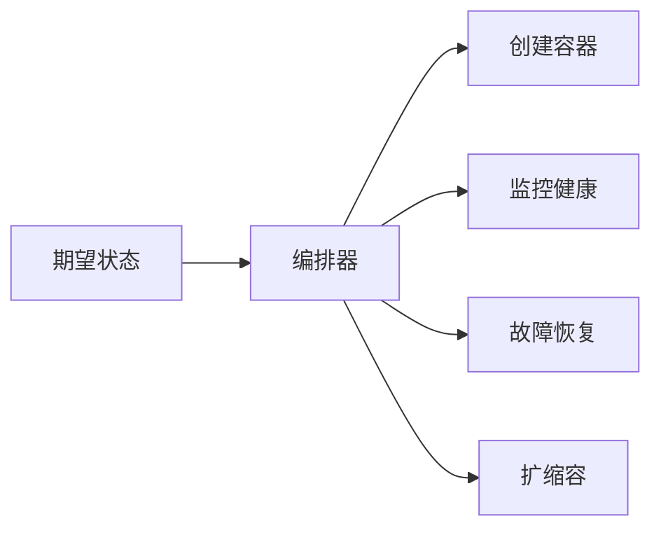
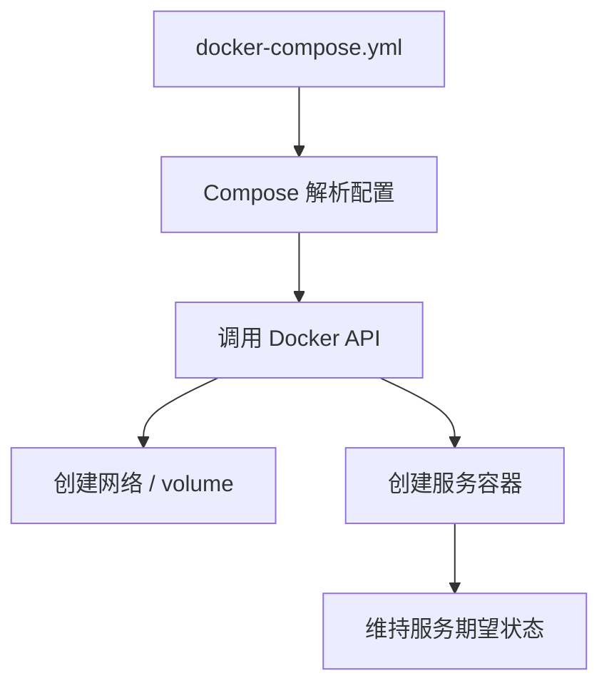
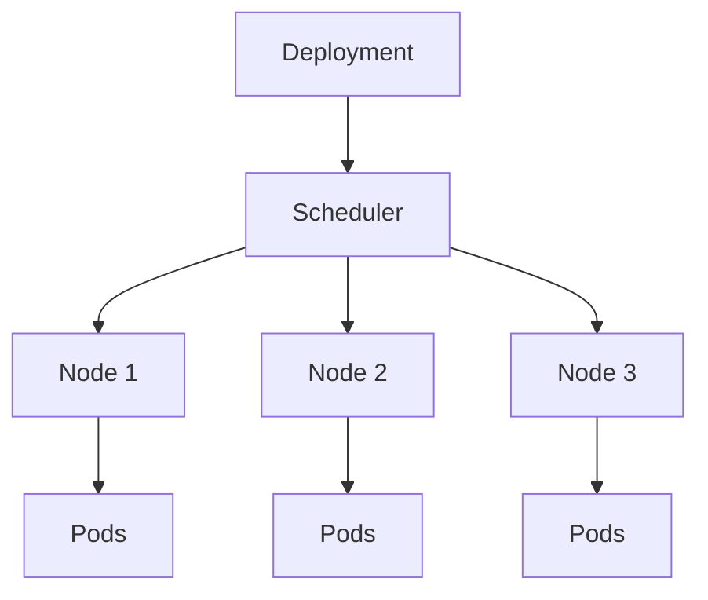
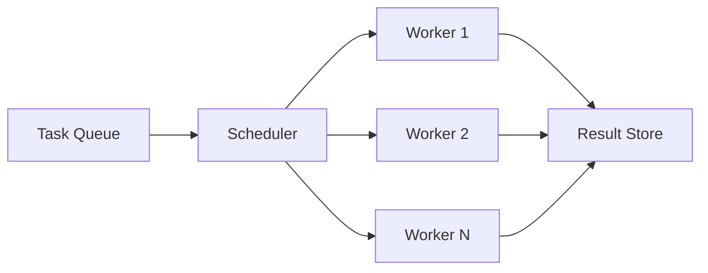

# 容器编排与调度设计

> **核心问题**：当你不再只起 1 个容器，而是要稳定地起 16 个、64 个、甚至几百个验证 worker 时，怎么编排、调度和回收这些环境？

---

## 1. 什么是容器编排

容器编排要解决的是：**声明你想要多少容器、它们怎么连、怎么恢复、怎么扩缩容，然后让系统自动维持这种期望状态**。

### 为什么需要编排

如果没有编排工具，随着容器数增加，你会立刻遇到这些问题：

- 哪个容器挂了，谁来重建？
- 16 个 worker 怎么统一扩容？
- 任务怎么分发到不同 worker？
- 资源怎么限制，避免互相抢爆？

最小心智模型：



---

## 2. Docker Compose 的工作原理

### 2.1 YAML → API → 容器

Compose 的核心流程是：



一个最小 worker 示例：

```yaml
version: "3.8"

services:
  worker:
    image: agent-verify:latest
    deploy:
      replicas: 1
      resources:
        limits:
          cpus: "0.5"
          memory: "512M"
    volumes:
      - knowledge-base:/data:ro
    environment:
      - TASK_QUEUE=redis://queue:6379
      - RESULT_BACKEND=redis://queue:6379
    depends_on:
      - queue

  queue:
    image: redis:7-alpine

volumes:
  knowledge-base:
    external: true
```

### 2.2 `docker-compose up --scale worker=16` 底层发生了什么

本质上是这几步：

1. 读取 Compose 文件。
2. 解析 `worker` 服务定义。
3. 循环创建 16 个同配置实例。
4. 所有实例接入同一网络和同一队列。
5. 每个实例拥有独立写层和进程空间。

一句话总结：

> `--scale` 是“复制同一服务模板”，不是智能调度系统。

所以它适合：

- 本地 demo
- 小规模并发实验
- 快速验证 worker 池

不太适合：

- 复杂资源分配
- 跨节点调度
- 自动恢复和弹性策略很多的场景

---

## 3. Kubernetes 核心概念

### 3.1 核心概念

| 概念 | 作用 |
|------|------|
| Pod | 最小调度单元 |
| Node | 实际运行 Pod 的机器 |
| Deployment | 管理副本数和更新策略 |
| Service | 提供稳定访问入口 |
| Scheduler | 决定 Pod 落在哪个 Node |

### 3.2 整体架构



### 3.3 Deployment 工作流程

```yaml
apiVersion: apps/v1
kind: Deployment
metadata:
  name: agent-worker
spec:
  replicas: 16
  selector:
    matchLabels:
      app: agent-worker
  template:
    metadata:
      labels:
        app: agent-worker
    spec:
      containers:
      - name: worker
        image: agent-verify:latest
        resources:
          requests:
            cpu: "500m"
            memory: "512Mi"
          limits:
            cpu: "1000m"
            memory: "1Gi"
```

调度器真正做的事：

1. 过滤资源不够的节点。
2. 给候选节点打分。
3. 选一个最优节点。
4. 失败时重建。

---

## 4. 自定义调度器设计

### 4.1 基于任务队列 + Worker Pool 的调度器

这是最常见的 Agent infra 调度模型：



调度器通常负责：

- 控制最大并发
- 分配 CPU / 内存预算
- 处理超时和重试
- 回收结果

### 4.2 并发控制（Semaphore）

最简单直接的方式就是用信号量限制同时运行的任务数。

```python
from asyncio import Semaphore

class Scheduler:
    def __init__(self, max_concurrent=16):
        self.sem = Semaphore(max_concurrent)

    async def run_task(self, task):
        async with self.sem:
            return await execute(task)
```

这不等于完整调度器，但它是一个非常高 ROI 的第一步。

---

## 5. Warm Pool 模式

### 5.1 Warm Pool vs Cold Start

| 方案 | 特点 | 适合场景 |
|------|------|----------|
| Cold Start | 每次任务都现建环境 | 请求稀疏、初始化便宜 |
| Warm Pool | 预先保留一批可用容器 | 请求稳定、初始化贵 |

### 5.2 Warm Pool 的设计要点

Warm Pool 关注三件事：

1. **池大小**：预热多少实例才划算。
2. **健康检查**：实例是否还能继续用。
3. **状态重置**：一个任务跑完后如何恢复到干净状态。

### 5.3 关键问题：状态重置

Warm Pool 最大风险不是“起不来”，而是“上一个任务污染了下一个任务”。

常见重置方式：

| 方式 | 特点 |
|------|------|
| 直接销毁重建 | 最干净，但最慢 |
| Git reset + 清临时文件 | 快，但要小心遗漏 |
| 基于 snapshot / checkpoint 恢复 | 更快，但实现更复杂 |

---

## 6. 资源亲和性和反亲和性

### 6.1 在 Agent infra 中的应用

亲和性通常用于：

- 把访问同一数据源的任务放近一点
- 把需要 GPU 的任务放到指定节点

反亲和性通常用于：

- 不让所有 worker 都堆到同一个节点
- 避免单机故障导致全部任务一起挂

### 6.2 Docker Compose 中的资源约束

Compose 不如 K8s 灵活，但仍然可以做基础限制：

| 资源 | 常见参数 |
|------|----------|
| CPU | `--cpus` |
| 内存 | `--memory` |
| 进程数 | `--pids-limit` |

---

## 面试高频问题

### Q1: Docker Compose 和 Kubernetes 怎么选？

**A**：小规模、本地实验优先 Compose；跨节点、高并发、需要自动恢复和复杂调度时用 Kubernetes。

### Q2: `docker-compose up --scale worker=16` 底层做了什么？

**A**：本质是复制 16 份同一服务模板，统一接入同一网络和队列，但不负责复杂的智能调度。

### Q3: 什么是 Warm Pool？怎么实现？

**A**：Warm Pool 就是预先准备一批可直接接任务的环境。实现关键是池大小控制、健康检查和任务后状态重置。

### Q4: 如果 16 个 worker 都在同一台机器上，怎么防止资源争抢？

**A**：给每个 worker 设定 CPU / memory limit，再用信号量或队列限制最大活跃数，必要时做任务分级调度。

### Q5: 设计一个支持动态扩缩容的调度器，你会怎么做？

**A**：我会把任务队列长度、平均等待时间、容器启动时间和资源利用率作为扩缩容信号，再结合 warm pool 做分层管理。
