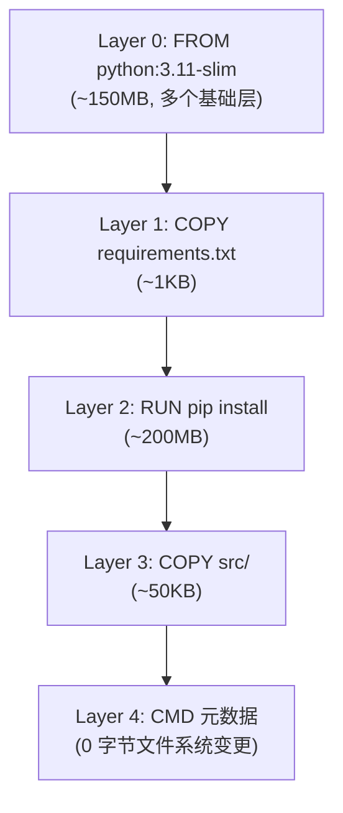
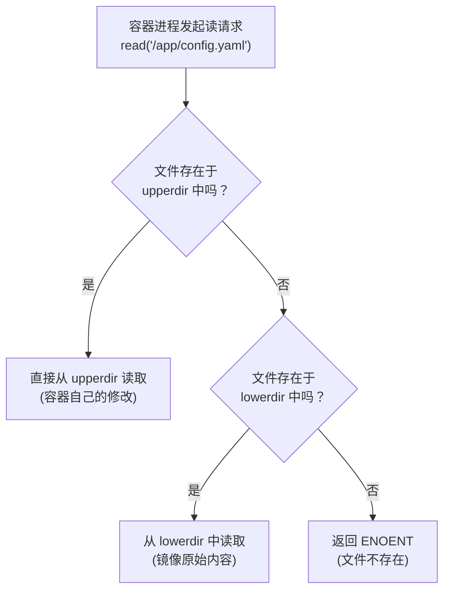
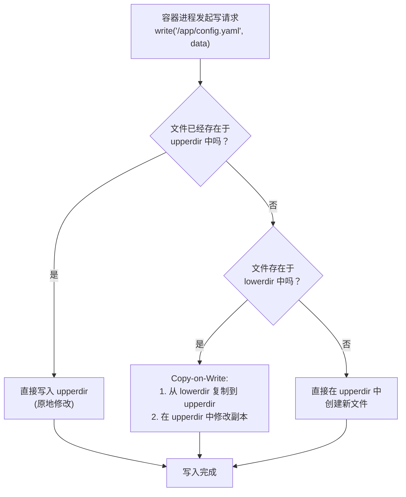

# 镜像分层与 Copy-on-Write

> **核心问题**：为什么 16 个容器能共享同一份基础镜像和大部分只读数据，而不需要 16 份完整副本？

---

## 1. Dockerfile 每条指令对应一个 Layer

### 1.1 什么是指令与层的对应关系

> **Layer（镜像层）**：Docker 镜像的最小存储单元，每一条会改变文件系统状态的 Dockerfile 指令通常都会生成一个独立的 Layer。

```dockerfile
FROM python:3.11-slim          # Layer 0: 基础镜像的所有层
COPY requirements.txt .        # Layer 1: 复制依赖清单文件
RUN pip install -r requirements.txt  # Layer 2: 安装 Python 依赖
COPY src/ /app/src/            # Layer 3: 复制应用源代码
CMD ["python", "/app/src/main.py"]   # Layer 4: 元数据层（不改变文件系统）
```



### 1.2 为什么每条指令对应一个 Layer

这种"一条指令一层"的设计不是偶然，而是为了实现两个关键能力：

1. **缓存复用**：如果某一层的内容没有变化（由哈希判定），下一次构建可以直接复用该层，跳过耗时的指令执行。
2. **跨镜像共享**：不同镜像如果包含相同的层，磁盘上只需要存储一份。

### 1.3 哪些指令会生成 Layer

| 指令类型 | 是否生成 Layer | 说明 |
|----------|---------------|------|
| `FROM` | 是（引入基础层） | 基础镜像本身可能包含多个层 |
| `RUN` | 是 | 执行命令产生的文件系统变更 |
| `COPY` / `ADD` | 是 | 添加文件到文件系统 |
| `WORKDIR` | 是（创建目录时） | 如果目录不存在会创建 |
| `ENV` | 是（元数据层） | 写入环境变量到元数据 |
| `EXPOSE` | 否 | 仅声明端口，不改变文件系统 |
| `CMD` / `ENTRYPOINT` | 否 | 仅写入镜像配置的 JSON |
| `LABEL` / `MAINTAINER` | 否 | 仅写入镜像元数据 |

---

## 2. Content-Addressable Storage

> **Content-Addressable Storage（内容寻址存储）**：一种存储策略，数据的唯一标识由其内容的 SHA256 哈希值决定，而非由文件名或存储路径决定。

### 2.1 工作原理

Docker 在构建镜像时，对每一层的文件系统内容计算 SHA256 哈希值，用这个哈希值作为该层的唯一标识。

```
Layer 内容 → gzip 压缩 → SHA256 哈希 → 存储为 /var/lib/docker/overlay2/<hash>/
```

**关键机制**：

| 机制 | 含义 |
|------|------|
| 内容寻址 | 文件的存储路径由其内容哈希决定 |
| 去重存储 | 相同内容的层在磁盘上只存在一份 |
| 层共享 | 多个镜像可以引用同一个层（相同的哈希值） |
| 完整性校验 | 读取时重新计算哈希，确保数据未被篡改 |

### 2.2 SHA256 哈希的计算过程

```bash
# Docker 构建时自动计算每层哈希
# 例如一个 RUN 层的内容哈希：
$ docker history python:3.11-slim --no-trunc
IMAGE                                                                     CREATED       SIZE   COMMENT
sha256:a1b2c3d4e5f6...                                                     2 days ago    0B     CMD ["python3"]
sha256:b2c3d4e5f6a7...                                                     2 days ago    15.6MB RUN /bin/sh -c pip install...
sha256:c3d4e5f6a7b8...                                                     2 days ago    1.2KB  COPY requirements.txt .
sha256:d4e5f6a7b8c9...                                                     5 days ago    150MB  (base image layers)
```

### 2.3 哈希驱动的去重示例

假设你有三个镜像：

```
镜像 A: python:3.11-slim + flask
镜像 B: python:3.11-slim + django
镜像 C: python:3.11-slim + fastapi
```

虽然三个镜像的最终哈希各不相同，但它们共享 `python:3.11-slim` 的所有基础层。磁盘上只需要存储一份基础层 + 三份各自的差异层，而不是三份完整副本。

```
磁盘实际占用：
  python:3.11-slim 基础层: 150MB × 1 = 150MB
  flask 层: 45MB × 1 = 45MB
  django 层: 80MB × 1 = 80MB
  fastapi 层: 35MB × 1 = 35MB
  总计: 310MB（而非 810MB × 3）
```

---

## 3. Layer Cache 命中规则

> **Layer Cache（层缓存）**：Docker 构建时将每一层的结果缓存起来，后续构建如果某一层的输入没有变化，就直接复用缓存结果，跳过实际执行。

### 3.1 缓存命中条件

一个层的缓存能否被命中，取决于以下因素：

1. **该指令本身没有变化**（指令文本相同）
2. **该指令之前的所有层都命中了缓存**（层是严格顺序依赖的）
3. **该指令涉及的构建上下文文件没有变化**（对 COPY/ADD 而言）

> **重要特性**：缓存检查是**从前到后、逐层判定**的。一旦某一层缓存未命中，该层及其后续所有层都会重新执行。

### 3.2 三个构建场景分析

#### 场景 1：只修改了应用源代码

```dockerfile
FROM python:3.11-slim
COPY requirements.txt .
RUN pip install -r requirements.txt
COPY src/ /app/src/          # ← 只有这层失效
CMD ["python", "/app/src/main.py"]
```

**结果**：
- Layer 0 (FROM)：命中（基础镜像未变）
- Layer 1 (COPY requirements.txt)：命中（文件未变）
- Layer 2 (RUN pip install)：**命中**（输入层未变，依赖未变）
- Layer 3 (COPY src/)：**未命中**（源代码文件变了）
- Layer 4 (CMD)：重新生成

**构建时间**：约 2 秒（仅复制新源码），因为最耗时的 `pip install` 被缓存命中。

#### 场景 2：修改了依赖清单

```dockerfile
FROM python:3.11-slim
COPY requirements.txt .      # ← 这层失效
RUN pip install -r requirements.txt  # ← 这层也失效
COPY src/ /app/src/
CMD ["python", "/app/src/main.py"]
```

**结果**：
- Layer 0 (FROM)：命中
- Layer 1 (COPY requirements.txt)：**未命中**（文件内容变了）
- Layer 2 (RUN pip install)：**未命中**（因为 Layer 1 未命中，依赖内容也变了）
- Layer 3 (COPY src/)：**未命中**（因为 Layer 2 未命中，后续全部重新构建）
- Layer 4 (CMD)：重新生成

**构建时间**：约 60 秒（需要重新下载和安装所有依赖）。

#### 场景 3：只修改了 .dockerignore 中的文件

```
# .dockerignore
*.log
__pycache__/
.env
```

假设添加了一个新的忽略规则 `*.tmp`：

**结果**：如果被忽略的文件本身不在任何 COPY 指令的范围内，那么**所有层缓存都会命中**。因为 `.dockerignore` 的变化只影响构建上下文的打包，不影响 COPY 指令实际复制的内容（那些文件本来就没被复制）。

但如果被新忽略的文件影响了 COPY 指令的范围，则对应的 COPY 层及其后续层都会失效。

### 3.3 Dockerfile 编写策略：错误 vs 正确写法

#### 错误写法：把所有文件一次性 COPY

```dockerfile
# ❌ 错误：把全部文件一次性复制
FROM python:3.11-slim
WORKDIR /app
COPY . /app/                        # 任何文件变化都会使这层失效
RUN pip install -r requirements.txt  # 依赖安装层也会被重新执行
COPY src/ /app/src/                  # 这层总在最后，缓存毫无意义
CMD ["python", "-m", "src.main"]
```

**问题分析**：
- `COPY . /app/` 会把源代码、测试文件、文档、README 等全部复制进去。
- 开发者每次修改一行源码，这层就会失效。
- 由于这层失效，后续的 `pip install` 层也会失效，导致每次构建都要重新安装全部依赖。
- 依赖安装通常需要 30-120 秒，严重影响开发效率。

#### 正确写法：按变化频率从低到高排列

```dockerfile
# ✅ 正确：按变化频率从低到高排列指令
FROM python:3.11-slim
WORKDIR /app

# 第一步：只复制依赖声明（变化频率最低）
COPY requirements.txt /app/requirements.txt

# 第二步：安装依赖（最耗时的步骤，只要依赖不变就永远命中缓存）
RUN pip install --no-cache-dir -r requirements.txt

# 第三步：复制应用源代码（变化频率最高，放在最后）
COPY src/ /app/src/

# 第四步：启动命令
CMD ["python", "-m", "src.main"]
```

**优化效果**：

| 操作 | 错误写法耗时 | 正确写法耗时 |
|------|------------|------------|
| 修改一行源码后重新构建 | ~90 秒（含 pip install） | ~2 秒（仅 COPY） |
| 添加一个新依赖 | ~90 秒 | ~90 秒（依赖变了，必须重装） |
| 添加一个新源文件 | ~90 秒 | ~2 秒 |

**核心原则**：变化频率低的、耗时的操作放前面；变化频率高的、轻量的操作放后面。

#### 进阶写法：利用 .dockerignore 进一步优化

```
# .dockerignore
.git/
__pycache__/
*.pyc
.env
tests/
docs/
*.md
.vscode/
.idea/
```

`.dockerignore` 的作用是排除不需要的文件进入构建上下文，这能：
1. 减小构建上下文的大小，加快上传到 Docker daemon 的速度
2. 避免无关文件的变化触发缓存失效

---

## 4. OverlayFS 原理详解

> **OverlayFS**：Linux 内核提供的联合文件系统（Union Filesystem），它将多个目录叠加在一起，对外呈现为一个统一的目录视图。Docker 使用 OverlayFS2 作为默认存储驱动。

### 4.1 四个核心目录

OverlayFS 通过四个目录协同工作：

| 目录 | 读写属性 | 作用 | 类比 |
|------|---------|------|------|
| `lowerdir` | 只读 | 底层目录，包含镜像的各层 | 书架上的参考书（不能涂改） |
| `upperdir` | 可读写 | 容器的可写层，所有修改都发生在这里 | 草稿纸（可以随意涂改） |
| `workdir` | 内部使用 | OverlayFS 内部工作目录，用于辅助 CoW 操作 | 草稿纸的临时缓冲区 |
| `mergedir` | 虚拟视图 | 对外呈现的统一合并视图，容器看到的文件系统 | 透过棱镜看到的完整画面 |

```
OverlayFS 挂载命令（Docker 内部执行）：
mount -t overlay overlay \
  -o lowerdir=/var/lib/docker/overlay2/<layer_hash>/lower:\
/var/lib/docker/overlay2/<base_hash>/lower, \
  -o upperdir=/var/lib/docker/overlay2/<container_hash>/upper, \
  -o workdir=/var/lib/docker/overlay2/<container_hash>/work, \
  /var/lib/docker/overlay2/<container_hash>/merged
```

**多 lowerdir 的叠加顺序**：从左到右，越靠左的层越"高"（优先级越高）。最左侧的 lowerdir 优先级仅次于 upperdir。

### 4.2 OverlayFS 读流程



**读流程详解**：

1. 容器内的进程请求读取文件 `/app/config.yaml`。
2. OverlayFS 首先检查 `upperdir`（容器可写层）中是否存在该文件。
3. 如果存在，直接从 `upperdir` 读取（这是容器运行期间被修改过的版本）。
4. 如果不存在，依次检查 `lowerdir` 中的各层（从最高优先级到最低优先级）。
5. 如果所有层都不存在，返回"文件不存在"错误。

### 4.3 OverlayFS 写流程



### 4.4 Copy-on-Write 完整过程

> **Copy-on-Write（写时复制，CoW）**：当需要修改只读层（lowerdir）中的文件时，先将文件从只读层复制到可写层（upperdir），然后在可写层的副本上进行修改。只读层中的原始文件保持不变。

**CoW 详细步骤**：

假设容器要修改 `/etc/nginx/nginx.conf`（该文件存在于镜像层中）：

```
步骤 1: 容器进程调用 write("/etc/nginx/nginx.conf", new_content)
步骤 2: OverlayFS 拦截写请求
步骤 3: 检查 upperdir 中是否已有该文件 → 没有
步骤 4: 检查 lowerdir 中是否有该文件 → 有（在镜像的某一层中）
步骤 5: 触发 Copy-on-Write：
        a. 在 workdir 中创建临时文件
        b. 从 lowerdir 复制原始文件内容到 upperdir
        c. 复制完成后，在 upperdir 的副本上执行实际的写入操作
步骤 6: 后续对该文件的读操作将直接从 upperdir 读取（修改后的版本）
步骤 7: lowerdir 中的原始文件完全不变，对其他容器依然可见
```

**CoW 的核心价值**：
- **节省磁盘**：不需要为每个容器复制完整的文件系统，只在修改时才复制单个文件。
- **节省内存**：未修改的文件可以通过页缓存共享，只有修改的文件才需要独立的内存页。
- **启动快速**：容器创建时只需要创建空的 upperdir，不需要复制任何数据。

### 4.5 目录操作的特殊处理

对于目录操作，OverlayFS 有不同的策略：

| 操作 | 处理方式 |
|------|---------|
| 修改已有文件 | Copy-on-Write：复制到 upperdir 后修改 |
| 创建新文件 | 直接在 upperdir 中创建 |
| 创建新目录 | 直接在 upperdir 中创建 |
| 删除已有文件 | 在 upperdir 中创建 whiteout 文件（见 4.6） |
| 删除已有目录 | 递归创建 whiteout 文件 |

---

## 5. Whiteout 文件原理

> **Whiteout 文件**：OverlayFS 中一种特殊文件，文件名以 `.wh.` 前缀开头，用于在可写层（upperdir）中标记"删除"只读层（lowerdir）中的某个文件。它不包含任何数据，仅作为一个"遮罩"存在。

### 5.1 Whiteout 文件的命名规则

```
原始文件路径: /app/old_config.yaml
Whiteout 文件: /app/.wh.old_config.yaml
```

规则：在原始文件名前面添加 `.wh.` 前缀。

### 5.2 文件删除流程

假设容器执行 `rm /app/old_config.yaml`，而该文件存在于 lowerdir 中：

```
步骤 1: 容器进程调用 unlink("/app/old_config.yaml")
步骤 2: OverlayFS 检查文件位置 → 在 lowerdir 中
步骤 3: OverlayFS 不能修改 lowerdir（只读），因此：
步骤 4: 在 upperdir 中创建文件 .wh.old_config.yaml
步骤 5: 后续读取 /app/old_config.yaml 时：
        a. 先检查 upperdir → 发现 .wh.old_config.yaml
        b. OverlayFS 识别到 whiteout 标记
        c. 返回"文件不存在"给调用者
        d. lowerdir 中的原始文件仍然存在，但对容器不可见
```

### 5.3 目录删除流程

删除目录时，OverlayFS 需要递归处理：

```
假设删除 /app/logs/（其中包含 access.log 和 error.log）

步骤 1: 检查 lowerdir 中的 /app/logs/ 目录
步骤 2: 创建 upperdir/.wh.logs（whiteout 目录）
步骤 3: 如果 lowerdir 中 /app/logs/ 下还有文件，
        需要为每个仍然存在于 merged 视图中的文件创建 whiteout
```

### 5.4 Whiteout 文件的存储特点

- Whiteout 文件大小为 0 字节（不包含数据，仅是一个标记）
- 它们存储在 upperdir 中，随容器一起被创建和删除
- 当容器被删除时，其 upperdir（包括所有 whiteout 文件）一起被清理
- Whiteout 文件不影响 lowerdir 中的原始数据

### 5.5 Whiteout 文件与镜像层的关系

在镜像构建过程中，Whiteout 同样起作用：

```dockerfile
FROM ubuntu:22.04
RUN rm /var/cache/apt/archives/*.deb
```

这行 `RUN` 指令会在新的层中创建大量 whiteout 文件。虽然原始的 `.deb` 文件在基础层中仍然存在，但在最终镜像视图中它们被 whiteout 文件"遮住"了。这也意味着这些 whiteout 文件会占用额外的空间。

**最佳实践**：在同一个 RUN 指令中完成安装和清理，避免创建多余的 whiteout 层：

```dockerfile
# ❌ 会产生 whiteout 层
RUN apt-get update && apt-get install -y curl
RUN apt-get clean && rm -rf /var/lib/apt/lists/*

# ✅ 在同一层中完成安装和清理，不产生 whiteout
RUN apt-get update && apt-get install -y curl \
    && apt-get clean \
    && rm -rf /var/lib/apt/lists/*
```

---

## 6. 多阶段构建（Multi-Stage Build）

> **多阶段构建**：在一个 Dockerfile 中定义多个构建阶段（FROM 指令出现多次），每个阶段可以使用不同的基础镜像，最终镜像只保留最后阶段（或指定阶段）的内容。主要用于分离构建依赖和运行依赖，大幅减小最终镜像体积。

### 6.1 为什么需要多阶段构建

在 Agent 基础设施中，很多工具需要编译构建：
- Go 程序需要 Go 编译器和完整的 Go 模块缓存
- Rust 程序需要 Cargo 和编译工具链
- Node.js 前端项目需要 npm 和 node_modules

但运行时只需要编译产物（一个二进制文件或静态资源），不需要编译器和构建缓存。

### 6.2 两阶段 Go 服务示例

```dockerfile
# ============================================================
# 阶段 1: 构建阶段（使用完整的 Go 编译镜像）
# ============================================================
FROM golang:1.22-alpine AS builder

WORKDIR /build

# 先复制依赖文件（利用层缓存）
COPY go.mod go.sum ./
RUN go mod download

# 再复制源代码并编译
COPY . .
RUN CGO_ENABLED=0 GOOS=linux go build \
    -ldflags="-s -w" \
    -o /build/server ./cmd/server

# ============================================================
# 阶段 2: 运行阶段（使用精简的基础镜像）
# ============================================================
FROM alpine:3.19 AS runtime

# 只安装运行时必需的系统依赖
RUN apk add --no-cache ca-certificates tzdata

WORKDIR /app

# 从构建阶段只复制编译产物
COPY --from=builder /build/server /app/server

# 设置时区
ENV TZ=Asia/Shanghai

EXPOSE 8080

ENTRYPOINT ["/app/server"]
```

### 6.3 三阶段 Agent 评估服务示例

```dockerfile
# ============================================================
# 阶段 1: 依赖安装阶段
# ============================================================
FROM python:3.11-slim AS deps

WORKDIR /app

# 只复制依赖声明
COPY requirements.txt .
RUN pip install --no-cache-dir -r requirements.txt \
    && pip install --no-cache-dir playwright pytest pytest-asyncio

# 安装 Playwright 浏览器（仅本阶段需要）
RUN playwright install chromium

# ============================================================
# 阶段 2: 构建评估脚本包
# ============================================================
FROM python:3.11-slim AS builder

WORKDIR /app

# 从阶段 1 复制已安装的依赖
COPY --from=deps /usr/local/lib/python3.11/site-packages /usr/local/lib/python3.11/site-packages
COPY --from=deps /usr/local/bin /usr/local/bin

# 复制评估框架源代码
COPY eval_framework/ ./eval_framework/
COPY agent_configs/ ./agent_configs/

# 打包评估工具（不含浏览器、不含测试数据）
RUN tar czf /artifacts/eval-toolkit.tar.gz \
    eval_framework/ agent_configs/

# ============================================================
# 阶段 3: 最终运行镜像
# ============================================================
FROM python:3.11-slim AS runtime

WORKDIR /app

# 从阶段 2 复制已安装的依赖（不含 Playwright 浏览器）
COPY --from=deps /usr/local/lib/python3.11/site-packages /usr/local/lib/python3.11/site-packages
COPY --from=deps /usr/local/bin /usr/local/bin

# 从阶段 2 复制打包好的评估工具
COPY --from=builder /artifacts/eval-toolkit.tar.gz ./
RUN tar xzf eval-toolkit.tar.gz && rm eval-toolkit.tar.gz

# 运行时环境变量
ENV PYTHONUNBUFFERED=1
ENV EVAL_OUTPUT_DIR=/app/results

# 创建非 root 用户
RUN groupadd -r evaluator && useradd -r -g evaluator evaluator
USER evaluator

CMD ["python", "-m", "eval_framework.runner", "--config", "agent_configs/default.yaml"]
```

### 6.4 镜像大小对比

以一个典型的 Agent 评估服务为例：

| 构建方式 | 镜像大小 | 包含内容 |
|----------|---------|---------|
| 单阶段（完整构建） | **1.8 GB** | Go 编译器 + Node.js + Playwright 浏览器 + Python 依赖 + 评估代码 + 构建缓存 |
| 两阶段构建 | **320 MB** | Python 运行时 + 评估代码 + 评估依赖 |
| 三阶段构建（优化后） | **185 MB** | Python 运行时 + 精选评估依赖 + 评估代码（不含浏览器引擎） |

**大小差异来源**：
- Go 编译器及工具链：约 600 MB
- Node.js 及 node_modules：约 350 MB
- Playwright Chromium 浏览器：约 280 MB
- pip 构建缓存：约 65 MB

三阶段构建通过在独立的阶段安装各类构建工具，最终运行镜像只保留必需的运行时依赖，实现了约 **90%** 的体积缩减。

### 6.5 多阶段构建的层缓存优化

多阶段构建的每个阶段都有独立的层缓存。修改评估框架源代码时：
- 阶段 1（依赖安装）：缓存命中
- 阶段 2（打包）：缓存未命中，重新打包
- 阶段 3（最终镜像）：缓存未命中，重新复制

这比单阶段构建效率高得多，因为最耗时的依赖安装阶段始终命中缓存。

---

## 7. Copy-on-Write 并发场景：16 容器共享 10GB 知识库

### 7.1 场景描述

一个 Agent 评估系统需要同时运行 16 个 Agent 容器，每个 Agent 都需要访问同一个 10GB 的知识库（文档、向量索引、模型配置等）。知识库在容器运行期间是只读的，但每个 Agent 会产生自己的日志、缓存和输出结果。

### 7.2 存储架构

```
┌─────────────────────────────────────────────────┐
│                 Docker 存储层                     │
│                                                   │
│  ┌───────────────────────────────────────────┐   │
│  │  lowerdir (只读): 知识库镜像层 (10 GB)      │   │
│  │  - /data/knowledge_base/ (文档 + 向量索引)  │   │
│  │  - /data/model_config/ (模型配置)           │   │
│  └───────────────────────────────────────────┘   │
│       ↑ 共享（1 份）                              │
│  ┌──────┬──────┬──────┬──────────┬──────┐        │
│  │ C1   │ C2   │ C3   │ ...      │ C16  │        │
│  │upper │upper │upper │          │upper │        │
│  │(200M)│(180M)│(220M)│          │(190M)│        │
│  └──────┴──────┴──────┴──────────┴──────┘        │
└─────────────────────────────────────────────────┘
```

### 7.3 磁盘空间详细推导

**传统方式（无 CoW，每个容器完整复制）**：

```
每个容器: 10 GB（知识库）+ ~200 MB（自己的数据）= 10.2 GB
16 个容器: 10.2 GB × 16 = 163.2 GB
```

**OverlayFS CoW 方式（共享只读层）**：

```
共享层（lowerdir）:
  知识库镜像: 10 GB × 1 = 10 GB  （16 个容器共享这一份）

各容器可写层（upperdir）:
  容器 1:  200 MB（日志 50MB + 缓存 80MB + 输出 70MB）
  容器 2:  180 MB（日志 40MB + 缓存 75MB + 输出 65MB）
  容器 3:  220 MB（日志 60MB + 缓存 85MB + 输出 75MB）
  ...
  容器 16: 190 MB（日志 45MB + 缓存 78MB + 输出 67MB）

16 个 upperdir 平均 ~200 MB：
  容器可写层总计: 200 MB × 16 ≈ 3.2 GB

总磁盘占用: 10 GB + 3.2 GB = 13.2 GB
```

**节省对比**：

```
节省的磁盘空间: 163.2 GB - 13.2 GB = 150 GB
节省比例: 150 / 163.2 ≈ 91.9%
```

### 7.4 CoW 写操作的具体过程

假设容器 3 在运行过程中需要修改知识库中的一份配置文件 `/data/model_config/prompts.yaml`（原始文件在共享的只读层中）：

```
步骤 1: 容器 3 的进程请求写入 /data/model_config/prompts.yaml
步骤 2: OverlayFS 检查容器 3 的 upperdir → 不存在该文件
步骤 3: OverlayFS 检查 lowerdir → 存在（大小 15KB）
步骤 4: 触发 CoW：
        a. 将 15KB 的 prompts.yaml 从 lowerdir 复制到容器 3 的 upperdir
        b. 在 upperdir 的副本上执行写入操作
步骤 5: 容器 3 后续读取 prompts.yaml 时，读到的是自己修改后的版本
步骤 6: 容器 1、2、4-16 读取 prompts.yaml 时，仍然读到 lowerdir 中的原始版本
```

**关键点**：只有被修改的那个文件（15KB）被复制到 upperdir，其余 10GB 的只读数据完全不需要复制。

### 7.5 启动时间对比

| 方式 | 创建 16 个容器的启动时间 | 原因 |
|------|----------------------|------|
| 完整复制 | ~320 秒 | 每个容器需要复制 10GB 数据 |
| OverlayFS CoW | ~3 秒 | 只需创建 16 个空的 upperdir 目录 |

启动时间节省：约 **99%**。

---

## 8. Docker Volume vs Bind Mount vs OverlayFS CoW 对比

### 8.1 三种存储机制概览

> **Docker Volume**：由 Docker 管理的存储卷，数据存储在 Docker 管理的目录（默认 `/var/lib/docker/volumes/`）中，与容器的生命周期解耦。
>
> **Bind Mount**：将宿主机的任意目录或文件直接挂载到容器中，由用户指定宿主机路径。
>
> **OverlayFS CoW**：容器默认的文件系统行为，通过联合文件系统实现只读层共享和写时复制。

### 8.2 详细对比

| 特性 | Docker Volume | Bind Mount | OverlayFS CoW |
|------|-------------|------------|---------------|
| 存储位置 | `/var/lib/docker/volumes/` | 用户指定的任意路径 | `/var/lib/docker/overlay2/` |
| 管理方式 | Docker 管理 | 用户自行管理 | Docker 自动管理 |
| 数据持久化 | 容器删除后保留 | 容器删除后保留 | 容器删除后 upperdir 被清理 |
| 性能 | 高（原生文件系统） | 高（原生文件系统） | 中（首次写有 CoW 开销） |
| 多容器共享 | 支持挂载同一卷到多个容器 | 支持但需手动处理权限 | 天然支持（共享 lowerdir） |
| 可移植性 | 高（`docker volume` 命令统一管理） | 低（依赖宿主机路径） | 高（随镜像分发） |
| 适用场景 | 数据库存储、持久化配置 | 开发时代码热重载 | 镜像层共享、只读基础数据 |
| 网络存储支持 | 支持远程卷插件 | 依赖宿主机挂载 | 不直接支持远程存储 |
| 容量限制 | 无（受宿主机磁盘限制） | 无 | 受容器可写层大小限制 |

### 8.3 Agent 场景下的选择策略

```
场景判断流程：

需要持久化数据吗？
  ├── 是 → 数据需要在容器间共享吗？
  │         ├── 是 → 使用 Docker Volume
  │         │       (例: Agent 评估结果存储)
  │         └── 否 → 使用 Docker Volume 或 Bind Mount
  │                 (例: 单个 Agent 的私有配置)
  └── 否 → 只读共享数据吗？
            ├── 是 → 打入镜像层，利用 OverlayFS CoW 共享
            │       (例: 知识库、模型配置、评估框架代码)
            └── 否 → 使用临时存储或 tmpfs
                    (例: Agent 运行时的临时缓存)
```

### 8.4 混合使用示例

在实际的 Agent 基础设施中，通常需要混合使用三种机制：

```bash
# 启动 Agent 评估容器，同时使用三种存储机制
docker run -d \
  --name agent-eval-1 \
  # 1. OverlayFS CoW: 镜像内置的评估框架和知识库（只读共享）
  agent-eval:latest \
  # 2. Docker Volume: 评估结果的持久化存储
  -v eval-results:/app/results \
  # 3. Bind Mount: 开发时代码热重载（仅开发环境使用）
  -v $(pwd)/src:/app/src \
  # 4. tmpfs: 临时缓存（高速，不落盘）
  --tmpfs /tmp:rw,size=512m
```

---

## 9. 面试高频问题

### Q1: 为什么 Dockerfile 里 COPY requirements.txt 要放在 COPY src/ 前面？

**A**：这是层缓存优化的核心策略。Docker 的缓存是逐层判定的，一旦某一层缓存失效，后续所有层都会重新构建。`requirements.txt` 变化频率低，`pip install` 耗时长（可能 1-2 分钟）；`src/` 变化频率高，`COPY` 耗时短（通常 < 1 秒）。如果把 `COPY . /app` 放前面，每次改一行代码都会导致 `pip install` 重新执行。正确顺序下，改源码只重新执行 `COPY src/` 及之后的步骤，`pip install` 层缓存命中，构建时间从分钟级降到秒级。

### Q2: 什么是 Content-Addressable Storage？Docker 为什么使用它？

**A**：Content-Addressable Storage（内容寻址存储）是一种以内容哈希值作为存储标识的机制。Docker 对每一层镜像的内容计算 SHA256 哈希，用哈希值作为层的唯一 ID。它的好处有三个：(1) **去重**：相同内容的层在磁盘上只存一份，多个镜像共享同一个基础镜像时不需要重复存储；(2) **完整性校验**：读取时可以重新计算哈希验证数据是否被篡改；(3) **缓存判定**：构建时通过比较哈希值快速判断层是否变化。举例来说，如果你有 50 个基于 `python:3.11-slim` 的服务镜像，基础层的 150MB 数据只需要存储一份，而不是 50 份。

### Q3: Whiteout 文件是什么？为什么需要它？

**A**：Whiteout 文件是 OverlayFS 中用于"删除"只读层文件的特殊标记。文件名以 `.wh.` 前缀开头，大小为 0 字节。因为 OverlayFS 的 lowerdir 是只读的，不能物理删除其中的文件，所以当容器执行 `rm` 命令"删除"一个存在于 lowerdir 中的文件时，OverlayFS 会在 upperdir 中创建一个对应的 whiteout 文件。后续访问时，OverlayFS 发现 whiteout 标记就会返回"文件不存在"。这意味着：(1) lowerdir 中的原始文件仍然存在、对其他容器仍然可见；(2) 只有当前容器看不到这个文件；(3) whiteout 本身也占用 upperdir 的空间。因此在 Dockerfile 中，应该把安装和清理操作放在同一个 `RUN` 指令中，避免产生多余的 whiteout 层。

### Q4: 16 个容器共享一个 10GB 的知识库，磁盘空间和启动时间为什么能大幅节省？

**A**：这依赖 OverlayFS 的两个核心机制——层共享和 Copy-on-Write。**磁盘节省**：10GB 知识库作为镜像的只读层（lowerdir）在磁盘上只存储一份。16 个容器各自只有一个小的可写层（upperdir），假设每个约 200MB，总计 10GB + 200MB × 16 = 13.2GB，相比完全复制的 163.2GB 节省了约 92%。**启动节省**：创建容器时只需创建一个空的 upperdir 目录，不需要复制任何数据，因此 16 个容器的启动时间约为 3 秒，相比逐个复制 10GB 数据的 320 秒节省了约 99%。**运行时**：只有当某个容器真正修改了知识库中的某个文件时（比如 15KB 的配置文件），才会触发 CoW 将该单个文件复制到自己的 upperdir，其余 99.999% 的只读数据仍然共享。

### Q5: 多阶段构建为什么能减小镜像大小？在 Agent 基础设施中有哪些具体价值？

**A**：多阶段构建允许在一个 Dockerfile 中使用多个 FROM 指令定义不同的构建阶段，最终镜像只保留最后阶段的内容。它的核心价值在于**分离构建依赖和运行依赖**。以 Go 服务为例，编译阶段需要 ~800MB 的 Go 编译器和模块缓存，但编译产物（二进制文件）可能只有 20MB。通过多阶段构建，最终镜像只需要 alpine（~5MB）+ 二进制文件（~20MB）= ~25MB，相比单阶段构建的 ~820MB 缩减了 97%。在 Agent 基础设施中，评估服务可能依赖 Python 运行时 + Playwright 浏览器 + 评估框架代码 + 构建缓存，单阶段镜像可能达到 1.8GB。通过三阶段构建，将浏览器安装、依赖安装、代码打包分开处理，最终运行镜像可以控制在 185MB 左右。更小的镜像意味着：(1) 更快的分发和部署速度；(2) 更小的攻击面（不包含编译器和构建工具）；(3) 大规模并发启动时更少的网络和磁盘 IO。
