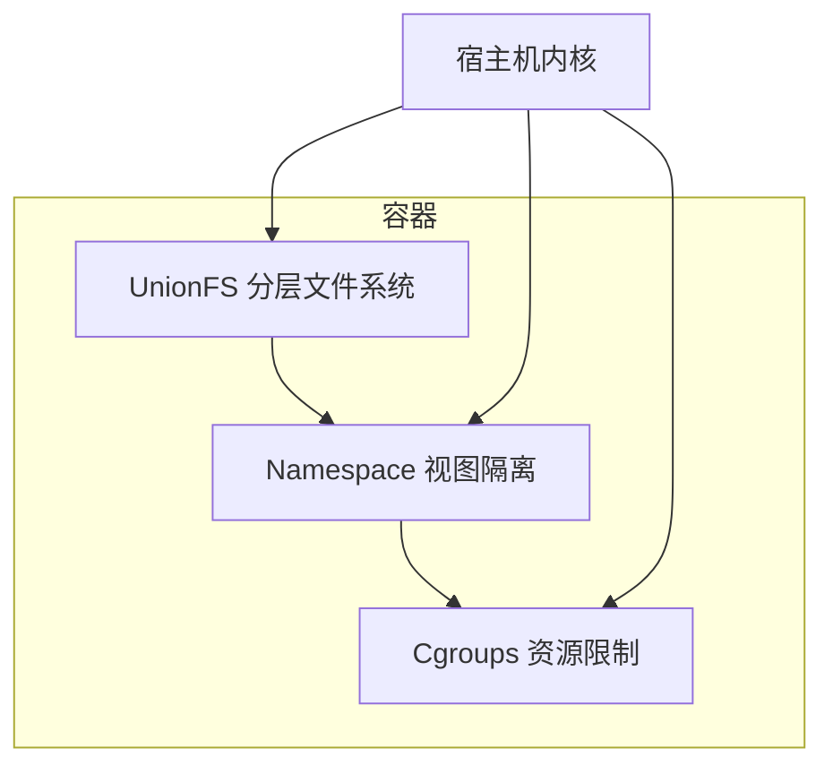
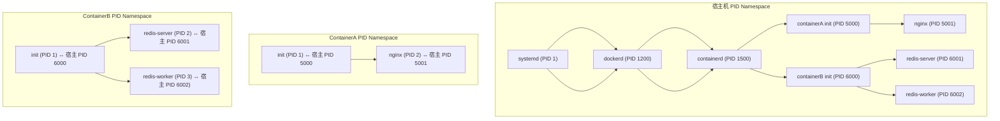
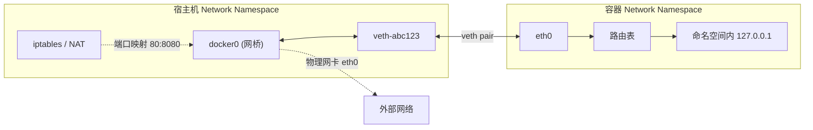
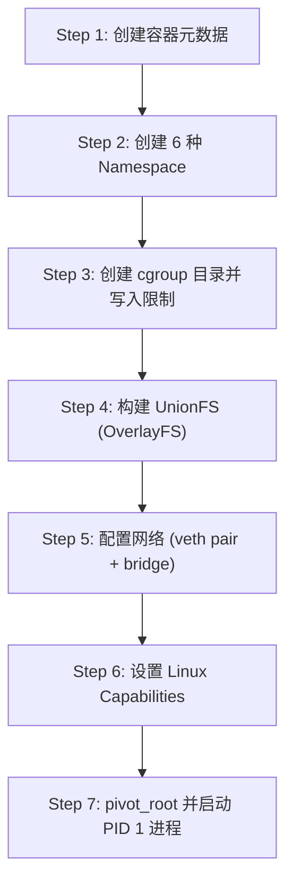

# Namespace 与 Cgroups：容器隔离与资源限制的底层原理

> **容器 (Container)**: 一种轻量级虚拟化技术，通过 Linux 内核的 Namespace（隔离） + Cgroups（资源限制） + UnionFS（分层文件系统）三大机制协同工作，在进程级别实现环境隔离与资源管控。

三者分工明确：

| 机制 | 核心问题 | 比喻 |
|------|---------|------|
| **Namespace** | 容器能"看见"什么 | 给进程戴上一副"VR 眼镜"，只看到自己的世界 |
| **Cgroups** | 容器能用多少资源 | 给进程分配一个"配额钱包" |
| **UnionFS** | 容器的文件系统怎么构建 | 像透明玻璃叠在一起，上层覆盖下层 |



> 参见 [image_layers_cow.md](./image_layers_cow.md)
> 参见 [container_orchestration.md](./container_orchestration.md)

---

## 1. Namespace：解决"看见什么"

> **Namespace (命名空间)**: Linux 内核提供的一种资源隔离机制，让一组进程只能看到与自身相关的系统资源，从而产生"独占整个系统"的错觉。

Linux 从 2.4.19 版本开始引入 mount namespace，此后逐步扩展到 6 种主要 Namespace：

| Namespace | 隔离内容 | 系统调用参数 | 内核版本 |
|-----------|----------|-------------|---------|
| PID | 进程 ID 空间 | `CLONE_NEWPID` | 2.6.24 |
| NET | 网络栈 | `CLONE_NEWNET` | 2.6.29 |
| MNT | 挂载点表 | `CLONE_NEWNS` | 2.4.19 |
| UTS | 主机名与域名 | `CLONE_NEWUTS` | 2.6.19 |
| IPC | 进程间通信 | `CLONE_NEWIPC` | 2.6.19 |
| USER | 用户与用户组 | `CLONE_NEWUSER` | 3.5 |

每个进程都属于各自的 Namespace 集合，可通过 `/proc/<pid>/ns/` 查看：

```bash
$ ls -la /proc/self/ns/
lrwxrwxrwx 1 root root 0 cgroup -> 'cgroup:[4026531835]'
lrwxrwxrwx 1 root root 0 ipc    -> 'ipc:[4026531839]'
lrwxrwxrwx 1 root root 0 mnt    -> 'mnt:[4026531840]'
lrwxrwxrwx 1 root root 0 net    -> 'net:[4026531992]'
lrwxrwxrwx 1 root root 0 pid    -> 'pid:[4026531836]'
lrwxrwxrwx 1 root root 0 user   -> 'user:[4026531837]'
lrwxrwxrwx 1 root root 0 uts    -> 'uts:[4026531838]'
```

两个进程如果指向同一个 inode 号，说明它们处于同一个 Namespace 中。

---

### 1.1 PID Namespace：进程树隔离

> **PID Namespace**: 隔离进程 ID 编号空间，使容器内的进程拥有独立的 PID 树，PID 从 1 开始编号。

#### 进程树映射关系



上图说明了一个关键事实：

- **宿主机视角**：容器 A 的 init 进程是 PID 5000，容器 B 的 init 进程是 PID 6000，它们只是宿主机上普通的子进程。
- **容器 A 视角**：自己看到 PID 1 是 init，PID 2 是 nginx，完全不知道 PID 5000/5001 的存在。
- **容器 B 视角**：自己看到 PID 1 是 init，PID 2 是 redis-server，完全不知道容器 A 的存在。

#### PID 1 的特殊性

在容器内，PID 1 承担着与宿主机 systemd/init 类似的角色，但它有几个重要的特殊行为：

| 特性 | 宿主机 PID 1 | 容器内 PID 1 |
|------|------------|-------------|
| 信号处理 | 内核特殊保护，不会被默认杀死 | 同样受内核保护，`SIGKILL` 也无法杀死 |
| 僵尸进程回收 | 自动 `wait()` 回收子进程 | **必须**主动回收，否则僵尸进程堆积 |
| `SIGTERM` 默认行为 | 被 systemd 等处理 | 如果应用不注册处理器，信号被丢弃 |
| `docker stop` 超时 | N/A | 发送 `SIGTERM`，10 秒后 `SIGKILL` |

**核心问题**：如果容器内的 PID 1 是一个简单的应用程序（如 `python app.py`），它通常不会回收孤儿进程。当容器停止时，`docker stop` 发送 `SIGTERM` 给 PID 1，如果应用没有注册信号处理器，信号会丢失，最终 Docker 只能在超时后强制 `SIGKILL`。

**解决方案**：

```bash
# 方案 1：使用 --init 自动注入 tini 作为 PID 1
docker run --init nginx

# 方案 2：在 Dockerfile 中使用 tini 或 dumb-init
ENTRYPOINT ["tini", "--"]
CMD ["python", "app.py"]

# 方案 3：脚本形式的 init 进程
ENTRYPOINT ["/entrypoint.sh"]  # 脚本中 exec $@ 转交信号
```

#### 嵌套 PID Namespace

PID Namespace 支持嵌套：子 Namespace 可以看到父 Namespace 的进程（以只读方式），但父 Namespace 无法直接看到子 Namespace 内部的进程编号。

```bash
# 创建嵌套 PID Namespace
unshare --pid --fork --mount-proc bash
# 在新的 PID Namespace 内再嵌套一层
unshare --pid --fork --mount-proc bash
```

---

### 1.2 NET Namespace：网络栈隔离

> **NET Namespace**: 为容器提供独立的网络协议栈，包括网卡（NIC）、IP 地址、端口空间、路由表、iptables 规则、ARP 表等。

#### veth pair 工作原理

> **veth pair (Virtual Ethernet Pair)**: 一对虚拟网卡设备，从一端发送的数据会立即出现在另一端，类似于一根虚拟网线连接两个网络命名空间。



**数据包流转过程**：

1. 容器内进程发送数据到 `eth0`
2. 数据通过 veth pair 到达宿主机的 `veth-abc123`
3. `veth-abc123` 作为 docker0 网桥的一个端口，数据被网桥转发
4. 如果目标是外部网络，通过 docker0 的 NAT（iptables）规则转发到宿主机物理网卡

#### Docker 四种网络模式对比

| 模式 | Docker 参数 | 特点 | 使用场景 |
|------|------------|------|---------|
| **Bridge** (默认) | `--network bridge` | 独立 Network Namespace，通过 veth pair + docker0 网桥连接 | 日常开发、微服务 |
| **Host** | `--network host` | 共享宿主机 Network Namespace，无隔离 | 高性能网络需求 |
| **None** | `--network none` | 只有 loopback 网卡 `lo`，无外部网络 | 离线计算、安全隔离 |
| **Container** | `--network container:<id>` | 与另一个容器共享 Network Namespace | sidecar 模式、日志采集 |

```bash
# Bridge 模式（默认）
docker run -d --name web -p 8080:80 nginx
# 容器内有独立 IP（如 172.17.0.2），通过 iptables DNAT 映射到宿主机 8080

# Host 模式
docker run -d --name web --network host nginx
# 容器直接使用宿主机网络栈，监听 80 端口等于占用宿主机 80

# None 模式
docker run -d --name worker --network none myapp
# 容器内只有 127.0.0.1，无法访问外部，适合纯计算任务

# Container 模式
docker run -d --name app --network bridge myapp
docker run -d --name log-collector --network container:app log-collector
# log-collector 与 app 共享网络栈，可以通过 127.0.0.1 访问 app 的端口
```

#### 查看容器网络详情

```bash
# 查看容器的 veth pair 对端
$ docker exec web cat /sys/class/net/eth0/iflink
15
$ ip link | grep 15
15: veth-abc123@if14: <BROADCAST,MULTICAST,UP> mtu 1500 ...

# 查看容器路由表
$ docker exec web ip route
default via 172.17.0.1 dev eth0
172.17.0.0/16 dev eth0 proto kernel scope link src 172.17.0.2

# 查看宿主机网桥
$ bridge fmac show docker0
```

---

### 1.3 MNT Namespace：挂载点隔离

> **MNT Namespace**: 隔离文件系统挂载点表，使每个容器拥有独立的文件系统挂载视图。在一个 Namespace 中挂载/卸载文件系统不会影响其他 Namespace。

#### Mount Propagation（挂载传播）

> **Mount Propagation**: 控制 mount 事件在父子 MNT Namespace 之间的传播行为，有四种传播类型。

| 传播类型 | 含义 | 场景 |
|---------|------|------|
| **shared** | mount/umount 事件双向传播（父子互相影响） | systemd 默认使用 |
| **slave** | 父到子单向传播（父的 mount 可见，子的不可见） | 常见容器配置 |
| **private** | 完全隔离，不传播任何 mount 事件 | Docker 容器默认 |
| **unbindable** | 与 private 相同，但不允许被 bind mount | 防止递归绑定 |

```bash
# 查看当前 mount propagation
$ cat /proc/self/mountinfo | grep overlay
531 520 0:49 /... / overlay rw,relatime - overlay overlay ...

# 在容器中设置 shared propagation（Docker 默认是 private）
docker run --mount type=bind,source=/host/dir,target=/container/dir,propagation=rshared nginx
```

#### chroot vs pivot_root

> **chroot (Change Root)**: 更改进程的根目录，使进程无法访问根目录之外的文件。但它**不会**切换 mount namespace，原有挂载点仍然可见。
>
> **pivot_root**: 将整个根文件系统切换到新的位置，并**卸载**旧根文件系统。比 chroot 更彻底、更安全。

| 对比维度 | chroot | pivot_root |
|---------|--------|-----------|
| 安全性 | 低 — 进程可通过 `cd /..` 逃逸（在某些内核版本） | 高 — 旧根被卸载，无法逃逸 |
| 旧根处理 | 旧根挂载点仍存在 | 旧根被卸载或移到新根的某个子目录 |
| 使用复杂度 | 简单 `chroot /newroot` | 需要准备新根、调用 `pivot_root()`、卸载旧根 |
| Docker 使用 | 早期版本使用 | 当前版本使用（containerd/runc 默认） |

```bash
# chroot 示例
sudo chroot /newroot /bin/bash

# pivot_root 流程（runc 内部逻辑简化）
# 1. 挂载新根文件系统
mount --bind /container/rootfs /mnt/rootfs
# 2. 创建 oldroot 挂载点
mkdir /mnt/rootfs/oldroot
# 3. 执行 pivot_root
pivot_root /mnt/rootfs /mnt/rootfs/oldroot
# 4. 卸载旧根
umount -l /oldroot
```

---

### 1.4 UTS Namespace：主机名隔离

> **UTS Namespace**: 隔离 `hostname` 和 `domainname`，使每个容器可以拥有独立的主机名。

UTS 是最简单的 Namespace，但有两个实际用途：

1. **容器身份标识**：不同容器可以设置不同的 hostname 便于区分和日志记录。
2. **分布式系统协调**：某些分布式应用依赖 hostname 做节点发现。

```bash
# Docker 默认使用容器 ID 短哈希作为 hostname
docker run -it --hostname my-node alpine hostname
# 输出: my-node

# 查看容器 UTS Namespace
$ ls -la /proc/<container_pid>/ns/uts
lrwxrwxrwx 1 root root 0 uts -> 'uts:[4026531838]'
```

---

### 1.5 IPC Namespace：进程间通信隔离

> **IPC Namespace**: 隔离 System V IPC 和 POSIX 消息队列，使容器内的进程只能看到同 Namespace 内的共享内存段、信号量和消息队列。

隔离的 IPC 对象包括：

| IPC 机制 | 系统调用 | 隔离内容 |
|---------|---------|---------|
| System V 消息队列 | `msgget`, `msgsnd`, `msgrcv` | 消息队列标识符 |
| System V 信号量 | `semget`, `semop` | 信号量集合 |
| System V 共享内存 | `shmget`, `shmat` | 共享内存段 |
| POSIX 消息队列 | `mq_open`, `mq_send` | 消息队列描述符 |

```bash
# 在宿主机上创建共享内存
$ ipcs -m
------ Shared Memory Segments --------
key        shmid      owner      perms      bytes      nattch     status
0x00000000 65536      root       644        80         0

# 在容器内查看 — 看不到宿主机的共享内存段
docker run -it alpine ipcs -m
------ Shared Memory Segments --------
# (空)
```

**实际场景**：多个容器需要共享内存（如进程间缓存），可以通过 `--ipc=container:<id>` 共享 IPC Namespace，或使用挂载共享内存文件系统 `/dev/shm`：

```bash
# 共享 IPC Namespace
docker run -d --name app1 --ipc=shareable myapp
docker run -d --name app2 --ipc=container:app1 myapp

# 挂载共享内存
docker run -d --shm-size=256m myapp
```

---

### 1.6 USER Namespace：用户隔离与 Rootless 容器

> **USER Namespace**: 隔离用户和用户组 ID 空间，使容器内的 UID/GID 映射到宿主机的不同 UID/GID，从而实现容器内 root 不等于宿主机 root。

#### UID Mapping 机制

```
容器内 UID 0 (root) ──映射──> 宿主机 UID 100000 (普通用户)
容器内 UID 1      ──映射──> 宿主机 UID 100001
容器内 UID 2      ──映射──> 宿主机 UID 100002
...
```

核心映射文件：

| 文件 | 作用 | 格式 |
|------|------|------|
| `/proc/<pid>/uid_map` | UID 映射关系 | `容器内起始UID 宿主机起始UID 映射数量` |
| `/proc/<pid>/gid_map` | GID 映射关系 | 同上 |
| `/etc/subuid` | 用户可用的 subuid 范围 | `username:start:count` |
| `/etc/subgid` | 用户可用的 subgid 范围 | `username:start:count` |

```bash
# 查看当前用户的 subuid 范围
$ cat /etc/subuid
zhuji:100000:65536
# 表示用户 zhuji 可以将容器内 UID 0-65535 映射到宿主机 UID 100000-165535

# 查看容器的 UID 映射
$ cat /proc/<container_pid>/uid_map
         0       1000          1
      1000       1000          1
# 容器内 UID 0 -> 宿主机 UID 1000
# 容器内 UID 1000 -> 宿主机 UID 1000
```

#### Rootless Container（无根容器）

> **Rootless Container**: 在没有宿主机 root 权限的情况下运行的容器。通过 USER Namespace 将容器内 root 映射为宿主机普通用户，实现完全非特权运行。

```bash
# 安装 rootless Docker
dockerd-rootless-setuptool.sh install

# 运行 rootless 容器
docker run -d --name web nginx
# 此时即使容器内进程是 UID 0，在宿主机上也只是普通用户权限
```

**Rootless 容器的限制**：

- 无法绑定 1024 以下的端口（宿主机需要 root 才能绑定特权端口）
- 无法挂载某些特殊文件系统（如 `/proc` 的某些部分）
- 网络配置需要 slirp4netns 等用户态网络方案
- 存储驱动默认使用 vfs（性能较低），或 fuse-overlayfs

---

## 2. Cgroups：解决"能用多少"

> **Cgroups (Control Groups)**: Linux 内核提供的资源限制与监控机制，可以限制、记录和隔离进程组使用的物理资源（CPU、内存、磁盘 I/O 等）。

Cgroups 的工作方式是：将进程放入一个 cgroup 中，然后对该 cgroup 设置资源限制。所有属于该 cgroup 的进程共同受到这些限制的约束。

---

### 2.1 cgroup v1 子系统详解

> **cgroup v1**: 第一代控制组实现，每个子系统（如 cpu、memory）有独立的挂载层次（hierarchy），不同子系统可以独立挂载到不同的目录。

#### 2.1.1 cpu 子系统

限制容器使用 CPU 的时间片。

| Docker 参数 | 对应 cgroup 文件 | 行为 |
|------------|-----------------|------|
| `--cpus=1` | `cpu.cfs_quota_us / cpu.cfs_period_us` | 硬限制：最多使用 1 个 CPU 核 |
| `--cpu-shares=512` | `cpu.shares` | 软限制：权重（默认 1024） |
| `--cpuset-cpus=0,1` | `cpuset.cpus` | 绑定到指定 CPU 核心 |
| `--cpuset-mems=0` | `cpuset.mems` | 绑定到指定 NUMA 节点 |

**场景**：Web 服务集群中，核心 API 服务分配 `--cpus=2 --cpu-shares=2048`，后台任务分配 `--cpus=1 --cpu-shares=512`，确保核心服务获得更多 CPU 时间。

```bash
# 查看容器 CPU cgroup
$ cat /sys/fs/cgroup/cpu/docker/<container_id>/cpu.cfs_quota_us
100000
$ cat /sys/fs/cgroup/cpu/docker/<container_id>/cpu.cfs_period_us
100000
# quota/period = 100000/100000 = 1 CPU
```

#### 2.1.2 memory 子系统

限制容器使用的物理内存和 swap。

| Docker 参数 | 对应 cgroup 文件 | 行为 |
|------------|-----------------|------|
| `--memory=512m` | `memory.limit_in_bytes` | 硬限制：最多使用 512MB 物理内存 |
| `--memory-swap=1g` | `memory.memsw.limit_in_bytes` | memory + swap 总量上限 |
| `--memory-reservation=256m` | `memory.soft_limit_in_bytes` | 软限制：内存紧张时优先回收 |
| `--oom-kill-disable` | `memory.oom_control` | 禁止 OOM Killer 杀死进程（危险） |

**关键规则**：`--memory-swap` 表示 **memory + swap 的总和**，不是 swap 的独立值。

```
# 场景 1：只设置 --memory=512m
# 隐含：swap = memory = 512m，总可用 = 512m + 512m = 1g

# 场景 2：--memory=512m --memory-swap=1g
# swap = 1g - 512m = 512m，总可用 = 1g

# 场景 3：--memory=512m --memory-swap=512m
# swap = 0，禁用 swap，总可用 = 512m
```

```bash
# 触发 OOM 的测试
docker run -m 64m --rm stress --vm 1 --vm-bytes 128M --vm-hang 0
# 容器因 OOM 被杀死
```

#### 2.1.3 blkio 子系统

限制块设备（磁盘）的 I/O 吞吐量。

| Docker 参数 | 对应 cgroup 文件 | 行为 |
|------------|-----------------|------|
| `--blkio-weight=500` | `blkio.weight` | I/O 权重（10-1000，默认 500） |
| `--device-read-bps` | `blkio.throttle.read_bps_device` | 限制读取速率（字节/秒） |
| `--device-write-bps` | `blkio.throttle.write_bps_device` | 限制写入速率（字节/秒） |
| `--device-read-iops` | `blkio.throttle.read_iops_device` | 限制读取 IOPS |
| `--device-write-iops` | `blkio.throttle.write_iops_device` | 限制写入 IOPS |

**场景**：日志收集容器需要大量磁盘写入，限制其 I/O 避免影响数据库容器：

```bash
# 限制日志容器写入速率为 10MB/s
docker run -d --name logger \
  --device-write-bps /dev/sda:10mb \
  fluentd

# 限制数据库容器的 IOPS
docker run -d --name db \
  --device-read-iops /dev/sda:1000 \
  --device-write-iops /dev/sda:500 \
  postgres
```

#### 2.1.4 pids 子系统

限制 cgroup 中允许创建的最大进程数。

| Docker 参数 | 对应 cgroup 文件 | 行为 |
|------------|-----------------|------|
| `--pids-limit=100` | `pids.max` | 最多允许 100 个进程（含线程） |

**场景**：防止恶意或失控的应用通过 fork bomb 耗尽系统 PID 资源：

```bash
# 限制容器最多 100 个进程
docker run -d --pids-limit=100 myapp

# 测试 fork bomb（安全环境中）
docker run --rm --pids-limit=100 alpine sh -c "while true; do :; done"
# 达到限制后，新的 fork 调用会失败
```

#### 2.1.5 devices 子系统

控制 cgroup 中进程对设备文件的访问权限。

| Docker 参数 | 行为 |
|------------|------|
| `--device /dev/sda:/dev/xvda:r` | 挂载设备（只读） |
| `--device-cgroup-rule='a 8:0 rwm'` | 添加设备访问规则 |
| `--privileged` | 赋予所有设备访问权限（危险） |

**场景**：GPU 容器需要访问 `/dev/nvidia0`，普通容器不应访问任何块设备：

```bash
# GPU 容器
docker run --gpus all nvidia/cuda:11.0 base nvidia-smi

# 严格限制设备访问
docker run --cap-drop ALL --device-cgroup-rule='c 226:* r' myapp
```

#### 2.1.6 net_cls 子系统

为网络数据包打标签，配合 tc（traffic control）实现网络带宽限制。

| 对应 cgroup 文件 | 行为 |
|-----------------|------|
| `net_cls.classid` | 为 cgroup 中的网络包标记 classid |

**场景**：使用 tc + net_cls 实现容器网络带宽限制（现代 Docker 更常用 `--network` 插件直接实现）。

#### 2.1.7 freezer 子系统

挂起/恢复 cgroup 中的所有进程。

| cgroup 文件 | 行为 |
|------------|------|
| `freezer.state` | 写入 `FROZEN` 挂起，写入 `THAWED` 恢复 |

**场景**：检查点/恢复（CRIU）、批量管理容器的暂停与恢复：

```bash
# 冻结容器所有进程
echo FROZEN > /sys/fs/cgroup/freezer/docker/<container_id>/freezer.state

# 恢复容器所有进程
echo THAWED > /sys/fs/cgroup/freezer/docker/<container_id>/freezer.state
```

---

### 2.2 cgroup v1 vs v2 对比

> **cgroup v2**: 第二代控制组实现，将所有子系统统一到单一层次结构中，解决了 v1 的设计问题。

| 维度 | cgroup v1 | cgroup v2 |
|------|-----------|-----------|
| **层次结构** | 多层次，每个子系统独立挂载 | 单一统一层次，所有子系统共享一棵树 |
| **挂载路径** | `/sys/fs/cgroup/cpu/`, `/sys/fs/cgroup/memory/` 等多个 | 统一在 `/sys/fs/cgroup/` |
| **后台进程** | 大量 `systemd` 后台进程管理不同层次 | 简化，单一 `systemd` 管理 |
| **内存控制** | `memory.limit_in_bytes` | `memory.max` |
| **进程归属** | 一个进程可同时属于多个层次的不同 cgroup | 一个进程只属于一个 cgroup |
| **默认内核** | Linux 2.6.24+ | Linux 4.15+，5.x+ 默认启用 |
| **Docker 支持** | 兼容性好，长期支持 | 现代版本默认使用 |

```bash
# 检查当前系统使用的 cgroup 版本
$ mount | grep cgroup
# v1: 多行输出，每个子系统单独一行
# v2: 单行 cgroup2 on /sys/fs/cgroup type cgroup2

# 或检查内核参数
$ grep cgroup /proc/filesystems
nodev   cgroup
nodev   cgroup2
```

---

## 3. `docker run --cpus=1 --memory=512m nginx` 背后发生了什么

当执行这条命令时，Docker 引擎（dockerd -> containerd -> containerd-shim -> runc）会执行以下 7 个步骤：



### Step 1: 创建容器元数据

Docker 客户端解析命令行参数，构建 OCI (Open Container Initiative) 规范的运行时配置（`config.json` 和 `runtime.json`），包括：

```json
{
  "ociVersion": "1.0.2",
  "process": {
    "terminal": false,
    "user": {"uid": 0, "gid": 0},
    "args": ["nginx", "-g", "daemon off;"],
    "capabilities": {
      "bounding": ["CAP_CHOWN", "CAP_DAC_OVERRIDE", "..."],
      "permitted": ["CAP_CHOWN", "CAP_DAC_OVERRIDE", "..."],
      "effective": ["CAP_CHOWN", "CAP_DAC_OVERRIDE", "..."]
    },
    "rlimits": [{"type": "RLIMIT_NOFILE", "hard": 1048576, "soft": 1048576}]
  },
  "linux": {
    "namespaces": [
      {"type": "pid"},
      {"type": "network"},
      {"type": "mount"},
      {"type": "uts"},
      {"type": "ipc"},
      {"type": "user"}
    ],
    "resources": {
      "devices": [{"allow": false, "access": "rwm"}],
      "cpu": {"quota": 100000, "period": 100000},
      "memory": {"limit": 536870912}
    }
  }
}
```

### Step 2: 创建 6 种 Namespace

runc 调用 `clone()` 系统调用，一次性或逐步创建 6 种 Namespace：

```c
// 简化的 runc 内部逻辑
clone(child_fn, child_stack,
      CLONE_NEWPID | CLONE_NEWNET | CLONE_NEWNS |
      CLONE_NEWUTS | CLONE_NEWIPC | CLONE_NEWUSER | SIGCHLD, NULL);
```

此时容器进程已经拥有独立的 PID、网络、挂载、主机名、IPC 和用户视图。

### Step 3: 创建 cgroup 目录并写入资源限制

```bash
# 创建 cgroup 目录
mkdir /sys/fs/cgroup/docker/<container_id>/

# 写入 CPU 限制（--cpus=1）
echo 100000 > /sys/fs/cgroup/docker/<container_id>/cpu.cfs_quota_us
echo 100000 > /sys/fs/cgroup/docker/<container_id>/cpu.cfs_period_us

# 写入内存限制（--memory=512m）
echo 536870912 > /sys/fs/cgroup/docker/<container_id>/memory.limit_in_bytes

# 将容器进程 PID 写入 cgroup.procs
echo <container_pid> > /sys/fs/cgroup/docker/<container_id>/cgroup.procs
```

### Step 4: 构建 UnionFS (OverlayFS)

```bash
# 创建 OverlayFS 分层
# lowerdir = 镜像层（只读）+ 基础层
# upperdir = 容器写层（可读写）
# workdir  = OverlayFS 工作目录
mount -t overlay overlay \
  -o lowerdir=/var/lib/docker/overlay2/<layer1>/merged:/var/lib/docker/overlay2/<layer2>/merged \
  -o upperdir=/var/lib/docker/overlay2/<container_id>/diff \
  -o workdir=/var/lib/docker/overlay2/<container_id>/work \
  /var/lib/docker/overlay2/<container_id>/merged
```

### Step 5: 配置网络

```bash
# 创建 veth pair
ip link add veth-abc123 type veth peer name eth0

# 将 eth0 移入容器的 NET Namespace
ip link set eth0 netns <container_pid>

# 将 veth-abc123 接入 docker0 网桥
ip link set veth-abc123 master docker0

# 在容器内配置 IP 地址
nsenter -t <container_pid> -n ip addr add 172.17.0.2/16 dev eth0
nsenter -t <container_pid> -n ip link set eth0 up
nsenter -t <container_pid> -n ip route add default via 172.17.0.1

# 配置 NAT/iptables
iptables -t nat -A DOCKER -p tcp --dport 80 -j DNAT --to-destination 172.17.0.2:80
```

### Step 6: 设置 Linux Capabilities

Docker 默认保留 14 个 Capability，移除其余所有特权能力（相比宿主机 root 的全部能力大幅缩减）。

### Step 7: pivot_root 并启动 PID 1

```c
// runc 最终执行 pivot_root
pivot_root("/rootfs", "/rootfs/.oldroot");

// 卸载旧根文件系统
umount2("/.oldroot", MNT_DETACH);

// 执行容器入口命令
execve("/docker-entrypoint.sh", args, env);
```

---

## 4. Linux Capabilities 与 UID Mapping

### 4.1 Linux Capabilities

> **Linux Capabilities**: 将传统 Unix root 权限（全部或零）细分为一系列独立的能力单元，每个 Capability 代表一种特权操作。

Docker 默认保留的 14 个 Capabilities：

| # | Capability | 作用 |
|---|-----------|------|
| 1 | `CAP_CHOWN` | 修改文件所有者 |
| 2 | `CAP_DAC_OVERRIDE` | 绕过文件读写权限检查 |
| 3 | `CAP_DAC_READ_SEARCH` | 绕过文件读权限和目录读权限检查 |
| 4 | `CAP_FOWNER` | 绕过文件所有者权限检查 |
| 5 | `CAP_FSETID` | 允许设置 setuid/setgid 位 |
| 6 | `CAP_KILL` | 向不属于自己的进程发送信号 |
| 7 | `CAP_SETGID` | 允许设置 GID |
| 8 | `CAP_SETUID` | 允许设置 UID |
| 9 | `CAP_SETPCAP` | 修改进程的 Capabilities |
| 10 | `CAP_NET_BIND_SERVICE` | 绑定 1024 以下的特权端口 |
| 11 | `CAP_NET_RAW` | 使用原始套接字（raw socket） |
| 12 | `CAP_SYS_CHROOT` | 使用 chroot() |
| 13 | `CAP_MKNOD` | 创建设备文件 |
| 14 | `CAP_AUDIT_WRITE` | 写入内核审计日志 |

**安全实践：最小权限原则**

```bash
# 查看容器当前拥有的 Capabilities
docker inspect --format '{{.HostConfig.CapAdd}} {{.HostConfig.CapDrop}}' <container_id>

# 移除所有 Capabilities 后只添加需要的
docker run --cap-drop ALL --cap-add NET_BIND_SERVICE nginx

# 完全移除所有 Capabilities（最安全，但可能影响某些应用）
docker run --cap-drop ALL alpine sh
```

### 4.2 UID Mapping 文件详解

UID/GID 映射通过以下文件配置：

```
/etc/subuid 格式: <username>:<start_uid>:<count>
/etc/subgid 格式: <username>:<start_gid>:<count>

# 示例
zhuji:100000:65536
# 含义: 用户 zhuji 拥有 UID 100000-165535 的 subuid 范围
# 容器可以将 UID 0-65535 映射到此范围
```

```
/proc/<pid>/uid_map 格式: <ns_start> <host_start> <length>

# 示例
0 100000 65536
# 含义: 容器内 UID 0 映射到宿主机 UID 100000
#         容器内 UID 1 映射到宿主机 UID 100001
#         ...
#         容器内 UID 65535 映射到宿主机 UID 165535
```

**映射规则限制**（内核安全约束）：

1. 一行映射中的映射数量（length）不能超过 `/etc/subuid` 或 `/etc/subgid` 中分配的数量。
2. 写入 `uid_map` 的进程只能写入自己拥有的 UID 范围。
3. `uid_map` 和 `gid_map** 只能写入一次，写入后不可修改。

---

## 5. 面试高频问题

### Q1: 请完整阐述「容器 = Namespace + Cgroups + UnionFS」中每一层的作用和关系。

**A**：三层各自解决不同的问题，缺一不可：

- **Namespace**（隔离层）：解决"进程能看到什么"。通过 6 种 Namespace 隔离 PID、网络、挂载点、主机名、IPC、用户，让进程以为自己独占一台完整机器。但 Namespace 不做资源限制，一个容器理论上可以吃掉全部 CPU 和内存。
- **Cgroups**（限制层）：解决"进程能用多少"。对 CPU、内存、磁盘 I/O、进程数等资源设置硬性上限，防止单个容器影响其他容器和宿主机。
- **UnionFS**（文件系统层）：解决"容器文件从哪来"。将只读的镜像层和可写的容器层叠加，实现镜像复用和快速构建。容器删除后，写层自动清除，镜像层保持不变。

三者关系：Namespace 提供隔离的"房间"，Cgroups 确保每个房间不会"过度消耗水电"，UnionFS 为每个房间提供"家具"。没有 Namespace，进程能看到宿主机一切；没有 Cgroups，容器可能耗尽资源；没有 UnionFS，每次创建容器都要复制完整的文件系统。

### Q2: 16 个容器并发验证 rollout，cgroup 怎么配？

**A**：假设宿主机有 8 核 CPU 和 32GB 内存：

1. **资源预算**：每个容器分配 `--cpus=0.5`（共 8 核）和 `--memory=1g`（共 16GB），预留 50% 资源给宿主机和突发。
2. **CPU 控制**：`--cpus=0.5` 是 CFS 硬上限（CFS quota = 50000 / period 100000），配合 `--cpu-shares=512` 在资源竞争时按权重分配。
3. **内存控制**：`--memory=1g --memory-swap=1g` 禁用 swap（避免磁盘延迟影响性能），`--memory-reservation=512m` 作为软限制在内存紧张时优先收缩。
4. **防护措施**：`--pids-limit=100` 防止 fork bomb，`--oom-kill-disable=false`（默认）允许 OOM Killer 回收异常容器。
5. **I/O 隔离**：`--blkio-weight=500` 防止容器抢占磁盘 I/O。
6. **监控**：通过 `docker stats` 和 Prometheus cgroup exporter 实时监控资源使用。

### Q3: 为什么 Namespace 不是安全边界？如何加强容器安全？

**A**：Namespace 只提供资源视图的隔离，不提供完整的权限控制。安全不足体现在：

1. **共享内核**：所有容器与宿主机共享同一个 Linux 内核，内核漏洞可导致容器逃逸。
2. **Capabilities 泄露**：默认保留的 14 个 Capabilities 中，某些可能被滥用。
3. **信息泄露**：`/proc`、`/sys` 中的大量信息未隔离，可推断宿主机状态。

**加强措施**：

- `--cap-drop ALL` 移除所有 Capabilities，按需 `--cap-add`
- `--security-opt no-new-privileges:true` 阻止通过 setuid 提权
- `--security-opt seccomp=profile.json` 使用白名单 seccomp 过滤系统调用
- `--read-only` 将容器文件系统设为只读
- 使用 **rootless 容器**（USER Namespace + subuid/subgid）
- AppArmor / SELinux MAC（强制访问控制）
- 运行时安全工具：Falco、gVisor、Kata Containers

### Q4: cgroup v1 和 v2 的区别？实际生产环境用哪个？迁移需要注意什么？

**A**：

**核心区别**：
- v1 是多层次架构（每个子系统一棵树），v2 是单一层次架构（所有子系统共用一棵树）。
- v1 中一个进程可同时属于多个子系统的不用 cgroup，v2 中一个进程只属于一个 cgroup。
- v2 的内存控制器支持 PSI（Pressure Stall Information），可提供更精细的内存压力监控。
- v2 的设计更简洁，减少了后台守护进程数量。

**实际选择**：
- Ubuntu 22.04+、RHEL 9+、Fedora 35+ 默认使用 cgroup v2。
- Docker 20.10+ 和 containerd 1.6+ 均支持 v2。
- Kubernetes 1.25+ 正式支持 cgroup v2（从 1.22 开始 alpha）。

**迁移注意**：
- 监控系统（Prometheus node_exporter、cAdvisor）的指标采集路径变化。
- 某些自定义的 cgroup 脚本需要适配 v2 的文件路径（如 `memory.limit_in_bytes` -> `memory.max`）。
- systemd 的 `Delegate=yes` 配置在 v2 下行为略有不同。

### Q5: 如果一个容器里的进程不断 fork，会怎样？怎么防止？如果容器内 PID 1 进程意外退出会发生什么？

**A**：

**fork bomb 的危害**：
- 耗尽宿主机的 PID 空间（默认 `pid_max` 约 32768 或 4194304）。
- 大量进程竞争 CPU 时间片，导致其他容器和宿主机服务响应缓慢。
- 内存被大量进程的内核栈和 task_struct 占用，触发 OOM。

**防止措施**：
- `--pids-limit=100`（或按应用规模调整），限制容器内最大进程数。
- cgroup 的 `pids.max` 达到上限后，新的 `fork()`/`clone()` 调用返回 `EAGAIN` 错误，应用可以捕获并处理。
- 监控容器内进程数量：`docker top <container>` 或通过 cgroup 指标 `pids.current` / `pids.max`。

**PID 1 退出的后果**：
- 内核会杀死该 PID Namespace 中的所有进程（发送 `SIGKILL`）。
- 容器停止运行，Docker 将容器状态设为 `exited`。
- 如果容器配置了 `restart: always`（Docker Compose）或 `--restart=always`，Docker 会自动重启容器。
- 如果没有 restart 策略，容器保持停止状态，需要手动启动。
- 因此容器内的 PID 1 进程应该使用 `tini`、`dumb-init` 或正确处理信号以确保优雅关闭。
