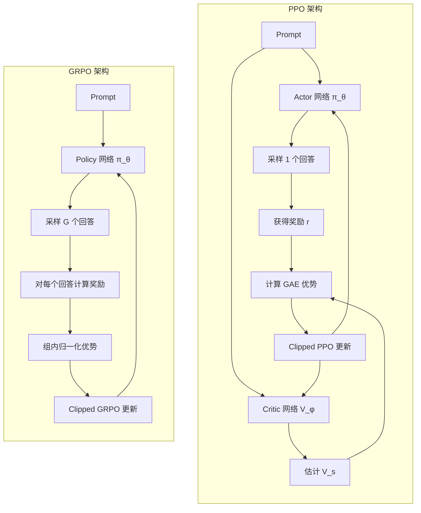
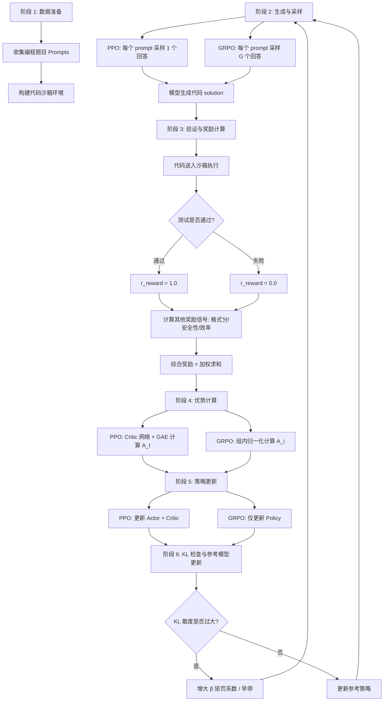
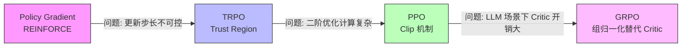

# PPO 与 GRPO：强化学习在 Agent 训练中的完整拆解

> **目标**：从 RL 基础概念出发，完整拆解 PPO 和 GRPO 的原理、公式、训练流程，并通过对比与面试高频问题建立深度理解。

---

## 1. 强化学习基础：从零讲起

### 1.1 什么是强化学习

> **强化学习 (Reinforcement Learning, RL)**：一种机器学习范式，智能体通过与环境交互，根据获得的奖励信号来学习最优行为策略。

与监督学习"有标准答案"的范式不同，RL 的核心特征是 **延迟反馈** 和 **探索-利用权衡**。智能体不知道哪个动作是"正确"的，只能通过不断试错来发现高回报的行为模式。

### 1.2 RL 的六大核心术语

#### Agent（智能体）

> **Agent**：在环境中做决策的主体，在 LLM 场景下就是我们要训练的语言模型。

Agent 的核心能力是观察环境状态、选择动作、接收奖励，然后根据这些信息调整自己的行为策略。在 Agent 训练中，Agent 就是我们微调的大语言模型，它需要学会在给定问题（状态）时生成高质量的代码或回答（动作）。

#### Environment（环境）

> **Environment**：Agent 所处的外部世界，负责接收 Agent 的动作并返回新的状态和奖励。

在 LLM 的 RL 训练中，环境可以是代码沙箱（执行生成的代码并返回测试结果）、数学验证器（判断推导过程是否正确）、或者用户反馈系统。环境是 Agent 无法直接控制的，Agent 只能通过选择不同的动作来影响环境的状态变化。

#### State（状态）

> **State (s)**：对环境当前情况的完整描述，Agent 基于状态做决策。

在传统 RL（如游戏）中，状态是屏幕像素或棋盘格局。在 LLM 的 RL 训练中，状态通常是 **prompt（提示词）**——它编码了任务描述、上下文信息和约束条件。状态 s_t 完全决定了 Agent 决策时所需的所有信息。

#### Action（动作）

> **Action (a)**：Agent 在当前状态下选择执行的操作。

在 LLM 场景中，动作是模型生成的 **token 序列**——可能是一段代码、一个推理链、或者一段自然语言回答。动作空间是离散的（词表中的 token），这使得语言模型的 RL 训练在动作空间上有特殊性。每个动作 a_t 采自策略 π(a_t | s_t)。

#### Reward（奖励）

> **Reward (r)**：环境对 Agent 动作的即时反馈信号，标量值，衡量动作的好坏。

奖励是 RL 训练唯一的监督信号。关键特性包括：

| 特性 | 说明 |
|------|------|
| 标量性 | 奖励是一个实数，正数表示好，负数表示差 |
| 稀疏性 | 很多任务只有在整个序列完成后才能获得奖励（如代码能否通过测试） |
| 延迟性 | 动作和奖励之间可能隔着多步 |
| 可设计性 | 奖励函数由人工设计，其质量直接决定训练效果 |

在 Agent 训练中，奖励来源多样：代码测试通过率、格式正确性、安全性评分、人类偏好等。

#### Policy（策略）

> **Policy (π)**：从状态到动作的映射函数，定义了 Agent 在每个状态下选择每个动作的概率分布。

策略是 RL 的核心学习对象。形式化定义为 π(a|s)，表示在状态 s 下选择动作 a 的概率。训练的目标就是找到能让长期累积奖励最大化的策略。在 LLM 中，策略就是语言模型本身——给定 prompt 生成 token 序列的概率分布。

### 1.3 RL 最小闭环

```mermaid
flowchart TD
    S[Environment 输出 State s_t] --> P[Agent 的 Policy π 选择 Action a_t]
    P --> E[Environment 接收 a_t]
    E --> R[Environment 返回 Reward r_t]
    E --> SN[Environment 进入新状态 s_{t+1}]
    R --> U[Agent 根据 r 更新 Policy π]
    SN --> U
    U --> S
```

这个闭环不断重复，Agent 的策略在一次次交互中逐渐优化。

### 1.4 RL 与监督学习的根本区别

| 维度 | 监督学习 (SL) | 强化学习 (RL) |
|------|---------------|---------------|
| 训练信号 | 标准答案 (label) | 标量奖励 (reward) |
| 学习方式 | 模仿标注数据 | 通过探索优化策略 |
| 反馈时机 | 即时，每步都有 | 可能延迟，序列结束才给 |
| 数据来源 | 静态数据集 | Agent 自身与环境交互产生 |
| 探索能力 | 无，只能模仿数据 | 有，可以尝试新策略 |
| 目标 | 最小化预测误差 | 最大化累积奖励 |
| 典型任务 | 分类、翻译、摘要 | 游戏、机器人、代码生成 |

RL 的优势在于：当标准答案难以获取或不存在时（如"什么是好的代码？"），可以通过奖励信号引导模型探索更优的行为。

### 1.5 值函数与优势函数

在学习具体算法之前，需要理解两个关键概念。

#### 值函数

> **值函数 V(s)**：从状态 s 出发，按照当前策略 π 执行，未来能获得的期望累积折扣奖励。

$$V(s) = \mathbb{E}_{\pi} \left[ \sum_{t=0}^{\infty} \gamma^t r_t \mid s_0 = s \right]$$

其中 γ ∈ [0, 1] 是折扣因子，控制对未来奖励的重视程度。

#### 动作-值函数

> **动作-值函数 Q(s, a)**：在状态 s 下执行动作 a，之后按照策略 π 执行，未来能获得的期望累积折扣奖励。

$$Q(s, a) = \mathbb{E}_{\pi} \left[ \sum_{t=0}^{\infty} \gamma^t r_t \mid s_0 = s, a_0 = a \right]$$

#### 优势函数

> **优势函数 A(s, a)**：在状态 s 下执行动作 a，比按照策略 π 的"平均水平"好多少。

$$A(s, a) = Q(s, a) - V(s)$$

优势函数是后续 PPO 和 GRPO 中的核心概念：
- A(s, a) > 0：这个动作比平均好，应该增加其概率
- A(s, a) < 0：这个动作比平均差，应该降低其概率
- A(s, a) = 0：这个动作和平均水平一样

---

## 2. 策略梯度方法：RL 优化的起点

### 2.1 核心思想

> **策略梯度 (Policy Gradient)**：直接对策略参数 θ 求梯度，让能带来高奖励的动作概率增大，让带来低奖励的动作概率减小。

策略梯度方法不通过值函数间接选择动作，而是直接优化策略本身。其目标函数为：

$$J(\theta) = \mathbb{E}_{\pi_\theta} \left[ \sum_t \gamma^t r_t \right]$$

我们想最大化 J(θ)，也就是找到让累积奖励期望最大的策略参数。

### 2.2 策略梯度定理

策略梯度的核心公式（REINFORCE）：

$$\nabla_\theta J(\theta) = \mathbb{E}_{\pi_\theta} \left[ \nabla_\theta \log \pi_\theta(a|s) \cdot A(s, a) \right]$$

直觉理解：

```python
# 策略梯度的简化实现
loss = -log_prob(action) * advantage

# 更新：增大产生正 advantage 动作的概率
#       减小产生负 advantage 动作的概率
```

- `log_prob(action)`：策略给该动作的对数概率，代表"模型原本有多倾向这个动作"
- `advantage`：该动作比平均水平好多少，代表"这个动作值得被强化多少"
- 负号：因为我们用梯度下降最小化 loss，而目标是最大化奖励

### 2.3 策略梯度的问题

纯策略梯度有三个致命缺陷：

| 问题 | 描述 | 后果 |
|------|------|------|
| 更新步长不可控 | 每次梯度更新可能让策略变化很大 | 训练不稳定，性能骤降 |
| 高方差 | 单次采样的 reward 波动大 | 需要大量样本才能收敛 |
| 无保证单调改进 | 理论上策略可能变差 | 训练过程不可预测 |

这些问题催生了 TRPO（Trust Region Policy Optimization），进而催生了 PPO——TRPO 的高效替代方案。

---

## 3. PPO 完整拆解：Proximal Policy Optimization

### 3.1 为什么需要 PPO

> **PPO (Proximal Policy Optimization)**：一种策略梯度算法，通过 clip 机制限制每次策略更新的幅度，在保证训练稳定性的同时保持计算高效。

PPO 的核心设计哲学：

> **让策略更新，但别一次走太远。**

TRPO 通过约束 KL 散度来保证单调改进，但需要求解约束优化问题（二阶方法），计算复杂。PPO 用简单的 clip 操作近似实现了类似的效果，成为业界最广泛使用的 RL 算法之一。

### 3.2 重要性采样比

在推导 PPO 公式之前，先理解重要性采样比：

> **重要性采样比 (Importance Sampling Ratio) r(θ)**：新策略与旧策略的概率之比，用于在旧策略收集的数据上更新新策略。

$$r(\theta) = \frac{\pi_\theta(a|s)}{\pi_{\theta_{old}}(a|s)}$$

- r(θ) = 1：新策略和旧策略对这个动作的概率一样
- r(θ) > 1：新策略比旧策略更倾向这个动作（概率增大了）
- r(θ) < 1：新策略比旧策略更不倾向这个动作（概率减小了）

### 3.3 Clipped Surrogate Objective（裁剪代理目标函数）

> **Clipped Surrogate Objective**：PPO 的核心目标函数，通过裁剪重要性采样比来限制策略更新的幅度。

$$L^{CLIP}(\theta) = \mathbb{E}_t \left[ \min\left( r_t(\theta) A_t, \, \text{clip}(r_t(\theta), 1-\epsilon, 1+\epsilon) A_t \right) \right]$$

其中：
- r_t(θ) = π_θ(a_t|s_t) / π_θ_old(a_t|s_t) 是重要性采样比
- A_t 是时间步 t 的优势函数值
- ε 是裁剪参数，通常取 0.1 或 0.2

#### Clip 机制原理详解

clip 机制的本质是一个 **"更新上限"**：

**当 A_t > 0 时（好动作，应增大其概率）：**
- 正常梯度：r(θ) 越大，loss 越小（奖励越多），策略越倾向增大 r
- clip 之后：r(θ) 被限制在 1+ε，即使再增大也不会带来更多奖励
- 效果：好动作的概率最多增加 ε 倍，不会"过度优化"

**当 A_t < 0 时（差动作，应减小其概率）：**
- 正常梯度：r(θ) 越小，loss 越小（惩罚减轻），策略越倾向减小 r
- clip 之后：r(θ) 被限制在 1-ε，即使再减小也不会减轻更多惩罚
- 效果：差动作的概率最多减少 ε 倍，不会"矫枉过正"

```python
# PPO clip 目标函数的实现
def ppo_clipped_objective(ratio, advantage, epsilon=0.2):
    # 未裁剪的目标
    unclipped = ratio * advantage
    # 裁剪后的目标
    clipped = torch.clamp(ratio, 1 - epsilon, 1 + epsilon) * advantage
    # 取两者中较小的值（保守估计）
    return torch.min(unclipped, clipped).mean()

# 训练时取负号做最小化
ppo_loss = -ppo_clipped_objective(ratio, advantage, epsilon=0.2)
```

**直觉总结**：clip 机制相当于告诉模型——"你已经知道这个动作好/坏了，适度调整概率即可，不需要走极端。"

### 3.4 GAE：Generalized Advantage Estimation

> **GAE (Generalized Advantage Estimation)**：一种平衡偏差 (bias) 与方差 (variance) 的优势估计方法，通过引入 λ 参数控制多步回报的指数衰减。

精确计算 A(s,a) 需要 Q(s,a) 和 V(s)，但 Q(s,a) 很难估计。GAE 通过多步 TD 残差的指数加权平均来近似优势函数：

$$\hat{A}_t^{GAE(\gamma, \lambda)} = \sum_{l=0}^{\infty} (\gamma \lambda)^l \delta_{t+l}$$

其中 TD 残差定义为：

$$\delta_t = r_t + \gamma V(s_{t+1}) - V(s_t)$$

#### λ 参数的作用

| λ 值 | 效果 | 特点 |
|------|------|------|
| λ = 0 | 只看当前一步的 TD 残差 | 低方差，高偏差 |
| λ = 1 | 等价于蒙特卡洛估计 | 高方差，低偏差 |
| 0 < λ < 1 | 折中权衡（通常取 0.95） | 实践中最常用 |

#### GAE 的递推实现

```python
def compute_gae(rewards, values, dones, gamma=0.99, lam=0.95):
    """
    计算 GAE 优势估计
    rewards: 每步的奖励列表
    values: 每步的状态值估计列表
    dones: 每步是否结束的标志列表
    gamma: 折扣因子
    lam: GAE lambda 参数
    """
    advantages = []
    gae = 0

    # 从后往前递推
    for t in reversed(range(len(rewards))):
        if t == len(rewards) - 1:
            next_value = 0  # 序列结束时 next_value 为 0
        else:
            next_value = values[t + 1]

        # TD 残差：即时奖励 + 下一状态的折后值估计 - 当前状态的值估计
        delta = rewards[t] + gamma * next_value * (1 - dones[t]) - values[t]

        # GAE 递推：当前 TD 残差 + 折扣后的上一步 GAE
        gae = delta + gamma * lam * (1 - dones[t]) * gae
        advantages.insert(0, gae)

    return advantages
```

### 3.5 PPO 的 Actor-Critic 架构

PPO 通常采用 Actor-Critic 架构：

> **Actor（演员）**：策略网络 π_θ(a|s)，负责选择动作。
>
> **Critic（评论家）**：值函数网络 V_φ(s)，负责估计状态值，辅助计算优势。

```mermaid
flowchart TD
    S[State s_t] --> Actor[Actor 网络 π_θ]
    S --> Critic[Critic 网络 V_φ]
    Actor --> A[采样动作 a_t]
    A --> Env[Environment]
    Env --> R[获得奖励 r_t]
    Env --> S_next[进入状态 s_{t+1}]
    R --> Delta[计算 TD 残差 δ_t]
    Critic --> Delta
    S_next --> Delta
    Delta --> GAE[计算 GAE 优势]
    GAE --> Clip[计算 Clipped Objective]
    A --> Ratio[计算重要性采样比 r_θ]
    Ratio --> Clip
    Clip --> Update[更新 Actor 和 Critic 参数]
    Update --> Actor
    Update --> Critic
```

Critic 的训练目标是最小化值函数的均方误差：

$$L^{VF}(\phi) = \mathbb{E}_t \left[ (V_\phi(s_t) - \hat{R}_t)^2 \right]$$

其中 R_hat_t 是实际的累积折扣回报（return）。

### 3.6 PPO 完整训练循环伪代码

```python
# ============= PPO 完整训练循环 =============

# 初始化
policy_network = PolicyNetwork()       # Actor
value_network = ValueNetwork()         # Critic
reference_policy = copy(policy_network)  # 保存旧策略用于计算 ratio
optimizer = Adam(concat(policy_network.params, value_network.params))

for epoch in range(num_epochs):
    # -------- 阶段 1: 数据收集 (Rollout) --------
    batch_data = []
    for prompt in prompts:
        state = prompt
        trajectory = []

        for t in range(max_steps):
            # 用当前策略采样动作
            action, log_prob = policy_network.sample(state)

            # 执行动作，与环境交互
            reward, next_state, done = environment.step(action)

            trajectory.append({
                'state': state,
                'action': action,
                'log_prob': log_prob,
                'reward': reward,
                'done': done
            })

            state = next_state
            if done:
                break

        batch_data.append(trajectory)

    # -------- 阶段 2: 计算优势函数 --------
    for trajectory in batch_data:
        # 用 Critic 网络计算每步的值估计
        values = [value_network(t['state']) for t in trajectory]

        # 用 GAE 计算优势
        rewards = [t['reward'] for t in trajectory]
        dones = [t['done'] for t in trajectory]
        advantages = compute_gae(rewards, values, dones)

        # 计算累积回报 (用于训练 Critic)
        returns = [adv + val for adv, val in zip(advantages, values)]

        # 标准化优势
        advantages = normalize(advantages)

        # 保存到轨迹中
        for t, adv, ret in zip(trajectory, advantages, returns):
            t['advantage'] = adv
            t['return'] = ret

    # -------- 阶段 3: 策略更新 --------
    # 保存旧策略的 log_prob（用于计算 ratio）
    old_log_probs = {t['state']: t['log_prob'] for traj in batch_data for t in traj}

    for update_step in range(num_update_epochs):
        for trajectory in batch_data:
            for t in trajectory:
                # 重新计算新策略的 log_prob
                new_log_prob = policy_network.log_prob(t['state'], t['action'])

                # 计算重要性采样比
                ratio = torch.exp(new_log_prob - old_log_probs[t['state']])

                # 计算 PPO clipped objective
                actor_loss = -torch.min(
                    ratio * t['advantage'],
                    torch.clamp(ratio, 1 - epsilon, 1 + epsilon) * t['advantage']
                ).mean()

                # Critic loss（值函数 MSE）
                value_pred = value_network(t['state'])
                critic_loss = F.mse_loss(value_pred, t['return'])

                # 可选：KL 散度惩罚
                kl_loss = kl_divergence(policy_network, reference_policy)

                # 总 loss
                total_loss = actor_loss + critic_coef * critic_loss + kl_coef * kl_loss

                optimizer.zero_grad()
                total_loss.backward()
                optimizer.step()

    # 更新参考策略
    reference_policy = copy(policy_network)
```

### 3.7 PPO 在 LLM 中的具体适配

将 PPO 应用到 LLM 训练时，有几个关键适配：

| 适配点 | 传统 RL | LLM 场景 |
|--------|---------|-----------|
| 状态 | 游戏画面/传感器数据 | Prompt token 序列 |
| 动作 | 离散/连续控制指令 | 生成的 token 序列 |
| 环境 | 游戏模拟器 | 代码沙箱/验证器/奖励模型 |
| 奖励 | 游戏得分 | 代码通过率/格式分/偏好分 |
| 序列长度 | 通常较短（几百步） | 可变长（几十到几千 token） |
| 探索 | epsilon-greedy 等 | 温度采样 |

---

## 4. GRPO 完整拆解：Group Relative Policy Optimization

### 4.1 核心思想

> **GRPO (Group Relative Policy Optimization)**：一种策略优化算法，通过对同一 prompt 采样一组回答，用组内相对奖励来构造优势函数，从而省去独立的 Critic 网络。

GRPO 由 DeepSeek 提出，核心洞察是：

> **如果同一问题有多个回答的奖励，那么这些奖励之间的相对关系天然构成了优势的度量。**

### 4.2 与 PPO 的关键区别

PPO 需要一个独立的 Critic 网络 V_φ(s) 来估计基线。但训练一个准确的 Critic 有几个问题：

1. Critic 本身需要大量数据和计算来训练
2. Critic 的误差会传播到优势估计，影响策略更新质量
3. 在 LLM 场景中，状态空间（prompt 空间）巨大，Critic 很难泛化

GRPO 的解决方案：**不训练 Critic，而是用同一 prompt 下多个采样的相对奖励来代替**。

### 4.3 Group Relative 计算公式

对每个 prompt q，采样 G 个回答 {o_1, o_2, ..., o_G}，每个回答获得奖励 {r_1, r_2, ..., r_G}。

#### 组归一化优势函数

> **组归一化优势**：将同一 prompt 下所有回答的奖励进行标准化，得到的相对分数作为每个回答的优势。

$$\hat{A}_i = \frac{r_i - \text{mean}(\{r_1, ..., r_G\})}{\text{std}(\{r_1, ..., r_G\})}$$

其中：
- r_i 是第 i 个回答的奖励
- mean 和 std 在同一 prompt 的 G 个回答上计算
- 标准化后的 A_hat_i 表示第 i 个回答在组内的相对好坏

```python
def compute_group_advantage(rewards_group):
    """
    计算组归一化优势
    rewards_group: 同一 prompt 下 G 个回答的奖励列表
    """
    mean_reward = sum(rewards_group) / len(rewards_group)
    std_reward = (sum((r - mean_reward) ** 2 for r in rewards_group)
                  / len(rewards_group)) ** 0.5

    # 防止除零
    if std_reward < 1e-8:
        std_reward = 1.0

    advantages = [(r - mean_reward) / std_reward for r in rewards_group]
    return advantages
```

#### 完整 GRPO 目标函数

$$J_{GRPO}(\theta) = \mathbb{E}_{q \sim P(Q), \{o_i\}_{i=1}^G \sim \pi_{\theta_{old}}(\cdot|q)} \left[ \frac{1}{G} \sum_{i=1}^G \min\left( \frac{\pi_\theta(o_i|q)}{\pi_{\theta_{old}}(o_i|q)} \hat{A}_i, \, \text{clip}\left(\frac{\pi_\theta(o_i|q)}{\pi_{\theta_{old}}(o_i|q)}, 1-\epsilon, 1+\epsilon\right) \hat{A}_i \right) - \beta D_{KL}(\pi_\theta \| \pi_{ref}) \right]$$

可以看到，GRPO 保留了 PPO 的 clip 机制，但将优势函数的来源从 Critic 网络替换为组内归一化。

### 4.4 GRPO 为什么更适合 Agent 场景

| 原因 | 详细解释 |
|------|----------|
| **显存效率高** | 不需要维护独立的 Critic 网络，在 LLM（几十亿参数）场景下可节省约 50% 显存 |
| **奖励可验证** | 代码生成、数学推理等任务有明确的对错判断，组内奖励信号质量高 |
| **组内比较公平** | 同一 prompt 的回答在难度上具有可比性，相对排序比绝对值更可靠 |
| **架构更简单** | 省去 Critic 的训练、调参和调试，工程复杂度大幅降低 |
| **对 LLM 友好** | LLM 的生成是自回归的，每个 token 的奖励通常只有序列级奖励，组内归一化能更好地处理这种稀疏奖励 |
| **稳定性好** | 不依赖 Critic 的估计质量，避免 Critic 误差导致策略更新偏差 |

### 4.5 GRPO 的局限

| 局限 | 说明 | 缓解方案 |
|------|------|----------|
| **多采样开销** | 每个 prompt 需要采样 G 个回答（通常 G=8~64），推理计算量增加 | 使用较小的 G，或并行采样 |
| **奖励质量依赖** | 如果奖励函数设计不好，组内排序不可靠，优势估计就有噪声 | 使用多个奖励信号的组合，或引入奖励模型 |
| **不适合连续控制** | 组采样在连续动作空间效率低 | 仍使用传统 PPO |
| **组内多样性** | 如果采样温度太低，G 个回答可能非常相似，组内方差趋近零 | 适当提高采样温度 |

### 4.6 GRPO 训练循环伪代码

```python
# ============= GRPO 完整训练循环 =============

policy_network = PolicyNetwork()        # 仅有 Policy 网络，无 Critic
reference_policy = copy(policy_network)  # 参考策略（用于 KL 惩罚）
optimizer = Adam(policy_network.params)

for epoch in range(num_epochs):
    # -------- 阶段 1: 组采样 (Group Rollout) --------
    for prompt in prompts:
        # 对同一 prompt 采样 G 个回答
        group_outputs = []
        for _ in range(G):
            output = policy_network.generate(prompt, temperature=0.7)
            group_outputs.append(output)

    # -------- 阶段 2: 计算组奖励和优势 --------
    for prompt, group_outputs in dataset:
        # 对每个回答计算奖励
        rewards = []
        for output in group_outputs:
            reward = reward_function(prompt, output)  # 代码测试/验证器/奖励模型
            rewards.append(reward)

        # 组归一化优势
        advantages = compute_group_advantage(rewards)

    # -------- 阶段 3: 策略更新（与 PPO 类似，但无 Critic） --------
    for update_step in range(num_update_epochs):
        for prompt, group_outputs, advantages in dataset:
            for output, advantage in zip(group_outputs, advantages):
                # 计算新旧策略的 log_prob 比
                old_log_prob = reference_policy.log_prob(prompt, output)
                new_log_prob = policy_network.log_prob(prompt, output)
                ratio = torch.exp(new_log_prob - old_log_prob)

                # Clipped surrogate objective
                clipped_loss = -torch.min(
                    ratio * advantage,
                    torch.clamp(ratio, 1 - epsilon, 1 + epsilon) * advantage
                ).mean()

                # KL 散度惩罚（GRPO 中尤为重要，因为没有 Critic 提供稳定信号）
                kl_loss = kl_divergence(policy_network, reference_policy)

                # 总 loss
                total_loss = clipped_loss + beta * kl_loss

                optimizer.zero_grad()
                total_loss.backward()
                optimizer.step()

    # 更新参考策略
    reference_policy = copy(policy_network)
```

---

## 5. PPO vs GRPO：八维度完整对比

| 维度 | PPO | GRPO |
|------|-----|------|
| **优势来源** | Critic 网络 V(s) 估计 + GAE | 同一 prompt 下组内奖励归一化 |
| **Critic 网络** | 必需（Actor-Critic 架构） | 不需要 |
| **显存占用** | 高（需要同时维护 Policy + Critic + 参考模型） | 低（仅需 Policy + 参考模型） |
| **采样策略** | 通常每个 prompt 采样 1 次 | 每个 prompt 采样 G 次（G 通常 8~64） |
| **优势估计偏差** | 受 Critic 精度影响，可能引入系统性偏差 | 依赖组内奖励的相对排序，无估计偏差 |
| **计算开销** | Rollout 便宜，但 Critic 训练有额外开销 | Rollout 昂贵（多次采样），但更新步骤简单 |
| **适用场景** | 通用 RL 任务，特别适合有丰富状态信息的场景 | LLM 训练，特别是有明确验证信号的任务（代码、数学） |
| **工程复杂度** | 高（需调 Critic 网络、GAE 参数、双网络同步） | 低（无需管理 Critic，超参数更少） |

### 架构对比图



---

## 6. Agent 训练中的应用流程

### 6.1 端到端流程图

在代码 Agent 的 RL 训练中，PPO/GRPO 的完整应用流程如下：



### 6.2 各阶段详解

#### 阶段 1：数据准备

- 从代码竞赛平台（LeetCode、Codeforces）或开源数据集收集编程题目
- 为每道题构建测试用例（公开测试 + 隐藏测试）
- 部署代码沙箱（如 Docker 容器）用于安全执行生成的代码

#### 阶段 2：生成与采样

- PPO 模式：用当前策略对每个 prompt 采样 1 个完整回答
- GRPO 模式：用当前策略对每个 prompt 采样 G 个回答（G 通常取 16~64）
- 采样温度通常设置在 0.6~1.0 之间，保证一定的多样性

#### 阶段 3：验证与奖励计算

这是 Agent 训练中最关键的一环，奖励函数的设计直接决定训练效果：

```python
def compute_reward(prompt, solution, test_cases):
    """计算代码生成的综合奖励"""
    total_reward = 0.0

    # 1. 功能正确性奖励（权重最高）
    passed = run_tests(solution, test_cases)
    correctness_reward = passed / len(test_cases)  # 0.0 ~ 1.0
    total_reward += 3.0 * correctness_reward

    # 2. 格式正确性奖励
    format_reward = check_format(solution)  # 语法是否合法
    total_reward += 0.5 * format_reward

    # 3. 代码效率奖励
    if passed:
        efficiency_reward = compute_efficiency(solution)  # 时间/空间复杂度
        total_reward += 0.5 * efficiency_reward

    # 4. 安全性奖励
    safety_reward = check_safety(solution)  # 无危险操作
    total_reward += 0.5 * safety_reward

    return total_reward
```

#### 阶段 4：优势计算

- PPO：使用 Critic 网络的值估计和 GAE 计算序列中每个 token 的优势
- GRPO：在同一 prompt 的 G 个回答之间做归一化，得到每个回答的优势

#### 阶段 5：策略更新

- 使用 clipped surrogate objective 更新策略网络
- PPO 同时更新 Critic 网络
- 通常对同一批数据做多轮（3~10 轮）更新

#### 阶段 6：KL 检查

> **KL 散度 (KL Divergence)**：衡量两个概率分布差异的指标。在 RL 训练中用于约束策略不要偏离参考模型太远。

$$D_{KL}(\pi_\theta \| \pi_{ref}) = \sum_x \pi_\theta(x) \log \frac{\pi_\theta(x)}{\pi_{ref}(x)}$$

KL 惩罚的直觉：不让模型为了追求 reward 而破坏原有的语言能力。如果 KL 散度过大，说明模型已经偏离参考模型太多，需要增大 β 惩罚系数或提前终止更新。

---

## 7. 关键超参数总结

### PPO 超参数

| 参数 | 典型值 | 说明 |
|------|--------|------|
| ε (clip) | 0.1 ~ 0.2 | clip 范围，控制更新幅度 |
| γ (gamma) | 0.99 | 折扣因子 |
| λ (lambda) | 0.95 | GAE 参数，控制偏差-方差权衡 |
| learning_rate | 1e-6 ~ 3e-5 | 学习率（LLM 场景偏小） |
| num_update_epochs | 3 ~ 10 | 每批数据的更新轮数 |
| critic_coef | 0.5 | Critic loss 的权重 |
| kl_coef (β) | 0.01 ~ 0.1 | KL 散度惩罚系数 |

### GRPO 超参数

| 参数 | 典型值 | 说明 |
|------|--------|------|
| G (group size) | 8 ~ 64 | 每个 prompt 的采样数量 |
| ε (clip) | 0.1 ~ 0.2 | 与 PPO 相同 |
| temperature | 0.6 ~ 1.0 | 采样温度 |
| learning_rate | 1e-6 ~ 1e-5 | 学习率 |
| kl_coef (β) | 0.01 ~ 0.1 | KL 散度惩罚系数 |

---

## 8. 面试高频问题

### Q1: PPO 的 clip 机制为什么重要？clip 后梯度会发生什么变化？

**A**：clip 机制是 PPO 区别于普通策略梯度的核心创新。没有 clip 时，重要性采样比 r(θ) 可以无限大，导致策略更新步长不受控——模型可能在一次更新中把一个好动作的概率从 5% 飙升到 90%，直接破坏训练稳定性。

clip 后，当 r(θ) 超出 [1-ε, 1+ε] 范围时，目标函数变为常数，梯度归零。这意味着：
- **好动作**（advantage > 0）：概率最多增加 ε 倍，之后梯度为零，停止增加
- **差动作**（advantage < 0）：概率最多减少 ε 倍，之后梯度为零，停止减少

这保证了每次更新的步长有界，是 PPO 训练稳定性的根本保障。实践中 ε 通常取 0.2，意味着策略每次最多改变 20%。

---

### Q2: GRPO 为什么不需要 Critic？这种设计的代价是什么？

**A**：GRPO 的核心洞察是：对同一 prompt 采样 G 个回答，这 G 个回答的奖励天然构成了一个相对比较集合。用组内均值做基线、组内标准差做归一化，就得到了每个回答的优势估计：

$$\hat{A}_i = \frac{r_i - \text{mean}(r)}{\text{std}(r)}$$

这本质上是用 **经验均值** 代替了 Critic 的 **参数化估计**。当 G 足够大时，组内均值是对期望奖励的无偏估计。

代价在于：
1. **计算开销增加**：每个 prompt 需要 G 次推理（而非 1 次），总推理量增加 G 倍
2. **对奖励质量更敏感**：如果奖励函数本身有问题，组内排序就不靠谱，优势估计就会有噪声
3. **对温度敏感**：温度太低会导致 G 个回答几乎相同，组内方差趋近零，标准化失效
4. **不适合在线场景**：组采样需要所有回答的奖励都计算完才能更新，无法即时更新

---

### Q3: GAE 中的 λ 参数起什么作用？在实际训练中如何选择？

**A**：λ 控制 GAE 的偏差-方差权衡，本质是决定"我们信任多少步的未来信息"。

- λ = 0 时，GAE 退化为一步 TD：A_t = r_t + γV(s_{t+1}) - V(s_t)。只看当前一步的 TD 残差，偏差大（忽略了后续奖励），但方差小（只依赖一步估计）
- λ = 1 时，GAE 等价于蒙特卡洛回报：A_t = R_t - V(s_t)，其中 R_t 是完整的累积折扣回报。偏差小（用了真实回报），但方差大（单个轨迹的回报波动大）
- 0 < λ < 1 时，通过指数衰减 (γλ)^l 加权多步 TD 残差，形成偏差和方差的最佳折中

实践中 λ 通常取 0.95 ~ 0.98。选择建议：
- **奖励稀疏**的任务（如只有序列末尾才有奖励）：用更高的 λ（0.98），让信号传播更远
- **奖励密集**的任务：用较低的 λ（0.95），减少方差
- **训练不稳定时**：降低 λ，牺牲一些偏差换取稳定性

---

### Q4: KL 散度惩罚在 PPO/GRPO 中的作用是什么？β 系数如何动态调整？

**A**：KL 散度惩罚约束训练后的策略 π_θ 不要偏离参考策略 π_ref 太远。在 LLM 训练中尤其关键，因为：

1. **防止奖励黑客 (reward hacking)**：模型可能找到奖励函数的漏洞来获得高分，但生成的内容已经不可用了
2. **保持语言能力**：RL 训练可能让模型"忘掉"预训练学到的语言知识
3. **维持生成多样性**：没有约束时，模型可能坍缩到少数几个高奖励的回答模式

动态调整 β 的常用策略（adaptive KL）：

```python
# 自适应 KL 系数调整
target_kl = 0.01  # 目标 KL 值

if actual_kl > 1.5 * target_kl:
    # KL 太大，策略偏离过多，增大惩罚
    beta = beta * 2
elif actual_kl < target_kl / 1.5:
    # KL 太小，策略太保守，减小惩罚以允许更多探索
    beta = beta / 2
```

当 KL 散度持续超过目标值时，增大 β 限制更新幅度；当 KL 散度远低于目标值时，减小 β 允许更积极的更新。

---

### Q5: 在代码 Agent 的 RL 训练中，你会选择 PPO 还是 GRPO？为什么？

**A**：我会根据具体条件选择，但大多数代码 Agent 场景下我会优先考虑 GRPO，原因如下：

**选择 GRPO 的理由：**
1. 代码生成任务有 **明确的验证信号**（测试用例通过率），奖励函数质量高，组内排序可靠
2. 省去 Critic 网络在 LLM 规模下可 **节省约 50% 显存**，可以用更大的 batch size 或更长的序列
3. 工程 **复杂度更低**，不需要维护和调优 Critic 网络
4. DeepSeek 等团队的实践已经证明 GRPO 在代码和数学任务上效果优秀

**可能选择 PPO 的场景：**
1. 奖励信号不够可靠或比较稀疏时（如开放域对话），Critic 可以提供更稳定的基线
2. 需要在线学习、快速反馈的场景（每个 prompt 只能采样 1 次）
3. 任务需要细粒度的 token 级奖励而非序列级奖励时（Critic 可以在每步估计值）

**实际建议**：先用 GRPO 快速验证效果，如果奖励信号质量高且算力允许多采样，GRPO 通常是更优选择；如果训练不稳定或奖励噪声大，再切换到 PPO 尝试。

---

## 9. 总结：从 PPO 到 GRPO 的演进脉络



| 算法 | 核心创新 | 解决的问题 | 主要代价 |
|------|----------|------------|----------|
| Policy Gradient | 直接对策略求梯度 | 无法用监督学习训练的序列决策问题 | 高方差，训练不稳定 |
| TRPO | 约束 KL 散度 + 二阶优化 | 更新步长不可控 | 计算复杂，工程实现困难 |
| PPO | clip 机制近似信任域 | TRPO 计算复杂 | 仍需 Critic 网络 |
| GRPO | 组内归一化替代 Critic | LLM 场景下 Critic 开销大 | 需要多采样，对奖励质量敏感 |

从 Policy Gradient 到 GRPO 的演进，本质上是一条 **"如何在保持训练稳定性的同时降低工程复杂度"** 的路线。PPO 解决了稳定性问题，GRPO 进一步解决了 LLM 场景下的效率问题。理解这条脉络，有助于在实际项目中做出合理的算法选择。
