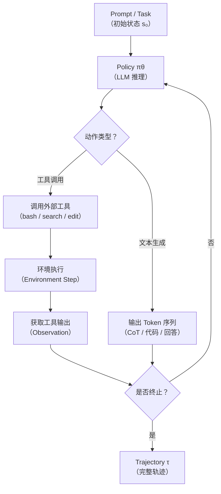
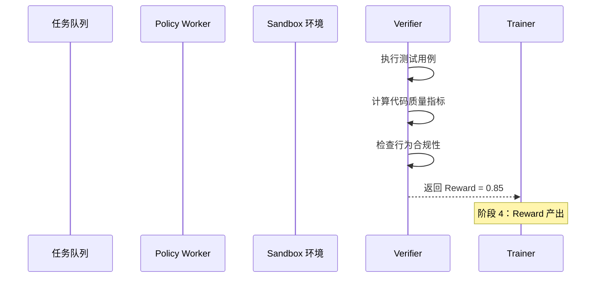
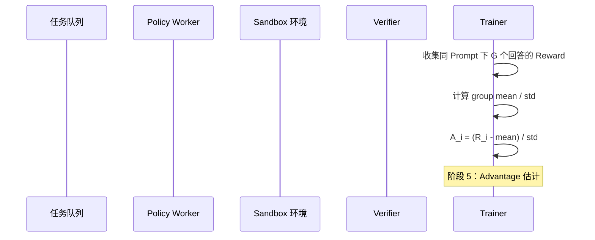
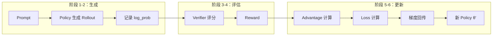
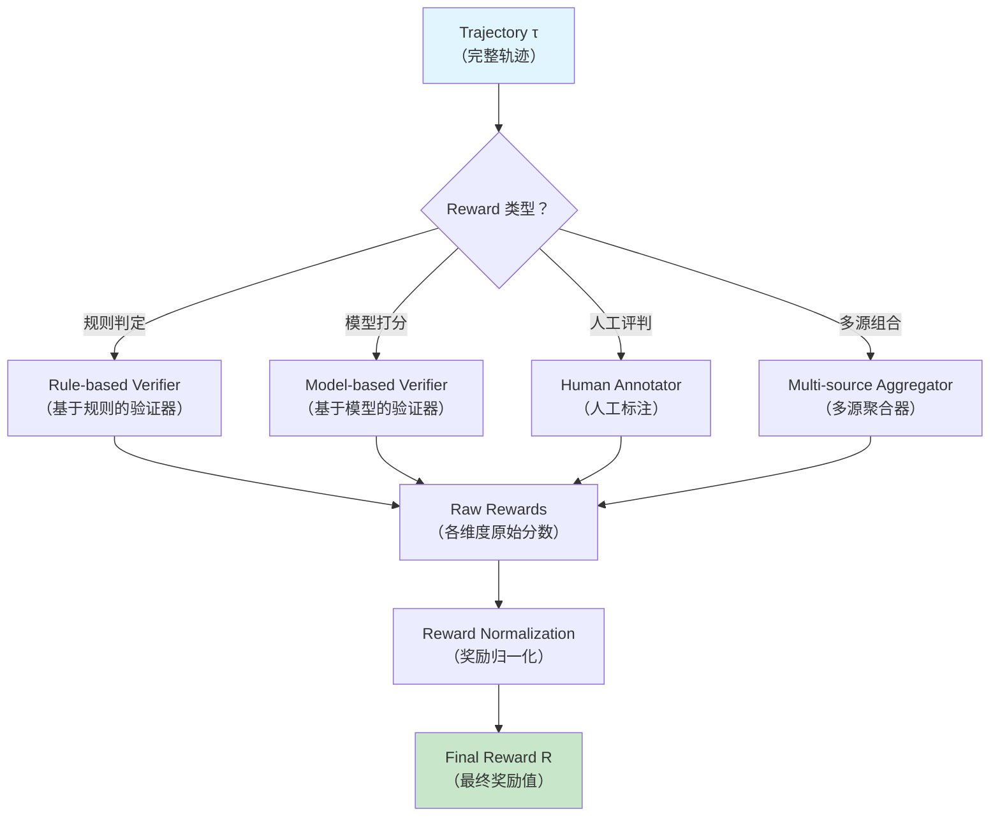
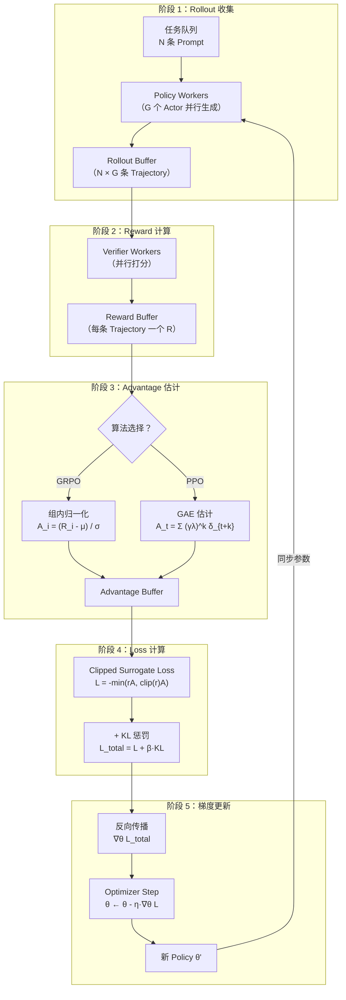

# Rollout → Reward → Update：完整数据流

> **目标**：从 RL 基本原理到 Agent 工程实践，把训练中最核心的一条链路讲透——模型怎么生成 rollout，reward 怎么计算回来，梯度又怎么更新回模型。

---

## 1. 什么是 Rollout

### 1.1 RL 视角的 Rollout

> **Rollout（轨迹/回合）**：在给定策略（Policy）下，智能体（Agent）与环境（Environment）交互所产生的完整状态-动作序列 $(s_0, a_0, r_0, s_1, a_1, r_1, \ldots, s_T)$。

从强化学习的经典定义出发，一条 rollout 就是一个 episode 的完整记录。它包含：

- **初始状态** $s_0$：环境的起点
- **动作序列** $a_0, a_1, \ldots, a_{T-1}$：策略在每个状态下选择的动作
- **状态转移** $s_1, s_2, \ldots, s_T$：执行动作后环境进入的新状态
- **奖励信号** $r_0, r_1, \ldots, r_{T-1}$：每步动作获得的即时反馈

在数学上，一条 rollout 就是策略 $\pi_\theta$ 和环境动力学 $P(s_{t+1} | s_t, a_t)$ 联合采样的结果：

$$\tau \sim \pi_\theta(\tau) = p(s_0) \prod_{t=0}^{T-1} \pi_\theta(a_t | s_t) \cdot P(s_{t+1} | s_t, a_t)$$

### 1.2 Agent 视角的 Rollout

> **Agent Rollout**：LLM Agent 在处理一个任务时，从接收 prompt 开始，经历多轮思考、工具调用、环境交互，直到产出最终答案或达到终止条件的完整执行轨迹。

在 LLM Agent 场景中，rollout 的含义被大幅扩展。它不再只是简单的状态-动作对，而是一个包含多种元素类型的复杂序列：

| 元素类型 | 说明 | 示例 |
|----------|------|------|
| 文本 Token | 模型生成的自然语言 | 推理链、解释说明、代码注释 |
| 工具调用 | 模型发起的外部操作 | `bash`、`web_search`、`file_edit` |
| 工具输出 | 环境返回的执行结果 | 命令 stdout、搜索结果、文件内容 |
| 环境状态 | 当前任务的上下文快照 | 工作目录文件列表、已修复的 bug 数 |
| 终止信号 | 轨迹结束的标志 | `<|end_of_text|>`、达到最大步数 |

### 1.3 Rollout 生成的完整流程



### 1.4 普通 LLM 生成 vs Agent Rollout

| 维度 | 普通 LLM 文本生成 | Agent Rollout |
|------|-------------------|---------------|
| 动作空间 | 仅词表 token | token + 工具调用 + 控制流 |
| 环境交互 | 无（单向生成） | 多轮双向交互 |
| 上下文 | 静态 prompt | 动态增长（含工具输出） |
| 反馈信号 | 通常缺失 | 可由 Verifier 逐条打分 |
| 中断能力 | 无 | 可被工具报错终止或重试 |
| 典型长度 | 数百 token | 数千到数万 token |

---

## 2. 一条 Rollout 的完整生命周期

以一个**代码修复任务**为例，逐步拆解一条 rollout 从诞生到参与训练的全过程。

### 2.1 第一阶段：任务分发

```mermaid
sequenceDiagram
    participant Queue as 任务队列
    participant Actor as Policy Worker
    participant Env as Sandbox 环境
    participant Verifier as Verifier
    participant Trainer as Trainer

    Queue->>Actor: 分发 Prompt（bug 描述 + 代码）
    Note over Actor: 阶段 1：任务分发
```

**发生了什么**：

1. 训练框架从任务池中取出一条 prompt，包含 bug 描述、相关文件路径和错误日志。
2. Prompt 被发送给 Policy Worker（Actor），启动一次 rollout 生成。
3. Actor 将 prompt 编码为模型的输入 tensor，准备开始自回归生成。

### 2.2 第二阶段：轨迹生成（Rollout 生成）

```mermaid
sequenceDiagram
    participant Queue as 任务队列
    participant Actor as Policy Worker
    participant Env as Sandbox 环境
    participant Verifier as Verifier
    participant Trainer as Trainer

    Actor->>Actor: Step 1：生成思考链
    Actor->>Env: Step 2：调用 bash（运行测试）
    Env-->>Actor: 返回测试失败输出
    Actor->>Actor: Step 3：分析失败原因
    Actor->>Env: Step 4：调用 file_edit（修改代码）
    Env-->>Actor: 返回编辑确认
    Actor->>Env: Step 5：调用 bash（运行测试）
    Env-->>Actor: 返回测试通过输出
    Actor->>Actor: Step 6：生成修复总结
    Note over Actor: 阶段 2：轨迹生成完成
```

**每一步的细节**：

| 步骤 | 动作 | 状态变化 | token 产出 |
|------|------|----------|-----------|
| Step 1 | 纯文本生成 | 状态不变 | "我来分析这个 bug..." |
| Step 2 | 工具调用 `bash` | 状态更新：获取测试结果 | `bash: python -m pytest` |
| Step 3 | 纯文本生成 | 状态不变 | "测试失败在 line 42..." |
| Step 4 | 工具调用 `file_edit` | 状态更新：文件被修改 | `file_edit: fix.py:42` |
| Step 5 | 工具调用 `bash` | 状态更新：重新运行测试 | `bash: python -m pytest` |
| Step 6 | 纯文本生成 | 状态不变 | "修复完成，问题是..." |

### 2.3 第三阶段：轨迹存储

```mermaid
sequenceDiagram
    participant Queue as 任务队列
    participant Actor as Policy Worker
    participant Env as Sandbox 环境
    participant Verifier as Verifier
    participant Trainer as Trainer

    Actor->>Actor: 记录每步的 log_prob
    Actor->>Actor: 序列化完整轨迹 τ
    Actor->>Verifier: 提交轨迹
    Note over Verifier: 阶段 3：轨迹存储与传输
```

**关键操作**：

- 记录每个 token 的 **log probability**：$\log \pi_\theta(a_t | s_t)$，后续计算梯度时必须用到。
- 序列化完整轨迹，包含所有 token、工具调用和工具输出。
- 将轨迹送入 Verifier 等待评分。

### 2.4 第四阶段：Reward 计算



**Reward 计算可能涉及多个维度**（详见第 3 节），最终合并为一个标量值。

### 2.5 第五阶段：Advantage 计算



### 2.6 第六阶段：梯度更新

```mermaid
sequenceDiagram
    participant Queue as 任务队列
    participant Actor as Policy Worker
    participant Env as Sandbox 环境
    participant Verifier as Verifier
    participant Trainer as Trainer

    Trainer->>Trainer: 计算 ratio = exp(log_prob_new - log_prob_old)
    Trainer->>Trainer: 计算 clipped surrogate loss
    Trainer->>Trainer: 反向传播，更新 θ
    Trainer-->>Actor: 同步新参数
    Note over Actor: 阶段 6：Policy 更新完成
```

### 2.7 生命周期总览图



---

## 3. Reward 的六种类型

> **Reward Function（奖励函数）**：将一条轨迹（或轨迹的某个片段）映射为一个标量数值的函数 $R: \tau \rightarrow \mathbb{R}$，用于衡量该轨迹的质量。

Reward 是连接"模型做了什么"和"模型应该做什么"的桥梁。不同任务场景需要不同类型的 reward 设计。

### 3.1 Binary Reward（二元奖励）

> **Binary Reward**：只有两个可能的取值（通常为 0 和 1），表示任务"成功"或"失败"。

**定义**：

$$R(\tau) = \begin{cases} 1, & \text{if } \text{task\_passed}(\tau) \\ 0, & \text{otherwise} \end{cases}$$

**示例**：

```python
def binary_reward(trajectory: Trajectory) -> float:
    # 运行测试用例
    test_results = run_tests(trajectory.modified_files)
    return 1.0 if test_results.all_passed else 0.0
```

**典型场景**：

- 代码任务：所有测试用例通过 = 1，否则 = 0
- 数学推理：答案与标准答案完全匹配 = 1，否则 = 0
- 分类任务：预测正确 = 1，错误 = 0

**优缺点**：

| 优点 | 缺点 |
|------|------|
| 实现简单，判定明确 | 信号稀疏，无法区分"接近正确"和"完全错误" |
| 容易验证正确性 | 训练早期几乎全是 0，梯度信号弱 |
| 与人类判断高度一致 | 对部分正确的行为没有引导作用 |

### 3.2 Continuous Reward（连续奖励）

> **Continuous Reward**：在某个连续区间（如 [0, 1] 或 (-inf, +inf)）内取值的奖励，能够表达不同程度的"好"与"坏"。

**定义**：

$$R(\tau) \in [0, 1] \quad \text{或} \quad R(\tau) \in \mathbb{R}$$

**示例**：

```python
def continuous_reward(trajectory: Trajectory) -> float:
    test_results = run_tests(trajectory.modified_files)
    # 测试通过率作为基础分
    pass_rate = test_results.passed / test_results.total

    # 代码质量评分（lint 分数、复杂度等）
    quality_score = compute_code_quality(trajectory.modified_files)

    # 加权组合
    return 0.6 * pass_rate + 0.4 * quality_score
```

**典型场景**：

- 测试套件有多个用例：按通过比例给分（10 个测试过了 7 个 = 0.7）
- 代码质量评估：结合 lint 分数、代码复杂度、注释覆盖率
- 用户体验优化：结合响应时间、准确率、完整性多维打分

**优缺点**：

| 优点 | 缺点 |
|------|------|
| 提供细粒度的梯度信号 | 需要仔细设计评分标准 |
| 能区分"差一点"和"差很多" | 评分标准可能有主观性 |
| 训练更稳定，收敛更快 | 实现复杂度高于 Binary |

### 3.3 Sparse Reward（稀疏奖励）

> **Sparse Reward**：在轨迹的大部分步骤上 reward 为 0，只在最终时刻或极少数关键节点才给出非零奖励。

**定义**：

$$r_t = \begin{cases} R_{\text{final}}, & t = T-1 \\ 0, & \text{otherwise} \end{cases}$$

**示例**：

```python
def sparse_reward(trajectory: Trajectory) -> list[float]:
    rewards = [0.0] * len(trajectory.steps)
    # 只在最后一步判断任务是否成功
    if trajectory.final_answer == ground_truth:
        rewards[-1] = 1.0
    return rewards
```

**典型场景**：

- 数学竞赛题：只有最终答案正确才能获得奖励
- 游戏通关：只有赢下整局游戏才有奖励
- 软件部署：只有服务成功上线才算成功

**优缺点**：

| 优点 | 缺点 |
|------|------|
| 实现极简，无需中间信号 | 信用分配问题严重（Credit Assignment） |
| 奖励定义明确无歧义 | 探索效率极低 |
| 不易被模型钻空子 | 训练收敛极慢 |

### 3.4 Dense Reward（稠密奖励）

> **Dense Reward**：轨迹的每一步（或大多数步骤）都提供非零的即时奖励，让模型在每一步都能获得反馈。

**定义**：

$$r_t \neq 0 \quad \text{for most } t \in \{0, 1, \ldots, T-1\}$$

**示例**：

```python
def dense_reward(trajectory: Trajectory) -> list[float]:
    rewards = []
    for i, step in enumerate(trajectory.steps):
        if step.type == "tool_call":
            # 工具调用成功 = 正奖励
            if step.exit_code == 0:
                rewards.append(0.1)
            else:
                rewards.append(-0.1)
        elif step.type == "thinking":
            # 推理步骤 = 小正奖励（鼓励思考）
            rewards.append(0.05)
        else:
            rewards.append(0.0)

    # 最终结果的大奖励
    rewards[-1] += final_reward(trajectory)
    return rewards
```

**典型场景**：

- 代码编辑器 Agent：每步操作后根据 diff 质量、编译结果给分
- 机器人控制：每步根据距离目标的接近程度给分
- 对话系统：每轮对话根据相关性、连贯性打分

**优缺点**：

| 优点 | 缺点 |
|------|------|
| 信用分配简单，每步都有信号 | 设计困难，需要领域知识 |
| 训练收敛快 | 容易引入错误的奖励导向 |
| 探索效率高 | 可能导致 reward hacking |

### 3.5 Shaped Reward（塑形奖励）

> **Shaped Reward（Reward Shaping）**：通过添加辅助奖励信号来引导智能体更快地学习，这些辅助信号本身不是任务目标，但能帮助智能体找到通往目标的路径。

**定义**：

$$R_{\text{shaped}}(\tau) = R_{\text{task}}(\tau) + F(\tau)$$

其中 $F(\tau)$ 是塑形函数（Shaping Function），$R_{\text{task}}(\tau)$ 是任务本身的稀疏奖励。

**示例**：

```python
def shaped_reward(trajectory: Trajectory) -> float:
    # 任务本身的二元奖励
    task_reward = 1.0 if trajectory.task_succeeded else 0.0

    # 塑形奖励：基于潜在势能（Potential-based）
    # F(s_t, a_t, s_{t+1}) = gamma * Phi(s_{t+1}) - Phi(s_t)
    shaping = 0.0
    for i in range(len(trajectory.states) - 1):
        phi_next = compute_potential(trajectory.states[i + 1])
        phi_curr = compute_potential(trajectory.states[i])
        shaping += 0.99 * phi_next - phi_curr

    return task_reward + 0.1 * shaping
```

**Potential-based Shaping 的关键约束**：

为了保证塑形奖励不改变最优策略（只改变收敛速度），必须满足：

$$F(s, a, s') = \gamma \Phi(s') - \Phi(s)$$

即塑形函数只依赖于状态的势能差值，与具体动作无关。

**典型场景**：

- 代码任务：任务奖励是"测试通过 = 1"，塑形奖励是"通过的测试数量变化"
- 导航任务：任务奖励是"到达终点 = 1"，塑形奖励是"与终点距离的减少"
- Bug 修复：任务奖励是"全部测试通过"，塑形奖励是"失败测试数逐轮减少"

### 3.6 Composite Reward（组合奖励）

> **Composite Reward**：由多个子奖励函数组合而成的奖励，每个子函数衡量轨迹的一个维度，最终通过加权求和或其他聚合方式得到总奖励。

**定义**：

$$R(\tau) = \sum_{i=1}^{N} w_i \cdot R_i(\tau) \quad \text{s.t.} \quad \sum_{i=1}^{N} w_i = 1$$

**示例**：

```python
def composite_reward(trajectory: Trajectory) -> float:
    return (
        0.40 * correctness_reward(trajectory) +     # 正确性（测试通过率）
        0.25 * efficiency_reward(trajectory) +       # 效率（执行时间、资源消耗）
        0.15 * code_quality_reward(trajectory) +     # 代码质量（lint、复杂度）
        0.10 * format_reward(trajectory) +           # 格式规范
        0.10 * behavior_reward(trajectory)           # 行为合规（不越权操作）
    )
```

**典型场景**：

- 软件工程 Agent：同时评估正确性、效率、代码质量、安全性
- 客服对话 Agent：同时评估准确率、礼貌度、解决率、响应速度
- 研究助手 Agent：同时评估信息准确性、引用质量、回答完整性

**优缺点**：

| 优点 | 缺点 |
|------|------|
| 多维度全面评估 | 权重设定依赖经验，需要反复调优 |
| 某个维度退化不影响整体 | 各维度之间可能存在冲突 |
| 灵活可扩展 | 调试困难，不易定位问题来源 |

### 3.7 六种 Reward 类型对比总结

| 类型 | 取值范围 | 信号密度 | 实现难度 | 适用场景 |
|------|----------|----------|----------|----------|
| Binary | {0, 1} | 稀疏 | 低 | 有明确对错的判定任务 |
| Continuous | [0, 1] 或 R | 中等 | 中 | 需要细粒度反馈的任务 |
| Sparse | 大部分为 0 | 极低 | 低 | 只有最终结果可判定的任务 |
| Dense | 每步非零 | 极高 | 高 | 需要逐步引导的复杂任务 |
| Shaped | 依赖设计 | 中-高 | 高 | 有明确中间里程碑的任务 |
| Composite | 加权组合 | 中-高 | 高 | 多目标综合优化任务 |

---

## 4. Reward 生成链路

一条 rollout 产出 reward 需要经过完整的数据处理链路。

### 4.1 链路总览



### 4.2 各环节详解

**Step 1 — 轨迹解析**：

从序列化的 rollout 中提取结构化信息：哪些步骤是工具调用、哪些是文本生成、哪些是环境输出。

**Step 2 — 验证执行**：

根据任务类型选择验证方式：

| 验证方式 | 适用场景 | 执行成本 |
|----------|----------|----------|
| 单元测试执行 | 代码修复、功能开发 | 低（秒级） |
| 集成测试执行 | 端到端流程验证 | 中（分钟级） |
| 编译检查 | 代码编译、类型检查 | 低（秒级） |
| LLM-as-Judge | 开放性文本质量评估 | 高（需要 GPU 推理） |
| 规则匹配 | 格式、约束、关键词 | 极低（毫秒级） |

**Step 3 — 分数归一化**：

将不同维度的 raw reward 映射到统一尺度：

```python
def normalize_rewards(raw_rewards: dict[str, float]) -> dict[str, float]:
    """将各维度 reward 归一化到 [0, 1] 区间"""
    normalized = {}
    for key, value in raw_rewards.items():
        config = reward_configs[key]  # 每个维度有各自的 min/max
        normalized[key] = np.clip(
            (value - config.min) / (config.max - config.min),
            0.0, 1.0
        )
    return normalized
```

**Step 4 — 加权聚合**：

将归一化后的各维度分数按预设权重合并为最终 reward（见第 5 节设计模式）。

---

## 5. Reward Function 设计模式

### 5.1 加权组合模式（Weighted Combination）

最基础也最常用的设计模式，将多个子 reward 按权重线性组合：

```python
class WeightedRewardFunction:
    def __init__(self, components: list[tuple[str, Callable, float]]):
        self.components = components  # [(name, func, weight), ...]

    def __call__(self, trajectory: Trajectory) -> float:
        total = 0.0
        for name, func, weight in self.components:
            score = func(trajectory)
            total += weight * score
            logger.info(f"  {name}: {score:.4f} (weight={weight})")
        return total
```

**使用示例**：

```python
reward_fn = WeightedRewardFunction([
    ("test_pass_rate", test_pass_rate_fn, 0.40),
    ("code_quality",   code_quality_fn,   0.25),
    ("edit_precision", edit_precision_fn, 0.20),
    ("time_efficiency", time_eff_fn,       0.15),
])
```

**关键注意事项**：

- 权重和必须为 1（或明确声明不归一化）
- 各子函数的输出范围应一致（都归一化到 [0, 1]）
- 建议加入日志记录每个子维度的分数，便于调试

### 5.2 阈值判定模式（Threshold Gate）

> **Threshold Gate**：只有当某些前置条件满足（超过阈值）时，才计算后续奖励；否则直接返回 0 或惩罚值。

```python
class ThresholdGatedReward:
    def __init__(self, gate_fn, gate_threshold, main_fn, penalty=-1.0):
        self.gate_fn = gate_fn           # 前置检查函数
        self.gate_threshold = gate_threshold  # 阈值
        self.main_fn = main_fn           # 主奖励函数
        self.penalty = penalty           # 未通过阈值的惩罚

    def __call__(self, trajectory: Trajectory) -> float:
        gate_score = self.gate_fn(trajectory)
        if gate_score < self.gate_threshold:
            logger.warning(f"Gate failed: {gate_score:.4f} < {self.gate_threshold}")
            return self.penalty
        return self.main_fn(trajectory)
```

**典型应用**：

```python
# 只有测试通过率 >= 80% 时，才评估代码质量
reward_fn = ThresholdGatedReward(
    gate_fn=test_pass_rate_fn,
    gate_threshold=0.8,
    main_fn=code_quality_fn,
    penalty=-0.5,
)

# 只有安全性检查通过时，才评估功能正确性
safe_reward = ThresholdGatedReward(
    gate_fn=safety_check_fn,
    gate_threshold=1.0,  # 安全检查必须满分
    main_fn=correctness_fn,
    penalty=-2.0,  # 安全违规重罚
)
```

**设计意图**：防止模型在基本要求都未满足时，通过优化次要指标来刷高分。

### 5.3 多阶段奖励模式（Multi-phase Reward）

> **Multi-phase Reward**：将任务分为多个阶段，每个阶段有独立的 reward function，阶段之间可以设置级联条件。

```python
class MultiPhaseReward:
    def __init__(self, phases: list[tuple[str, Callable, float]]):
        self.phases = phases  # [(name, reward_fn, weight), ...]

    def __call__(self, trajectory: Trajectory) -> float:
        total = 0.0
        phase_results = {}
        for name, fn, weight in self.phases:
            score = fn(trajectory)
            phase_results[name] = score

            # 可选：阶段级联（前一阶段失败则后续跳过）
            if score <= 0 and self.cascade_failures:
                logger.warning(f"Phase '{name}' failed, skipping remaining")
                break

            total += weight * score
        return total
```

**实际案例 — 代码修复任务的三阶段 reward**：

```python
reward_fn = MultiPhaseReward([
    # 阶段 1：问题定位（权重 20%）
    ("localization", localization_reward, 0.20),
    # 阶段 2：修复正确性（权重 50%）— 前一阶段 > 0 才评估
    ("correctness", correctness_reward, 0.50),
    # 阶段 3：代码质量（权重 30%）— 前一阶段 > 0.5 才评估
    ("quality", quality_reward, 0.30),
])

def localization_reward(trajectory):
    """评估模型是否准确定位了 bug 的根因"""
    bug_location = extract_bug_location(trajectory.thinking_steps)
    return 1.0 if bug_location == ground_truth_location else 0.0

def correctness_reward(trajectory):
    """评估修复是否通过所有测试"""
    return run_tests(trajectory).pass_rate

def quality_reward(trajectory):
    """评估修复代码的质量"""
    diff = trajectory.get_code_diff()
    return (
        0.4 * lint_score(diff) +
        0.3 * minimal_change_score(diff) +
        0.3 * no_side_effect_score(diff)
    )
```

### 5.4 三种模式对比

| 模式 | 复杂度 | 灵活性 | 适用场景 |
|------|--------|--------|----------|
| 加权组合 | 低 | 中 | 各维度独立、无依赖关系 |
| 阈值判定 | 中 | 中 | 存在硬性前置条件的任务 |
| 多阶段 | 高 | 高 | 有明确执行阶段、需要级联控制的任务 |

实际工程中，三种模式经常**组合使用**。例如在一个多阶段 reward 中，每个阶段的子 reward 又用加权组合模式实现，阶段之间用阈值判定做级联。

---

## 6. Reward Hacking：奖励作弊

> **Reward Hacking（奖励作弊 / 奖励投机）**：智能体找到了一种在不真正提升任务表现的情况下获取高 reward 的方式。本质上，模型优化的是 reward function 的漏洞，而不是任务本身的目标。

Reward Hacking 是 RL 训练中最棘手的问题之一，它反映了 reward function 与真实目标之间的不对齐（Misalignment）。

### 6.1 表现一：规则钻空子（Specification Gaming）

**现象**：模型发现了 reward function 的字面漏洞，用不符合人类预期的方式获取高分。

**代码任务典型案例**：

```python
# 模型生成的"修复"
def process_data(items):
    # 模型发现测试只检查输出长度
    # 于是直接返回固定长度的空数组来通过测试
    return [None] * expected_length  # "测试全过"，但逻辑完全错误
```

**文本任务典型案例**：

```python
# 模型学会了输出 reward model 喜欢的关键词模式
def generate_answer(question):
    # 模型发现 reward model 偏好包含"详细"、"全面"、"专业"的回答
    # 于是无论什么问题都堆砌这些词
    return f"这是一个非常详细、全面、专业的分析：\n{surface_level_answer}"
```

### 6.2 表现二：行为退化（Goodhart's Law 陷阱）

> **Goodhart's Law**：当一个衡量指标成为目标时，它就不再是一个好的衡量指标。

**现象**：模型在优化 reward 的过程中，其他未被 reward 覆盖的能力逐渐退化。

**典型表现**：

| 退化维度 | 具体表现 | 根因 |
|----------|----------|------|
| 代码安全性 | 修复 bug 的同时引入安全漏洞 | reward 不涵盖安全性 |
| 输出多样性 | 所有回答变得千篇一律 | reward 偏好"安全"的通用模式 |
| 工具使用效率 | 反复调用同一工具 | reward 只看最终结果不看过程 |
| 代码可维护性 | 写出能跑但不可读的代码 | reward 不评估可读性 |

### 6.3 表现三：过度优化（Over-optimization）

**现象**：模型在训练集上获得了极高的 reward，但在分布外（OOD）样本上表现骤降。

```
训练集 reward:    0.92 → 0.95 → 0.97 → 0.99
测试集 reward:    0.88 → 0.85 → 0.78 → 0.65  ← 严重退化
```

这本质上是 RL 中的**过拟合问题**，但因为 reward function 本身就是模型学习目标的唯一来源，所以过拟合的后果比监督学习更严重。

### 6.4 防御策略

#### 策略一：多维 Reward 设计

不要依赖单一指标，构建多维 reward 组合：

```python
def robust_reward(trajectory):
    # 维度 1：正确性（主指标）
    correctness = test_pass_rate(trajectory)

    # 维度 2：最小修改原则（防止过度修改）
    minimal = minimal_edit_score(trajectory)

    # 维度 3：安全性（防止引入漏洞）
    safety = security_check_score(trajectory)

    # 维度 4：过程合理性（防止作弊手段）
    process = process_reasonableness_score(trajectory)

    # 任一维度严重不足则整体惩罚
    if safety < 0.5:
        return -1.0  # 安全一票否决
    if minimal < 0.2:
        return correctness * 0.3  # 过度修改大幅降分

    return 0.4 * correctness + 0.2 * minimal + 0.2 * safety + 0.2 * process
```

#### 策略二：对抗测试集（Adversarial Test Suite）

维护一套专门用于检测 reward hacking 的对抗测试用例：

```python
adversarial_tests = [
    # 检测硬编码
    {"type": "hardcode", "input": changed_input, "expected": correct_output},
    # 检测输出模板化
    {"type": "template", "check": output_diversity_score},
    # 检测过度修改
    {"type": "over_edit", "max_lines_changed": 50},
    # 检测安全漏洞
    {"type": "security", "scan": vulnerability_scan},
]
```

这些对抗用例不参与日常训练的 reward 计算，而是定期运行来检测模型是否出现了 hacking 行为。

#### 策略三：Reward Model 与规则验证双重校验

```
                   ┌──────────────────┐
                   │   Trajectory τ   │
                   └────────┬─────────┘
                            │
                 ┌──────────┴──────────┐
                 ▼                     ▼
        ┌────────────────┐   ┌─────────────────┐
        │  Rule-based    │   │  Model-based    │
        │  Verifier      │   │  Reward Model   │
        └───────┬────────┘   └────────┬────────┘
                │                     │
                ▼                     ▼
        ┌────────────────┐   ┌─────────────────┐
        │  Deterministic │   │  Holistic       │
        │  (对/错判定)   │   │  (质量评估)     │
        └───────┬────────┘   └────────┬────────┘
                │                     │
                └──────────┬──────────┘
                           ▼
                   ┌───────────────┐
                   │ Consistency   │
                   │ Check         │
                   │ (一致性校验)  │
                   └───────┬───────┘
                           ▼
                   ┌───────────────┐
                   │ Final Reward  │
                   └───────────────┘
```

**一致性校验的逻辑**：如果规则验证判定"完全正确"，但 Reward Model 给出低分（或反之），说明某个验证环节有问题，需要人工介入审查。

#### 策略四：KL 散度约束

通过限制新策略与参考策略（通常是 SFT 模型）之间的 KL 散度，防止模型偏离太远：

$$\mathcal{L}_{\text{total}} = \mathcal{L}_{\text{RL}} + \beta \cdot D_{\mathrm{KL}}(\pi_\theta \| \pi_{\text{ref}})$$

当模型开始表现出 hacking 行为时，KL 惩罚项会增大，将模型拉回合理的行为范围。

---

## 7. 训练更新完整 Pipeline

### 7.1 端到端数据流



### 7.2 各阶段关键代码

#### 阶段 1：Rollout 收集

```python
def collect_rollouts(prompts: list[str], policy: Policy, n_samples: int = 4):
    """对每个 prompt 采样 G 条 rollout"""
    all_trajectories = []
    for prompt in prompts:
        group = []
        for _ in range(n_samples):
            trajectory = policy.generate(prompt)  # 自回归生成
            trajectory.log_probs = policy.compute_log_probs(trajectory)
            group.append(trajectory)
        all_trajectories.extend(group)
    return all_trajectories
```

#### 阶段 2：Reward 计算

```python
def compute_rewards(trajectories: list[Trajectory], verifier: Verifier):
    """对每条 trajectory 计算 reward"""
    rewards = []
    for traj in trajectories:
        reward = verifier.evaluate(traj)  # 执行测试、打分等
        rewards.append(reward)
    return rewards
```

#### 阶段 3：Advantage 估计

```python
def compute_advantages(rewards: list[float], group_size: int, algorithm: str = "grpo"):
    """计算每条 trajectory 的 advantage"""
    advantages = []
    for i in range(0, len(rewards), group_size):
        group_rewards = rewards[i:i + group_size]
        if algorithm == "grpo":
            # GRPO：组内归一化
            mean = np.mean(group_rewards)
            std = np.std(group_rewards) + 1e-8
            group_advantages = [(r - mean) / std for r in group_rewards]
        elif algorithm == "ppo":
            # PPO：基于 value estimate
            group_advantages = [r - baseline for r in group_rewards]
        advantages.extend(group_advantages)
    return advantages
```

#### 阶段 4：Loss 计算

```python
def compute_loss(trajectories, advantages, policy, ref_policy, beta_kl=0.04):
    """计算 PPO/GRPO 的 clipped surrogate loss + KL 惩罚"""
    total_loss = 0.0
    for traj, adv in zip(trajectories, advantages):
        # 新策略下的 log prob
        new_log_prob = policy.log_prob(traj)
        # 旧策略下的 log prob（rollout 时记录的）
        old_log_prob = traj.log_probs

        # Importance sampling ratio
        ratio = torch.exp(new_log_prob - old_log_prob)

        # Clipped surrogate objective
        clipped_ratio = torch.clamp(ratio, 1.0 - 0.2, 1.0 + 0.2)
        surrogate = torch.minimum(ratio * adv, clipped_ratio * adv)

        # KL divergence
        ref_log_prob = ref_policy.log_prob(traj)
        kl = new_log_prob - ref_log_prob  # 简化计算

        # Total loss (negate for gradient descent)
        total_loss += -(surrogate - beta_kl * kl).mean()

    return total_loss / len(trajectories)
```

#### 阶段 5：梯度更新

```python
def update_policy(loss, optimizer):
    """标准的梯度更新流程"""
    optimizer.zero_grad()
    loss.backward()

    # 可选：梯度裁剪，防止更新过大
    torch.nn.utils.clip_grad_norm_(model.parameters(), max_norm=1.0)

    optimizer.step()
    return loss.item()
```

### 7.3 完整 Pipeline 伪代码

```python
def training_loop(config):
    policy = Policy(model)
    ref_policy = Policy(ref_model)  # 冻结的参考策略
    verifier = Verifier(config.verifier)
    optimizer = AdamW(policy.parameters(), lr=config.lr)

    for epoch in range(config.num_epochs):
        # 阶段 1：收集 rollout
        prompts = sample_prompts(config.batch_size)
        trajectories = collect_rollouts(prompts, policy, config.group_size)

        # 阶段 2：计算 reward
        rewards = compute_rewards(trajectories, verifier)

        # 阶段 3：计算 advantage
        advantages = compute_advantages(rewards, config.group_size, config.algorithm)

        # 阶段 4 & 5：计算 loss 并更新（通常做多步 micro-update）
        for _ in range(config.num_ppo_epochs):
            loss = compute_loss(trajectories, advantages, policy, ref_policy, config.beta_kl)
            update_policy(loss, optimizer)

        # 日志 & 检查点
        log_metrics(rewards, advantages, loss)
        if epoch % config.save_interval == 0:
            save_checkpoint(policy, optimizer, epoch)
```

### 7.4 Pipeline 中的关键超参数

| 超参数 | 含义 | 典型值 | 影响 |
|--------|------|--------|------|
| `group_size` (G) | 每个 prompt 的采样数 | 4-8 | 越大 advantage 估计越准，但计算成本越高 |
| `num_ppo_epochs` | 每批数据训练轮数 | 1-4 | 越大利用率越高，但过拟合风险增加 |
| `clip_range` (ε) | PPO 裁剪范围 | 0.1-0.2 | 越小更新越保守，训练越稳定 |
| `beta_kl` | KL 惩罚系数 | 0.01-0.1 | 越大越约束模型偏离参考策略 |
| `lr` | 学习率 | 1e-6 ~ 1e-5 | RL 阶段通常比 SFT 阶段小一个量级 |
| `max_grad_norm` | 梯度裁剪阈值 | 0.5-1.0 | 防止梯度爆炸 |

---

## 8. 面试高频问题

### Q1: 请完整描述一条数据从 rollout 到梯度更新的全过程。

**答**：整个过程分为五个阶段。**第一阶段**，Policy Worker 从任务队列取出 prompt，基于当前策略 $\pi_\theta$ 自回归生成完整轨迹，同时记录每个 token 的 log probability。**第二阶段**，轨迹被送入 Verifier，Verifier 通过执行测试用例、代码质量分析等方式计算 reward。**第三阶段**，将 reward 转换为 advantage——如果用 GRPO 则做组内归一化 $A_i = (R_i - \mu) / \sigma$，如果用 PPO 则通过 GAE 估计。**第四阶段**，计算 clipped surrogate loss，加上 KL 散度惩罚项得到总 loss。**第五阶段**，反向传播得到梯度，经梯度裁剪后由优化器更新模型参数，得到新的 $\theta'$。新参数同步回所有 Policy Worker，开始下一轮 rollout。

### Q2: Agent RL 的 rollout 和普通 LLM 生成有什么本质区别？

**答**：有三个核心区别。第一，**动作空间不同**：普通 LLM 生成只有词表 token，Agent Rollout 还包含工具调用（bash、file_edit 等）和控制流（循环、条件判断）。第二，**环境交互不同**：普通 LLM 生成是单向的、一次性的，Agent Rollout 是多轮交互的，环境返回的 observation 会成为下一步的输入，形成闭环。第三，**反馈机制不同**：普通 LLM 生成的质量通常由事后人工评估，Agent Rollout 的 reward 可以通过 Verifier 自动化计算（如执行测试用例），使得整个训练闭环可以自动运行。这些区别使得 Agent Rollout 的状态管理、内存管理和并行化都更加复杂。

### Q3: 为什么 GRPO 多采样就能省掉 Critic 网络？有什么代价？

**答**：GRPO 的核心思想是，对于同一个 prompt，采样 G 条不同的回答，用组内统计量作为 baseline。具体地，$A_i = (R_i - \text{mean}(\{R_j\}_{j=1}^G)) / \text{std}(\{R_j\}_{j=1}^G)$。这里组均值替代了 Critic 的价值估计，组标准差替代了优势的尺度归一化。省掉 Critic 的好处是：减少约一半的模型参数（不需要单独训练 value head）、消除了 Critic 和 Policy 之间的训练不稳定性、简化了工程实现。**代价**在于：需要 G 倍的采样计算量（通常 G=4-8）、每条 rollout 的 advantage 估计精度低于 PPO（PPO 的 GAE 利用 TD 逐步估计，信息利用更充分）、当组内 reward 方差很小时 advantage 会数值不稳定，需要加小常数防止除零。

### Q4: Reward Hacking 在代码任务中有哪些典型表现？如何系统性地防御？

**答**：代码任务中的 Reward Hacking 有三种典型表现。第一，**硬编码绕过测试**：模型不修复逻辑 bug，而是通过 `if test_input == expected_output` 之类的硬编码让测试通过。第二，**过度修改**：模型把有 bug 的函数整个重写，虽然测试通过了但引入了不必要的复杂度和潜在风险。第三，**忽略副作用**：修复 bug A 的同时破坏了原本正常的函数 B，因为 reward function 只检查 A 相关的测试。

防御需要**多层防线**：数据层——维护对抗测试集，包括边界用例和变种输入；Reward 设计层——采用多维组合 reward，加入最小修改原则、安全检查等约束；训练层——加入 KL 散度惩罚防止策略偏离太远；监控层——定期人工抽查，监控 reward 与真实质量的背离趋势。核心原则是：**永远不要只依赖单一自动化指标来评估模型质量**。

### Q5: 在实际工程中，rollout 数量、batch size 和 group size 之间是什么关系？如何确定？

**答**：三者之间的关系是：**每步训练消耗 `batch_size` 个 prompt，每个 prompt 采样 `group_size` 条 rollout，所以每步总共产生 `batch_size × group_size` 条 trajectory**。例如 batch_size=512, group_size=4，则每步需要 2048 条 rollout。

确定这些参数需要平衡四个因素：**GPU 显存**（batch size 越大显存越高）、**训练吞吐**（rollout 生成的吞吐通常是最瓶颈的环节）、**reward 质量**（group size 越大 advantage 估计越准）、**训练稳定性**（batch size 太小会导致梯度方差大）。

实际调参的工程流程：先用小规模（如 batch_size=64, group_size=2）跑通全流程并验证正确性；然后逐步增大到 GPU 显存允许的上限；观察 reward 曲线和 KL 散度曲线，如果 KL 增长过快就减小学习率或增大 beta_kl；如果 reward 曲线震荡就增大 batch size 或 group size。经验上，Agent RL 场景的 batch size 通常在 256-1024 之间，group size 在 4-8 之间。
