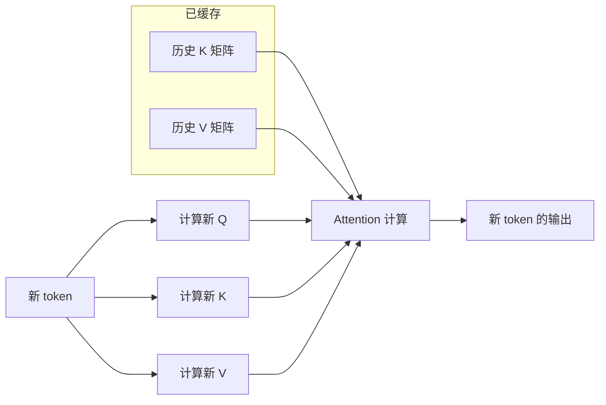
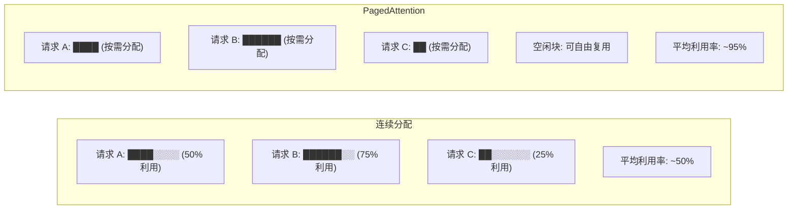
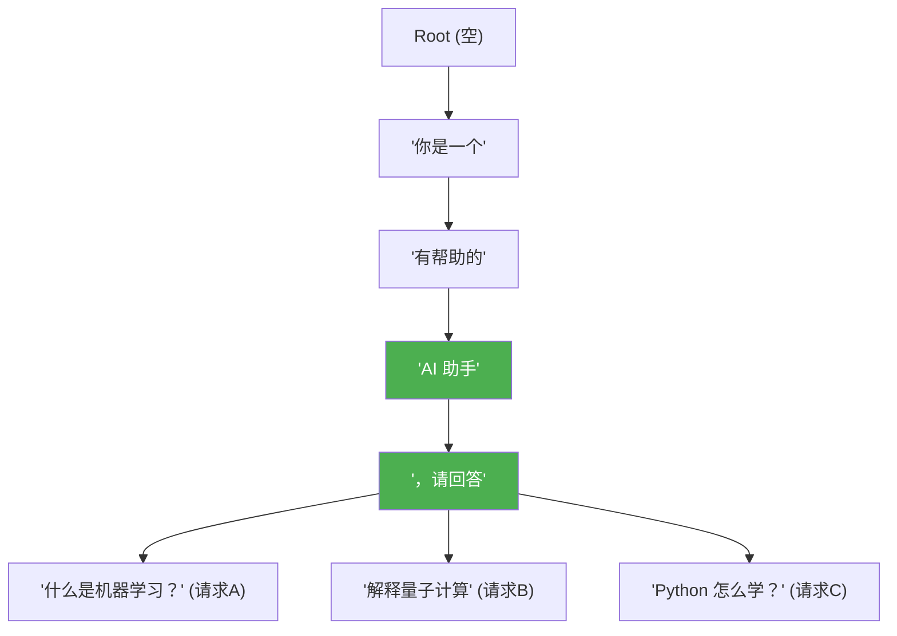

# KV Cache 机制详解

> **KV Cache**: 缓存 Transformer attention 中 Key 和 Value 矩阵的中间结果，避免每步重新计算所有历史 token。它是现代 LLM 推理系统中最核心的内存优化手段，几乎所有生产级推理框架（vLLM、TensorRT-LLM、TGI 等）都围绕 KV Cache 管理来设计系统架构。

---

## 1. 回顾：Transformer Self-Attention 的计算过程

### 1.1 Q、K、V 的角色

在 Transformer 的每一层中，输入序列 X 经过三个不同的线性投影得到三个矩阵：

```python
Q = X @ Wq   # Query：当前 token "想关注什么"
K = X @ Wk   # Key：每个 token "能提供什么索引"
V = X @ Wv   # Value：每个 token "携带的实际信息"
```

Self-Attention 的完整计算流程：

```python
scores = Q @ K.T / sqrt(d_k)    # 注意力分数：衡量每个 token 对其他 token 的关注度
weights = softmax(scores)        # 归一化为概率分布
output = weights @ V             # 加权求和，得到每个位置的上下文感知表示
```

### 1.2 自回归生成的特点

LLM 的文本生成是**自回归（autoregressive）** 的——每一步只生成一个新 token，然后将它追加到序列中，作为下一步的输入。

这意味着在第 t 步生成 token 时，模型需要对这个长度为 t 的完整序列做一次 forward pass，其中涉及完整的 Q @ K.T @ V 计算。

---

## 2. 为什么需要 KV Cache

### 2.1 没有 KV Cache：灾难性的重复计算

假设已经生成了 t 个 token，现在要生成第 t+1 个 token。

**没有 KV Cache 时**，系统需要：

1. 把前 t+1 个 token 全部送入模型
2. 重新计算所有 t+1 个 token 的 K 和 V 矩阵
3. 只为第 t+1 个 token 计算 Q
4. 用 Q 与所有 K 做注意力计算

**关键问题**：前 t 个 token 的 K 和 V 与上一步完全相同——因为模型权重没变、输入没变。这意味着每一步都在**白白重复计算**之前已经算过的东西。

时间复杂度分析：

| 生成步骤 | 输入序列长度 | 计算量（无缓存） | 浪费的计算量 |
|---------|------------|----------------|------------|
| 第 1 步 | 1 | O(1) | 0 |
| 第 2 步 | 2 | O(2) | O(1) |
| 第 3 步 | 3 | O(3) | O(2) |
| ... | ... | ... | ... |
| 第 t 步 | t | O(t) | O(t-1) |
| **总计** | | **O(t^2)** | **O(t^2)** |

**总计算量为 O(t^2)**——每个历史 token 的 K/V 被重复计算了多次，造成极其严重的算力浪费。对于生成长度为 4096 的回答，总计算量约为 O(4096^2) = O(16M)，而实际有效的计算量只有 O(4096)。

### 2.2 有 KV Cache：增量计算

> **增量解码（Incremental Decoding）**: 只为新 token 计算 Q/K/V，历史 token 的 K/V 从缓存中直接读取，将每步的计算量从 O(t) 降低到 O(1)。



有 KV Cache 时的时间复杂度：

| 生成步骤 | 新增计算量 | 累计总计算量 |
|---------|-----------|------------|
| 第 1 步（prefill） | O(t) | O(t) |
| 第 2 步 | O(1) | O(t) + O(1) |
| 第 3 步 | O(1) | O(t) + O(2) |
| ... | O(1) | O(t) + O(t-1) |
| **总计** | | **O(t) + O(t) = O(2t)** |

**总计算量从 O(t^2) 降低到 O(2t)**，在长序列场景下加速效果极为显著。

### 2.3 一个直观类比

没有 KV Cache 就像每次写邮件时，都要把之前所有已写的段落重新打字一遍，只为在末尾追加一句话；有了 KV Cache，你只需保留已写好的内容（缓存），只打出新增的那一句话即可。

---

## 3. KV Cache 的内存占用计算

### 3.1 通用公式

KV Cache 的显存占用取决于以下因素：

- **num_layers (L)**：Transformer 层数
- **hidden_dim (H)**：隐藏层维度（更精确地说是 `num_kv_heads * head_dim`）
- **seq_len (S)**：序列长度（已生成的 token 数）
- **dtype_bytes (B)**：每个元素的字节数（FP16=2, FP32=4, INT8=1, INT4=0.5）
- **batch_size (N)**：并发请求数量

```
KV Cache 内存 = 2 × L × H × S × B × N
```

其中 `2` 代表 K 和 V 两份缓存，它们具有相同的形状 `(S, H)`。

### 3.2 具体实例计算

以一个典型的生产环境配置为例：

| 参数 | 值 | 说明 |
|------|-----|------|
| num_layers (L) | 32 | 典型 70B 级模型 |
| hidden_dim (H) | 4096 | 注意力隐藏维度 |
| seq_len (S) | 4096 | 上下文窗口 |
| dtype_bytes (B) | 2 | FP16 精度 |
| batch_size (N) | 16 | 并发 16 个请求 |

**逐层计算**：

```
每层 K 缓存: 4096 × 4096 × 2 bytes = 33,554,432 bytes ≈ 32 MB
每层 V 缓存: 同上 ≈ 32 MB
每层合计:   ≈ 64 MB
32 层合计:  32 × 64 MB = 2048 MB ≈ 2 GB
16 个请求:  16 × 2 GB = 32 GB
```

**最终结果：单个请求约 2 GB，16 个并发请求共需要 32 GB 显存仅用于 KV Cache。**

这还只是 4096 的上下文长度。如果序列增长到 128K（如许多现代模型支持的长上下文），KV Cache 将膨胀到约 8192 GB（8 TB）——这显然是不可接受的，因此必须通过量化、分页、前缀共享等手段来控制。

### 3.3 不同精度下的 KV Cache 对比

| 数据类型 | 每元素字节数 | 单请求 KV Cache（32层/4096H/4096 seq） | 相对 FP16 |
|---------|------------|---------------------------------------|-----------|
| FP32 | 4 | 4 GB | 2x |
| FP16/BF16 | 2 | 2 GB | 1x（基准） |
| INT8 | 1 | 1 GB | 0.5x |
| INT4 | 0.5 | 0.5 GB | 0.25x |
| FP8 (E4M3) | 1 | 1 GB | 0.5x |

> **KV Cache 量化（KV Cache Quantization）**: 将 K/V 矩阵从高精度（如 FP16）转换为低精度（如 INT8/INT4）存储，以牺牲少量精度换取接近线性的显存节省。常见的方案包括按 token 量化、按 channel 量化和分组量化。

### 3.4 GQA / MQA 对 KV Cache 的影响

> **分组查询注意力（Grouped Query Attention, GQA）**: 将多个 Query 头分组共享同一组 Key/Value 头，在 MHA（每个 Q 头对应独立的 KV 头）和 MQA（所有 Q 头共享一组 KV 头）之间取得平衡。

| 方案 | KV 头数 | KV Cache 隐藏维度 | 单请求 KV Cache | 相对 MHA |
|------|--------|-----------------|----------------|---------|
| MHA | 32 | 4096 | 2 GB | 1x |
| GQA（G=4） | 8 | 1024 | 0.5 GB | 0.25x |
| GQA（G=8） | 4 | 512 | 0.25 GB | 0.125x |
| MQA | 1 | 128 | 0.0625 GB | 0.03x |

GQA 是目前主流大模型的标配策略。LLaMA-3 采用 GQA，将 KV 头数从 32 减少到 8，KV Cache 直接缩小为原来的 1/4。

---

## 4. PagedAttention：解决显存碎片问题

### 4.1 传统连续分配的痛点

在没有分页管理之前，系统采用连续内存分配策略：为每个请求预留一段连续的显存空间来存放 KV Cache。

这种方法存在严重问题：

1. **内碎片（Internal Fragmentation）**：系统必须按最大可能长度预分配空间。如果一个请求平均只用 2000 token，但预留了 4096 的空间，有约 50% 的显存被浪费。
2. **外碎片（External Fragmentation）**：请求完成后释放的连续空间可能无法被新请求利用，因为新请求需要的空间大小不同。
3. **难以支持动态上下文**：无法在运行时灵活调整分配量。

实际生产中，传统连续分配的显存利用率通常只有 **50% 左右**——这意味着一半的 GPU 显存被白白浪费。

### 4.2 PagedAttention 的核心思想

> **PagedAttention**: 类比 OS 虚拟内存分页，用 block table 管理非连续的 KV Cache blocks，减少显存碎片。将 KV Cache 切分为固定大小的页块（block），通过页表（block table）将逻辑上连续的序列映射到物理上离散的显存块，使显存利用率从约 50% 提升到接近 95%。

```mermaid
flowchart TD
    subgraph 逻辑视图
        SEQ["Token 序列 (逻辑连续)\n[t0, t1, t2, ..., t15]"]
    end

    subgraph 页表 "Block Table"
        P0["Page 0 → Block #7"]
        P1["Page 1 → Block #2"]
        P2["Page 2 → Block #5"]
        P3["Page 3 → Block #0"]
    end

    subgraph 物理显存 "Physical GPU Memory"
        direction LR
        B0["Block #0\n[t12-t15]"]
        B1["Block #1\n(其他请求)"]
        B2["Block #2\n[t4-t7]"]
        B3["Block #3\n(空闲)"]
        B4["Block #4\n(其他请求)"]
        B5["Block #5\n[t8-t11]"]
        B6["Block #6\n(空闲)"]
        B7["Block #7\n[t0-t3]"]
    end

    SEQ --> P0 --> B7
    SEQ --> P1 --> B2
    SEQ --> P2 --> B5
    SEQ --> P3 --> B0
```

### 4.3 连续分配 vs 分页分配对比



### 4.4 PagedAttention 的关键优势

| 特性 | 连续分配 | PagedAttention |
|------|---------|---------------|
| 显存利用率 | ~50% | ~95% |
| 碎片问题 | 严重（内碎片+外碎片） | 几乎消除 |
| 动态扩缩 | 不支持，需预分配 | 按需分配页块 |
| 请求调度 | 粗粒度，需等请求完成释放整块 | 细粒度，逐页回收 |
| 实现 | 简单 | 需要 block table 管理和 kernel 适配 |

### 4.5 vLLM 与 PagedAttention

vLLM 是 PagedAttention 的代表性实现，它围绕这一机制构建了整个推理引擎：

- **KV Cache Manager**：统一管理 GPU 上的所有页块，维护空闲页块列表
- **Block Table**：每个请求维护自己的页表，记录逻辑页到物理页的映射
- **Copy-on-Write（CoW）**：当请求需要分叉时（如 beam search），通过写时复制共享页块，避免立即复制全部 KV Cache
- **Swapping**：当 GPU 显存不足时，将部分页块换出到 CPU 内存（类似操作系统的 swap）

---

## 5. Prefix Caching 与 RadixAttention

### 5.1 问题：重复计算共享前缀

在许多实际场景中，多个请求共享相同的输入前缀：

- **System Prompt**：同一个应用的 system prompt 被所有请求共享
- **Few-shot Examples**：所有请求都使用相同的 few-shot 示例
- **RL 训练中的 Rollout**：强化学习训练时，多个 rollout 共享相同的 prompt 前缀

如果不做优化，每个请求都要独立计算这些共享前缀的 KV Cache，造成大量重复计算。

### 5.2 Prefix Caching

> **前缀缓存（Prefix Caching）**: 识别并缓存多个请求共享的输入前缀，使后续请求可以直接复用已计算的 KV Cache，避免重复计算。典型的 system prompt 可能有数百到数千 token，如果 100 个并发请求都包含相同的 system prompt，Prefix Caching 可以节省数百万元素的计算量。

Prefix Caching 的生效条件：
1. 前缀的**内容完全相同**（逐 token 匹配）
2. 前缀对应的**模型版本和参数一致**
3. KV Cache 在物理显存中**尚未被淘汰**

### 5.3 RadixAttention：自动化的前缀共享

> **RadixAttention（基数树注意力）**: 基于 Radix Tree（基数树 / Patricia Trie）数据结构来自动识别和管理多个请求之间的共享前缀，实现自动化的 KV Cache 复用。



在 RadixAttention 中：

1. **每个节点**存储一段连续 token 的 KV Cache
2. **共享路径**上的节点被多个请求共同引用（引用计数）
3. **叶子节点**是各请求独有的 token 对应的 KV Cache
4. 当请求到达时，沿着 radix tree 匹配最长公共前缀，直接复用已缓存的节点

### 5.4 RL Rollout 场景中的巨大价值

在强化学习（RLHF / GRPO）训练中，生成 rollout 是计算密集的环节。

**场景**：使用一个 2000 token 的 prompt 进行 16 个 rollout，每个 rollout 生成 512 个新 token。

| 方案 | 计算 token 数 | 说明 |
|------|-------------|------|
| 无前缀共享 | 16 × (2000 + 512) = 40,192 | 每个 rollout 独立计算完整 prompt |
| Prefix Caching | 2000 + 16 × 512 = 10,192 | prompt 只算一次，rollout 共享 |
| **节省比例** | | **75% 的计算被节省** |

在更大规模训练中（如 DeepSeek-R1 的训练），可能有数百甚至数千个 rollout 共享同一个 prompt，此时 Prefix Caching 的节省效果更加惊人。

---

## 6. KV Cache 淘汰策略

当 GPU 显存不足以容纳所有请求的 KV Cache 时，系统必须淘汰部分缓存来为新请求腾出空间。以下是常见的淘汰策略：

### 6.1 LRU（Least Recently Used）

> **最近最少使用（LRU）**: 优先淘汰最长时间未被访问的 KV Cache 页块。这是最经典的缓存淘汰策略，假设最近被访问的数据在未来也更可能被访问。

**适用场景**：请求之间独立性强、无明显访问模式时效果较好。

**缺点**：对于长上下文请求不友好——一个正在处理长序列的请求，其早期 token 的 KV Cache 会因为"最近未使用"而被错误淘汰。

### 6.2 Evict Oldest（淘汰最旧）

> **淘汰最旧（Evict Oldest）**: 优先淘汰最早进入缓存的数据。这种策略简单直接，适用于流式处理场景。

**优点**：实现简单，无需维护额外的访问时间戳。

**缺点**：不考虑数据的重要性，可能淘汰仍在活跃使用中的请求的早期缓存。

### 6.3 Sliding Window Attention（滑动窗口注意力）

> **滑动窗口注意力（Sliding Window Attention）**: 每个 token 只关注最近的 W 个 token，而不是整个历史序列。超出窗口的 KV Cache 被直接丢弃，无需复杂的淘汰逻辑。

```
时间步 t=100，窗口大小 W=32：

Attention 范围: [t=68, t=69, ..., t=100]
丢弃的 KV Cache: [t=0, t=1, ..., t=67]
```

**优点**：
- KV Cache 大小有上限（固定为 W 个 token），内存可预测
- 计算复杂度固定为 O(W)，不受历史长度影响
- 实现简单，天然支持

**缺点**：
- 真正丢失了超出窗口的信息（尽管某些实现通过局部注意力+全局 token 的方式缓解）
- 不适合需要完整长距离依赖的任务

### 6.4 策略对比

| 策略 | 实现复杂度 | 内存可预测性 | 信息保留 | 适用场景 |
|------|----------|------------|---------|---------|
| LRU | 中 | 低 | 好 | 通用缓存 |
| Evict Oldest | 低 | 低 | 中 | 流式处理 |
| Sliding Window | 低 | 高 | 受限于窗口 | 长上下文、内存受限 |
| 前缀感知淘汰 | 高 | 中 | 最好 | RL 训练、system prompt 复用 |

---

## 7. KV Cache 相关的其他优化技术

### 7.1 Multi-Query Attention / Grouped-Query Attention

通过减少 KV 头数量从结构层面降低缓存大小，详见 3.4 节。

### 7.2 KV Cache 压缩与蒸馏

- **KV Cache 量化**：将 K/V 从 FP16 量化到 INT8/INT4，显存减半或减至 1/4
- **Token 合并（Token Merging / Pruning）**：识别并合并注意力分数较低的相邻 token，减少实际缓存的 token 数量
- **KV Cache 蒸馏**：训练一个小模型来压缩 KV Cache 的表示

### 7.3 Speculative Decoding 与 KV Cache

> **投机解码（Speculative Decoding）**: 用一个小模型快速生成多个候选 token，然后由大模型并行验证这些 token 的正确性，同时保留或修正 KV Cache。

投机解码的 KV Cache 管理有特殊要求：当大模型拒绝部分候选 token 时，需要**回滚 KV Cache**到正确的位置，丢弃被拒绝的 token 对应的缓存。

---

## 8. 面试高频问题

### Q1: 请手算一个 70B 模型在 4096 上下文、FP16 精度、batch size 为 16 时的 KV Cache 显存占用。

**A**:

首先列出公式：

```
KV Cache 内存 = 2 × L × H × S × B × N
```

代入具体参数：
- L = 32 层
- H = 4096（假设 GQA 后的 KV 维度，若不使用 GQA 则为 8192）
- S = 4096
- B = 2（FP16 每元素 2 字节）
- N = 16

```
= 2 × 32 × 4096 × 4096 × 2 × 16
= 2 × 32 × 4096 × 4096 × 32
= 64 × 16,777,216 × 32
= 1,073,741,824 × 32
= 34,359,738,368 bytes
≈ 32 GB
```

单个请求约 2 GB，16 个并发请求共需约 32 GB。如果使用 MQA 将 KV 维度从 4096 降到 128，可以降至约 1 GB。关键要说明的是：**KV Cache 随 seq_len 线性增长**，这是长上下文推理的显存瓶颈。

---

### Q2: PagedAttention 和操作系统的虚拟内存分页有什么异同？

**A**:

**相似点**：
1. 核心思想一致——将逻辑上连续的空间映射到物理上不连续的页块，消除碎片
2. 都使用页表（Page Table / Block Table）维护映射关系
3. 都支持按需分配（不是一开始就分配全部页块）
4. 都可以在内存不足时进行换出（vLLM 支持 swapping 到 CPU）

**不同点**：
1. **粒度**：OS 的页通常是 4KB，vLLM 的 KV block 通常为 16 个 token（远大于 4KB）
2. **访问模式**：OS 页面访问具有时间局部性，而 KV Cache 的访问模式是序列化的——一旦某页的 KV Cache 写入后，后续每个生成步骤都会读取它，直到请求结束
3. **生命周期**：KV Cache 的生命周期与请求绑定，请求结束后整体释放；OS 页面的生命周期由使用计数管理
4. **CoW 语义**：vLLM 的 CoW 用于 beam search 的分支复制；OS 的 CoW 用于 fork() 后的进程隔离

---

### Q3: KV Cache 量化会影响模型质量吗？如何评估？

**A**:

KV Cache 量化**一定会引入误差**，但影响程度取决于多个因素：

**影响较小的场景**：
- 量化到 INT8（FP16 → INT8），质量损失通常很小（< 0.5% 的准确率下降）
- 短到中等长度的上下文（< 8K token）
- 任务对精确数值不敏感（如创意写作、摘要）

**影响较大的场景**：
- 量化到 INT4 甚至更低，尤其在长上下文中
- 需要"大海捞针"（Needle in a Haystack）的长距离信息检索
- 数学推理、代码生成等对精确性要求高的任务

**评估方法**：
1. 使用标准 benchmark（MMLU、GSM8K、HumanEval）对比量化前后的准确率
2. 使用 Needl-in-a-Haystack 测试长上下文信息保留能力
3. 在实际业务数据上做 A/B 测试
4. 关注困惑度（Perplexity）变化，通常 INT8 量化后 perplexity 上升很小

**实践经验**：KV Cache INT8 量化是目前生产中性价比最高的选择——显存减半，质量损失可忽略。INT4 则需要更谨慎的评估。

---

### Q4: 在 RL 训练的 rollout 生成阶段，KV Cache 管理有哪些特殊考量？

**A**:

RL 训练（如 PPO、GRPO）中的 rollout 生成与普通推理有显著不同：

**1. 高度共享的前缀**
- 多个 rollout（通常是 16~256 个）共享同一个 prompt
- 使用 Prefix Caching / RadixAttention 后，prompt 的 KV Cache 只需计算一次
- 例如：2000 token prompt + 16 个 rollout，节省 75% 的计算量

**2. 并发量极大**
- 一次 rollout 生成可能同时运行数百个请求
- KV Cache 显存压力远超普通 serving
- PagedAttention 在此场景下尤为重要，可以将显存利用率从 50% 提升到 95%

**3. 计算密度变化**
- Prefill 阶段（处理 prompt）是 compute-bound
- Decode 阶段（生成 rollout）是 memory-bound
- 需要针对两个阶段分别优化

**4. 请求生命周期的特殊性**
- 所有 rollout 的 prompt 相同、生成长度相近
- 请求几乎同时开始、同时结束
- 可以使用 bulk prefill + batched decode 的策略

**实践建议**：
- 强制启用 Prefix Caching，确保所有 rollout 共享 prompt 的 KV Cache
- 使用 PagedAttention 管理显存，避免为每个 rollout 预分配最大长度
- 考虑使用 GQA 模型（如 LLaMA-3）进一步降低 KV Cache 开销
- 在显存紧张时，可以优先淘汰已完成 rollout 的独有 KV Cache，保留共享前缀
