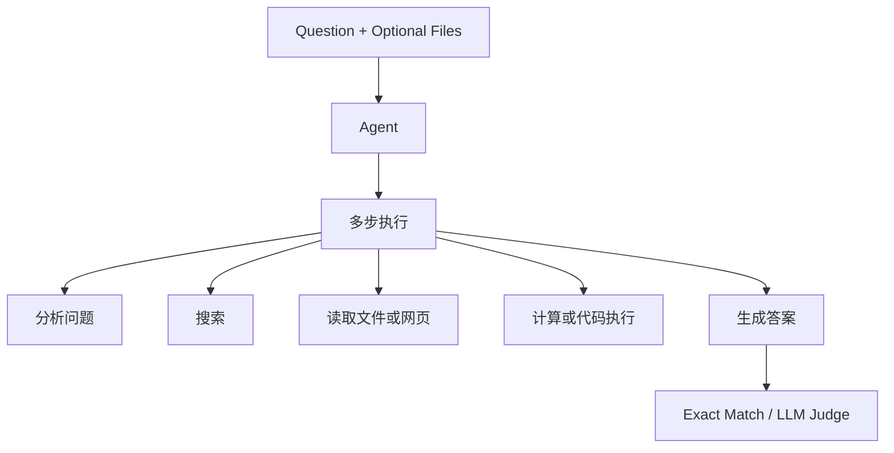
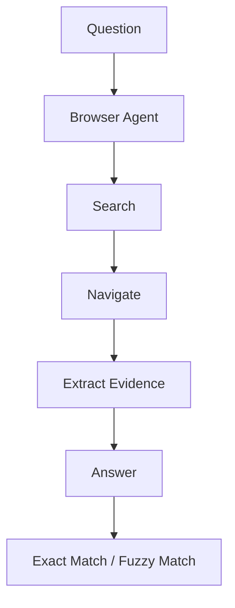
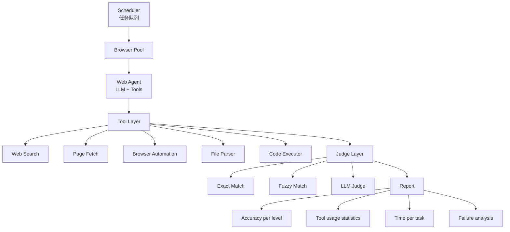

# GAIA + BrowseComp 详解

> **GAIA (General AI Assistants)**: 一个评测 AI 助手综合能力的 benchmark，要求模型具备推理、多模态理解、web 浏览和工具使用能力。由 Facebook AI Research (FAIR) 于 2023 年发布。名字来源于希腊大地女神 Gaia，寓意「全方位」的能力测试。

> **BrowseComp**: 一个专门评测 AI 系统 web 浏览和信息提取能力的 benchmark，使用真实网站作为测试环境，而非缓存的网页快照。由斯坦福大学于 2024 年发布。

---

## 1. GAIA 详解

### 什么是 GAIA

GAIA 的核心思想是：一个真正有用的 AI 助手，不应该只擅长某一种任务，而是应该像人类一样，具备综合解决各类问题的能力。

| 传统 benchmark | 局限 |
|----------------|------|
| MMLU | 偏知识问答 |
| GSM8K | 偏数学推理 |
| HumanEval | 偏代码生成 |
| VQAv2 | 偏图像理解 |

GAIA 的突破在于：**把多种能力放在同一任务里联合考察**。

一个 GAIA 任务可能同时要求：

- 数学推理
- 文件处理（PDF / Excel）
- Web 搜索
- 图像理解
- 多步推理

类比：传统 benchmark 像是「单科考试」（只考数学），GAIA 像是「综合能力测试」（数学+语文+外语+实验操作）。

### 任务类型

GAIA 将任务分为三个等级，难度递增：

| 等级 | 任务特征 | 例子 | 难度 |
|------|----------|------|------|
| Level 1 | 基础推理，不需要外部工具 | 纯文本推理、简单计算、常识问题 | `★★☆☆☆` |
| Level 2 | 需要工具使用 | Web 搜索、PDF/Excel/CSV、代码执行 | `★★★★☆` |
| Level 3 | 复杂多步推理 + 多工具协作 | 跨网站整合、多文件分析、复杂建模 | `★★★★★` |

### GAIA 的数据格式

```json
{
  "task_id": "gaia_1234",
  "level": 2,
  "question": "Find the population of the capital city of the country "
              "that won the 2018 FIFA World Cup, and calculate the "
              "population density given that the city area is 1214 km².",
  "answer": "Moscow; 12,537,046 / 1214 ≈ 10,326.4 people/km²",
  "file_name": null,
  "file_path": null,
  "anonymized": false
}
```

### GAIA 的评测流程



### GAIA 的关键特点

| 特点 | 对 infra 的要求 |
|------|-----------------|
| 真实工具使用 | 真实网络环境、浏览和抓取能力 |
| 多模态输入 | 文件解析器和统一输入管线 |
| 多步推理链 | 中间状态管理、错误恢复 |
| 答案格式灵活 | 多种匹配策略和 judge 方案 |

---

## 2. BrowseComp 详解

### 什么是 BrowseComp

BrowseComp 专门测试 AI 系统的 **web 浏览和信息提取能力**。它的核心理念是：真正的 web agent 应该能在真实的互联网环境中找到答案。

BrowseComp 的设计哲学可以压缩成三条：

1. 用真实网站，而不是缓存快照。
2. 让 Agent 自由导航，而不是强行限制步骤。
3. 不提前暴露答案来源，让系统自己检索和验证。

### BrowseComp 的任务设计

| 类型 | 例子 | 难点 |
|------|------|------|
| Fact Retrieval | 诺贝尔奖得主是谁 | 找到权威来源 |
| Comparative Analysis | 比较两款车参数 | 多站点对比 |
| Deep Information Extraction | 找到论文 DOI | 多级导航 |
| Dynamic Information | 今天东京天气 | 信息会变 |
| Implicit Information | 导演配偶的出生城市 | 需要 A→B→C 推理链 |

### BrowseComp 的评测流程



### BrowseComp vs GAIA 的 web 任务

| 维度 | GAIA | BrowseComp |
|------|------|------------|
| 专注领域 | 综合能力 | Web 浏览 |
| 任务范围 | 包含非 web 任务 | 纯 web 任务 |
| 环境 | 允许多种工具 | 更强调浏览器与网站导航 |
| 网站处理 | 搜索引擎为主 | 自由导航 |
| 动态性 | 部分静态 | 更强调真实实时性 |
| 判分 | 多种方式 | 答案提取匹配 |

---

## 3. 对 Infra 的要求

### 两个 benchmark 共同的 infra 挑战

| 能力域 | 基础要求 |
|--------|----------|
| 真实网络环境 | 容器可访问互联网、支持 HTTP/HTTPS 代理、能处理超时和重试，且策略不同于 SWE-bench 的网络隔离 |
| 浏览器自动化 | Headless Chrome / Playwright / Selenium、页面渲染、DOM 操作、截图、Cookie 管理 |
| 网页解析 | HTML 到结构化文本、广告过滤、表格提取、反爬处理 |
| 搜索 API 集成 | Google / Bing / DDG 等搜索 API、结果解析、检索策略、成本控制 |
| 文件处理 | PDF、Excel/CSV、OCR、格式转换 |

### Infra 架构设计



### 浏览器自动化的关键挑战

1. 动态网页：很多页面是 JavaScript 渲染的 SPA，需要 `wait_for_*` 语义和更稳的页面状态判断，Playwright 的 auto-wait 很关键。
2. 反爬机制：CAPTCHA、rate limiting、User-Agent 检测都很常见，需要代理池和更接近真人的访问节奏。
3. 网页结构变化：网站改版会让 CSS 选择器失效，需要准备多种 selector 策略和回退逻辑。
4. 网络不稳定：超时、DNS 失败、SSL 错误都需要重试和熔断。
5. 成本控制：搜索 API 与代理资源都会烧钱，必须有缓存和预算限制。

### 浏览器容器化方案

```dockerfile
# BrowseComp / GAIA 评测容器示例
FROM mcr.microsoft.com/playwright/python:v1.40.0-jammy

# 安装额外工具
RUN apt-get update && apt-get install -y \
    poppler-utils \    # PDF 工具
    tesseract-ocr \    # OCR
    libreoffice \      # Office 文件转换
    && rm -rf /var/lib/apt/lists/*

# 安装 Python 依赖
COPY requirements.txt .
RUN pip install -r requirements.txt

# 配置 Playwright
RUN playwright install --with-deps chromium

# 设置工作目录
WORKDIR /workspace

# 入口
CMD ["python", "agent.py"]
```

```
容器网络策略：
  - GAIA Level 1：无网络（纯推理）
  - GAIA Level 2/3：允许出站 HTTP/HTTPS
  - BrowseComp：允许完整网络访问

安全限制：
  - 限制可访问的域名白名单（可选）
  - 限制出站端口（只允许 80/443）
  - 限制网络带宽
  - 记录所有网络请求（审计）
```

---

## 4. 与 SWE-bench 的 infra 需求对比

| 维度 | SWE-bench | GAIA | BrowseComp |
|------|-----------|------|------------|
| 隔离要求 | 高 | 中 | 中 |
| 网络需求 | 无 | 有 | 必须 |
| 浏览器 | 不需要 | 可能需要 | 必须 |
| 文件处理 | 代码文件 | PDF / Excel | 通常不需要 |
| 执行时间 | 2-10min / 题 | 1-5min / 题 | 1-10min / 题 |
| 容器策略 | 网络隔离 | 有限网络 | 完整网络 |
| 判分方式 | 测试通过率 | 答案匹配 | 答案匹配 |
| 并发瓶颈 | CPU / 内存 | 网络 I/O | 网络 I/O |

关键差异：
- SWE-bench 更偏计算密集，瓶颈通常在编译、测试、CPU 并发。
- GAIA / BrowseComp 更偏 I/O 密集，瓶颈通常在网络请求、页面加载和浏览器池。

优化方向：
- SWE-bench：优先做 CPU 并发、warm pool、环境复用。
- GAIA / BrowseComp：优先做网络带宽、重试策略、浏览器池和抓取缓存。

---

## 面试高频问题

### Q1: GAIA 和 SWE-bench 测的是不同能力，你怎么理解它们在评测体系中的定位？

**A**: SWE-bench 测的是**工程实现能力** —— 在一个真实的代码库中定位 bug、生成修复、通过测试。它是一个高度结构化的评测，输入是 issue，输出是 patch，判分是 pass/fail。

GAIA 测的是**综合助手能力** —— 像一个全能助手一样，根据需要使用各种工具（搜索、计算、文件处理）来解决不同类型的问题。它是一个非结构化的评测，需要 Agent 自主决定使用什么工具、怎么组合。

在评测体系中，它们是互补的：SWE-bench 验证代码能力，GAIA 验证综合能力。一个优秀的 Agent 应该在两个 benchmark 上都表现好。

### Q2: BrowseComp 为什么坚持用真实网站而不是缓存的网页？这带来了什么工程挑战？

**A**: 真实网站 vs 缓存网页是一个根本性的设计选择。

真实网站的优势：
1. **反映真实能力**：Agent 在真实环境中的表现才是实际使用时的表现
2. **防过拟合**：如果用缓存，模型可以记住缓存页面的内容
3. **测试适应性**：网站结构变化时，Agent 需要能适应

工程挑战：
1. **不可控性**：网站可能宕机、改版、加反爬
2. **不可复现**：同一个问题在不同时间可能得到不同结果
3. **成本高**：真实网络请求比读本地文件慢得多
4. **反爬应对**：需要代理池、人性化操作间隔等

### Q3: 如果让你设计 GAIA/BrowseComp 的评测 infra，你会怎么处理网络不稳定性？

**A**: 分四层防御：

1. **重试机制**：网络请求失败自动重试（指数退避，最多 3 次）
2. **代理池**：准备多个代理 IP，一个被封自动切换
3. **超时控制**：每个操作设置超时（搜索 10s、页面加载 30s、整个任务 300s）
4. **降级策略**：如果某个网站不可达，尝试从其他来源获取信息（如换一个搜索引擎）

关键原则：评测的是 Agent 的能力，不是网络的质量。网络故障不应该导致整个评测失败，而应该被当作 Agent 需要处理的环境噪声。

### Q4: GAIA 的 Level 2/3 需要工具使用，怎么确保工具调用的安全性？

**A**: 分三种策略：

1. **容器隔离**：Agent 在 Docker 容器中执行，限制文件系统访问范围
2. **网络白名单**：限制可访问的域名和端口，防止访问恶意网站
3. **沙箱执行**：代码执行（Python）在沙箱中运行，禁止系统调用（如 os.system）

对于 GAIA Level 2/3，允许网络访问但需要审计：记录所有 HTTP 请求的 URL、method、response code，便于后续分析。

### Q5: 从 benchmark 设计的角度，你怎么评价 GAIA 和 BrowseComp 的优缺点？

**A**:

GAIA 的优点：综合能力强、任务多样性好、评测全面
GAIA 的缺点：任务定义不够精确（边界模糊）、判分标准不一致（有些答案太长）、Level 之间难度差异大

BrowseComp 的优点：专注度高、真实环境、任务定义清晰
BrowseComp 的缺点：范围窄（只测 web 浏览）、不可复现（网站变化）、容易被反爬机制干扰

理想方案：结合两者的优势 —— 用 GAIA 的综合框架 + BrowseComp 的真实环境 + SWE-bench 的严格判分。

→ 参见 [swe_bench.md](swe_bench.md) 了解 SWE-bench 的严格判分机制
→ 参见 [hle.md](hle.md) 了解 HLE 的评测方法论
