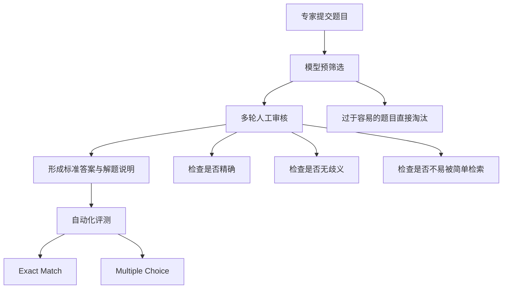
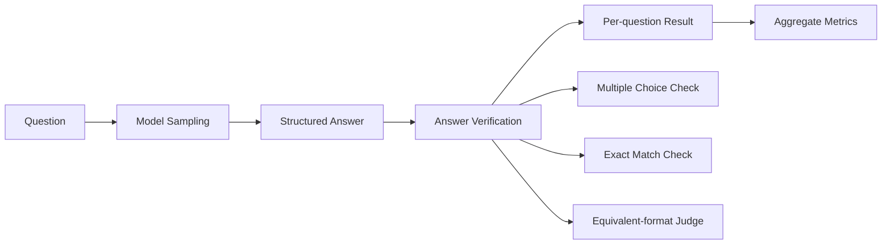
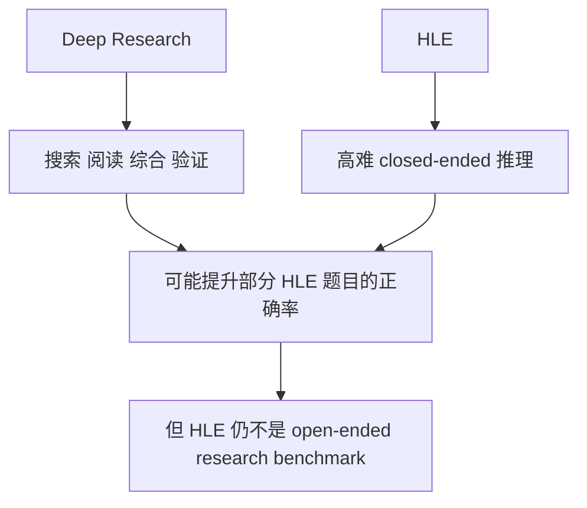

# HLE (Humanity's Last Exam) 详解

> **HLE**：一个面向前沿模型能力评估的高难度学术 benchmark。根据 2026 年 1 月 28 日发表于 Nature 的论文，HLE 是一个 **expert-level、closed-ended、可自动判分** 的评测集合。

> **本地核对说明**：本页已按 `2026-04-20` 对照 Nature 论文与官方站点修订，避免沿用早期二手总结中的过时说法。

---

## 1. 什么是 HLE

HLE 关注的不是「模型记住了多少公开题库」，而是「模型在**封闭答案、可验证**的高难学术问题上还能走多远」。

| 维度 | 当前更准确的描述 |
|------|------------------|
| 官方论文 | Nature, published on **January 28, 2026** |
| benchmark 定位 | **closed-ended academic benchmark** |
| 题目规模 | **2,500 questions** |
| 题型 | **multiple-choice + exact-match short answer** |
| 判分方式 | 以自动判分为主，允许对等价格式做 judge 校验 |
| 多模态比例 | 约 **14%** 题目需要同时理解文字和图片 |
| 多选比例 | 约 **24%** 为 multiple-choice，其余为 exact-match |
| 核心目标 | 在已有 benchmark 饱和后，继续拉开模型差距 |

### 为什么会有 HLE

很多经典 benchmark 已经越来越接近饱和，导致它们对 frontier model 的区分度下降。

| Benchmark | 常见问题 |
|-----------|----------|
| MMLU | 覆盖广，但对前沿模型已经不够难 |
| GPQA | 更难，但规模较小 |
| HLE | 通过专家供题和更严格审核，把难度再往前推一层 |

可以把它理解成一条难度升级链：

- `MMLU` 更像大范围本科层面的知识+理解测试。
- `GPQA` 更像高阶学科问答。
- `HLE` 则更接近“专家级、封闭答案、不可轻易检索”的综合压力测试。

### HLE 的核心设计要求

这个流程的重点不是“题多”，而是：

- 题目要难。
- 题目要有**明确答案**。
- 题目要适合自动化评测。
- 题目要尽量避免被简单记忆或检索解决。

---

## 2. HLE 与 MMLU、GPQA 的区别

| 维度 | MMLU | GPQA | HLE |
|------|------|------|-----|
| 核心目标 | 通用知识与理解 | 更难的研究生级问答 | 专家级 closed-ended 学术能力 |
| 题量 | 大 | 较小 | 2,500 |
| 难度策略 | 广覆盖 | Google-proof 倾向 | 专家供题 + 多轮审核 |
| 题型 | 以多选为主 | 多选 | 多选 + exact-match |
| 判分 | 自动判分 | 自动判分 | 自动判分为主，可处理答案等价 |
| 是否适合追踪 frontier 进展 | 逐渐变弱 | 中等 | 当前更强 |

### 一个重要纠偏

HLE **不是**“开放式论文题 + 专家主观评审为主”的 benchmark。

更准确的说法是：

- 它是 **closed-ended** 的。
- 每题都有已知答案。
- 题目强调精确、可验证、无歧义。
- 自动判分是主流程，不是附属流程。

这点很关键，因为它直接决定了 HLE 更接近“高难自动评测基准”，而不是“开放式研究任务评审”。

---

## 3. 题型与难度特征

### 题型结构

| 类别 | 特点 | 对 infra 的影响 |
|------|------|-----------------|
| `Exact Match` | 输出必须对齐到明确答案 | 适合自动评分，便于规模化 |
| `Multiple Choice` | 选项明确 | 评测吞吐高，便于稳定复现 |
| `Text + Image` | 需要跨模态理解 | 要求模型支持视觉输入与统一判分 |

### HLE 为什么难

1. **题目难度高**：不是常规教科书级别问答，而是更靠近专家知识边界。
2. **封闭答案约束强**：没有“写得像样就算对”的空间。
3. **不可简单检索**：题目设计本身就避免被直接搜索命中。
4. **跨学科范围广**：不是只测数学或只测常识。
5. **模型校准也被暴露**：论文中强调很多模型会高置信度地答错。

### 不该再沿用的旧说法

- “HLE 有 3000+ 题”。
- “HLE 主要是开放题”。
- “HLE 主要靠 LLM judge 或专家人工评分”。

这些说法会把 HLE 讲成另一个东西，和官方定义有偏差。

---

## 4. HLE 怎么评测

### 标准评测链路

### 判分的正确理解

HLE 的主干仍然是 **自动化答案验证**：

- multiple-choice 题直接做选项对比。
- exact-match 题直接做答案匹配。
- 遇到格式等价问题时，可以引入 judge 处理“分数/小数/等价表述”的归一化。

这和“开放式 essay 让另一个模型主观打分”不是一回事。

### 常见指标

| 指标 | 含义 | 适合看什么 |
|------|------|------------|
| `pass@1` | 一次采样就答对 | 单次能力、真实默认体验 |
| `pass@k` | 采样 k 次中任一正确 | 上限能力、重采样收益 |
| `majority vote` | 多次采样后多数投票 | 自一致性带来的收益 |

### 为什么 HLE 对 infra 依然重要

虽然 HLE 不像 SWE-bench 那样需要 Docker 沙箱跑测试，但它仍然会给 infra 带来压力：

- `pass@k` 带来明显的推理放大。
- 多模态题要求统一的输入与评测管线。
- 答案归一化与 judge 校验需要额外推理开销。
- 想做大规模横向对比时，吞吐和成本都不是小问题。

---

## 5. HLE 与 Deep Research 的关系

这部分最容易被讲偏。

### 正确关系

HLE **不是**专门测 web search 或 open-ended research 的 benchmark。

它更像是：

- 一个针对 **closed-ended academic reasoning** 的高难评测；
- 可以用来观察 Deep Research 或外部工具是否真的提升了最终正确率；
- 但不能把它直接等同于“真实世界研究型 agent benchmark”。

### 更稳妥的表述方式

如果你在面试里讲这部分，推荐这样说：

- HLE 测的是高难 closed-ended 学术推理。
- Deep Research 测的是多步搜索与综合能力。
- 两者有交集，但并不等价。
- 用 HLE 看 Deep Research 的收益时，要把它当成**补充评测**，而不是唯一结论。

### 对 Infra 工程师的启示

1. **推理吞吐是硬约束**：`pass@k` 会迅速放大调用量。
2. **多模态支持要一体化**：文本和图像不能拆成两套评测管线。
3. **答案验证要标准化**：格式归一化、等价判断、结果聚合都要稳定。
4. **版本管理很重要**：benchmark 公开集、私有集、后续更新要清楚分层。

→ 参见 [Week 3 README](../../03_week3_inference_claude_code/README.md) 了解推理吞吐与 batching  
→ 参见 [five_layer_optimization.md](../deep_research/five_layer_optimization.md) 了解 Deep Research 的优化维度

---

## 面试高频问题

### Q1: 为什么有了 MMLU 和 GPQA 还需要 HLE？

**A**：因为 benchmark 会饱和。MMLU 这类评测对 frontier model 的区分度已经下降，GPQA 难度更高但规模更小。HLE 通过专家供题、多轮审核和 closed-ended 自动评测，把难度和统计稳定性一起往前推了一步。

### Q2: HLE 是不是开放式问题 benchmark？

**A**：不是。HLE 的官方定义是 **closed-ended academic benchmark**。它包含 multiple-choice 和 exact-match short answer，核心目标是自动化、可验证，而不是开放式主观评分。

### Q3: HLE 的 judge 在做什么？

**A**：judge 主要用于处理**等价答案格式**，例如分数和小数、不同但等价的写法。它不是在把 HLE 变成开放式作文评分。

### Q4: HLE 对 Deep Research 系统有什么价值？

**A**：它可以作为一个高难 closed-ended 测试集，观察外部搜索、证据整合和重采样是否真的提高了最终正确率。但它不能单独代表开放式研究 agent 的全部能力。

### Q5: 设计 HLE 评测 infra 时你最关心什么？

**A**：三件事：采样成本、答案验证标准化、多模态输入管线。HLE 不像 SWE-bench 那样重沙箱，但它很吃推理吞吐和评测一致性。
