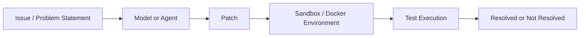
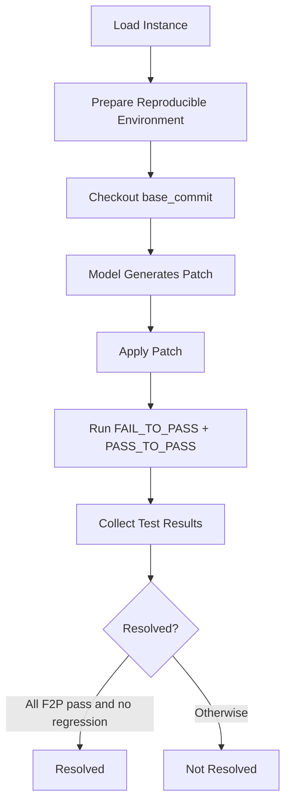
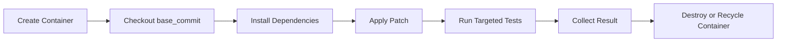

# SWE-bench 详解

> **SWE-bench**：一个评测 AI 系统真实软件工程能力的 benchmark。核心输入是真实 GitHub issue，核心输出是 patch，核心判分方式是把 patch 放进可复现环境里跑测试。

> **本地核对说明**：本页已按 `2026-04-20` 对照 SWE-bench 官方数据页修订，尤其更新了 `Lite = 534`、`Verified = 500` 等容易写旧的数字。

---

## 1. 什么是 SWE-bench

SWE-bench 想测的不是“模型能不能独立写一个函数”，而是“模型能不能在真实仓库里定位问题、修改代码、通过回归测试”。

| 传统代码 benchmark | SWE-bench |
|--------------------|-----------|
| 题目短、上下文少 | issue 来自真实仓库 |
| 往往只测函数实现 | 要理解项目结构和依赖 |
| 环境简单 | 环境复现复杂 |
| 判分通常是隐藏测试 | 判分强调真实测试与回归约束 |

所以它更像真实研发流程里的一个最小闭环：



---

## 2. 数据来源与数据格式

### 数据来源

SWE-bench 来自真实开源仓库中的 issue 和对应修复，强调：

- 仓库要有成熟测试套件。
- issue 和修复之间要能建立清晰对应关系。
- 运行环境要能在容器中复现。

### 一个 instance 通常包含什么

```json
{
  "instance_id": "django__django-12453",
  "repo": "django/django",
  "version": "3.0",
  "base_commit": "4c7e4f8f7b3e5a2b1c9d8e7f6a5b4c3d2e1f0a9b",
  "problem_statement": "When using QuerySet.select_related() with a nested relation...",
  "hints_text": "The issue occurs when...",
  "test_patch": "@@ -1,5 +1,7 @@ ...",
  "patch": "@@ -45,7 +45,9 @@ ...",
  "FAIL_TO_PASS": ["test_nested_select_related"],
  "PASS_TO_PASS": ["test_basic_select_related"]
}
```

| 字段 | 含义 | 对 infra 的意义 |
|------|------|-----------------|
| `instance_id` | 唯一编号 | 任务调度和结果回收 |
| `repo` | 仓库名 | 选择镜像和代码基底 |
| `base_commit` | 修复前 commit | 保证复现一致 |
| `problem_statement` | issue 文本 | 输入给模型 |
| `patch` | 参考修复 | 离线分析，不给模型 |
| `FAIL_TO_PASS` | 原来失败、修后必须通过的测试 | 成功判定核心 |
| `PASS_TO_PASS` | 原来通过、修后仍必须通过的测试 | 回归检查核心 |

### 判分为什么不是“只看通过率”

SWE-bench 最关键的不是“跑过一些测试”，而是这两个条件必须同时满足：

1. `FAIL_TO_PASS` 全部通过。
2. `PASS_TO_PASS` 不出现回归。

这比“总体通过率高不高”严格得多，也更接近真实工程要求。

---

## 3. 评测流程

### 标准评测链路



### 一个更工程化的伪代码视角

```python
def evaluate_swe_bench(instance, model):
    container = docker.create(
        image=f"swe-bench/{instance.repo}:{instance.version}",
        cpus=2,
        memory="4g",
    )

    container.exec(f"git checkout {instance.base_commit}")
    container.exec("pip install -e .")

    patch = model.generate(
        problem_statement=instance.problem_statement,
        workspace=container.workspace,
    )

    apply_result = container.exec(f"git apply {patch}")
    if apply_result.failed:
        return {"resolved": False, "reason": "patch_apply_failed"}

    test_results = container.exec(
        f"python -m pytest "
        f"{' '.join(instance.FAIL_TO_PASS)} "
        f"{' '.join(instance.PASS_TO_PASS)} "
        f"--tb=short --no-header -q"
    )

    all_fail_to_pass = all(
        test_results[t] == "passed" for t in instance.FAIL_TO_PASS
    )
    no_regression = all(
        test_results[t] == "passed" for t in instance.PASS_TO_PASS
    )

    return {"resolved": all_fail_to_pass and no_regression}
```

---

## 4. 为什么 Docker 是核心基础设施

SWE-bench 的评测环境天然要求：

- **隔离**：不同 instance 不能互相污染。
- **复现**：同一 patch 重跑结果应该一致。
- **可并发**：几百个 instance 不能串行慢慢跑。
- **安全**：模型输出不能直接在宿主机上乱执行。

### 容器生命周期



### Warm Pool 为什么值钱

| 模式 | 主要耗时 | 结果 |
|------|----------|------|
| 每个 instance 冷启动 | 创建容器 + 初始化环境 + 测试执行 | 延迟高 |
| Warm Pool | 预先准备一批可复用环境，重点消耗测试执行本身 | 吞吐明显提升 |

一个常见近似模型：

| 项目 | 冷启动 | Warm Pool |
|------|--------|-----------|
| 容器创建 | 30s | 预启动摊平 |
| 环境初始化 | 60s | 预启动摊平 |
| 测试执行 | 120s | 120s |
| 销毁/回收 | 5s | 5s |

这就是为什么评测 infra 讨论 SWE-bench 时，总会落到：

- 镜像预构建
- 容器池
- CoW 共享基础层
- 调度器并发控制

→ 参见 [Week 1 README](../../01_week1_docker/README.md) 了解容器与 warm pool 基础

---

## 5. 数据集版本演进

官方数据页当前给出的主版本如下：

| 数据集 | 规模 | 典型用途 |
|--------|------|----------|
| SWE-bench Full | **2,294** | 全面评估 |
| SWE-bench Lite | **534** | 快速迭代与日常开发 |
| SWE-bench Verified | **500** | 高质量、低噪声评测 |

### 怎么理解这三个版本

| 维度 | Full | Lite | Verified |
|------|------|------|----------|
| 覆盖面 | 最大 | 较小 | 中等 |
| 评测成本 | 最高 | 最低 | 中等 |
| 噪声 | 较高 | 中等 | 最低 |
| 适合场景 | 系统级报告 | 快速实验 | 论文/对外汇报/高质量比较 |

### 一个常见误区

不要再把 `Lite` 写成 `300`。  
当前官方数据页是 **534 instances**。

---

## 6. 常见工程挑战

### Flaky Test

| 问题 | 现象 | 常见处理 |
|------|------|----------|
| 同一 patch 多次跑结果不同 | 有时 pass、有时 fail | 多次运行、过滤已知 flaky case、固定随机性 |

### Patch Apply 失败

| 原因 | 说明 |
|------|------|
| 行号偏移 | 模型依据的上下文和目标 commit 不一致 |
| diff 上下文不匹配 | patch 格式正确但无法定位 |
| 缩进/文件路径错误 | 在真实仓库里很常见 |

### 超时管理

| 层级 | 常见做法 |
|------|----------|
| 单个测试 | 设置 case timeout |
| 单个 instance | 设置 overall timeout |
| 整个评测批次 | 设置作业级 SLA |

---

## 7. SWE-bench 对 Infra 工程师意味着什么

SWE-bench 几乎把 Agent infra 的三件核心事压缩成了一个 benchmark：

1. **并发**：几百到上千 instance 不可能串行跑。
2. **复现**：base commit、依赖、环境变量都要锁死。
3. **自动判分**：用真实测试把结果变成结构化 reward / resolve signal。

如果你能讲清楚 SWE-bench，基本也就能讲清楚：

- 为什么需要 Docker / sandbox；
- 为什么需要 Harness / Verifier；
- 为什么评测和 RL 训练会共享很多基础设施。

→ 参见 [Week 2 README](../../02_week2_rl_verification/README.md) 了解 rollout → reward → update  
→ 参见 [06_references/papers.md](../../06_references/papers.md) 查看本地论文摘要

---

## 面试高频问题

### Q1: SWE-bench 和 HumanEval 的本质区别是什么？

**A**：HumanEval 更像函数级编程题，SWE-bench 更像真实项目修 bug。前者主要测局部代码生成，后者测代码理解、定位、修复、验证的完整闭环。

### Q2: 为什么 SWE-bench 一定要上容器？

**A**：因为它要同时解决安全、复现、并发三个问题。宿主机直跑很难做到既稳定又可规模化。

### Q3: 如果你是 SWE-bench 的 infra 负责人，你会怎么优化吞吐？

**A**：优先做三件事：镜像预构建、warm pool、测试范围裁剪。然后再考虑调度策略、失败重试和结果缓存。

### Q4: Verified 为什么重要？

**A**：因为它更像“低噪声高置信”的评测子集。对外汇报、模型对比、论文表格都更依赖这种质量更稳定的数据。

### Q5: SWE-bench 为什么天然适合 RL / RLAIF / RLVR 讨论？

**A**：因为它把 patch 质量变成了结构化可验证信号。模型生成 rollout，环境执行 patch，测试结果回收 reward，这和 RL 训练里的 verifier 闭环非常接近。
