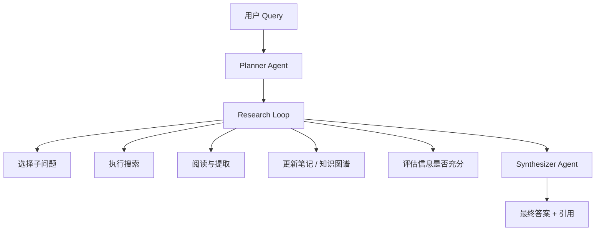
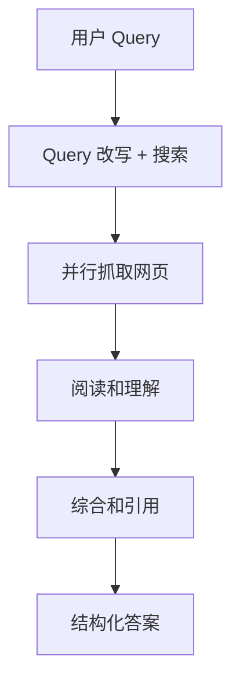
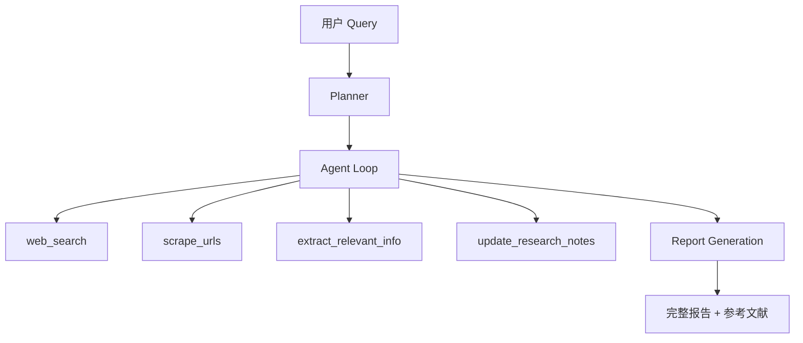
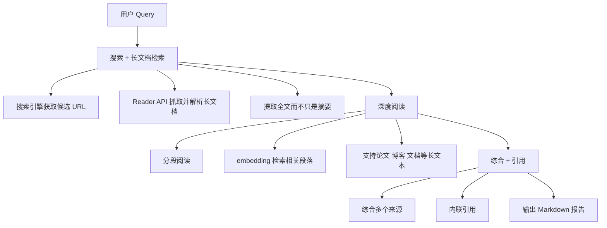
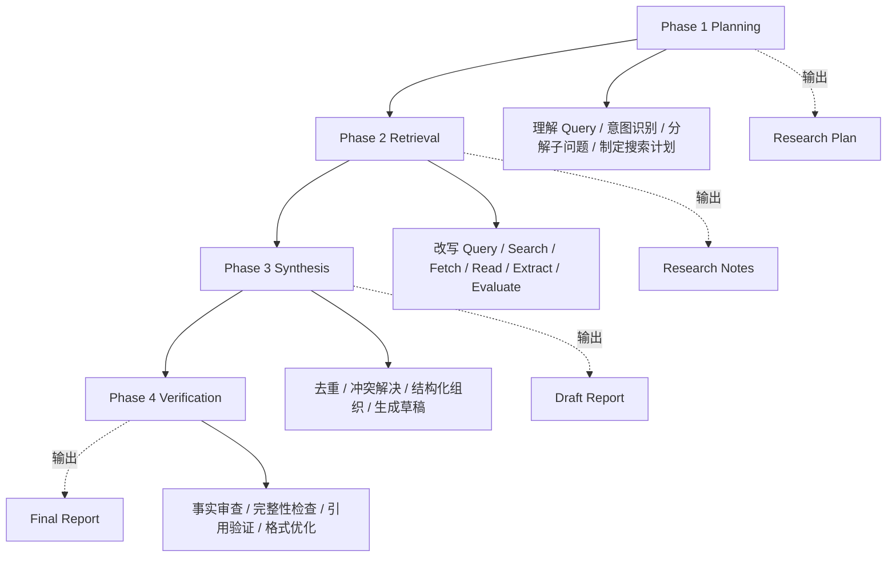

# Deep Research 架构对比

> 本文件对比分析主流 Deep Research 系统的架构设计，提取通用模式，为 infra 设计提供参考。

---

## 1. OpenAI Deep Research

### 公开信息

OpenAI 于 2025 年初发布了 Deep Research 功能，集成在 ChatGPT Pro 中。官方技术博客披露了部分架构思想。

### 核心架构思想



### 关键特点

| 特点 | 含义 |
|------|------|
| 深度搜索 | 多轮搜索，用户等待时间长，但覆盖更深 |
| 多 Agent 协作 | Planner / Researcher / Synthesizer 分工清楚 |
| 长上下文管理 | 需要压缩中间结果并维护结构化笔记 |
| 实时进度反馈 | 用户能看到正在搜索什么、用了哪些来源 |

---

## 2. Perplexity 架构

### 核心流程



### 关键特点

| 特点 | Perplexity | OpenAI Deep Research |
|------|------------|----------------------|
| 返回速度 | 更快，通常 10-30 秒 | 更慢，可能 5-30 分钟 |
| 搜索轮数 | 少 | 多 |
| 典型定位 | 快速、浅层、实时 | 慢速、深层、全面 |
| 引用风格 | 强内联引用 | 更偏完整研究输出 |

---

## 3. GPT-Researcher（开源实现）

### 项目概述

> **GPT-Researcher**: 一个开源的 Deep Research Agent 框架，使用 GPT-4 等模型实现自动化的研究任务。GitHub star 数 15K+，是最流行的开源 Deep Research 实现。

GitHub: https://github.com/assafelovic/gpt-researcher

### 核心架构



### 关键代码结构

```python
# GPT-Researcher 的核心 Agent Loop（简化版）
class GPTResearcher:
    async def conduct_research(self, query: str):
        # Step 1: 生成搜索 query
        search_queries = await self.plan_research(query)

        # Step 2: 多轮搜索和抓取
        for sub_query in search_queries:
            # 搜索
            search_results = await self.web_search(sub_query)

            # 抓取网页
            for url in search_results:
                content = await self.scrape_url(url)

                # 提取相关信息
                info = await self.extract_info(content, sub_query)

                # 更新研究笔记
                self.research_notes.append(info)

        # Step 3: 生成报告
        report = await self.generate_report(self.research_notes)
        return report
```

### 使用的工具

| 组件 | 常见选择 |
|------|----------|
| 搜索 | Tavily、DuckDuckGo、Google、Bing |
| 抓取 | BeautifulSoup、Playwright、Newspaper3k |
| LLM | GPT-4 / GPT-3.5 / 其他兼容 API |

### 优点与局限

| 优点 | 局限 |
|------|------|
| 完全开源，可扩展 | 搜索质量依赖外部 API |
| 模块化设计，易换组件 | 强推理能力仍依赖底层模型 |
| 社区活跃，支持本地运行 | 报告质量通常不如商业产品 |
| 文档较完善 | benchmark 结果体系较弱 |

---

## 4. Jina DeepSearch / DeepResearch（开源实现）

### 项目概述

Jina AI 发布的 DeepSearch 开源实现，侧重于长文本阅读和深度理解。

### 核心架构



### 与 GPT-Researcher 的区别

| 维度 | GPT-Researcher | Jina DeepSearch |
|------|----------------|-----------------|
| 专注点 | 多轮搜索 | 深度阅读 |
| 文档处理 | 摘要/提取 | 全文 + 分段 |
| 长文档 | 支持一般 | 深度优化 |
| 引用风格 | 末尾列表 | 内联引用 |
| 搜索轮数 | 多轮 | 少轮 + 深阅读 |
| Reader | 基础解析 | Jina Reader API |

---

## 5. 通用 Deep Research 架构模式

从以上方案中提取的通用模式：



### 各方案的实现差异

| 组件 | OpenAI | Perplexity | GPT-Researcher | Jina DeepSearch |
|------|--------|------------|----------------|-----------------|
| **Planning** | 多 Agent 协作 | 简单改写 | 单 Agent | 单 Agent |
| **Retrieval 轮数** | 10-50+ 轮 | 1-3 轮 | 5-15 轮 | 3-8 轮 |
| **阅读深度** | 深度 | 浅层 | 中等 | 深度 |
| **Synthesis** | o3/o4-mini | GPT-4 class | GPT-4 | GPT-4 |
| **Verification** | 自我审查 | 简单检查 | 无强验证 | 引用验证 |
| **耗时** | 5-30 min | 10-30s | 2-10 min | 1-5 min |
| **引用** | 完整列表 | 内联引用 | 末尾列表 | 内联引用 |
| **多模态** | 支持 | 有限 | 不支持 | 有限 |

---

## 6. 各方案的异同对比表

### 完整对比

| 维度 | OpenAI | Perplexity | GPT-R | Jina |
|------|--------|------------|-------|------|
| 开源 | 否 | 否 | 是 | 是 |
| 深度 | 极深 | 浅 | 中 | 深 |
| 速度 | 慢 | 快 | 中 | 中 |
| 多 Agent | 是 | 否 | 否 | 否 |
| 长文档处理 | 优秀 | 一般 | 一般 | 优秀 |
| 代码执行 | 是 | 否 | 否 | 否 |
| 实时搜索 | 是 | 是 | 是 | 是 |
| 引用系统 | 完整 | 内联 | 末尾 | 内联 |
| 自我验证 | 强 | 弱 | 无 | 中 |
| 成本 | 高 | 中 | 中 | 中 |
| 适合场景 | 深度调研 | 快速问答 | 自定义研究 | 深度阅读 |

### 架构模式分类

1. 搜索-阅读-总结模式（Perplexity）
   `Search -> Read -> Summarize`
   特点是单轮、快速、浅层，适合实时问答。
2. 多轮 Agent Loop（GPT-Researcher / Jina）
   `Plan -> [Search -> Read -> Note] x N -> Report`
   特点是多轮、中等深度、可定制，适合自定义研究任务。
3. 多 Agent 协作模式（OpenAI）
   `Planner -> [Researcher x N] -> Synthesizer -> Verifier`
   特点是多 Agent、极深、最复杂，适合专业深度调研。

---

## 7. 对 Infra 工程师的启示

### Infra 设计要点

无论哪种 Deep Research 架构，infra 都要支持这五组能力：

| 能力域 | 核心要求 |
|--------|----------|
| 搜索 API 管理 | 多搜索引擎支持、限流和熔断、成本追踪、结果缓存 |
| 网页抓取基础设施 | 浏览器自动化、HTML 到结构化文本、反爬应对、大文档处理 |
| LLM 推理基础设施 | 多模型支持、KV Cache / Batching / Prefix Cache、成本控制、长上下文 |
| Agent 状态管理 | 研究笔记持久化、中间结果版本管理、Agent 间消息传递、失败恢复 |
| 评测基础设施 | 答案质量评估、引用准确性验证、延迟与成本监控、A/B 测试框架 |

### 选择建议

根据场景选架构：

- 快速问答：搜索-阅读-总结模式。
- 自定义研究：GPT-Researcher 风格。
- 专业深度调研：多 Agent 协作模式。

从 infra 落地顺序看：

1. 先实现 Phase 2（Retrieval）的 infra。
2. 再实现 Phase 1（Planning）和 Phase 3（Synthesis）。
3. 最后补上 Phase 4（Verification）。
4. 四个阶段都可以独立优化和替换。

→ 参见 [five_layer_optimization.md](five_layer_optimization.md) 了解 Deep Research 五层优化

---

## 面试高频问题

### Q1: OpenAI Deep Research 和 Perplexity 的核心架构区别是什么？

**A**: 核心区别在于**深度和复杂度**。

OpenAI Deep Research 使用多 Agent 协作模式，有专门的 Planner Agent 做规划和分解，多个 Researcher Agent 并行搜索和阅读，Synthesizer Agent 做综合。搜索轮数可以达 10-50+ 轮，耗时 5-30 分钟。适合专业深度调研。

Perplexity 使用搜索-阅读-总结模式，query 改写后做 1-3 轮搜索，10-30 秒内返回结果。特点是强引用系统（内联引用）和实时搜索。适合快速获取信息。

类比：OpenAI Deep Research 是「请一个研究员花一周做调研」，Perplexity 是「快速 Google 搜索后总结」。

### Q2: 如果让你从零设计一个 Deep Research 系统，你会怎么分模块？

**A**: 分四个模块：

1. **Planning Module**：理解用户 query，分解子问题，制定搜索计划。输出是结构化的 research plan。
2. **Retrieval Module**：执行搜索、抓取网页、提取信息。这是一个多轮循环，直到信息充分度达到阈值。输出是 research notes。
3. **Synthesis Module**：综合 research notes 生成报告，添加引用和来源。输出是 draft report。
4. **Verification Module**：自我审查报告的事实正确性、完整性、引用准确性。输出是 final report。

每个模块可以独立开发和优化，也可以用不同的 LLM（Planning 用强推理模型，Retrieval 用快速模型，Verification 用专门判分模型）。

### Q3: Deep Research 系统最大的工程挑战是什么？

**A**: 三个核心挑战：

1. **质量控制**：多轮搜索中如何避免信息偏差和幻觉。解决方案是强引用系统 + 多源交叉验证 + 自我审查。
2. **成本控制**：几十轮 LLM 推理 + 大量搜索 API 调用。解决方案是早停机制 + 缓存策略 + 轨迹剪枝。
3. **延迟控制**：5-30 分钟的等待时间。解决方案是进度反馈 + 并行化 + 流式输出。

从 infra 角度，还有一个被忽视的挑战：**可观测性**。Deep Research 是一个复杂的多步系统，当结果不好时，很难定位是哪一步出了问题。需要完善的日志、tracing 和指标监控。

### Q4: 你怎么评估一个 Deep Research 系统的质量？

**A**: 分四个维度评估：

1. **准确性**：答案的事实正确率。可以用 LLM-as-judge 或人工评审。
2. **完整性**：是否覆盖了用户 query 的所有方面。
3. **引用质量**：引用是否准确、来源是否可靠。
4. **效率**：达到相同质量所需的搜索轮数、推理 token 数和耗时。

定量评测可以用 GAIA benchmark（特别是 Level 2/3 的 web 任务）和 BrowseComp。也可以用 HLE 来测试推理上限。

### Q5: GPT-Researcher 开源实现有什么局限？你会怎么改进？

**A**: 主要局限：

1. **缺少强推理**：依赖 GPT-4 的推理能力，没有专门的推理优化（如 chain-of-thought prompting、self-reflection）。
2. **缺少验证环节**：生成的报告没有自我审查，可能有事实错误。
3. **搜索策略简单**：基于关键词搜索，缺少语义理解和动态调整。

改进方向：
1. 加入 Verification Module，用独立模型审查报告质量
2. 优化搜索策略，使用 embedding-based retrieval 替代纯关键词搜索
3. 加入早停机制，基于信息充分度自动停止搜索
4. 支持多 Agent 并行，sub-query 可以并行搜索
5. 加入 I/O 缓存层，避免重复的搜索和抓取
