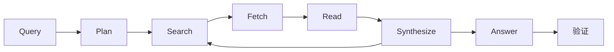
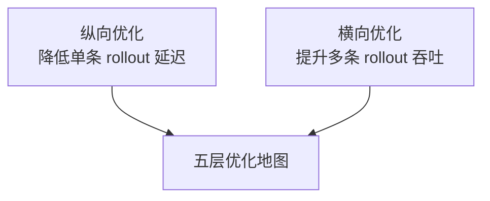
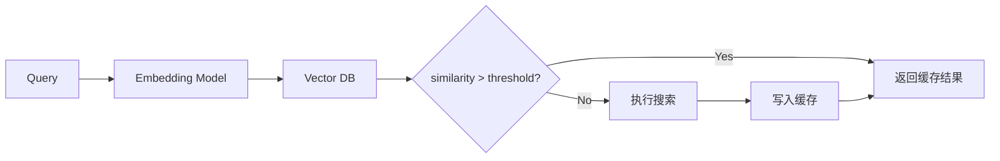
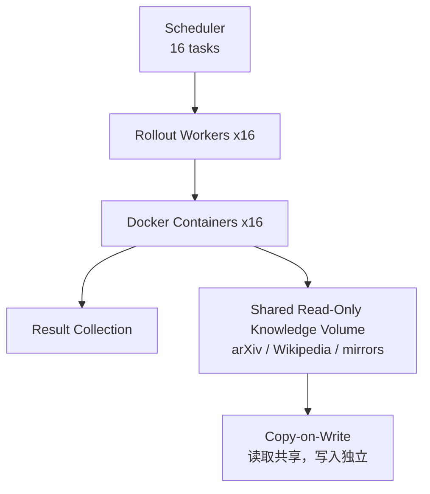
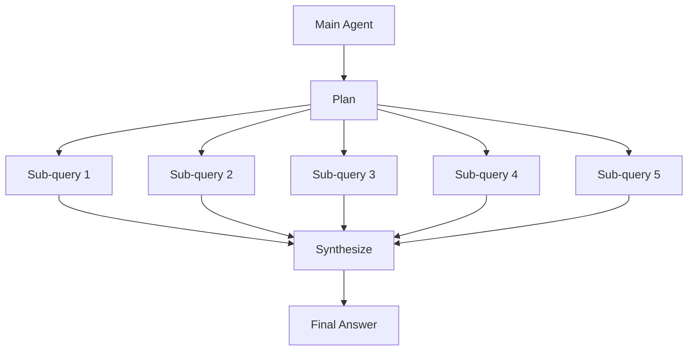
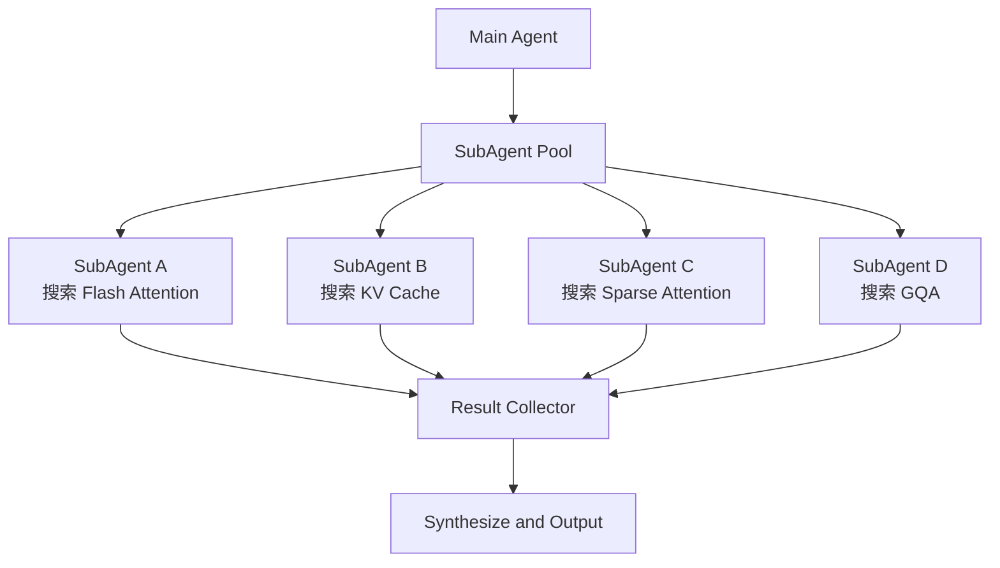
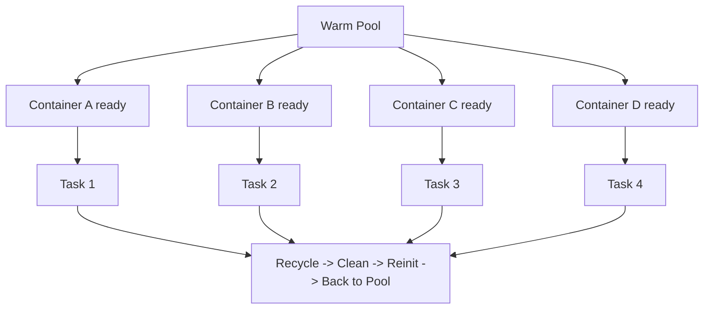

# Deep Research 五层优化地图

> **Deep Research**: 一种 Agent 架构模式，通过多轮搜索、阅读、综合来回答复杂问题。一次典型的 Deep Research 任务可能需要 5-30 分钟，涉及几十轮 LLM 推理和网络 I/O。

---

## 0. 场景定义

### 标准的 Deep Research 流程



| 阶段 | 典型耗时 |
|------|----------|
| Plan | ~5s |
| Search | ~2s / 轮 |
| Fetch | ~1s / 轮 |
| Read | ~1s / 轮 |
| Synthesize | ~10s / 轮 |

粗略估算：

- 单轮约 `15s`
- 10 轮约 `150s`
- 16 条 rollout 串行约 `40min`
- 16 条 rollout 并行后可压到约 `3.3min + 调度开销`

### 两个正交维度

在讲优化之前，先理清两个维度的关系：

| 维度 | 目标 | 典型手段 | 类比 |
|------|------|----------|------|
| 纵向优化 | 让单条 rollout 更快完成 | 缓存 I/O、加速推理、优化算法 | 让一个快递员单次送件更快 |
| 横向优化 | 让多条 rollout 同时跑 | 并发调度、环境复用、推理 batching | 让 16 个快递员一起送件 |



> **纵向优化**关注单条 rollout 的延迟（latency），即一个用户问一个问题到得到答案的时间。
> **横向优化**关注多条 rollout 的吞吐（throughput），即系统同时处理多少个 Deep Research 任务。

> 为什么要分开讲？因为它们的优化手段不同：纵向优化靠缓存和算法，横向优化靠并发和调度。面试时你能清晰区分这两个维度，说明你理解问题的本质。

---

## 第 1 层：I/O 缓存层

> 这一层解决的问题是：Deep Research 的每轮都要做网络 I/O（搜索、抓取网页），而大量 I/O 是重复的或可预测的。

### 1.1 语义缓存

语义缓存要解决的是：**同义 query 触发重复搜索**。



| 项目 | 设计建议 |
|------|----------|
| 缓存 key | query embedding |
| 缓存 value | search results + fetched pages |
| 常用向量库 | FAISS / Milvus |
| 过期策略 | 按来源设置 TTL，例如 1 小时 |

> **Embedding**: 将文本转换为高维向量（如 768 维），使得语义相似的文本在向量空间中距离更近。类比：把「苹果」和「橘子」都映射到「水果」附近的区域。

> **余弦相似度 (Cosine Similarity)**: 衡量两个向量方向一致性的指标，值域 [-1, 1]，1 表示完全相同方向。在语义搜索中，> 0.95 通常意味着高度语义等价。

```python
# 语义缓存伪代码
class SemanticCache:
    def __init__(self, embedding_model, vector_db, threshold=0.95):
        self.embedding_model = embedding_model
        self.vector_db = vector_db
        self.threshold = threshold

    def get_or_compute(self, query, compute_fn):
        # Step 1: 将 query 转为 embedding
        query_vector = self.embedding_model.encode(query)

        # Step 2: 在 vector DB 中搜索最相似的缓存
        cached = self.vector_db.search(query_vector, top_k=1)

        if cached and cached.similarity > self.threshold:
            # 命中缓存，直接返回
            return cached.value
        else:
            # 未命中，执行实际计算
            result = compute_fn(query)

            # Step 3: 缓存结果
            self.vector_db.insert(query_vector, result, ttl=3600)
            return result
```

### 1.2 本地知识库镜像

本地知识库镜像要解决的是：**热门来源重复远程 fetch 带来的延迟、成本和不稳定性**。

| 来源 | 本地化价值 | 典型规模 |
|------|------------|----------|
| arXiv | 可本地全文检索 | ~2TB |
| Wikipedia | 结构稳定，适合本地 API | ~100GB |
| GitHub 热门仓库 | 代码、README、Issues 可离线索引 | ~500GB |
| StackOverflow 热门问答 | 常见排障信息命中率高 | ~50GB |

| 实现方式 | 作用 |
|----------|------|
| Elasticsearch | 全文索引 |
| Vector DB | 语义检索 |
| 每日增量同步 | 保持数据新鲜度 |
| CoW 快照 | 不影响正在运行的查询 |

### 1.3 Fetch 结果持久化

Fetch 持久化要解决的是：**相同 URL 被多条 rollout 反复抓取**。

| 存储方案 | 适用场景 |
|----------|----------|
| Redis | 热数据、小体量缓存 |
| SQLite | 中等规模、本地单机 |
| LMDB | 大数据、高性能 KV |
| RocksDB | 大数据、范围查询 |

| 来源类型 | 建议 TTL |
|----------|----------|
| 新闻 | 1 小时 |
| Wikipedia | 24 小时 |
| arXiv | 7 天 |
| GitHub | 1 小时 |

### 1.4 工具调用幂等化

工具调用幂等化要解决的是：**同样的工具参数被重复执行，重复产生费用和延迟**。

| 字段 | 建议 |
|------|------|
| 缓存 key | `hash(tool_name + tool_params)` |
| 缓存 value | 工具返回结果 |
| TTL | 按工具类型设置 |

示例：

- `web_search(query="Llama 3 parameters")`
- key 可以是 `hash("web_search" + "Llama 3 parameters")`
- 下次同参调用时直接命中缓存，省掉 API 成本和额外等待

---

## 第 2 层：并发与调度层

> 这一层解决的问题是：Deep Research 涉及大量可以并行的操作（多轮 rollout、多轮搜索、多个子任务），如何高效调度。

### 2.1 轨迹间并发（Inter-trajectory Concurrency）

场景：同时跑 16 条 Deep Research rollout。



关键设计：
1. 独立 Docker：每个 rollout 都有自己的容器，保证隔离。
2. 共享 Volume：知识库用只读共享层，节省存储。
3. 调度策略：可以按难度感知调度，让简单任务先结束。
4. 失败重试：单条 rollout 失败不拖垮整个批次。

### 2.2 轨迹内并发（Intra-trajectory Concurrency）

场景：Agent 制定计划后，有 5 个 sub-query 可以并行搜索。

- Plan: "研究 Transformer 架构的优化方法"
- Sub-query 1: Flash Attention 原理
- Sub-query 2: KV Cache 压缩方法
- Sub-query 3: Sparse Attention 研究
- Sub-query 4: Multi-Query Attention
- Sub-query 5: GQA vs MQA 对比

串行：`5 x 15s = 75s`
并行：`15s + 调度开销 ≈ 20s`
加速：`3.75x`



### 2.3 SubAgent 并行池

场景：Main Agent 将子任务分发给 SubAgent 并行执行。



实现：`asyncio` / Ray Actors / goroutine pool  
关键：异步等待所有 SubAgent 完成后再综合。

> **SubAgent**: 一个独立的 Agent 实例，有自己的 context window、工具集和推理循环。类比：项目经理（Main Agent）把子任务分配给不同的团队成员（SubAgent）并行执行。

---

## 第 3 层：推理侧优化

> 这一层解决的问题是：Deep Research 中 LLM 推理是最贵的部分（成本和延迟），如何优化推理引擎。

→ 参见 [../03_week3_inference_claude_code/](../../03_week3_inference_claude_code/README.md) 了解推理引擎基础知识

### 3.1 KV Cache 复用

问题：同一个 Deep Research 的不同步骤里，`system prompt` 和 `tool schema` 通常相同；每轮都重做 prefill 很浪费。

解决方案：只 prefill 一次共享前缀，后续步骤直接复用 KV Cache。

| 项目 | 说明 |
|------|------|
| 共享前缀 | `System Prompt (500 tokens) + Tool Schema (2000 tokens) = 2500 tokens` |
| Step 1 | Prefill 共享前缀，生成第一轮 query 改写 |
| Step 2 | 命中共享前缀缓存，只 Prefill `Q1 + A1 + 搜索结果 + Q2` |
| 节省效果 | 每步少做 2500 tokens 的 Prefill；10 轮约节省 25000 tokens |

→ 参见 [../../03_week3_inference_claude_code/README.md](../../03_week3_inference_claude_code/README.md)

### 3.2 Continuous Batching

问题：如果 16 条 rollout 用 static batching，短序列会被迫等最长序列。

解决方案：Continuous Batching。已经完成的序列立即退出，新请求立刻补位。

| 对比项 | Static Batching | Continuous Batching |
|--------|------------------|---------------------|
| 批次成员 | 固定到最长序列结束 | 动态替换已完成序列 |
| 短序列行为 | 提前完成后只能空等 | 立刻让出槽位 |
| GPU 利用率 | 中后段明显下降 | 更接近持续满载 |
| 典型时间线 | `[R1,R2,R3,R4]` 一直等到 `R3` 结束 | `R1` 结束后马上替换成 `R5` |
| 典型实现 | 传统固定 batch | vLLM / SGLang |

示例时间线：
- Step 1-8: `[R1, R2, R3, R4]`
- Step 9: `[R2, R3, R4, R5]`
- Step 13: `[R3, R4, R5, R6]`
- Step 17: `[R5, R6, R7, R8]`

> **Continuous Batching**: 推理引擎的一种调度策略，在 batch 中某条请求完成后立即用新请求替换它，而非等待整个 batch 完成。由 Orca 论文提出，现在已被 vLLM、SGLang 等主流推理引擎采用。

### 3.3 Prefix Caching

问题：16 条 rollout 的 `system prompt` 完全相同，如果每条都 prefill 一遍，会白白烧掉大量算力。

解决方案：Prefix Caching。

| 项目 | 说明 |
|------|------|
| 首次请求 | `System Prompt + Tool Schema + Q1`，第一次完整 Prefill |
| 后续请求 | `System Prompt + Tool Schema + Q2` 命中前缀缓存，只对新增部分 Prefill |
| 实现方式 | SGLang 的 RadixAttention 用 Radix Tree 存 KV，并自动检测共享前缀 |
| 收益 | 16 条 rollout 只需完整 Prefill 1 次共享前缀，理论上节省 `15/16 = 93.75%` 的共享前缀计算 |

### 3.4 Speculative Decoding

问题：Deep Research 每步 decode 都要等大模型，延迟高。

解决方案：用小模型先猜，大模型再验证。

| 路径 | 行为 |
|------|------|
| 传统 Decode | 大模型按 `token1 -> token2 -> token3 -> token4` 串行生成 |
| Speculative Decode | 小模型先猜 `token1'...token4'`，大模型批量验证 |
| 全部猜对 | 一次验证直接接受多个 token |
| 中途猜错 | 保留已验证正确的前缀，从错误位置继续生成 |
| 最差情况 | 第一个 token 就错，退回传统 decode |

经验收益通常是 `2-3x`，前提是小模型与大模型分布足够接近、接受率足够高。

---

## 第 4 层：算法/训练侧优化

> 这一层解决的问题是：通过优化 Agent 的决策算法来减少不必要的计算和步骤。

### 4.1 早停（Early Stopping）

问题：Deep Research 可能搜索很多轮，但答案在第 5 轮前就已经够好了，继续搜索是在浪费资源。

解决方案：用 Reward Model 实时评估答案质量，超过阈值就早停。

| Round | 流程 | 质量分数 |
|-------|------|----------|
| 1 | Search -> Synthesize | 0.30 |
| 2 | Search -> Synthesize | 0.50 |
| 3 | Search -> Synthesize | 0.70 |
| 4 | Search -> Synthesize | 0.85 |
| 5 | Search -> Synthesize | 0.92 |

当阈值设为 `0.9` 时，第 5 轮即可停止。Reward Model 常看的维度包括：

- 信息完整性：是否覆盖了关键点。
- 来源可靠性：引用是否来自权威来源。
- 逻辑一致性：推理是否自洽。
- 答案精确性：是否直接回答原始问题。

效果：平均可减少约 40% 的搜索轮数。

### 4.2 Query 重写

问题：用户原始 query 往往过于模糊，直接搜会拿回很多不相关结果。

解决方案：先用小模型把 query 改写成更精准的搜索词。

原始 query：
- “为什么大模型推理很慢？”

改写后可以变成：
1. `LLM inference latency optimization techniques`
2. `transformer inference speed bottleneck KV cache`
3. `vLLM PagedAttention inference optimization`

| 维度 | 说明 |
|------|------|
| 成本 | 小模型改写大约 `0.1s / 次` |
| 优势 1 | 成本低，可以多次试探 |
| 优势 2 | 生成多条 query，提高覆盖率 |
| 优势 3 | 自动替换成专业术语，提高精确度 |
| 预期收益 | 搜索结果相关性可提升 30-50% |

### 4.3 轨迹剪枝

问题：Best-of-N 采样里，明显差的 rollout 仍在消耗搜索和推理预算。

解决方案：用 Beam Search 风格的轨迹剪枝，尽早放弃差分支。

| 阶段 | 活跃 rollout 数 | 动作 |
|------|-----------------|------|
| Step 1: Plan | 16 | 所有 rollout 先生成计划，用 Reward Model 打分，保留 top 8 |
| Step 2: Round 1-3 Search | 8 | 持续搜索和阅读，中途再次评估，保留 top 4 |
| Step 3: Synthesis | 4 | 只让高质量分支生成最终答案，再选最佳答案 |

资源节省：`16 -> 8 -> 4`，通常能省掉 50-75% 的计算量。  
质量保证：top-k 机制保留了更可能产出好答案的分支。

### 4.4 课程式 Rollout（Curriculum Learning）

问题：一上来就让 Agent 做 10 轮级别的 Deep Research，通常学不好。

解决方案：课程式训练，从简单任务逐步加难。

| Stage | 示例任务 | 训练目标 |
|-------|----------|----------|
| Stage 1 | “搜索 Llama 3 的参数量” | 学会单轮搜索和基础阅读 |
| Stage 2 | “比较 GPT-4 和 Claude 3 的上下文窗口大小” | 学会多轮搜索和信息对比 |
| Stage 3 | “分析 Transformer 架构的主要优化方法及其效果” | 学会复杂规划、深度搜索和长文本综合 |

原理就是从简到难，让模型逐步建立能力。类比是先学加减法，再学乘除法，最后学微积分。

---

## 第 5 层：环境复用（最容易被忽视）

> 这一层解决的问题是：Deep Research 的环境初始化（Docker 启动、依赖安装、索引构建）耗时很长，如何复用已初始化的环境。

### 5.1 环境快照 Checkpoint

问题：每次都重新启动容器、安装依赖、构建索引，初始化时间可能占总时长的 30-50%。

解决方案：把中间状态做成 checkpoint。

| 方案 | 耗时构成 | 总耗时 |
|------|----------|--------|
| 传统方式 | 启动容器 30s + 安装依赖 60s + 构建索引 120s + 实际推理 150s | 360s |
| Checkpoint | 从 checkpoint 启动 5s + 实际推理 150s | 155s |

第一次运行时，先走完初始化，再通过 `docker commit` 保存成类似 `deep-research:ready` 的中间镜像。

实现方式：
- Docker `commit` / `save`：保存镜像层。
- CRIU：做进程级 checkpoint / restore。
- 文件系统快照：保存已下载和已索引的数据。

### 5.2 Copy-on-Write

问题：16 个容器如果各自持有完整数据副本，磁盘会被直接打爆。

解决方案：共享底层 layer，写入时才复制。

共享基础层示例：

| Layer | 内容 | 大小 |
|-------|------|------|
| 0 | Ubuntu base | 200MB |
| 1 | Python + deps | 500MB |
| 2 | arXiv index | 2GB |
| 3 | Wikipedia dump | 100GB |

基础层总计约 `103GB`，所有容器共享。

各容器只维护自己的写入层，例如：
- Container 1: 基础层 + 50MB 写入层
- Container 2: 基础层 + 30MB 写入层
- Container 16: 基础层 + 40MB 写入层

磁盘使用约为 `103GB + 16 x 40MB ≈ 103.6GB`；如果完全不共享，大约是 `16 x 103GB = 1.65TB`，节省约 93.7%。

### 5.3 验证环境池化（Warm Pool）

问题：Deep Research 的容器启动和初始化要接近 3 分钟，用户等待太久。

解决方案：维护预热容器池，思路类似数据库连接池。



策略：
- 始终保持 `N` 个 ready 容器。
- 容器一旦被分配出去，就立刻补新的初始化任务。
- 任务完成后回收、清理状态、重新初始化，再归还池子。

效果：用户等待时间可从约 3 分钟降到约 5 秒；代价是需要提前占住资源维护池子。

### 5.4 冷热分层

问题：并不是所有任务都值得常驻 warm pool，把所有类型都预热会很浪费。

解决方案：冷热分层。

| 任务层级 | 典型任务 | 启动策略 | 资源占比 |
|----------|----------|----------|----------|
| 热任务 | 代码调研、技术对比 | 常驻 warm pool，例如 8 个预启动容器 | 80% |
| 温任务 | 数据分析、特殊依赖任务 | 延迟初始化，请求到达后尽快就绪 | 15% |
| 冷任务 | 多模态分析、GPU 特殊任务 | on-demand 从零启动 | 5% |

原理就是 Pareto 法则：少量高频任务占据了大部分请求量。

---

## 总结图

| 层级 | 核心技术 | 主要收益 |
|------|----------|----------|
| 第 1 层：I/O 缓存 | 语义缓存、本地知识库、Fetch 持久化、幂等化 | 减少 30-50% 网络 I/O |
| 第 2 层：并发与调度 | 轨迹间并发、轨迹内并发、SubAgent 池 | 吞吐放大可达 16x |
| 第 3 层：推理侧优化 | KV Cache、Continuous Batching、Prefix Cache、Speculative Decoding | 推理吞吐提升 2-4x |
| 第 4 层：算法 / 训练优化 | 早停、Query 重写、轨迹剪枝、课程式训练 | 减少 40-75% 不必要计算 |
| 第 5 层：环境复用 | Checkpoint、CoW、Warm Pool、冷热分层 | 减少 90%+ 初始化时间 |

两个正交维度：
- 纵向：第 1、3、4 层为主，目标是加速单条 rollout。
- 横向：第 2、5 层为主，目标是放大多条 rollout 的系统吞吐。
- 但五层实际上都会同时影响延迟和吞吐，只是主作用面不同。

---

## 面试高频问题

### Q1: 请讲清 Deep Research 五层优化的每一层。

**A**: 从底到顶：

**第 1 层 I/O 缓存**：解决网络 I/O 重复的问题。语义缓存（embedding + vector DB，相似度 > 0.95 复用结果）、本地知识库镜像（arXiv/Wikipedia 全量快照）、Fetch 结果持久化（URL → response 的 KV 存储）、工具调用幂等化（相同参数直接返回缓存）。

**第 2 层 并发调度**：解决串行执行慢的问题。轨迹间并发（16 rollout 并行 Docker）、轨迹内并发（plan 完后 N 个 sub-query 并行搜索）、SubAgent 并行池（主 agent 分发子任务，异步等待收集结果）。

**第 3 层 推理优化**：解决 LLM 推理贵和慢的问题。KV Cache 复用（共享 system prompt 的 prefill）、Continuous Batching（vLLM 动态批处理）、Prefix Caching（SGLang RadixAttention 自动识别共享前缀）、Speculative Decoding（小模型猜、大模型验）。

**第 4 层 算法优化**：解决不必要计算的问题。早停（Reward Model 打分 > 阈值就停）、Query 重写（小模型改写为更精准的搜索词）、轨迹剪枝（Best-of-N → Beam Search，差的分支早扔）、课程式训练（从短任务开始训）。

**第 5 层 环境复用**：解决环境初始化耗时的问题。Docker commit 保存中间状态、Copy-on-Write 共享底层 layer、Warm Pool 维护预热容器池、冷热分层（高频任务 warm pool，低频任务 on-demand）。

### Q2: 语义缓存和 KV Cache 是一回事吗？它们分别解决什么问题？

**A**: 不是一回事，它们解决的是不同层面的问题。

**语义缓存**属于 I/O 层：缓存的是搜索/抓取的**外部数据**。目的是避免重复的网络请求。实现方式是 embedding + vector DB，通过余弦相似度判断 query 是否语义等价。

**KV Cache**属于推理层：缓存的是 Transformer 模型**内部的注意力矩阵**。目的是避免重复计算。同一个 sequence 的 KV 值在不同生成步骤中可以复用，不需要重新计算。

简单说：语义缓存省的是「网络 I/O」，KV Cache 省的是「GPU 计算」。两者是互补的。

### Q3: 为什么要把「纵向加速」和「横向放大」分开讲？

**A**: 因为它们的优化手段和目标不同，分开讲才能说明你理解问题的本质。

纵向加速关注**单条 rollout 的延迟** —— 一个用户问一个问题到得到答案要多久。优化手段是缓存 I/O、加速推理、算法剪枝。类比：让一个快递员送单次包裹更快。

横向放大关注**多条 rollout 的吞吐** —— 系统同时能处理多少个 Deep Research 请求。优化手段是并发调度、环境复用、推理 batching。类比：让 16 个快递员同时送包裹。

在实际系统中，两个维度都要优化。但面试时你能区分它们，说明你既能做「单点优化」也能做「系统设计」，这是 infra 工程师的核心能力。

### Q4: Warm Pool 的维护成本是什么？什么场景下不适合用 Warm Pool？

**A**: Warm Pool 的成本是**资源占用**。预启动的容器会占用 CPU、内存、磁盘，即使没有任务在跑也在消耗。

不适合用 Warm Pool 的场景：
1. **任务到达极度不规律**：可能几个小时没有任务，维护 pool 纯属浪费
2. **任务类型极度多样**：每种任务需要不同的环境配置，无法统一预热
3. **资源紧张**：GPU/CPU 资源不足，不能预留给空转容器
4. **冷启动时间短**：如果初始化只要几秒，warm pool 的价值不大

权衡公式：`warm pool 价值 = 任务到达频率 x 每次冷启动节省的时间 x 资源成本`。如果这个值大于维护 pool 的资源成本，就值得用。

### Q5: 如果你是 Deep Research infra 的负责人，你会优先优化哪一层？为什么？

**A**: 优先级取决于瓶颈在哪里。我会先做 profiling：

1. **先测**：跑一条 baseline rollout，统计每个阶段的耗时占比
2. **找瓶颈**：通常 I/O（搜索、抓取网页）占 40-60%，推理占 30-40%，环境初始化占 10-20%
3. **优瓶颈**：
   - 如果 I/O 是瓶颈 → 优先第 1 层（语义缓存、本地知识库）
   - 如果推理是瓶颈 → 优先第 3 层（KV Cache、Continuous Batching）
   - 如果初始化是瓶颈 → 优先第 5 层（Warm Pool、Checkpoint）

一般规律：**第 1 层 I/O 缓存的 ROI 最高**（实现简单、效果显著），其次是**第 2 层并发**（16x 吞吐提升）。第 3-5 层需要更多工程投入，但边际收益递减。
