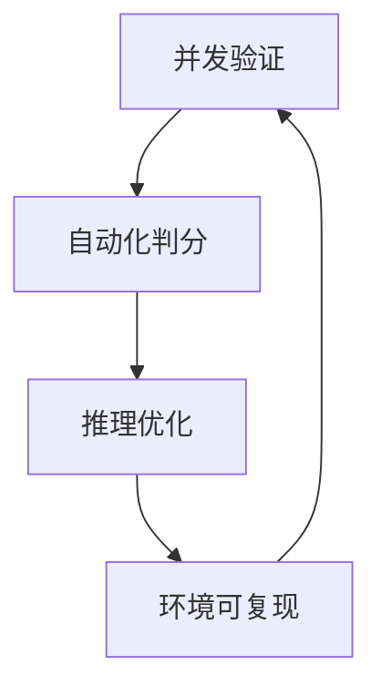
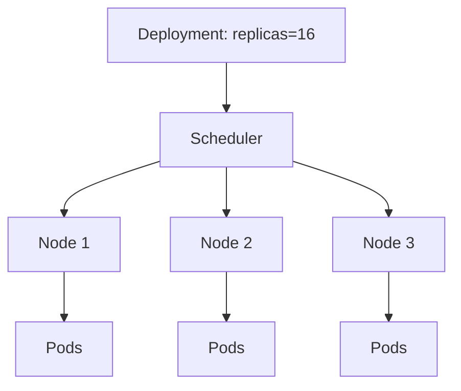
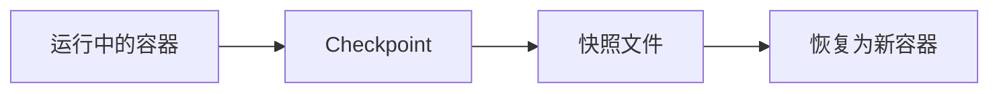
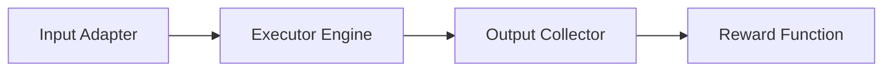
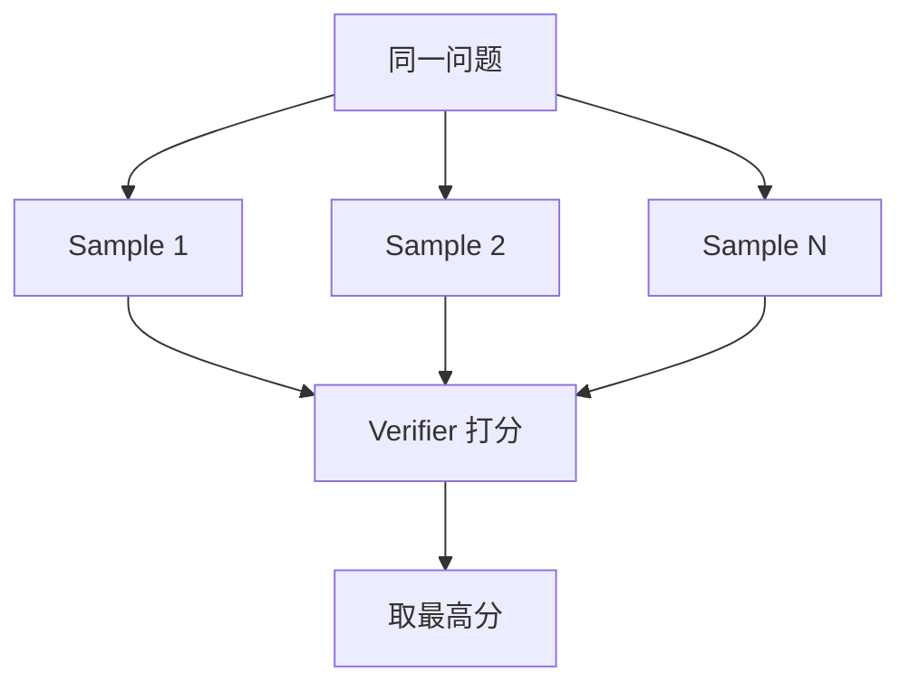
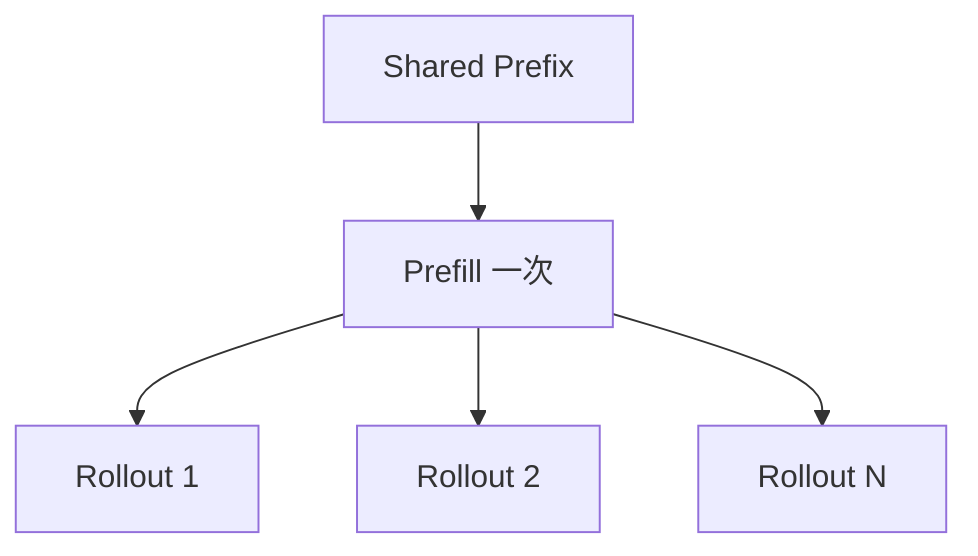

# 4 个核心能力拆解

> **核心命题**：如何搭一个让「1 个模型 × N 个任务 × M 条轨迹」同时跑、同时验、同时回收 reward 的高吞吐基础设施？答案可以压缩成四个能力。

## 能力总览

| 能力 | 技术栈 | 面试官真正想听的点 |
|------|--------|--------------------|
| ① 大规模并发验证 | 容器编排、调度、资源池化 | 吞吐怎么做大 |
| ② 验证环境可复现 | 镜像管理、状态快照、依赖锁定 | 结果为什么可信 |
| ③ 验证闭环自动化 | Harness、Verifier、reward signal | 怎么自动判分 |
| ④ 推理侧多线程/多分支 | 异步推理调度、树搜索、KV Cache | 怎么提高搜索质量和推理效率 |

四个能力形成闭环：



---

## ① 大规模并发验证

### 核心问题

如何同时跑 N 条 rollout 验证，并把资源利用率做高？

### 关键技术栈

#### 1. Docker Compose Scale

最简单的并发方式，是先用 Compose 把 worker 横向拉起来。

```yaml
version: "3.8"

services:
  worker:
    image: agent-verify:latest
    deploy:
      replicas: 1
      resources:
        limits:
          cpus: "0.5"
          memory: "512M"
    volumes:
      - knowledge-base:/data:ro
    environment:
      - TASK_QUEUE=redis://queue:6379
      - RESULT_BACKEND=redis://queue:6379
    depends_on:
      - queue

  queue:
    image: redis:7-alpine

volumes:
  knowledge-base:
    external: true
```

运行时本质上是在做：

1. 根据同一配置创建多个容器。
2. 每个容器共享只读数据层。
3. 每个容器维护自己的写层。
4. 所有实例从同一个任务队列取任务。

#### 2. Kubernetes Pod 调度

当并发规模和稳定性要求再上去，就需要 K8s。



K8s 的价值不只是“能起很多 Pod”，而是：

- 自动分配到不同节点
- 自动重建失败实例
- 支持资源 request / limit
- 支持扩缩容、亲和性、滚动更新

#### 3. 资源池化

资源池化的核心目标是统一管理 CPU / GPU / 内存，而不是让每个团队或任务各自占一块。

| 没有池化 | 有池化 |
|----------|--------|
| 容易局部闲置 | 更容易做全局最优分配 |
| 资源碎片多 | 利用率更高 |
| 手工协调多 | 调度器按需分配 |

#### 4. Warm Pool

Warm Pool 是最常见、ROI 很高的并发优化。

| 模式 | 冷启动成本 | 适合场景 |
|------|------------|----------|
| Cold Start | 每个任务都要完整初始化 | 任务稀疏 |
| Warm Pool | 预先保留可复用环境 | 任务稳定、初始化贵 |

---

## ② 验证环境可复现

### 核心问题

为什么同一个 bug 今天跑和明天跑结果一样？

### 关键技术栈

#### 1. 镜像版本化

镜像必须是显式版本管理的，而不是口头约定。

| 做法 | 作用 |
|------|------|
| 固定镜像 tag / digest | 保证运行基底一致 |
| 固定 base commit | 保证代码版本一致 |
| 固定环境变量 | 防止行为漂移 |

#### 2. 状态快照（Docker Checkpoint）

Checkpoint 的价值是：

- 不重复走初始化流程
- 把已准备好的环境直接冻结
- 下次从快照恢复



#### 3. 依赖锁定

| 文件类型 | 风险 |
|----------|------|
| `requirements.txt` 只写大版本 | 版本可能漂移 |
| lockfile | 结果更稳定、可复现 |

依赖锁定的目的不是“更规范”，而是保证 reward 不被环境噪声污染。

---

## ③ 验证闭环自动化

### 核心问题

如何把模型输出自动转成结构化结果和 reward？

### 关键技术栈

#### 1. Harness 设计

Harness 的标准链路：



每个部分要解决的事：

| 模块 | 作用 |
|------|------|
| Input Adapter | 接收 patch / action、做格式检查与任务路由 |
| Executor Engine | 起容器、控并发、设超时、处理异常 |
| Output Collector | 解析测试、日志和结构化结果 |
| Reward Function | 汇总为 reward |

#### 2. Reward Function 设计

一个常见组合是：

`reward = 0.6 * test_pass_rate + 0.2 * lint_score + 0.1 * security_score + 0.1 * perf_score`

reward 设计时要注意：

1. binary reward 最稳，但信息少。
2. continuous reward 信息多，但更容易被钻空子。
3. 多目标加权要和真实业务目标对齐。

#### 3. 结果收集

结果收集不只是“保存日志”，而是要支持：

- reward 分析
- failure case 分类
- 回放
- 训练数据回收

---

## ④ 推理侧多线程 / 多分支

### 核心问题

如何在不无限增大模型参数量的情况下，让 agent 搜得更深、试得更多、结果更好？

### 关键技术栈

#### 1. Test-Time Scaling

本质是：把更多预算放到推理阶段，而不是只堆模型参数。

| 方案 | 特点 |
|------|------|
| 更大模型，单次生成 | 参数贵，推理次数少 |
| 中等模型，多分支搜索 | 推理预算更灵活 |

#### 2. 树搜索策略

##### Best-of-N

最简单：



##### Beam Search

适合逐层扩展并保留 top-k：

| 步骤 | 动作 |
|------|------|
| 第 1 层 | 生成多个候选 |
| 每一层 | 保留 top-k |
| 最终 | 在保留分支中选最优 |

##### MCTS

适合探索和利用并存的场景：

| 阶段 | 作用 |
|------|------|
| Selection | 选择当前最值得扩展的节点 |
| Expansion | 扩展新节点 |
| Simulation | 估计该分支价值 |
| Backpropagation | 把价值回传到祖先节点 |

#### 3. KV Cache 前缀复用

如果多条 rollout 共享相同长前缀，前缀 prefill 只需要算一次。



这在 coding agent 场景尤其重要，因为 system prompt、tool schema 和用户任务通常高度重合。

---

## 面试高频问题

### Q1: 如果让你设计一个支持 16 并发的验证系统，你会怎么做？

**A**：先用任务队列 + worker 模式搭起来，再用 warm pool 降低初始化开销，最后加入资源池化和调度策略，把并发数和单任务资源做平衡。

### Q2: Reward Function 用 binary 好还是 continuous 好？

**A**：binary 更稳、抗作弊，但信息少；continuous 更细，但更容易被 reward hacking。实际通常是 binary 为主，continuous 为辅。

### Q3: 什么是 test-time scaling？为什么对 Agent infra 重要？

**A**：就是把更多预算花在推理搜索阶段，通过多采样、树搜索和验证器筛选得到更优结果。它要求 infra 能承受更多 rollout 和更高推理吞吐。

### Q4: Best-of-N、Beam Search、MCTS 怎么选？

**A**：Best-of-N 最简单，Beam Search 适合分层保留 top-k，MCTS 适合探索与利用并存的复杂搜索空间。具体选择看动作空间、评估成本和可用预算。
