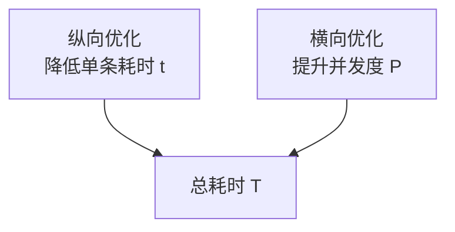
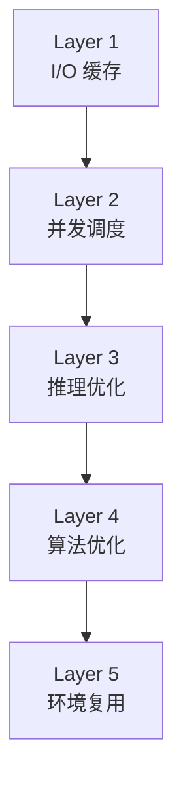
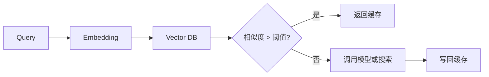
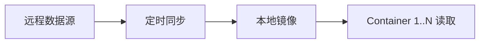
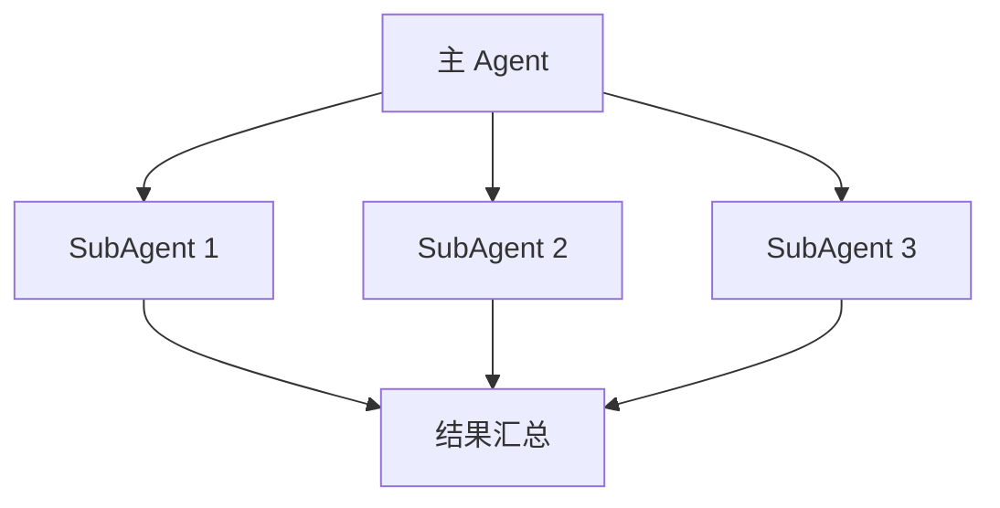
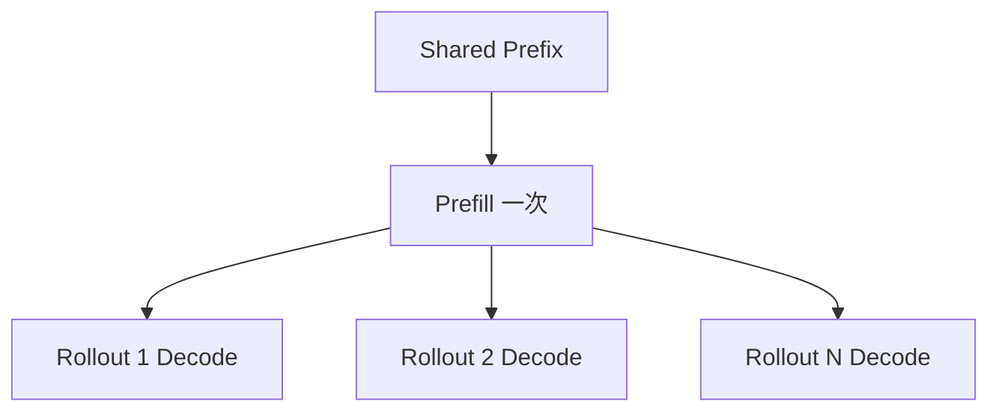

# 核心心法

> 把每个技术问题都先转成三个问题：怎么并发、怎么复现、怎么自动判分。回答清楚这三件事，才算真正进入 infra 视角。

→ 参见 [position_overview.md](./position_overview.md)  
→ 参见 [four_core_abilities.md](./four_core_abilities.md)

---

## 1. 三个灵魂问题

### 问题 1：这个东西怎么并发？

并发是第一问题，因为 Agent infra 的价值首先体现在吞吐。

常见并发维度：

| 维度 | 典型技术 | 目标 |
|------|----------|------|
| 容器并发 | warm pool、资源池化、调度器 | 同时跑更多验证任务 |
| 推理并发 | continuous batching、prefix cache | 同时跑更多生成请求 |
| 任务并发 | SubAgent、异步等待 | 一个任务内部拆多路子任务 |
| I/O 并发 | CoW、共享只读数据、异步抓取 | 减少重复加载和等待 |

### 问题 2：这个东西怎么复现 / 复用？

没有复现性，就没有可靠 reward；没有复用性，系统成本会被重复工作拖垮。

| 维度 | 典型技术 | 目标 |
|------|----------|------|
| 环境复现 | 不可变镜像、依赖锁定、状态快照 | 相同输入得到相同结果 |
| 结果复用 | 语义缓存、KV Cache、中间态保存 | 避免重复计算 |
| 资源复用 | warm pool、连接池、共享 layer | 避免重复创建资源 |
| 知识复用 | 失败案例库、跨任务记忆 | 避免重复犯错 |

### 问题 3：这个东西怎么自动判分？

自动判分是闭环的关键节点。

| 层次 | 例子 | 作用 |
|------|------|------|
| Binary reward | 测试通过 / 失败 | 最客观，最直接 |
| Continuous reward | 覆盖率、代码质量分数 | 提供更多梯度信息 |
| Penalty | 安全风险、超时、回归 | 防止模型钻空子 |
| Bonus | 性能更优、资源更省 | 鼓励更优解 |

最常见形式：

`reward = f(test_pass_rate, quality_score, security_score, efficiency_score)`

---

## 2. 两个正交维度

回答“怎么更快”时，一定要拆成两个维度：

| 维度 | 关注点 | 目标 |
|------|--------|------|
| 纵向优化 | 单条 rollout 的延迟 | 让一条更快 |
| 横向优化 | 多条 rollout 的吞吐 | 让更多条同时跑 |

### 纵向：单条 rollout 内的单点加速

| 手段 | 作用 |
|------|------|
| I/O 缓存 | 避免重复网络请求和磁盘读取 |
| 推理加速 | KV Cache、continuous batching |
| 算法剪枝 | 早停、query 重写、轨迹剪枝 |
| 工程优化 | 更少依赖、更少冷启动、更少上下文冗余 |

### 横向：N 条 rollout 间的吞吐放大

| 手段 | 作用 |
|------|------|
| 容器并发 | warm pool、worker 池 |
| 资源池化 | CPU / GPU / 内存统一分配 |
| 调度优化 | 优先级、亲和性、队列管理 |
| 存储共享 | CoW、共享只读 volume |

### 两个维度的关系

总耗时可以粗略写成：

`T = N / P * t`

- `N`：rollout 总数
- `P`：并发度
- `t`：单条 rollout 耗时

所以：

- 纵向优化的目标是减小 `t`
- 横向优化的目标是增大 `P`

两者是乘法关系，不是替代关系。

---

## 3. 五层优化地图

这五层可以作为面试里的统一讲法：

| 层级 | 名称 | 偏向维度 | 典型技术 |
|------|------|----------|----------|
| Layer 1 | I/O 缓存 | 纵向 | 语义缓存、本地知识库、fetch 持久化 |
| Layer 2 | 并发调度 | 横向 | 轨迹间并发、轨迹内并发、SubAgent 池 |
| Layer 3 | 推理优化 | 纵向 | KV Cache、continuous batching、speculative decoding |
| Layer 4 | 算法优化 | 纵向 | 早停、query 重写、轨迹剪枝 |
| Layer 5 | 环境复用 | 横向 | checkpoint、CoW、warm pool |

原则：

1. 先做简单且 ROI 高的。
2. 先 profiling，再决定优化层。
3. 不要只讲单点技巧，要能把技巧放回五层图。

### 第 1 层：I/O 缓存

#### 语义缓存

语义缓存的核心不是“字符串一样”，而是“语义足够相近”。

相似度阈值一般要通过离线评估来定，太高会 miss，太低会误命中。

#### 本地知识库镜像

适合高频、稳定、可离线索引的数据源，例如：

- Wikipedia
- GitHub 热门仓库
- arXiv

### 第 2 层：并发调度

#### 轨迹间并发 vs 轨迹内并发

| 类型 | 含义 | 例子 |
|------|------|------|
| 轨迹间并发 | 多条 rollout 同时跑 | 16 个验证容器并发 |
| 轨迹内并发 | 一条 rollout 内部拆子任务 | 多个子 query 并行搜索 |

#### SubAgent 并行池

一个典型模式：

### 第 3 层：推理优化

#### KV Cache 复用

多个 rollout 共享相同长前缀时，最值得复用的就是前缀 prefill 计算结果。

#### Continuous Batching

核心价值是避免 static batching 的 head-of-line blocking。

| Static | Continuous |
|--------|------------|
| 要等整批结束 | 有空位就立即塞新请求 |
| batch 间空闲明显 | GPU 利用率更高 |
| 短请求经常被长请求拖住 | 吞吐更稳 |

### 第 4 层：算法优化

#### 早停策略

很多候选轨迹不值得完整跑完。

一个常见做法是分阶段过滤：

1. 先做静态检查。
2. 再做轻量测试。
3. 最后才跑完整验证。

#### Query 重写

重写 query 的价值不是“文案更好看”，而是：

- 更短，推理更便宜
- 更精确，检索更准
- 后续工具调用更少

#### 轨迹剪枝

思路和搜索算法一致：低质量分支尽快停止，不把预算浪费在明显没希望的轨迹上。

### 第 5 层：环境复用

#### Docker Checkpoint

适合把一个已初始化好的环境快照下来，后续快速恢复。

#### Copy-on-Write

适合让大量容器共享底层数据，只为各自差异写入付成本。

#### Warm Pool vs Cold Start

| 方案 | 适合场景 |
|------|----------|
| Cold Start | 请求稀疏，初始化成本低 |
| Warm Pool | 请求稳定且初始化昂贵 |

---

## 4. 话术改造速查

把“功能视角”改成“infra 视角”时，可以用这套模板：

| 原话 | Infra 话术 |
|------|------------|
| 我把任务做快了 | 我把单条延迟和整体吞吐都做了优化 |
| 我做了一个 Agent | 我搭了一条 rollout -> execute -> verify -> aggregate 的闭环 |
| 我用了 Docker | 我用了可复现的隔离执行环境 |
| 我加了缓存 | 我把重复 I/O 和重复推理分别做了复用 |

---

## 面试高频问题

### Q1: 你怎么理解 Agent 基建和 Agent 应用的区别？

**A**：应用关注单个 Agent 能不能完成任务，基建关注大量 Agent / rollout 怎么稳定并发、复现和自动判分。

### Q2: 如果让你优化一个 Agent 验证系统，你会从哪些方面入手？

**A**：我会先 profiling，再按五层优化地图排优先级，通常先看 I/O 缓存和并发调度，再看推理与环境复用。

### Q3: 语义缓存的阈值怎么定？

**A**：通过离线样本评估精度和召回，平衡误命中与漏命中，并针对不同任务域分开调参。

### Q4: Continuous Batching 和 Static Batching 的区别？

**A**：前者是流式补位，后者是整批等待。Continuous Batching 的核心优势是减少空转和 head-of-line blocking。

### Q5: Warm Pool 和 Docker Checkpoint 有什么区别？

**A**：Warm Pool 是预先准备一批可用环境；Checkpoint 是把某个环境状态冻结下来以便快速恢复。两者可以组合用，但不是一个概念。
