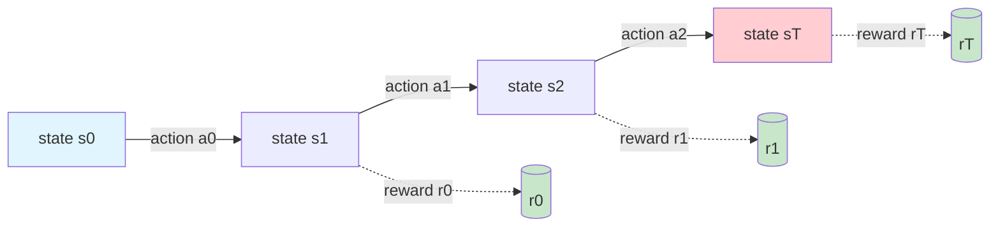
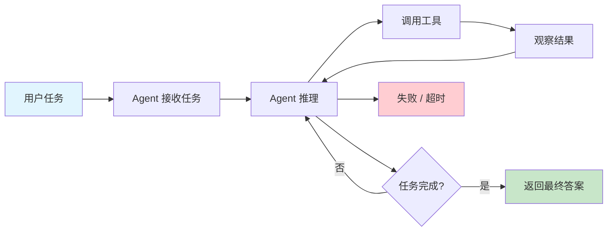
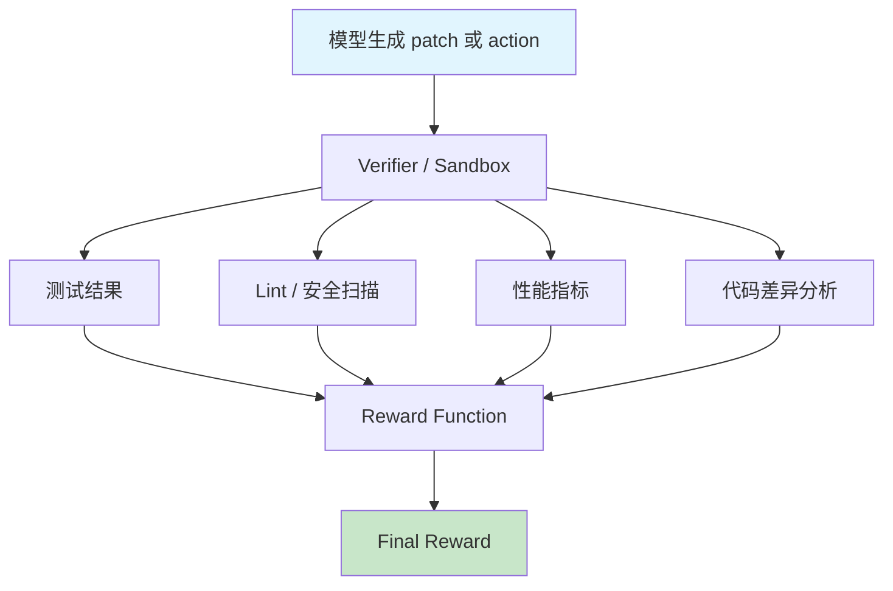
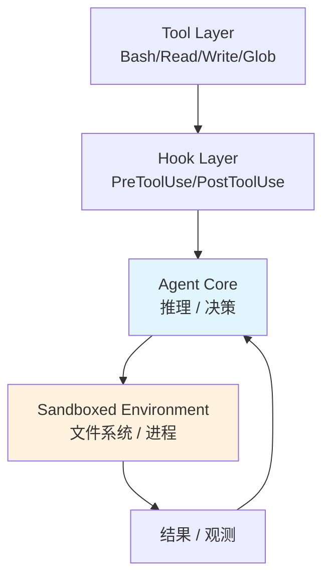
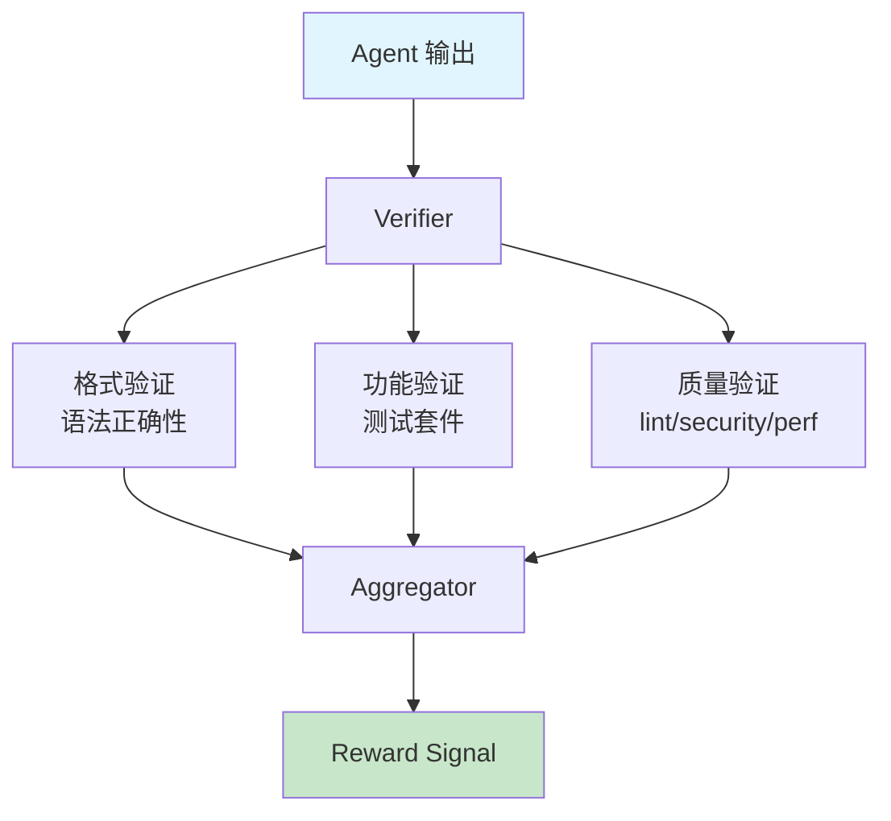
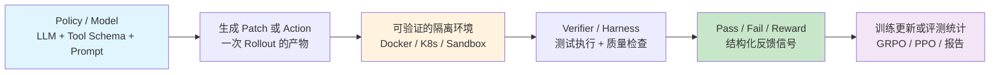

# 岗位核心定位转变

> **核心结论**：从「Agent 应用开发工程师」转向「Agent 基建 / Infra 工程师」，本质不是换语言或框架，而是换思考对象。应用工程师优化的是单个 Agent 的体验，Infra 工程师优化的是大量 Agent / rollout 的并发执行、复现和自动判分。

---

## 1. 为什么需要这个转变

### 1.1 业务结果 vs 系统理解

业务结果例如「120 分钟降到 30 分钟」只能证明你做出了产品价值；要拿到 infra 方向的面试认可，你还需要证明自己理解：

- 为什么这个系统能并发。
- 为什么结果可复现。
- 为什么输出可自动验证。
- 为什么这个闭环可以规模化。

面试官反复提到 Docker，真正关心的并不是 Docker 命令本身，而是：

> 每一条 rollout 都要进入一个可复现、可并发、可自动判分的隔离环境。

Docker 只是当前最常见的载体。以后换成 Firecracker、gVisor 或 WebAssembly runtime，岗位本质也不会变。

### 1.2 从应用转向 Infra 的深层原因

**原因一：行业进入「工程化深水区」**

早期 Agent 项目以 demo 为主，只要一个 Agent 能跑通就算成功。但 2024 年之后，行业开始关注 RLHF / RLAIF 训练、大规模评测（如 SWE-bench）、以及生产级 Agent 服务。这些场景的核心瓶颈不再是"模型够不够聪明"，而是"能不能高效地生成、验证和回收大量 rollout"。

**原因二：单点优化空间见顶**

应用层的 prompt 工程、工具编排、RAG 策略，经过一两年的迭代，提升空间已经有限。真正的成本和速度突破，来自 infra 层的并发、缓存、环境复用和自动判分。

**原因三：数据飞轮需要基建支撑**

RL 训练需要大量高质量的 (state, action, reward) 三元组。这些三元组怎么高效生产？需要一套"生成 patch → 隔离验证 → 自动判分 → 回收 reward"的自动化流水线。这套流水线就是 infra。

**原因四：可复现性决定可信度**

学术评测和生产部署都要求结果可复现。如果同样的代码今天跑 80 分、明天跑 60 分，整个系统就没有可信度。镜像版本化、依赖锁定、状态快照这些 infra 技术是保证可复现性的基础。

### 1.3 岗位转变的能力映射

```
应用工程师的核心技能              Infra 工程师的核心技能
─────────────────────          ─────────────────────
prompt engineering          →   reward function 设计
tool calling / function     →   harness 框架搭建
RAG / vector search         →   I/O 缓存 / 语义缓存
单个 Agent 调试             →   大规模并发验证
"功能做出来了"               →   "吞吐 / 延迟 / 成本" 指标化
```

---

## 2. 核心术语详解

### 2.1 Rollout

> **Rollout**：模型与环境交互一次产生的一整条轨迹（trajectory）。在 Agent 语境中，就是从接收任务、调用工具、观察结果到完成或失败的完整执行过程。一条 rollout 包含了完整的状态转移序列 (s0, a0, s1, a1, ..., sT, aT)。

**RL 视角下的解释：**

在强化学习中，rollout 是从某个初始状态出发，按照当前策略（policy）与环境交互，直到终止状态的一条完整轨迹。数学表示为 τ = (s0, a0, r0, s1, a1, r1, ..., sT, aT, rT)。每条 rollout 产生一个 return G = Σ γ^t * r_t，是训练更新的基本数据单元。RL 算法（如 PPO、GRPO）需要大量 rollout 来估计策略梯度或价值函数。



**Agent 视角下的解释：**

在 Agent 系统中，rollout 是一次完整的任务执行过程：用户发起请求 → Agent 接收并解析任务 → Agent 进行多轮推理（可能调用搜索、代码执行、文件读写等工具）→ Agent 返回最终答案或报告失败。每一次这样的端到端执行就是一条 rollout。比如 Claude Code 帮你修一个 bug，从你描述问题到最终运行测试通过，整个过程就是一条 rollout。



**为什么 rollout 对 infra 工程师重要：**

1. 每条 rollout 都要有执行环境（容器、沙箱）。
2. 每条 rollout 都要能被验证（测试、lint、安全扫描）。
3. 训练和评测通常需要大量 rollout 并发跑（16 条、64 条、甚至上千条）。
4. 这些 rollout 的结果还要能稳定回放和分析，否则 reward 信号不可信。

→ 参见 [four_core_abilities.md](./four_core_abilities.md)

---

### 2.2 Reward Signal

> **Reward Signal**：环境对模型行为给出的反馈分数。在 RL 闭环中，reward 是唯一的优化目标——模型通过最大化累计 reward 来学习更好的策略。没有 reward，就没有 RL 闭环。

**RL 视角下的解释：**

在强化学习中，reward signal r_t 是环境在时间步 t 给出的标量反馈，反映 Agent 在该步的行为质量。累计回报（return）G = Σ γ^t * r_t 是 Agent 试图最大化的目标。reward 的设计直接决定了 Agent 的学习方向：如果 reward 只关注测试通过率，Agent 可能会学到"通过测试但不保证代码质量"的策略（reward hacking）。因此 reward 设计需要兼顾多个维度。

**Agent 视角下的解释：**

在 Agent 评测和训练系统中，reward signal 是对一次 rollout 结果的结构化评分。它通常由 Verifier 或 Harness 产出，可以是一个简单的 0/1（测试是否通过），也可以是多个子指标的加权组合。Reward 是"模型输出 → 环境验证 → 结构化反馈"这条链路的最终产物，也是连接 infra 和训练的桥梁。

常见 reward 类型：

| 类型 | 例子 | 特点 | 适用场景 |
|------|------|------|----------|
| Binary reward | 测试通过 = 1，失败 = 0 | 简洁直接，不易被 hack | 代码生成、Bug 修复 |
| Continuous reward | 代码质量 0.86，覆盖率 0.73 | 信息更细，梯度更丰富 | 需要细粒度反馈的训练 |
| Sparse reward | 只在任务结束时给分 | 信号稀疏，训练更难 | 多步推理、复杂规划 |
| Dense reward | 每一步都给反馈 | 更密，但噪声可能更大 | 需要快速迭代的学习 |

Reward 生成链路：



一个典型例子：

```
final_reward = 0.6 * test_pass_rate + 0.2 * lint_score + 0.1 * security_score + 0.1 * perf_score
```

Reward 设计之所以是 infra 能力，是因为 reward 设计不当会直接导致：

- **Reward Hacking**：模型学会了"骗过 reward function"而不是"真正解决问题"。比如 reward 只看测试通过，模型可能生成只覆盖测试 case 而非真正修复 bug 的代码。
- **训练不稳定**：reward 方差太大或分布偏移会导致策略振荡。
- **目标错位**：reward 和真实业务目标不一致，导致模型学到了"正确但无用"的策略。

---

### 2.3 Harness

> **Harness**：把模型输出放进环境里执行、验证、收集结构化结果的那层框架。它是「模型 - 环境 - 结果」之间的标准化接口。你可以把它理解为"测试框架 + 执行环境 + 评分器"的三位一体。

**RL 视角下的解释：**

在 RL 中，harness 扮演的是"环境"（environment）的角色。它接收 Agent 的 action（如生成的代码 patch），在受控环境中执行这个 action，然后返回 next_state 和 reward。一个可靠的 harness 等价于一个可靠的环境模型——如果环境不可复现、reward 不可靠，整个 RL 闭环就不可信。

**Agent 视角下的解释：**

在 Agent infra 中，harness 是一套标准化的验证框架。它负责：准备执行环境（拉镜像、checkout 代码）→ 应用 Agent 输出（apply patch）→ 运行验证（测试、lint）→ 收集结果（pass/fail、日志）→ 计算 reward。SWE-bench 的 evaluation harness 就是一个经典例子。

```mermaid
flowchart LR
    A[模型输出\n(patch / action)] --> B[Input Adapter\n格式校验 / 路由]
    B --> C[Executor Engine\n启动沙箱 / 应用 patch / 运行测试]
    C --> D[Output Collector\n解析日志 / 收集指标]
    D --> E[Reward Function\n计算最终分数]

    style A fill:#e1f5fe
    style E fill:#c8e6c9
```

一个典型 SWE-bench Harness 要做的事：

1. **准备环境**：拉取目标项目的 Docker 镜像，确保依赖已安装。
2. **Checkout 代码**：切换到指定的 `base_commit`，保证代码版本一致。
3. **应用 patch**：把模型生成的 diff / patch 应用到代码库。
4. **运行测试**：执行目标测试文件或测试函数。
5. **解析结果**：从测试输出中提取 pass/fail 信息和错误详情。
6. **计算 reward**：根据测试结果输出 `resolved / not resolved` 和 reward 分数。

Claude Code 本身也可以从 harness 视角理解：



---

### 2.4 Policy

> **Policy**：给定当前状态，决定下一步动作的函数 π(a|s)。在 Agent 系统里，可以粗略理解为 `LLM + tool schema + system prompt` 的组合——它接收当前上下文（state），输出下一步应该做什么（action）。

**RL 视角下的解释：**

在强化学习中，policy 是从状态到动作的映射 π : S → A。它可以是确定性的（给定状态输出唯一动作），也可以是随机性的（给定状态输出动作的概率分布）。整个 RL 训练的目标就是优化这个 policy，使其在环境中获得最大的累计 reward。常见算法如 PPO 通过梯度上升来更新 policy 参数。

**Agent 视角下的解释：**

在 Agent 系统中，policy 是整套"决策接口"。它不是只有模型权重，而是由多个组件协同构成的决策系统：

| 组成部分 | 作用 | 对应 RL 概念 |
|----------|------|-------------|
| LLM | 决定推理能力上限 | policy 的参数化近似 |
| Tool Schema | 决定可执行动作空间 | 动作空间 A |
| System Prompt | 决定行为边界与格式约束 | policy 的先验约束 |
| 历史上下文 | 决定当前决策依据 | 状态 s 的观测 |
| 检索结果 / RAG | 扩展观测空间 | 增强的 state representation |

所以 Policy 不是"只有模型权重"，而是整套决策接口。理解这一点很重要：当你优化 system prompt、调整 tool schema、或者改进 RAG 检索时，你其实都在优化 policy。

```mermaid
flowchart TD
    subgraph Policy[Policy = 决策系统]
        A[System Prompt] --> D[LLM 推理]
        B[Tool Schema] --> D
        C[历史上下文 + RAG] --> D
        E[Memory / 经验] --> D
    end
    D --> F[Action\n(调用工具 / 生成文本 / 返回答案)]

    style Policy fill:#e1f5fe
    style F fill:#c8e6c9
```

---

### 2.5 Verifier

> **Verifier**：判断 rollout 或输出是否真的完成任务的组件。对于代码任务，它往往表现为测试执行器；对于 research / QA 任务，它可能是答案匹配器、LLM-as-judge 或混合判分器。Verifier 的输出是 reward signal 的直接来源。

**RL 视角下的解释：**

在 RL 中，verifier 扮演的是"环境反馈"的角色。它评估 Agent 产生的 action 是否符合预期，并据此产生 reward signal。在 model-based RL 或 reward model 场景中，verifier 本身也可以是一个学习到的模型（如 Reward Model），用来近似人类偏好或任务完成度。

**Agent 视角下的解释：**

在 Agent infra 中，verifier 是负责"判定质量"的组件。它可以是：

| 任务类型 | verifier 常见形式 | reward 来源 |
|----------|------------------|-------------|
| 代码修复 | 跑测试、lint、安全扫描、性能检查 | 测试通过率 + 质量分数 |
| Research / QA | exact match、fuzzy match、LLM judge | 答案正确性评分 |
| Tool-use agent | 检查工具调用顺序、参数合法性、最终结果质量 | 任务完成度评分 |
| 代码生成 | 静态分析 + 单元测试 + 集成测试 | 多级验证组合 |



Verifier 和 Harness 的区别：

| 维度 | Harness | Verifier |
|------|---------|----------|
| 范围 | 完整的执行与验证流程框架 | 负责判定对错/打分的组件 |
| 类比 | 测试框架（如 pytest） | 断言 / 检查点 |
| 包含关系 | Harness 包含 Verifier | Verifier 是 Harness 的一部分 |
| 输入 | patch + 环境配置 | 执行结果 + 预期标准 |
| 输出 | 结构化结果 + reward | 判定结果 + 分数 |

---

## 3. Agent 应用开发 vs Agent 基建

### 3.1 详细对比表

| 维度 | Agent 应用开发 | Agent 基建 / Infra |
|------|----------------|--------------------|
| **关注点** | 单个任务能否跑通 | 大量任务如何稳定运行 |
| **优化目标** | 体验、功能、交互 | 吞吐、复现、判分、成本 |
| **核心问题** | prompt 怎么写、工具怎么接 | sandbox 怎么搭、reward 怎么回收 |
| **产出物** | 产品功能、demo、工作流 | 调度器、容器池、评测系统、verifier |
| **衡量指标** | 用户满意度、任务完成率 | QPS、P99 延迟、资源利用率、reward 一致性 |
| **故障模式** | 某次对话出错 | 大规模任务失败、reward 偏移、环境漂移 |
| **技术栈** | LangChain、OpenAI SDK、prompt | Docker、K8s、asyncio、Celery、Redis |
| **调试方式** | 手动对话、看单次日志 | 分布式追踪、指标监控、批量回放 |
| **规模思考** | 1 个用户 / 1 个任务 | 1000 并发 / 10000 rollout / 小时 |

### 3.2 同一个项目，两种讲法

**项目 1：自动搜索报告生成 Agent**

旧讲法（应用视角）：

> 我做了一个能自动搜索资料并生成报告的 Agent，把任务时间从 120 分钟降到 30 分钟。用了 GPT-4 + Tavily 搜索 + prompt chaining。

基建讲法（Infra 视角）：

> 我搭了一套 rollout → execute → verify → aggregate 的闭环系统。核心优化点：① 把搜索和生成拆成两条独立 pipeline 并行执行（并发调度）；② 对重复搜索 query 做语义缓存（I/O 缓存层）；③ 用 warm pool 预热搜索 worker 避免冷启动（环境复用层）；④ 定义了结构化 output schema 并用 JSON Schema 验证输出质量（自动判分层）。最终吞吐提升 4x，单条延迟从 120 分钟降到 30 分钟。

**项目 2：代码自动修复 Agent**

旧讲法（应用视角）：

> 我写了一个能自动修 bug 的 Agent，在 SWE-bench Lite 上达到 40% 的 resolve rate。用了 Claude + 测试驱动的方式。

基建讲法（Infra 视角）：

> 我设计了一个可复现的代码验证 harness：① 用 Docker 镜像固定每个项目的运行环境（环境复现）；② 实现了 checkout → apply patch → run test → collect result 的标准化流程（验证闭环自动化）；③ 通过 warm pool 预创建容器，把单条验证的冷启动从 45 秒降到 3 秒（环境复用）；④ 对 Best-of-N 生成的多条 patch 做并发验证，取 reward 最高的（推理侧多分支 + 大规模并发验证）。支撑了每轮 128 条 rollout 的评测规模。

**项目 3：多模态内容审核 Agent**

旧讲法（应用视角）：

> 我做了一个内容审核 Agent，能自动检测图片和文本中的违规内容，准确率达到 95%。

基建讲法（Infra 视角）：

> 我搭了一套多模态内容审核的自动化流水线：① 将图片和文本审核拆成两个独立的 SubAgent 并行执行（轨迹内并发）；② 对审核结果做三级过滤——静态规则 → 模型推理 → 人工抽检（算法优化层：早停策略）；③ 用 continuous batching 把 GPU 推理利用率从 35% 提升到 78%（推理优化层）；④ 审核结果和 reward 信号写入结构化存储，支持离线分析和模型迭代（验证闭环自动化）。

### 3.3 基建工程师的日常工作

你在面试里应该体现出以下工作类型：

1. **设计 sandbox / execution environment**：确定容器规格、资源配额、网络隔离方案。
2. **设计 reward / verifier**：定义多级验证策略，确保 reward 信号可靠。
3. **设计 warm pool、资源池化和调度策略**：把冷启动降到最低，把资源利用率做到最高。
4. **分析瓶颈并做吞吐优化**：用 profiling 定位瓶颈，按五层优化地图逐层解决。
5. **收集、存储和分析 rollout 结果**：结构化存储每条 rollout 的完整数据，支持回放和训练数据回收。

---

## 4. 世界观模型

把岗位本质压缩成一张图：



**完整的数据流：**

```
[训练循环]
Policy → 采样 N 条 Rollout → 每条 Rollout 进入隔离环境执行 → Verifier 判定质量
→ 收集 Reward Signal → 更新 Policy 参数 → 重复

[评测循环]
Policy → 采样 N 条 Rollout → 每条 Rollout 进入隔离环境执行 → Verifier 判定质量
→ 汇总统计 (resolve rate / avg reward / 分位数) → 输出评测报告
```

Infra 工程师的核心工作就集中在中间三件事：

- **环境怎么搭**：隔离性、可复现性、并发能力、成本。
- **判分怎么做**：Verifier 的设计、Reward Function 的定义、多级验证策略。
- **结果怎么回收**：结构化存储、批量分析、训练数据转化。

---

## 5. 面试高频问题

### Q1: Agent 应用开发和 Agent 基建有什么本质区别？

**A**：应用开发关注单个 Agent 的任务完成度和用户体验，核心技能是 prompt engineering、工具集成和 RAG。基建关注大量 Agent / rollout 的并发执行、环境复现、自动判分和成本控制，核心技能是容器编排、调度系统、reward function 设计和大规模系统优化。打个比方：应用开发像"造一辆好车"，基建像"建一条能跑 1000 辆车的高速公路"。

### Q2: 你说的 rollout 是什么？为什么需要并发？

**A**：rollout 是模型处理一个任务时产生的完整执行轨迹，包含 (state, action, reward) 序列。需要并发是因为：① RL 训练需要大量 rollout 来估计梯度，串行跑太慢；② 大规模评测（如 SWE-bench）需要同时验证多个实例；③ 推理侧的多分支搜索（Best-of-N、MCTS）天然需要并发验证。16 条 rollout 串行可能要 4 小时，并发可能只要 20 分钟。

### Q3: Harness 和 Verifier 是什么关系？

**A**：Harness 是完整的执行与验证流程框架，包含环境准备、patch 应用、测试执行、结果收集等步骤。Verifier 是 Harness 中负责"判定输出质量、产出 reward"的核心组件。可以用测试框架类比：Harness 像 pytest（整个测试框架），Verifier 像断言语句（具体的判定逻辑）。

### Q4: 如果让你从零搭一个 Agent 验证 infra，你会怎么设计？

**A**：我会分四层设计：① 任务输入层：标准化的任务格式和队列（Redis/Celery）；② 执行环境层：基于 Docker/K8s 的隔离环境，配合 warm pool 降低冷启动；③ 判分层：多级 Verifier（静态检查 → 轻量测试 → 完整验证），产出结构化 reward；④ 结果回收层：结构化存储每条 rollout 的完整数据，支持回放和训练数据回收。优先解决并发、复现和自动判分三个问题。

### Q5: Reward Signal 设计有哪些常见坑？怎么避免？

**A**：三个最常见坑：① Reward Hacking——模型学会骗过 reward function 而非真正解决问题，解决方法是多级验证和人工抽检；② Reward 稀疏——信号太少导致训练困难，解决方法是引入中间步骤的 dense reward；③ Reward 与业务目标错位——reward 高但实际效果差，解决方法是让 reward function 和真实业务指标定期对齐。核心原则是：reward 设计必须可验证、可审计、可分解。
