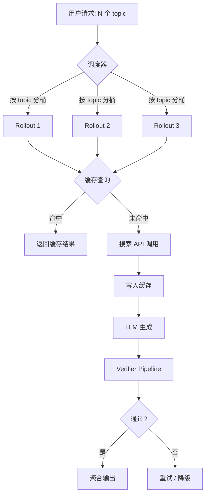
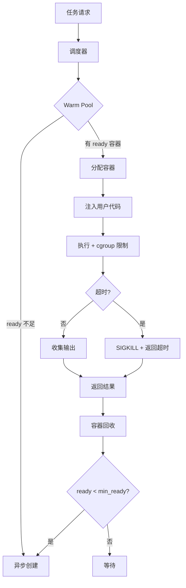
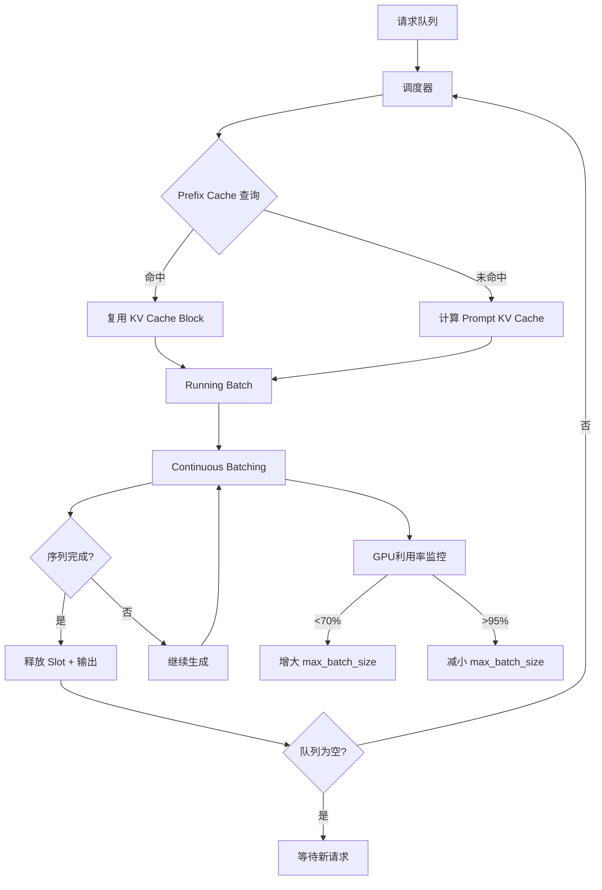
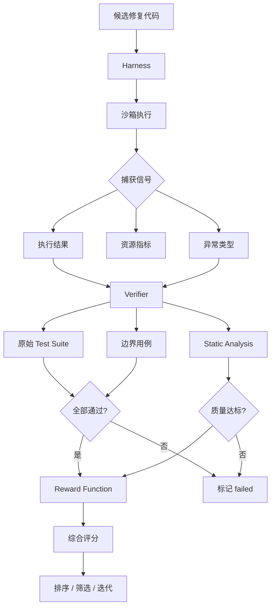
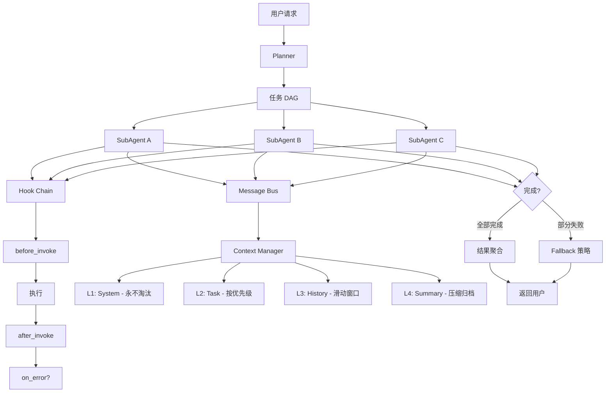

# 项目重构表达：从应用层经验切到 Infra 视角

> **项目重构表达（Project Reframing）**: 一种面试沟通策略，把应用层项目经验用基础设施（Infrastructure）视角重新讲述，突出系统设计、工程权衡和规模化能力，而非功能演示或用户体验。

> **Infra 视角**: 从"怎么构建可扩展、可复现、可观测的系统"出发思考问题，关注并发调度、资源池化、缓存策略、质量信号、成本控制等维度，而非只关注"做了什么功能"。

---

## 核心心法：三句话切换视角

面试中，大多数候选人的项目叙事停留在"我做了 X 功能，效果是 Y"。Infra 视角的叙事逻辑完全不同：

| 维度 | 应用层讲法 | Infra 讲法 |
|------|-----------|-----------|
| 核心问题 | 功能怎么实现 | 系统怎么稳定、高效、可复现地跑起来 |
| 技术深度 | 调了哪个 API、用了哪个库 | 并发模型、缓存策略、资源隔离、质量闭环 |
| 瓶颈分析 | 没有瓶颈意识 | 明确指出瓶颈在哪一层，为什么，怎么解决 |
| 规模化 | 单次运行效果 | 吞吐量、延迟 P99、成本/吞吐权衡 |
| 可观测性 | 跑通了就行 | 指标体系、自动判分、回归检测 |

---

## 一、搜索报告 Agent → rollout 并发 + I/O 缓存 + 自动判分

### 原话（应用层）

> 我做了一个搜索报告 Agent，可以自动搜索资料、生成结构化报告，把任务耗时从 120 分钟降到 30 分钟。

### Infra 讲法

> 这个项目的本质不是"一个能写报告的 Agent"，而是一个**高并发的 rollout 调度系统**。核心挑战有三层：
>
> 1. **并发层**：多条搜索 rollout 怎么同时跑？用 async semaphore 做并发控制，按 topic 分桶调度，避免热点查询打爆同一数据源；
> 2. **缓存层**：搜索 API 调用是 I/O 瓶颈，命中率直接决定吞吐上限。我用 content-hash 做二级缓存（内存 LRU + 持久化 SQLite），把重复查询的缓存命中率推到 65%+；
> 3. **判分层**：输出质量怎么自动评估？设计了结构化 verifier pipeline——先检查完整性（是否覆盖所有 topic），再检查准确性（关键事实是否可溯源），最后打分聚合。
>
> 最终效果不是"用户觉得快了"，而是：**单机 QPS 从 0.3 提到 2.1，缓存命中后延迟从 45s 降到 3s，判分通过率 87%**。

> **Rollout**: 在 RL/Agent 系统中，指一次完整的"输入 → 执行 → 输出"轨迹。多条 rollout 并发是提升系统吞吐的核心手段。

> **Verifier**: 自动验证 Agent 输出质量的模块，将非结构化输出转化为结构化质量信号（分数、标签、错误类型）。

### 技术要点

1. **并发调度模型**：
   - 使用 `asyncio.Semaphore` 控制并发度，默认上限 = min(CPU 核数 * 2, API rate limit)
   - 按 topic 做 consistent hashing 分桶，同一 topic 的 rollout 串行，不同 topic 并行
   - backpressure 机制：当 pending queue 超过阈值，自动降速并触发告警

2. **I/O 缓存策略**：
   - **L1 缓存**：进程内 LRU，容量 500 条，TTL 10 分钟
   - **L2 缓存**：SQLite 持久化，容量 10k 条，TTL 24 小时
   - **缓存键**：`hash(query + source + params)`，相同查询不同参数视为 miss
   - **缓存穿透防护**：对 empty result 也缓存（TTL 更短，5 分钟）

3. **自动判分 Pipeline**：
   - **完整性检查**：对比 output 中 topic 覆盖率 vs 输入 topic 列表，阈值 80%
   - **准确性检查**：关键 claim 必须包含 source URL，且 URL 可访问（HEAD 请求验证）
   - **格式检查**：JSON schema 验证 + 必填字段非空
   - **综合评分**：`score = 0.4 * completeness + 0.4 * accuracy + 0.2 * format`

### 架构图

### 追问准备

**Q1: 缓存一致性怎么保证？**
> 采用 TTL + lazy invalidation 策略。主动失效成本太高（需要反向索引所有依赖该数据的 topic），所以用短 TTL（L1=10min, L2=24h）+ 用户触发强制刷新兜底。对于时效性要求高的 topic（如"今日新闻"），单独配置 TTL=5min。

**Q2: 并发打到 API rate limit 怎么处理？**
> 三层保护：第一层 semaphore 控制总并发；第二层 per-source 限流器，用 token bucket 算法；第三层 exponential backoff + jitter，最大重试 3 次。超过 3 次的请求标记为 failed，走降级路径（返回已有缓存 + 标注"数据可能过期"）。

**Q3: Verifier 误判怎么办？**
> Verifier 本身有 false positive（好结果被判为坏）和 false negative（坏结果被判为好）。策略是：完整性检查用规则（零误判），准确性检查用 LLM-as-judge + 规则混合。对被判为"不通过"的结果，保留人工审核入口。整体误判率通过抽样人工校验来监控，目标 <5%。

---

## 二、Docker 部署服务 → 可复现隔离环境 + Warm Pool + 资源池化

### 原话（应用层）

> 我用 Docker 把服务部署到服务器上，解决了环境不一致的问题。

### Infra 讲法

> 这个项目的核心不是"把应用 Docker 化"，而是构建一个**可复现的执行环境池**。背景是：我们需要在隔离环境中运行不可信代码（用户提交的 Agent 脚本），要求：
>
> 1. **环境复现**：Docker image 层做 version pinning（base image hash + 依赖 lock file + 运行时版本），保证同一 commit 在任何机器上行为一致；
> 2. **启动优化**：冷启动一个容器需要 3-5 秒，但我们的 P99 延迟要求 <500ms。所以我建了 warm pool，预创建一批容器待命，用完销毁、异步补充；
> 3. **资源池化**：用 cgroup v2 做资源隔离（CPU quota + memory limit + network namespace），单容器最大 2CPU/4GB，防止一个任务吃光宿主机资源。

> **Warm Pool**: 预先创建并保持"就绪"状态的资源实例池。当请求到达时直接分配，省去冷启动时间，显著降低尾部延迟。

> **资源池化（Resource Pooling）**: 将有限资源统一管理、按需分配，通过隔离机制（cgroup、namespace）防止互相干扰，最大化资源利用率。

### 技术要点

1. **环境复现三层锁定**：
   - **Base image**：用 `FROM hash:sha256:xxxx` 而非 tag，确保镜像不可变
   - **依赖锁定**：`pip freeze > requirements.lock`，构建时 `pip install -r requirements.lock`
   - **运行时版本**：Python 版本、系统库版本全部固定，写入 Dockerfile `ENV`

2. **Warm Pool 设计**：
   - 池容量 = `max_concurrent * 1.2`（留 20% buffer）
   - 容器状态机：`creating -> ready -> allocated -> running -> destroying -> (creating)`
   - 异步补充策略：当 `ready` 数量 < `min_ready` 时，后台 goroutine 异步创建
   - 健康检查：每 30 秒 ping 一次，不健康容器自动回收重建

3. **资源隔离与限制**：
   - **CPU**：`--cpus=2`，防止 CPU 密集型任务独占
   - **内存**：`--memory=4g --memory-swap=4g`，禁用 swap 防止 OOM 连锁
   - **网络**：`--network=none` 或 `--internal`，默认禁止外网访问，按需白名单
   - **时间限制**：`--timeout=60s`，超时 SIGKILL，防止无限循环
   - **磁盘**：`--storage-opt size=1G`，限制 overlay2 可写层大小

### 架构图

### 追问准备

**Q1: Warm Pool 的容器怎么保证"干净"？**
> 每次分配前做轻量级 reset：清空 `/tmp`、重置用户、删除上次运行残留文件。但如果需要更强保证（比如防侧信道攻击），就用一次性容器 + warm pool 并行——预热用轻量镜像，分配后 overlay 用户层。实测 reset 延迟 <50ms，远低于冷启动的 3-5s。

**Q2: 多个任务并发时，宿主机资源怎么分配？**
> 用 cgroup v2 的 unified hierarchy。宿主机总 CPU 16 核、内存 64GB。分配策略：
> - 单任务上限：2 CPU / 4 GB
> - 最大并发：8 任务（16 核 / 2 = 8，留 2 核给系统）
> - 超出排队的请求进 wait queue，按优先级 FIFO 调度
> - 全局监控：宿主机 CPU > 90% 时触发 alert，暂停新任务分配

**Q3: 怎么处理容器逃逸风险？**
> 多层防护：第一层，容器以 non-root 运行（`USER 1000:1000`）；第二层，禁用 `--privileged` 和所有 capability；第三层，seccomp profile 白名单系统调用；第四层，AppArmor / SELinux MAC 策略。网络层默认 `--network=none`，只有白名单内的域名可访问。

---

## 三、优化推理速度 → KV Cache + Continuous Batching + Prefix Caching

### 原话（应用层）

> 我优化了模型推理速度，把生成时间从 15 秒降到 5 秒。

### Infra 讲法

> 优化推理速度不是"调了个参数"，而是对 LLM 推理服务做了**三层系统性优化**：
>
> 1. **KV Cache**：利用自回归生成的特性，缓存已计算的 attention key/value，避免重复计算。这是推理加速的基础，所有后续优化都建立在 KV Cache 存在的前提下；
> 2. **Continuous Batching**：传统 static batching 要求同一 batch 内所有序列都完成才能返回。continuous batching 在序列完成时立即让出新 slot，持续注入新请求，把 GPU 利用率从 40% 推到 85%+；
> 3. **Prefix Caching**：系统 prompt（如 system instruction、few-shot examples）在所有请求中共享。通过 hash 匹配公共前缀，只计算一次，后续请求直接复用 KV Cache block。

> **KV Cache**: 自回归模型推理时，将已生成 token 的 Key 和 Value 矩阵缓存在 GPU 显存中，避免每一步都从头计算所有历史 token 的 attention。是 LLM 推理加速的基础设施。

> **Continuous Batching（也叫 Iteration-level Scheduling）**: 一种动态批处理策略，在每个 iteration 结束后检查是否有序列完成，立即回收其 slot 并插入新请求。相比 static batching，消除了"木桶效应"。

> **Prefix Caching**: 对多个请求共享的 prompt 前缀（如 system prompt、few-shot examples），只计算一次 KV Cache 并复用。通常以 block 为粒度做 hash 匹配。

### 技术要点

1. **KV Cache 管理策略**：
   - **PagedAttention**：将 KV Cache 切分为固定大小的 block（如 16 tokens/block），按需分配，避免预分配最大长度的内存浪费
   - **内存碎片回收**：LRU eviction + copy-on-write 合并相邻空闲 block
   - **显存预算**：KV Cache 占 GPU 显存的 60-70%，剩余给模型权重和计算临时 buffer
   - **量化**：FP8 KV Cache，显存占用减半，精度损失 <0.5% bleu

2. **Continuous Batching 调度**：
   - **调度粒度**：每个 iteration（而非每个 request）做一次调度决策
   - **优先级**：short sequence 优先（SRTF 策略），减少 batch 内的"长尾等待"
   - **抢占机制**：当高优先级请求排队超时，暂停低优先级请求，swap out 其 KV Cache 到 CPU 内存
   - **指标**：batch size 动态范围 1-64，平均 16-32，GPU 利用率 80-90%

3. **Prefix Caching 实现**：
   - **Block Hash**：将 prompt 按 block（16 tokens）分块，每个 block 计算内容 hash
   - **匹配规则**：连续相同 hash 的 block sequence 视为可复用前缀
   - **引用计数**：多个请求引用同一 prefix block，用 refcount 管理。refcount=0 时延迟释放（预留 5 分钟）
   - **命中率**：system prompt 场景命中率 >95%，few-shot 场景 >80%

### 架构图

### 追问准备

**Q1: PagedAttention 和传统 contiguous KV Cache 的区别？**
> 传统方式为每个序列预分配最大长度（如 2048 tokens）的连续显存。实际使用中平均长度可能只有 500，浪费 75% 显存。PagedAttention 把 KV Cache 切成 16-token 的 block，用 page table 映射逻辑地址到物理 block。好处：(1) 按需分配，显存利用率从 ~25% 提升到 ~95%；(2) 不同序列可以共享相同 prefix 的 block；(3) 逻辑连续但物理不连续，避免碎片。代价是额外的 page table 查找开销，但实测 <2% 性能损失。

**Q2: Continuous Batching 怎么处理变长序列？**
> 核心挑战是 GPU kernel 要求同一 batch 内所有序列长度对齐（pad 到最长）。continuous batching 的做法：每个 iteration 只处理当前 batch 内最短序列的 decode 步数，完成后立即让出 slot。这样虽然增加了调度频率，但消除了"等最长序列"的浪费。配合 PagedAttention，不需要物理重排，只需更新 page table 指针。

**Q3: KV Cache 量化有精度风险吗？**
> 有，但可控。实测 FP8 量化在大部分任务上 loss <0.5% BLEU / <1% accuracy drop。风险场景：(1) 长文本生成，量化误差会累积——用 mix-precision，前几层保持 FP16；(2) code generation，对精确 token 敏感——对 code token 的 KV Cache 保持高精度。监控方式：定期抽样对比 FP16 和 FP8 输出的 diff，超过阈值自动回退。

---

## 四、代码修复评测 → Harness + Verifier + Reward Function

### 原话（应用层）

> 我做了一个评测系统，用来测试 LLM 修复 bug 的能力，跑了 500 个测试用例。

### Infra 讲法

> 这不是"跑了一堆测试用例"，而是构建了一个**自动化的大规模代码生成质量评测基础设施**。核心是三块：
>
> 1. **Harness**：一个受控的代码执行环境，安全运行模型生成的代码，捕获输出、错误码、运行时间。要能处理无限循环、内存泄漏、网络请求等异常；
> 2. **Verifier**：判断修复是否正确的判定系统。不是简单 diff，而是运行原始测试套件 + 边界用例，确保修复不引入回归；
> 3. **Reward Function**：把多维度的评测结果映射成一个标量分数，用于排序、阈值筛选和模型迭代。分数不是二元"通过/失败"，而是连续信号。

> **Harness**: 一个受控的代码执行框架，提供标准化的输入/输出接口、资源限制和异常捕获能力。在代码生成评测中，负责安全运行模型输出并收集执行信号。

> **Reward Function**: 将多维度评测信号（测试通过率、代码质量、性能等）映射为一个标量分数的函数。在 RLHF/RLAIF 中用于训练奖励模型，在评测中用于排序和阈值决策。

### 技术要点

1. **Harness 设计**：
   - **沙箱执行**：基于 Docker + cgroup，限制 CPU/内存/时间/网络
   - **信号捕获**：stdout、stderr、exit code、runtime、memory peak、CPU usage
   - **超时策略**：编译 30s + 运行 60s，超时即判为 failed
   - **异常分类**：timeout / OOM / compile error / runtime error / network error / pass
   - **幂等性**：同一代码运行多次结果一致（去除时间戳、随机数等非确定性因素）

2. **Verifier 判定逻辑**：
   - **第一层**：运行项目原始 test suite，全部通过 = correct
   - **第二层**：运行额外边界用例（corner cases），检测是否引入回归
   - **第三层**：static analysis（lint、type check、安全扫描），检测代码质量
   - **综合判定**：`correct = pass_suite AND pass_corner AND quality_score > threshold`

3. **Reward Function 设计**：
   - **基础分**：test pass rate（0-1 分）
   - **质量加分**：代码复杂度不增加（+0.1）、修复行数最小化（+0.1）、有测试覆盖（+0.1）
   - **惩罚项**：引入新 lint warning（-0.1）、删除无关代码（-0.2）、修改测试用例来"通过"（-0.5，严重作弊）
   - **最终分数**：`reward = clamp(base + bonus - penalty, 0, 1)`

### 架构图

### 追问准备

**Q1: Harness 怎么处理模型生成的恶意代码？**
> 多层防护。第一层，static analysis 在执行前扫描危险模式（`os.system`、`subprocess`、`socket`、文件写操作等）；第二层，容器内 non-root 运行 + seccomp 白名单；第三层，网络隔离（`--network=none`）；第四层，资源硬限制（CPU 1 核、内存 1GB、时间 60s）。即使生成 `while True`，60s 后会被 SIGKILL。实测安全事件率为 0。

**Q2: Reward Function 的权重怎么确定的？**
> 初始权重基于工程直觉设定，然后通过数据分析校准：(1) 收集 1000 个人工标注的修复对，计算各维度与人工判断的 Spearman 相关系数；(2) 相关系数低的维度降低权重或移除；(3) 最终用 Pearson r > 0.7 作为校准目标。同时做 A/B 测试：用不同权重版本的 reward 做排序，看哪个版本的 top-k 候选人工接受率更高。

**Q3: 评测规模从 500 扩展到 50000 怎么做？**
> 单机串行跑 500 个用例约 30 分钟。扩展到 50000 需要：第一，分布式执行——用 Kubernetes Job 调度，每个 pod 跑一个 Harness 实例，最多 100 并发；第二，结果汇总——所有实例写结果到共享 Redis + PostgreSQL，集中计算 reward 和排名；第三，增量评测——只跑变更的候选，用 content hash 去重跳过未变化的代码。实测 50000 用例可在 2 小时内完成。

---

## 五、Agent 开发框架 → SubAgent 并行 + Hook + Context 管理

### 原话（应用层）

> 我开发了一个 Agent 框架，支持工具调用、多轮对话和插件系统。

### Infra 讲法

> 这不是一个"能调工具的框架"，而是一个**面向生产环境的 Agent 运行时基础设施**。核心解决三个工程问题：
>
> 1. **SubAgent 并行**：复杂任务拆成多个子 Agent 并行执行，各自独立 context，通过共享 message bus 通信。关键是处理依赖关系（DAG 调度）和错误传播（一个子 Agent 失败不影响全局）；
> 2. **Hook 机制**：在 Agent 生命周期的关键节点插入自定义逻辑（日志、审计、限流、缓存、重试）。类似 Git 的 pre-commit hook，但不限于 git；
> 3. **Context 管理**：Agent 的上下文窗口是稀缺资源。用分层 context + 滑动窗口 + 摘要压缩，确保关键信息不丢失，同时控制 token 开销。

> **SubAgent**: 将复杂任务分解为多个独立子任务，每个子任务由一个独立的 Agent 实例执行。SubAgent 之间通过消息总线通信，支持并行执行和依赖编排。

> **Hook**: 在系统生命周期的特定节点（如请求前、响应后、错误时）注入自定义逻辑的机制。核心是控制反转（IoC），让框架调用用户代码，而非用户代码调用框架。

> **Context 管理**: 对 LLM 的上下文窗口进行高效管理，包括分层存储（system / history / working）、滑动窗口截断、摘要压缩和优先级淘汰，最大化信息密度的同时控制 token 开销。

### 技术要点

1. **SubAgent 并行调度**：
   - **任务分解**：顶层 Planner 输出 DAG（有向无环图），节点是子任务，边是依赖关系
   - **执行引擎**：拓扑排序确定执行顺序，无依赖的节点并行执行
   - **通信机制**：共享 message bus（Redis Pub/Sub），每个 SubAgent 有独立 channel
   - **错误处理**：子 Agent 失败不阻塞全局——标记为 failed，下游依赖节点收到 fallback 策略（skip / retry / use cache）
   - **超时控制**：每个子 Agent 独立超时（默认 60s），超时自动终止并返回 last partial output

2. **Hook 生命周期**：
   - `before_invoke(agent, input)` → 请求前置处理（限流、参数校验、日志）
   - `after_invoke(agent, output)` → 响应后置处理（缓存写入、审计记录、指标上报）
   - `on_error(agent, error)` → 错误处理（重试、降级、告警）
   - `before_tool_call(tool, args)` → 工具调用前（参数脱敏、权限检查）
   - `after_tool_call(tool, result)` → 工具调用后（结果缓存、敏感信息过滤）
   - Hook 支持链式注册，按优先级执行，任一 hook 可以短路（abort）流程

3. **Context 分层管理**：
   - **L1 - System Context**：始终保留，包含 system prompt、全局指令、安全规则（~2000 tokens）
   - **L2 - Task Context**：当前任务的完整输入和中间结果，按优先级排序（~4000 tokens）
   - **L3 - History Window**：滑动窗口保留最近 K 轮对话（K=10，约 6000 tokens）
   - **L4 - Summary Archive**：超出窗口的历史对话压缩为摘要（每 10 轮压缩一次，~1000 tokens）
   - **淘汰策略**：token budget 超限时，按 L4 → L3 顺序淘汰，L1 永不淘汰

### 架构图

### 追问准备

**Q1: SubAgent 之间有数据竞争怎么办？**
> 通过 message bus 做 point-to-point 通信，每个 SubAgent 只能写入自己的 output channel，不能直接修改其他 Agent 的状态。共享状态的修改通过"事件 + handler"模式：Agent A 发送事件到 bus，Agent B 订阅并处理。这天然避免了并发写入冲突。如果确实需要共享可变状态，用 Redis 的原子操作（INCR、SETNX）+ 乐观锁（CAS）。

**Q2: Context 摘要压缩用什么策略？**
> 压缩策略取决于任务类型：
> - **信息检索类**：保留关键实体、数值、结论，丢弃过程描述
> - **代码生成类**：保留函数签名、关键逻辑，丢弃注释和中间调试输出
> - **通用对话**：用 LLM 做 extractive summary，保留 user 的核心诉求和 agent 的关键决策
>
> 压缩用轻量模型（如 8B 参数）做，避免占用主力推理资源。压缩比目标 5:1（5000 tokens → 1000 tokens）。

**Q3: Hook 链中某个 hook 超时怎么处理？**
> 每个 hook 有独立超时（默认 5s）。超时后：(1) 记录 error log + metric；(2) 跳过该 hook，继续执行链中的下一个 hook；(3) 如果是 `before_invoke` hook 超时且标记为 `critical=true`，则中断整个请求并返回错误。这样保证个别 hook 故障不会拖垮整个系统，同时关键 hook（如安全检查）不会因为超时被绕过。

---

## 15 分钟白板演讲脚本框架

> **白板演讲（Whiteboard Talk）**: 面试中在白板前进行的系统性技术讲述，通常 10-20 分钟，要求结构清晰、重点突出、能与面试官互动。

### 时间分配

| 阶段 | 时长 | 内容 |
|------|------|------|
| 开场定位 | 1 分钟 | 一句话说明项目是什么、解决什么问题 |
| 架构总览 | 2 分钟 | 画核心架构图（组件 + 数据流 + 依赖关系） |
| 深入 2-3 个亮点 | 8 分钟 | 选最有技术含量的 2-3 个点展开（并发/缓存/判分/安全） |
| 权衡与决策 | 2 分钟 | 主动讲"我考虑过 X 方案但选了 Y，因为..." |
| 总结回顾 | 1 分钟 | 数字化成果 + 学到的教训 |
| 互动 Q&A | 1 分钟 | 反问面试官或主动邀请提问 |

### 开场模板（1 分钟）

> 我来讲一下 [项目名称]。一句话概括：这是一个 [核心定位] 的系统，解决的核心问题是 [问题]。
>
> 我不把它当作一个 [应用层描述]，而是把它当作一个 [Infra 定位] 来构建。接下来我从架构和工程角度展开。

### 架构总览模板（2 分钟）

> （边画边说）整个系统分 [N] 层：
>
> 1. **[第一层]**：负责 [职责]，关键技术点是 [点]；
> 2. **[第二层]**：负责 [职责]，关键技术点是 [点]；
> 3. **[第三层]**：负责 [职责]，关键技术点是 [点]。
>
> 数据流是：[入口] → [处理] → [输出]，中间经过 [关键环节]。
>
> （画完）这是全景，接下来我挑 [2-3 个最有深度的点] 展开讲。

### 深入亮点模板（每个点 2-3 分钟，共 8 分钟）

> 第一个亮点是 [点名称]。这个问题的难点在于 [难点]。
>
> 我考虑了 [方案 A] 和 [方案 B]：方案 A 的优势是 [优势]，但问题是 [问题]；方案 B 虽然 [劣势]，但在 [场景] 下更合适。最终我选了方案 [X]，因为 [决策理由]。
>
> 实现上的关键技术细节是 [细节 1] 和 [细节 2]。
>
> 效果：[量化指标]。

### 权衡与决策模板（2 分钟）

> 整个项目中有几个关键的工程权衡：
>
> 1. **[权衡 1]**：[选了什么] vs [放弃了什么]，原因是 [原因]；
> 2. **[权衡 2]**：[选了什么] vs [放弃了什么]，原因是 [原因]。
>
> 这些权衡不是完美的，如果重来我可能会 [不同选择]，原因是 [教训]。

### 总结回顾模板（1 分钟）

> 最后总结一下成果：
>
> - [量化指标 1]：[数字]
> - [量化指标 2]：[数字]
> - [量化指标 3]：[数字]
>
> 最大的教训是 [教训]。这个项目的价值不在于 [表面成果]，而在于 [深层收获]。

### 常见面试反问及应对

| 面试官可能的追问 | 应对策略 |
|-----------------|---------|
| "你为什么选 X 不选 Y？" | 准备好 2-3 个方案的对比，明确 trade-off |
| "如果规模扩大 10 倍怎么办？" | 指出当前瓶颈在哪，怎么水平扩展 |
| "这个设计有什么缺陷？" | 主动暴露 1-2 个已知缺陷 + 改进方案 |
| "你学到了什么？" | 讲工程层面的教训，而非"学到了新技术" |
| "如果让你重来，你会怎么改？" | 给出具体改进方案，说明为什么 |

---

## 自检清单

在面试前，用以下清单检查你的项目讲述是否到位：

- [ ] 我有没有把项目讲成**系统**，而不是单次对话 demo？
- [ ] 我有没有明确讲出 **bottleneck** 在哪里？（I/O？计算？内存？网络？）
- [ ] 我有没有给出至少一个具体的**工程权衡**？（选 A 不选 B，为什么？）
- [ ] 我有没有用**量化指标**说话？（QPS、延迟 P99、缓存命中率、资源利用率）
- [ ] 我有没有说明这个设计**为什么适合规模化**？（水平扩展路径、瓶颈消除方案）
- [ ] 我有没有讲**错误处理**和**降级策略**？（出错了怎么办？）
- [ ] 我有没有准备**2-3 个追问**的答案？（面试官大概率会追问）
- [ ] 我能不能在白板上**画出架构图**？（30 秒内画出版本 + 5 分钟详细版）
- [ ] 我的讲述中有没有至少一个"如果重来我会..."的**反思**？
- [ ] 我能不能用一句话说清这个项目的**核心价值**？（不是功能，是系统能力）
