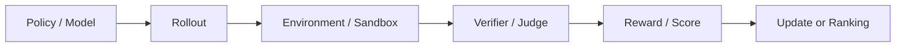
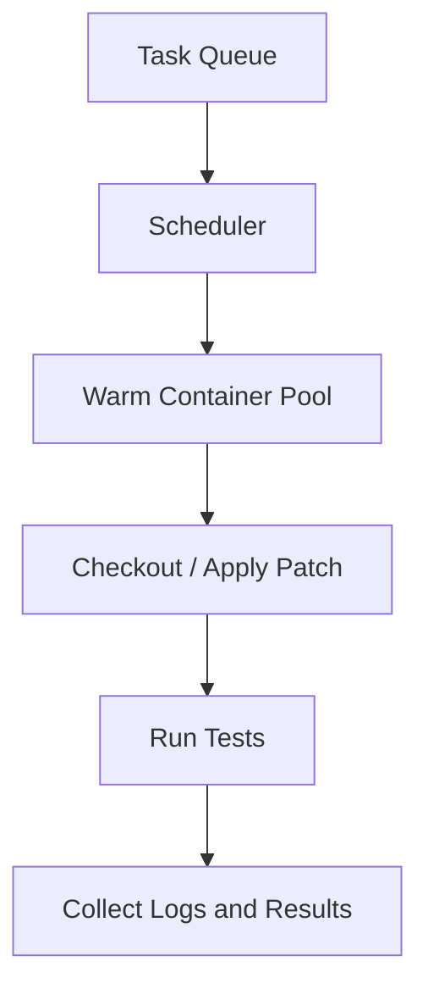
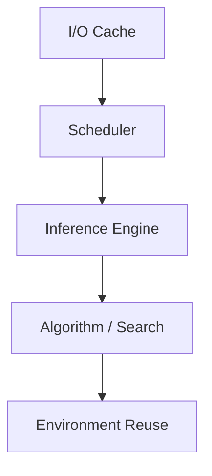
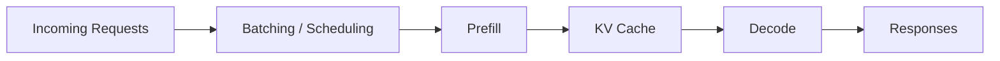
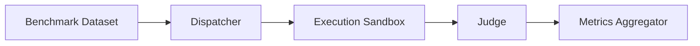

# 白板图清单

> 目标：面试时优先画能体现 infra 思维的图，不画纯产品流程图。

---

## 1. Agent 基础闭环

适用场景：

- 讲 RL / verifier
- 讲评测系统
- 讲 agent execution loop

---

## 2. Docker 验证环境

适用场景：

- 讲 SWE-bench
- 讲 rollout 验证
- 讲并发执行环境

---

## 3. Deep Research 五层图

适用场景：

- 讲 deep research 优化
- 讲端到端性能分析

---

## 4. 推理吞吐图

适用场景：

- 讲 vLLM / continuous batching
- 讲 inference bottleneck

---

## 5. 评测 Pipeline

适用场景：

- 讲 benchmark infra
- 讲自动判分和报告生成
