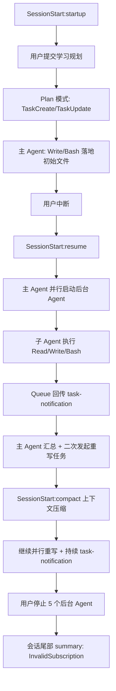
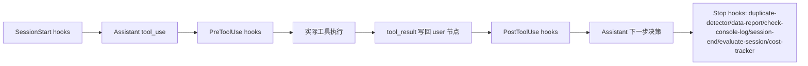

# Claude `--resume ccf8e533-28f9-4482-9bd7-6b3513f50597` 会话执行总结

## 1) 数据来源（你可以直接打开这些文件）

- 主会话日志（927 行）  
  `/Users/zhuji_m4pro/.claude/projects/-Users-zhuji-m4pro/ccf8e533-28f9-4482-9bd7-6b3513f50597.jsonl`
- 子 Agent 日志目录（共 23 个 `.jsonl`，合计 2534 行）  
  `/Users/zhuji_m4pro/.claude/projects/-Users-zhuji-m4pro/ccf8e533-28f9-4482-9bd7-6b3513f50597/subagents/`
- 会话索引  
  `/Users/zhuji_m4pro/.claude/projects/-Users-zhuji-m4pro/sessions-index.json`
- 输入历史（包含该 session 的用户消息）  
  `/Users/zhuji_m4pro/.claude/history.jsonl`

## 2) 会话总体结论（先给结论）

这个 session 的核心是：

1. 先在 Plan 模式写计划并落地部分文件。
2. 用户打断后，通过 `SessionStart:resume` 恢复执行（这就是你说的 `--resume` 关键点）。
3. 主 Agent 多次并行启动后台子 Agent（`Agent` 工具）批量写文档。
4. 中途发生一次上下文压缩（`SessionStart:compact`），并用 compact summary 承接状态继续跑。
5. 多个任务完成并通过 queue 回传 `<task-notification>`。
6. 最后 5 个后台 agent 被用户停止，尾部出现 `InvalidSubscription` 错误摘要。

## 3) `--resume` 关键证据

在主会话日志里，明确出现了两条 resume 启动 hook：

- `SessionStart:resume`（data-report）
- `SessionStart:resume`（session-start.js 入口包装命令）

对应位置（主会话日志）：

- line 51
- line 52

说明：这个 session 不是单次连续跑完，而是被中断后恢复执行。

## 4) 时间线（按阶段）

时间为 UTC（日志原始时区）。

1. **06:48:22Z - SessionStart:startup**  
   触发 startup hook，进入会话。
2. **06:49:05Z - 用户提交超长学习规划需求**  
   主 Agent 进入 Plan 流程，写入计划文件。
3. **06:51:17Z - 用户中断一次**  
   产生 `[Request interrupted by user]`。
4. **06:51:42Z - SessionStart:resume**  
   恢复会话，用户发“按照计划开始实施”。
5. **06:52~06:57Z - 主 Agent 先做基础落地**  
   创建目录、写 README/核心概念文件、创建任务清单。
6. **06:56~06:58Z - 第一轮并行子 Agent 启动**  
   启动 3 个大任务：Week1、Week2+3、Week4+5+6。
7. **07:22~07:31Z - 前两批子任务完成通知**  
   `af8609e...`、`a8f5acd...` 完成并回传 task-notification。
8. **08:00Z - 用户要求“等 Agent 3 写完通知我”**
9. **08:18:28Z - SessionStart:compact**  
   上下文压缩后继续执行（出现 `isCompactSummary:true` 的承接摘要）。
10. **08:19~09:38Z - 第二轮重写波次开始**  
    又发起“rewrite core/docker、rewrite RL/inference、rewrite interview/references”等后台 agent。
11. **09:44~10:25Z - 精细化单文件重写并行执行**  
    连续启动多个单文件 agent（如 `ppo_grpo.md`、`verifier_design.md`、`blogs.md` 等）。
12. **10:36:26Z - 用户停止 5 个后台 agent**  
    日志出现：`5 background agents were stopped by the user ...`。
13. **10:36:29Z - 尾部错误摘要**  
    `summary` 记录为 `InvalidSubscription` API 400。

## 5) 主会话里的工具调用统计（927 行日志）

### 5.1 工具调用次数

- `Agent`: 23
- `Bash`: 14
- `Write`: 9
- `TaskUpdate`: 11
- `TaskCreate`: 6
- `TaskOutput`: 5
- `Read`: 1
- `ExitPlanMode`: 2

### 5.2 事件类型计数

- `progress`: 592
- `assistant`: 139
- `user`: 101
- `queue-operation`: 40
- `system`: 35
- `file-history-snapshot`: 16
- `last-prompt`: 3
- `summary`: 1

## 6) Hook 调用总结（主会话）

### 6.1 Hook 事件统计

- `SessionStart`: 6
  - `SessionStart:startup` x2
  - `SessionStart:resume` x2
  - `SessionStart:compact` x2
- `PreToolUse`: 302
- `PostToolUse`: 149
- `Stop`: 132（对应 22 轮 stop，每轮 6 条）

### 6.2 典型 Hook 链路（按工具）

- `Write`: `PreToolUse:Write -> PostToolUse:Write`
- `Bash`: `PreToolUse:Bash -> PostToolUse:Bash`
- `Agent`: `PreToolUse:Agent -> PostToolUse:Agent`
- 其它工具（TaskCreate/TaskUpdate/TaskOutput/Read/ExitPlanMode）也都是同样前后钩子结构。

### 6.3 高频 Hook 命令（主会话）

- `pre:observe / post:observe`（continuous-learning 观察钩子）
- `pre:mcp-health-check`
- `pre:bash:tmux-reminder`
- `pre:bash:git-push-reminder`
- `post:bash:pr-created`
- `post:bash:build-complete`
- `pre/post:governance-capture`
- `stop:check-console-log`
- `stop:session-end`
- `stop:evaluate-session`
- `stop:cost-tracker`
- `duplicate-detector --pre-tool-use/--stop`
- `data-report --session-start/--pre-tool-use/--post-tool-use/--stop`

## 7) Hook 脚本实际路径（可打开）

常见插件脚本（multiple locations，最直接可用的是 `~/.claude/scripts/hooks`）：

- `/Users/zhuji_m4pro/.claude/scripts/hooks/run-with-flags.js`
- `/Users/zhuji_m4pro/.claude/scripts/hooks/run-with-flags-shell.sh`
- `/Users/zhuji_m4pro/.claude/scripts/hooks/session-start.js`
- `/Users/zhuji_m4pro/.claude/scripts/hooks/session-end.js`
- `/Users/zhuji_m4pro/.claude/scripts/hooks/mcp-health-check.js`
- `/Users/zhuji_m4pro/.claude/scripts/hooks/governance-capture.js`
- `/Users/zhuji_m4pro/.claude/scripts/hooks/doc-file-warning.js`
- `/Users/zhuji_m4pro/.claude/scripts/hooks/suggest-compact.js`
- `/Users/zhuji_m4pro/.claude/scripts/hooks/quality-gate.js`
- `/Users/zhuji_m4pro/.claude/scripts/hooks/check-console-log.js`
- `/Users/zhuji_m4pro/.claude/scripts/hooks/evaluate-session.js`
- `/Users/zhuji_m4pro/.claude/scripts/hooks/cost-tracker.js`
- `/Users/zhuji_m4pro/.claude/skills/continuous-learning-v2/hooks/observe.sh`

日志中提到的 `data-report`/`duplicate-detector` 路径是：

- `/Users/zhuji_m4pro/.comate/extensions/baidu.baidu-cc-2.1.76-rc.6/resources/hooks/...`

我当前在本机扫描时没有找到这个目录（可能是旧版本路径或已迁移），但日志里确实记录了它被调用。

## 8) Queue / 子任务回传（主 session 中可见）

以下是主日志里明确出现的任务完成通知（`queue-operation enqueue` + `<task-notification>`）：

- `af8609e33b62096f7` - Write Week 1 Docker files（completed）
- `a8f5acdf12efbc316` - Write Week 2+3 RL and inference files（completed）
- `a4ebb9b04a00995c0` - Write Week 4+5+6 eval/interview/ref files（completed, result 显示 timeout）
- `a0bf5737d072ca544` - Rewrite core + docker files（completed, result timeout）
- `a4de91d21749e1c93` - Rewrite RL + inference files（completed, result timeout）
- `a84b79205a1a2158c` - Rewrite batching.md（completed）
- `adfa32187852c89ca` - Rewrite interview + references（completed, result timeout）
- `ad6b3d1f9e9c98ae0` - Rewrite kv_cache.md（completed）
- `ae6f297927da8aad0` - Rewrite prefill_decode.md（completed）
- `a8d91eaa681521caf` - Rewrite namespace_cgroups.md（completed）
- `a8400a3a6fd7c8e64` - Rewrite project_reframing.md（completed）
- `ae062cfa4f1569d80` - Create repos.md（completed）
- `ac6a2a431f9fdd303` - Rewrite 4 claude_code files（completed）
- `a50c7e17862595a65` - Create blogs.md（completed）
- `a250e64dafaaea39e` - Rewrite image_layers_cow.md（completed）
- `a713f01806b16d6a6` - Rewrite rollout_reward.md（completed）
- `a067c645c00aeec30` - Rewrite ppo_grpo.md（completed）
- `a252a205c994a4ba8` - Rewrite verifier_design.md（completed）

## 9) 子 Agent -> 具体写入文件映射

下表是根据每个 subagent `.jsonl` 中 `Write` 工具实际抽取得到。

- `af8609e33b62096f7` 写了 8 个：
  - `00_core_concepts/position_overview.md`
  - `00_core_concepts/four_core_abilities.md`
  - `00_core_concepts/mindset.md`
  - `01_week1_docker/concepts/namespace_cgroups.md`
  - `01_week1_docker/concepts/image_layers_cow.md`
  - `01_week1_docker/concepts/container_orchestration.md`
  - `01_week1_docker/tasks/concurrent_workers.md`
  - `01_week1_docker/resources.md`
- `a8f5acdf12efbc316` 写了 15 个（Week2+3 全套）。
- `a4ebb9b04a00995c0` 写了 8 个（Week4+Interview 部分）。
- `ac6a2a431f9fdd303` 写了 4 个（`claude_code/*` 四个核心文件）。
- `a250e64dafaaea39e` 写了：`01_week1_docker/concepts/image_layers_cow.md`
- `a252a205c994a4ba8` 写了：`02_week2_rl_verification/concepts/verifier_design.md`
- `a713f01806b16d6a6` 写了：`02_week2_rl_verification/concepts/rollout_reward_update.md`
- `a067c645c00aeec30` 写了：`02_week2_rl_verification/concepts/ppo_grpo.md`
- `ad6b3d1f9e9c98ae0` 写了：`03_week3_inference_claude_code/inference/kv_cache.md`
- `ae6f297927da8aad0` 写了：`03_week3_inference_claude_code/inference/prefill_decode.md`
- `a84b79205a1a2158c` 写了：`03_week3_inference_claude_code/inference/batching_strategies.md`
- `a8d91eaa681521caf` 写了：`01_week1_docker/concepts/namespace_cgroups.md`
- `a8400a3a6fd7c8e64` 写了：`05_interview_prep/project_reframing.md`
- `ae062cfa4f1569d80` 写了：`06_references/repos.md`
- `a50c7e17862595a65` 写了：`06_references/blogs.md`

有少量 agent 只做 `Read` 未 `Write`（通常是被停掉或中途结束）。

## 10) 流程图（整体调用）



## 11) 流程图（单次工具调用 + Hook）



## 12) 本次会话产出文件总览（当前目录）

当前 `Agent_learn` 下共 `39` 个 Markdown 文件：

- 根目录：`README.md`
- `00_core_concepts/`：3
- `01_week1_docker/`：6
- `02_week2_rl_verification/`：6
- `03_week3_inference_claude_code/`：9
- `04_week4_eval_deep_research/`：7
- `05_interview_prep/`：3
- `06_references/`：4

完整清单可用：

```bash
find /Users/zhuji_m4pro/Agent_learn -name '*.md' -type f | sort
```

## 13) 你如果要继续深入排查，推荐顺序

1. 先看主日志里 `SessionStart:resume` 与 `SessionStart:compact` 两段。
2. 再看 `queue-operation` 的 `<task-notification>`，这是任务完成的主索引。
3. 最后按 task-id 打开对应 subagent 日志，核对 `Write` 真实落盘路径。

