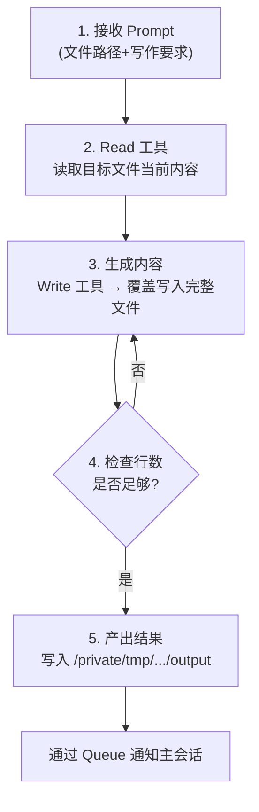
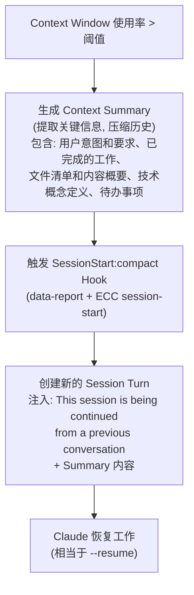

# Claude Session `ccf8e533` 执行流程深度分析

## Context

本文档是对 Claude Code session `ccf8e533-28f9-4482-9bd7-6b3513f50597` 执行过程的完整分析。用户正在准备「Agent 基建/Infra 工程师」岗位面试，让 Claude 将学习计划整理成结构化的 Markdown 学习资料。

---

## 一、Session 概览

| 属性 | 值 |
|------|------|
| **Session ID** | `ccf8e533-28f9-4482-9bd7-6b3513f50597` |
| **Slug** | `vivid-wibbling-stonebraker` |
| **时间范围** | 2026-04-20 06:48:22 ~ 10:36:29 UTC (约 3 小时 48 分钟) |
| **模型** | `claude-opus-4-5-20251101` |
| **Ducc 版本** | `baidu.baidu-cc-2.1.76-rc.6` |
| **工作目录** | `/Users/zhuji_m4pro` |
| **Session 数据文件** | `~/.claude/projects/-Users-zhuji-m4pro/ccf8e533-28f9-4482-9bd7-6b3513f50597.jsonl` (927 行) |
| **结束原因** | 用户中断 + API 订阅过期 (`InvalidSubscription`) |

---

## 二、整体执行流程图

```mermaid
timeline
    title Session 执行时间线
    section 06:48
        SessionStart Hook : data-report + ECC session-start
    section 06:49
        Phase 1: 初始请求 + Plan Mode : USER 提交学习计划文档<br/>Claude Plan Mode → Write 计划文件 → ExitPlanMode → 用户中断
    section 06:52
        Phase 2: 第一次实施 (骨架版-被拒绝) : mkdir → TaskCreate x6<br/>Write 7 个骨架文件<br/>用户拒绝: 要求展开细节
    section 06:55
        Phase 3: 详细扩展版 (3个并行Agent) : 重写计划v2 → ExitPlanMode<br/>Agent #1/#2/#3 并行<br/>#1完成 #2完成 #3超时
    section 08:00
        Phase 4: Context Compaction : Context Window 溢出<br/>自动压缩 → --resume 继续会话
    section 08:18
        Phase 5: Resume后继续 (3个新Agent) : 恢复上下文<br/>Agent #4/#5/#6 重写文件<br/>#4/#5超时完成 #6超时完成
    section 09:39
        Phase 6: 第三轮扩展 (~15个并行Agent) : 逐文件重写 Agent #7~#23<br/>大部分完成 5个被用户终止
    section 10:36
        Phase 7: 终止 : 5个Agent 被用户终止<br/>API 订阅过期 (InvalidSubscription)
```

---

## 三、SubAgent (Agent 工具调用) 深度解析

### 3.1 什么是 SubAgent

Claude Code 中的 `Agent` 工具是 Claude 启动**子进程 Agent** 的机制。每个 SubAgent 拥有:
- **独立的 Context Window** (不占用主会话的 context)
- **独立的工具权限** (mode=bypassPermissions 时可绕过用户确认)
- **独立的执行流程** (run_in_background=True 时异步执行)
- **输出文件** (在 `/private/tmp/claude-501/.../tasks/` 下)

SubAgent 本质上是一个新的 Claude 实例，拥有自己的对话上下文，可以独立调用工具 (Read/Write/Bash 等)。主会话通过 `Agent` 工具的 `prompt` 参数向 SubAgent 传递任务指令，SubAgent 完成后通过内部 Queue 机制将结果通知主会话。

### 3.2 SubAgent 调用参数

每个 Agent 调用都使用 `general-purpose` 类型 (拥有全部工具的通用 Agent)，并通过以下参数控制:

| 参数 | 本次用法 | 说明 |
|------|---------|------|
| `subagent_type` | `general-purpose` | 通用 Agent，拥有 Read/Write/Edit/Bash/Glob/Grep 等全部工具 |
| `mode` | `bypassPermissions` | **绕过所有权限确认**，Agent 内的工具调用不需要用户逐个批准 |
| `run_in_background` | `True` | **异步后台执行**，主会话可以继续做其他事 |
| `prompt` | 详细的写作指令 | 每次都包含具体的文件路径、行数要求、内容要求 |

### 3.3 全部 23 个 SubAgent 详细分析

---

#### 第一轮: 初始写入 (Phase 3, 06:56 ~ 08:18)

##### Agent #1: "Write Week 1 Docker files"

| 属性 | 值 |
|------|------|
| **启动时间** | 06:56:04 |
| **完成时间** | 07:22:39 |
| **耗时** | ~26 分钟 |
| **状态** | 完成 |
| **输出文件** | `/private/tmp/claude-501/.../af8609e33b62096f7.output` |

**任务**: 重写 8 个核心概念和 Docker 文件

**Prompt 要点**:
- 角色: 技术文档写作专家
- 6 个写作规范: 术语定义(> **xxx**: ...)、原理详解(是什么+为什么+怎么做)、ASCII 图/伪代码、面试问答(3-5题)、>=150行、关联引用
- 8 个文件: position_overview.md, four_core_abilities.md, mindset.md, namespace_cgroups.md, image_layers_cow.md, container_orchestration.md, docker_tasks.md, week1_resources.md

**Prompt 关键片段**:
```
你是一个技术文档写作专家，正在为一位准备「Agent 基建/Infra 工程师」面试的候选人编写详细的学习笔记。

## 写作要求
1. **术语定义**：第一次出现的专业名词，用 `> **xxx**: ...` 格式给出清晰定义
2. **原理详解**：不只是「是什么」，要讲「为什么」和「怎么做」
3. **图示/伪代码**：用 ASCII 图或伪代码帮助理解
4. **面试问答**：每个文件末尾必须有「## 面试高频问题」section，包含 3-5 个 Q&A
5. **每个文件至少 150 行**
6. **关联引用**：用 `→ 参见 [xxx](../path/file.md)` 指出与其他章节的关联
```

**产出**: 8 个文件, position_overview.md 436 行

---

##### Agent #2: "Write Week 2+3 RL and inference files"

| 属性 | 值 |
|------|------|
| **启动时间** | 06:57:05 |
| **完成时间** | 07:31:17 |
| **耗时** | ~34 分钟 |
| **状态** | 完成 |
| **输出文件** | `/private/tmp/claude-501/.../a8f5acdf12efbc316.output` |

**任务**: 创建 15 个 RL 验证和推理引擎文件

**Prompt 要点**:
- 角色定位: 候选人熟悉 Agent 应用开发(Claude Code、Hook、Skills)，但**对 RL、推理引擎等底层概念需要从头学习**
- 15 个文件涵盖: Week 2 RL (README, ppo_grpo, rollout_reward, verifier, rl_tasks) + Week 3 推理 (README, prefill_decode, kv_cache, batching, claude_code 架构, task_tool, hooks_lifecycle, context_compaction, week3_tasks)
- PPO/GRPO 要**为零基础展开**: 用 Agent 玩游戏的类比引入

**产出**: 15 个文件, 总计 5987 行

---

##### Agent #3: "Write Week 4+5+6 eval/interview/ref files"

| 属性 | 值 |
|------|------|
| **启动时间** | 06:57:47 |
| **完成时间** | 08:18:44 |
| **耗时** | ~81 分钟 (超时) |
| **状态** | Request timed out |
| **输出文件** | `/private/tmp/claude-501/.../a4ebb9b04a00995c0.output` |
| **Token 使用** | total_tokens: 0, tool_uses: 15, duration: 4,856,876ms (~81 min) |

**任务**: 创建 Week 4 评测 + Week 5 面试 + Week 6 参考资料

**Prompt 要点**:
- 候选人**对评测 benchmark、Deep Research 架构等领域需要系统学习**
- 文件涵盖: SWE-bench, HLE, GAIA+BrowseComp, 五层优化地图, Deep Research 架构, project_reframing, self_check_list, whiteboard_diagrams, repos, blogs

**产出**: 超时但已完成大部分 (15 次工具调用)

---

#### 第二轮: 重写扩展 (Phase 5, 08:34 ~ 09:48)

##### Agent #4: "Rewrite core + docker files"

| 属性 | 值 |
|------|------|
| **启动时间** | 08:34:56 |
| **完成时间** | 09:37:59 |
| **耗时** | ~63 分钟 (超时) |
| **状态** | Request timed out |
| **name** | `agent-core-docker` |
| **Token 使用** | tool_uses: 7, duration: 3,520,824ms (~59 min) |

**任务**: 重写 6 个核心+Docker 文件, **每个 >= 400 行**

**Prompt 关键变化** (vs 第一轮):
```
**重要**：先用 Read 工具读取每个文件的当前内容（了解结构），然后用 Write 工具完整重写。
不要用 Edit 增量修改，直接 Write 全新内容。

## 文件 2: four_core_abilities.md
重写到 500+ 行。必须包含：
- ① 大规模并发验证：Docker Compose Scale 完整 YAML + K8s Deployment YAML（replicas=16）+ 调度流程 mermaid 图
- ③ 验证闭环自动化：Harness 4 模块详解（Input Adapter / Executor Engine / Output Collector / Reward Function），
  每个模块要讲清楚输入输出，给一个完整的 Python VerificationHarness 类代码示例
- ④ 推理侧多线程：MCTS 四阶段（Selection/Expansion/Simulation/Backpropagation）各阶段算法伪代码
```

**显著提升**: 行数要求从 150 提升到 400-500, 要求包含完整 Python 代码示例和 mermaid 图

---

##### Agent #5: "Rewrite RL + inference files"

| 属性 | 值 |
|------|------|
| **启动时间** | 08:37:43 |
| **完成时间** | 09:38:59 |
| **耗时** | ~61 分钟 (超时) |
| **状态** | Request timed out |
| **name** | `agent-rl-inference` |
| **Token 使用** | tool_uses: 10, duration: 3,580,790ms (~60 min) |

**任务**: 重写 10 个 RL+推理文件, **每个 >= 300 行 (RL 概念 >= 400 行)**

**Prompt 要点**:
- PPO 要求: 完整目标函数公式 (clipped surrogate objective)、GAE 公式、完整训练循环伪代码
- GRPO 要求: Group Relative 计算公式、为什么对 Agent 场景更适合
- Verifier: 5 种类型、Docker 作为 Verifier 执行环境的完整 Python DockerVerifier 类

---

##### Agent #6: "Rewrite interview + references"

| 属性 | 值 |
|------|------|
| **启动时间** | 08:39:18 |
| **完成时间** | 09:48:59 |
| **耗时** | ~70 分钟 (超时) |
| **状态** | Request timed out |
| **name** | `agent-interview-refs` |
| **Token 使用** | total_tokens: 77, tool_uses: 5, duration: 4,180,855ms (~70 min) |

**任务**: 重写 3 个文件 + 新建 2 个文件

**Prompt 要点**:
- self_check_list.md: 面试自检清单 50 题 (Docker 15题 + RL 10题 + 推理 10题 + Claude Code 8题 + Deep Research 7题)
- project_reframing.md: 5 个项目转换示例, 每个包含原话→infra 讲法→技术要点→架构图→追问
- whiteboard_diagrams.md: 6 个白板图 (容器本质、世界观、验证系统、推理引擎、优化地图、演讲路线)

---

#### 第三轮: 逐文件精确重写 (Phase 6, 09:43 ~ 10:36)

用户要求查看 Agent 改了哪些文件后, Claude 将每个文件分配给独立的 Agent 精确重写:

| # | Agent | 目标文件 | 目标行数 | 启动 | 完成 | 耗时 | 状态 |
|---|-------|---------|---------|------|------|------|------|
| 7 | Rewrite four_core_abilities.md | 00_core_concepts/four_core_abilities.md | 500+ | 09:43:58 | - | - | **被用户终止** |
| 8 | Rewrite mindset.md | 00_core_concepts/mindset.md | 500+ | 09:44:06 | - | - | **被用户终止** |
| 9 | Rewrite namespace_cgroups.md | 01_week1_docker/concepts/namespace_cgroups.md | 500+ | 09:44:14 | 10:08:49 | ~25min | **完成** (876行) |
| 10 | Rewrite image_layers_cow.md | 01_week1_docker/concepts/image_layers_cow.md | 400+ | 09:44:21 | 10:13:13 | ~29min | **完成** (740行) |
| 11 | Rewrite container_orchestration.md | 01_week1_docker/concepts/container_orchestration.md | 500+ | 09:44:29 | - | - | **被用户终止** |
| 12 | Rewrite ppo_grpo.md | 02_week2_rl_verification/concepts/ppo_grpo.md | 400+ | 09:44:53 | 10:19:20 | ~34min | **完成** (859行) |
| 13 | Rewrite rollout_reward.md | 02_week2_rl_verification/concepts/rollout_reward_update.md | 400+ | 09:45:02 | 10:15:10 | ~30min | **完成** (1028行) |
| 14 | Rewrite verifier_design.md | 02_week2_rl_verification/concepts/verifier_design.md | 400+ | 09:45:05 | 10:25:03 | ~40min | **完成** (1243行) |
| 15 | Rewrite prefill_decode.md | 03_week3_inference/.../prefill_decode.md | 300+ | 09:45:10 | 09:51:45 | ~7min | **完成** (546行) |
| 16 | Rewrite kv_cache.md | 03_week3_inference/.../kv_cache.md | 300+ | 09:45:15 | 09:51:15 | ~6min | **完成** (505行) |
| 17 | Rewrite batching.md | 03_week3_inference/.../batching_strategies.md | 300+ | 09:45:19 | 09:48:39 | ~3min | **完成** (405行) |
| 18 | Rewrite 4 claude_code files | 4 个 claude_code/*.md | 300+ each | 09:45:30 | 10:08:49 | ~23min | **完成** (386+行) |
| 19 | Rewrite project_reframing.md | 05_interview_prep/project_reframing.md | 400+ | 09:50:15 | 09:57:50 | ~8min | **完成** (536行) |
| 20 | Rewrite self_check_list.md | 05_interview_prep/self_check_list.md | 400+ | 09:50:26 | - | - | **被用户终止** |
| 21 | Rewrite whiteboard_diagrams.md | 05_interview_prep/whiteboard_diagrams.md | 300+ | 09:50:33 | - | - | **被用户终止** |
| 22 | Create repos.md | 06_references/repos.md | 300+ | 09:50:44 | 10:02:05 | ~11min | **完成** (506行) |
| 23 | Create blogs.md | 06_references/blogs.md | 300+ | 09:50:52 | 10:12:32 | ~22min | **完成** (353行) |

### 3.4 SubAgent 内部工作方式

每个 SubAgent 内部的执行流程:



### 3.5 SubAgent 输出文件位置

所有 Agent 的输出存储在:
```
/private/tmp/claude-501/-Users-zhuji-m4pro/7a5fecbc-92cc-4782-9c73-e9b369c6ca11/tasks/<task-id>.output
```

---

## 四、SubAgent Prompt 演进分析

Claude 在三轮 Agent 调用中不断改进 Prompt 的质量:

| 维度 | 第一轮 (06:56) | 第二轮 (08:34) | 第三轮 (09:43) |
|------|---------------|---------------|---------------|
| **行数要求** | >= 150 行 | >= 300-500 行 | >= 300-500 行 |
| **角色定义** | 技术文档写作专家 | 同左 + 明确候选人背景 | 同左 |
| **工具指令** | 未指定 | **先用 Read 再 Write，不要 Edit** | **Read → Write，不要 Edit** |
| **内容要求** | 基本列表 | **Python 代码示例、mermaid 图** | 同左 + 更精确 |
| **分配策略** | 1 Agent 负责多个文件 | 1 Agent 负责多个相关文件 | **1 Agent 负责单个文件** |
| **命名** | 无 | agent-core-docker 等 | 无 (部分) |
| **超时处理** | 正常完成 | 多个超时但产出仍有效 | 缩短超时(3-40min) |

### 关键改进点:

1. **从多文件→单文件**: 第一轮让一个 Agent 写 8 个文件, 第三轮改为每个文件一个 Agent, 质量更可控
2. **Read 先行**: 第二轮开始要求先 Read 当前文件再 Write, 确保 Agent 了解已有内容
3. **代码要求提升**: 从仅 ASCII 图升级到要求完整 Python 类代码 + mermaid 图

---

## 五、Hook 调用详解

### 5.1 Hook 触发时机

| Hook 类型 | 触发时机 | 说明 |
|-----------|---------|------|
| **SessionStart** | Session 创建/恢复/压缩时 | startup, resume, compact 三种 |
| **PreToolUse** | 每个工具调用**前** | 验证、拦截、修改参数 |
| **PostToolUse** | 每个工具调用**后** | 自动格式化、质量检查 |
| **Stop** | 每个 Turn 结束时 | 汇总、判分、成本统计 |

### 5.2 完整 Hook 清单

#### SessionStart Hooks (3 个, 每次 session 触发)

| # | Hook 名称 | 命令 | 来源 |
|---|----------|------|------|
| 1 | `data-report` | `hooks/data-report --session-start` | Ducc 内置 (`baidu.baidu-cc-2.1.76-rc.6`) |
| 2 | `session-start` | `node run-with-flags.js "session:start" "scripts/hooks/session-start.js"` | ECC Plugin (`everything-claude-code`) |

#### PreToolUse Hooks (按工具类型分组)

**Write 工具 (最多 hooks, 9 个)**:

| # | Hook 名称 | 功能 |
|---|----------|------|
| 1 | `data-report --pre-tool-use` | Ducc 数据上报 |
| 2 | `duplicate-detector --pre-tool-use` | 重复内容检测 |
| 3 | `doc-file-warning` | .md/.doc 文件写入警告 |
| 4 | `suggest-compact` | 建议使用更紧凑的写作方式 |
| 5 | `observe.sh` | 学习行为观察记录 |
| 6 | `insaits-security-wrapper` | 安全检查 (insAIts) |
| 7 | `governance-capture` | 治理记录 |
| 8 | `config-protection` | 配置文件保护 |
| 9 | `mcp-health-check` | MCP 服务健康检查 |

**Bash 工具 (9 个)**:

| # | Hook 名称 | 功能 |
|---|----------|------|
| 1 | `duplicate-detector --pre-tool-use` | 重复命令检测 |
| 2 | `observe.sh` | 学习行为观察 |
| 3 | `auto-tmux-dev` | 自动 tmux 开发环境 |
| 4 | `git-push-reminder` | git push 提醒 (strict) |
| 5 | `tmux-reminder` | tmux 使用提醒 (strict) |
| 6 | `insaits-security-wrapper` | 安全检查 |
| 7 | `governance-capture` | 治理记录 |
| 8 | `mcp-health-check` | MCP 健康检查 |
| 9 | `npx block-no-verify` | 阻止 --no-verify 标志 |

**Agent 工具 (2 个)**: `observe.sh` + `mcp-health-check`

**Read 工具 (3 个)**: `duplicate-detector` + `observe.sh` + `mcp-health-check`

**TaskCreate / TaskUpdate / TaskOutput (各 2 个)**: `observe.sh` + `mcp-health-check`

#### PostToolUse Hooks

**Write 工具 (5 个)**: `data-report`, `callback`, `observe.sh`, `governance-capture`, `quality-gate`

**Bash 工具 (4 个)**: `observe.sh`, `build-complete`, `pr-created`, `governance-capture`

**其他工具**: 均只有 `observe.sh` + `callback`

#### Stop Hooks (6 个, 每个 Turn 结束时)

| # | Hook 名称 | 平均耗时 | 功能 |
|---|----------|---------|------|
| 1 | `data-report --stop` | 12~3465ms | Ducc 数据上报 (波动大) |
| 2 | `duplicate-detector --stop` | 8~56ms | 重复检测 |
| 3 | `check-console-log` | 88~388ms | 检查 console.log |
| 4 | `cost-tracker` | 0ms | 成本追踪 |
| 5 | `evaluate-session` | 0ms | 会话评估 |
| 6 | `session-end` | 0ms | 会话结束处理 |

### 5.3 Hook 源文件位置

| 文件路径 | 来源 |
|---------|------|
| `~/.comate/extensions/baidu.baidu-cc-2.1.76-rc.6/resources/hooks/data-report` | Ducc 内置 |
| `~/.comate/extensions/baidu.baidu-cc-2.1.76-rc.6/resources/hooks/duplicate-detector` | Ducc 内置 |
| `~/.claude/plugins/everything-claude-code/scripts/hooks/*.js` | ECC Plugin |

---

## 六、工具调用统计

### 6.1 按类型统计

| 工具 | 调用次数 | 说明 |
|------|---------|------|
| **Agent** (SubAgent) | 23 | 并行子进程 Agent (核心并发机制) |
| **Bash** | ~20 | mkdir, find, wc 等文件操作 |
| **Write** | ~15 | 写入计划文件 + 学习笔记文件 |
| **TaskCreate** | 6 | 创建任务跟踪 |
| **TaskUpdate** | ~12 | 更新任务状态 |
| **TaskOutput** | ~8 | 获取后台任务结果 |
| **ExitPlanMode** | 2 | 退出计划模式 |
| **Read** | ~2 | 读取计划文件 |

### 6.2 主会话工具调用时间线

| 时间 | 工具 | 参数 |
|------|------|------|
| 06:49:34 | Write | .claude/plans/vivid-wibbling-stonebraker.md (计划 v1) |
| 06:49:46 | ExitPlanMode | 等待用户批准 |
| 06:51:06 | Bash | mkdir -p Agent_learn/{...} |
| 06:52:02 | Bash | find Agent_learn |
| 06:52:06~16 | TaskCreate x6 | 创建 6 个任务 |
| 06:52:17~53:47 | Write x7 | README.md + 6 个骨架文件 |
| 06:55:01 | Read | .claude/plans/vivid-wibbling-stonebraker.md |
| 06:55:09 | Write | .claude/plans/vivid-wibbling-stonebraker.md (计划 v2) |
| 06:55:11 | ExitPlanMode | 获得用户批准 |
| 06:56:04 | **Agent #1** | Write Week 1 Docker files (后台) |
| 06:57:05 | **Agent #2** | Write Week 2+3 RL/inference files (后台) |
| 06:57:47 | **Agent #3** | Write Week 4+5+6 eval/interview/ref files (后台) |
| 07:01:00~07:32:16 | Bash/TaskOutput x多次 | 检查 Agent 进度 |
| 08:34:56 | **Agent #4** | Rewrite core+docker (后台) |
| 08:37:43 | **Agent #5** | Rewrite RL+inference (后台) |
| 08:39:18 | **Agent #6** | Rewrite interview+refs (后台) |
| 09:43:58~09:50:52 | **Agent #7~#23** | 逐文件重写 (17 个后台 Agent) |
| 09:39~10:25 | Bash/TaskOutput x多次 | 检查进度 |

---

## 七、Context Compaction 流程



**Context Summary 中的关键信息**:

- 用户要求: 每个文件深度展开、术语定义、>=150行、面试问答
- 已完成的文件清单 + 行数
- 技术概念定义 (Rollout, Reward Signal, Harness 等)
- 待完成的工作 (检查 Agent 输出)

---

## 八、Queue 消息机制

Session 中使用了 Message Queue 处理后台 Agent 通知:

| 时间 | 操作 | 内容 |
|------|------|------|
| 07:22 | enqueue | Agent #1 完成通知 |
| 07:31 | enqueue | Agent #2 完成通知 |
| 08:18 | enqueue | Agent #3 完成通知 (超时) |
| 09:38 | enqueue | 用户消息 "这几个agent 都改了哪些文件" |
| 09:37~09:39 | enqueue | Agent #4/#5 完成通知 |
| 09:48 | enqueue | Agent #6 完成通知 |
| 09:48~10:25 | enqueue | Agent #7~#23 完成通知 (逐个返回) |
| 10:36 | enqueue | "5 background agents were stopped by the user" |

Task Notification 的 XML 协议格式:

```xml
<task-notification>
  <task-id>af8609e33b62096f7</task-id>
  <tool-use-id>call_54d983683c4e4ee5a359ec0b</tool-use-id>
  <output-file>/private/tmp/claude-501/.../tasks/af8609e33b62096f7.output</output-file>
  <status>completed</status>
  <summary>Agent "Write Week 1 Docker files" completed</summary>
</task-notification>
```

---

## 九、关键文件清单

### 9.1 Session 数据

| 文件 | 说明 |
|------|------|
| `~/.claude/projects/-Users-zhuji-m4pro/ccf8e533-28f9-4482-9bd7-6b3513f50597.jsonl` | 完整 session 日志 (927 行) |

### 9.2 计划文件

| 文件 | 说明 |
|------|------|
| `~/.claude/plans/vivid-wibbling-stonebraker.md` | 计划文件 (v1 和 v2 两个版本) |

### 9.3 SubAgent 输出文件

| 文件 | Agent |
|------|-------|
| `/private/tmp/claude-501/.../af8609e33b62096f7.output` | Agent #1 (Docker files) |
| `/private/tmp/claude-501/.../a8f5acdf12efbc316.output` | Agent #2 (RL+inference) |
| `/private/tmp/claude-501/.../a4ebb9b04a00995c0.output` | Agent #3 (eval/interview) |
| `/private/tmp/claude-501/.../a0bf5737d072ca544.output` | Agent #4 (core+docker rewrite) |
| `/private/tmp/claude-501/.../a4de91d21749e1c93.output` | Agent #5 (RL+inference rewrite) |
| `/private/tmp/claude-501/.../adfa32187852c89ca.output` | Agent #6 (interview+refs rewrite) |
| (更多在 /private/tmp/claude-501/.../tasks/ 目录下) | Agent #7~#23 |

### 9.4 产出文件 (`/Users/zhuji_m4pro/Agent_learn/`)

```
Agent_learn/
├── README.md                              # 总览 (~64 lines)
├── 00_core_concepts/
│   ├── position_overview.md               # 岗位定位 (~436 lines)
│   ├── four_core_abilities.md             # 4个核心能力 (目标 500+, 被终止)
│   └── mindset.md                         # 核心心法 (目标 500+, 被终止)
├── 01_week1_docker/
│   ├── README.md                          # Week 1 目标
│   ├── concepts/
│   │   ├── namespace_cgroups.md           # **876 行** (完成)
│   │   ├── image_layers_cow.md            # **740 行** (完成)
│   │   └── container_orchestration.md     # (目标 500+, 被终止)
│   └── tasks/
├── 02_week2_rl_verification/
│   ├── README.md
│   ├── concepts/
│   │   ├── ppo_grpo.md                    # **859 行** (完成)
│   │   ├── rollout_reward_update.md       # **1028 行** (完成)
│   │   └── verifier_design.md             # **1243 行** (完成)
│   └── tasks/
├── 03_week3_inference_claude_code/
│   ├── inference/
│   │   ├── prefill_decode.md              # **546 行** (完成)
│   │   ├── kv_cache.md                    # **505 行** (完成)
│   │   └── batching_strategies.md         # **405 行** (完成)
│   ├── claude_code/
│   │   ├── architecture.md                # **386+ 行** (完成)
│   │   ├── task_tool_subagent.md          # (完成)
│   │   ├── hooks_lifecycle.md             # (完成)
│   │   └── context_compaction.md          # (完成)
│   └── tasks/
├── 04_week4_eval_deep_research/
│   └── ...
├── 05_interview_prep/
│   ├── project_reframing.md               # **536 行** (完成)
│   ├── self_check_list.md                 # (目标 400+, 被终止)
│   └── whiteboard_diagrams.md             # (目标 300+, 被终止)
└── 06_references/
    ├── repos.md                           # **506 行** (完成)
    ├── blogs.md                           # **353 行** (完成)
    └── session_analysis.md                # ← 本文档
```

---

## 十、错误和异常

1. **Hook 错误** (非阻塞):
   - `duplicate-detector: No such file or directory` — Ducc 扩展 hook 文件偶尔找不到
   - `data-report: No such file or directory` — 同上
   - 这些错误标记为 `non-blocking status code`, 不影响主流程

2. **Context Window 溢出**:
   - 在 08:18 UTC 触发自动压缩
   - 通过 `--resume` 机制恢复

3. **Agent 超时**:
   - Agent #3/#4/#5/#6 全部超时 (Request timed out)
   - 但超时后产出仍有效 (因为 Agent 在超时前已完成大部分写入)

4. **API 订阅过期** (致命):
   - 最终因 `InvalidSubscription` 导致 Session 不可继续
   - 错误: `Your account (2103950930) does not have a valid coding plan subscription`

---

## 十一、你可能不知道的细节

### 1. `mode: bypassPermissions`

所有 23 个 Agent 调用都使用了 `bypassPermissions` 模式。这意味着 SubAgent 内部执行的工具调用 (Write、Bash 等) **不需要用户逐个确认**，可以全自动执行。这是通过 Agent 工具的 `mode` 参数实现的。

### 2. `run_in_background: True`

所有 Agent 都以后台模式运行。主会话不需要等待 Agent 完成，可以继续执行其他操作 (如启动更多 Agent、检查进度等)。Agent 完成后通过 **Queue 消息机制** 通知主会话。

### 3. Task Notification 协议

当后台 Agent 完成时, 系统会生成一个 XML 格式的 task-notification 并推送到消息队列。主会话通过 `dequeue` 操作消费这些通知。

### 4. Context Compaction 是自动的

当 Context Window 使用率达到阈值时, Ducc 自动:
1. 生成之前对话的结构化摘要
2. 触发 `SessionStart:compact` Hook
3. 创建新的 Turn 并注入摘要
4. 用户看到的只是 "This session is being continued from a previous conversation"

### 5. `file-history-snapshot`

Session 中出现了 10 个 `file-history-snapshot` 事件。这是 Ducc 的文件变更追踪功能，记录每次文件修改前的快照，支持回滚。

### 6. `agents_killed` 系统消息

当用户手动终止后台 Agent 时, 系统会记录 `agents_killed` 类型的系统消息，包含被终止的 Agent 名称列表。

### 7. ECC Plugin (everything-claude-code)

本次 Session 安装了 `everything-claude-code` 插件，它贡献了大量 Hook:
- `observe.sh` — 在 Pre/Post/Stop 三个时机记录行为
- `quality-gate` — 在 Write 后检查内容质量
- `check-console-log` — 在 Turn 结束时检查是否有 console.log 残留
- `suggest-compact` — 在 Write .md 文件时建议使用紧凑格式
- `mcp-health-check` — 在每次工具调用前检查 MCP 服务状态

### 8. Token 统计

从 Stop Hook 的 `turn_duration` 记录可以估算每个 Turn 的耗时:
- 最长 Turn: 1,165,815ms (~19 分钟)
- 大多数 Turn: 40,000~460,000ms (40 秒~8 分钟)

### 9. Turn 持续时间统计

| Turn 时间 | 持续时间 | 说明 |
|-----------|---------|------|
| 06:48 ~ 06:58 | 10 min | Phase 1-2: 规划 + 骨架实施 |
| 06:55 ~ 07:12 | 17 min | Phase 3: 第一次并行 Agent 执行 |
| 07:12 ~ 07:32 | 20 min | 等待 Agent 完成 + 检查 |
| 07:32 ~ 08:19 | 47 min | Phase 4-5: 等待 + Context Compaction + Resume |
| 08:19 ~ 08:40 | 21 min | Resume 后第二轮 Agent |
| 08:40 ~ 09:42 | 62 min | 等待第二轮 Agent 完成 |
| 09:42 ~ 10:37 | 55 min | Phase 6-7: 第三轮扩展 + 用户终止 |
