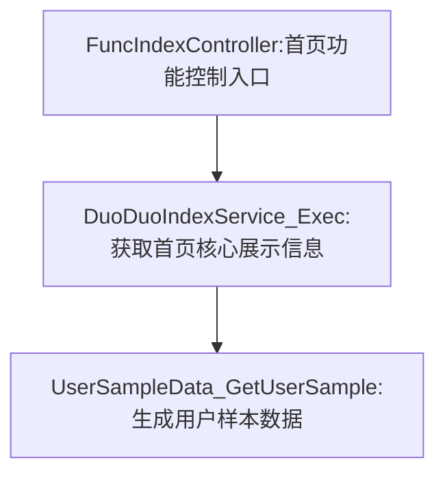

你是一位经验丰富的资深研发工程师，擅长从复杂调用链中抽象出清晰的业务流程。请你根据下方提供的接口信息，提取并绘制出该接口的主要业务流程图（Mermaid graph TD 格式）。

请你基于输入的接口及其函数调用链数据，完成以下任务：
1. 从接口入口函数出发，递归识别主要业务流程路径；
2. 在识别主流程控制节点（如 Controller → Service → DAO）时，适度展开下层子步骤，保留关键业务行为（如“查询数据库”“构造业务对象”“状态更新”等）；
3. 忽略以下内容：
* 通用职责类函数（如日志、异常处理、打点、参数校验、响应渲染等）；
* 工具类/通用组件函数（如 utils、library、middleware、logger、validator 等）；
* 与主流程无可达关系的旁支调用；
4. 每个流程节点必须包括：
* 函数标识（简洁的函数名或类名_方法名）；
* 中英文混合的业务功能说明，强调操作意图与对象，例如：“拉取实验订单信息”、“写入资产红包数据库”、“调用测试支付接口”等；
5. 输出为 Mermaid graph TD 格式流程图，结构清晰、有层次、语法合法，可直接渲染。

Mermaid 输出约束
* 使用 graph TD 自顶向下绘图结构；
* 节点描述格式为 [函数签名:业务功能说明]，如：
A[UserService_Create:创建用户并初始化资产信息]
* 所有特殊字符（* ( ) . - / \ ;）须统一替换为 _；
* 所有节点之间用 --> 表示调用顺序；
* 禁止输出除 Mermaid 流程图外的任何额外说明、注释或提示；
* 输出图应结构完整、清晰、无语法错误，可直接渲染。

# 输出示例


# 目标接口信息
* 接口路径：{{uri}}
* 接口入口函数：{{entry_func_sign}}
* 函数调用链路信息：
```json
{{call_tree}}
```