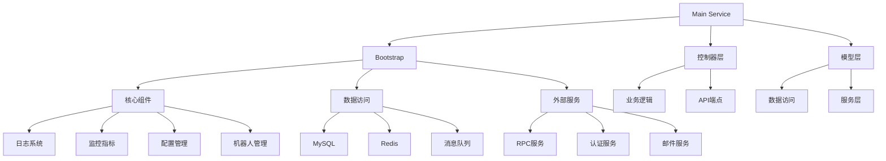

# Duoduo Video 系统架构文档

## 系统概述
Duoduo Video 是基于百度 GDP 框架开发的视频服务系统，主要功能包括视频处理、任务管理和微信集成等。

## 架构图

## 核心组件

### 1. 初始化系统 (Bootstrap)
- **MustInit()**: 主初始化入口，顺序初始化:
  1. 监控指标
  2. PaaS 平台适配
  3. 认证系统
  4. 日志系统
  5. 数据库连接
  6. 外部服务

- **关键配置**:
  - `conf/app.toml`: 主配置文件
  - `conf/logit/*.toml`: 日志配置
  - `conf/servicer/*.toml`: 服务发现配置

### 2. 数据层
- **MySQL**:
  - 主从架构
  - 多数据源支持 (业务数据、管理数据)
  
- **Redis**:
  - 多实例支持
  - 功能隔离 (业务缓存、特征存储)

### 3. 外部服务集成
- **RPC (RAL)**: 百度内部服务调用框架
- **Passport**: 统一认证系统
- **Robot Manager**: 自动化任务管理

## 初始化流程
1. 加载配置 (`app.toml`)
2. 初始化监控指标
3. 建立数据库连接
4. 初始化日志系统 (多日志通道)
5. 启动外部服务连接
6. 注册优雅关闭钩子

## 环境支持
- **运行模式**:
  - debug: 开发环境
  - test: 测试环境  
  - release: 生产环境
- **IDC 支持**: 多机房配置

## 最佳实践
1. 新组件应在 `bootstrap.MustInit()` 中添加初始化逻辑
2. 需要资源清理的组件应注册 `TryRegisterCloser`
3. 配置应遵循环境隔离原则