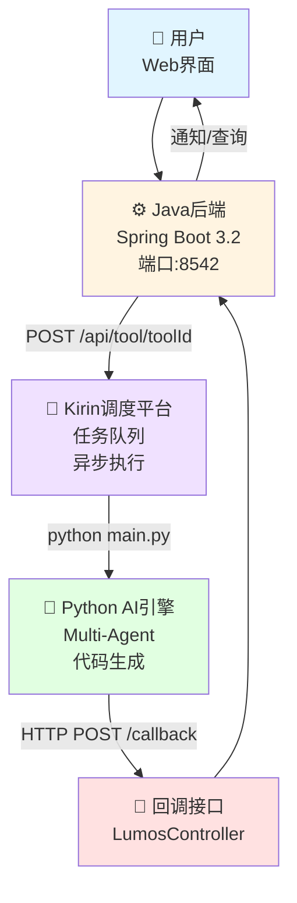
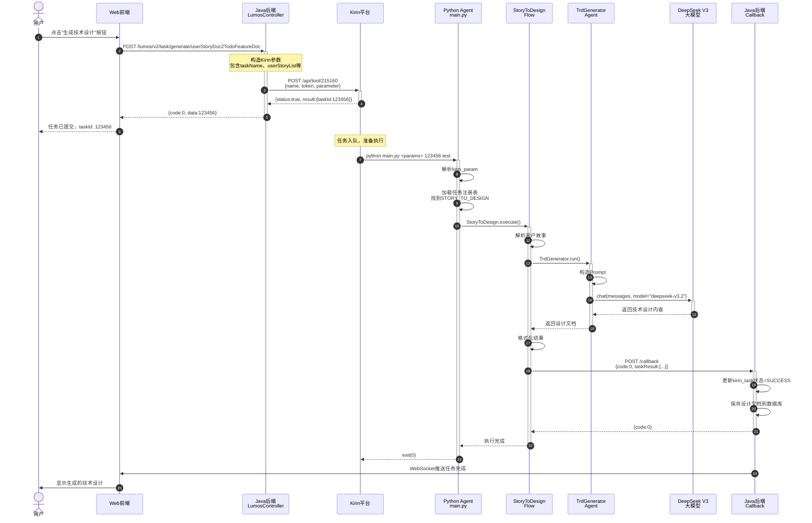

# 百度QAMate AI测试平台 - 系统总览

> **为Python开发者准备的系统架构文档**
> 重点说明Java后端做了什么，以及前后端如何协作

---

## 一句话总结

**这是一个AI驱动的研发自动化测试平台**，通过**Java后端 → Kirin调度平台 → Python AI引擎**的异步架构，实现从需求文档（PRD）到代码实现的全流程自动化生成。

### 解决什么问题

- ✅ **需求到代码的鸿沟**：自动将PRD转换为用户故事、技术设计、最终代码
- ✅ **API测试繁琐**：智能生成和执行API测试计划
- ✅ **代码理解困难**：构建代码知识图谱，智能检索API和函数
- ✅ **重复性劳动**：30+种AI任务自动化日常开发测试工作

### 核心工作流程

```
用户点击按钮 → Java后端调用Kirin → Kirin执行你的Python代码 → Python回调后端 → 用户看到结果
```

---

## 三层架构详解

### 整体架构图

> **💡 如何查看Mermaid图**：
> - **VS Code**: 安装 "Markdown Preview Mermaid Support" 插件
> - **在线查看**: 复制代码到 https://mermaid.live/
> - **GitHub/GitLab**: 原生支持Mermaid渲染



**纯文本版本（如果Mermaid无法显示）**：

```
┌─────────┐
│  用户   │ (Web界面)
└────┬────┘
     │
     ↓ 触发任务
┌─────────────────┐
│  Java后端       │ (Spring Boot 3.2, 端口:8542)
│                 │
└────┬────────────┘
     │ POST /api/tool/{toolId}
     ↓
┌─────────────────┐
│  Kirin调度平台  │ (任务队列、异步执行)
│                 │
└────┬────────────┘
     │ python main.py <params>
     ↓
┌─────────────────┐
│ Python AI引擎   │ (Multi-Agent、代码生成)
│                 │
└────┬────────────┘
     │ HTTP POST /callback
     ↓
┌─────────────────┐
│  回调接口       │ (LumosController)
│                 │
└────┬────────────┘
     │
     ↓ 更新状态
┌─────────────────┐
│  Java后端       │
└────┬────────────┘
     │
     ↓ 通知/查询
┌─────────┐
│  用户   │
└─────────┘
```

---

### Layer 1: Java后端（Spring Boot）

**位置**: `/Users/zhuji_m4pro/code/baidu/qamate-strategy/apismart-code/baidu/qamate-server/core`

**你不熟悉的部分，后端在做什么：**

#### 🎯 主要职责

1. **提供REST API**
   - 给前端Web界面提供接口
   - 管理文档、任务、配置等业务数据
   - 35+个Controller，100+个接口

2. **调用Kirin平台**
   - 把用户请求转换为Kirin任务
   - 传递参数给你的Python代码
   - 返回`taskId`给用户追踪任务

3. **接收回调结果**
   - 监听你的Python代码的HTTP回调
   - 更新任务状态到数据库
   - 发送通知（飞书/邮件）

4. **管理任务状态**
   - 在`kirin_task`表记录任务状态
   - 状态流转：RUNNING → SUCCESS/FAIL
   - 支持任务终止（killTask）

#### 📁 核心模块

```java
// 关键类（Python开发者需要理解）

1. KirinServiceImpl - 调用Kirin的核心逻辑
   路径: core/src/main/java/com/baidu/qamate/core/v2/lumosgmt/service/impl/KirinServiceImpl.java

2. LumosController - 接收Python回调
   路径: core/src/main/java/com/baidu/qamate/core/v2/lumosgmt/controller/LumosController.java

3. KirinConfig - Tool ID配置
   路径: core/src/main/java/com/baidu/qamate/core/v2/lumosgmt/domain/constants/KirinConfig.java
```

#### 🔧 技术栈

```
Spring Boot 3.2.0        → 对标Python的FastAPI
MyBatis Plus 3.5.4       → ORM框架，操作MySQL
MySQL (5个数据库)       → 关系型数据存储
Redis + JetCache         → 缓存
WebSocket                → 实时通信
RestTemplate             → HTTP客户端，调用Kirin
```

---

### Layer 2: Kirin调度平台

**这是百度内部的任务编排中间件**，你不需要修改它，只需要理解它的作用：

#### 🎯 主要职责

1. **任务队列管理**
   - 接收后端的任务请求
   - 排队调度，避免并发过高

2. **执行Python脚本**
   - 根据Tool ID找到对应的Python脚本路径
   - 执行命令：`python main.py <kirin_param> <task_id> <env>`
   - 把参数传递给你的Python代码

3. **异步回调**
   - 任务执行完成后，Python代码主动回调后端
   - Kirin自己也会回调状态（成功/失败/超时）

#### 🔑 关键概念：Tool ID

每个任务类型都有一个Tool ID：

```java
// 测试环境
ASYNC_TOOL_ID_TEST = 215160L
SYNC_TOOL_ID_TEST = 215208L

// 线上环境
ASYNC_TOOL_ID_ONLINE = 214909L
SYNC_TOOL_ID_ONLINE = 214934L
```

后端通过Tool ID告诉Kirin应该执行哪个Python脚本。

---

### Layer 3: Python AI引擎（你熟悉的部分）

**位置**: `/Users/zhuji_m4pro/code/multi-agent/baidu/multi-agent/code`

**你已经熟悉的内容：**

#### 🎯 主要职责

1. **接收Kirin参数**
   - `main.py`解析命令行参数
   - 提取任务类型、业务参数、任务ID

2. **任务注册和分发**
   - `registry/` 目录注册30+种任务
   - 每个任务对应一个TaskSpec

3. **执行AI任务**
   - `executor/` 目录的Flow负责编排
   - `agent/` 目录的Agent执行具体逻辑
   - 调用LLM生成代码/文档

4. **回调后端**
   - 使用`utils/qamate.py`的callback方法
   - 把结果POST回后端的回调接口

#### 📁 核心模块

```python
# 你熟悉的Python结构

main.py                     # 入口，解析Kirin参数
registry/registry.py        # 任务注册表
executor/base.py            # BaseFlow基类
agent/base/base_agent.py    # Agent基类
utils/qamate.py             # 回调工具
utils/kirin.py              # Kirin状态回调
```

#### 🔧 技术栈

```python
Python 3.10
FastAPI                     # Web框架（如果需要）
Neo4j                       # 知识图谱存储
MySQL                       # 关系数据库
E2B Sandbox                 # 代码执行沙箱
多种LLM（DeepSeek、Claude等）
```

---

## Python开发者需要理解的Java部分

作为Python开发者，你主要需要理解两件事：

### 1️⃣ 后端如何触发你的Python代码

#### Java代码（KirinServiceImpl.java）

```java
// 位置: core/src/main/java/.../lumosgmt/service/impl/KirinServiceImpl.java

public Long asycCall(JSONObject data, TaskEnum taskEnum) {
    // 步骤1: 构造Kirin参数
    JSONObject kirinParam = new JSONObject();
    kirinParam.put("name", "xiaolihua");                    // 工具名（固定）
    kirinParam.put("token", "190df4f275dd42a7b4716d...");   // 认证Token
    kirinParam.put("callback", "");                         // 空字符串
    kirinParam.put("parameter", data.toJSONString());       // 业务参数JSON

    // 步骤2: 调用Kirin平台
    String url = "http://kirin.baidu-int.com/api/tool/215160";  // Tool ID
    var response = restTemplate.postForObject(url, kirinParam, String.class);

    // 步骤3: 解析返回的taskId
    JSONObject responseObj = JSONObject.parseObject(response);
    if (responseObj.getBoolean("status")) {
        return responseObj.getJSONObject("result").getLongValue("taskId");
    }

    return null;
}
```

#### 对应的Python理解

```python
# 相当于FastAPI的这种写法（伪代码）

@app.post("/api/tool/{tool_id}")
async def kirin_endpoint(tool_id: int, body: dict):
    name = body["name"]        # "xiaolihua"
    token = body["token"]      # 认证
    parameter = body["parameter"]  # 业务参数JSON字符串

    # Kirin会执行：
    # python main.py <parameter> <task_id> <env>

    return {"status": True, "result": {"taskId": 123456}}
```

#### 参数传递格式

**后端传给Kirin的`data`**（示例：用户故事生成设计）：

```json
{
  "taskName": "STORY_TO_DESIGN",
  "productId": 37,
  "serverUrl": "https://qamate.baidu-int.com",
  "callbackUrl": "/core/lumos/v2/task/generate/userStoryDoc2TodoFeatureDoc/callback",
  "username": "zhangsan",
  "docNodeId": 12345,
  "userStoryList": [
    {
      "title": "用户登录功能",
      "description": "实现用户名密码登录",
      "acceptanceCriteria": ["输入正确用户名密码可登录", "密码错误显示提示"]
    }
  ]
}
```

**Kirin传给你的Python代码**：

```bash
python main.py '<上面的JSON>' '123456' 'test'
# 参数1: kirin_param（JSON字符串）
# 参数2: kirin_task_id（任务ID）
# 参数3: kirin_env（环境：test/online）
```

---

### 2️⃣ 你的Python代码如何回调后端

#### Python代码（utils/qamate.py）

```python
# 位置: /Users/zhuji_m4pro/code/multi-agent/baidu/multi-agent/code/utils/qamate.py

class QAMate:
    def callback(self, task_name, doc_node_id, kirin_task_id, code, msg,
                task_result=None, retry_times=3):
        """
        回调后端接口

        Args:
            task_name: 任务名称（如"STORY_TO_DESIGN"）
            doc_node_id: 文档节点ID
            kirin_task_id: Kirin任务ID
            code: 错误码（0=成功，其他=失败）
            msg: 消息
            task_result: 任务结果（dict）
            retry_times: 重试次数
        """
        # 方式1: 使用动态回调URL（新版）
        if self.callback_url and self.callback_url.strip() != "":
            headers = {
                "Content-Type": "application/json",
                "QAMate-ModuleId": "0",
                "QAMate-Token": "super-9a796933bf024ebfa0420dce6f864a51"
            }

            data = {
                "callbackUrl": self.callback_url,  # 例如：/core/lumos/v2/.../callback
                "docNodeId": doc_node_id,
                "username": username,
                "kirinTaskId": kirin_task_id,
                "code": code,
                "msg": msg,
                "taskResult": task_result
            }

            # 带重试的POST请求
            for attempt in range(retry_times):
                res = requests.post(
                    self.callback_url,
                    data=json.dumps({"callbackResp": data}),
                    headers=headers
                )
                if res and res["code"] == 0:
                    return True
                time.sleep(2)  # 重试间隔

            return False
```

#### 对应的Java接收端（LumosController.java）

```java
// 位置: core/src/main/java/.../lumosgmt/controller/LumosController.java

@PostMapping("/task/generate/userStoryDoc2TodoFeatureDoc/callback")
public Response<Boolean> userStoryDoc2TodoFeatureDocCallback(
    @RequestBody KirinCommonCallback req) throws Exception {

    // 解析回调数据
    Story2DesignKirinCallbackResp callbackResp = req.getCallbackResp();
    Long kirinTaskId = callbackResp.getKirinTaskId();
    Integer code = callbackResp.getCode();  // 0=成功
    String msg = callbackResp.getMsg();

    // 更新任务状态
    if (code == 0) {
        // 成功：保存结果到数据库
        kirinTaskPo.setTaskStatus(TaskTRDStatusEnum.SUCCESS.getStatus());
        kirinTaskPo.setTaskResult(JSONObject.toJSONString(callbackResp));

        // 发送飞书通知
        hiGroupService.sendTaskFinishNotice(kirinTaskPo, docNodeId);
    } else {
        // 失败：记录错误
        kirinTaskPo.setTaskStatus(TaskTRDStatusEnum.FAIL.getStatus());
    }

    return Response.success(true);
}
```

#### 回调数据格式

**Python发送的完整请求**：

```http
POST https://qamate.baidu-int.com/core/lumos/v2/task/generate/userStoryDoc2TodoFeatureDoc/callback
Content-Type: application/json
QAMate-ModuleId: 0
QAMate-Token: super-9a796933bf024ebfa0420dce6f864a51

{
  "callbackResp": {
    "docNodeId": 12345,
    "kirinTaskId": 123456,
    "username": "zhangsan",
    "code": 0,
    "msg": "SUCCESS",
    "taskResult": {
      "todoFeatureList": [
        {
          "title": "实现登录API",
          "description": "...",
          "apiList": [...]
        }
      ]
    }
  }
}
```

---

### 3️⃣ 任务状态管理

#### Java后端的任务状态表

```sql
-- 表名：kirin_task
CREATE TABLE `kirin_task` (
  `id` BIGINT PRIMARY KEY,
  `task_id` BIGINT,              -- Kirin任务ID
  `task_type` VARCHAR(100),       -- 任务类型（如STORY_TO_DESIGN）
  `task_status` INT,              -- 任务状态
  `task_result` TEXT,             -- 任务结果JSON
  `create_time` DATETIME,
  `update_time` DATETIME
);
```

#### 状态流转

```
RUNNING (1)     - 执行中
  ↓
SUCCESS (2)     - 成功
  或
FAIL (3)        - 失败
  或
KILL (4)        - 被终止
```

#### Python代码如何影响状态

```python
# 你的executor/base.py中

class BaseFlow:
    async def execute(self, req, kirin_task_id):
        try:
            # 执行业务逻辑...
            result = await self._do_something()

            # ✅ 成功回调 → 后端更新状态为SUCCESS
            self.qamate.callback(
                task_name="STORY_TO_DESIGN",
                doc_node_id=req.docNodeId,
                kirin_task_id=kirin_task_id,
                code=0,                    # 0=成功
                msg="SUCCESS",
                task_result=result
            )

        except Exception as e:
            # ❌ 失败回调 → 后端更新状态为FAIL
            self.qamate.callback(
                task_name="STORY_TO_DESIGN",
                doc_node_id=req.docNodeId,
                kirin_task_id=kirin_task_id,
                code=1001,                 # 非0=失败
                msg=str(e),
                task_result=None
            )
```

---

### 4️⃣ 关键Java类对照Python概念

| Java概念 | Python等价概念 | 说明 |
|---------|---------------|-----|
| `@RestController` | `@app.get/post` | 定义API路由 |
| `@PostMapping("/path")` | `@app.post("/path")` | HTTP POST接口 |
| `@Service` | 业务逻辑类 | 不需要装饰器，直接class |
| `@Autowired` | 构造函数注入 | Spring的依赖注入 |
| `Entity` / `Po` | `Pydantic Model` | 数据模型 |
| `Mapper` | SQLAlchemy/Tortoise ORM | 数据库操作 |
| `JSONObject` | `dict` | JSON对象 |
| `RestTemplate.postForObject()` | `requests.post()` | HTTP客户端 |
| `Response<T>` | FastAPI的响应模型 | 统一响应格式 |

#### 示例对照

**Java Controller**:
```java
@RestController
@RequestMapping("/api")
public class ApiController {

    @Autowired
    private ApiService apiService;

    @PostMapping("/create")
    public Response<Long> createTask(@RequestBody TaskReq req) {
        Long taskId = apiService.create(req);
        return Response.success(taskId);
    }
}
```

**对应的Python（FastAPI）**:
```python
from fastapi import FastAPI, Depends
from pydantic import BaseModel

app = FastAPI()

class TaskReq(BaseModel):
    name: str

@app.post("/api/create")
async def create_task(
    req: TaskReq,
    api_service: ApiService = Depends()  # 依赖注入
):
    task_id = await api_service.create(req)
    return {"success": True, "data": task_id}
```

---

## 完整调用链路实例

### 场景：用户故事生成技术设计

让我们跟踪一个完整的任务执行过程。

### 序列图

> **💡 如何查看Mermaid图**：在线复制到 https://mermaid.live/ 查看



**纯文本版本（14步流程）**：

```
步骤1-5: 用户触发 → 后端调用Kirin
───────────────────────────────────
用户点击按钮
  ↓
前端发送请求 → Java后端
  ↓
后端构造参数 → POST Kirin平台
  ↓
Kirin返回taskId → 后端
  ↓
后端返回taskId → 用户（任务已提交）

步骤6-11: Kirin执行Python → 任务完成
───────────────────────────────────
Kirin执行: python main.py <params> <taskId> <env>
  ↓
Python main.py解析参数
  ↓
Registry加载任务定义 → STORY_TO_DESIGN
  ↓
StoryToDesign.execute() 执行
  ↓
TrdGenerator Agent运行
  ↓
调用DeepSeek V3 LLM
  ↓
LLM返回技术设计内容
  ↓
格式化结果
  ↓
QAMate.callback() → POST 后端回调接口
  ↓
后端更新任务状态=SUCCESS
  ↓
保存设计文档到数据库

步骤12-14: 后端通知用户
───────────────────────────────────
后端 → WebSocket推送
  ↓
前端接收通知
  ↓
用户看到生成的技术设计
```

---

### 详细步骤说明

#### 步骤1-5: 用户触发到后端调用Kirin

**1. 用户操作**
```
用户在Web界面点击"生成技术设计"按钮
```

**2. 前端发起请求**
```http
POST https://qamate.baidu-int.com/core/lumos/v2/task/generate/userStoryDoc2TodoFeatureDoc
Content-Type: application/json

{
  "docNodeId": 12345,
  "productId": 37,
  "userStoryList": [
    {
      "title": "用户登录功能",
      "description": "实现用户名密码登录",
      "acceptanceCriteria": ["输入正确用户名密码可登录"]
    }
  ]
}
```

**3. Java后端处理**

*位置*: `LumosController.java`

```java
@PostMapping("/task/generate/userStoryDoc2TodoFeatureDoc")
public Response<Long> generateUserStoryDoc2TodoFeatureDoc(@RequestBody TaskReq req) {
    // 1. 构造Kirin参数
    JSONObject data = new JSONObject();
    data.put("taskName", "STORY_TO_DESIGN");
    data.put("serverUrl", "https://qamate.baidu-int.com");
    data.put("callbackUrl", "/core/lumos/v2/task/generate/userStoryDoc2TodoFeatureDoc/callback");
    data.put("docNodeId", req.getDocNodeId());
    data.put("userStoryList", req.getUserStoryList());

    // 2. 调用Kirin
    Long taskId = kirinService.asycCall(data, TaskEnum.STORY_TO_DESIGN);

    // 3. 保存任务记录
    KirinTaskPo po = new KirinTaskPo();
    po.setTaskId(taskId);
    po.setTaskType("STORY_TO_DESIGN");
    po.setTaskStatus(TaskTRDStatusEnum.RUNNING.getStatus());
    kirinTaskService.save(po);

    return Response.success(taskId);
}
```

**4. Kirin平台接收**
```http
POST http://kirin.baidu-int.com/api/tool/215160
Content-Type: application/json

{
  "name": "xiaolihua",
  "token": "190df4f275dd42a7b4716d8e56571743",
  "callback": "",
  "parameter": "{\"taskName\":\"STORY_TO_DESIGN\",\"serverUrl\":\"https://qamate.baidu-int.com\",\"callbackUrl\":\"/core/lumos/v2/task/generate/userStoryDoc2TodoFeatureDoc/callback\",\"docNodeId\":12345,\"userStoryList\":[...]}"
}
```

**5. Kirin返回taskId**
```json
{
  "status": true,
  "result": {
    "taskId": 123456
  }
}
```

---

#### 步骤6-11: Kirin执行Python到任务完成

**6. Kirin执行Python脚本**

```bash
# Kirin在后台执行：
cd /path/to/multi-agent/baidu/multi-agent/code
python main.py '<parameter_json>' '123456' 'test'
```

**7. Python main.py处理**

*位置*: `/Users/zhuji_m4pro/code/multi-agent/baidu/multi-agent/code/main.py`

```python
async def main(args):
    # 解析参数
    kirin_param = args[1]  # JSON字符串
    kirin_task_id = int(args[2])  # 123456
    kirin_env = args[3]  # "test"

    # 处理超长参数
    if kirin_param.startswith('parameter too long'):
        kirin_param = developer.Developer.get_params(kirin_task_id, kirin_env)

    param_dict = json.loads(kirin_param)
    task_name = param_dict.get("taskName")  # "STORY_TO_DESIGN"

    # 动态加载任务模块
    load_task_module(task_name)  # import registry.story_to_design

    # 获取任务定义
    spec = get_task_spec(task_name)

    # 构建Flow实例
    flow = spec.build_flow()  # StoryToDesign()

    # 验证输入
    parsed_input = spec.input_schema(**param_dict)

    # 执行任务
    result, status = await flow.execute(req=parsed_input, kirin_task_id=kirin_task_id)

    # 回调Kirin状态
    if status == ErrorEnum.SUCCESS:
        kirin.callback(kirin_task_id, kirin_env,
                      kirin.Response(response=result.dict()).to_json(), is_test)
```

**8. StoryToDesign.execute()执行**

*位置*: `/Users/zhuji_m4pro/code/multi-agent/baidu/multi-agent/code/executor/online/story_to_design.py`

```python
class StoryToDesign(BaseFlow):
    async def execute(self, req: StoryToDesignReq, kirin_task_id: int):
        # 初始化回调对象
        self._init_qamate(req.serverUrl, req.callbackUrl)

        try:
            # 1. 解析用户故事
            story_descs = [story.description for story in req.userStoryList]

            # 2. 拆分功能点（调用LLM）
            todo_features = await self._split_features(story_descs)

            # 3. 检索相关API（从Neo4j知识图谱）
            api_infos = self._get_api_info_by_entity(entities)

            # 4. 生成技术设计文档（调用Agent）
            design_doc = await self.trd_generator.run(todo_features, api_infos)

            # 5. 格式化结果
            task_result = {
                "todoFeatureList": [
                    {
                        "title": feature.title,
                        "description": design_doc,
                        "apiList": api_infos
                    }
                    for feature in todo_features
                ]
            }

            # 6. 回调后端（成功）
            self.qamate.callback(
                task_name="STORY_TO_DESIGN",
                doc_node_id=req.docNodeId,
                kirin_task_id=kirin_task_id,
                code=0,
                msg="SUCCESS",
                username=req.username,
                task_result=task_result
            )

            return StoryToDesignResp(**task_result), ErrorEnum.SUCCESS

        except Exception as e:
            logger.error(f"执行失败: {e}")

            # 回调后端（失败）
            self.qamate.callback(
                task_name="STORY_TO_DESIGN",
                doc_node_id=req.docNodeId,
                kirin_task_id=kirin_task_id,
                code=1001,
                msg=f"生成设计失败: {str(e)}",
                username=req.username
            )

            return None, ErrorEnum.GEN_DESIGN_ERROR
```

**9. Agent执行（TrdGenerator）**

*位置*: `/Users/zhuji_m4pro/code/multi-agent/baidu/multi-agent/code/agent/application/trd_generator.py`

```python
class TrdGenerator(BaseAgent):
    async def run(self, todo_features, api_infos):
        # 构造Prompt
        prompt = self._build_prompt(todo_features, api_infos)

        # 调用LLM
        messages = [
            {"role": "system", "content": self.system_prompt},
            {"role": "user", "content": prompt}
        ]

        response = await AsyncLLM.chat(
            messages=messages,
            model="deepseek-v3.2",
            temperature=0.7
        )

        # 解析返回的技术设计
        design_content = response['choices'][0]['message']['content']

        return design_content
```

**10. LLM调用**

*位置*: `/Users/zhuji_m4pro/code/multi-agent/baidu/multi-agent/code/utils/async_llm.py`

```python
class AsyncLLM:
    @staticmethod
    async def chat(messages, model="deepseek-v3.2", temperature=0.7):
        # 调用OpenAI兼容接口
        client = AsyncOpenAI(
            api_key=config["api_key"],
            base_url=config["base_url"]
        )

        response = await client.chat.completions.create(
            model=model,
            messages=messages,
            temperature=temperature
        )

        return response.model_dump()
```

**11. QAMate.callback()回调后端**

*位置*: `/Users/zhuji_m4pro/code/multi-agent/baidu/multi-agent/code/utils/qamate.py`

```python
def callback(self, task_name, doc_node_id, kirin_task_id, code, msg,
            task_result=None, retry_times=3):

    url = f"{self.url_prefix}{self.callback_url}"
    # url = "https://qamate.baidu-int.com/core/lumos/v2/task/generate/userStoryDoc2TodoFeatureDoc/callback"

    headers = {
        "Content-Type": "application/json",
        "QAMate-ModuleId": "0",
        "QAMate-Token": "super-9a796933bf024ebfa0420dce6f864a51"
    }

    data = {
        "callbackResp": {
            "docNodeId": doc_node_id,
            "kirinTaskId": kirin_task_id,
            "username": "zhangsan",
            "code": code,
            "msg": msg,
            "taskResult": task_result
        }
    }

    # 带重试的POST
    for attempt in range(retry_times):
        try:
            res = requests.post(url, data=json.dumps(data), headers=headers)
            if res.json()["code"] == 0:
                logger.info(f"回调成功: taskId={kirin_task_id}")
                return True
        except Exception as e:
            logger.warning(f"回调第{attempt+1}次失败: {e}")
            time.sleep(2)

    return False
```

---

#### 步骤12-14: 后端接收回调并通知用户

**12. Java后端接收回调**

*位置*: `LumosController.java`

```java
@PostMapping("/task/generate/userStoryDoc2TodoFeatureDoc/callback")
public Response<Boolean> userStoryDoc2TodoFeatureDocCallback(
    @RequestBody KirinCommonCallback req) throws Exception {

    // 委托给Service层处理
    return Response.success(
        todoFeatureDocService.userStoryDoc2TodoFeatureDocCallback(req)
    );
}
```

**13. Service层处理回调**

*位置*: `TodoFeatureDocServiceImpl.java`

```java
public Boolean userStoryDoc2TodoFeatureDocCallback(KirinCommonCallback req) {
    Story2DesignKirinCallbackResp callbackResp = req.getCallbackResp();
    Long kirinTaskId = callbackResp.getKirinTaskId();
    Integer code = callbackResp.getCode();

    // 1. 查询任务记录
    KirinTaskPo kirinTaskPo = kirinTaskService.queryByTaskId(kirinTaskId);

    if (code == 0) {
        // 2. 成功：保存结果
        kirinTaskPo.setTaskStatus(TaskTRDStatusEnum.SUCCESS.getStatus());
        kirinTaskPo.setTaskResult(JSONObject.toJSONString(callbackResp));
        kirinTaskService.updateById(kirinTaskPo);

        // 3. 更新业务数据
        TodoFeatureDocPo todoFeatureDocPo = ...;
        todoFeatureDocPo.setContent(callbackResp.getTaskResult().getContent());
        todoFeatureDocPo.setStatus(GenerateStatusEnum.DONE.getCode());
        todoFeatureDocService.updateById(todoFeatureDocPo);

        // 4. 发送飞书通知
        hiGroupService.sendTaskFinishNotice(kirinTaskPo, docNodeId);

    } else {
        // 失败：记录错误
        kirinTaskPo.setTaskStatus(TaskTRDStatusEnum.FAIL.getStatus());
        kirinTaskPo.setErrorMsg(callbackResp.getMsg());
        kirinTaskService.updateById(kirinTaskPo);
    }

    return true;
}
```

**14. 用户看到结果**

- **WebSocket推送**：后端通过WebSocket实时推送任务完成事件
- **前端轮询**：前端定时查询`/api/task/status?taskId=123456`
- **飞书通知**：用户收到飞书消息"技术设计已生成"

---

## 数据格式速查

### 1. 后端调用Kirin的请求格式

```json
{
  "name": "xiaolihua",
  "token": "190df4f275dd42a7b4716d8e56571743",
  "callback": "",
  "parameter": "{\"taskName\":\"STORY_TO_DESIGN\",\"serverUrl\":\"https://qamate.baidu-int.com\",\"callbackUrl\":\"/core/lumos/v2/task/generate/userStoryDoc2TodoFeatureDoc/callback\",\"docNodeId\":12345,\"userStoryList\":[...]}"
}
```

### 2. Kirin调用Python的参数格式

**命令行**:
```bash
python main.py '<parameter>' '<task_id>' '<env>'
```

**sys.argv解析**:
```python
args = sys.argv
# args[0] = "main.py"
# args[1] = '<parameter>'  # JSON字符串
# args[2] = '<task_id>'     # "123456"
# args[3] = '<env>'         # "test" 或 "online"
```

**parameter JSON结构**（示例：STORY_TO_DESIGN）:
```json
{
  "taskName": "STORY_TO_DESIGN",
  "productId": 37,
  "serverUrl": "https://qamate.baidu-int.com",
  "callbackUrl": "/core/lumos/v2/task/generate/userStoryDoc2TodoFeatureDoc/callback",
  "username": "zhangsan",
  "docNodeId": 12345,
  "sourceType": "icafe",
  "userStoryList": [
    {
      "title": "用户登录功能",
      "description": "实现用户名密码登录，支持记住密码功能",
      "acceptanceCriteria": [
        "输入正确用户名密码可成功登录",
        "密码错误显示错误提示",
        "支持记住密码功能"
      ]
    }
  ]
}
```

### 3. Python回调后端的数据格式

**HTTP请求**:
```http
POST https://qamate.baidu-int.com/core/lumos/v2/task/generate/userStoryDoc2TodoFeatureDoc/callback
Content-Type: application/json
QAMate-ModuleId: 0
QAMate-Token: super-9a796933bf024ebfa0420dce6f864a51

{
  "callbackResp": {
    "docNodeId": 12345,
    "kirinTaskId": 123456,
    "username": "zhangsan",
    "code": 0,
    "msg": "SUCCESS",
    "taskResult": {
      "content": "# 技术设计文档\n\n## 1. 登录API设计\n...",
      "todoFeatureList": [
        {
          "title": "实现登录API",
          "description": "POST /api/login接口，参数：username, password",
          "apiList": [
            {
              "apiName": "login",
              "apiPath": "/api/login",
              "method": "POST"
            }
          ],
          "codeRepoList": [
            {
              "repoName": "backend-api",
              "repoPath": "/path/to/repo"
            }
          ]
        }
      ]
    }
  }
}
```

**字段说明**:
| 字段 | 类型 | 必填 | 说明 |
|------|------|------|------|
| `callbackResp` | Object | ✅ | 回调响应对象（最外层） |
| `callbackResp.docNodeId` | Long | ✅ | 文档节点ID（后端用于定位数据） |
| `callbackResp.kirinTaskId` | Long | ✅ | Kirin任务ID（用于更新任务状态） |
| `callbackResp.username` | String | ✅ | 用户名 |
| `callbackResp.code` | Integer | ✅ | 错误码（0=成功，非0=失败） |
| `callbackResp.msg` | String | ✅ | 消息（成功="SUCCESS"，失败=错误原因） |
| `callbackResp.taskResult` | Object | ❌ | 任务结果（成功时必填，失败时为null） |

### 4. 常用错误码

**Python定义**（ErrorEnum）:
```python
class ErrorEnum(IntEnum):
    SUCCESS = 0                    # 成功
    EXECUTE_ERROR = 1001           # 执行错误
    GEN_DESIGN_ERROR = 1002        # 生成设计失败
    GEN_CODE_ERROR = 1003          # 生成代码失败
    BUILD_KNOWLEDGE_ERROR = 1004   # 构建知识图谱失败
    PARSE_PARAM_ERROR = 1005       # 参数解析失败
    CALLBACK_ERROR = 1006          # 回调失败
    TIMEOUT_ERROR = 1007           # 超时
```

**Java定义**（TaskTRDStatusEnum）:
```java
public enum TaskTRDStatusEnum {
    RUNNING(1, "执行中"),
    SUCCESS(2, "成功"),
    FAIL(3, "失败"),
    KILL(4, "终止");

    private Integer status;
    private String desc;
}
```

---

## 数据流图

完整的数据流转过程：

> **💡 如何查看Mermaid图**：在线复制到 https://mermaid.live/ 查看



```mermaid
flowchart LR
    A[👤 用户请求] --> B{⚙️ Java后端<br/>Controller}
    B --> C[🔧 构造Kirin参数<br/>JSONObject]
    C --> D[📡 调用Kirin API<br/>RestTemplate.post]
    D --> E[🔄 Kirin队列<br/>任务排队]
    E --> F[▶️ 启动Python进程<br/>python main.py]
    F --> G[📥 main.py解析参数<br/>sys.argv]
    G --> H[📋 Registry查找任务<br/>get_task_spec]
    H --> I[🎯 Flow.execute<br/>StoryToDesign]
    I --> J[🤖 Agent.run<br/>TrdGenerator]
    J --> K[🧠 LLM调用<br/>AsyncLLM.chat]
    K --> L[✅ 生成结果<br/>design_doc]
    L --> M[📤 QAMate.callback<br/>POST /callback]
    M --> N[📥 Java后端接收<br/>LumosController]
    N --> O[💾 更新数据库<br/>kirinTaskService]
    O --> P[📢 发送通知<br/>hiGroupService]
    P --> Q[👁️ 用户查看结果]

    style A fill:#e1f5ff
    style B fill:#fff4e1
    style E fill:#f0e1ff
    style G fill:#e1ffe1
    style K fill:#ffe1e1
    style O fill:#fff4e1
    style Q fill:#e1f5ff
```

**纯文本版本**：

```
用户请求
  ↓
Java后端Controller
  ↓
构造Kirin参数 (JSONObject)
  ↓
调用Kirin API (RestTemplate.post)
  ↓
Kirin队列 (任务排队)
  ↓
启动Python进程 (python main.py)
  ↓
main.py解析参数 (sys.argv)
  ↓
Registry查找任务 (get_task_spec)
  ↓
Flow.execute (StoryToDesign)
  ↓
Agent.run (TrdGenerator)
  ↓
LLM调用 (AsyncLLM.chat)
  ↓
生成结果 (design_doc)
  ↓
QAMate.callback (POST /callback)
  ↓
Java后端接收 (LumosController)
  ↓
更新数据库 (kirinTaskService)
  ↓
发送通知 (hiGroupService)
  ↓
用户查看结果
```

---

## 总结：关键要点

### Python开发者需要记住的5件事

1. **Java后端的作用** 🎯
   - 提供REST API给前端
   - 调用Kirin平台触发你的Python代码
   - 接收你的回调并更新任务状态

2. **Kirin是中间层** 🔄
   - 负责任务队列和异步调度
   - 执行命令：`python main.py <params> <task_id> <env>`
   - 你不需要修改Kirin，只需要理解它的作用

3. **参数传递方式** 📦
   - 后端 → Kirin：JSON格式的parameter字段
   - Kirin → Python：命令行参数（sys.argv）
   - Python需要解析JSON字符串

4. **回调机制** 📡
   - 使用`QAMate.callback()`方法
   - 带重试机制（默认3次）
   - 回调URL在参数中指定（callbackUrl字段）
   - 必须传递`code=0`表示成功

5. **任务状态管理** 📊
   - Java后端维护`kirin_task`表
   - 状态：RUNNING → SUCCESS/FAIL
   - 你的回调code决定最终状态

---

### 下一步

- 📖 阅读 `BACKEND_FOR_PYTHON_DEVS.md` 了解如何添加新任务类型
- 🔍 查看具体Java类的实现细节
- 🛠️ 学习如何调试前后端协作问题

---

## 附录：关键文件路径速查

### Java后端关键文件

| 文件 | 路径 | 作用 |
|------|------|------|
| KirinServiceImpl.java | `core/src/main/java/com/baidu/qamate/core/v2/lumosgmt/service/impl/KirinServiceImpl.java` | 调用Kirin平台 |
| LumosController.java | `core/src/main/java/com/baidu/qamate/core/v2/lumosgmt/controller/LumosController.java` | 接收Python回调 |
| KirinConfig.java | `core/src/main/java/com/baidu/qamate/core/v2/lumosgmt/domain/constants/KirinConfig.java` | Tool ID配置 |
| TodoFeatureDocServiceImpl.java | `core/src/main/java/com/baidu/qamate/core/v2/lumosgmt/service/impl/TodoFeatureDocServiceImpl.java` | 处理回调业务逻辑 |

### Python AI引擎关键文件

| 文件 | 路径 | 作用 |
|------|------|------|
| main.py | `/Users/zhuji_m4pro/code/multi-agent/baidu/multi-agent/code/main.py` | Python入口 |
| qamate.py | `/Users/zhuji_m4pro/code/multi-agent/baidu/multi-agent/code/utils/qamate.py` | 回调工具 |
| kirin.py | `/Users/zhuji_m4pro/code/multi-agent/baidu/multi-agent/code/utils/kirin.py` | Kirin回调 |
| registry.py | `/Users/zhuji_m4pro/code/multi-agent/baidu/multi-agent/code/registry/registry.py` | 任务注册表 |
| base.py | `/Users/zhuji_m4pro/code/multi-agent/baidu/multi-agent/code/executor/base.py` | Flow基类 |

---

**生成时间**: 2026-04-28
**文档版本**: 1.0
**适用对象**: Python开发者
