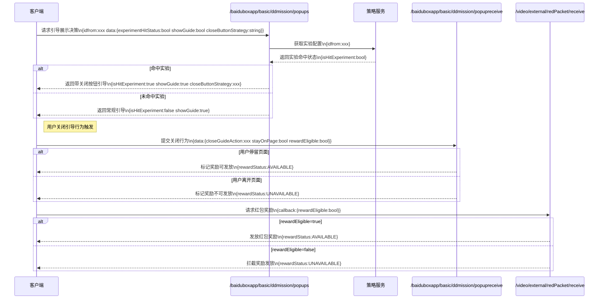
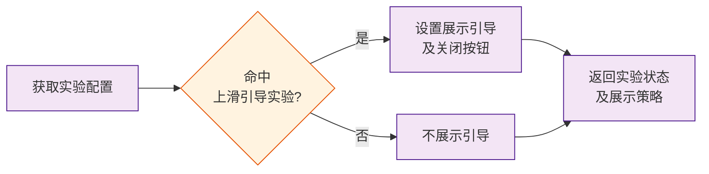
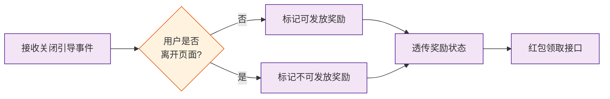
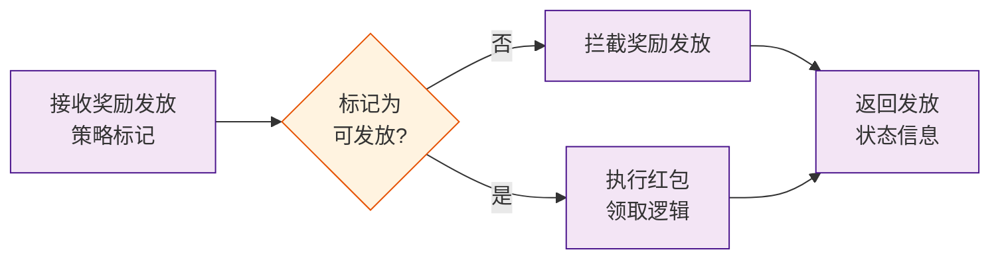
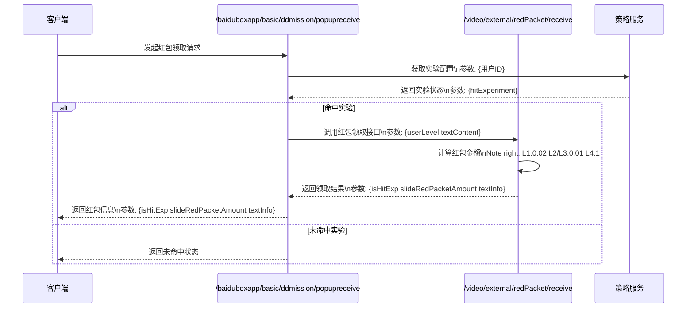
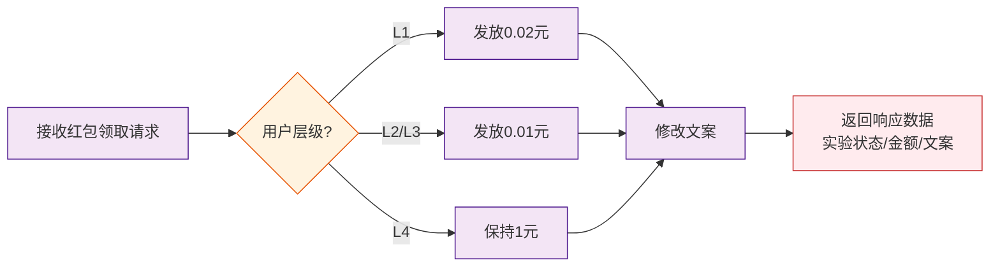
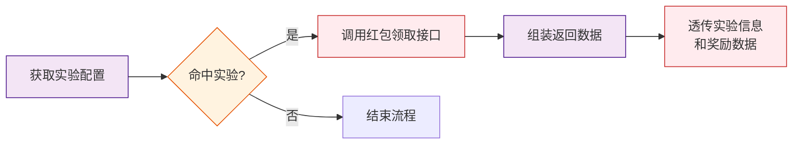

# 1. 需求背景
* **需求文档**： [【server】【非随】【极速版存钱罐】上滑引导功能实验](https://console.cloud.baidu-int.com/devops/icafe/issue/ailite-29174/show)
* **背景描述**: 当前上滑引导提示，若用户不上滑视频，则会一直展示，增加关闭逻辑，减少阻断，优化体验同时在上滑引导中修改发放大额奖励为小额奖励，减少新手红包数量
* **预期收益**：

# 2. 设计总览
* **功能点**：`上滑引导增加关闭逻辑`
| **目标代码库**                                                                                                                   | **接口名称** | **接口路径**                        | **改动类型** | **变更概述** | **备注** |
|-----------------------------------------------------------------------------------------------------------------------------|----------|---------------------------------|---------|--------|----------|
| [baidu/searchbox/sbox-basic](https://console.cloud.baidu-int.com/devops/icode/repos/baidu/searchbox/sbox-basic/tree/master) | 弹窗展示决策接口 | `/baiduboxapp/basic/ddmission/popups` | 修改 | 增加上滑引导关闭逻辑实验判断及展示策略 | |
| [baidu/searchbox/sbox-basic](https://console.cloud.baidu-int.com/devops/icode/repos/baidu/searchbox/sbox-basic/tree/master) | 任务奖励领取接口 | `/baiduboxapp/basic/ddmission/popupreceive` | 修改 | 记录关闭引导行为并控制奖励发放策略 | |
| [baidu/jady/ug-duoduo-video](https://console.cloud.baidu-int.com/devops/icode/repos/baidu/jady/ug-duoduo-video/tree/master) | 红包领取执行接口 | `/video/external/redPacket/receive` | 修改 | 根据奖励发放策略标记执行红包发放逻辑 | |

* **功能点**：`上滑引导发放小额现金奖励`
| **目标代码库**                                                                                                                   | **接口名称** | **接口路径**                        | **改动类型** | **变更概述** | **备注**                     |
|-----------------------------------------------------------------------------------------------------------------------------|----------|---------------------------------|---------|--------|----------------------------|
| [baidu/jady/ug-duoduo-video](https://console.cloud.baidu-int.com/devops/icode/repos/baidu/jady/ug-duoduo-video/tree/master) | 上滑红包领取接口 | `/video/external/redPacket/receive` | 修改 | 根据用户层级调整红包金额并修改文案 |          |
| [baidu/searchbox/sbox-basic](https://console.cloud.baidu-int.com/devops/icode/repos/baidu/searchbox/sbox-basic/tree/master) | 任务奖励领取接口 | `/baiduboxapp/basic/ddmission/popupreceive` | 修改 | 新增实验判断逻辑并透传奖励信息 |          |

# 3. 详细设计
## 3.1 上滑引导增加关闭逻辑

### 3.1.1 弹窗展示决策接口（修改）
* **代码库**: [baidu/searchbox/sbox-basic](https://console.cloud.baidu-int.com/devops/icode/repos/baidu/searchbox/sbox-basic/tree/master)
* **接口路径**: `/baiduboxapp/basic/ddmission/popups`
* **调用方式**: `GET,POST`
* **变更功能描述**: 
```
1. 从策略服务获取配置判断用户是否命中上滑引导关闭逻辑实验
2. 根据实验命中状态决定是否在上滑引导中增加关闭按钮
3. 返回字段包含：
   - 实验命中状态
   - 是否展示引导
   - 引导关闭按钮展示策略
```
* **变更功能流程图**:

* **请求参数变更点**: 
```json
{
  "idfrom": "string|required|用户标识来源|MODIFY",
  "data": {
    "experimentHitStatus": "bool|实验命中状态|NEW",
    "showGuide": "bool|是否展示引导|NEW",
    "closeButtonStrategy": "string|引导关闭按钮展示策略|NEW"
  }
}
```
* **响应参数变更点**: 
```json
{
  "isHitExperiment": "bool|是否命中上滑引导关闭逻辑实验|NEW",
  "showGuide": "bool|是否展示引导|NEW",
  "closeButtonStrategy": "string|引导关闭按钮展示策略|NEW"
}
```

### 3.1.2 任务奖励领取接口（修改）
* **代码库**: [baidu/searchbox/sbox-basic](https://console.cloud.baidu-int.com/devops/icode/repos/baidu/searchbox/sbox-basic/tree/master)
* **接口路径**: `/baiduboxapp/basic/ddmission/popupreceive`
* **调用方式**: `POST`
* **变更功能描述**: 
```
1. 接收并记录用户关闭上滑引导的行为事件
2. 根据用户行为控制奖励发放策略：
   - 若用户关闭引导后未离开当前视频页面，标记为可发放奖励
   - 若用户关闭引导后离开页面再返回，标记为不可发放奖励
3. 透传奖励发放状态至红包领取接口
```
* **变更功能流程图**:

* **请求参数变更点**: 
```json
{
  "data": {
    "closeGuideAction": "string|required|用户关闭上滑引导的行为事件|NEW",
    "stayOnPage": "bool|required|用户关闭引导后是否停留在当前视频页面|NEW",
    "rewardEligible": "bool|required|标记奖励是否可发放|NEW"
  }
}
```
* **响应参数变更点**: 
```json
{
  "isHitExperiment": "bool|是否命中上滑引导关闭逻辑实验|NEW",
  "rewardStatus": "string|奖励发放状态（'AVAILABLE'-可发放/'UNAVAILABLE'-不可发放）|NEW",
  "closeBehavior": "bool|用户是否关闭上滑引导|NEW"
}
```

### 3.1.3 红包领取执行接口（修改）
* **代码库**: [baidu/jady/ug-duoduo-video](https://console.cloud.baidu-int.com/devops/icode/repos/baidu/jady/ug-duoduo-video/tree/master)
* **接口路径**: `/video/external/redPacket/receive`
* **调用方式**: `GET,POST`
* **变更功能描述**: 
```
1. 接收来自任务奖励领取接口的奖励发放策略标记
2. 执行实际上滑红包奖励发放逻辑：
   - 当标记为可发放时，正常处理红包领取
   - 当标记为不可发放时，拦截奖励发放流程
3. 返回最终奖励发放状态信息
```
* **变更功能流程图**:

* **请求参数变更点**: 
```json
{
  "callback": {
    "rewardEligible": "bool|required|标记奖励是否可发放|NEW"
  }
}
```
* **响应参数变更点**: 
```json
{
  "isHitExperiment": "bool|是否命中上滑引导关闭逻辑实验|NEW",
  "rewardStatus": "string|奖励发放状态（'AVAILABLE'-可发放/'UNAVAILABLE'-不可发放）|NEW"
}
```

## 3.2 上滑引导发放小额现金奖励

### 3.2.1 上滑红包领取接口（修改）
* **代码库**: [baidu/jady/ug-duoduo-video](https://console.cloud.baidu-int.com/devops/icode/repos/baidu/jady/ug-duoduo-video/tree/master)
* **接口路径**: `/video/external/redPacket/receive`
* **调用方式**: `GET,POST`
* **变更功能描述**: 
```
1. 接收上滑红包领取请求
2. 根据用户层级确定上滑红包金额：
   - L1用户发放0.02元
   - L2用户发放0.01元
   - L3用户发放0.01元
   - L4用户保持1元
3. 修改文案「立得现金奖励」为「立得微信打款」
4. 返回字段包含：
   - 实验命中状态
   - 上滑红包金额
   - 文案信息
```
* **变更功能流程图**:

* **请求参数变更点**: 
```json
{
  "userLevel": "string|required|用户层级（L1/L2/L3/L4）|NEW",
  "textContent": "string|required|文案信息（立得微信打款）|NEW"
}
```
* **响应参数变更点**: 
```json
{
  "isHitExp": "bool|是否命中实验|NEW",
  "slideRedPacketAmount": "float64|上滑红包金额，根据用户层级确定：L1用户0.02元，L2/L3用户0.01元，L4用户1元|NEW",
  "textInfo": "string|文案信息，\"立得现金奖励\"->\"立得微信打款\"|NEW"
}
```

### 3.2.2 任务奖励领取接口（修改）
* **代码库**: [baidu/searchbox/sbox-basic](https://console.cloud.baidu-int.com/devops/icode/repos/baidu/searchbox/sbox-basic/tree/master)
* **接口路径**: `/baiduboxapp/basic/ddmission/popupreceive`
* **调用方式**: `POST`
* **变更功能描述**: 
```
1. 从策略服务获取配置判断用户是否命中上滑引导发放小额现金奖励实验
2. 若命中实验，则调用下游红包领取接口完成奖励发放
3. 透传实验命中状态、红包金额和文案信息给前端
```
* **变更功能流程图**:

* **请求参数变更点**: 
```json
{
  "data": {
    "hitExperiment": "bool|required|是否命中实验|NEW",
    "rewardAmount": "float64|红包金额|NEW",
    "textContent": "string|文案信息|NEW"
  }
}
```
* **响应参数变更点**: 
```json
{
  "isHitExp": "bool|是否命中上滑引导发放小额现金奖励实验|NEW",
  "slideRedPacketAmount": "float64|上滑红包金额，根据用户层级确定：L1用户0.02元，L2/L3用户0.01元，L4用户1元|NEW",
  "textInfo": "string|文案信息|NEW"
}
```
