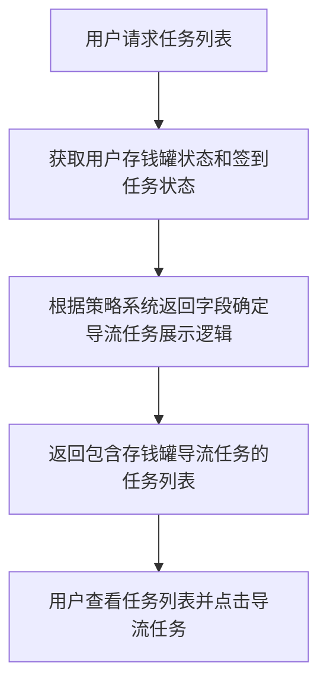
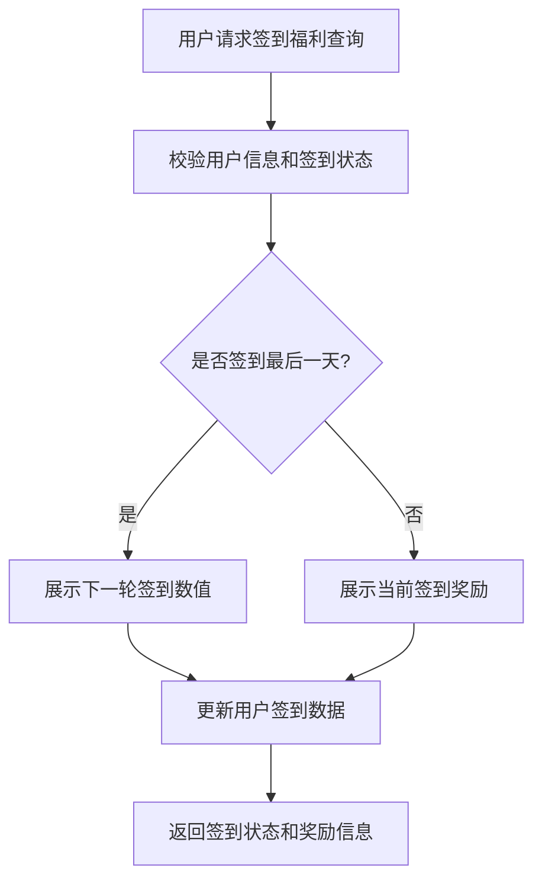
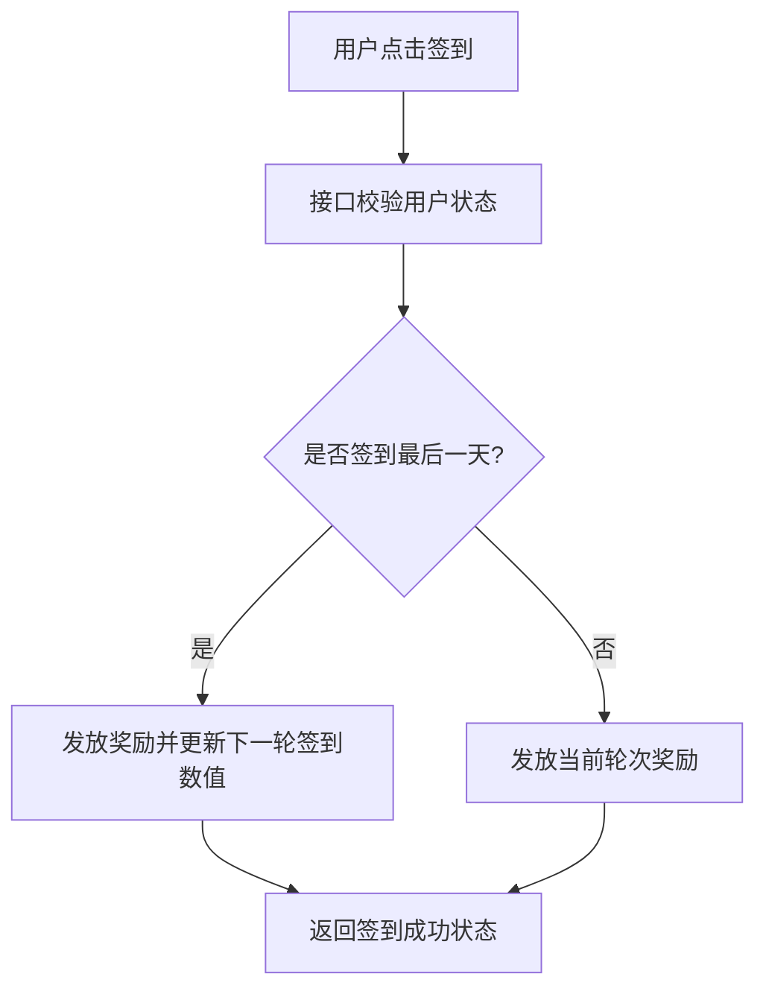

# 1. 项目背景
* 需求文档链接：[【非随】【极速版存钱罐】任务系统相互导流](https://console.cloud.baidu-int.com/devops/icafe/issue/ailite-30376/show)
* 项目背景: 端内激励活动用户属性相近，通过互导融合，提高向APP内用户分发激励任务的效率
## 2. 设计总览

| **目标代码库**                                                                                                                                  | **接口名称** | **接口路径**                             | **调用方式** | **改动类型** | **功能点概述**                                       | **关联度得分** |
|---------------------------------------------------------------------------------------------------------------------------------------------------|--------|--------------------------------------------|--------------|--------------|-------------------------------------------------|-----------|
| [baidu/jady/ug-duoduo-video](https://console.cloud.baidu-int.com/devops/icode/repos/baidu/jady/ug-duoduo-video/tree/master)                     | 视频外部任务列表 | `/video/external/task/list`           | GET         | 修改         | - 新增逻辑以获取用户存钱罐状态和签到任务状态。<br>- 根据策略系统返回的字段，调整任务列表展示逻辑，以适配存钱罐任务系统的导流需求。<br>- 更新任务列表排序逻辑，确保存钱罐导流任务在合适的位置展示。<br>- 集成数据上报功能，记录导流任务的展示数据。 | 0.9       |
| [baidu/jady/ug-duoduo-video](https://console.cloud.baidu-int.com/devops/icode/repos/baidu/jady/ug-duoduo-video/tree/master)                     | 签到福利查询 | `/video/external/welfare/receive`            | GET,POST         | 修改         | - 新增或修改逻辑以支持获取用户存钱罐状态和签到任务状态。<br>- 根据策略系统返回的字段，调整签到福利查询逻辑，以适配存钱罐任务系统的导流需求。<br>- 更新用户签到数据，确保签到最后一天时能够正确展示下一轮签到数值。<br>- 集成数据上报功能，记录签到相关的用户行为和任务展示数据。 | 0.8       |
| [baidu/jady/ug-duoduo-video](https://console.cloud.baidu-int.com/devops/icode/repos/baidu/jady/ug-duoduo-video/tree/master)                     | 存钱罐签到任务奖励领取 | `/video/external/task/receive`            | GET,POST         | 修改         | - 新增逻辑以支持存钱罐签到任务的奖励领取操作。<br>- 根据策略系统返回的字段，调整奖励发放逻辑，以适配存钱罐任务系统的导流需求。<br>- 更新用户签到记录，确保签到最后一天时能够正确发放奖励并更新下一轮签到数值。<br>- 集成数据上报功能，记录奖励领取相关的用户行为数据。 | 0.8       |

## 3.1 视频外部任务列表（修改）
* 当前接口和需求关联得分：**0.9**
### 3.1.1 接口定义
* **目标代码库**：[baidu/jady/ug-duoduo-video](https://console.cloud.baidu-int.com/devops/icode/repos/baidu/jady/ug-duoduo-video/tree/master)
* **接口路径**：/video/external/task/list
* **调用方式**：GET
* **请求参数**：
```json
{
  "user_id": {
    "type": "string",
    "description": "用户唯一标识",
    "required": true,
    "change_type": "MODIFY"
  },
  "platform": {
    "type": "string",
    "description": "请求平台标识（如：ios/android/web）",
    "required": true,
    "change_type": "MODIFY"
  }
}
```
* **响应参数**：
```json
{
  "task_list": {
    "type": "array",
    "description": "任务列表",
    "change_type": "MODIFY",
    "items": {
      "type": "object",
      "properties": {
        "task_id": {
          "type": "string",
          "description": "任务ID",
          "change_type": "MODIFY"
        },
        "task_type": {
          "type": "string",
          "description": "任务类型（存钱罐/签到/常规）",
          "change_type": "NEW"
        },
        "display_priority": {
          "type": "integer",
          "description": "展示优先级（数字越小优先级越高）",
          "change_type": "NEW"
        },
        "is_piggybank_task": {
          "type": "boolean",
          "description": "是否为存钱罐导流任务",
          "change_type": "NEW"
        }
      }
    }
  },
  "piggybank_status": {
    "type": "object",
    "description": "用户存钱罐状态",
    "change_type": "NEW",
    "properties": {
      "is_activated": {
        "type": "boolean",
        "description": "是否已激活存钱罐功能"
      },
      "current_amount": {
        "type": "number",
        "description": "当前存钱罐金额"
      }
    }
  }
}
```
### 3.1.2 功能逻辑和实现流程
1. 新增逻辑以获取用户存钱罐状态和签到任务状态；
2. 根据策略系统返回的字段，调整任务列表展示逻辑，以适配存钱罐任务系统的导流需求；
3. 更新任务列表排序逻辑，确保存钱罐导流任务在合适的位置展示；
4. 集成数据上报功能，记录导流任务的展示数据。

## 3.2 签到福利查询接口（修改）
* 当前接口和需求关联得分：**0.8**
### 3.2.1 接口定义
* **目标代码库**：[baidu/jady/ug-duoduo-video](https://console.cloud.baidu-int.com/devops/icode/repos/baidu/jady/ug-duoduo-video/tree/master)
* **接口路径**：/video/external/welfare/receive
* **调用方式**：GET,POST
* **请求参数**：
```json
{
  "user_id": {
    "type": "string",
    "description": "用户唯一标识",
    "required": true,
    "change_type": "MODIFY"
  },
  "task_type": {
    "type": "string",
    "description": "任务类型标识（存钱罐/签到）",
    "required": true,
    "change_type": "NEW"
  }
}
```
* **响应参数**：
```json
{
  "piggybank_status": {
    "type": "object",
    "description": "存钱罐状态信息",
    "change_type": "NEW",
    "properties": {
      "is_active": {
        "type": "boolean",
        "description": "是否激活状态"
      },
      "current_amount": {
        "type": "number",
        "description": "当前累计金额"
      }
    }
  },
  "checkin_status": {
    "type": "object",
    "description": "签到任务状态",
    "change_type": "MODIFY",
    "properties": {
      "current_day": {
        "type": "integer",
        "description": "当前签到天数"
      },
      "next_round_rewards": {
        "type": "array",
        "description": "下一轮签到奖励预览",
        "items": {
          "type": "object",
          "properties": {
            "day": {
              "type": "integer",
              "description": "签到天数"
            },
            "reward": {
              "type": "number",
              "description": "奖励金额"
            }
          }
        }
      }
    }
  }
}
```
### 3.2.2 功能逻辑和实现流程
1. 新增或修改逻辑以支持获取用户存钱罐状态和签到任务状态；
2. 根据策略系统返回的字段，调整签到福利查询逻辑，以适配存钱罐任务系统的导流需求；
3. 更新用户签到数据，确保签到最后一天时能够正确展示下一轮签到数值；
4. 集成数据上报功能，记录签到相关的用户行为和任务展示数据。


## 3.3 存钱罐签到任务奖励领取接口（修改）
* 当前接口和需求关联得分：**0.8**

### 3.3.1 接口定义
* **目标代码库**：[baidu/jady/ug-duoduo-video](https://console.cloud.baidu-int.com/devops/icode/repos/baidu/jady/ug-duoduo-video/tree/master)
* **接口路径**：/video/external/task/receive
* **调用方式**：["GET", "POST"]
* **请求参数**：
```json
{
  "user_id": {
    "type": "string",
    "description": "用户唯一标识",
    "required": true,
    "change_type": "MODIFY"
  },
  "task_type": {
    "type": "string",
    "description": "任务类型，此处固定为'piggy_bank_sign'",
    "required": true,
    "change_type": "NEW"
  },
  "sign_day": {
    "type": "integer",
    "description": "当前签到天数",
    "required": true,
    "change_type": "NEW"
  }
}
```
* **响应参数**：
```json
{
  "status": {
    "type": "string",
    "description": "领取状态：success/fail",
    "change_type": "NEW"
  },
  "reward": {
    "type": "object",
    "description": "奖励信息",
    "change_type": "NEW",
    "properties": {
      "amount": {
        "type": "integer",
        "description": "奖励金额"
      },
      "type": {
        "type": "string",
        "description": "奖励类型"
      }
    }
  },
  "next_round": {
    "type": "integer",
    "description": "下一轮签到起始天数",
    "change_type": "NEW"
  }
}
```

### 3.3.2 功能逻辑和实现流程
* 新增逻辑以支持存钱罐签到任务的奖励领取操作；
* 根据策略系统返回的字段，调整奖励发放逻辑，以适配存钱罐任务系统的导流需求；
* 更新用户签到记录，确保签到最后一天时能够正确发放奖励并更新下一轮签到数值；
* 集成数据上报功能，记录奖励领取相关的用户行为数据。



### 3.3.2 存储设计
* mysql表格设计示例：
```mysql
create table `user_piggy_bank_sign`(
    id                 bigint(20) unsigned NOT NULL AUTO_INCREMENT primary key COMMENT '自增id',
    user_id           varchar(64) NOT NULL DEFAULT '' COMMENT '用户唯一标识',
    current_round     int(11) NOT NULL DEFAULT '1' COMMENT '当前签到轮次',
    sign_day          int(11) NOT NULL DEFAULT '0' COMMENT '当前签到天数',
    last_sign_time    timestamp           NOT NULL DEFAULT CURRENT_TIMESTAMP COMMENT '最后签到时间',
    created_at         timestamp           NOT NULL DEFAULT CURRENT_TIMESTAMP COMMENT '创建时间',
    updated_at         timestamp           NOT NULL DEFAULT CURRENT_TIMESTAMP ON UPDATE CURRENT_TIMESTAMP COMMENT '更新时间',
    UNIQUE KEY `idx_user_id` (`user_id`)
) ENGINE = InnoDB DEFAULT CHARSET = utf8mb4 COMMENT ='用户存钱罐签到记录';
```

* redis设计示例：
```redis
key: piggy_bank_sign_reward_{user_id}
value:
{
    "current_round": 1,
    "sign_day": 3,
    "last_reward": {
        "amount": 100,
        "type": "coin"
    }
}
```