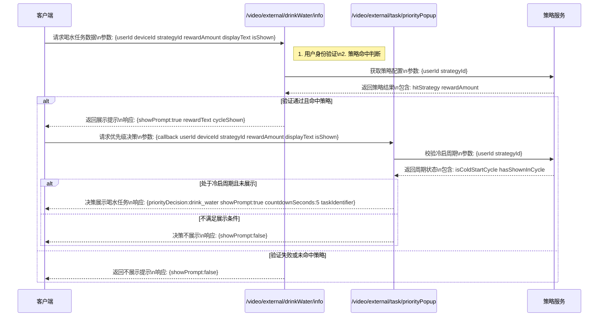
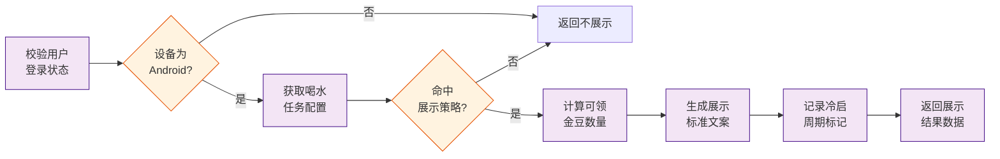
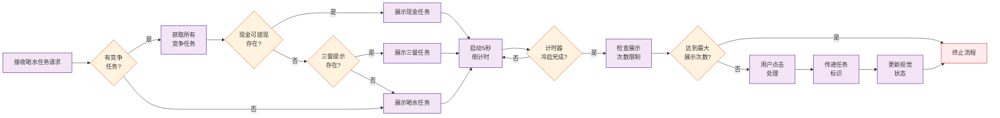
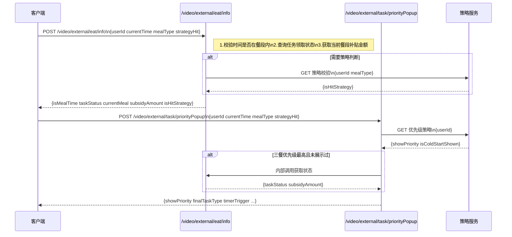
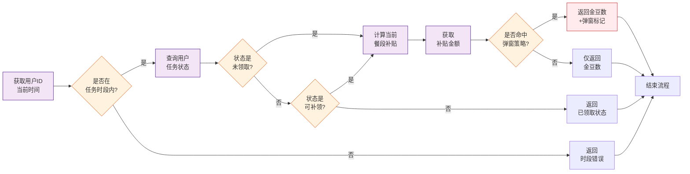
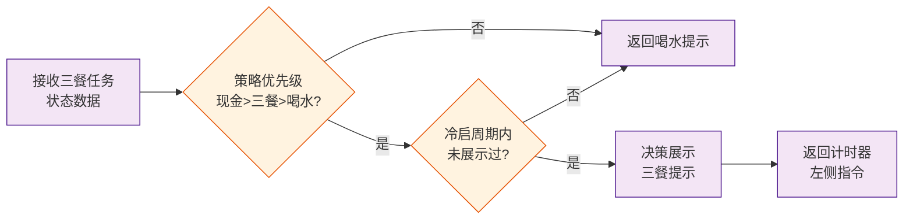

# 1. 需求背景
* **需求文档**： [【v6.59】【存钱罐】喝水&三餐任务提示](https://console.cloud.baidu-int.com/devops/icafe/issue/ailite-30842/show)
* **背景描述**: 针对任务列表内时间点类型的任务，增加任务可完成提示，提升任务面板展示
* **预期收益**：

# 2. 设计总览
* **功能点**：`喝水任务提示`
| **目标代码库**                                                                                                                   | **接口名称** | **接口路径**                        | **改动类型** | **变更概述** | **备注** |
|-----------------------------------------------------------------------------------------------------------------------------|----------|---------------------------------|---------|--------|----------|
| [baidu/jady/ug-duoduo-video](https://console.cloud.baidu-int.com/devops/icode/repos/baidu/jady/ug-duoduo-video/tree/master) | 喝水任务信息查询 | `/video/external/drinkWater/info` | 修改 | 增加用户身份验证、策略命中判断、奖励信息准备等功能 | |
| [baidu/jady/ug-duoduo-video](https://console.cloud.baidu-int.com/devops/icode/repos/baidu/jady/ug-duoduo-video/tree/master) | 任务弹窗优先级决策 | `/video/external/task/priorityPopup` | 修改 | 增加多任务优先级仲裁、展示决策、生命周期控制等功能 | |

* **功能点**：`三餐任务提示`
| **目标代码库**                                                                                                                   | **接口名称** | **接口路径**                        | **改动类型** | **变更概述** | **备注**                     |
|-----------------------------------------------------------------------------------------------------------------------------|----------|---------------------------------|---------|--------|----------------------------|
| [baidu/jady/ug-duoduo-video](https://console.cloud.baidu-int.com/devops/icode/repos/baidu/jady/ug-duoduo-video/tree/master) | 三餐任务信息查询接口 | `/video/external/eat/info` | 修改 | 增加用户任务时段判断、状态检查、补贴金额返回及弹窗触发条件 |          |
| [baidu/jady/ug-duoduo-video](https://console.cloud.baidu-int.com/devops/icode/repos/baidu/jady/ug-duoduo-video/tree/master) | 任务优先级决策接口 | `/video/external/task/priorityPopup` | 修改 | 新增三餐任务状态处理、优先级判断、展示限制检查及最终任务决策 |          |

# 3. 详细设计
## 3.1 喝水任务提示

### 3.1.1 喝水任务信息查询（修改）
* **代码库**: [baidu/jady/ug-duoduo-video](https://console.cloud.baidu-int.com/devops/icode/repos/baidu/jady/ug-duoduo-video/tree/master)
* **接口路径**: `/video/external/drinkWater/info`
* **调用方式**: `GET,POST`
* **变更功能描述**: 
```
1. 用户身份验证：
   - 校验用户登录状态和设备信息
   - 确认Android设备标识
2. 策略命中判断：
   - 从策略服务获取喝水任务提示配置
   - 判断用户是否命中当前冷启周期的展示策略
3. 奖励信息准备：
   - 计算当前可领取的金豆奖励数量
   - 生成'喝水打卡领/nXXX金豆'标准文案
4. 状态标记：
   - 记录本次冷启周期内已展示标记
5. 返回结果：
   - 包含是否展示提示、展示文案、奖励数值等核心信息
```
* **变更功能流程图**:

* **请求参数变更点**: 
```json
{
  "userId": "string|required|用户唯一标识|NEW",
  "deviceId": "string|required|Android设备标识|NEW",
  "strategyId": "string|required|策略服务配置ID|NEW",
  "rewardAmount": "int64|可领取的金豆奖励数量|NEW",
  "displayText": "string|喝水打卡领金豆标准文案|NEW",
  "isShown": "bool|本次冷启周期内是否已展示标记|NEW"
}
```
* **响应参数变更点**: 
```json
{
  "isLoggedIn": "bool|用户登录状态验证结果|NEW",
  "isAndroidDevice": "bool|Android设备标识验证结果|NEW",
  "hitStrategy": "bool|是否命中当前冷启周期的展示策略|NEW",
  "showPrompt": "bool|是否展示喝水任务提示|NEW",
  "rewardAmount": "int64|当前可领取的金豆奖励数量|NEW",
  "rewardText": "string|'喝水打卡领/nXXX金豆'标准文案|NEW",
  "cycleShown": "bool|本次冷启周期内已展示标记|NEW"
}
```

### 3.1.2 任务弹窗优先级决策（修改）
* **代码库**: [baidu/jady/ug-duoduo-video](https://console.cloud.baidu-int.com/devops/icode/repos/baidu/jady/ug-duoduo-video/tree/master)
* **接口路径**: `/video/external/task/priorityPopup`
* **调用方式**: `GET`
* **变更功能描述**: 
```
1. 多任务优先级仲裁：
   - 接收来自喝水任务接口的提示请求
   - 同时检查现金可提现提示、三餐提示等竞争任务
2. 展示决策：
   - 按照'现金可提现>喝水任务>三餐提示'的优先级排序
   - 确认计时器完成冷启后转满一圈的触发时机
3. 生命周期控制：
   - 管理5秒自动消失的倒计时逻辑
   - 确保单个冷启周期内最多展示1次的限制
4. 交互响应：
   - 处理用户点击事件后向任务面板传递喝水任务标识
   - 触发提示消失的视觉状态更新
```
* **变更功能流程图**:

* **请求参数变更点**: 
```json
{
  "callback": "string|required|用户点击事件回调函数|MODIFY",
  "userId": "string|required|用户唯一标识|NEW",
  "deviceId": "string|required|Android设备标识|NEW",
  "strategyId": "string|required|策略服务配置ID|NEW",
  "rewardAmount": "int64|可领取的金豆奖励数量|NEW",
  "displayText": "string|喝水打卡领金豆标准文案|NEW",
  "isShown": "bool|本次冷启周期内是否已展示标记|NEW"
}
```
* **响应参数变更点**: 
```json
{
  "priorityDecision": "string|当前展示的优先级决策结果，取值：'cash_withdraw'/'drink_water'/'meal_prompt'|NEW",
  "showPrompt": "bool|是否展示当前决策的提示|NEW",
  "countdownSeconds": "int|自动消失倒计时秒数（固定5秒）|NEW",
  "isColdStartCycle": "bool|是否处于冷启动周期内|NEW",
  "hasShownInCycle": "bool|本冷启周期内是否已展示过提示|NEW",
  "taskIdentifier": "string|用户点击时需要传递的任务标识（当priorityDecision为drink_water时使用）|NEW",
  "shouldUpdateUI": "bool|是否需要更新提示消失的视觉状态|NEW",
  "timerCompleted": "bool|计时器是否已完成冷启后转满一圈|NEW"
}
```

## 3.2 三餐任务提示

### 3.2.1 三餐任务信息查询接口（修改）
* **代码库**: [baidu/jady/ug-duoduo-video](https://console.cloud.baidu-int.com/devops/icode/repos/baidu/jady/ug-duoduo-video/tree/master)
* **接口路径**: `/video/external/eat/info`
* **调用方式**: `GET,POST`
* **变更功能描述**: 
```
1. 根据用户ID和当前时间判断用户是否处于三餐任务可领取时段
2. 检查用户当前三餐任务的领取状态（未领取/已领取/可补领）
3. 返回当前餐段（早餐/午餐/晚餐）对应的补贴金额（金豆数）
4. 提供任务弹窗触发条件判断依据（是否命中策略）
```
* **变更功能流程图**:

* **请求参数变更点**: 
```json
{
  "userId": "string|required|用户ID|NEW",
  "currentTime": "string|required|当前时间|NEW",
  "mealType": "string|当前餐段（早餐/午餐/晚餐）|NEW",
  "strategyHit": "bool|是否命中策略|NEW"
}
```
* **响应参数变更点**: 
```json
{
  "isMealTime": "bool|当前是否处于三餐任务可领取时段|NEW",
  "taskStatus": "string|任务领取状态(未领取/已领取/可补领)|NEW",
  "currentMeal": "string|当前餐段(早餐/午餐/晚餐)|NEW",
  "subsidyAmount": "int|当前餐段对应的补贴金豆数|NEW",
  "isHitStrategy": "bool|是否命中任务弹窗触发策略|NEW"
}
```

### 3.2.2 任务优先级决策接口（修改）
* **代码库**: [baidu/jady/ug-duoduo-video](https://console.cloud.baidu-int.com/devops/icode/repos/baidu/jady/ug-duoduo-video/tree/master)
* **接口路径**: `/video/external/task/priorityPopup`
* **调用方式**: `GET`
* **变更功能描述**: 
```
1. 接收来自三餐任务接口的状态数据
2. 根据策略服务配置判断提示展示优先级（现金提现>三餐>喝水）
3. 确认当前冷启周期内是否已展示过三餐提示（限1次/周期）
4. 决策最终展示的任务类型（当三餐优先级高于喝水且满足条件时）
5. 返回计时器左侧提示的触发指令
```
* **变更功能流程图**:

* **请求参数变更点**: 
```json
{
  "userId": "string|required|用户ID|NEW",
  "currentTime": "string|required|当前时间|NEW",
  "mealType": "string|当前餐段（早餐/午餐/晚餐）|NEW",
  "strategyHit": "bool|是否命中策略|NEW"
}
```
* **响应参数变更点**: 
```json
{
  "showPriority": "string|展示优先级(现金提现/三餐/喝水)|NEW",
  "isColdStartShown": "bool|冷启周期内是否已展示过三餐提示|NEW",
  "finalTaskType": "string|最终展示的任务类型|NEW",
  "timerTrigger": "string|计时器左侧提示的触发指令|NEW",
  "isMealTime": "bool|当前是否处于三餐任务可领取时段|MODIFY",
  "taskStatus": "string|任务领取状态(未领取/已领取/可补领)|MODIFY",
  "currentMeal": "string|当前餐段(早餐/午餐/晚餐)|MODIFY",
  "subsidyAmount": "int|当前餐段对应的补贴金豆数|MODIFY",
  "isHitStrategy": "bool|是否命中任务弹窗触发策略|MODIFY"
}
```
