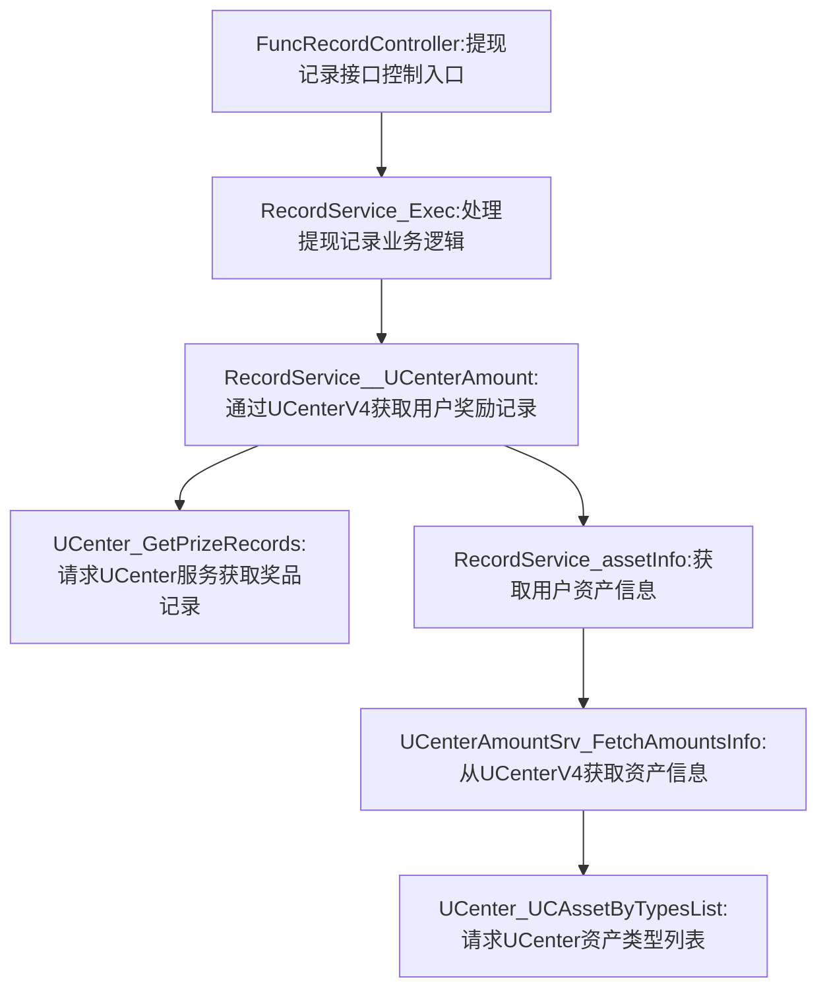

# 1. 项目背景
* 需求文档链接：[【非随】【极速版存钱罐】提现记录页数据规则](https://console.cloud.baidu-int.com/devops/icafe/issue/ailite-26824/show)
* 项目背景: 当前提现记录页中的累计获得及已提现数据中，存在部分数据重复计算的问题，导致与用户的理解不一致
| **目标代码库**                                                                                                                                  | **接口名称** | **接口路径**                             | **改动类型** | **功能点概述**                                       | **关联度得分** |
|---------------------------------------------------------------------------------------------------------------------------------------------------|--------|--------------------------------------------|--------------|-------------------------------------------------|-----------|
| [baidu/jady/ug-duoduo-video](https://console.cloud.baidu-int.com/devops/icode/repos/baidu/jady/ug-duoduo-video/tree/master)                     | 提现记录接口 | `/video/withdraw/withdrawRecordApi`       | 修改         | - 新增逻辑过滤大额转小额记录不计入累计获得数据。<br>- 新增逻辑过滤大额转小额记录不计入已提现数据。<br>- 新增逻辑生成20元微信提现记录。<br>- 新增逻辑处理小额提现记录并更新提现按钮文案。 | 0.9       |
| [baidu/jady/ug-duoduo-video](https://console.cloud.baidu-int.com/devops/icode/repos/baidu/jady/ug-duoduo-video/tree/master)                     | 提现记录接口 | `/video/withdraw/withdrawRecordApi`       | 修改         | - 解析策略系统返回的金额变动类型标记。<br>- 根据金额变动类型标记进行数据分类处理。 | 0.9       |
| [baidu/jady/ug-duoduo-video](https://console.cloud.baidu-int.com/devops/icode/repos/baidu/jady/ug-duoduo-video/tree/master)                     | 提现记录接口 | `/video/withdraw/withdrawRecordApi`       | 修改         | - 修改UCenter_GetPrizeRecords获取策略系统详细金额变动记录。<br>- 修改UCenter_UCAssetByTypesList获取策略系统资产信息。 | 0.9       |

## 3.1 提现记录接口（修改）
* 当前接口和需求关联得分：**0.9**
### 3.1.1 接口定义
* **目标代码库**：[baidu/jady/ug-duoduo-video](https://console.cloud.baidu-int.com/devops/icode/repos/baidu/jady/ug-duoduo-video/tree/master)
* **接口路径**：/video/withdraw/withdrawRecordApi
* **调用方式**：GET,POST
* **请求参数**：
```json
{
  "request": {
    "type": "object",
    "description": "框架默认请求类型（如ghttp.Request）",
    "required": true,
    "change_type": "MODIFY"
  }
}
```
* **响应参数**：
```json
{
  "response": {
    "type": "object",
    "description": "框架默认响应类型（如ghttp.Response）",
    "change_type": "MODIFY"
  }
}
```

### 3.1.2 功能逻辑和实现流程
* **任务1：修改RecordService_Exec业务逻辑**
  1. 新增逻辑过滤大额转小额记录不计入累计获得数据
  2. 新增逻辑过滤大额转小额记录不计入已提现数据
  3. 新增逻辑生成20元微信提现记录
  4. 新增逻辑处理小额提现记录并更新提现按钮文案

* **任务2：修改RecordService__UCenterAmount适配策略**
  1. 解析策略系统返回的金额变动类型标记
  2. 根据金额变动类型标记进行数据分类处理

* **任务3：修改UCenter相关方法**
  1. 修改UCenter_GetPrizeRecords获取策略系统详细金额变动记录
  2. 修改UCenter_UCAssetByTypesList获取策略系统资产信息

