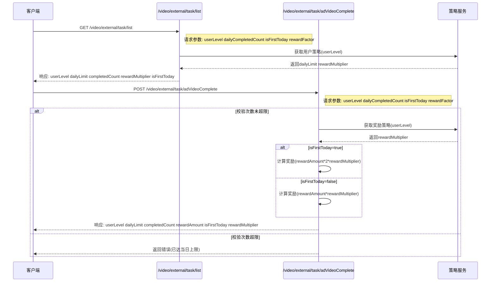
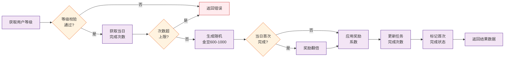
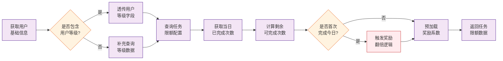
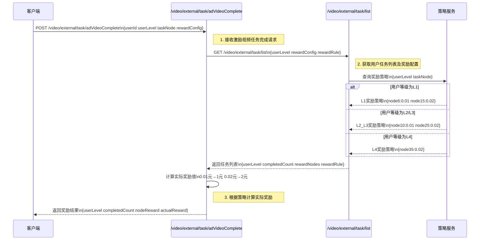
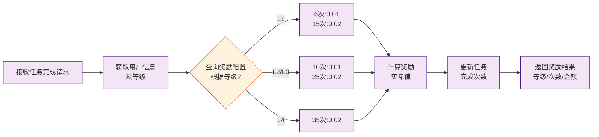
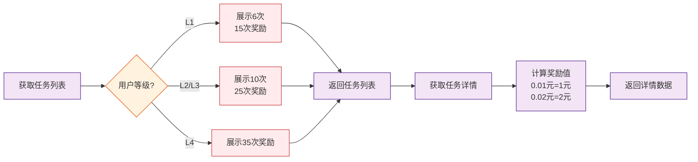

# 1. 需求背景
* **需求文档**： [【非随】【极速版存钱罐】激励视频任务增加小额奖励](https://console.cloud.baidu-int.com/devops/icafe/issue/ailite-30227/show)
* **背景描述**: 任务列表激励视频任务增加小额发放，激励用户完成激励视频任务，提升激励视频收入
* **预期收益**：

# 2. 设计总览
* **功能点**：`原有激励视频任务金豆奖励逻辑`
| **目标代码库**                                                                                                                   | **接口名称** | **接口路径**                        | **改动类型** | **变更概述** | **备注**                     |
|-----------------------------------------------------------------------------------------------------------------------------|----------|---------------------------------|---------|--------|----------------------------|
| [baidu/jady/ug-duoduo-video](https://console.cloud.baidu-int.com/devops/icode/repos/baidu/jady/ug-duoduo-video/tree/master) | 激励视频任务完成接口    | /video/external/task/adVideoComplete                          | 修改 | 新增用户等级校验与金豆奖励计算逻辑 |          |
| [baidu/jady/ug-duoduo-video](https://console.cloud.baidu-int.com/devops/icode/repos/baidu/jady/ug-duoduo-video/tree/master) | 任务列表查询接口   | /video/external/task/list                          | 修改             | 新增用户等级透传与任务限额展示 |          |

* **功能点**：`新增激励视频任务小额现金奖励逻辑`
| **目标代码库**                                                                                                                   | **接口名称** | **接口路径**                        | **改动类型** | **变更概述** | **备注**                     |
|-----------------------------------------------------------------------------------------------------------------------------|----------|---------------------------------|---------|--------|----------------------------|
| [baidu/jady/ug-duoduo-video](https://console.cloud.baidu-int.com/devops/icode/repos/baidu/jady/ug-duoduo-video/tree/master) | 激励视频任务完成接口    | /video/external/task/adVideoComplete                          | 修改 | 根据用户等级和任务完成节点计算小额现金奖励 |          |
| [baidu/jady/ug-duoduo-video](https://console.cloud.baidu-int.com/devops/icode/repos/baidu/jady/ug-duoduo-video/tree/master) | 任务列表查询接口    | /video/external/task/list                          | 修改 | 在任务列表中展示用户等级对应的奖励节点信息 |          |

# 3. 详细设计
## 3.1 原有激励视频任务金豆奖励逻辑

### 3.1.1 激励视频任务完成接口（修改）
* **代码库**: [baidu/jady/ug-duoduo-video](https://console.cloud.baidu-int.com/devops/icode/repos/baidu/jady/ug-duoduo-video/tree/master)
* **接口路径**: `/video/external/task/adVideoComplete`
* **调用方式**: `GET,POST`
* **变更功能描述**: 
```
1. **用户等级校验与次数限制**
   - 根据用户等级（L1/L2/L3/L4）动态设置单日激励视频任务上限次数（15/25/35次）
   - 校验当前用户已完成次数是否超过当日上限
2. **金豆奖励计算**
   - 生成随机金豆奖励值（范围600-1000）
   - 判断是否为当日首次完成，若是则奖励翻倍
   - 叠加奖励系数逻辑（如实验策略或活动加成）
3. **任务状态更新**
   - 记录当前任务完成次数+1
   - 标记首次完成状态（仅当日首次触发时）
4. **结果返回**
   - 返回用户等级、单日上限次数、当前完成次数、实际发放金豆值、是否首次完成、奖励系数等核心字段
```
* **变更功能流程图**:

* **请求参数变更点**: 
```json
{
  "userLevel": "string|required|用户等级(L1/L2/L3/L4)|NEW",
  "dailyCompletedCount": "int32|required|当日已完成次数|NEW",
  "isFirstToday": "bool|required|是否当日首次完成|NEW",
  "rewardFactor": "float32|奖励系数(实验策略或活动加成)|NEW"
}
```
* **响应参数变更点**: 
```json
{
  "userLevel": "string|用户等级(L1/L2/L3/L4)|NEW",
  "dailyLimit": "int|单日激励视频任务上限次数|NEW",
  "completedCount": "int|当前已完成次数|NEW",
  "rewardAmount": "int|实际发放金豆值(600-1000)|NEW",
  "isFirstToday": "bool|是否当日首次完成|NEW",
  "rewardMultiplier": "float64|奖励系数(实验策略或活动加成)|NEW"
}
```

### 3.1.2 任务列表查询接口（修改）
* **代码库**: [baidu/jady/ug-duoduo-video](https://console.cloud.baidu-int.com/devops/icode/repos/baidu/jady/ug-duoduo-video/tree/master)
* **接口路径**: `/video/external/task/list`
* **调用方式**: `GET`
* **变更功能描述**: 
```
1. **用户等级透传**
   - 获取用户基础信息时需包含用户等级字段
2. **任务限额展示**
   - 在激励视频任务项中动态显示当前等级对应的单日上限次数（15/25/35次）
   - 实时返回用户当日已完成的激励视频任务次数
3. **奖励系数预加载**
   - 根据实验策略预计算可能的奖励系数范围
4. **首次完成状态同步**
   - 标记用户当日是否已触发过首次完成奖励翻倍
```
* **变更功能流程图**:

* **请求参数变更点**: 
```json
{
  "userLevel": "string|required|用户等级(L1/L2/L3/L4)|NEW",
  "dailyCompletedCount": "int32|required|当日已完成次数|NEW",
  "isFirstToday": "bool|required|是否当日首次完成|NEW",
  "rewardFactor": "float32|奖励系数(实验策略或活动加成)|NEW"
}
```
* **响应参数变更点**: 
```json
{
  "userLevel": "string|用户等级(L1/L2/L3/L4)|NEW",
  "dailyLimit": "int|单日激励视频任务上限次数|NEW",
  "completedCount": "int|当前已完成次数|NEW",
  "rewardMultiplier": "float64|奖励系数(实验策略或活动加成)|NEW",
  "isFirstToday": "bool|是否当日首次完成|NEW"
}
```

## 3.2 新增激励视频任务小额现金奖励逻辑

### 3.2.1 激励视频任务完成接口（修改）
* **代码库**: [baidu/jady/ug-duoduo-video](https://console.cloud.baidu-int.com/devops/icode/repos/baidu/jady/ug-duoduo-video/tree/master)
* **接口路径**: `/video/external/task/adVideoComplete`
* **调用方式**: `GET,POST`
* **变更功能描述**: 
```
1. 接收用户激励视频任务完成请求
2. 获取用户基础信息（包括用户等级）
3. 根据用户等级和任务完成节点，向策略服务查询小额现金奖励配置
   - L1等级：6次节点奖励0.01元，15次节点奖励0.02元
   - L2/L3等级：10次节点奖励0.01元，25次节点奖励0.02元
   - L4等级：35次节点奖励0.02元
4. 计算奖励实际值（0.01元对应最高1元，0.02元对应最高2元）
5. 更新用户任务完成次数和奖励记录
6. 返回奖励结果，包括：用户等级、当前完成次数、节点奖励金额、奖励实际值
```
* **变更功能流程图**:

* **请求参数变更点**: 
```json
{
  "userId": "string|required|用户ID|NEW",
  "userLevel": "int64|required|用户等级|NEW",
  "taskNode": "int64|required|任务完成节点|NEW",
  "rewardConfig": {
    "L1": {
      "node6": "float64|6次节点奖励金额|NEW",
      "node15": "float64|15次节点奖励金额|NEW"
    },
    "L2_L3": {
      "node10": "float64|10次节点奖励金额|NEW",
      "node25": "float64|25次节点奖励金额|NEW"
    },
    "L4": {
      "node35": "float64|35次节点奖励金额|NEW"
    }
  }
}
```
* **响应参数变更点**: 
```json
{
  "userLevel": "int|用户等级|NEW",
  "completedCount": "int|当前完成次数|NEW",
  "nodeReward": "float64|节点奖励金额|NEW",
  "actualReward": "float64|奖励实际值|NEW"
}
```

### 3.2.2 任务列表查询接口（修改）
* **代码库**: [baidu/jady/ug-duoduo-video](https://console.cloud.baidu-int.com/devops/icode/repos/baidu/jady/ug-duoduo-video/tree/master)
* **接口路径**: `/video/external/task/list`
* **调用方式**: `GET`
* **变更功能描述**: 
```
1. 在返回任务列表时，包含激励视频任务的小额现金奖励配置信息
2. 根据用户等级展示对应的奖励节点信息
   - L1等级：显示6次和15次节点奖励
   - L2/L3等级：显示10次和25次节点奖励
   - L4等级：显示35次节点奖励
3. 在任务详情中展示奖励实际值计算规则（0.01元对应最高1元，0.02元对应最高2元）
```
* **变更功能流程图**:

* **请求参数变更点**: 
```json
{
  "userLevel": "int64|required|用户等级|NEW",
  "rewardConfig": {
    "L1": {
      "node6": "float64|6次节点奖励金额|NEW",
      "node15": "float64|15次节点奖励金额|NEW"
    },
    "L2_L3": {
      "node10": "float64|10次节点奖励金额|NEW",
      "node25": "float64|25次节点奖励金额|NEW"
    },
    "L4": {
      "node35": "float64|35次节点奖励金额|NEW"
    }
  },
  "rewardRule": "string|奖励实际值计算规则（0.01元对应最高1元，0.02元对应最高2元）|NEW"
}
```
* **响应参数变更点**: 
```json
{
  "userLevel": "int|用户等级，用于控制奖励节点展示逻辑|NEW",
  "completedCount": "int|当前完成次数，用于计算节点奖励|NEW",
  "rewardNodes": {
    "L1": "array|L1等级展示的节点次数[6,15]|NEW",
    "L2_L3": "array|L2/L3等级展示的节点次数[10,25]|NEW",
    "L4": "array|L4等级展示的节点次数[35]|NEW"
  },
  "rewardRule": "string|奖励实际值计算规则说明（0.01元对应最高1元，0.02元对应最高2元）|NEW",
  "nodeReward": "float64|节点奖励金额|NEW",
  "actualReward": "float64|奖励实际值|NEW"
}
```
