# 1. 需求背景
* **需求文档**： [【非随】【极速版存钱罐】电商任务](https://console.cloud.baidu-int.com/devops/icafe/issue/ailite-28341/show)
* **背景描述**: 存钱罐与电商结合，引导用户完成下单任务，提升收入
* **预期收益**：

# 2. 设计总览
* **功能点**：`任务状态管理`
| **目标代码库**                                                                                                                   | **接口名称** | **接口路径**                        | **改动类型** | **变更概述** | **备注**                     |
|-----------------------------------------------------------------------------------------------------------------------------|----------|---------------------------------|---------|--------|----------------------------|
| [baidu/searchbox/sbox-basic](https://console.cloud.baidu-int.com/devops/icode/repos/baidu/searchbox/sbox-basic/tree/master) | 任务面板管理   | `/baiduboxapp/basic/ddmission/taskPanel` | 修改             | 展示任务列表、进度、奖励领取、个性化展示、权限检查 |          |
| [baidu/jady/ug-duoduo-video](https://console.cloud.baidu-int.com/devops/icode/repos/baidu/jady/ug-duoduo-video/tree/master) | 视频任务列表   | `/video/external/task/list` | 修改             | 展示视频任务列表、状态、奖励信息、身份校验、任务过滤 |          |
| [baidu/searchbox/sbox-basic](https://console.cloud.baidu-int.com/devops/icode/repos/baidu/searchbox/sbox-basic/tree/master) | 任务状态管理   | `/baiduboxapp/basic/ddmission/taskStatus` | 新增             | 管理任务状态、处理状态变更、状态查询、异常处理 |          |
| [baidu/jady/ug-duoduo-video](https://console.cloud.baidu-int.com/devops/icode/repos/baidu/jady/ug-duoduo-video/tree/master) | 视频任务状态   | `/video/external/task/status` | 新增             | 管理视频任务状态、处理状态变更、状态查询、异常处理 |          |

* **功能点**：`浏览任务倒计时控制`
| **目标代码库**                                                                                                                   | **接口名称** | **接口路径**                        | **改动类型** | **变更概述** | **备注** |
|-----------------------------------------------------------------------------------------------------------------------------|----------|---------------------------------|---------|--------|----------|
| [baidu/searchbox/sbox-basic](https://console.cloud.baidu-int.com/devops/icode/repos/baidu/searchbox/sbox-basic/tree/master) | 任务面板管理 | `/baiduboxapp/basic/ddmission/taskPanel` | 修改 | 展示任务列表、进度及奖励，支持倒计时控制和个性化展示 | |
| [baidu/jady/ug-duoduo-video](https://console.cloud.baidu-int.com/devops/icode/repos/baidu/jady/ug-duoduo-video/tree/master) | 视频任务列表 | `/video/external/task/list` | 修改 | 展示任务列表及状态，支持倒计时控制和任务过滤 | |
| [baidu/searchbox/sbox-basic](https://console.cloud.baidu-int.com/devops/icode/repos/baidu/searchbox/sbox-basic/tree/master) | 倒计时任务管理 | `/baiduboxapp/basic/ddmission/taskTimer` | 新增 | 管理倒计时任务状态，处理状态变更和异常情况 | |
| [baidu/jady/ug-duoduo-video](https://console.cloud.baidu-int.com/devops/icode/repos/baidu/jady/ug-duoduo-video/tree/master) | 视频倒计时任务 | `/video/external/task/timer` | 新增 | 管理视频倒计时任务状态，处理状态变更和异常情况 | |

* **功能点**：`下单任务处理`
| **目标代码库**                                                                                                                   | **接口名称** | **接口路径**                        | **改动类型** | **变更概述** | **备注**                     |
|-----------------------------------------------------------------------------------------------------------------------------|----------|---------------------------------|---------|--------|----------------------------|
| [baidu/searchbox/sbox-basic](https://console.cloud.baidu-int.com/devops/icode/repos/baidu/searchbox/sbox-basic/tree/master) | 任务面板管理   | `/baiduboxapp/basic/ddmission/taskPanel` | 修改             | 展示用户可参与的下单任务列表，显示进度和奖励，提供领取功能 |          |
| [baidu/jady/ug-duoduo-video](https://console.cloud.baidu-int.com/devops/icode/repos/baidu/jady/ug-duoduo-video/tree/master) | 视频任务列表   | `/video/external/task/list` | 修改             | 展示用户可参与的下单任务列表，提供关键信息，激励用户参与 |          |
| [baidu/searchbox/sbox-basic](https://console.cloud.baidu-int.com/devops/icode/repos/baidu/searchbox/sbox-basic/tree/master) | 下单任务状态管理   | `/baiduboxapp/basic/ddmission/taskStatus` | 新增             | 管理用户下单任务状态，处理状态变更事件，提供查询功能 |          |
| [baidu/jady/ug-duoduo-video](https://console.cloud.baidu-int.com/devops/icode/repos/baidu/jady/ug-duoduo-video/tree/master) | 视频下单任务状态管理   | `/video/external/task/status` | 新增             | 管理视频下单任务状态，处理状态变更事件，提供查询功能 |          |
| [baidu/searchbox/sbox-basic](https://console.cloud.baidu-int.com/devops/icode/repos/baidu/searchbox/sbox-basic/tree/master) | 下单任务倒计时管理   | `/baiduboxapp/basic/ddmission/taskTimer` | 新增             | 管理浏览下单任务的倒计时状态，处理状态变更事件，提供查询功能 |          |
| [baidu/jady/ug-duoduo-video](https://console.cloud.baidu-int.com/devops/icode/repos/baidu/jady/ug-duoduo-video/tree/master) | 视频下单任务倒计时管理   | `/video/external/task/timer` | 新增             | 管理视频浏览下单任务的倒计时状态，处理状态变更事件，提供查询功能 |          |

* **功能点**：`退单奖励扣除`
| **目标代码库**                                                                                                                   | **接口名称** | **接口路径**                        | **改动类型** | **变更概述** | **备注**                     |
|-----------------------------------------------------------------------------------------------------------------------------|----------|---------------------------------|---------|--------|----------------------------|
| [baidu/searchbox/sbox-basic](https://console.cloud.baidu-int.com/devops/icode/repos/baidu/searchbox/sbox-basic/tree/master) | 任务面板管理接口   | `/baiduboxapp/basic/ddmission/taskPanel` | 修改             | 新增退单奖励扣除任务相关功能 |          |
| [baidu/jady/ug-duoduo-video](https://console.cloud.baidu-int.com/devops/icode/repos/baidu/jady/ug-duoduo-video/tree/master) | 视频任务列表接口   | `/video/external/task/list` | 修改             | 新增退单奖励扣除任务相关功能 |          |
| [baidu/searchbox/sbox-basic](https://console.cloud.baidu-int.com/devops/icode/repos/baidu/searchbox/sbox-basic/tree/master) | 退单奖励扣除接口   | `/baiduboxapp/basic/ddmission/refundReward` | 新增             | 处理退单奖励扣除请求 |          |
| [baidu/jady/ug-duoduo-video](https://console.cloud.baidu-int.com/devops/icode/repos/baidu/jady/ug-duoduo-video/tree/master) | 视频退单奖励扣除接口   | `/video/external/task/refundReward` | 新增             | 处理视频退单奖励扣除请求 |          |

* **功能点**：`风控逻辑处理`
| **目标代码库**                                                                                                                   | **接口名称** | **接口路径**                        | **改动类型** | **变更概述** | **备注**                     |
|-----------------------------------------------------------------------------------------------------------------------------|----------|---------------------------------|---------|--------|----------------------------|
| [baidu/searchbox/sbox-basic](https://console.cloud.baidu-int.com/devops/icode/repos/baidu/searchbox/sbox-basic/tree/master) | 任务面板管理   | `/baiduboxapp/basic/ddmission/taskPanel` | 修改             | 增加权限检查、实验分组处理、任务分类展示逻辑 |          |
| [baidu/jady/ug-duoduo-video](https://console.cloud.baidu-int.com/devops/icode/repos/baidu/jady/ug-duoduo-video/tree/master) | 视频任务列表   | `/video/external/task/list` | 修改             | 增加身份校验、任务配置过滤、状态排序逻辑 |          |
| [baidu/searchbox/sbox-basic](https://console.cloud.baidu-int.com/devops/icode/repos/baidu/searchbox/sbox-basic/tree/master) | 风控逻辑处理   | `/baiduboxapp/basic/ddmission/riskControl` | 新增             | 新增用户行为风险检查、任务状态处理功能 |          |
| [baidu/jady/ug-duoduo-video](https://console.cloud.baidu-int.com/devops/icode/repos/baidu/jady/ug-duoduo-video/tree/master) | 视频任务风控处理   | `/video/external/task/riskControl` | 新增             | 新增视频任务风险检查、状态处理功能 |          |

# 3. 详细设计
## 3.1 任务状态管理
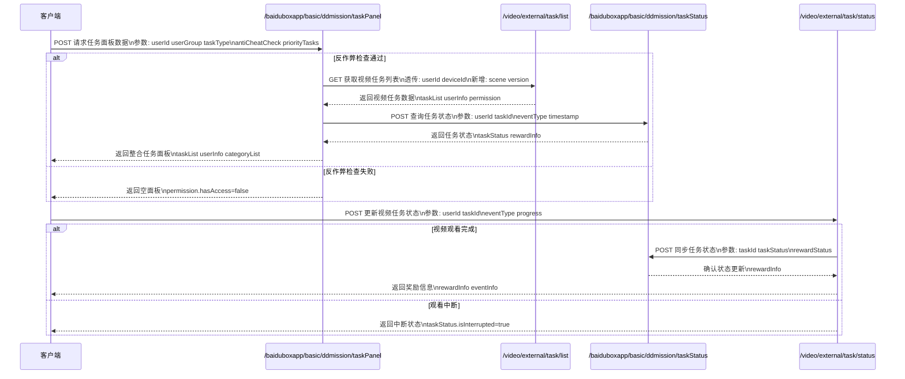
### 3.1.1 任务面板管理（修改）
* **代码库**: [baidu/searchbox/sbox-basic](https://console.cloud.baidu-int.com/devops/icode/repos/baidu/searchbox/sbox-basic/tree/master)
* **接口路径**: `/baiduboxapp/basic/ddmission/taskPanel`
* **调用方式**: `POST`
* **变更功能描述**: 
```
1. 展示用户可参与的任务列表，包括视频观看、签到等任务
2. 显示用户当前的任务进度和奖励情况
3. 提供任务完成后的奖励领取功能
4. 根据用户身份和属性进行个性化任务展示
5. 用户访问权限检查，包括登录状态、实验分组等
6. 反作弊检查，命中则返回空面板
7. 任务分类处理，特殊任务优先展示，普通任务根据条件过滤
```
* **变更功能流程图**:
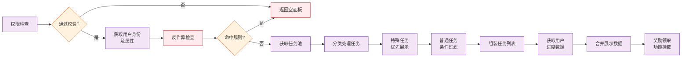
* **请求参数变更点**: 
```json
{
  "userId": "string|required|用户ID，用于身份校验和个性化展示|NEW",
  "userGroup": "string|用户实验分组信息|NEW",
  "taskType": "string|任务类型（video/signin等）|NEW",
  "taskStatus": "string|任务完成状态|NEW",
  "rewardStatus": "string|奖励领取状态|NEW",
  "antiCheatCheck": "bool|反作弊检查标记|NEW",
  "priorityTasks": "[]string|特殊任务优先展示列表|NEW",
  "filterCondition": "string|普通任务过滤条件|NEW"
}
```
* **响应参数变更点**: 
```json
{
  "taskList": [
    {
      "taskId": "string|任务ID|NEW",
      "taskType": "string|任务类型(视频观看/签到等)|NEW",
      "taskName": "string|任务名称|NEW",
      "taskDesc": "string|任务描述|NEW",
      "taskIcon": "string|任务图标URL|NEW",
      "progress": "int|当前进度|NEW",
      "target": "int|目标进度|NEW",
      "rewardAmount": "float64|奖励金额|NEW",
      "rewardType": "string|奖励类型|NEW",
      "canClaim": "bool|是否可领取|NEW",
      "isSpecial": "bool|是否特殊任务|NEW",
      "expireTime": "string|过期时间|NEW"
    }
  ],
  "userInfo": {
    "userId": "string|用户ID|NEW",
    "isLogin": "bool|是否登录|NEW",
    "userGroup": "string|实验分组|NEW",
    "isCheat": "bool|是否作弊|NEW"
  },
  "permission": {
    "hasAccess": "bool|是否有访问权限|NEW",
    "blockReason": "string|拦截原因|NEW"
  },
  "categoryList": [
    {
      "categoryId": "string|分类ID|NEW",
      "categoryName": "string|分类名称|NEW",
      "priority": "int|展示优先级|NEW"
    }
  ]
}
```

### 3.1.2 视频任务列表（修改）
* **代码库**: [baidu/jady/ug-duoduo-video](https://console.cloud.baidu-int.com/devops/icode/repos/baidu/jady/ug-duoduo-video/tree/master)
* **接口路径**: `/video/external/task/list`
* **调用方式**: `GET`
* **变更功能描述**: 
```
1. 展示用户可参与的视频任务列表
2. 提供任务状态、奖励金额、完成进度等关键信息
3. 用户身份校验，包括登录状态和设备标识
4. 任务列表获取与过滤，根据设备、版本号、场景参数过滤不匹配的任务
5. 任务状态计算，判断任务是否可领取
6. 资产与提现信息整合，包括现金和金豆余额、提现倒计时等
```
* **变更功能流程图**:
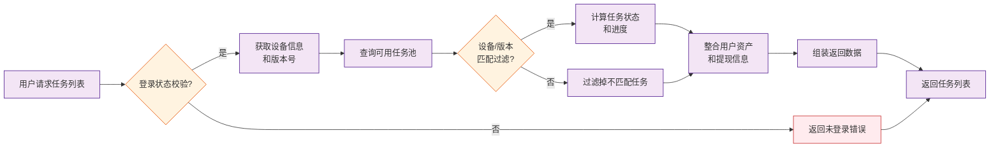
* **请求参数变更点**: 
```json
{
  "userId": "string|required|用户ID，用于身份校验和个性化展示|NEW",
  "deviceId": "string|required|设备标识，用于设备过滤|NEW",
  "version": "string|required|客户端版本号，用于版本过滤|NEW",
  "scene": "string|场景参数，用于场景过滤|NEW",
  "taskStatus": "string|任务完成状态|NEW",
  "rewardAmount": "float64|奖励金额|NEW",
  "progress": "int32|任务完成进度|NEW",
  "cashBalance": "float64|现金余额|NEW",
  "beanBalance": "int32|金豆余额|NEW",
  "withdrawCountdown": "int64|提现倒计时(秒)|NEW"
}
```
* **响应参数变更点**: 
```json
{
  "taskList": [
    {
      "taskId": "string|任务ID|NEW",
      "taskType": "string|任务类型(视频观看/签到等)|NEW",
      "taskName": "string|任务名称|NEW",
      "taskDesc": "string|任务描述|NEW",
      "taskIcon": "string|任务图标URL|NEW",
      "progress": "int|当前进度|NEW",
      "target": "int|目标进度|NEW",
      "rewardAmount": "float64|奖励金额|NEW",
      "rewardType": "string|奖励类型|NEW",
      "canClaim": "bool|是否可领取|NEW",
      "isSpecial": "bool|是否特殊任务|NEW",
      "expireTime": "string|过期时间|NEW"
    }
  ],
  "userInfo": {
    "userId": "string|用户ID|NEW",
    "isLogin": "bool|是否登录|NEW",
    "userGroup": "string|实验分组|NEW",
    "isCheat": "bool|是否作弊|NEW",
    "deviceId": "string|设备标识|NEW"
  },
  "permission": {
    "hasAccess": "bool|是否有访问权限|NEW",
    "blockReason": "string|拦截原因|NEW"
  },
  "assetInfo": {
    "cashBalance": "float64|现金余额|NEW",
    "beanBalance": "int|金豆余额|NEW",
    "withdrawCountdown": "string|提现倒计时|NEW"
  },
  "filterParams": {
    "deviceType": "string|设备类型|NEW",
    "appVersion": "string|应用版本号|NEW",
    "scene": "string|场景参数|NEW"
  }
}
```

### 3.1.3 任务状态管理（新增）
* **代码库**: [baidu/searchbox/sbox-basic](https://console.cloud.baidu-int.com/devops/icode/repos/baidu/searchbox/sbox-basic/tree/master)
* **接口路径**: `/baiduboxapp/basic/ddmission/taskStatus`
* **调用方式**: `POST`
* **变更功能描述**: 
```
1. 管理用户任务状态，包括任务开始、进行中、完成等状态
2. 处理任务状态变更事件，如任务完成、奖励领取等
3. 与任务面板管理接口和视频任务列表接口协同工作，确保状态一致性
4. 提供任务状态查询功能，支持按任务类型、状态等条件过滤
5. 处理任务状态异常情况，如任务中断、重复提交等
```
* **变更功能流程图**:
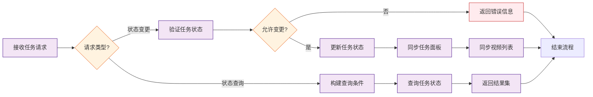
* **请求参数变更点**: 
```json
{
  "userId": "string|required|用户ID，用于身份校验",
  "deviceId": "string|required|设备标识，用于设备过滤",
  "taskId": "string|required|任务唯一标识",
  "taskType": "string|required|任务类型（video/signin等）",
  "taskStatus": "string|required|任务完成状态",
  "rewardStatus": "string|奖励领取状态",
  "progress": "int32|任务完成进度",
  "eventType": "string|required|状态变更事件类型（start/progress/finish/reward等）",
  "timestamp": "int64|required|事件发生时间戳",
  "antiCheatCheck": "bool|反作弊检查标记",
  "filterCondition": {
    "statusFilter": "string|任务状态过滤条件",
    "typeFilter": "string|任务类型过滤条件"
  },
  "errorInfo": {
    "errorCode": "string|错误码",
    "errorMsg": "string|错误信息"
  }
}
```
* **响应参数变更点**: 
```json
{
  "taskStatus": {
    "taskId": "string|任务ID",
    "taskType": "string|任务类型(视频观看/签到等)",
    "currentStatus": "string|当前状态(started/in_progress/completed)",
    "progress": "int|当前进度",
    "target": "int|目标进度",
    "lastUpdateTime": "string|最后状态更新时间",
    "expireTime": "string|过期时间",
    "canClaim": "bool|是否可领取奖励",
    "isInterrupted": "bool|是否被中断",
    "interruptReason": "string|中断原因",
    "isDuplicate": "bool|是否重复提交"
  },
  "rewardInfo": {
    "rewardAmount": "float64|奖励金额",
    "rewardType": "string|奖励类型",
    "isClaimed": "bool|是否已领取",
    "claimTime": "string|领取时间"
  },
  "userInfo": {
    "userId": "string|用户ID",
    "userGroup": "string|实验分组",
    "isCheat": "bool|是否作弊"
  },
  "errorInfo": {
    "hasError": "bool|是否有错误",
    "errorCode": "string|错误码",
    "errorMsg": "string|错误信息"
  },
  "filterParams": {
    "taskTypeFilter": "string|任务类型过滤条件",
    "statusFilter": "string|状态过滤条件",
    "timeRange": "string|时间范围过滤条件"
  }
}
```

### 3.1.4 视频任务状态（新增）
* **代码库**: [baidu/jady/ug-duoduo-video](https://console.cloud.baidu-int.com/devops/icode/repos/baidu/jady/ug-duoduo-video/tree/master)
* **接口路径**: `/video/external/task/status`
* **调用方式**: `POST`
* **变更功能描述**: 
```
1. 管理视频任务状态，包括视频观看进度、完成状态等
2. 处理视频任务状态变更事件，如视频观看完成、奖励领取等
3. 与视频任务列表接口协同工作，确保状态一致性
4. 提供视频任务状态查询功能，支持按任务ID、状态等条件过滤
5. 处理视频任务状态异常情况，如观看中断、重复提交等
```
* **变更功能流程图**:
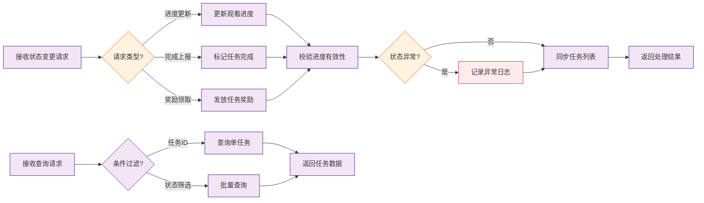
* **请求参数变更点**: 
```json
{
  "userId": "string|required|用户ID，用于身份校验",
  "deviceId": "string|required|设备标识，用于设备过滤",
  "taskId": "string|required|任务唯一标识",
  "taskType": "string|required|任务类型（video/signin等）",
  "taskStatus": "string|required|任务完成状态",
  "rewardStatus": "string|奖励领取状态",
  "progress": "int32|任务完成进度",
  "eventType": "string|required|状态变更事件类型（start/progress/finish/reward等）",
  "timestamp": "int64|required|事件发生时间戳",
  "antiCheatCheck": "bool|反作弊检查标记",
  "filterCondition": {
    "statusFilter": "string|任务状态过滤条件",
    "typeFilter": "string|任务类型过滤条件"
  },
  "errorInfo": {
    "errorCode": "string|错误码",
    "errorMsg": "string|错误信息"
  }
}
```
* **响应参数变更点**: 
```json
{
  "taskStatus": {
    "taskId": "string|任务ID",
    "taskType": "string|任务类型(视频观看/签到等)",
    "currentStatus": "string|当前状态(started/in_progress/completed)",
    "progress": "int|当前进度",
    "target": "int|目标进度",
    "lastUpdateTime": "string|最后状态更新时间",
    "expireTime": "string|过期时间",
    "canClaim": "bool|是否可领取奖励",
    "isInterrupted": "bool|是否被中断",
    "interruptReason": "string|中断原因",
    "isDuplicate": "bool|是否重复提交",
    "videoDuration": "int|视频总时长(秒)",
    "watchedDuration": "int|已观看时长(秒)",
    "playbackRate": "float64|播放速率",
    "isMuted": "bool|是否静音",
    "resolution": "string|视频分辨率"
  },
  "rewardInfo": {
    "rewardAmount": "float64|奖励金额",
    "rewardType": "string|奖励类型",
    "isClaimed": "bool|是否已领取",
    "claimTime": "string|领取时间",
    "rewardDesc": "string|奖励描述"
  },
  "userInfo": {
    "userId": "string|用户ID",
    "userGroup": "string|实验分组",
    "isCheat": "bool|是否作弊",
    "deviceId": "string|设备标识"
  },
  "errorInfo": {
    "hasError": "bool|是否有错误",
    "errorCode": "string|错误码",
    "errorMsg": "string|错误信息",
    "retryable": "bool|是否可重试"
  },
  "filterParams": {
    "taskTypeFilter": "string|任务类型过滤条件",
    "statusFilter": "string|状态过滤条件",
    "timeRange": "string|时间范围过滤条件",
    "videoId": "string|视频ID过滤条件"
  },
  "eventInfo": {
    "eventType": "string|事件类型(watch_start/watch_progress/watch_complete/reward_claim)",
    "eventTime": "string|事件发生时间",
    "eventData": "object|事件相关数据"
  }
}
```

## 3.2 浏览任务倒计时控制
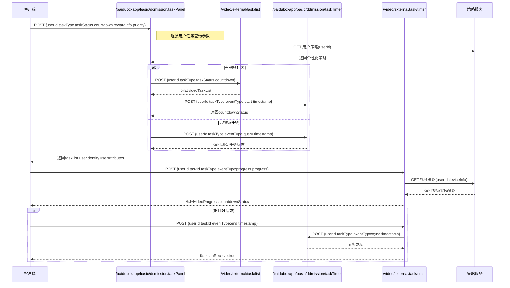
### 3.2.1 任务面板管理（修改）
* **代码库**: [baidu/searchbox/sbox-basic](https://console.cloud.baidu-int.com/devops/icode/repos/baidu/searchbox/sbox-basic/tree/master)
* **接口路径**: `/baiduboxapp/basic/ddmission/taskPanel`
* **调用方式**: `POST`
* **变更功能描述**: 
```
1. 展示用户可参与的任务列表，包括浏览任务倒计时控制
2. 显示用户当前的任务进度和奖励情况，包含倒计时信息
3. 提供任务完成后的奖励领取功能，支持倒计时结束后的奖励处理
4. 根据用户身份和属性进行个性化任务展示，包括倒计时任务的优先级调整
```
* **变更功能流程图**:
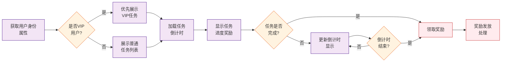
* **请求参数变更点**: 
```json
{
  "tversion": "string|required|版本信息|MODIFY",
  "userId": "string|required|用户ID|NEW",
  "taskType": "string|任务类型|NEW",
  "taskStatus": "string|任务状态|NEW",
  "countdown": "int64|倒计时信息|NEW",
  "rewardInfo": {
    "rewardType": "string|奖励类型|NEW",
    "rewardAmount": "int64|奖励数量|NEW"
  },
  "priority": "int64|任务优先级|NEW"
}
```
* **响应参数变更点**: 
```json
{
  "taskList": [
    {
      "taskId": "string|任务ID|NEW",
      "taskName": "string|任务名称|NEW",
      "taskType": "string|任务类型|NEW",
      "taskStatus": "string|任务状态|NEW",
      "progress": "string|任务进度|NEW",
      "rewardAmount": "float64|奖励金额|NEW",
      "countdown": "int64|倒计时(秒)|NEW",
      "priority": "int|任务优先级|NEW",
      "canReceive": "bool|是否可领取奖励|NEW",
      "receiveStatus": "string|领取状态|NEW"
    }
  ],
  "userIdentity": "string|用户身份标识|NEW",
  "userAttributes": "map[string]string|用户属性|NEW"
}
```

### 3.2.2 视频任务列表（修改）
* **代码库**: [baidu/jady/ug-duoduo-video](https://console.cloud.baidu-int.com/devops/icode/repos/baidu/jady/ug-duoduo-video/tree/master)
* **接口路径**: `/video/external/task/list`
* **调用方式**: `GET`
* **变更功能描述**: 
```
1. 向用户展示可参与的任务列表，包括浏览任务倒计时控制
2. 提供与任务相关的关键信息，如任务状态、奖励金额、完成进度及倒计时信息
3. 根据用户设备、版本号、场景参数过滤不匹配的任务，优先下发倒计时任务
4. 查询用户任务完成记录，判断倒计时任务是否可领取
```
* **变更功能流程图**:
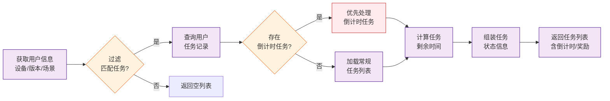
* **请求参数变更点**: 
```json
{
  "callback": "string|回调函数名|MODIFY",
  "tversion": "string|required|版本信息|NEW",
  "userId": "string|required|用户ID|NEW",
  "taskType": "string|任务类型|NEW",
  "taskStatus": "string|任务状态|NEW",
  "countdown": "int64|倒计时信息|NEW",
  "rewardInfo": {
    "rewardType": "string|奖励类型|NEW",
    "rewardAmount": "int64|奖励数量|NEW"
  },
  "priority": "int64|任务优先级|NEW"
}
```
* **响应参数变更点**: 
```json
{
  "taskList": [
    {
      "taskId": "string|任务ID|NEW",
      "taskName": "string|任务名称|NEW",
      "taskType": "string|任务类型|NEW",
      "taskStatus": "string|任务状态|NEW",
      "progress": "string|任务进度|NEW",
      "rewardAmount": "float64|奖励金额|NEW",
      "countdown": "int64|倒计时(秒)|NEW",
      "priority": "int|任务优先级|NEW",
      "canReceive": "bool|是否可领取奖励|NEW",
      "receiveStatus": "string|领取状态|NEW"
    }
  ],
  "userIdentity": "string|用户身份标识|NEW",
  "userAttributes": "map[string]string|用户属性|NEW",
  "deviceInfo": "map[string]string|设备信息|NEW",
  "version": "string|版本号|NEW",
  "scene": "string|场景参数|NEW"
}
```

### 3.2.3 倒计时任务管理（新增）
* **代码库**: [baidu/searchbox/sbox-basic](https://console.cloud.baidu-int.com/devops/icode/repos/baidu/searchbox/sbox-basic/tree/master)
* **接口路径**: `/baiduboxapp/basic/ddmission/taskTimer`
* **调用方式**: `POST`
* **变更功能描述**: 
```
1. 管理浏览任务的倒计时状态，包括倒计时开始、进行中、结束等状态
2. 处理倒计时任务状态变更事件，如倒计时结束、奖励领取等
3. 与任务面板管理接口和视频任务列表接口协同工作，确保倒计时状态一致性
4. 提供倒计时任务状态查询功能，支持按任务类型、状态等条件过滤
5. 处理倒计时任务状态异常情况，如倒计时中断、重复提交等
```
* **变更功能流程图**:
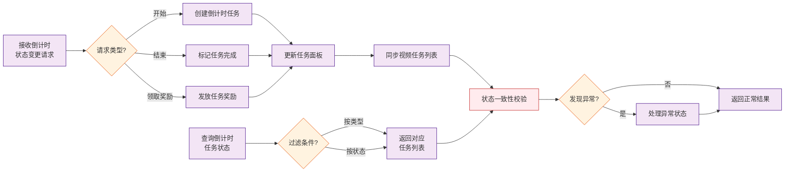
* **请求参数变更点**: 
```json
{
  "userId": "string|required|用户ID",
  "taskType": "string|required|任务类型",
  "taskStatus": "string|required|任务状态",
  "countdown": "int64|倒计时信息",
  "eventType": "string|required|事件类型（倒计时开始/结束/奖励领取等）",
  "timestamp": "int64|required|事件发生时间戳",
  "rewardInfo": {
    "rewardType": "string|奖励类型",
    "rewardAmount": "int64|奖励数量"
  },
  "queryCondition": {
    "statusFilter": "string|状态过滤条件",
    "typeFilter": "string|任务类型过滤条件"
  },
  "exceptionInfo": {
    "exceptionType": "string|异常类型（中断/重复提交等）",
    "exceptionTime": "int64|异常发生时间"
  }
}
```
* **响应参数变更点**: 
```json
{
  "taskList": [
    {
      "taskId": "string|任务ID",
      "taskName": "string|任务名称",
      "taskType": "string|任务类型",
      "taskStatus": "string|任务状态",
      "progress": "string|任务进度",
      "rewardAmount": "float64|奖励金额",
      "countdown": "int64|倒计时(秒)",
      "priority": "int|任务优先级",
      "canReceive": "bool|是否可领取奖励",
      "receiveStatus": "string|领取状态",
      "countdownStatus": "string|倒计时状态(start/processing/end)",
      "countdownStartTime": "int64|倒计时开始时间戳",
      "countdownEndTime": "int64|倒计时结束时间戳",
      "isInterrupted": "bool|是否中断",
      "interruptReason": "string|中断原因",
      "isRepeated": "bool|是否重复提交"
    }
  ],
  "userIdentity": "string|用户身份标识",
  "userAttributes": "map[string]string|用户属性",
  "currentTime": "int64|当前服务器时间戳",
  "version": "string|接口版本号",
  "scene": "string|场景参数"
}
```

### 3.2.4 视频倒计时任务（新增）
* **代码库**: [baidu/jady/ug-duoduo-video](https://console.cloud.baidu-int.com/devops/icode/repos/baidu/jady/ug-duoduo-video/tree/master)
* **接口路径**: `/video/external/task/timer`
* **调用方式**: `POST`
* **变更功能描述**: 
```
1. 管理视频浏览任务的倒计时状态，包括视频观看进度、倒计时完成状态等
2. 处理视频倒计时任务状态变更事件，如倒计时结束、奖励领取等
3. 与视频任务列表接口协同工作，确保倒计时状态一致性
4. 提供视频倒计时任务状态查询功能，支持按任务ID、状态等条件过滤
5. 处理视频倒计时任务状态异常情况，如观看中断、重复提交等
```
* **变更功能流程图**:
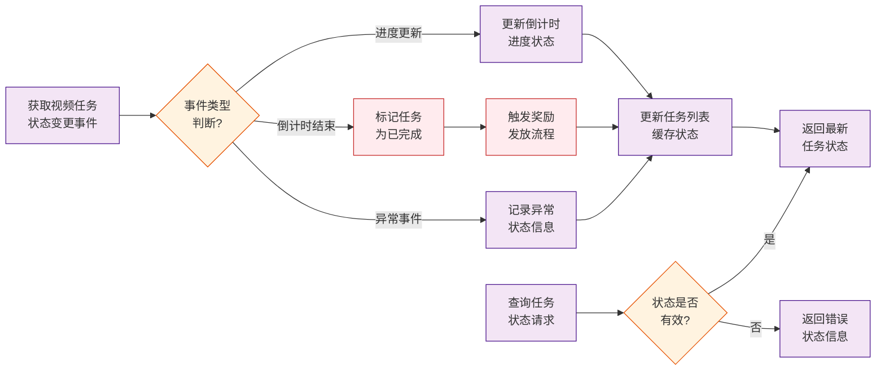
* **请求参数变更点**: 
```json
{
  "userId": "string|required|用户ID",
  "taskId": "string|required|任务ID",
  "taskType": "string|required|任务类型",
  "taskStatus": "string|required|任务状态",
  "progress": "int64|视频观看进度",
  "countdown": "int64|倒计时信息",
  "eventType": "string|required|事件类型（倒计时开始/结束/奖励领取等）",
  "timestamp": "int64|required|事件发生时间戳",
  "rewardInfo": {
    "rewardType": "string|奖励类型",
    "rewardAmount": "int64|奖励数量"
  },
  "queryCondition": {
    "taskIdFilter": "string|任务ID过滤条件",
    "statusFilter": "string|状态过滤条件"
  },
  "exceptionInfo": {
    "exceptionType": "string|异常类型（中断/重复提交等）",
    "exceptionTime": "int64|异常发生时间"
  }
}
```
* **响应参数变更点**: 
```json
{
  "taskList": [
    {
      "taskId": "string|任务ID",
      "taskName": "string|任务名称",
      "taskType": "string|任务类型",
      "taskStatus": "string|任务状态",
      "progress": "string|任务进度",
      "rewardAmount": "float64|奖励金额",
      "countdown": "int64|倒计时(秒)",
      "priority": "int|任务优先级",
      "canReceive": "bool|是否可领取奖励",
      "receiveStatus": "string|领取状态",
      "countdownStatus": "string|倒计时状态(start/processing/end)",
      "countdownStartTime": "int64|倒计时开始时间戳",
      "countdownEndTime": "int64|倒计时结束时间戳",
      "isInterrupted": "bool|是否中断",
      "interruptReason": "string|中断原因",
      "isRepeated": "bool|是否重复提交",
      "videoProgress": "float64|视频观看进度(0-1)",
      "videoDuration": "int64|视频总时长(秒)",
      "lastWatchTime": "int64|最后观看时间戳"
    }
  ],
  "userIdentity": "string|用户身份标识",
  "userAttributes": "map[string]string|用户属性",
  "currentTime": "int64|当前服务器时间戳",
  "version": "string|接口版本号",
  "scene": "string|场景参数",
  "deviceInfo": "map[string]string|设备信息",
  "errorCode": "string|异常状态码",
  "errorMsg": "string|异常信息"
}
```

## 3.3 下单任务处理
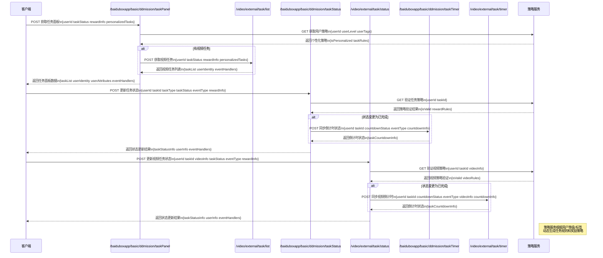
### 3.3.1 任务面板管理（修改）
* **代码库**: [baidu/searchbox/sbox-basic](https://console.cloud.baidu-int.com/devops/icode/repos/baidu/searchbox/sbox-basic/tree/master)
* **接口路径**: `/baiduboxapp/basic/ddmission/taskPanel`
* **调用方式**: `POST`
* **变更功能描述**: 
```
1. 展示用户可参与的下单任务列表
2. 显示用户当前的下单任务进度和奖励情况
3. 提供下单任务完成后的奖励领取功能
4. 根据用户身份和属性进行个性化下单任务展示
5. 处理下单任务的状态变更事件
```
* **变更功能流程图**:
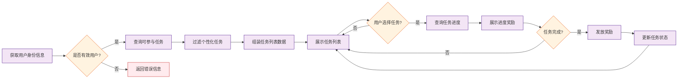
* **请求参数变更点**: 
```json
{
  "userId": "string|required|用户唯一标识|NEW",
  "taskStatus": "string|任务状态（进行中/已完成/未开始等）|NEW",
  "rewardInfo": {
    "amount": "int64|奖励金额|NEW",
    "type": "string|奖励类型|NEW"
  },
  "personalizedTasks": {
    "userLevel": "int64|用户等级|NEW",
    "userTags": "[]string|用户标签列表|NEW"
  }
}
```
* **响应参数变更点**: 
```json
{
  "taskList": [
    {
      "taskId": "string|任务ID|NEW",
      "taskName": "string|任务名称|NEW",
      "taskDesc": "string|任务描述|NEW",
      "taskStatus": "int|任务状态(0-未开始 1-进行中 2-已完成 3-已领取)|NEW",
      "taskProgress": "int|当前任务进度|NEW",
      "taskTarget": "int|任务目标值|NEW",
      "rewardAmount": "float64|奖励金额|NEW",
      "rewardStatus": "int|奖励状态(0-未达成 1-可领取 2-已领取)|NEW",
      "startTime": "string|任务开始时间|NEW",
      "endTime": "string|任务结束时间|NEW",
      "isPersonalized": "bool|是否个性化任务|NEW"
    }
  ],
  "userIdentity": "string|用户身份标识|NEW",
  "userAttributes": "object|用户属性信息|NEW",
  "eventHandlers": {
    "statusChange": "string|状态变更事件处理器|NEW",
    "rewardClaim": "string|奖励领取事件处理器|NEW"
  }
}
```

### 3.3.2 视频任务列表（修改）
* **代码库**: [baidu/jady/ug-duoduo-video](https://console.cloud.baidu-int.com/devops/icode/repos/baidu/jady/ug-duoduo-video/tree/master)
* **接口路径**: `/video/external/task/list`
* **调用方式**: `GET`
* **变更功能描述**: 
```
1. 展示用户可参与的下单任务列表
2. 提供与下单任务相关的关键信息（如任务状态、奖励金额、完成进度等）
3. 激励用户参与下单任务并提升活跃度
4. 处理下单任务的状态计算和过滤
```
* **变更功能流程图**:
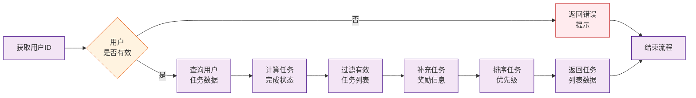
* **请求参数变更点**: 
```json
{
  "userId": "string|required|用户唯一标识|NEW",
  "taskStatus": "string|任务状态（进行中/已完成/未开始等）|NEW",
  "rewardInfo": {
    "amount": "int64|奖励金额|NEW",
    "type": "string|奖励类型|NEW"
  },
  "personalizedTasks": {
    "userLevel": "int64|用户等级|NEW",
    "userTags": "[]string|用户标签列表|NEW"
  }
}
```
* **响应参数变更点**: 
```json
{
  "taskList": [
    {
      "taskId": "string|任务唯一标识|NEW",
      "taskName": "string|任务名称|NEW",
      "taskDesc": "string|任务详细描述|NEW",
      "taskStatus": "int|任务状态(0-未开始 1-进行中 2-已完成 3-已领取)|NEW",
      "taskProgress": "int|当前完成进度值|NEW",
      "taskTarget": "int|任务目标值|NEW",
      "rewardAmount": "float64|可获得的奖励金额|NEW",
      "rewardStatus": "int|奖励领取状态(0-未达成 1-可领取 2-已领取)|NEW",
      "startTime": "string|任务开始时间(yyyy-MM-dd HH:mm:ss)|NEW",
      "endTime": "string|任务截止时间(yyyy-MM-dd HH:mm:ss)|NEW"
    }
  ],
  "userIdentity": "string|用户唯一标识|NEW",
  "eventHandlers": {
    "statusChange": "string|任务状态变更回调地址|NEW",
    "rewardClaim": "string|奖励领取回调地址|NEW"
  }
}
```

### 3.3.3 下单任务状态管理（新增）
* **代码库**: [baidu/searchbox/sbox-basic](https://console.cloud.baidu-int.com/devops/icode/repos/baidu/searchbox/sbox-basic/tree/master)
* **接口路径**: `/baiduboxapp/basic/ddmission/taskStatus`
* **调用方式**: `POST`
* **变更功能描述**: 
```
1. 管理用户下单任务状态，包括任务开始、进行中、完成等状态
2. 处理下单任务状态变更事件，如任务完成、奖励领取等
3. 与任务面板管理接口和视频任务列表接口协同工作，确保状态一致性
4. 提供下单任务状态查询功能，支持按任务类型、状态等条件过滤
5. 处理下单任务状态异常情况，如任务中断、重复提交等
```
* **变更功能流程图**:
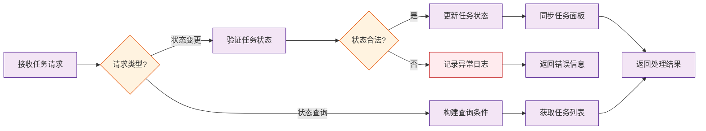
* **请求参数变更点**: 
```json
{
  "userId": "string|required|用户唯一标识",
  "taskId": "string|required|任务唯一标识",
  "taskType": "string|required|任务类型",
  "taskStatus": "string|required|任务状态（未开始/进行中/已完成/已中断）",
  "eventType": "string|required|状态变更事件类型（开始/完成/领取奖励/中断）",
  "rewardInfo": {
    "amount": "int64|奖励金额",
    "type": "string|奖励类型",
    "received": "bool|是否已领取"
  },
  "queryCondition": {
    "taskType": "string|查询条件-任务类型",
    "taskStatus": "string|查询条件-任务状态",
    "startTime": "int64|查询条件-任务开始时间范围起始",
    "endTime": "int64|查询条件-任务开始时间范围结束"
  },
  "errorInfo": {
    "code": "string|异常错误码",
    "message": "string|异常描述信息",
    "retryable": "bool|是否可重试"
  }
}
```
* **响应参数变更点**: 
```json
{
  "taskStatusInfo": {
    "taskId": "string|任务ID",
    "taskName": "string|任务名称",
    "taskDesc": "string|任务描述",
    "currentStatus": "int|当前任务状态(0-未开始 1-进行中 2-已完成 3-已领取)",
    "progress": "int|当前任务进度",
    "target": "int|任务目标值",
    "rewardInfo": {
      "amount": "float64|奖励金额",
      "status": "int|奖励状态(0-未达成 1-可领取 2-已领取)"
    },
    "startTime": "string|任务开始时间",
    "endTime": "string|任务结束时间",
    "isPersonalized": "bool|是否个性化任务"
  },
  "userInfo": {
    "userId": "string|用户唯一标识",
    "userAttributes": "object|用户属性信息"
  },
  "eventHandlers": {
    "statusChange": "string|状态变更事件处理器",
    "rewardClaim": "string|奖励领取事件处理器",
    "errorHandler": "string|异常处理回调地址"
  },
  "errorInfo": {
    "hasError": "bool|是否发生异常",
    "errorCode": "string|错误码",
    "errorMsg": "string|错误信息"
  },
  "timestamp": "string|接口响应时间戳"
}
```

### 3.3.4 视频下单任务状态管理（新增）
* **代码库**: [baidu/jady/ug-duoduo-video](https://console.cloud.baidu-int.com/devops/icode/repos/baidu/jady/ug-duoduo-video/tree/master)
* **接口路径**: `/video/external/task/status`
* **调用方式**: `POST`
* **变更功能描述**: 
```
1. 管理视频下单任务状态，包括视频观看进度、完成状态等
2. 处理视频下单任务状态变更事件，如视频观看完成、奖励领取等
3. 与视频任务列表接口协同工作，确保状态一致性
4. 提供视频下单任务状态查询功能，支持按任务ID、状态等条件过滤
5. 处理视频下单任务状态异常情况，如观看中断、重复提交等
```
* **变更功能流程图**:
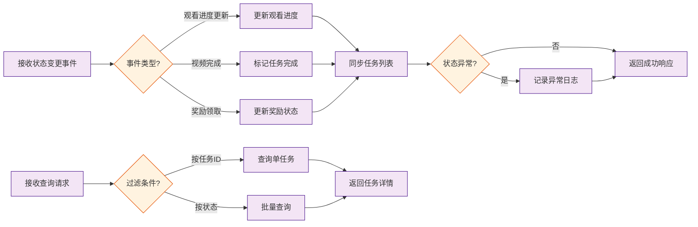
* **请求参数变更点**: 
```json
{
  "userId": "string|required|用户唯一标识",
  "taskId": "string|required|任务唯一标识",
  "videoInfo": {
    "progress": "int64|视频观看进度（百分比）",
    "duration": "int64|视频总时长（秒）",
    "currentPosition": "int64|当前播放位置（秒）"
  },
  "taskStatus": "string|required|任务状态（未开始/进行中/已完成/已中断）",
  "eventType": "string|required|状态变更事件类型（开始/完成/领取奖励/中断）",
  "rewardInfo": {
    "amount": "int64|奖励金额",
    "type": "string|奖励类型",
    "received": "bool|是否已领取"
  },
  "queryCondition": {
    "taskId": "string|查询条件-任务ID",
    "taskStatus": "string|查询条件-任务状态",
    "startTime": "int64|查询条件-任务开始时间范围起始",
    "endTime": "int64|查询条件-任务开始时间范围结束"
  },
  "errorInfo": {
    "code": "string|异常错误码",
    "message": "string|异常描述信息",
    "retryable": "bool|是否可重试"
  }
}
```
* **响应参数变更点**: 
```json
{
  "taskStatusInfo": {
    "taskId": "string|任务ID",
    "taskName": "string|任务名称",
    "taskDesc": "string|任务描述",
    "currentStatus": "int|当前任务状态(0-未开始 1-进行中 2-已完成 3-已领取)",
    "progress": "int|当前任务进度",
    "target": "int|任务目标值",
    "videoInfo": {
      "videoId": "string|视频ID",
      "videoDuration": "int|视频总时长(秒)",
      "watchedDuration": "int|已观看时长(秒)",
      "watchProgress": "float64|观看进度百分比",
      "isCompleted": "bool|是否观看完成"
    },
    "rewardInfo": {
      "amount": "float64|奖励金额",
      "status": "int|奖励状态(0-未达成 1-可领取 2-已领取)"
    },
    "startTime": "string|任务开始时间",
    "endTime": "string|任务结束时间",
    "isPersonalized": "bool|是否个性化任务"
  },
  "userInfo": {
    "userId": "string|用户唯一标识",
    "userAttributes": "object|用户属性信息"
  },
  "eventHandlers": {
    "statusChange": "string|状态变更事件处理器",
    "rewardClaim": "string|奖励领取事件处理器",
    "errorHandler": "string|异常处理回调地址"
  },
  "errorInfo": {
    "hasError": "bool|是否发生异常",
    "errorCode": "string|错误码",
    "errorMsg": "string|错误信息",
    "errorType": "string|错误类型(watch_interrupted-观看中断 duplicate_submission-重复提交)"
  },
  "timestamp": "string|接口响应时间戳"
}
```

### 3.3.5 下单任务倒计时管理（新增）
* **代码库**: [baidu/searchbox/sbox-basic](https://console.cloud.baidu-int.com/devops/icode/repos/baidu/searchbox/sbox-basic/tree/master)
* **接口路径**: `/baiduboxapp/basic/ddmission/taskTimer`
* **调用方式**: `POST`
* **变更功能描述**: 
```
1. 管理浏览下单任务的倒计时状态，包括倒计时开始、进行中、结束等状态
2. 处理倒计时下单任务状态变更事件，如倒计时结束、奖励领取等
3. 与任务面板管理接口和视频任务列表接口协同工作，确保倒计时状态一致性
4. 提供倒计时下单任务状态查询功能，支持按任务类型、状态等条件过滤
5. 处理倒计时下单任务状态异常情况，如倒计时中断、重复提交等
```
* **变更功能流程图**:
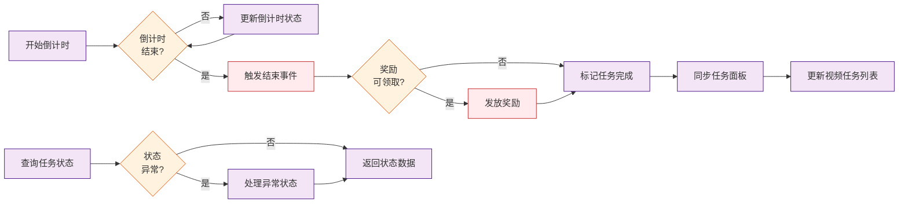
* **请求参数变更点**: 
```json
{
  "userId": "string|required|用户唯一标识",
  "taskId": "string|required|任务唯一标识",
  "taskType": "string|required|任务类型",
  "countdownStatus": "string|required|倒计时状态（未开始/进行中/已结束）",
  "eventType": "string|required|状态变更事件类型（开始/结束/领取奖励/中断）",
  "countdownInfo": {
    "startTime": "int64|倒计时开始时间",
    "endTime": "int64|倒计时结束时间",
    "remainingTime": "int64|剩余时间（秒）"
  },
  "rewardInfo": {
    "amount": "int64|奖励金额",
    "type": "string|奖励类型",
    "received": "bool|是否已领取"
  },
  "queryCondition": {
    "taskType": "string|查询条件-任务类型",
    "countdownStatus": "string|查询条件-倒计时状态",
    "startTime": "int64|查询条件-任务开始时间范围起始",
    "endTime": "int64|查询条件-任务开始时间范围结束"
  },
  "errorInfo": {
    "code": "string|异常错误码",
    "message": "string|异常描述信息",
    "retryable": "bool|是否可重试"
  }
}
```
* **响应参数变更点**: 
```json
{
  "taskCountdownInfo": {
    "taskId": "string|任务ID",
    "taskName": "string|任务名称",
    "taskDesc": "string|任务描述",
    "currentStatus": "int|当前任务状态(0-未开始 1-进行中 2-已完成 3-已领取)",
    "countdownStatus": "int|倒计时状态(0-未开始 1-进行中 2-已结束)",
    "remainingTime": "int|剩余时间(秒)",
    "progress": "int|当前任务进度",
    "target": "int|任务目标值",
    "rewardInfo": {
      "amount": "float64|奖励金额",
      "status": "int|奖励状态(0-未达成 1-可领取 2-已领取)"
    },
    "startTime": "string|任务开始时间",
    "endTime": "string|任务结束时间",
    "isPersonalized": "bool|是否个性化任务"
  },
  "userInfo": {
    "userId": "string|用户唯一标识",
    "userAttributes": "object|用户属性信息"
  },
  "eventHandlers": {
    "statusChange": "string|状态变更事件处理器",
    "rewardClaim": "string|奖励领取事件处理器",
    "countdownEnd": "string|倒计时结束事件处理器",
    "errorHandler": "string|异常处理回调地址"
  },
  "errorInfo": {
    "hasError": "bool|是否发生异常",
    "errorCode": "string|错误码",
    "errorMsg": "string|错误信息",
    "errorType": "string|错误类型(countdown_interrupted-倒计时中断 duplicate_submission-重复提交)"
  },
  "timestamp": "string|接口响应时间戳"
}
```

### 3.3.6 视频下单任务倒计时管理（新增）
* **代码库**: [baidu/jady/ug-duoduo-video](https://console.cloud.baidu-int.com/devops/icode/repos/baidu/jady/ug-duoduo-video/tree/master)
* **接口路径**: `/video/external/task/timer`
* **调用方式**: `POST`
* **变更功能描述**: 
```
1. 管理视频浏览下单任务的倒计时状态，包括视频观看进度、倒计时完成状态等
2. 处理视频倒计时下单任务状态变更事件，如倒计时结束、奖励领取等
3. 与视频任务列表接口协同工作，确保倒计时状态一致性
4. 提供视频倒计时下单任务状态查询功能，支持按任务ID、状态等条件过滤
5. 处理视频倒计时下单任务状态异常情况，如观看中断、重复提交等
```
* **变更功能流程图**:
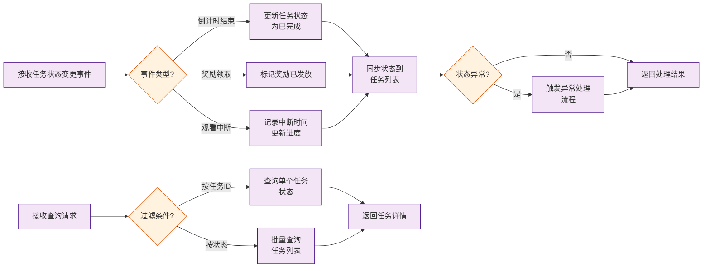
* **请求参数变更点**: 
```json
{
  "userId": "string|required|用户唯一标识",
  "taskId": "string|required|任务唯一标识",
  "taskType": "string|required|任务类型",
  "countdownStatus": "string|required|倒计时状态（未开始/进行中/已结束）",
  "eventType": "string|required|状态变更事件类型（开始/结束/领取奖励/中断）",
  "videoInfo": {
    "progress": "int64|视频观看进度（百分比）",
    "duration": "int64|视频总时长（秒）",
    "currentPosition": "int64|当前播放位置（秒）"
  },
  "countdownInfo": {
    "startTime": "int64|倒计时开始时间",
    "endTime": "int64|倒计时结束时间",
    "remainingTime": "int64|剩余时间（秒）"
  },
  "rewardInfo": {
    "amount": "int64|奖励金额",
    "type": "string|奖励类型",
    "received": "bool|是否已领取"
  },
  "queryCondition": {
    "taskId": "string|查询条件-任务ID",
    "taskStatus": "string|查询条件-任务状态",
    "countdownStatus": "string|查询条件-倒计时状态",
    "startTime": "int64|查询条件-任务开始时间范围起始",
    "endTime": "int64|查询条件-任务开始时间范围结束"
  },
  "errorInfo": {
    "code": "string|异常错误码",
    "message": "string|异常描述信息",
    "retryable": "bool|是否可重试"
  }
}
```
* **响应参数变更点**: 
```json
{
  "taskCountdownInfo": {
    "taskId": "string|任务ID",
    "taskName": "string|任务名称",
    "taskDesc": "string|任务描述",
    "currentStatus": "int|当前任务状态(0-未开始 1-进行中 2-已完成 3-已领取)",
    "countdownStatus": "int|倒计时状态(0-未开始 1-进行中 2-已结束)",
    "remainingTime": "int|剩余时间(秒)",
    "progress": "int|当前任务进度",
    "target": "int|任务目标值",
    "videoInfo": {
      "videoId": "string|视频ID",
      "videoDuration": "int|视频总时长(秒)",
      "watchedDuration": "int|已观看时长(秒)",
      "watchProgress": "float64|观看进度百分比",
      "isCompleted": "bool|是否观看完成"
    },
    "rewardInfo": {
      "amount": "float64|奖励金额",
      "status": "int|奖励状态(0-未达成 1-可领取 2-已领取)"
    },
    "startTime": "string|任务开始时间",
    "endTime": "string|任务结束时间",
    "isPersonalized": "bool|是否个性化任务"
  },
  "userInfo": {
    "userId": "string|用户唯一标识",
    "userAttributes": "object|用户属性信息"
  },
  "eventHandlers": {
    "statusChange": "string|状态变更事件处理器",
    "rewardClaim": "string|奖励领取事件处理器",
    "countdownEnd": "string|倒计时结束事件处理器",
    "errorHandler": "string|异常处理回调地址"
  },
  "errorInfo": {
    "hasError": "bool|是否发生异常",
    "errorCode": "string|错误码",
    "errorMsg": "string|错误信息",
    "errorType": "string|错误类型(watch_interrupted-观看中断 duplicate_submission-重复提交 countdown_interrupted-倒计时中断)"
  },
  "timestamp": "string|接口响应时间戳"
}
```

## 3.4 退单奖励扣除
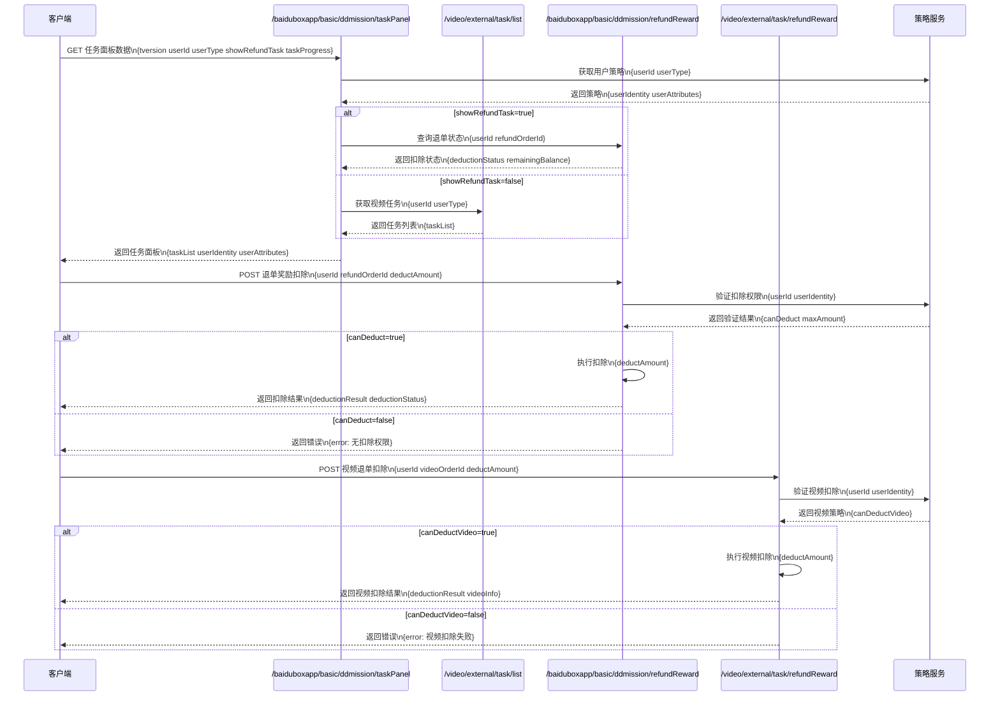
### 3.4.1 任务面板管理接口（修改）
* **代码库**: [baidu/searchbox/sbox-basic](https://console.cloud.baidu-int.com/devops/icode/repos/baidu/searchbox/sbox-basic/tree/master)
* **接口路径**: `/baiduboxapp/basic/ddmission/taskPanel`
* **调用方式**: `POST`
* **变更功能描述**: 
```
1. 展示用户可参与的任务列表，包括退单奖励扣除任务
2. 显示用户当前的任务进度和奖励情况，包括退单奖励扣除状态
3. 提供任务完成后的奖励领取功能，包括退单奖励扣除的领取
4. 根据用户身份和属性进行个性化任务展示，包括退单奖励扣除任务的展示
```
* **变更功能流程图**:
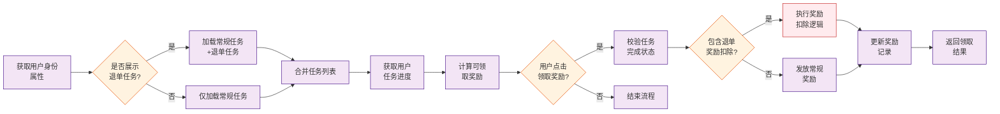
* **请求参数变更点**: 
```json
{
  "tversion": "string|required|版本信息|MODIFY",
  "userId": "string|required|用户ID|NEW",
  "userType": "string|用户类型|NEW",
  "showRefundTask": "bool|是否展示退单奖励扣除任务|NEW",
  "taskProgress": {
    "refundDeductionStatus": "string|退单奖励扣除状态|NEW"
  }
}
```
* **响应参数变更点**: 
```json
{
  "taskList": [
    {
      "taskId": "string|任务ID|NEW",
      "taskName": "string|任务名称|NEW",
      "taskType": "string|任务类型(常规任务/退单奖励扣除任务)|NEW",
      "taskStatus": "string|任务状态(未开始/进行中/已完成)|NEW",
      "progress": "string|当前任务进度|NEW",
      "rewardAmount": "float64|奖励金额|NEW",
      "deductionStatus": "string|退单奖励扣除状态(未扣除/已扣除)|NEW",
      "canReceive": "bool|是否可领取奖励|NEW",
      "isPersonalized": "bool|是否个性化展示|NEW"
    }
  ],
  "userIdentity": "string|用户身份标识|NEW",
  "userAttributes": "object|用户属性信息|NEW"
}
```

### 3.4.2 视频任务列表接口（修改）
* **代码库**: [baidu/jady/ug-duoduo-video](https://console.cloud.baidu-int.com/devops/icode/repos/baidu/jady/ug-duoduo-video/tree/master)
* **接口路径**: `/video/external/task/list`
* **调用方式**: `GET`
* **变更功能描述**: 
```
1. 展示用户可参与的任务列表，包括退单奖励扣除任务
2. 显示用户当前的任务进度和奖励情况，包括退单奖励扣除状态
3. 提供任务完成后的奖励领取功能，包括退单奖励扣除的领取
4. 根据用户身份和属性进行个性化任务展示，包括退单奖励扣除任务的展示
```
* **变更功能流程图**:
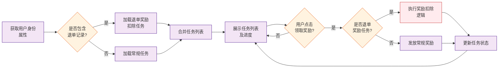
* **请求参数变更点**: 
```json
{
  "userId": "string|required|用户ID|NEW",
  "userType": "string|用户类型|NEW",
  "showRefundTask": "bool|是否展示退单奖励扣除任务|NEW",
  "taskProgress": {
    "refundDeductionStatus": "string|退单奖励扣除状态|NEW"
  }
}
```
* **响应参数变更点**: 
```json
{
  "taskList": [
    {
      "taskId": "string|任务ID|NEW",
      "taskName": "string|任务名称|NEW",
      "taskType": "string|任务类型(常规任务/退单奖励扣除任务)|NEW",
      "taskStatus": "string|任务状态(未开始/进行中/已完成)|NEW",
      "progress": "string|当前任务进度|NEW",
      "rewardAmount": "float64|奖励金额|NEW",
      "deductionStatus": "string|退单奖励扣除状态(未扣除/已扣除)|NEW",
      "canReceive": "bool|是否可领取奖励|NEW",
      "isPersonalized": "bool|是否个性化展示|NEW"
    }
  ],
  "userIdentity": "string|用户身份标识|NEW",
  "userAttributes": "object|用户属性信息|NEW"
}
```

### 3.4.3 退单奖励扣除接口（新增）
* **代码库**: [baidu/searchbox/sbox-basic](https://console.cloud.baidu-int.com/devops/icode/repos/baidu/searchbox/sbox-basic/tree/master)
* **接口路径**: `/baiduboxapp/basic/ddmission/refundReward`
* **调用方式**: `POST`
* **变更功能描述**: 
```
1. 处理用户退单奖励扣除请求
2. 检查用户退单奖励扣除条件
3. 扣除用户奖励
4. 更新用户奖励状态
5. 返回扣除结果
```
* **变更功能流程图**:
```mermaid
flowchart LR
    A[接收退单请求]
    B{满足扣除\n条件?}
    C[扣除用户奖励]
    D[更新奖励状态]
    E[返回操作结果]
    F[返回失败原因]

    A --> B
    B -- 是 --> C --> D --> E
    B -- 否 --> F

    %% 样式定义
    classDef process fill:#f3e5f5,stroke:#4a148c,stroke-width:1px  
    classDef decision fill:#fff3e0,stroke:#e65100,stroke-width:1px
    classDef important fill:#ffebee,stroke:#c62828,stroke-width:1px
    
    %% 应用样式
    class A,C,D,E,F process
    class B decision
```
* **请求参数变更点**: 
```json
{
  "userId": "string|required|用户ID",
  "userType": "string|用户类型",
  "refundOrderId": "string|required|退单ID",
  "deductAmount": "int64|required|扣除奖励金额",
  "deductReason": "string|扣除原因",
  "taskProgress": {
    "refundDeductionStatus": "string|退单奖励扣除状态"
  }
}
```
* **响应参数变更点**: 
```json
{
  "deductionResult": {
    "success": "bool|扣除是否成功",
    "deductedAmount": "float64|实际扣除金额",
    "remainingBalance": "float64|扣除后剩余余额"
  },
  "deductionStatus": "string|退单奖励扣除状态(未扣除/已扣除/部分扣除)",
  "orderInfo": {
    "orderId": "string|退单订单ID",
    "originalReward": "float64|原始奖励金额",
    "deductionReason": "string|扣除原因"
  },
  "userInfo": {
    "userId": "string|用户ID",
    "userIdentity": "string|用户身份标识",
    "rewardBalance": "float64|当前奖励余额"
  },
  "timestamp": "int64|扣除操作时间戳"
}
```

### 3.4.4 视频退单奖励扣除接口（新增）
* **代码库**: [baidu/jady/ug-duoduo-video](https://console.cloud.baidu-int.com/devops/icode/repos/baidu/jady/ug-duoduo-video/tree/master)
* **接口路径**: `/video/external/task/refundReward`
* **调用方式**: `POST`
* **变更功能描述**: 
```
1. 处理用户视频退单奖励扣除请求
2. 检查用户视频退单奖励扣除条件
3. 扣除用户视频奖励
4. 更新用户视频奖励状态
5. 返回扣除结果
```
* **变更功能流程图**:
```mermaid
flowchart LR
    A[接收退单请求] --> B{满足\n扣除条件?}
    B -- 是 --> C[扣除视频奖励]
    B -- 否 --> D[返回失败结果]
    C --> E[更新奖励状态]
    E --> F[返回成功结果]
    
    %% 样式定义
    classDef process fill:#f3e5f5,stroke:#4a148c,stroke-width:1px  
    classDef decision fill:#fff3e0,stroke:#e65100,stroke-width:1px
    classDef important fill:#ffebee,stroke:#c62828,stroke-width:1px
    
    %% 应用样式
    class A,C,E,F process
    class B decision
    class D important
```
* **请求参数变更点**: 
```json
{
  "userId": "string|required|用户ID",
  "userType": "string|用户类型",
  "videoOrderId": "string|required|视频订单ID",
  "deductAmount": "int64|required|扣除奖励金额",
  "deductReason": "string|扣除原因",
  "taskProgress": {
    "refundDeductionStatus": "string|退单奖励扣除状态"
  }
}
```
* **响应参数变更点**: 
```json
{
  "deductionResult": {
    "success": "bool|扣除是否成功",
    "deductedAmount": "float64|实际扣除金额",
    "remainingBalance": "float64|扣除后剩余余额"
  },
  "deductionStatus": "string|退单奖励扣除状态(未扣除/已扣除/部分扣除)",
  "videoInfo": {
    "videoId": "string|视频ID",
    "originalReward": "float64|原始奖励金额",
    "deductionReason": "string|扣除原因"
  },
  "userInfo": {
    "userId": "string|用户ID",
    "userIdentity": "string|用户身份标识",
    "rewardBalance": "float64|当前奖励余额"
  },
  "timestamp": "int64|扣除操作时间戳"
}
```

## 3.5 风控逻辑处理
```mermaid
sequenceDiagram
    participant Client as 客户端
    participant TaskPanel as /baiduboxapp/basic/ddmission/taskPanel
    participant VideoTask as /video/external/task/list
    participant RiskControl as /baiduboxapp/basic/ddmission/riskControl
    participant VideoRisk as /video/external/task/riskControl

    Client->>TaskPanel: POST 请求任务面板数据\n参数: tversion talosLiteParams city experimentGroup
    Note right of TaskPanel: 1. 检查用户访问权限\n2. 解析实验分组信息
    TaskPanel->>RiskControl: GET 风控检查\n参数: userId actionType=check checkParams
    alt 存在风险行为
        RiskControl-->>TaskPanel: 返回风险等级及限制措施\nriskLevel riskControlActions
        TaskPanel-->>Client: 返回受限任务面板\nisRiskUser taskList=[]
    else 正常用户
        TaskPanel->>VideoTask: GET 获取视频任务\n参数: tversion talosLiteParams experimentGroup
        VideoTask->>VideoRisk: GET 视频风控检查\n参数: userId actionType=query
        VideoRisk-->>VideoTask: 返回视频任务状态\nvideoTaskStatus watchBehavior
        VideoTask-->>TaskPanel: 返回过滤后任务列表\ntaskList userAssets
        TaskPanel-->>Client: 返回完整任务面板\ntaskList userAssets personalizedConfig
    end

    Note left of RiskControl: 风控状态变更时同步流程
    RiskControl->>TaskPanel: POST 状态同步\n参数: taskStatusSync=true
    RiskControl->>VideoRisk: POST 状态同步\n参数: taskStatusSync=true
    VideoRisk->>VideoTask: POST 状态同步\n参数: syncStatus=true
```
### 3.5.1 任务面板管理（修改）
* **代码库**: [baidu/searchbox/sbox-basic](https://console.cloud.baidu-int.com/devops/icode/repos/baidu/searchbox/sbox-basic/tree/master)
* **接口路径**: `/baiduboxapp/basic/ddmission/taskPanel`
* **调用方式**: `POST`
* **变更功能描述**: 
```
1. 检查用户访问权限，包括苹果审核状态、访问渠道和登录状态
2. 解析请求参数并记录用户实验分组信息
3. 获取基础任务数据并进行反作弊检查
4. 按任务类型分类处理，优先展示特殊任务
5. 组装展示信息，包括用户资产信息、任务状态和进度、可领取奖励提示等
6. 根据用户所在城市和实验分组进行个性化处理
```
* **变更功能流程图**:
```mermaid
flowchart LR
    A[检查用户权限\n苹果审核/渠道/登录]
    B{权限有效?}
    C[解析请求参数\n记录实验分组]
    D[获取基础任务数据\n反作弊检查]
    E{任务类型\n为特殊任务?}
    F[优先处理\n特殊任务]
    G[处理普通任务]
    H[组装展示信息\n资产/状态/奖励]
    I{需要城市\n个性化?}
    J[应用城市\n个性化配置]
    K[返回结果数据]

    A --> B
    B -- 是 --> C
    B -- 否 --> K
    C --> D
    D --> E
    E -- 是 --> F
    E -- 否 --> G
    F --> H
    G --> H
    H --> I
    I -- 是 --> J
    I -- 否 --> K
    J --> K

    %% 样式定义
    classDef process fill:#f3e5f5,stroke:#4a148c,stroke-width:1px  
    classDef decision fill:#fff3e0,stroke:#e65100,stroke-width:1px
    classDef important fill:#ffebee,stroke:#c62828,stroke-width:1px
    
    class A,C,D,F,G,H,J,K process
    class B,E,I decision
```
* **请求参数变更点**: 
```json
{
  "tversion": "string|required|版本信息|MODIFY",
  "talosLiteParams": {
    "appleReviewStatus": "string|苹果审核状态|NEW",
    "accessChannel": "string|访问渠道|NEW",
    "loginStatus": "string|required|登录状态|NEW"
  },
  "city": "string|用户所在城市|NEW",
  "experimentGroup": "string|用户实验分组信息|NEW"
}
```
* **响应参数变更点**: 
```json
{
  "isAppleReview": "bool|是否苹果审核状态|NEW",
  "accessChannel": "string|访问渠道(web/app等)|NEW",
  "isLogin": "bool|是否已登录|NEW",
  "expGroup": "string|用户实验分组信息|NEW",
  "userAssets": {
    "balance": "float64|用户余额|NEW",
    "points": "int|用户积分|NEW"
  },
  "taskList": [
    {
      "taskId": "string|任务ID|NEW",
      "taskType": "string|任务类型|NEW",
      "priority": "int|任务优先级|NEW",
      "status": "string|任务状态|NEW",
      "progress": "int|任务进度|NEW",
      "rewardTips": "string|可领取奖励提示|NEW"
    }
  ],
  "cityCode": "string|用户所在城市编码|NEW",
  "personalizedConfig": "string|个性化配置信息|NEW"
}
```

### 3.5.2 视频任务列表（修改）
* **代码库**: [baidu/jady/ug-duoduo-video](https://console.cloud.baidu-int.com/devops/icode/repos/baidu/jady/ug-duoduo-video/tree/master)
* **接口路径**: `/video/external/task/list`
* **调用方式**: `GET`
* **变更功能描述**: 
```
1. 校验用户身份和设备标识
2. 从配置系统加载所有任务配置并根据用户设备、版本号、场景参数过滤
3. 查询用户任务完成记录并判断任务是否可领取
4. 获取用户当前现金和金豆余额并计算提现倒计时
5. 根据A/B实验调整任务排序和文案
6. 按任务状态排序并返回结构化数据
```
* **变更功能流程图**:
```mermaid
flowchart LR
    A[校验用户身份\n设备标识]
    B{校验通过?}
    C[加载任务配置\n过滤条件]
    D[查询用户\n任务记录]
    E{任务可领取?}
    F[获取用户\n余额信息]
    G[计算提现\n倒计时]
    H[应用A/B实验\n调整内容]
    I[按状态排序\n任务数据]
    J[返回结构化\n响应数据]

    A --> B
    B -- 是 --> C
    B -- 否 --> J
    C --> D
    D --> E
    E -- 是 --> F
    E -- 否 --> H
    F --> G
    G --> H
    H --> I
    I --> J

    %% 样式定义
    classDef process fill:#f3e5f5,stroke:#4a148c,stroke-width:1px  
    classDef decision fill:#fff3e0,stroke:#e65100,stroke-width:1px
    classDef important fill:#ffebee,stroke:#c62828,stroke-width:1px
    
    %% 应用样式
    class A,C,D,F,G,H,I,J process
    class B,E decision
```
* **请求参数变更点**: 
```json
{
  "callback": "string|回调函数名|MODIFY",
  "tversion": "string|required|版本信息|NEW",
  "talosLiteParams": {
    "appleReviewStatus": "string|苹果审核状态|NEW",
    "accessChannel": "string|访问渠道|NEW",
    "loginStatus": "string|required|登录状态|NEW"
  },
  "city": "string|用户所在城市|NEW",
  "experimentGroup": "string|用户实验分组信息|NEW"
}
```
* **响应参数变更点**: 
```json
{
  "isLogin": "bool|是否已登录|NEW",
  "deviceId": "string|设备唯一标识|NEW",
  "userAssets": {
    "balance": "float64|用户现金余额|NEW",
    "points": "int|用户金豆余额|NEW",
    "withdrawCountdown": "int|提现倒计时(秒)|NEW"
  },
  "expGroup": "string|用户A/B实验分组信息|NEW",
  "taskList": [
    {
      "taskId": "string|任务ID|NEW",
      "taskType": "string|任务类型|NEW",
      "priority": "int|任务优先级(受实验影响)|NEW",
      "status": "string|任务状态(未开始/进行中/可领取/已完成)|NEW",
      "progress": "int|任务当前进度|NEW",
      "targetProgress": "int|任务目标进度|NEW",
      "rewardTips": "string|奖励文案(受实验影响)|NEW",
      "configSource": "string|任务配置来源|NEW"
    }
  ],
  "filterParams": {
    "deviceType": "string|设备类型|NEW",
    "version": "string|客户端版本号|NEW",
    "scene": "string|场景参数|NEW"
  }
}
```

### 3.5.3 风控逻辑处理（新增）
* **代码库**: [baidu/searchbox/sbox-basic](https://console.cloud.baidu-int.com/devops/icode/repos/baidu/searchbox/sbox-basic/tree/master)
* **接口路径**: `/baiduboxapp/basic/ddmission/riskControl`
* **调用方式**: `POST`
* **变更功能描述**: 
```
1. 检查用户行为风险，包括异常任务完成频率、奖励领取频率等
2. 处理高风险用户的任务状态，如暂停任务参与资格
3. 与任务面板管理接口和视频任务列表接口协同工作，确保风控状态一致性
4. 提供风控状态查询功能，支持按用户ID、风险等级等条件过滤
5. 处理风控状态变更事件，如风险解除、重新开放任务参与资格等
```
* **变更功能流程图**:
```mermaid
flowchart LR
    A[接收用户行为数据]
    B{存在风险行为?}
    C[更新风控状态]
    D[同步任务面板状态]
    E[同步视频任务状态]
    F[记录风控日志]
    G[触发状态变更通知]
    H{风险解除?}
    I[解除风控限制]
    J[查询风控状态]
    K[返回过滤结果]

    A --> B
    B -- 是 --> C
    B -- 否 --> J
    C --> D
    D --> E
    E --> F
    F --> G
    G --> H
    H -- 是 --> I
    H -- 否 --> J
    I --> J
    J --> K

    %% 样式定义
    classDef process fill:#f3e5f5,stroke:#4a148c,stroke-width:1px  
    classDef decision fill:#fff3e0,stroke:#e65100,stroke-width:1px
    classDef important fill:#ffebee,stroke:#c62828,stroke-width:1px
    
    class A,C,D,E,F,G,I,J,K process
    class B,H decision
    class C,F important
```
* **请求参数变更点**: 
```json
{
  "userId": "string|required|用户ID",
  "riskLevel": "int64|风险等级",
  "actionType": "string|required|操作类型（check/update/query）",
  "checkParams": {
    "taskCompleteFrequency": "int64|任务完成频率",
    "rewardClaimFrequency": "int64|奖励领取频率"
  },
  "updateParams": {
    "taskStatus": "string|任务状态（suspend/resume）",
    "riskStatus": "string|风险状态（resolved/reopened）"
  },
  "queryParams": {
    "filterByRiskLevel": "boolean|是否按风险等级过滤",
    "filterByUserId": "boolean|是否按用户ID过滤"
  },
  "tversion": "string|required|版本信息",
  "talosLiteParams": {
    "accessChannel": "string|访问渠道",
    "loginStatus": "string|required|登录状态"
  }
}
```
* **响应参数变更点**: 
```json
{
  "riskLevel": "string|风险等级(low/medium/high)",
  "riskType": "string|风险类型(abnormal_frequency/reward_abuse/suspicious_behavior)",
  "isRiskUser": "bool|是否高风险用户",
  "riskControlActions": {
    "suspendTask": "bool|是否暂停任务参与资格",
    "limitReward": "bool|是否限制奖励领取",
    "banDuration": "int|封禁时长(秒)"
  },
  "riskDetails": [
    {
      "behaviorType": "string|行为类型(task_completion/reward_claim)",
      "frequency": "int|行为频率(次/小时)",
      "threshold": "int|风控阈值(次/小时)",
      "lastTriggerTime": "string|最后一次触发时间"
    }
  ],
  "taskStatusSync": {
    "taskPanelSync": "bool|是否需要同步任务面板状态",
    "videoTaskSync": "bool|是否需要同步视频任务状态"
  },
  "recoveryInfo": {
    "estimatedRecoveryTime": "string|预计恢复时间",
    "autoRecovery": "bool|是否自动恢复"
  },
  "queryParams": {
    "userId": "string|用户ID",
    "deviceId": "string|设备ID",
    "riskLevelFilter": "string|风险等级过滤条件"
  }
}
```

### 3.5.4 视频任务风控处理（新增）
* **代码库**: [baidu/jady/ug-duoduo-video](https://console.cloud.baidu-int.com/devops/icode/repos/baidu/jady/ug-duoduo-video/tree/master)
* **接口路径**: `/video/external/task/riskControl`
* **调用方式**: `POST`
* **变更功能描述**: 
```
1. 检查视频任务相关风险，包括异常视频观看行为、奖励领取频率等
2. 处理高风险用户的视频任务状态，如暂停视频任务参与资格
3. 与视频任务列表接口协同工作，确保风控状态一致性
4. 提供视频任务风控状态查询功能，支持按用户ID、风险等级等条件过滤
5. 处理视频任务风控状态变更事件，如风险解除、重新开放视频任务参与资格等
```
* **变更功能流程图**:
```mermaid
flowchart LR
    A[获取用户视频\n任务数据] --> B{存在风险\n行为?}
    B -- 是 --> C[标记高风险\n用户]
    B -- 否 --> D[更新正常\n状态]
    C --> E[暂停任务\n资格]
    D --> F[同步任务\n列表状态]
    E --> F
    F --> G{需要查询\n风控状态?}
    G -- 是 --> H[返回过滤后\n结果]
    G -- 否 --> I[结束流程]
    H --> I
    J[接收状态\n变更事件] --> K{风险解除?}
    K -- 是 --> L[恢复任务\n资格]
    K -- 否 --> M[保持限制\n状态]
    L --> N[同步更新\n风控状态]
    M --> N
    
    %% 样式定义
    classDef process fill:#f3e5f5,stroke:#4a148c,stroke-width:1px  
    classDef decision fill:#fff3e0,stroke:#e65100,stroke-width:1px
    classDef important fill:#ffebee,stroke:#c62828,stroke-width:1px
    
    %% 应用样式
    class A,C,D,E,F,H,J,L,M,N process
    class B,G,K decision
    class C,E,L important
```
* **请求参数变更点**: 
```json
{
  "userId": "string|required|用户ID",
  "riskLevel": "int64|风险等级",
  "actionType": "string|required|操作类型（check/update/query）",
  "checkParams": {
    "videoWatchBehavior": "string|视频观看行为",
    "rewardClaimFrequency": "int64|奖励领取频率",
    "taskCompleteFrequency": "int64|任务完成频率"
  },
  "updateParams": {
    "taskStatus": "string|任务状态（suspend/resume）",
    "riskStatus": "string|风险状态（resolved/reopened）"
  },
  "queryParams": {
    "filterByRiskLevel": "boolean|是否按风险等级过滤",
    "filterByUserId": "boolean|是否按用户ID过滤"
  },
  "tversion": "string|required|版本信息",
  "talosLiteParams": {
    "accessChannel": "string|访问渠道",
    "loginStatus": "string|required|登录状态"
  }
}
```
* **响应参数变更点**: 
```json
{
  "riskLevel": "string|风险等级(low/medium/high)",
  "riskType": "string|风险类型(abnormal_frequency/reward_abuse/suspicious_behavior)",
  "isRiskUser": "bool|是否高风险用户",
  "riskControlActions": {
    "suspendTask": "bool|是否暂停任务参与资格",
    "limitReward": "bool|是否限制奖励领取",
    "banDuration": "int|封禁时长(秒)"
  },
  "riskDetails": [
    {
      "behaviorType": "string|行为类型(task_completion/reward_claim)",
      "frequency": "int|行为频率(次/小时)",
      "threshold": "int|风控阈值(次/小时)",
      "lastTriggerTime": "string|最后一次触发时间"
    }
  ],
  "taskStatusSync": {
    "taskPanelSync": "bool|是否需要同步任务面板状态",
    "videoTaskSync": "bool|是否需要同步视频任务状态"
  },
  "recoveryInfo": {
    "estimatedRecoveryTime": "string|预计恢复时间",
    "autoRecovery": "bool|是否自动恢复"
  },
  "queryParams": {
    "userId": "string|用户ID",
    "deviceId": "string|设备ID",
    "riskLevelFilter": "string|风险等级过滤条件"
  },
  "videoTaskStatus": {
    "isSuspended": "bool|是否暂停视频任务参与资格",
    "suspendedReason": "string|暂停原因",
    "suspendedTime": "string|暂停时间",
    "reopenTime": "string|重新开放时间"
  },
  "watchBehavior": {
    "abnormalCount": "int|异常观看次数",
    "lastAbnormalTime": "string|最后一次异常观看时间",
    "watchFrequency": "int|观看频率(次/小时)"
  },
  "rewardClaim": {
    "claimCount": "int|奖励领取次数",
    "lastClaimTime": "string|最后一次领取时间",
    "claimFrequency": "int|领取频率(次/小时)"
  },
  "syncStatus": {
    "taskListSync": "bool|是否需要同步视频任务列表状态",
    "lastSyncTime": "string|最后一次同步时间"
  }
}
```
