# 1. 需求背景
* **需求文档**： [【非随】【极速版存钱罐】电商列表页增加直播资源](https://console.cloud.baidu-int.com/devops/icafe/issue/ailite-30802/show)
* **背景描述**: 当前线上电商大盘中，电商直播的购买转化率高于商品列表，在电商任务中增加电商直播内容，提升购买转化率
* **预期收益**：

# 2. 设计总览
* **功能点**：`直播资源信息透传`
| **目标代码库**                                                                                                                   | **接口名称** | **接口路径**                        | **改动类型** | **变更概述** | **备注**                     |
|-----------------------------------------------------------------------------------------------------------------------------|----------|---------------------------------|---------|--------|----------------------------|
| [baidu/searchbox/sbox-basic](https://console.cloud.baidu-int.com/devops/icode/repos/baidu/searchbox/sbox-basic/tree/master) | 电商商品列表接口   | `/baiduboxapp/basic/ddmission/ecommerceList` | 修改             | 获取直播资源信息并进行数据预处理 |          |
| [baidu/jady/ug-duoduo-video](https://console.cloud.baidu-int.com/devops/icode/repos/baidu/jady/ug-duoduo-video/tree/master) | 电商直播混排接口   | `/video/external/ecommerce/list` | 修改             | 直播资源与商品信息混排及全Tab适配 |          |
| [baidu/jady/ug-duoduo-video](https://console.cloud.baidu-int.com/devops/icode/repos/baidu/jady/ug-duoduo-video/tree/master) | 直播订单状态接口   | `/ecommerce/external/orderchange` | 修改             | 直播订单状态同步与特殊处理 |          |
| [baidu/jady/ug-duoduo-video](https://console.cloud.baidu-int.com/devops/icode/repos/baidu/jady/ug-duoduo-video/tree/master) | 直播浏览完成接口   | `/video/external/ecommerce/browseComplete` | 修改             | 直播观看行为记录与专属奖励处理 |          |

* **功能点**：`直播资源点击交互处理`
| **目标代码库** | **接口名称** | **接口路径** | **改动类型** | **变更概述** | **备注** |
|----------------|----------|----------|---------|--------|--------|

* **功能点**：`奖励发放提示处理`
| **目标代码库**                                                                                                                   | **接口名称** | **接口路径**                        | **改动类型** | **变更概述** | **备注**                     |
|-----------------------------------------------------------------------------------------------------------------------------|----------|---------------------------------|---------|--------|----------------------------|
| [baidu/jady/ug-duoduo-video](https://console.cloud.baidu-int.com/devops/icode/repos/baidu/jady/ug-duoduo-video/tree/master) | 订单状态变更处理接口    | `/ecommerce/external/orderchange`                          | 修改 | 处理订单状态变更并生成奖励记录 |          |
| [baidu/searchbox/sbox-basic](https://console.cloud.baidu-int.com/devops/icode/repos/baidu/searchbox/sbox-basic/tree/master) | 任务面板数据接口   | `/baiduboxapp/basic/ddmission/taskPanel` | 修改             | 整合奖励信息到任务面板 |          |
| [baidu/jady/ug-duoduo-video](https://console.cloud.baidu-int.com/devops/icode/repos/baidu/jady/ug-duoduo-video/tree/master) | 浏览任务完成接口   | `/video/external/ecommerce/browseComplete` | 修改             | 处理购买触发的浏览任务奖励 |          |

* **功能点**：`商品和直播下单统计区分`
| **目标代码库**                                                                                                                   | **接口名称** | **接口路径**                        | **改动类型** | **变更概述** | **备注**                     |
|-----------------------------------------------------------------------------------------------------------------------------|----------|---------------------------------|---------|--------|----------------------------|
| [baidu/jady/ug-duoduo-video](https://console.cloud.baidu-int.com/devops/icode/repos/baidu/jady/ug-duoduo-video/tree/master) | 订单状态变更处理器 | `/ecommerce/external/orderchange` | 修改 | 订单数据区分处理、奖励发放逻辑适配、数据存储准备 |          |
| [baidu/jady/ug-duoduo-video](https://console.cloud.baidu-int.com/devops/icode/repos/baidu/jady/ug-duoduo-video/tree/master) | 商品列表展示器 | `/video/external/ecommerce/list` | 修改 | 商品来源标识、任务展示区分、数据采集 |          |
| [baidu/searchbox/sbox-basic](https://console.cloud.baidu-int.com/devops/icode/repos/baidu/searchbox/sbox-basic/tree/master) | 商品数据分类器 | `/baiduboxapp/basic/ddmission/ecommerceList` | 修改 | 数据源分类、列表组织、元数据补充 |          |

* **功能点**：`电商任务报表数据扩展`
| **目标代码库**                                                                                                                   | **接口名称** | **接口路径**                        | **改动类型** | **变更概述** | **备注** |
|-----------------------------------------------------------------------------------------------------------------------------|----------|---------------------------------|---------|--------|----------|
| [baidu/searchbox/sbox-basic](https://console.cloud.baidu-int.com/devops/icode/repos/baidu/searchbox/sbox-basic/tree/master) | 任务面板数据扩展接口 | `/baiduboxapp/basic/ddmission/taskPanel` | 修改 | 增加电商任务数据分类处理与结果组装 | |
| [baidu/searchbox/sbox-basic](https://console.cloud.baidu-int.com/devops/icode/repos/baidu/searchbox/sbox-basic/tree/master) | 电商商品数据接口 | `/baiduboxapp/basic/ddmission/ecommerceList` | 修改 | 扩展商品数据返回结构与分页逻辑 | |
| [baidu/jady/ug-duoduo-video](https://console.cloud.baidu-int.com/devops/icode/repos/baidu/jady/ug-duoduo-video/tree/master) | 电商任务列表接口 | `/video/external/ecommerce/list` | 修改 | 增强任务奖励数据整合与数据上报 | |
| [baidu/jady/ug-duoduo-video](https://console.cloud.baidu-int.com/devops/icode/repos/baidu/jady/ug-duoduo-video/tree/master) | 电商订单状态接口 | `/ecommerce/external/orderchange` | 修改 | 完善订单类型识别与奖励处理逻辑 | |
| [baidu/jady/ug-duoduo-video](https://console.cloud.baidu-int.com/devops/icode/repos/baidu/jady/ug-duoduo-video/tree/master) | 电商浏览完成接口 | `/video/external/ecommerce/browseComplete` | 修改 | 任务类型区分与奖励发放优化 | |

# 3. 详细设计
## 3.1 直播资源信息透传
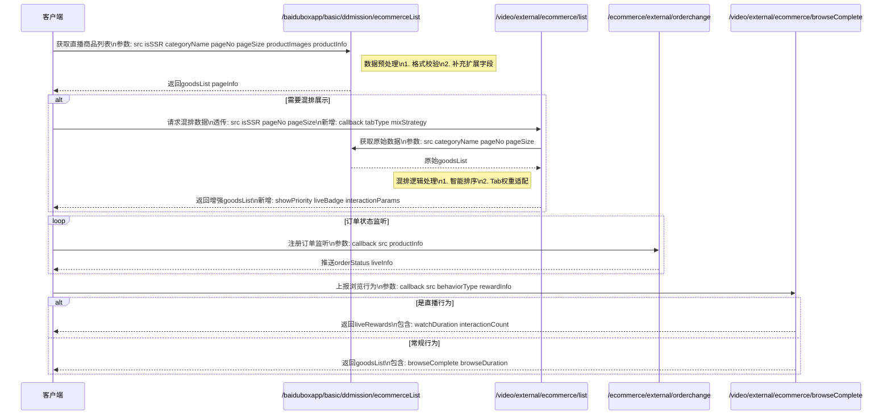
### 3.1.1 电商商品列表接口（修改）
* **代码库**: [baidu/searchbox/sbox-basic](https://console.cloud.baidu-int.com/devops/icode/repos/baidu/searchbox/sbox-basic/tree/master)
* **接口路径**: `/baiduboxapp/basic/ddmission/ecommerceList`
* **调用方式**: `GET`
* **变更功能描述**: 
```
1. 从电商侧获取直播资源信息
   - 获取商品图、商品信息、标签、价格等基础数据
   - 支持按分类和分页参数获取直播商品列表
2. 数据预处理
   - 对直播商品信息进行基础格式校验
   - 补充商品展示所需的扩展字段
```
* **变更功能流程图**:
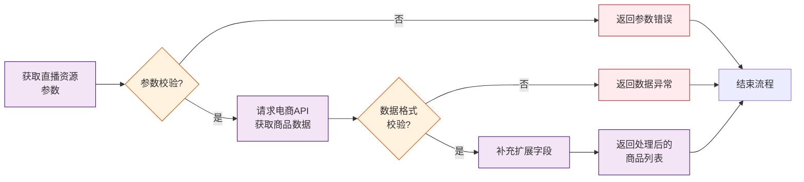
* **请求参数变更点**: 
```json
{
  "src": "string|required|数据来源标识|MODIFY",
  "isSSR": "bool|是否服务端渲染|MODIFY",
  "categoryName": "string|商品分类名称|MODIFY",
  "pageNo": "int|required|分页页码|MODIFY",
  "pageSize": "int|required|分页大小|MODIFY",
  "productImages": "array|商品图片列表|NEW",
  "productInfo": {
    "title": "string|商品标题|NEW",
    "tags": "array|商品标签|NEW",
    "price": "float|商品价格|NEW"
  }
}
```
* **响应参数变更点**: 
```json
{
  "goodsList": [
    {
      "goodsId": "string|商品ID|NEW",
      "goodsImage": "string|商品图片URL|NEW",
      "goodsTitle": "string|商品标题|NEW",
      "goodsDesc": "string|商品描述|NEW",
      "goodsTags": "[]string|商品标签列表|NEW",
      "goodsPrice": "float64|商品价格|NEW",
      "goodsCategory": "string|商品分类|NEW",
      "isLive": "bool|是否在直播中|NEW",
      "liveStartTime": "int64|直播开始时间戳|NEW",
      "liveEndTime": "int64|直播结束时间戳|NEW"
    }
  ],
  "pageInfo": {
    "pageNum": "int|当前页码|NEW",
    "pageSize": "int|每页数量|NEW",
    "total": "int|总数|NEW"
  }
}
```

### 3.1.2 电商直播混排接口（修改）
* **代码库**: [baidu/jady/ug-duoduo-video](https://console.cloud.baidu-int.com/devops/icode/repos/baidu/jady/ug-duoduo-video/tree/master)
* **接口路径**: `/video/external/ecommerce/list`
* **调用方式**: `GET,POST`
* **变更功能描述**: 
```
1. 直播资源与商品信息混排
   - 接收电商商品列表接口的原始数据
   - 按业务规则将直播资源与常规商品进行智能混排
2. 全Tab适配
   - 确保混排后的列表支持在所有Tab下展示
   - 处理不同Tab场景下的展示权重差异
3. 结果组装
   - 生成最终客户端所需的展示数据结构
   - 补充直播特有的展示标识和交互参数
```
* **变更功能流程图**:
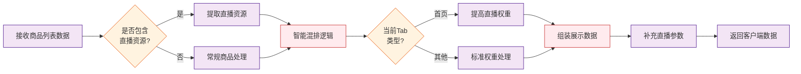
* **请求参数变更点**: 
```json
{
  "callback": "string|回调函数名|MODIFY",
  "src": "string|required|数据来源标识|NEW",
  "isSSR": "bool|是否服务端渲染|NEW",
  "pageNo": "int|required|分页页码|NEW",
  "pageSize": "int|required|分页大小|NEW",
  "productImages": "array|商品图片列表|NEW",
  "productInfo": {
    "title": "string|商品标题|NEW",
    "tags": "array|商品标签|NEW",
    "price": "float|商品价格|NEW"
  }
}
```
* **响应参数变更点**: 
```json
{
  "goodsList": [
    {
      "goodsId": "string|商品ID|NEW",
      "goodsImage": "string|商品图片URL|NEW",
      "goodsTitle": "string|商品标题|NEW",
      "goodsDesc": "string|商品描述|NEW",
      "goodsTags": "[]string|商品标签列表|NEW",
      "goodsPrice": "float64|商品价格|NEW",
      "goodsCategory": "string|商品分类|NEW",
      "isLive": "bool|是否在直播中|NEW",
      "liveStartTime": "int64|直播开始时间戳|NEW",
      "liveEndTime": "int64|直播结束时间戳|NEW",
      "showPriority": "int|展示优先级（用于不同Tab权重控制）|NEW",
      "liveBadge": "string|直播角标标识|NEW",
      "interactionParams": "object|直播特有交互参数|NEW"
    }
  ],
  "pageInfo": {
    "pageNum": "int|当前页码|NEW",
    "pageSize": "int|每页数量|NEW",
    "total": "int|总数|NEW"
  },
  "tabType": "string|当前Tab类型标识|NEW",
  "mixStrategy": "string|混排策略标识|NEW"
}
```

### 3.1.3 直播订单状态接口（修改）
* **代码库**: [baidu/jady/ug-duoduo-video](https://console.cloud.baidu-int.com/devops/icode/repos/baidu/jady/ug-duoduo-video/tree/master)
* **接口路径**: `/ecommerce/external/orderchange`
* **调用方式**: `POST`
* **变更功能描述**: 
```
1. 直播订单状态同步
   - 监听直播场景产生的订单状态变更
   - 特殊处理直播专属商品的订单状态流转
```
* **变更功能流程图**:
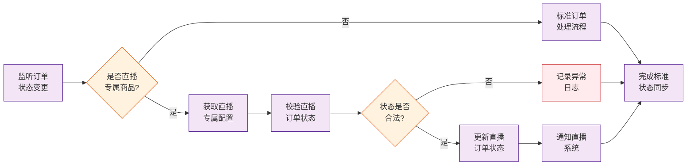
* **请求参数变更点**: 
```json
{
  "callback": "string|required|回调函数名|MODIFY",
  "src": "string|required|数据来源标识|NEW",
  "productInfo": {
    "title": "string|商品标题|NEW",
    "tags": "array|商品标签|NEW",
    "price": "float|商品价格|NEW"
  }
}
```
* **响应参数变更点**: 
```json
{
  "orderId": "string|直播订单ID|NEW",
  "goodsId": "string|商品ID|NEW",
  "orderStatus": "string|订单状态（pending/paid/shipped/completed/cancelled）|NEW",
  "isLiveGoods": "bool|是否直播专属商品|NEW",
  "liveInfo": {
    "liveId": "string|关联直播场次ID|NEW",
    "liveStartTime": "int64|直播开始时间戳|NEW",
    "liveEndTime": "int64|直播结束时间戳|NEW"
  },
  "statusUpdateTime": "int64|状态变更时间戳|NEW"
}
```

### 3.1.4 直播浏览完成接口（修改）
* **代码库**: [baidu/jady/ug-duoduo-video](https://console.cloud.baidu-int.com/devops/icode/repos/baidu/jady/ug-duoduo-video/tree/master)
* **接口路径**: `/video/external/ecommerce/browseComplete`
* **调用方式**: `GET,POST`
* **变更功能描述**: 
```
1. 直播观看行为记录
   - 捕获用户在直播间的商品浏览完成事件
   - 区分常规浏览与直播场景的特殊浏览行为
2. 直播专属奖励处理
   - 处理直播场景特有的奖励规则计算
   - 记录直播相关的用户行为数据
```
* **变更功能流程图**:
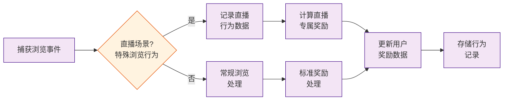
* **请求参数变更点**: 
```json
{
  "callback": "string|required|回调函数名|MODIFY",
  "src": "string|required|数据来源标识|NEW",
  "isSSR": "bool|是否服务端渲染|NEW",
  "productInfo": {
    "title": "string|商品标题|NEW",
    "tags": "array|商品标签|NEW",
    "price": "float|商品价格|NEW"
  },
  "behaviorType": "string|required|浏览行为类型（常规/直播）|NEW",
  "rewardInfo": {
    "ruleId": "string|奖励规则ID|NEW",
    "amount": "float|奖励金额|NEW"
  }
}
```
* **响应参数变更点**: 
```json
{
  "isLive": "bool|是否直播场景|NEW",
  "goodsList": [
    {
      "goodsId": "string|商品ID|NEW",
      "browseComplete": "bool|商品浏览是否完成|NEW",
      "browseDuration": "int64|浏览持续时间(ms)|NEW"
    }
  ],
  "liveRewards": {
    "rewardType": "string|奖励类型(live_special/normal)|NEW",
    "rewardAmount": "float64|奖励金额|NEW",
    "behaviorData": {
      "watchDuration": "int64|观看时长(ms)|NEW",
      "interactionCount": "int|互动次数|NEW"
    }
  }
}
```

## 3.2 直播资源点击交互处理
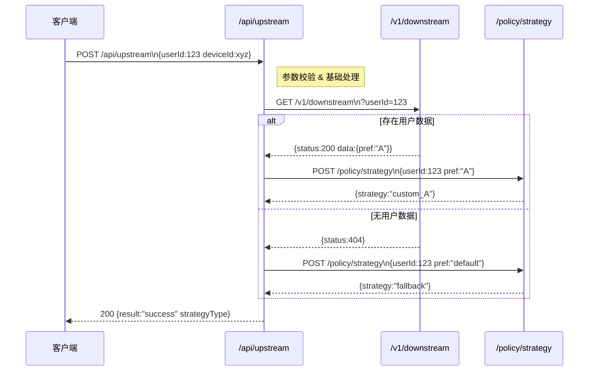

## 3.3 奖励发放提示处理
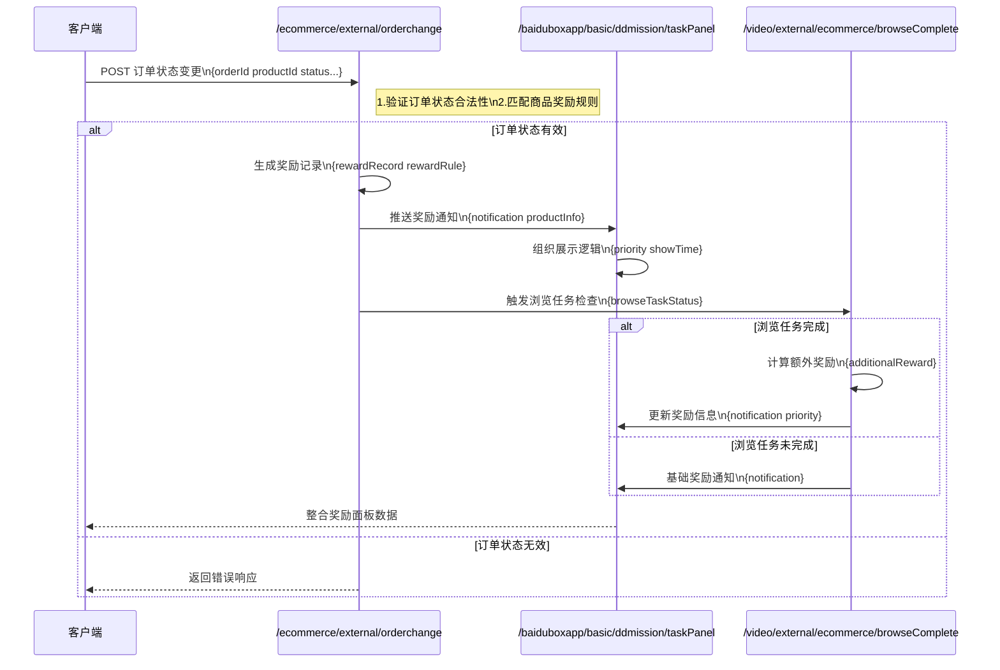
### 3.3.1 订单状态变更处理接口（修改）
* **代码库**: [baidu/jady/ug-duoduo-video](https://console.cloud.baidu-int.com/devops/icode/repos/baidu/jady/ug-duoduo-video/tree/master)
* **接口路径**: `/ecommerce/external/orderchange`
* **调用方式**: `POST`
* **变更功能描述**: 
```
1. 接收直播间内购买商品的通知
2. 验证订单状态变更的合法性
3. 根据购买商品信息匹配对应的奖励规则
4. 生成奖励发放记录（包括奖励类型和数量）
5. 构造奖励发放提示信息（包含商品名称、奖励金额等关键要素）
```
* **变更功能流程图**:
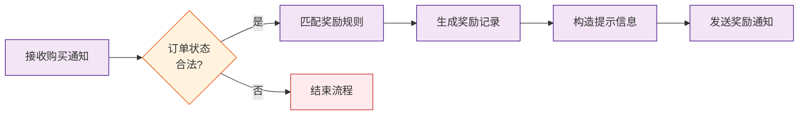
* **请求参数变更点**: 
```json
{
  "callback": {
    "orderId": "string|required|订单ID|NEW",
    "productId": "string|required|商品ID|NEW",
    "productName": "string|商品名称|NEW",
    "rewardType": "string|奖励类型|NEW",
    "rewardAmount": "int64|奖励数量|NEW",
    "status": "string|required|订单状态|NEW"
  }
}
```
* **响应参数变更点**: 
```json
{
  "orderId": "string|直播间订单ID|NEW",
  "orderStatus": "string|订单状态(待支付/已支付/已取消)|NEW",
  "productInfo": {
    "productName": "string|商品名称|NEW",
    "productPrice": "float64|商品价格|NEW"
  },
  "rewardRule": {
    "ruleId": "string|奖励规则ID|NEW",
    "rewardType": "string|奖励类型(积分/优惠券)|NEW",
    "rewardAmount": "float64|奖励数量|NEW"
  },
  "rewardRecord": {
    "recordId": "string|奖励记录ID|NEW",
    "createTime": "string|记录创建时间|NEW"
  },
  "notification": {
    "title": "string|奖励通知标题|NEW",
    "content": "string|奖励通知内容(包含商品名称和奖励金额)|NEW"
  }
}
```

### 3.3.2 任务面板数据接口（修改）
* **代码库**: [baidu/searchbox/sbox-basic](https://console.cloud.baidu-int.com/devops/icode/repos/baidu/searchbox/sbox-basic/tree/master)
* **接口路径**: `/baiduboxapp/basic/ddmission/taskPanel`
* **调用方式**: `POST`
* **变更功能描述**: 
```
1. 接收来自订单变更接口的奖励发放通知
2. 将奖励提示信息整合到用户任务面板数据中
3. 组织奖励提示的展示逻辑（包括排序优先级、时效性控制）
4. 补充与奖励相关的运营信息（如倒计时提示）
```
* **变更功能流程图**:
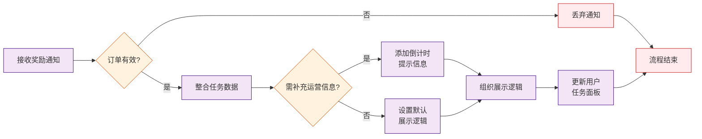
* **请求参数变更点**: 
```json
{
  "callback": {
    "orderId": "string|required|订单ID|NEW",
    "productId": "string|required|商品ID|NEW",
    "productName": "string|商品名称|NEW",
    "rewardType": "string|奖励类型|NEW",
    "rewardAmount": "int64|奖励数量|NEW",
    "status": "string|required|订单状态|NEW"
  }
}
```
* **响应参数变更点**: 
```json
{
  "orderId": "string|直播间订单ID|NEW",
  "orderStatus": "string|订单状态(待支付/已支付/已取消)|NEW",
  "productInfo": {
    "productName": "string|商品名称|NEW",
    "productPrice": "float64|商品价格|NEW"
  },
  "rewardRule": {
    "ruleId": "string|奖励规则ID|NEW",
    "rewardType": "string|奖励类型(积分/优惠券)|NEW",
    "rewardAmount": "float64|奖励数量|NEW"
  },
  "rewardRecord": {
    "recordId": "string|奖励记录ID|NEW",
    "createTime": "string|记录创建时间|NEW",
    "expireTime": "string|奖励过期时间|NEW"
  },
  "notification": {
    "title": "string|奖励通知标题|NEW",
    "content": "string|奖励通知内容(包含商品名称和奖励金额)|NEW",
    "priority": "int|展示优先级(数值越大优先级越高)|NEW",
    "showTime": "string|展示截止时间|NEW"
  }
}
```

### 3.3.3 浏览任务完成接口（修改）
* **代码库**: [baidu/jady/ug-duoduo-video](https://console.cloud.baidu-int.com/devops/icode/repos/baidu/jady/ug-duoduo-video/tree/master)
* **接口路径**: `/video/external/ecommerce/browseComplete`
* **调用方式**: `GET,POST`
* **变更功能描述**: 
```
1. 接收商品购买完成后的浏览任务状态更新
2. 验证购买行为与浏览任务的关联性
3. 补充处理因购买触发的额外浏览任务奖励
4. 返回整合后的完整奖励提示信息
```
* **变更功能流程图**:
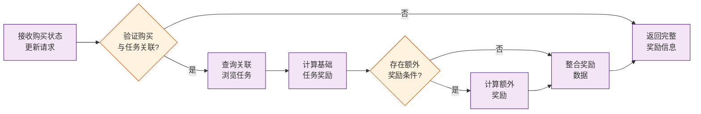
* **请求参数变更点**: 
```json
{
  "callback": {
    "orderId": "string|required|订单ID|NEW",
    "productId": "string|required|商品ID|NEW",
    "productName": "string|商品名称|NEW",
    "rewardType": "string|奖励类型|NEW",
    "rewardAmount": "int64|奖励数量|NEW",
    "status": "string|required|订单状态|NEW"
  }
}
```
* **响应参数变更点**: 
```json
{
  "orderId": "string|直播间订单ID|NEW",
  "orderStatus": "string|订单状态(待支付/已支付/已取消)|NEW",
  "productInfo": {
    "productName": "string|商品名称|NEW",
    "productPrice": "float64|商品价格|NEW"
  },
  "rewardRule": {
    "ruleId": "string|奖励规则ID|NEW",
    "rewardType": "string|奖励类型(积分/优惠券)|NEW",
    "rewardAmount": "float64|奖励数量|NEW"
  },
  "rewardRecord": {
    "recordId": "string|奖励记录ID|NEW",
    "createTime": "string|记录创建时间|NEW",
    "expireTime": "string|奖励过期时间|NEW"
  },
  "notification": {
    "title": "string|奖励通知标题|NEW",
    "content": "string|奖励通知内容(包含商品名称和奖励金额)|NEW",
    "priority": "int|展示优先级(数值越大优先级越高)|NEW",
    "showTime": "string|展示截止时间|NEW"
  },
  "browseTaskStatus": "string|浏览任务状态(已完成/未完成)|NEW",
  "additionalReward": {
    "amount": "float64|额外奖励金额|NEW",
    "description": "string|额外奖励描述|NEW"
  }
}
```

## 3.4 商品和直播下单统计区分
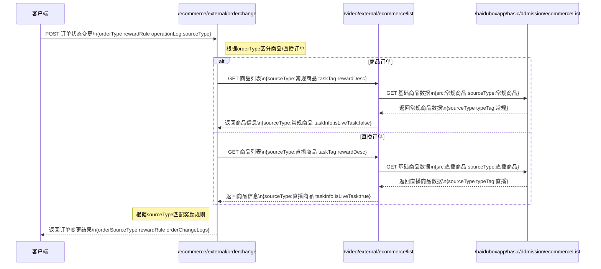
### 3.4.1 订单状态变更处理器（修改）
* **代码库**: [baidu/jady/ug-duoduo-video](https://console.cloud.baidu-int.com/devops/icode/repos/baidu/jady/ug-duoduo-video/tree/master)
* **接口路径**: `/ecommerce/external/orderchange`
* **调用方式**: `POST`
* **变更功能描述**: 
```
1. 订单数据区分处理
   - 识别订单来源类型（商品订单/直播订单）
   - 根据订单类型打标并记录到订单变更日志
2. 奖励发放逻辑适配
   - 根据订单类型（商品/直播）匹配不同的奖励规则
   - 在发放奖励时记录订单类型标识
3. 数据存储准备
   - 在订单状态变更记录中增加订单类型字段
   - 确保所有订单操作日志包含来源类型信息
```
* **变更功能流程图**:
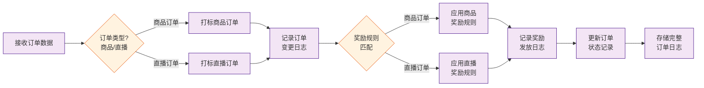
* **请求参数变更点**: 
```json
{
  "orderType": "string|required|订单来源类型（商品订单/直播订单）|NEW",
  "rewardRule": "string|根据订单类型匹配的奖励规则|NEW",
  "operationLog": {
    "sourceType": "string|required|订单来源类型信息|NEW"
  }
}
```
* **响应参数变更点**: 
```json
{
  "orderSourceType": "string|订单来源类型（商品订单/直播订单）|NEW",
  "rewardRule": "string|奖励规则标识（根据订单类型匹配）|NEW",
  "orderChangeLogs": [
    {
      "orderTypeTag": "string|订单类型标签|NEW",
      "sourceType": "string|订单来源类型（商品/直播）|NEW"
    }
  ]
}
```

### 3.4.2 商品列表展示器（修改）
* **代码库**: [baidu/jady/ug-duoduo-video](https://console.cloud.baidu-int.com/devops/icode/repos/baidu/jady/ug-duoduo-video/tree/master)
* **接口路径**: `/video/external/ecommerce/list`
* **调用方式**: `GET,POST`
* **变更功能描述**: 
```
1. 商品来源标识
   - 在返回的商品数据中明确标注商品来源（常规商品/直播商品）
2. 任务展示区分
   - 对直播商品展示专属任务标识
   - 在任务奖励说明中区分商品类型奖励差异
3. 数据采集
   - 记录用户对不同类型商品的浏览行为
   - 在用户操作日志中标记商品来源类型
```
* **变更功能流程图**:
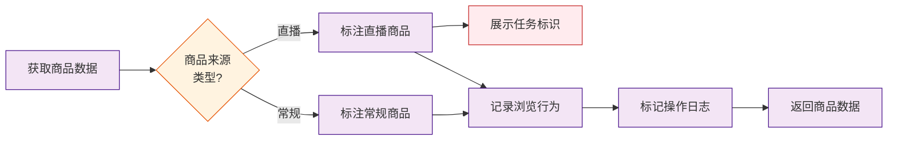
* **请求参数变更点**: 
```json
{
  "callback": "string|回调函数名|MODIFY",
  "sourceType": "string|required|商品来源类型（常规商品/直播商品）|NEW",
  "taskTag": "string|直播商品专属任务标识|NEW",
  "rewardDesc": "string|根据商品类型区分的奖励说明|NEW",
  "operationLog": {
    "sourceType": "string|required|商品来源类型信息|NEW"
  }
}
```
* **响应参数变更点**: 
```json
{
  "sourceType": "string|商品来源类型（常规商品/直播商品）|NEW",
  "taskInfo": {
    "isLiveTask": "bool|是否直播专属任务|NEW",
    "rewardDesc": "string|奖励说明（根据商品类型展示差异）|NEW"
  },
  "behaviorLog": {
    "viewSourceType": "string|浏览商品来源类型（常规/直播）|NEW"
  },
  "operationLog": {
    "sourceType": "string|操作商品来源类型（常规/直播）|NEW"
  }
}
```

### 3.4.3 商品数据分类器（修改）
* **代码库**: [baidu/searchbox/sbox-basic](https://console.cloud.baidu-int.com/devops/icode/repos/baidu/searchbox/sbox-basic/tree/master)
* **接口路径**: `/baiduboxapp/basic/ddmission/ecommerceList`
* **调用方式**: `GET`
* **变更功能描述**: 
```
1. 数据源分类
   - 在获取原始商品数据时区分直播商品和常规商品
2. 列表组织
   - 支持按商品类型（直播/常规）进行筛选
   - 在分页逻辑中保持类型一致性
3. 元数据补充
   - 为每个商品附加类型标识字段
   - 确保返回数据结构包含商品分类维度
```
* **变更功能流程图**:
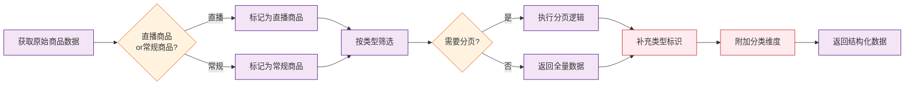
* **请求参数变更点**: 
```json
{
  "src": "string|required|数据源分类（直播商品/常规商品）|MODIFY",
  "sourceType": "string|required|商品来源类型（常规商品/直播商品）|NEW",
  "categoryName": "string|商品分类维度|MODIFY"
}
```
* **响应参数变更点**: 
```json
{
  "sourceType": "string|商品来源类型（常规商品/直播商品）|NEW",
  "items": [
    {
      "typeTag": "string|商品类型标签（常规/直播）|NEW",
      "category": "string|商品分类维度|NEW"
    }
  ]
}
```

## 3.5 电商任务报表数据扩展
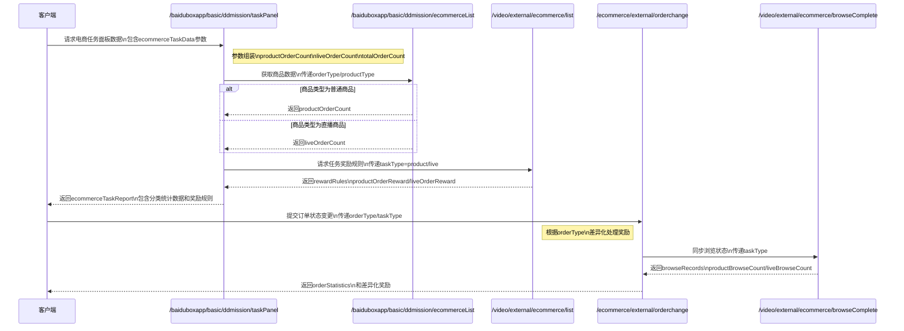
### 3.5.1 任务面板数据扩展接口（修改）
* **代码库**: [baidu/searchbox/sbox-basic](https://console.cloud.baidu-int.com/devops/icode/repos/baidu/searchbox/sbox-basic/tree/master)
* **接口路径**: `/baiduboxapp/basic/ddmission/taskPanel`
* **调用方式**: `POST`
* **变更功能描述**: 
```
1. 在任务面板数据组装阶段，增加电商任务数据分类处理：
   - 区分商品下单数据和直播下单数据
   - 计算并整合整体下单数据
2. 扩展结果组装逻辑：
   - 在返回数据中新增电商任务报表专用字段
   - 包含商品下单量、直播下单量、总下单量三类核心指标
3. 保持原有任务展示逻辑的同时，确保新增电商数据不影响其他任务类型展示
```
* **变更功能流程图**:
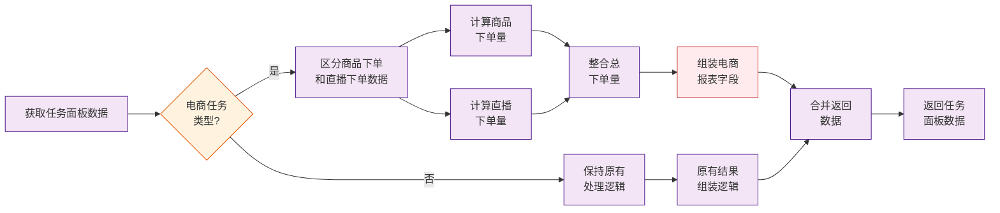
* **请求参数变更点**: 
```json
{
  "ecommerceTaskData": {
    "productOrderCount": "int64|商品下单量|NEW",
    "liveOrderCount": "int64|直播下单量|NEW",
    "totalOrderCount": "int64|总下单量|NEW"
  }
}
```
* **响应参数变更点**: 
```json
{
  "ecommerceTaskReport": {
    "productOrderCount": "int|商品下单量|NEW",
    "liveOrderCount": "int|直播下单量|NEW",
    "totalOrderCount": "int|总下单量|NEW"
  }
}
```

### 3.5.2 电商商品数据接口（修改）
* **代码库**: [baidu/searchbox/sbox-basic](https://console.cloud.baidu-int.com/devops/icode/repos/baidu/searchbox/sbox-basic/tree/master)
* **接口路径**: `/baiduboxapp/basic/ddmission/ecommerceList`
* **调用方式**: `GET`
* **变更功能描述**: 
```
1. 扩展商品数据返回结构：
   - 在商品基础信息中增加下单类型标识字段（商品/直播）
   - 补充商品关联的下单统计数据
2. 优化分页逻辑：
   - 支持按商品类型（普通商品/直播商品）筛选
3. 数据预处理：
   - 对商品下单数据进行分类汇总计算
```
* **变更功能流程图**:
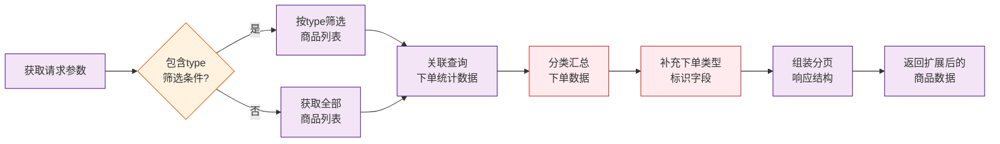
* **请求参数变更点**: 
```json
{
  "orderType": "string|商品/直播下单类型标识|NEW",
  "productType": "string|普通商品/直播商品筛选类型|NEW",
  "ecommerceTaskData": {
    "productOrderCount": "int64|商品下单量|NEW",
    "liveOrderCount": "int64|直播下单量|NEW",
    "totalOrderCount": "int64|总下单量|NEW"
  }
}
```
* **响应参数变更点**: 
```json
{
  "orderType": "string|下单类型标识，取值：product(商品)/live(直播)|NEW",
  "orderStatistics": {
    "productOrderCount": "int|商品下单量|NEW",
    "liveOrderCount": "int|直播下单量|NEW",
    "totalOrderCount": "int|总下单量|NEW"
  },
  "filterType": "string|商品类型筛选条件，取值：product(普通商品)/live(直播商品)/all(全部)|NEW"
}
```

### 3.5.3 电商任务列表接口（修改）
* **代码库**: [baidu/jady/ug-duoduo-video](https://console.cloud.baidu-int.com/devops/icode/repos/baidu/jady/ug-duoduo-video/tree/master)
* **接口路径**: `/video/external/ecommerce/list`
* **调用方式**: `GET,POST`
* **变更功能描述**: 
```
1. 增强任务奖励数据整合：
   - 区分商品下单和直播下单的任务奖励规则
   - 在返回数据结构中明确标注任务类型
2. 完善数据上报：
   - 记录用户对不同类型电商任务（商品/直播）的交互行为
3. 动态提示优化：
   - 根据任务类型展示差异化的奖励提示信息
```
* **变更功能流程图**:
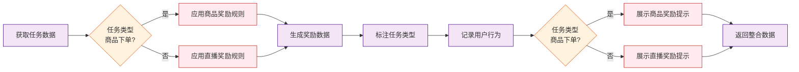
* **请求参数变更点**: 
```json
{
  "taskType": "string|required|任务类型（商品/直播）|NEW",
  "interactionType": "string|用户交互行为类型|NEW",
  "rewardHint": "string|差异化奖励提示信息|NEW"
}
```
* **响应参数变更点**: 
```json
{
  "taskType": "string|任务类型标识，取值：product(商品)/live(直播)|NEW",
  "rewardRules": {
    "productOrderReward": "float64|商品下单任务奖励金额|NEW",
    "liveOrderReward": "float64|直播下单任务奖励金额|NEW"
  },
  "interactionRecords": {
    "productOrderCount": "int|商品下单交互次数|NEW",
    "liveOrderCount": "int|直播下单交互次数|NEW"
  },
  "dynamicTips": {
    "productOrderTip": "string|商品下单任务奖励提示文案|NEW",
    "liveOrderTip": "string|直播下单任务奖励提示文案|NEW"
  }
}
```

### 3.5.4 电商订单状态接口（修改）
* **代码库**: [baidu/jady/ug-duoduo-video](https://console.cloud.baidu-int.com/devops/icode/repos/baidu/jady/ug-duoduo-video/tree/master)
* **接口路径**: `/ecommerce/external/orderchange`
* **调用方式**: `POST`
* **变更功能描述**: 
```
1. 完善订单类型识别：
   - 在订单状态变更时识别并记录商品订单与直播订单
2. 扩展奖励处理逻辑：
   - 根据订单类型应用不同的奖励计算规则
3. 数据分类统计：
   - 按订单类型分别记录任务完成状态
4. 异常处理增强：
   - 对不同类型的订单状态变更进行差异化错误处理
```
* **变更功能流程图**:
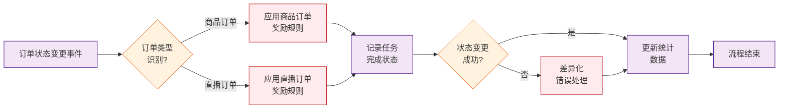
* **请求参数变更点**: 
```json
{
  "orderType": "string|商品/直播订单类型标识|NEW",
  "taskType": "string|required|任务类型（商品/直播）|NEW",
  "rewardHint": "string|差异化奖励提示信息|NEW"
}
```
* **响应参数变更点**: 
```json
{
  "orderType": "string|订单类型标识，取值：product(商品)/live(直播)|NEW",
  "rewardRules": {
    "productOrderReward": "float64|商品订单奖励金额|NEW",
    "liveOrderReward": "float64|直播订单奖励金额|NEW"
  },
  "orderStatistics": {
    "productOrderCount": "int|商品订单数量|NEW",
    "liveOrderCount": "int|直播订单数量|NEW",
    "totalOrderCount": "int|总订单数量|NEW"
  },
  "errorHandling": {
    "productOrderErrorCode": "string|商品订单错误码|NEW",
    "liveOrderErrorCode": "string|直播订单错误码|NEW"
  }
}
```

### 3.5.5 电商浏览完成接口（修改）
* **代码库**: [baidu/jady/ug-duoduo-video](https://console.cloud.baidu-int.com/devops/icode/repos/baidu/jady/ug-duoduo-video/tree/master)
* **接口路径**: `/video/external/ecommerce/browseComplete`
* **调用方式**: `GET,POST`
* **变更功能描述**: 
```
1. 任务类型区分：
   - 在浏览任务完成验证阶段识别商品浏览与直播浏览
2. 奖励发放优化：
   - 根据浏览任务类型匹配对应的奖励策略
3. 数据记录扩展：
   - 在任务完成日志中增加任务类型标识
4. 状态同步增强：
   - 将分类浏览数据同步至报表统计系统
```
* **变更功能流程图**:
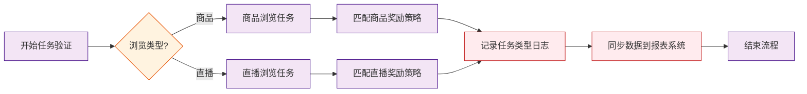
* **请求参数变更点**: 
```json
{
  "taskType": "string|required|任务类型（商品/直播）|NEW",
  "rewardHint": "string|差异化奖励提示信息|NEW"
}
```
* **响应参数变更点**: 
```json
{
  "taskType": "string|任务类型标识，取值：product(商品)/live(直播)|NEW",
  "rewardRules": {
    "productBrowseReward": "float64|商品浏览任务奖励金额|NEW",
    "liveBrowseReward": "float64|直播浏览任务奖励金额|NEW"
  },
  "browseRecords": {
    "productBrowseCount": "int|商品浏览交互次数|NEW",
    "liveBrowseCount": "int|直播浏览交互次数|NEW"
  },
  "reportStatistics": {
    "productBrowseCount": "int|商品浏览统计量|NEW",
    "liveBrowseCount": "int|直播浏览统计量|NEW",
    "totalBrowseCount": "int|总浏览统计量|NEW"
  }
}
```
