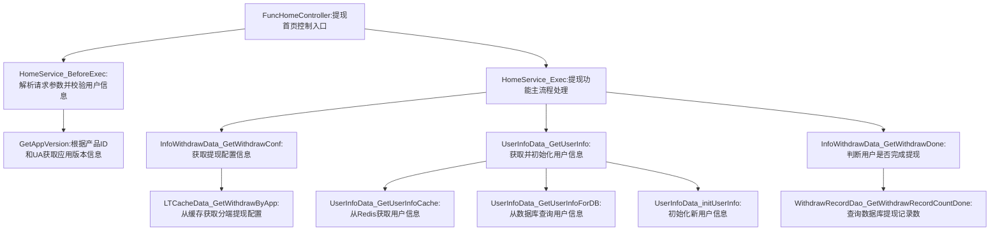

# 1. 项目背景
* 需求文档链接：[【非随】【极速版存钱罐】私信通知](https://console.cloud.baidu-int.com/devops/icafe/issue/ailite-24895/show)
* 项目背景: 私信通知能力，可发送资产发放信息，基于此方式进行存钱罐促活
| **目标代码库**                                                                                                                              | **接口名称**       | **接口路径**                             | **调用方式**   | **改动类型** | **功能点概述**                                                                                                                                                                                                 | **关联度得分** |
|-------------------------------------------------------------------------------------------------------------------------------------------------|--------------------|--------------------------------------------|----------------|--------------|-------------------------------------------------------------------------------------------------------------------------------------------------------------------------------------------------------------|-----------|
| [baidu/jady/ug-duoduo-video](https://console.cloud.baidu-int.com/devops/icode/repos/baidu/jady/ug-duoduo-video/tree/master)                   | 提现首页接口       | `/video/withdraw/withdrawHomeApi`         | ["GET", "POST"] | 修改         | - 用户基础信息获取与实验命中判断：修改 `UserInfoData_GetUserInfo` 和 `UserInfoData_initUserInfo` 以支持从策略系统获取用户标签并判断实验组命中状态。<br>- 存钱罐渗透状态检查：在 `InfoWithdrawData_GetWithdrawConf` 中增加对策略系统返回的存钱罐渗透状态字段的检查逻辑。<br>- 打款金额与频次控制：在 `InfoWithdrawData_GetWithdrawDone` 中增加对用户历史打款状态的检查逻辑。<br>- 消息内容组装与跳转逻辑：在 `HomeService_Exec` 中增加对提现页跳转链接参数的处理逻辑，确保携带资产余额滚动增加0.1元参数。 | 0.8       |
## 3.1 提现首页接口（修改）
* 当前接口和需求关联得分：**0.8**
### 3.1.1 接口定义
* **目标代码库**：[baidu/jady/ug-duoduo-video](https://console.cloud.baidu-int.com/devops/icode/repos/baidu/jady/ug-duoduo-video/tree/master)
* **接口路径**：/video/withdraw/withdrawHomeApi
* **调用方式**：["GET", "POST"]
* **请求参数**：
```json
{
  "user_id": {
    "type": "string",
    "description": "用户唯一标识",
    "required": true,
    "change_type": "MODIFY"
  },
  "app_version": {
    "type": "string",
    "description": "客户端版本号",
    "required": false,
    "change_type": "NEW"
  }
}
```
* **响应参数**：
```json
{
  "withdraw_config": {
    "type": "object",
    "description": "提现配置信息",
    "change_type": "MODIFY",
    "properties": {
      "penetration_status": {
        "type": "boolean",
        "description": "存钱罐渗透状态",
        "change_type": "NEW"
      }
    }
  },
  "user_info": {
    "type": "object",
    "description": "用户信息",
    "change_type": "MODIFY",
    "properties": {
      "experiment_group": {
        "type": "string",
        "description": "实验组命中状态",
        "change_type": "NEW"
      }
    }
  },
  "redirect_url": {
    "type": "string",
    "description": "提现页跳转链接（携带资产余额滚动增加0.1元参数）",
    "change_type": "NEW"
  }
}
```
### 3.1.2 功能逻辑和实现流程
* 用户基础信息获取与实验命中判断：
  - 修改 `UserInfoData_GetUserInfo` 和 `UserInfoData_initUserInfo` 以支持从策略系统获取用户标签并判断实验组命中状态。
* 存钱罐渗透状态检查：
  - 在 `InfoWithdrawData_GetWithdrawConf` 中增加对策略系统返回的存钱罐渗透状态字段的检查逻辑。
* 打款金额与频次控制：
  - 在 `InfoWithdrawData_GetWithdrawDone` 中增加对用户历史打款状态的检查逻辑。
* 消息内容组装与跳转逻辑：
  - 在 `HomeService_Exec` 中增加对提现页跳转链接参数的处理逻辑，确保携带资产余额滚动增加0.1元参数。
