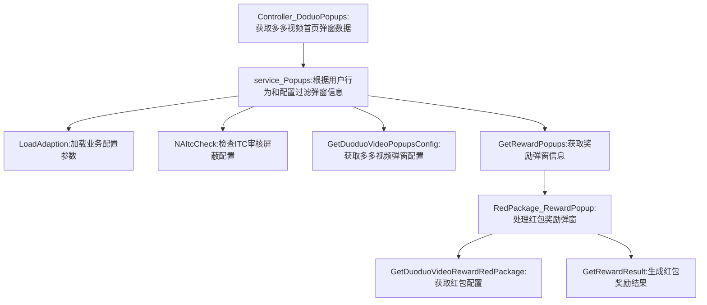

# 1. 项目背景
* 需求文档链接：[【非随】【极速版存钱罐】红包广场弹窗样式](https://console.cloud.baidu-int.com/devops/icafe/issue/ailite-30438/show)
* 项目背景: 红包广场弹窗样式提示优化
| **目标代码库**                                                                                                                                  | **接口名称** | **接口路径**                             | **改动类型** | **功能点概述**                                       | **关联度得分** |
|---------------------------------------------------------------------------------------------------------------------------------------------------|--------|--------------------------------------------|--------------|-------------------------------------------------|-----------|
| [baidu/searchbox/sbox-basic](https://console.cloud.baidu-int.com/devops/icode/repos/baidu/searchbox/sbox-basic/tree/master)                     | 多多视频弹窗数据 | `/baiduboxapp/basic/ddmission/popups`     | 修改         | - 根据用户实验命中状态组装弹窗展示内容。<br>- 若命中实验：设置标题为'完成任务，领取金豆！'，添加辅助文案'完成看视频任务后到账'，绑定弹窗背景点击事件。<br>- 未命中实验：设置标题为'恭喜获得金豆奖励'，不展示辅助文案，弹窗背景无点击交互。 | 0.9       |

## 3.1 多多视频弹窗数据接口（修改）
* 当前接口和需求关联得分：**0.9**
### 3.1.1 接口定义
* **目标代码库**：[baidu/searchbox/sbox-basic](https://console.cloud.baidu-int.com/devops/icode/repos/baidu/searchbox/sbox-basic/tree/master)
* **接口路径**：/baiduboxapp/basic/ddmission/popups
* **调用方式**：GET,POST
* **请求参数**：
```json
{
  "user_id": {
    "type": "string",
    "description": "用户唯一标识",
    "required": true,
    "change_type": "MODIFY"
  },
  "abtest_flag": {
    "type": "string",
    "description": "AB实验标识",
    "required": false,
    "change_type": "NEW"
  }
}
```
* **响应参数**：
```json
{
  "is_experiment_user": {
    "type": "boolean",
    "description": "是否命中弹窗样式优化实验",
    "change_type": "NEW"
  },
  "title": {
    "type": "string",
    "description": "弹窗标题内容",
    "change_type": "MODIFY"
  },
  "amount": {
    "type": "string",
    "description": "奖励金额",
    "change_type": "MODIFY"
  },
  "sub_text": {
    "type": "string",
    "description": "金额下方辅助文案",
    "change_type": "NEW"
  },
  "background_clickable": {
    "type": "boolean",
    "description": "弹窗背景是否可点击",
    "change_type": "NEW"
  }
}
```
### 3.1.2 功能逻辑和实现流程
1. 从策略平台获取用户实验命中状态，判断是否命中弹窗样式优化实验策略；
2. 根据命中结果组装弹窗展示内容：
   - 若命中实验：
     - 设置标题为'完成任务，领取金豆！'；
     - 在金额'1999'下方添加辅助文案'完成看视频任务后到账'；
     - 绑定弹窗背景点击事件与按钮相同交互逻辑；
   - 未命中实验：
     - 设置标题为'恭喜获得金豆奖励'；
     - 金额区域不展示辅助文案；
     - 弹窗背景无点击交互；
3. 返回包含实验命中状态、标题内容、金额辅助文案标识、背景点击交互标识的字段。
