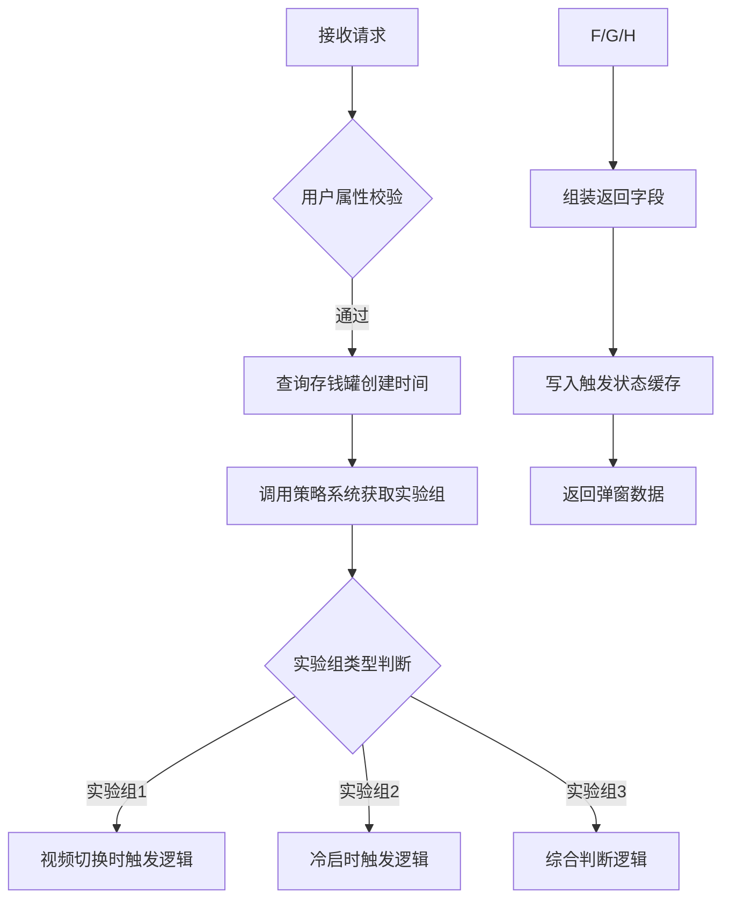
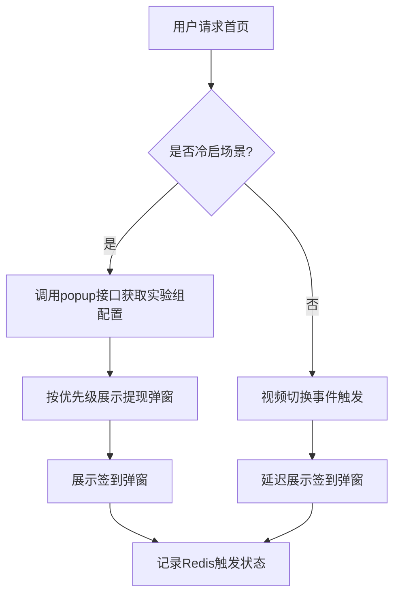
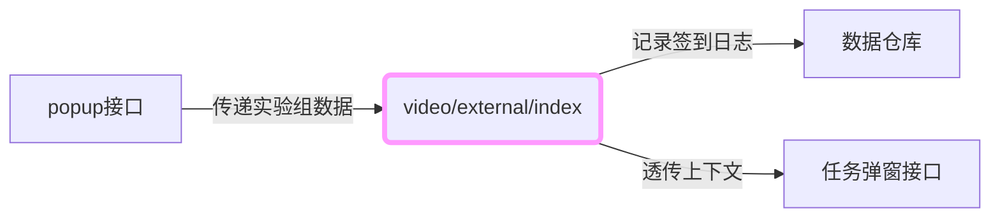

# 1. 项目背景
* 需求文档链接：[【非随】【极速版存钱罐】存钱罐创建首日签到弹窗主动展示实验](https://console.cloud.baidu-int.com/devops/icafe/issue/ailite-30374/show)
* 项目背景: 存钱罐创建首日，签到弹窗会在上下滑挂件结束后点击挂件入口后展示，无主动展示时机，在首日的渗透用户中，34%的渗透用户未展示签到弹窗，增加首日的签到弹窗展示时机观测效果
## 2. 设计总览

| **目标代码库**                                                                                                                                  | **接口名称** | **接口路径**                             | **改动类型** | **功能点概述**                                       | **关联度得分** |
|---------------------------------------------------------------------------------------------------------------------------------------------------|--------|--------------------------------------------|--------------|-------------------------------------------------|-----------|
| [baidu/searchbox/sbox-basic](https://console.cloud.baidu-int.com/devops/icode/repos/baidu/searchbox/sbox-basic/tree/master)                     | 存钱罐弹窗 | `/baiduboxapp/basic/ddmission/popup`      | 修改         | - 实验组判断与首日校验<br>- 返回字段扩展（实验组类型、签到状态、触发上下文）<br>- 全局状态控制（Redis缓存记录触发状态） | 0.8       |
| [baidu/searchbox/sbox-basic](https://console.cloud.baidu-int.com/devops/icode/repos/baidu/searchbox/sbox-basic/tree/master)                     | 弹窗管理 | `/baiduboxapp/basic/ddmission/popups`     | 修改         | - 实验组命中逻辑扩展<br>- 弹窗展示控制（优先级权重计算、延迟展示逻辑）<br>- 状态同步（跨接口计数器、CAS机制） | 0.8       |
| [baidu/jady/ug-duoduo-video](https://console.cloud.baidu-int.com/devops/icode/repos/baidu/jady/ug-duoduo-video/tree/master)                     | 视频外部索引 | `/video/external/index`                   | 修改         | - 签到状态同步逻辑（记录实验组标记）<br>- 上下文信息透传（传递给下游接口）<br>- 状态校验增强（实验组有效性校验） | 0.8       |

## 3.1 存钱罐弹窗接口（修改）
* 当前接口和需求关联得分：**0.8**
### 3.1.1 接口定义
* **目标代码库**：[baidu/searchbox/sbox-basic](https://console.cloud.baidu-int.com/devops/icode/repos/baidu/searchbox/sbox-basic/tree/master)
* **接口路径**：/baiduboxapp/basic/ddmission/popup
* **调用方式**：POST
* **请求参数**：
```json
{
  "user_info": {
    "type": "object",
    "description": "用户基础信息",
    "required": true,
    "change_type": "MODIFY",
    "properties": {
      "user_id": {
        "type": "string",
        "description": "用户唯一标识",
        "required": true,
        "change_type": "MODIFY"
      },
      "device_id": {
        "type": "string",
        "description": "设备唯一标识",
        "required": true,
        "change_type": "MODIFY"
      }
    }
  }
}
```
* **响应参数**：
```json
{
  "experiment_group": {
    "type": "string",
    "description": "实验组类型：group1/group2/group3",
    "change_type": "NEW"
  },
  "signin_status": {
    "type": "boolean",
    "description": "当前签到状态：true/false",
    "change_type": "NEW"
  },
  "trigger_condition": {
    "type": "string",
    "description": "触发上下文：cold_start/video_switch",
    "change_type": "NEW"
  },
  "is_first_day": {
    "type": "boolean",
    "description": "是否存钱罐创建首日",
    "change_type": "NEW"
  }
}
```
### 3.1.2 功能逻辑和实现流程
* 任务1：实验组判断与首日校验
  1. 调用策略系统接口获取用户实验分组配置
  2. 查询用户存钱罐创建时间并校验是否为首日
* 任务2：返回字段扩展
  1. 增加experiment_group字段返回实验组类型
  2. 增加signin_status字段返回当前签到状态
  3. 增加trigger_condition字段标识触发上下文
* 任务3：全局状态控制
  1. 实现Redis缓存记录自然日触发状态
  2. 增加触发次数校验逻辑（每日上限控制）

### 3.1.3 存储设计
* redis设计
```redis
key: ddmission_popup_trigger:{user_id}:{date} 
value: {
  "trigger_count": 1,
  "last_trigger_time": "2023-11-01T12:00:00Z",
  "experiment_group": "group1"
}
```
## 3.2 弹窗管理接口（修改）
* 当前接口和需求关联得分：**0.8**
### 3.2.1 接口定义
* **目标代码库**：[baidu/searchbox/sbox-basic](https://console.cloud.baidu-int.com/devops/icode/repos/baidu/searchbox/sbox-basic/tree/master)
* **接口路径**：/baiduboxapp/basic/ddmission/popups
* **调用方式**：GET
* **请求参数**：
```json
{
  "experiment_group": {
    "type": "string",
    "description": "实验组标识",
    "required": true,
    "change_type": "MODIFY"
  },
  "trigger_condition": {
    "type": "string",
    "description": "触发条件（video_switch/cold_start）",
    "required": true,
    "change_type": "NEW"
  }
}
```
* **响应参数**：
```json
{
  "popup_priority": {
    "type": "int",
    "description": "弹窗展示优先级（1-高 2-中 3-低）",
    "change_type": "NEW"
  },
  "delay_time": {
    "type": "int",
    "description": "延迟展示时间（毫秒）",
    "change_type": "NEW"
  },
  "signin_status": {
    "type": "object",
    "description": "签到状态同步数据",
    "change_type": "MODIFY",
    "properties": {
      "last_show_time": {
        "type": "timestamp",
        "description": "上次展示时间戳"
      }
    }
  }
}
```
### 3.2.2 功能逻辑和实现流程
* **实验组命中逻辑扩展**：
  1. 集成popup接口返回的experiment_group/signin_status数据
  2. 冷启场景下优先命中实验组2配置
  3. 动态计算弹窗优先级权重值

* **弹窗展示控制**：
  1. 解析trigger_condition字段判断触发场景
  2. 视频切换场景下应用延迟展示逻辑（实验组1）
  3. 与提现弹窗接口进行优先级仲裁（实验组2）

* **状态同步**：
  1. 复用popup接口的Redis缓存结构
  2. 新增跨接口展示次数计数器
  3. 实现状态同步CAS机制


### 3.2.3 存储设计
* **redis设计**：
```redis
key: 
popup_trigger_status:{user_id}:{experiment_group}

value:
{
  "last_show_timestamp": 1630000000,
  "show_count": 3,
  "priority_history": [1,2,1]
}
```
## 3.3 视频外部索引接口（修改）
* 当前接口和需求关联得分：**0.8**
### 3.3.1 接口定义
* **目标代码库**：[baidu/jady/ug-duoduo-video](https://console.cloud.baidu-int.com/devops/icode/repos/baidu/jady/ug-duoduo-video/tree/master)
* **接口路径**：/video/external/index
* **调用方式**：GET,POST
* **请求参数**：
```json
{
  "experiment_group": {
    "type": "string",
    "description": "实验组标识",
    "required": true,
    "change_type": "NEW"
  },
  "trigger_condition": {
    "type": "string",
    "description": "冷启/视频切换上下文",
    "required": true,
    "change_type": "NEW"
  }
}
```
* **响应参数**：
```json
{
  "status": {
    "type": "string",
    "description": "接口处理状态：success/failure",
    "change_type": "MODIFY"
  },
  "experiment_valid": {
    "type": "boolean",
    "description": "实验组有效性校验结果",
    "change_type": "NEW"
  }
}
```
### 3.3.2 功能逻辑和实现流程
* 任务1：签到状态同步逻辑
  1. 接收上游接口传递的实验组标识（experiment_group）
  2. 在用户行为日志中记录实验组标记
* 任务2：上下文信息透传
  1. 解析请求中的trigger_condition参数
  2. 将上下文信息传递给下游任务弹窗接口
* 任务3：状态校验增强
  1. 在用户状态判断逻辑中增加实验组有效性校验
  2. 返回校验结果字段experiment_valid
