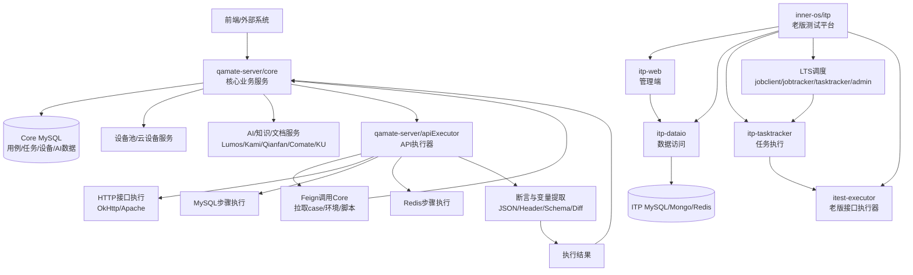

# QAMate / ITP 项目架构概览

本文基于当前本地三个 Git 仓库的 `pom.xml`、启动类、Controller/Service/Mapper 目录、配置文件和典型调用链做快速架构梳理。

涉及项目：

- `baidu/qamate-server/core`
- `baidu/qamate-server/apiExecutor`
- `baidu/inner-os/itp`

## 1. 总体定位

这三个项目整体上是一套“测试用例管理 + API/自动化执行 + 老版 ITP 测试平台”的体系。

`qamate-server/core` 是核心业务中台，负责管理用例、步骤、任务、设备、调试结果、AI 生成、Lumos/Kami 等能力。

`qamate-server/apiExecutor` 是执行器服务，负责接收 `core` 下发的执行任务，实际跑 API case、HTTP/MySQL/Redis 操作、断言、变量提取，并把结果回传给 `core`。

`inner-os/itp` 是老一代 ITP 测试平台，包含 Web 管理端、数据访问、任务执行器、LTS 调度系统、老式接口测试执行能力。它更像历史平台和基础能力库，技术栈明显更老。

可以先用一句话理解：

```text
core 是大脑和业务数据库，apiExecutor 是实际执行任务的工人，itp 是老平台和历史调度/执行体系。
```

## 2. Java 版本

| 项目 | Java 版本 | 依据 |
|---|---:|---|
| `qamate-server/core` | Java 21 | `pom.xml` 中 `<java.version>21</java.version>` |
| `qamate-server/apiExecutor` | Java 17 | `pom.xml` 中 `maven.compiler.source/target=17` |
| `inner-os/itp` | 主要 Java 8 | 多个模块中 `<java.version>1.8</java.version>` |
| `inner-os/itp/itest-executor/stargater` | Java 6 | `maven.compiler.source/target=1.6` |

## 3. 主要模块

### 3.1 qamate-server/core

`core` 是业务最重的服务，采用 Spring Boot 3.x，目录按照业务域拆分。

主要模块：

| 模块 | 作用 |
|---|---|
| `casenodemgt` | 测试用例树、用例节点、用例详情管理 |
| `casestepmgt` | 用例步骤、步骤 URI、步骤截图、步骤复制/移动等 |
| `cloudmgt` | 云端计划、任务、执行器、任务池、回调处理 |
| `debugmgt` | API 调试任务、步骤结果、调试文件、WebSocket 通知 |
| `devicemgt` | 设备池、设备注册、设备借还、设备账号 |
| `apismartmgt` | API Smart 相关计划、执行、调度集成 |
| `codegenmgt` | 代码生成任务、生成步骤、回调 |
| `generatemgt` / `flowmgt` | AI/流程生成任务、用例生成、任务状态管理 |
| `modelmgt` | LLM 模型策略、模型调用、模型价格/日志 |
| `v2/lumosgmt` | Lumos 文档、知识、代码仓库、规则、Agent、生成任务 |
| `v2/kamixmgt` | Kami/Kamix Agent、技能、会话、产品、任务 |
| `othermgt` | 产品、环境、用户、模板、脚本、配置、标签等基础管理 |
| `prometheusmgt` | 指标、异常处理、监控上报 |
| `stabilitymgt` | 稳定性测试计划、Monkey 任务 |
| `stargate` | Starlight/RPC 调用封装 |

典型结构：

```text
controller -> service -> mapper -> MySQL
                 |
                 -> feign/client -> 外部内部系统
```

启动类特征：

- `@SpringBootApplication`
- `@EnableScheduling`
- `@EnableTransactionManagement`
- `@EnableFeignClients`
- `@EnableMethodCache`
- `@EnableRetry`

### 3.2 qamate-server/apiExecutor

`apiExecutor` 是 API 执行器，职责更聚焦：接收任务、构造执行上下文、执行步骤、断言、回传结果。

主要模块：

| 模块 | 作用 |
|---|---|
| `controller` | 对外接口，例如 `/task/case/submit`、`/task/case/debugByJson` |
| `runner` | 任务运行器，把任务按执行流程跑起来 |
| `processor` | 任务处理器，处理不同步骤或阶段 |
| `client/impl/http` | HTTP 请求执行，包含 OkHttp 和 Apache HttpClient 实现 |
| `client/impl/sql` | MySQL 连接与 SQL 执行 |
| `client/impl/redis` | Redis/Jedis 执行 |
| `protocol` | 请求、响应、执行协议模型 |
| `verify` | 断言能力：状态码、Header、JSON、Schema、文本 Diff、Kirin 等 |
| `extraction` | 响应变量提取：Header、Body、部分提取、完整提取 |
| `context` | 执行上下文 |
| `common/conf/feign` | 调用 `core` 和设备服务 |
| `jobhandler` | XXL-Job 任务入口 |
| `mapper` | MyBatis-Plus 数据访问 |

典型执行链路：

```text
TaskController
  -> TaskSubmitService
  -> RunnerTask
  -> Runner / Processor
  -> HTTP / SQL / Redis Client
  -> Extraction
  -> Verify
  -> QAMateCoreClient 回传结果
```

启动类特征：

- `@SpringBootApplication`
- `@EnableFeignClients(basePackages = "com.baidu.**")`
- `@EnableScheduling`
- `@MapperScan("com.baidu.qamate.server.mapper")`
- `@ServletComponentScan`

### 3.3 inner-os/itp

`itp` 是老平台，结构更复杂，包含多个相对独立的子系统。

主要模块：

| 模块 | 作用 |
|---|---|
| `itp/itp-web` | 老式 Web 管理端，大量 `Action` 类，类似早期 MVC Controller |
| `itp/itp-dataio` | 数据访问服务，包含 mapper、service、controller |
| `itp/itp-tasktracker` | 任务执行、断言、报告、回调、异步处理 |
| `itp/itp-core` | 公共模型、工具类、执行基础能力 |
| `itp/itp-intelli` | 较新的 Spring Boot 智能化模块 |
| `itp/itp-jetty-server` | Jetty 嵌入式服务支持 |
| `lts/*` | LTS 调度系统，包含 jobclient、jobtracker、tasktracker、admin |
| `itest-executor` | 老版接口测试执行器，依赖 TestNG、RestAssured、Jython、Dubbo、Stargate 等 |
| `case-digger` / `generator` | 辅助工具模块 |

它的典型链路：

```text
itp-web
  -> itp-dataio
  -> MySQL / Mongo / Redis

LTS jobclient
  -> jobtracker
  -> tasktracker
  -> itest-executor / itp-tasktracker
```

## 4. 技术栈

### 4.1 core

- Java 21
- Spring Boot 3.2
- Spring Cloud OpenFeign
- MyBatis-Plus
- Druid 多数据源
- JetCache
- Prometheus / Actuator metrics
- Lombok
- MapStruct
- Fastjson2
- Spring Retry
- 内部系统集成：UUAP、KU、Kami、Lumos、Qianfan、Comate、设备服务、BOS 等

### 4.2 apiExecutor

- Java 17
- Spring Boot 3.5
- Spring Cloud OpenFeign
- MyBatis-Plus
- XXL-Job
- OkHttp
- Apache HttpClient
- Jedis / Redis
- MapStruct
- Swagger / OpenAPI
- Log4j
- JSON Schema / JSON Diff / 文本 Diff 断言

### 4.3 itp

- 主要 Java 8，局部 Java 6
- Spring 3.x / 4.x
- Spring MVC
- 部分 Spring Boot 模块
- MyBatis / MyBatis Spring
- Druid / BoneCP
- Jetty / Tomcat WAR
- LTS 调度系统
- Redis / Mongo / MySQL
- Zookeeper / Dubbo
- TestNG / JUnit
- RestAssured
- Jython
- Log4j / SLF4J

## 5. 数据流向

### 5.1 新体系主链路

```text
前端/外部系统
  -> core 创建/维护用例、步骤、计划、设备、AI 生成任务
  -> core 从 MySQL 查询用例、环境、参数、设备池等信息
  -> core 把执行任务交给 apiExecutor 或云端执行器
  -> apiExecutor 拉取 case 信息、环境参数、脚本详情
  -> apiExecutor 执行 HTTP/SQL/Redis/API 步骤
  -> apiExecutor 做变量提取和断言
  -> apiExecutor 回传执行结果到 core
  -> core 落库并对外提供调试结果、报告、任务状态、AI 生成结果
```

### 5.2 老 ITP 链路

```text
itp-web 管理端
  -> itp-dataio 读写测试计划、用例、执行记录
  -> LTS 分发任务
  -> itp-tasktracker / itest-executor 执行任务
  -> MySQL / Mongo / Redis 保存结果和中间状态
```

## 6. 核心配置项

### 6.1 core

重点配置文件：

- `baidu/qamate-server/core/src/main/resources/application.yml`
- `baidu/qamate-server/core/src/main/resources/application-dev.yml`
- `baidu/qamate-server/core/src/main/resources/application-test.yml`
- `baidu/qamate-server/core/src/main/resources/application-online.yml`

关键配置类别：

- `server.servlet.context-path=/core`
- 多数据源：`core`、`api_smart_dispatch`、`api_executor`、`qamate_base`、`lazydevice`
- `mybatis-plus.mapper-locations=classpath*:mapper/*.xml`
- Prometheus / Actuator metrics
- JetCache 本地缓存
- Feign 外部服务地址
- UUAP 登录鉴权
- KU 文档服务
- Kami / Kamix / Lumos / Comate / Qianfan
- 设备服务、任务生成服务、Worker 服务

### 6.2 apiExecutor

重点配置文件：

- `baidu/qamate-server/apiExecutor/executor-server/src/main/resources/application.yml`
- `baidu/qamate-server/apiExecutor/executor-server/src/main/resources/application-dev.yml`
- `baidu/qamate-server/apiExecutor/executor-server/src/main/resources/application-test.yml`
- `baidu/qamate-server/apiExecutor/executor-server/src/main/resources/application-prod.yml`
- `baidu/qamate-server/apiExecutor/executor-server/src/main/resources/application-sandbox.yml`

关键配置类别：

- `server.servlet.context-path=/executor`
- MySQL 数据源
- `qamate.core.url`
- `qamate.device.url`
- `mybatis-plus.mapper-locations`
- XXL-Job admin/executor 配置
- Redis/BDRP 配置
- 文件根路径、脚本路径
- 执行器集群类型、模块 ID、服务 URL

### 6.3 itp

关键配置类别：

- Maven 多模块配置
- WAR/JAR 混合部署
- Spring XML / Spring MVC 配置
- MyBatis mapper 配置
- LTS 调度配置
- MySQL / Redis / Mongo / Zookeeper / Dubbo
- Jetty/Tomcat 启动配置

## 7. 模块依赖关系

```text
core
  -> MySQL
  -> 外部内部服务：UUAP / KU / Lumos / Kami / Qianfan / Comate / BOS / 设备服务
  -> apiExecutor

apiExecutor
  -> core: 拉取用例、环境、脚本，回传执行结果
  -> device service: 设备查询、注册、心跳、绑定
  -> MySQL: 执行器自身数据
  -> Redis: 缓存、状态、取消标记等
  -> HTTP / SQL / Redis 目标系统: 实际执行测试步骤

itp
  -> itp-core: 公共能力
  -> itp-dataio: 数据访问
  -> itp-web: Web 管理
  -> itp-tasktracker / itest-executor: 任务执行
  -> LTS: 调度
  -> MySQL / Mongo / Redis / Zookeeper / Dubbo
```

## 8. 架构图



## 9. 给 Python 背景读者的类比

| Java/Spring 概念 | Python 类比 |
|---|---|
| `pom.xml` | `pyproject.toml + requirements.txt + 构建配置` |
| `Controller` | FastAPI / Flask route |
| `Service` | 业务逻辑层 |
| `Mapper` | DAO / Repository / SQLAlchemy mapper |
| `Entity` | ORM model |
| `DTO` | Pydantic model / dataclass |
| `application.yml` | `.env + settings.py + yaml 配置` |
| `target/` | `build/` / `dist/` |
| `jar` | 可运行服务包 |
| `war` | 部署到 Tomcat/Jetty 的 Web 包 |

## 10. 风险与建议

本地配置文件中存在数据库连接、内部服务地址、token、secret 等敏感配置。建议后续做一次配置治理：

- 把密码、token、secret 从 Git 配置文件迁移到环境变量或配置中心。
- 为本地、测试、线上环境建立清晰隔离。
- 给 `core` 与 `apiExecutor` 的主链路补一份接口级调用文档。
- 对 `itp` 这类老系统建立模块边界说明，避免新功能继续堆到历史模块里。
