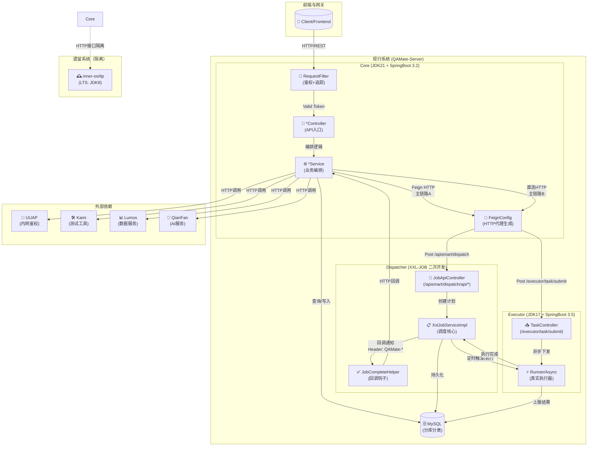
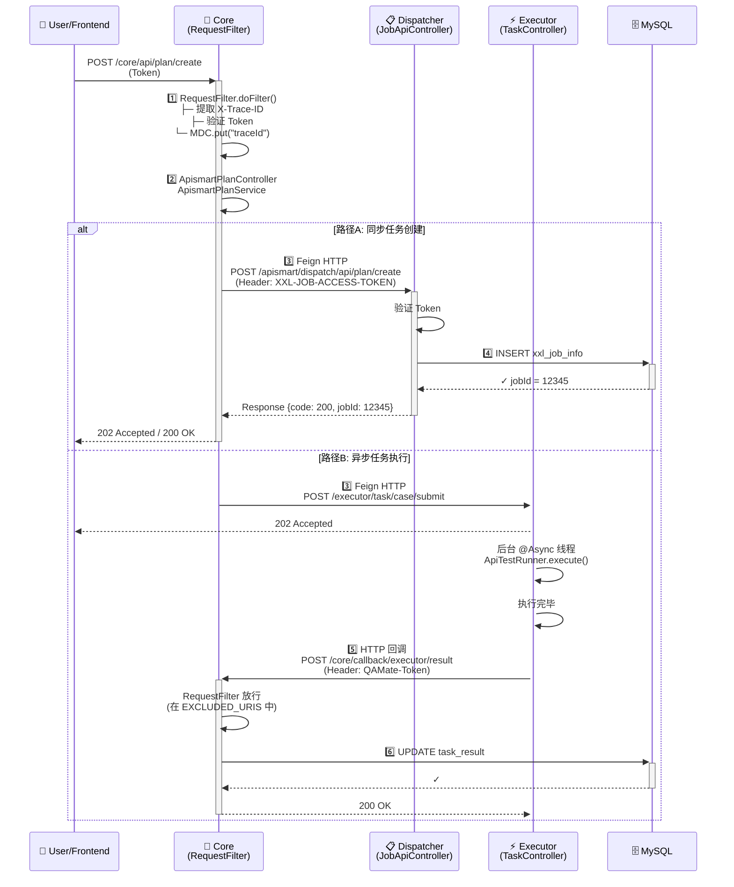

# QAMate 系统全景拓扑与生命周期完全指南

> **面向受众**：熟悉 Python（Flask/FastAPI + Celery）、对 Java 仅有语法理解的开发者
> **核心目标**：通过类比 Python 生态来解释 Java 微服务架构、通讯协议、技术栈和启动生命周期

---

## 第一部分：全景拓扑 (System Topology)

### 1.1 三大核心模块拓扑图

该系统三个独立的微服务构成，采用**同步 RPC（HTTP/Feign） + 异步回调** 混合架构。类比 Python 生态：

| 功能角色 | Java 模块 | Python 类比 | 通讯方式 |
|:---|:---|:---|:---|
| **Gateway 与业务编排** | `core` | FastAPI Application（带 route dispatcher） | HTTP/REST |
| **任务执行器（Worker）** | `apiExecutor` | Celery Worker（执行实际任务）| HTTP + 回调 |
| **分布式调度器** | `api-smart-dispatch` | Celery Broker（Redis/RabbitMQ 调度）| HTTP + 触发 |

### 1.2 Mermaid 微服务通讯拓扑



---

## 第二部分：核心通讯协议详解

### 2.1 链路 A：Core -> Dispatch（同步任务创建）

```
1. API入口
   POST /core/api/task/plan/create
   Header: QAMATE-Token, QAMate-ModuleId

2. 校验与转换（RequestFilter.doFilter）
   ├─ 提取 X-Trace-ID（全链路追踪，类同 Python contextvars）
   ├─ 验证 OpenAPI Token / UUAP Token
   └─ MDC.put("traceId", xxx)

3. 业务编排（*Service.createPlan）
   ├─ 参数校验与转换
   ├─ 权限检查（通过 openApiToken.checkFromToken 或 UUAP）
   └─ 组装 PlanDto

4. Feign HTTP 同步调用
   POST http://api-smart-dispatch-server:8080/apismart/dispatch/api/job/create
   Header: 
     - XXL-JOB-ACCESS-TOKEN: <token>
     - userName: <internal-user>
     - userToken: <internal-secret>
   Body: {planId, jobName, scheduleType, ...}

5. XXL-JOB 响应
   Response: {code: 200, data: {jobId: xxxxx}}

6. 结果落地
   ├─ 持久化 Plan 状态到 MySQL
   └─ 发送 WebSocket 事件给前端
```

**通讯协议**：HTTP/REST (Feign 封装)
**触发方式**：同步（Blocking Call）
**超时处理**：HttpClient 配置（见 application.yml，socketTimeout: 150000ms）

---

### 2.2 链路 B：Core -> Executor（直连执行下发）

```
1. 场景
   └─ 快速路径/调试模式，绕过调度中心

2. API 入口
   POST /core/api/debug/task/submit
   Header: QAMATE-Token, QAMate-ModuleId

3. 直连下发
   POST http://apiExecutor-server:8080/executor/task/case/submit
   Header: Authorization (来自 FeignConfig)
   Body: {caseId, caseData, executorType}

4. Executor 异步处理（TaskController.submitTask）
   ├─ 收到请求，立即返回 202 Accepted
   ├─ 后台 @Async 线程启动执行（ExecutorService）
   └─ 执行完后，HTTP 回调 Core

5. 执行完回调
   POST /core/api/callback/executor/result
   Header: Authorization
   Body: {taskId, status, output, errorMsg}
```

**通讯协议**：HTTP/REST (Feign)
**触发方式**：主线程返回 202，背景异步执行
**并发控制**：ThreadPoolExecutor (@Async配置)

---

### 2.3 链路 C：Executor -> Dispatcher 回调闭环

```
1. 调度链路（XxlJob 心跳触发）
   ├─ xxl-job-core 定时 pull Job 列表
   ├─ 找到可执行的 Task
   └─ Executor 组件执行业务逻辑

2. 执行完回调
   POST /core/callback/plan/complete
   Header: 
     - QAMate-ModuleId: <moduleId>
     - QAMate-Token: <token>
   Body: {planId, jobId, status, summary}

3. Core 接收并处理（RequestFilter 白名单放行，FilterConfig.allowCallbackUri）
   ├─ 更新 Plan 状态到 MySQL
   ├─ 发送 WebSocket 通知前端
   └─ 触发后处理流程（数据收敛、报表生成等）
```

**通讯协议**：HTTP/REST
**触发方式**：异步回调（Callback Pattern）
**认证**：Header 中的 Token 校验

---

## 第三部分：核心技术栈详解

### 3.1 Core 模块技术栈

| 技术维度 | 具体框架/库 | 版本 | 用途 |
|:---|:---|:---|:---|
| **JDK** | OpenJDK | 21 | 最新 LTS，支持虚拟线程（Virtual Thread） |
| **框架** | Spring Boot | 3.2.0 | Web 框架，自动配置 |
| **微服务** | Spring Cloud | 2023.0.3 | 分布式服务治理 |
| **服务通讯** | Spring Cloud Openfeign | 13.1 | 声明式 HTTP 客户端 |
| **RPC/服务发现** | Baidu Starlight | 2023.0.0 | 百度内部服务框架（泛化调用） |
| **数据库** | MyBatis Plus | 3.5.4.1 | ORM 框架 |
| **连接池** | Druid | 1.2.16 | 数据库连接池 |
| **缓存** | JetCache | 2.7.7 | 本地/远程缓存（支持 Redis） |
| **鉴权与授权** | UUAP Client | 0.3.7 | 百度内网鉴权中心 |
| **监控指标** | Micrometer Prometheus | 最新 | Metrics 导出 |
| **内存追踪** | Transmittable ThreadLocal | - | 线程上下文传递（MDC 跨异步） |
| **HTTP 客户端** | HttpClient5 | 5.3 | 底层 HTTP 实现 |
| **重试机制** | Spring Retry | 2.0.4 | @Retryable 注解 |
| **静态代码** | Lombok | 1.18.30 | 消除样板代码 |
| **对象映射** | MapStruct | 1.5.5 | 编译期自动生成 Mapper |
| **文档处理** | EasyExcel + POI | 3.3.4 & 4.1.0 | 读写 Excel 文件 |
| **JSON 处理** | FastJSON | 2.0.43 | 快速 JSON 序列化 |
| **工具库** | Hutool | 5.8.23 | 便利工具集 |

**架构特点**：
- 采用**微服务网关 + 分层架构**（Controller -> Service -> Manager -> Mapper）
- **Feign** 作为 RPC 框架（类似 Python 的 requests/httpx），但自动生成客户端代理
- **Micrometer + Prometheus** 全链路监控，类似 Python 中的 Prometheus Client
- **JetCache** 本地双缓存（LRU + RedisCache），避免反复查库

### 3.2 Executor 模块技术栈

| 技术维度 | 具体框架/库 | 版本 | 用途 |
|:---|:---|:---|:---|
| **JDK** | OpenJDK | 17 | LTS 版，避免前沿不稳定特性 |
| **框架** | Spring Boot | 3.5.9 | Web 框架 |
| **微服务** | Spring Cloud | 2025.0.1 | 分布式组件 |
| **数据库** | MyBatis Plus | 3.5.7 | 二代 ORM（Spring Boot 3.x 专用 Starter） |
| **调度核心** | XXL-Job Core | 3.2.0 | 分布式任务执行代理库 |
| **HTTP 通讯** | HttpClient | 5.x+ | 执行 API 测试请求 |
| **线程上下文** | Transmittable ThreadLocal | 2.11.0 | 异步线程下 MDC 保持 |
| **多语言执行** | Python-3.10.14 | 3.10 | 打包内置，用于运行 Python 测试脚本 |
| **RPC 编码** | Protocol Buffer Compiler | 32.0 | gRPC 协议编解码 |
| **拼音转换** | Pinyin4j | 2.5.1 | 中文拼音处理 |

**架构特点**：
- **轻量级无状态执行器**，核心逻辑在 `executor-server` 模块
- 支持多种执行模式（HTTP API 测试、Shell 脚本、Python 脚本）
- 内置 Python 和 protoc，避免外部依赖
- 通过 XXL-Job 心跳机制与调度中心对接

### 3.3 Dispatcher (api-smart-dispatch) 模块技术栈

| 技术维度 | 具体框架/库 | 版本 | 用途 |
|:---|:---|:---|:---|
| **JDK** | OpenJDK | 17 | 稳定版 |
| **框架** | Spring Boot | 3.5.6 | Web 框架 |
| **调度引擎** | XXL-Job | 3.2.1 | 开源分布式任务调度框架 |
| **数据库** | MyBatis | 3.0.5 | ORM |
| **网络** | Netty | 4.2.6 | 高性能网络库（XXL-Job 底层） |
| **JSON** | Gson | 2.13.2 | 序列化 |
| **脚本引擎** | Groovy | 5.0.1 | 动态脚本支持（XXL-Job 的调度脚本） |
| **SSO** | XXL-SSO | 2.1.1 | 登录认证模块 |
| **Spring** | Spring 6.2.11 | 6.2.11 | 核心框架 |

**架构特点**：
- 基于开源 XXL-JOB 的二次魔改
- 核心逻辑在 `xxl-job-admin` 模块（Web UI + API + 调度引擎）
- 提供 REST API 端点 `/apismart/dispatch/api/*` 供 Core 调用
- 内置 Netty，支持高并发任务分发

---

## 第四部分：目录地图与入口类

### 4.1 Core 模块目录结构

```
core/
├── src/main/java/com/baidu/qamate/core/
│   ├── App.java  ◄─ 【启动类入口】
│   │
│   ├── components/config/
│   │   ├── RequestFilter.java  ◄─ 鉴权与追踪拦截器
│   │   ├── UrlConfig.java  ◄─ 外部 URL 路由字典
│   │   ├── FeignConfig.java  ◄─ Feign 客户端配置
│   │   ├── FilterConfig.java  ◄─ 白名单与回调URL配置
│   │   └── OpenApiToken.java  ◄─ Token 校验逻辑
│   │
│   ├── apismartmgt/  ◄─ 调度中心模块
│   │   ├── controller/
│   │   │   └── ApismartPlanController.java  ◄─ 计划创建/查询 API
│   │   ├── service/
│   │   │   └── ApismartPlanService.java  ◄─ 业务逻辑
│   │   ├── manager/
│   │   │   ├── client/
│   │   │   │   ├── DispatchClient.java  ◄─ 【XXL-JOB Feign 客户端】
│   │   │   │   └── JobApiClient.java
│   │   │   └── ApismartPlanManager.java  ◄─ 计划管理器
│   │   ├── mapper/
│   │   │   └── ApismartPlanMapper.java
│   │   └── entity/
│   │       └── ApismartPlanEntity.java
│   │
│   ├── cloudmgt/  ◄─ 执行任务模块
│   │   ├── controller/
│   │   │   └── TaskController.java  ◄─ 执行任务 API
│   │   ├── service/
│   │   │   ├── TaskService.java
│   │   │   ├── ExecutorTaskService.java  ◄─ 调用 Executor
│   │   │   └── PoolService.java
│   │   └── manager/
│   │
│   ├── prometheusmgt/  ◄─ 监控指标
│   │   └── PrometheusMetricManager.java
│   │
│   ├── ... (其他业务模块)
│   │
│   └── v2/  ◄─ V2 版本（新功能孵化）
│       ├── lumosgmt/  ◄─ Lumos 集成
│       └── kamixmgt/  ◄─ Kami 集成
│
├── src/main/resources/
│   ├── application.yml  ◄─ 全局配置
│   ├── application-dev.yml
│   ├── application-test.yml
│   ├── application-online.yml
│   ├── logback-spring.xml  ◄─ 日志配置
│   ├── mapper/  ◄─ MyBatis XML 映射文件
│   └── sql/
│
├── pom.xml  ◄─ Maven 依赖定义
├── build.sh  ◄─ 编译脚本（-Pdev）
├── ci.yml  ◄─ CI/CD 定义
└── Dockerfile  ◄─ 容器镜像
```

**关键入口类**：
- **App.java** 第 24-40 行：
  - `@EnableScheduling`：启用定时任务
  - `@EnableFeignClients`：自动扫描并注册 Feign 客户端（见 L26-30）
  - `@EnableMethodCache`：启用 JetCache 方法缓存
  - `@SpringBootApplication(exclude=...)` 排除自动配置类

### 4.2 Executor 模块目录结构

```
apiExecutor/
├── executor-dto/  ◄─ 数据传输对象（POM 子模块）
│   └── src/main/java/
│       ├── TaskSubmitRequest.java
│       ├── TaskExecuteResult.java
│       └── ...
│
├── executor-client/  ◄─ 客户端库（供他人依赖）
│   └── src/main/java/
│       └── ExecutorClient.java
│
├── executor-server/  ◄─ 【实际服务模块】
│   ├── src/main/java/
│   │   ├── com/baidu/qamate/executor/
│   │   │   ├── Application.java  ◄─ 【启动类入口】
│   │   │   ├── controller/
│   │   │   │   ├── TaskController.java  ◄─ /executor/task/submit API
│   │   │   │   └── HealthController.java  ◄─ 健康检查
│   │   │   ├── runner/
│   │   │   │   ├── ApiTestRunner.java  ◄─ HTTP API 执行器
│   │   │   │   ├── PythonScriptRunner.java  ◄─ Python 脚本执行器
│   │   │   │   └── ShellRunner.java  ◄─ Shell 执行器
│   │   │   ├── async/
│   │   │   │   └── AsyncExecutor.java  ◄─ @Async 配置
│   │   │   ├── service/
│   │   │   │   ├── TaskService.java
│   │   │   │   └── ExecutionResultService.java
│   │   │   └── callback/
│   │   │       └── CoreCallbackClient.java  ◄─ 回调 Core
│   │   │
│   │   └── resources/
│   │       ├── application.yml  ◄─ Executor 配置
│   │       └── logback-spring.xml
│   │
│   ├── pom.xml
│   └── Dockerfile
│
├── pom.xml  ◄─ Parent POM（聚合 3 个子模块）
├── build.sh  ◄─ 编译脚本
├── ci.yml  ◄─ CI/CD
└── publish.sh  ◄─ 发布脚本
```

**关键入口类**：
- **Application.java**（在 executor-server）：
  - `@SpringBootApplication` 启动
  - `@EnableScheduling`（可选，用于定时健康检查）
  - `@EnableAsync`：启用异步（@Async 方法）

### 4.3 Dispatcher 模块目录结构

```
api-smart-dispatch/
├── xxl-job-core/  ◄─ 公共依赖库
│   ├── src/main/java/com/xxl/job/core/
│   │   ├── model/
│   │   │   └── XxlJobInfo.java  ◄─ 任务信息模型
│   │   ├── handler/
│   │   │   └── IJobHandler.java  ◄─ Job 处理器接口
│   │   └── executor/
│   │       └── XxlJobExecutor.java  ◄─ Executor 代理
│   └── pom.xml
│
├── xxl-job-admin/  ◄─ 【调度中心服务端】
│   ├── src/main/java/com/xxl/job/admin/
│   │   ├── XxlJobAdminApplication.java  ◄─ 【启动类入口】
│   │   ├── controller/
│   │   │   ├── openapi/
│   │   │   │   └── JobApiController.java  ◄─ 【REST API /apismart/dispatch/api/*】
│   │   │   ├── JobGroupController.java
│   │   │   └── JobInfoController.java
│   │   ├── service/
│   │   │   ├── impl/
│   │   │   │   ├── XxlJobServiceImpl.java  ◄─ 【核心调度逻辑】
│   │   │   │   └── XxlJobLogService.java
│   │   │   └── XxlJobService.java
│   │   ├── core/
│   │   │   ├── trigger/
│   │   │   │   └── XxlJobTrigger.java  ◄─ 触发器
│   │   │   └── scheduler/
│   │   │       └── XxlJobScheduler.java  ◄─ 【调度器线程】
│   │   ├── callback/
│   │   │   ├── JobCompleteHelper.java  ◄─ 【回调钩子】
│   │   │   └── CallbackService.java
│   │   ├── mapper/
│   │   │   └── XxlJobInfoMapper.java
│   │   └── entity/
│   │       └── XxlJobInfo.java
│   │
│   ├── src/main/resources/
│   │   ├── application.yml  ◄─ Dispatcher 配置
│   │   ├── application.properties
│   │   ├── templates/  ◄─ Web UI（非 API 部分）
│   │   └── db/
│   │       ├── 01-schema.sql  ◄─ 数据库 schema (MySQL)
│   │       └── 02-data.sql
│   │
│   ├── pom.xml
│   ├── Dockerfile
│   └── ci.yml
│
├── pom.xml  ◄─ Parent POM
├── build.sh  ◄─ mvn package
├── ci.yml  ◄─ CI/CD
└── postBuild.sh  ◄─ 后处理脚本
```

**关键入口类**：
- **XxlJobAdminApplication.java**：
  - `@SpringBootApplication` 启动
  - 初始化 `XxlJobScheduler` 定时线程
- **JobApiController.java**（L~）：
  - `@PostMapping("/job/create")` 创建任务 API（Core 调用）
  - `@GetMapping("/job/info")` 查询任务 API
  - 校验 `XXL-JOB-ACCESS-TOKEN` Header

---

## 第五部分：系统启动生命周期详解

### 5.1 启动顺序（以本地 dev 环境为例）

#### 阶段 0：前置依赖

启动顺序（应该是这样）：

```
1. MySQL 数据库 ← 必须先启动（schema + 初始数据）
2. Redis （可选，但 JetCache 依赖）
3. UUAP / Kami / Lumos ← 内网服务（已部署在百度内网）
```

#### 阶段 1：启动 Dispatcher（api-smart-dispatch）

```powershell
# 构建
cd api-smart-dispatch
mvn clean package -Pdev

# 运行
java -jar xxl-job-admin/target/xxl-job-admin.jar \
  --spring.profiles.active=dev \
  --server.port=8081 \
  --spring.datasource.url=jdbc:mysql://localhost:3306/xxl_job \
  --spring.datasource.username=root \
  --spring.datasource.password=password
```

**启动步骤**：
1. 加载 `XxlJobAdminApplication` 主类（实现 CommandLineRunner）
2. Spring IoC 容器初始化，自动装配所有 Bean
3. 数据库连接池（Druid）初始化
4. `XxlJobScheduler` 在 `@PostConstruct` 中启动定时线程
   ```java
   @PostConstruct
   public void start() {
       this.schedulerThread = new Thread(...);
       this.schedulerThread.start();  // 每秒扫描一次待执行任务
   }
   ```
5. 监听 HTTP 端口 `8081`，暴露 REST API `/apismart/dispatch/api/*`
6. 日志：`Started XxlJobAdminApplication in X.XXX seconds`

**数据库初始化**：
- 自动运行 `db/01-schema.sql`（创建 `xxl_job_info`、`xxl_job_log` 等表）
- 初始化 `xxl_job_group`（执行器组）

#### 阶段 2：启动 Executor（apiExecutor）

```powershell
cd apiExecutor/executor-server
mvn clean package -Pdev

java -jar target/executor-server.jar \
  --spring.profiles.active=dev \
  --server.port=8082 \
  --xxl.job.admin.url=http://localhost:8081/apismart/dispatch \
  --xxl.job.executor.address=http://localhost:8082
```

**启动步骤**：
1. 加载 `Application` 主类
2. Spring 容器初始化，装配 Beans
3. `XxlJobExecutor` 在 `@PostConstruct` 中注册到调度中心
   ```java
   @PostConstruct
   public void start() {
       XxlJobExecutor.registerExecutor(
           adminAddress="http://localhost:8081/apismart/dispatch",
           executorAddress="http://localhost:8082"
       );
       // 发送注册请求到 Dispatcher
       // POST /apismart/dispatch/api/executor/register
   }
   ```
4. Executor 进程启动嵌入式 Netty 端口监听，等待来自调度中心的任务下发
5. 日志：`Started Application in X.XXX seconds`
6. 定时心跳（每 30 秒）向调度中心上报存活状态

#### 阶段 3：启动 Core（core）

```powershell
cd core
mvn clean package -Pdev

java -jar target/core.jar \
  --spring.profiles.active=dev \
  --server.port=8080 \
  --logging.file.path=logs/
```

**启动步骤**：
1. 加载 `App` 主类
2. Spring 容器初始化
3. **Feign 客户端代理生成** (@EnableFeignClients 在 L26-30)
   ```java
   @EnableFeignClients(basePackages = {
       "com.baidu.qamate.core.apismartmgt.manager.client",
       "com.baidu.qamate.core.v2.lumosgmt.common.feign",
       "com.baidu.qamate.core.v2.kamixmgt.manager.feign"
   })
   ```
   - Spring 扫描这些包下带有 `@FeignClient` 的接口
   - 动态代理拦截方法调用，转换为 HTTP 请求
   - 应用 `FeignConfig.authInterceptor()` 对所有外出请求注入 Header

4. **缓存初始化** (@EnableMethodCache)
   - JetCache 初始化本地 LinkedHashMap 缓存（L34-42 in application.yml）
   - Redis 连接池（如果配置了 Redis）

5. **数据库连接池初始化**（Druid）
   - 创建连接池，预设 minIdle / maxActive 连接

6. **Scheduling 初始化** (@EnableScheduling)
   - 扫描 `@Scheduled` 注解的定时任务

7. **RequestFilter 注册**
   - Servlet Filter 链中注册 `RequestFilter.doFilter` 作为最前置拦截器

8. **Metrics 导出** (management.endpoints.web.exposure.include: prometheus)
   - Micrometer 初始化，绑定 Prometheus Registry
   - 暴露 `/metrics/prometheus` 端点供监控系统抓取

9. 监听 HTTP 端口 `8080`，上下文路径 `/core`（见 application.yml L61）
   - 实际 URL 前缀变为 `/core/api/*`

10. 日志：`Started App in X.XXX seconds`

### 5.2 握手与互联过程

```
时间线：

T=0s  ┌─────────────────────┐
      │ Dispatcher 上线      │ (MySQL/Druid 初始化 ✓)
      │ 监听 :8081          │
      └─────────────────────┘
          │
          │ 等待 Executor
          ▼

T=1s  ┌─────────────────────┐
      │ Executor 启动        │ 
      │ XxlJobExecutor.     │
      │ registerExecutor()  │ 
      └─────────────────────┘
          │
          │ POST /apismart/dispatch/api/executor/register
          │ (Header: XXL-JOB-ACCESS-TOKEN)
          │
          ▼
      ┌─────────────────────┐
      │ Dispatcher 收到注册  │ 
      │ ✓ 记录到数据库      │
      │ (xxl_job_group)    │
      └─────────────────────┘
          │
          │ Response 200 OK
          ▼
      ┌─────────────────────┐
      │ Executor 进入心跳    │
      │ 循环（每 30秒）     │
      └─────────────────────┘

T=2s  ┌─────────────────────┐
      │ Core 启动           │
      │ Feign 客户端初始化  │
      │ (DispatchClient)   │
      └─────────────────────┘
          │
          │ [可选] GET RequestContextHolder.currentRequest
          │        (用于铺垫 FeignConfig 中的 Token 获取逻辑)
          │
          ▼
      ┌─────────────────────┐
      │ Core 启动完毕       │
      │ 监听 :8080/core     │
      └─────────────────────┘

T=3s+ 系统就绪

┌────────────────────────────────────────────┐
│ 用户发起请求：POST /core/api/task/submit    │
└────────────────────────────────────────────┘
        │
        ▼
    ┌─────────────────────────┐
    │ RequestFilter.doFilter  │
    │ ├─ 提取 X-Trace-ID      │ 
    │ ├─ 验证 Token           │ 
    │ └─ MDC.put("traceId")   │
    └─────────────────────────┘
        │
        ▼
    ┌─────────────────────────┐
    │ ApismartPlanController  │
    │ .createPlan()           │
    └─────────────────────────┘
        │
        ▼
    ┌─────────────────────────┐
    │ ApismartPlanService     │
    │ .createPlan()           │
    └─────────────────────────┘
        │
        ├─ 分支 A: 同步调度 ─┐
        │                   ▼
        │            Feign HTTP
        │            POST /apismart/dispatch/api/plan/create
        │            (带 XXL-JOB-ACCESS-TOKEN)
        │                   │
        │                   ▼
        │            JobApiController.createPlan()
        │            XxlJobServiceImpl.add(XxlJobInfo)
        │            → MySQL 持久化
        │                   │
        │            Response {code: 200, jobId: 12345}
        │               ◄─ │
        │
        ├─ 分支 B: 异步执行 ─┐
        │                   ▼
        │            Feign HTTP
        │            POST /executor/task/case/submit
        │                   │
        │                   ▼
        │            TaskController.submitTask()
        │            返回 202 Accepted
        │                   │
        │            背景 @Async
        │            ApiTestRunner.execute()
        │            → HTTP/Shell/Python 执行
        │                   │
        │            完毕后：
        │            POST /core/callback/executor/result
        │
        └─ 汇聚 ─ ▶ 返回给客户端 202 / 200
```

---

## 第六部分：配置项完整释义

### 6.1 Core 配置（application.yml）

```yaml
# L61: 上下文路径，所有 API 都会加上 /core 前缀
server.servlet.context-path: /core

# L99-108: HTTP 客户端连接池（HttpClient5）
http.maxTotal: 100              # 全局最大连接数
http.defaultMaxPerRoute: 50     # 模型/单个主机的并发数（类似 Python requests.Session 的 pool_size）
http.socketTimeout: 150000      # 读取超时（数据传输超这么久则中断）
http.connectTimeout: 8000       # 连接建立超时

# L119-126: Lumos 服务地址
lumos.serviceUrl: http://10.12.204.38:8080

# L135-139: Ku 服务（测试用例管理）
ku.serviceUrl: https://testone.baidu-int.com

# L144-146: 钱帆 AI 服务
qianfan.baseUrl: https://qianfan.baidubce.com
```

### 6.2 Dispatcher 配置（xxl-job-admin/application.yml）

```yaml
# 监听端口
server.port: 8080

# 数据库
spring.datasource.url: jdbc:mysql://localhost:3306/xxl_job
spring.datasource.username: root

# 上下文路径（重要！Core 的 DispatchClient 依赖这个）
server.servlet.context-path: /apismart/dispatch
```

### 6.3 Executor 配置（executor-server/application.yml）

```yaml
# 监听端口
server.port: 8082

# XXL-Job Admin 地址（用于注册和心跳）
xxl.job.admin.url: http://localhost:8081/apismart/dispatch
xxl.job.executor.address: http://localhost:8082

# 执行器名称
xxl.job.executor.appname: executor
```

### 6.4 核心系统配置（FilterConfig.java 中的白名单）

```java
// 不需要鉴权的 URI（回调、健康检查等）
private static final Set<String> EXCLUDED_URIS = new HashSet<>(Arrays.asList(
    "/core/api/callback/executor/result",      // ← Executor 回调 Core
    "/core/api/callback/plan/complete",        // ← Dispatcher 回调 Core
    "/core/actuator/health",                   // ← 健康检查
    "/core/metrics/prometheus"                 // ← 普罗米修斯指标
));
```

---

## 第七部分：整体通讯时序图



---

## 第八部分：常见调试路径

### 问题 1：Feign 请求超时

**症状**：`org.springframework.cloud.openfeign.FeignException: Read timed out`

**诊断步骤**：
1. 检查 application.yml 中的 `http.socketTimeout`（默认 150s）
2. 检查下游服务是否在线（curl 测试）
3. 检查 `FeignConfig.authInterceptor()` 中是否发起了额外的同步请求（见 L60-72）

### 问题 2：Token 校验失败

**症状**：返回 "Token非法||Token失效"

**诊断步骤**：
1. 检查 `RequestFilter.doFilter` 第 8-9 行，Token 来源是哪个 Header
2. 检查 `OpenApiToken.checkFromToken` L31-46 是否匹配超级 Token
3. 检查 `ProductEntity` 是否在数据库中被正确查询到

### 问题 3：MDC TraceId 丢失

**症状**：后台异步任务的日志中看不到 `[traceId=xxx]`

**诊断步骤**：
1. 确保 `@Async` 的 Executor 使用了 `TransmittableThreadLocal` 封装（pom.xml L31）
2. 检查 `ExecutorService` 是否被 `TraceContextAwareThreadPool` 包装
3. 查看 `MDC.clear()` 是否在 finally 中调用（L206）

---

## 参考资源

- **Feign 官方文档**：https://github.com/OpenFeign/feign
- **XXL-Job 官方**：https://github.com/xuxueli/xxl-job
- **Spring Cloud 官方**：https://spring.io/projects/spring-cloud
- **百度内网 Wiki** （需要 VPN）：http://wiki.baidu-int.com/

