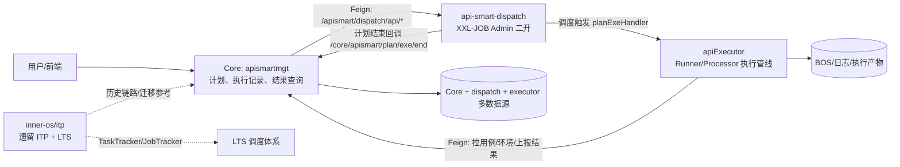
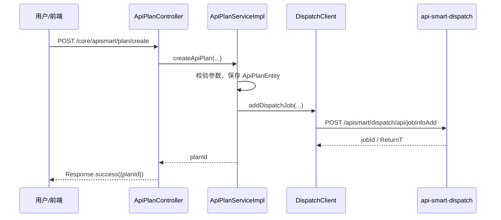
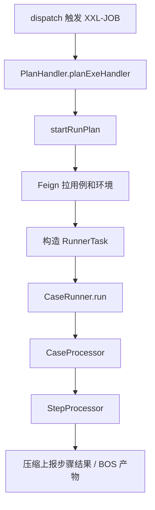

# QAMate / ITP 架构深潜

## 1. Thinking Process

这份文档不是先画图再找代码凑证据，而是按“入口 -> 调用契约 -> 执行管线 -> 回调与持久化 -> 隐性依赖”的顺序推导：

1. 先确认每个服务的启动边界。Core 启动类只把 `apismartmgt.manager.client` 纳入 Feign 扫描，同时还扫描了少量其他域的 Feign 包；本文只把非 apismart 域当作外部依赖处理，证据见 `baidu/qamate-server/core/src/main/java/com/baidu/qamate/core/App.java:24-40`。
2. 再追 apismart 的用户入口。`ApiPlanController` 统一挂在 `/apismart/plan`，计划创建、运行、执行状态、结果查询都从这里进入，证据见 `baidu/qamate-server/core/src/main/java/com/baidu/qamate/core/apismartmgt/controller/ApiPlanController.java:26-149`。
3. 然后追跨服务契约。Core 通过 `DispatchClient` 调 `api-smart-dispatch` 的 `/apismart/dispatch/api/*`，证据见 `baidu/qamate-server/core/src/main/java/com/baidu/qamate/core/apismartmgt/manager/client/DispatchClient.java:14-61`；调度中心的上下文路径是 `/apismart/dispatch`，证据见 `baidu/qamate-server/api-smart-dispatch/xxl-job-admin/src/main/resources/application.properties:1-4`。
4. 最后追执行和回流。调度中心触发执行器，执行器用 `PlanHandler -> PlanRunner -> CaseRunner -> Processor` 管线跑用例；执行结束后调度中心调用 Core 的 `/core/apismart/plan/exe/end`，证据见 `baidu/qamate-server/api-smart-dispatch/xxl-job-admin/src/main/java/com/xxl/job/admin/scheduler/thread/JobCompleteHelper.java:194-232`。

## 2. 维度 A：全局架构图景

### 2.1 重要概念：微服务

【正面】微服务把一个大系统拆成几个相对独立的小服务。日常类比是商场里的不同柜台：客服、收银、仓储各自负责一类事，互相通过明确窗口沟通。

【反面】柜台多了以后，沟通成本也上升。一个服务改了地址、字段或认证方式，另一个服务可能马上失败。

【反事实】如果不拆服务，计划管理、调度、执行都在一个进程里，初期简单，但一旦执行任务很重，整个后台都会被拖慢，升级也更难分开做。

【合】微服务的直觉模型是“分工换扩展性，用契约承担沟通成本”。

【本系统中的实例】Core 是业务编排中心，api-smart-dispatch 是调度中心，apiExecutor 是执行引擎，ITP/LTS 是遗留执行与调度体系。Core 启动类启用了 Feign 客户端扫描，证据见 `baidu/qamate-server/core/src/main/java/com/baidu/qamate/core/App.java:24-40`；apiExecutor 自己是独立 Spring Boot 应用，证据见 `baidu/qamate-server/apiExecutor/executor-server/src/main/java/com/baidu/qamate/server/App.java:18-31`；dispatch 也有自己的上下文路径，证据见 `baidu/qamate-server/api-smart-dispatch/xxl-job-admin/src/main/resources/application.properties:1-4`。

### 2.2 事件驱动 / 异步回调

【正面】异步回调像“餐厅取餐牌”：下单后不用站在柜台等，菜好了系统再通知你。

【反面】异步让链路变长。失败可能发生在“通知”这一步，而不是执行本身；排障时必须同时看发起方、执行方、回调方。

【反事实】如果没有异步回调，Core 必须一直阻塞等待执行器跑完计划。接口测试可能很慢，用户请求和服务线程都会被占住。

【合】异步回调用等待复杂度换系统吞吐，但必须有幂等、重试、日志和状态兜底。

【本系统中的实例】Core 在计划结束时保存状态后异步做报警检查和业务回调，证据见 `baidu/qamate-server/core/src/main/java/com/baidu/qamate/core/apismartmgt/service/impl/ApiPlanServiceImpl.java:961-1026`。dispatch 收到执行器 callback 后再调用 Core 的计划结束接口，证据见 `baidu/qamate-server/api-smart-dispatch/xxl-job-admin/src/main/java/com/xxl/job/admin/scheduler/thread/JobCompleteHelper.java:152-204`。

### 2.3 Runner / Processor 管线

【正面】Runner/Processor 像“流水线”：Runner 决定这张工单由哪条线处理，Processor 负责每个工序。

【反面】流水线会隐藏状态。上下文、变量、环境配置在多个步骤间传递，任何一步漏清理都可能污染下一次执行。

【反事实】如果没有管线，所有执行逻辑会堆在一个大函数里，新增协议、步骤、后置操作都会互相打架。

【合】管线让执行过程可拆分，但需要明确每一段的输入、输出和上下文生命周期。

【本系统中的实例】`Delegator` 按任务类型分发到 `CaseRunner` 或 `PlanRunner`，证据见 `baidu/qamate-server/apiExecutor/executor-server/src/main/java/com/baidu/qamate/server/runner/impl/Delegator.java:24-36`；`PlanRunner` 按 setup、case、teardown 顺序构造 case task 并执行，证据见 `baidu/qamate-server/apiExecutor/executor-server/src/main/java/com/baidu/qamate/server/runner/impl/PlanRunner.java:164-273`；`CaseProcessor` 逐个 step 调用 `StepProcessor`，证据见 `baidu/qamate-server/apiExecutor/executor-server/src/main/java/com/baidu/qamate/server/processor/impl/CaseProcessor.java:86-127`。

## 3. 维度 B：核心业务流向

### 3.1 apismart 计划创建

代码证据：

- Controller 暴露 `/apismart/plan/create` 并返回 `planId`，见 `baidu/qamate-server/core/src/main/java/com/baidu/qamate/core/apismartmgt/controller/ApiPlanController.java:59-64`。
- Service 校验计划名、模块、参数、cron，并保存 `ApiPlanEntity`，见 `baidu/qamate-server/core/src/main/java/com/baidu/qamate/core/apismartmgt/service/impl/ApiPlanServiceImpl.java:267-316`。
- Service 生成执行参数并调用调度中心创建任务，见 `baidu/qamate-server/core/src/main/java/com/baidu/qamate/core/apismartmgt/service/impl/ApiPlanServiceImpl.java:317-340`。
- dispatch OpenAPI 把 `jobInfoAdd` 映射到 `xxlJobService.add`，见 `baidu/qamate-server/api-smart-dispatch/xxl-job-admin/src/main/java/com/xxl/job/admin/controller/openapi/JobApiController.java:94-98`。
- `XxlJobInfo` 中有 `planId` 字段，说明调度任务和 Core 计划强绑定，见 `baidu/qamate-server/api-smart-dispatch/xxl-job-admin/src/main/java/com/xxl/job/admin/model/XxlJobInfo.java:10-15`。

### 3.2 apismart 计划执行

计划执行有两种入口：手动触发和定时触发。

- 手动执行：`/apismart/plan/run` 调 `runApiPlan`，Core 构造 `executorParam` 后调用 `jobTriggerByPlanId`，见 `baidu/qamate-server/core/src/main/java/com/baidu/qamate/core/apismartmgt/controller/ApiPlanController.java:87-92` 和 `baidu/qamate-server/core/src/main/java/com/baidu/qamate/core/apismartmgt/service/impl/ApiPlanServiceImpl.java:836-867`。
- 敏捷执行：`/apismart/plan/agile/run` 允许覆盖 server 配置和用户参数，再触发同一个 dispatch 接口，见 `baidu/qamate-server/core/src/main/java/com/baidu/qamate/core/apismartmgt/service/impl/ApiPlanServiceImpl.java:871-923`。
- 定时执行：dispatch 的 `JobScheduleHelper` 扫描即将触发的任务，并把 job 放入触发池，见 `baidu/qamate-server/api-smart-dispatch/xxl-job-admin/src/main/java/com/xxl/job/admin/scheduler/thread/JobScheduleHelper.java:54-103`。
- 手动触发时 dispatch 按 `planId` 找任务并创建 `planExeId`，见 `baidu/qamate-server/api-smart-dispatch/xxl-job-admin/src/main/java/com/xxl/job/admin/service/impl/XxlJobServiceImpl.java:599-617` 和 `baidu/qamate-server/api-smart-dispatch/xxl-job-admin/src/main/java/com/xxl/job/admin/scheduler/thread/JobTriggerPoolHelper.java:110-129`。

执行器内部链路：

- `PlanHandler` 读取 XXL-JOB 参数并调用 `PlanRunner.startRunPlan`，见 `baidu/qamate-server/apiExecutor/executor-server/src/main/java/com/baidu/qamate/server/jobhandler/PlanHandler.java:39-63`。
- `PlanRunner` 开始时调用 Core 记录计划开始，见 `baidu/qamate-server/apiExecutor/executor-server/src/main/java/com/baidu/qamate/server/runner/impl/PlanRunner.java:86-96`。
- `PlanExecuteServiceImpl` 通过 `QAMateCoreClient` 拉取 case、计划 case 列表和环境详情，见 `baidu/qamate-server/apiExecutor/executor-server/src/main/java/com/baidu/qamate/server/service/impl/PlanExecuteServiceImpl.java:38-93`。
- `QAMateCoreClient` 的 apismart 契约包括拉 case、拉计划参数和通知计划开始，见 `baidu/qamate-server/apiExecutor/executor-server/src/main/java/com/baidu/qamate/server/common/conf/feign/client/QAMateCoreClient.java:32-44`。

### 3.3 结果回流

结果回流分三层：

1. 执行器把步骤结果、BOS 文件、case 结果写回 Core 或执行器库。`CaseRunner` 结束后推送结果到 Core，见 `baidu/qamate-server/apiExecutor/executor-server/src/main/java/com/baidu/qamate/server/runner/impl/CaseRunner.java:153-160`；步骤结果压缩后上报 Core，见 `baidu/qamate-server/apiExecutor/executor-server/src/main/java/com/baidu/qamate/server/service/impl/PlanExecuteServiceImpl.java:113-124`。
2. dispatch 处理执行器 callback 后，把计划结束状态回调 Core。状态解析与 `callServerPlanEnd` 见 `baidu/qamate-server/api-smart-dispatch/xxl-job-admin/src/main/java/com/xxl/job/admin/scheduler/thread/JobCompleteHelper.java:194-244`。
3. Core 接收 `/apismart/plan/exe/start` 和 `/apismart/plan/exe/end`，保存执行记录并触发异步报警、业务回调，见 `baidu/qamate-server/core/src/main/java/com/baidu/qamate/core/apismartmgt/controller/ApiPlanController.java:108-120` 和 `baidu/qamate-server/core/src/main/java/com/baidu/qamate/core/apismartmgt/service/impl/ApiPlanServiceImpl.java:930-977`。

结果查询则由 Core 聚合调度日志、执行器参数、case 执行结果：

- `/apismart/plan/execute/result` 调 `queryExecuteResult`，见 `baidu/qamate-server/core/src/main/java/com/baidu/qamate/core/apismartmgt/controller/ApiPlanController.java:122-127`。
- `queryExecuteResult` 先查 dispatch 日志，再查执行器执行记录，再查 case 结果，见 `baidu/qamate-server/core/src/main/java/com/baidu/qamate/core/apismartmgt/service/impl/ApiPlanServiceImpl.java:1036-1076`。
- `/apismart/plan/executor/log` 通过 `DispatchClient.dispatchJobLog` 取调度日志，见 `baidu/qamate-server/core/src/main/java/com/baidu/qamate/core/apismartmgt/service/impl/ApiPlanExeServiceImpl.java:691-712`。

### 3.4 ITP / LTS 遗留链路

ITP 是老体系，不是当前 apismart 主链路，但它解释了很多历史设计：

- ITP Intelli 应用通过 Hessian 暴露或调用 `testNodeService`、`planService`、`syncDataService`，见 `baidu/inner-os/itp/itp/itp-intelli/src/main/java/com/baidu/itp/intelli/WebApplication.java:21-58`。
- ITP TaskTracker 的总入口是 `ItpJobRunner`，它按任务类型分派到 case、plan、batch case，见 `baidu/inner-os/itp/itp/itp-tasktracker/src/main/java/com/baidu/itp/tasktracker/runner/ItpJobRunner.java:100-168`。
- LTS 的 `TaskTracker` 初始化 RunnerPool、JobPullMachine 和停止工作监控，见 `baidu/inner-os/itp/lts/lts-tasktracker/src/main/java/com/lts/tasktracker/TaskTracker.java:31-45`。
- LTS 的 `JobTracker` 负责队列、JobClient、TaskTracker、JobReceiver、JobSender 等调度中心组件，见 `baidu/inner-os/itp/lts/lts-jobtracker/src/main/java/com/lts/jobtracker/JobTracker.java:29-64`。

## 4. 维度 C：隐性依赖与副作用

### 4.1 Feign header / token

【正面】Feign 像“带通讯录的电话”：业务代码只调用接口方法，不必每次手写 HTTP 地址、header 和序列化逻辑。

【反面】它会把真实 HTTP 细节藏起来。header、token、超时、重试策略一旦错了，表面上看只是一个 Java 方法失败。

【反事实】如果没有 Feign，所有服务调用都要手写 HTTP 请求，重复代码多，但每次调用细节更显眼。

【合】Feign 适合稳定的内部契约，但认证、超时、日志级别必须集中治理。

【本系统中的实例】Core 的 `FeignConfig` 给 dispatch 请求加 `XXL-JOB-ACCESS-TOKEN`、`userName`、`userToken`，其中存在硬编码凭据风险；这里只引用行号，不复写敏感值，见 `baidu/qamate-server/core/src/main/java/com/baidu/qamate/core/apismartmgt/manager/FeignConfig.java:35-43`。Worker token 通过用户名密码登录获得，见 `baidu/qamate-server/core/src/main/java/com/baidu/qamate/core/apismartmgt/manager/FeignConfig.java:45-71`。

### 4.2 白名单

【正面】白名单像小区门口的“免登记通道”：某些机器之间的回调不适合走普通用户登录流程。

【反面】白名单一旦过宽，就会绕过认证。新增回调如果忘记加白名单，会被拦；误加则可能暴露入口。

【反事实】如果没有白名单，机器回调也要模拟用户登录，稳定性和实现成本都会上升。

【合】白名单应该最小化、可审计，并配合内部 token。

【本系统中的实例】Core 把 `/apismart/plan/run`、`/apismart/plan/execute/status`、`/apismart/plan/agile/run` 等加入免鉴权列表，见 `baidu/qamate-server/core/src/main/java/com/baidu/qamate/core/components/config/FilterConfig.java:45-108`，尤其 `baidu/qamate-server/core/src/main/java/com/baidu/qamate/core/components/config/FilterConfig.java:98-103`。

### 4.3 ThreadLocal / MDC

【正面】ThreadLocal 像“当前办事窗口的临时便签”：同一个线程处理请求时，大家都能看到当前用户、模块、token。

【反面】线程会复用。便签如果不撕掉，下一个人可能读到上一个人的信息。

【反事实】如果没有 ThreadLocal，每个方法都要显式传用户、模块、traceId，参数会变长，但数据流更透明。

【合】ThreadLocal 适合请求上下文，但必须在请求结束或任务结束时清理。

【本系统中的实例】Core 的 `ContextHolder` 存用户、模块、Comate token、Ugate token，并提供 `remove()`，见 `baidu/qamate-server/core/src/main/java/com/baidu/qamate/core/components/common/ContextHolder.java:12-65`。`RequestFilter` 把 traceId 放入 MDC，并在普通鉴权路径 finally 清理 MDC，见 `baidu/qamate-server/core/src/main/java/com/baidu/qamate/core/components/config/RequestFilter.java:125-139` 和 `baidu/qamate-server/core/src/main/java/com/baidu/qamate/core/components/config/RequestFilter.java:201-207`。注意：白名单路径在 `filterChain.doFilter` 后没有进入同一个 `finally` 清理块，见 `baidu/qamate-server/core/src/main/java/com/baidu/qamate/core/components/config/RequestFilter.java:136-140`。

### 4.4 多数据源 / 外部配置

【正面】多数据源像一个办公室同时连接多个档案柜：计划数据、调度数据、执行数据可以分库存放。

【反面】数据分散后，事务边界和排障路径更复杂。一个查询结果为空，可能不是没执行，而是查错库、延迟写入或回调失败。

【反事实】如果全部数据放一个库，查询简单，但调度和执行的写入压力会互相影响。

【合】多数据源需要清晰命名、配置治理和跨库一致性说明。

【本系统中的实例】Core dev 配置存在 `newsource`、`apismart-dispatch`、`apismart-executor`、`oldsource`、`lazydevice` 等数据源，并出现数据库连接和凭据硬编码风险；这里只引用行号，不复写敏感内容，见 `baidu/qamate-server/core/src/main/resources/application-dev.yml:4-39`。Core 还通过 `dispatch.url`、`worker.url` 连接外部服务，见 `baidu/qamate-server/core/src/main/resources/application-dev.yml:98-121`。

## 5. 维度 D：设计模式与代码风格

### 5.1 责任链 / 模板方法

`AbstractProcessor` 固定 `beforeProcess -> doProcess -> afterProcess` 的顺序，像流水线的“开工检查、加工、收尾检查”，证据见 `baidu/qamate-server/apiExecutor/executor-server/src/main/java/com/baidu/qamate/server/processor/AbstractProcessor.java:14-60`。`CaseProcessor` 再把每个 step 交给 `StepProcessor`，形成责任链式处理，证据见 `baidu/qamate-server/apiExecutor/executor-server/src/main/java/com/baidu/qamate/server/processor/impl/CaseProcessor.java:104-127`。

### 5.2 工厂

工厂像“按菜单出餐的后厨”：调用方只说要哪类执行器，具体怎么创建由工厂或容器负责。apiExecutor 中 `Delegator` 是单例，但通过 `@Lookup` 获取原型作用域的 `PlanRunner`、`CaseRunner`，避免每次执行共享同一个 Runner 实例，证据见 `baidu/qamate-server/apiExecutor/executor-server/src/main/java/com/baidu/qamate/server/runner/impl/Delegator.java:39-57`。ITP/LTS 也保留 RunnerFactory 能力，证据见 `baidu/inner-os/itp/lts/lts-tasktracker/src/main/java/com/lts/tasktracker/TaskTracker.java:72-94`。

### 5.3 策略

策略像导航软件选择“最快、少收费、少红绿灯”。dispatch 用枚举匹配调度类型、路由策略、阻塞策略和错过调度策略，见 `baidu/qamate-server/api-smart-dispatch/xxl-job-admin/src/main/java/com/xxl/job/admin/service/impl/XxlJobServiceImpl.java:78-123` 和 `baidu/qamate-server/api-smart-dispatch/xxl-job-admin/src/main/java/com/xxl/job/admin/service/impl/XxlJobServiceImpl.java:345-353`。

### 5.4 动态代理

动态代理像“前台代接电话”：你以为直接找某人，其实前台先做登记、鉴权、记录，再转给目标。Spring Feign 接口没有实现类，运行时生成代理；例子是 `DispatchClient` 和 `QAMateCoreClient`，见 `baidu/qamate-server/core/src/main/java/com/baidu/qamate/core/apismartmgt/manager/client/DispatchClient.java:14-19` 与 `baidu/qamate-server/apiExecutor/executor-server/src/main/java/com/baidu/qamate/server/common/conf/feign/client/QAMateCoreClient.java:23-44`。Spring AOP 代理也被显式启用，见 `baidu/qamate-server/apiExecutor/executor-server/src/main/java/com/baidu/qamate/server/App.java:18-24`。

### 5.5 贫血模型

贫血模型指对象主要装数据，业务逻辑放在 Service 里。它像表格：每行数据很清楚，但“怎么处理这些数据”在另一本操作手册里。`XxlJobInfo` 是典型数据对象，字段和 getter/setter 承载调度配置，见 `baidu/qamate-server/api-smart-dispatch/xxl-job-admin/src/main/java/com/xxl/job/admin/model/XxlJobInfo.java:10-47` 和 `baidu/qamate-server/api-smart-dispatch/xxl-job-admin/src/main/java/com/xxl/job/admin/model/XxlJobInfo.java:56-157`。优点是简单，问题是规则分散到 Service，容易出现字段语义不集中。

### 5.6 Clean Code 问题

- 认证信息和连接信息散落在配置和代码里。Core FeignConfig、Core application、dispatch profile 配置都有硬编码风险，见 `baidu/qamate-server/core/src/main/java/com/baidu/qamate/core/apismartmgt/manager/FeignConfig.java:39-43`、`baidu/qamate-server/core/src/main/resources/application-dev.yml:4-39`、`baidu/qamate-server/api-smart-dispatch/xxl-job-admin/src/main/resources/application-prod.properties:77-79`。
- `PlanRunner.startRunPlan` 同时做拉环境、拉用例、执行 setup/case/teardown、状态判断和上下文清理，单函数职责偏重，见 `baidu/qamate-server/apiExecutor/executor-server/src/main/java/com/baidu/qamate/server/runner/impl/PlanRunner.java:86-297`。
- `RequestFilter` 同时做 header 采集、trace、鉴权、指标、外部 token 注入，职责较多，见 `baidu/qamate-server/core/src/main/java/com/baidu/qamate/core/components/config/RequestFilter.java:116-258`。
- ITP 的 DES-CBC 工具把 key/iv 固定在代码中，存在历史安全债，见 `baidu/inner-os/itp/itp/itp-core/src/main/java/com/baidu/itp/core/utils/DesCbcDecryptorUtil.java:16-20`。

## 6. 维度 E：TOP 5 潜在风险评估

### 风险 1：跨服务 token / 密钥硬编码

- 证据行号：Core FeignConfig 对 dispatch 写入固定访问 token 和用户 token，见 `baidu/qamate-server/core/src/main/java/com/baidu/qamate/core/apismartmgt/manager/FeignConfig.java:39-43`；dispatch profile 中配置了 Core 回调 token，见 `baidu/qamate-server/api-smart-dispatch/xxl-job-admin/src/main/resources/application-prod.properties:77-79`；Core dev 配置含数据库与外部系统凭据，见 `baidu/qamate-server/core/src/main/resources/application-dev.yml:4-39` 和 `baidu/qamate-server/core/src/main/resources/application-dev.yml:43-82`。
- 影响范围：Core 调 dispatch、dispatch 回调 Core、开发/测试环境数据库与外部服务。
- 修复方向：把 token、密码、连接串迁移到密钥系统或环境变量；按服务维度做最小权限；为 token 设置轮换机制；文档中只保留配置键名和获取方式。
- 优先级：P0。
- 如果不修会怎样：一旦代码或配置泄漏，攻击者可能伪造调度任务、伪造计划结束回调或访问内部数据源。

### 风险 2：白名单入口与内部 token 耦合，边界不清

- 证据行号：apismart 多个执行入口在 Core 鉴权白名单中，见 `baidu/qamate-server/core/src/main/java/com/baidu/qamate/core/components/config/FilterConfig.java:98-103`；RequestFilter 对白名单路径直接放行，见 `baidu/qamate-server/core/src/main/java/com/baidu/qamate/core/components/config/RequestFilter.java:136-140`。
- 影响范围：`/apismart/plan/run`、`/apismart/plan/agile/run`、`/apismart/plan/execute/status` 等接口。
- 修复方向：将“免用户登录”和“免机器认证”分开；白名单接口仍校验服务间签名或短期 token；为每个白名单入口写调用方说明。
- 优先级：P0。
- 如果不修会怎样：如果网络边界或 token 保护失效，关键计划执行入口可能被非预期调用。

### 风险 3：ThreadLocal / MDC 清理不完整导致上下文污染

- 证据行号：`ContextHolder` 使用多个 `TransmittableThreadLocal`，见 `baidu/qamate-server/core/src/main/java/com/baidu/qamate/core/components/common/ContextHolder.java:12-15`；`remove()` 存在但 RequestFilter 当前片段未调用它，见 `baidu/qamate-server/core/src/main/java/com/baidu/qamate/core/components/common/ContextHolder.java:60-65`；MDC 在非白名单鉴权路径的 finally 清理，见 `baidu/qamate-server/core/src/main/java/com/baidu/qamate/core/components/config/RequestFilter.java:201-207`，但白名单分支直接放行，见 `baidu/qamate-server/core/src/main/java/com/baidu/qamate/core/components/config/RequestFilter.java:136-140`。
- 影响范围：Core 请求日志、用户上下文、异步任务上下文、回调链路排障。
- 修复方向：把 `MDC.clear()` 和 `ContextHolder.remove()` 放入覆盖所有请求路径的 outer finally；异步任务开始和结束也显式清理上下文。
- 优先级：P1。
- 如果不修会怎样：高并发或线程复用时，可能出现请求串 traceId、用户串模块、错误归因困难。

### 风险 4：超大线程池与触发池拒绝策略可能放大故障

- 证据行号：apiExecutor `jobExecutor` 核心线程和最大线程均为 8000，队列 7000，见 `baidu/qamate-server/apiExecutor/executor-server/src/main/java/com/baidu/qamate/server/async/ExecutorConfiguration.java:21-27` 和 `baidu/qamate-server/apiExecutor/executor-server/src/main/java/com/baidu/qamate/server/async/ExecutorConfiguration.java:58-63`；dispatch fast/slow 触发池队列分别 2000、5000，拒绝时主要记录日志，见 `baidu/qamate-server/api-smart-dispatch/xxl-job-admin/src/main/java/com/xxl/job/admin/scheduler/thread/JobTriggerPoolHelper.java:39-76`。
- 影响范围：执行器机器资源、调度延迟、任务堆积、故障恢复时间。
- 修复方向：按机器规格和任务耗时压测后设置线程池；增加队列水位指标和熔断；拒绝时回写明确状态，而不只打日志。
- 优先级：P1。
- 如果不修会怎样：流量峰值时可能先耗尽线程、内存或下游连接，再出现大面积任务超时和状态不一致。

### 风险 5：遗留加密与日志暴露敏感信息

- 证据行号：ITP DES-CBC key/iv 固定在代码，见 `baidu/inner-os/itp/itp/itp-core/src/main/java/com/baidu/itp/core/utils/DesCbcDecryptorUtil.java:16-20`；解密失败日志会打印输入密文，见 `baidu/inner-os/itp/itp/itp-core/src/main/java/com/baidu/itp/core/utils/DesCbcDecryptorUtil.java:41-51`；Core RequestFilter 会拼接所有请求 header，见 `baidu/qamate-server/core/src/main/java/com/baidu/qamate/core/components/config/RequestFilter.java:277-294`。
- 影响范围：ITP 遗留密码字段、Core 请求日志、内部 token、用户 cookie。
- 修复方向：遗留密码迁移到现代加密方案和密钥管理；日志对 `Authorization`、`Token`、`Cookie`、数据库密码等字段脱敏；禁用示例 main 中的真实解密样例输出。
- 优先级：P1。
- 如果不修会怎样：排障日志可能变成敏感信息二次泄漏源，遗留密文也可能因固定密钥被批量解密。

## 7. 快速定位索引

| 模块 | 入口 | 关键文件 |
|---|---|---|
| Core apismart | `/core/apismart/plan/*` | `baidu/qamate-server/core/src/main/java/com/baidu/qamate/core/apismartmgt/controller/ApiPlanController.java:26-149` |
| Core 执行查询 | `/core/apismart/plan/executor/*` | `baidu/qamate-server/core/src/main/java/com/baidu/qamate/core/apismartmgt/controller/ApiPlanExeController.java:20-54` |
| Core 调 dispatch | Feign | `baidu/qamate-server/core/src/main/java/com/baidu/qamate/core/apismartmgt/manager/client/DispatchClient.java:14-61` |
| dispatch OpenAPI | `/apismart/dispatch/api/{uri}` | `baidu/qamate-server/api-smart-dispatch/xxl-job-admin/src/main/java/com/xxl/job/admin/controller/openapi/JobApiController.java:54-131` |
| dispatch 调度 | schedule + trigger pool | `baidu/qamate-server/api-smart-dispatch/xxl-job-admin/src/main/java/com/xxl/job/admin/scheduler/thread/JobScheduleHelper.java:54-103` |
| apiExecutor 计划执行 | XXL-JOB handler | `baidu/qamate-server/apiExecutor/executor-server/src/main/java/com/baidu/qamate/server/jobhandler/PlanHandler.java:39-63` |
| apiExecutor 管线 | Runner / Processor | `baidu/qamate-server/apiExecutor/executor-server/src/main/java/com/baidu/qamate/server/runner/impl/PlanRunner.java:86-297` |
| ITP 遗留入口 | TaskTracker JobRunner | `baidu/inner-os/itp/itp/itp-tasktracker/src/main/java/com/baidu/itp/tasktracker/runner/ItpJobRunner.java:100-168` |
| LTS 调度中心 | JobTracker | `baidu/inner-os/itp/lts/lts-jobtracker/src/main/java/com/lts/jobtracker/JobTracker.java:29-64` |
