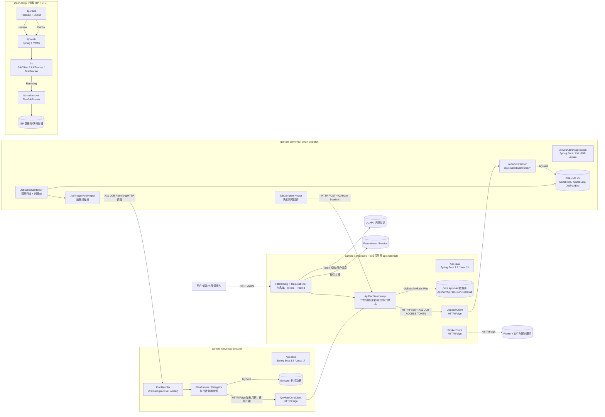
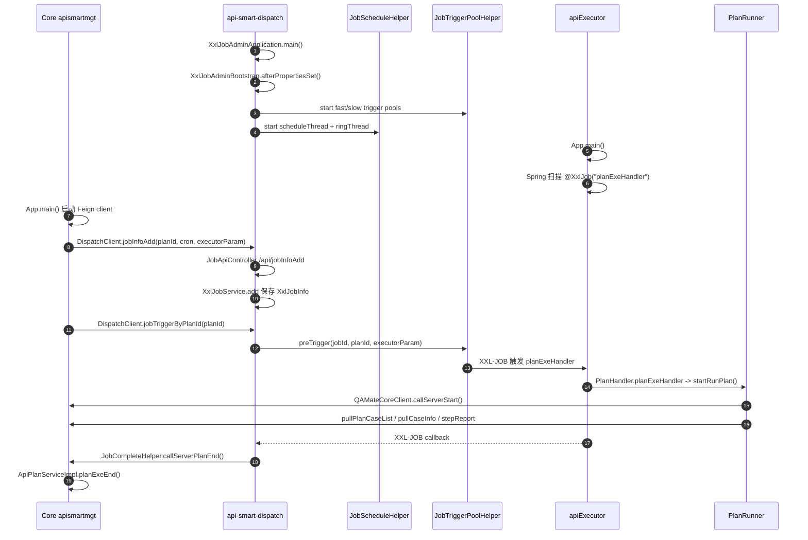

# Thinking Process

这份文档按“从现场证据到系统图”的方式写：先找四块系统的启动入口，再找它们对外说话的接口，最后把一次计划从创建、调度、执行到回调结束串起来。本文只把 `core` 中的 `apismartmgt` 当主体；`core` 里其他业务域只在被 apismart 直接调用时作为依赖出现。

读者可以把整套系统想成一家餐厅：`Core apismartmgt` 是前台和点单台，负责保存测试计划；`api-smart-dispatch` 是排班板，决定什么时候叫号；`apiExecutor` 是后厨，真正执行每道“测试菜”；`inner-os/itp` 是老厨房和老排班系统，仍保留一些历史能力和数据处理习惯。

重要说明：本文引用真实路径和精确行号；涉及 token、密码、数据库地址、内网凭据时，只说明“存在硬编码或配置风险”，不复制完整敏感值。

---

# 任务 1：全景拓扑

## 概念 1：微服务

【正面】微服务把一个大系统拆成几个小服务。日常类比是商场里的不同柜台：收银、仓库、客服各管一摊，某个柜台忙或坏了，不一定拖垮全部柜台。

【反面】柜台多了以后，沟通成本会上升。服务之间要约好“说什么话、走哪扇门、带什么证件”，否则就会出现前台下了单、后厨听不懂的情况。

【反事实】如果没有微服务，所有逻辑都塞在一个程序里，局部改动更直接；但调度、执行、老系统迁移这些变化会互相牵扯，发布风险更高。

【合】本系统选择拆成多块，是因为“计划管理、调度、执行、遗留系统”生命周期不同。拆开后，边界清楚，但跨服务接口必须稳定。

【本系统中的实例】Core 启动类扫描 apismart 的 Feign client，说明它会主动调用外部服务：`baidu/qamate-server/core/src/main/java/com/baidu/qamate/core/App.java:24`、`baidu/qamate-server/core/src/main/java/com/baidu/qamate/core/App.java:26`、`baidu/qamate-server/core/src/main/java/com/baidu/qamate/core/App.java:27`。

## Mermaid 全景拓扑图

## 数据流方向与协议标注

| 数据流 | 协议/形式 | 证据 |
|:---|:---|:---|
| 用户或外部系统 -> Core apismart | HTTP JSON，先经过过滤器 | `RequestFilter.doFilter` 读取请求头、TraceId、Token：`baidu/qamate-server/core/src/main/java/com/baidu/qamate/core/components/config/RequestFilter.java:116`、`RequestFilter.java:125`、`RequestFilter.java:136` |
| Core apismart -> dispatch | HTTP/Feign，路径在 `DispatchClient` | `DispatchClient` 指向 `${dispatch.url}`：`baidu/qamate-server/core/src/main/java/com/baidu/qamate/core/apismartmgt/manager/client/DispatchClient.java:15`、`DispatchClient.java:17`；创建/触发接口：`DispatchClient.java:26`、`DispatchClient.java:39` |
| dispatch OpenAPI -> XXL-JOB 内部服务 | Spring MVC Controller + service 调用 | `JobApiController` 统一接 `/api/{uri}`：`baidu/qamate-server/api-smart-dispatch/xxl-job-admin/src/main/java/com/xxl/job/admin/controller/openapi/JobApiController.java:35`、`JobApiController.java:36`、`JobApiController.java:54` |
| dispatch -> apiExecutor | XXL-JOB 调度触发 | `JobTriggerPoolHelper.preTrigger` 创建 `XxlPlanExe` 并触发：`baidu/qamate-server/api-smart-dispatch/xxl-job-admin/src/main/java/com/xxl/job/admin/scheduler/thread/JobTriggerPoolHelper.java:110`、`JobTriggerPoolHelper.java:119`、`JobTriggerPoolHelper.java:127` |
| apiExecutor -> Core apismart | HTTP/Feign，拉计划用例、通知开始、上报步骤 | `QAMateCoreClient` 指向 `${qamate.core.url}`：`baidu/qamate-server/apiExecutor/executor-server/src/main/java/com/baidu/qamate/server/common/conf/feign/client/QAMateCoreClient.java:23`；apismart 接口：`QAMateCoreClient.java:33`、`QAMateCoreClient.java:36`、`QAMateCoreClient.java:43` |
| dispatch -> Core apismart | HTTP POST 回调计划结束 | `JobCompleteHelper.callServerPlanEnd` 读取 Core 结束回调 URL 与头：`baidu/qamate-server/api-smart-dispatch/xxl-job-admin/src/main/java/com/xxl/job/admin/scheduler/thread/JobCompleteHelper.java:207`、`JobCompleteHelper.java:221`、`JobCompleteHelper.java:230`、`JobCompleteHelper.java:232` |
| ITP 内部 | Hessian、Dubbo、LTS Remoting | `WebApplication` 创建 Hessian 代理并导入 Dubbo 配置：`baidu/inner-os/itp/itp/itp-intelli/src/main/java/com/baidu/itp/intelli/WebApplication.java:3`、`WebApplication.java:21`、`WebApplication.java:22`、`WebApplication.java:31` |

---

# 任务 2：核心技术栈

## 概念 2：HTTP / REST API

【正面】HTTP API 像柜台窗口：调用方按约定把表单递进去，服务返回结果。它简单、通用，适合服务之间跨进程通信。

【反面】它不像本地函数调用那样可靠，可能超时、网络失败、返回字段变化，所以必须有稳定路径、请求体和鉴权头。

【反事实】如果不用 HTTP API，服务可能要共享数据库或共享代码包。这样短期少写接口，长期会让边界变模糊，一个服务改表结构会影响另一个服务。

【合】HTTP API 的核心不是“能访问”，而是“契约稳定”。路径、字段、状态码、鉴权头都是契约的一部分。

【本系统中的实例】Core 到 dispatch 的路径固定为 `/apismart/dispatch/api/jobInfoAdd`、`/jobTriggerByPlanId` 等：`baidu/qamate-server/core/src/main/java/com/baidu/qamate/core/apismartmgt/manager/client/DispatchClient.java:26`、`DispatchClient.java:39`、`DispatchClient.java:46`、`DispatchClient.java:53`。

## 概念 3：Feign

【正面】Feign 把“发 HTTP 请求”包装成“调用一个接口方法”。日常类比是通讯录：你按名字点联系人，不必每次手输号码。

【反面】它会让远程调用看起来像本地方法，容易忽略超时、失败、重试和鉴权头问题。

【反事实】如果不用 Feign，每个地方都要手写 URL、请求头、序列化、异常处理，重复多且容易漏。

【合】Feign 适合统一跨服务调用，但必须把 URL、超时、鉴权、日志级别当作重要配置管理。

【本系统中的实例】Core 的 `DispatchClient` 和 `WorkerClient` 都使用 `@FeignClient`，并共用 `FeignConfig`：`baidu/qamate-server/core/src/main/java/com/baidu/qamate/core/apismartmgt/manager/client/DispatchClient.java:15`、`DispatchClient.java:18`、`baidu/qamate-server/core/src/main/java/com/baidu/qamate/core/apismartmgt/manager/client/WorkerClient.java:16`、`WorkerClient.java:19`。

## 概念 4：调度器与 XXL-JOB

【正面】调度器像闹钟加派单台：到时间后，它不是自己干活，而是叫某个执行器去干。

【反面】调度器多了一层状态：任务是否启用、下次触发时间、执行日志、执行器是否在线，都可能影响结果。

【反事实】如果没有调度器，Core 只能同步调用 executor，长任务会占住请求；定时计划、失败重试、执行日志也要自己重写。

【合】XXL-JOB 在这里承担“什么时候触发”和“触发后记录结果”的角色，executor 承担“真正执行”的角色。

【本系统中的实例】dispatch 的 `XxlJobInfo` 保存上游计划 ID、执行器 handler、调度配置和下次触发时间：`baidu/qamate-server/api-smart-dispatch/xxl-job-admin/src/main/java/com/xxl/job/admin/model/XxlJobInfo.java:14`、`XxlJobInfo.java:25`、`XxlJobInfo.java:30`、`XxlJobInfo.java:43`、`XxlJobInfo.java:45`。

## 概念 5：异步回调

【正面】异步回调像餐厅取餐短信：前台不用站在后厨门口等，后厨完成后通知前台。

【反面】回调可能丢、重复、晚到。系统必须能识别执行 ID，并保证状态更新可追踪。

【反事实】如果没有回调，Core 只能轮询 dispatch 或 executor，查询压力更高，用户看到的状态也更滞后。

【合】异步回调适合长任务，但必须保证回调入口白名单、鉴权头、状态幂等和日志可查。

【本系统中的实例】executor 开始执行时通知 Core，dispatch 完成时回调 Core 结束：`baidu/qamate-server/apiExecutor/executor-server/src/main/java/com/baidu/qamate/server/runner/impl/PlanRunner.java:94`、`PlanRunner.java:95`；`baidu/qamate-server/api-smart-dispatch/xxl-job-admin/src/main/java/com/xxl/job/admin/scheduler/thread/JobCompleteHelper.java:194`、`JobCompleteHelper.java:202`。

## 概念 6：数据库、ORM、Mapper、Entity

【正面】数据库像档案柜，ORM/Mapper 像档案管理员，把程序对象和表记录互相转换，减少手写 SQL 的重复工作。

【反面】ORM 让数据读写更方便，也可能隐藏慢查询、事务边界和跨表一致性问题。

【反事实】如果不用 Mapper，每次读写都要手写 SQL 和字段映射；如果不用数据库，计划、执行记录、调度日志无法长期保存。

【合】本系统里，Core 负责 apismart 计划档案，dispatch 负责调度档案，executor 负责执行过程档案。三边都不能随意共享表。

【本系统中的实例】Core 的 apismart 目录下有 `entity`、`mapper`、`service` 分层；`ApiPlanServiceImpl` 继承 MyBatis-Plus 的 `ServiceImpl<ApiPlanMapper, ApiPlanEntity>`：`baidu/qamate-server/core/src/main/java/com/baidu/qamate/core/apismartmgt/service/impl/ApiPlanServiceImpl.java:58`、`ApiPlanServiceImpl.java:61`、`ApiPlanServiceImpl.java:92`。

## 概念 7：线程池

【正面】线程池像固定数量的工位：任务来了排队，空工位处理，避免每个任务都临时搭桌子。

【反面】工位太多会消耗机器资源，队列太长会拖慢反馈；拒绝策略如果没处理好，会直接丢出异常。

【反事实】如果没有线程池，调度触发和执行任务要么串行很慢，要么无限创建线程导致机器被压垮。

【合】线程池不是越大越好，核心是“容量、队列、拒绝策略、监控”一起设计。

【本系统中的实例】apiExecutor 的 `jobExecutor` 设置核心线程、最大线程、队列和拒绝策略：`baidu/qamate-server/apiExecutor/executor-server/src/main/java/com/baidu/qamate/server/async/ExecutorConfiguration.java:42`、`ExecutorConfiguration.java:59`、`ExecutorConfiguration.java:60`、`ExecutorConfiguration.java:61`、`ExecutorConfiguration.java:62`。

## 四模块技术栈表

| 模块 | 为什么需要这类工具 | 本系统具体技术 | 证据 |
|:---|:---|:---|:---|
| Core apismartmgt | 需要 Web 入口、鉴权、数据库访问、跨服务调用 | Java 21、Spring Boot 3.2.0、Spring MVC、OpenFeign、MyBatis-Plus、UUAP/Token Filter | `baidu/qamate-server/core/pom.xml:17`、`core/pom.xml:19`、`core/pom.xml:25`、`baidu/qamate-server/core/src/main/java/com/baidu/qamate/core/App.java:24`、`App.java:26` |
| apiExecutor | 需要被调度器调用并真正执行用例，同时回查 Core 数据 | Java 17、Spring Boot 3.5.9、Spring Cloud OpenFeign、XXL-JOB core、MyBatis-Plus、线程池 | `baidu/qamate-server/apiExecutor/pom.xml:22`、`apiExecutor/pom.xml:25`、`apiExecutor/pom.xml:26`、`baidu/qamate-server/apiExecutor/executor-server/pom.xml:55`、`executor-server/pom.xml:86` |
| api-smart-dispatch | 需要保存调度配置、按时间触发执行器、接收执行回调 | Java 17、Spring Boot 3.5.6、XXL-JOB Admin、MyBatis、HikariCP、XXL-SSO、Feign core | `baidu/qamate-server/api-smart-dispatch/pom.xml:23`、`api-smart-dispatch/pom.xml:24`、`api-smart-dispatch/pom.xml:40`、`baidu/qamate-server/api-smart-dispatch/xxl-job-admin/pom.xml:65`、`xxl-job-admin/pom.xml:78` |
| inner-os/itp | 遗留系统需要继续承载旧测试计划、LTS 调度、Hessian/Dubbo 集成 | Spring 4.x、WAR、LTS 1.6.6、Hessian、Dubbo、MySQL、Redis/ZK/Mongo 旧依赖 | `baidu/inner-os/itp/itp/itp-web/pom.xml:7`、`itp-web/pom.xml:11`、`itp-web/pom.xml:13`、`itp-web/pom.xml:31`、`itp-web/pom.xml:42` |

## 安全与配置风险提示

Core 的 Feign 配置在 dispatch 请求头里存在硬编码鉴权值风险，本文不复制完整值，只引用位置：`baidu/qamate-server/core/src/main/java/com/baidu/qamate/core/apismartmgt/manager/FeignConfig.java:39`、`FeignConfig.java:40`、`FeignConfig.java:41`、`FeignConfig.java:42`。

apiExecutor 调 Core 的 Feign 配置同样存在硬编码模块和 token 风险，本文不复制完整值：`baidu/qamate-server/apiExecutor/executor-server/src/main/java/com/baidu/qamate/server/common/conf/feign/QAMateCoreClientConfig.java:17`、`QAMateCoreClientConfig.java:19`、`QAMateCoreClientConfig.java:20`、`QAMateCoreClientConfig.java:21`。

dispatch 的默认 access token 写在配置文件中，属于调度 OpenAPI 的敏感配置风险点，本文不复制完整值：`baidu/qamate-server/api-smart-dispatch/xxl-job-admin/src/main/resources/application.properties:39`、`application.properties:40`。

ITP 的 DES-CBC 工具存在硬编码密钥和 IV 风险，本文不复制完整值：`baidu/inner-os/itp/itp/itp-core/src/main/java/com/baidu/itp/core/utils/DesCbcDecryptorUtil.java:16`、`DesCbcDecryptorUtil.java:17`、`DesCbcDecryptorUtil.java:18`、`DesCbcDecryptorUtil.java:20`。

---

# 任务 3：目录地图

## Core 目录地图（仅 apismartmgt）

| 类型 | 路径 | 做什么 | 证据 |
|:---|:---|:---|:---|
| 启动入口 | `baidu/qamate-server/core/src/main/java/com/baidu/qamate/core/App.java` | 启动 Spring Boot，开启调度、事务、Feign、Retry；Feign 扫描包含 apismart client | `App.java:24`、`App.java:25`、`App.java:26`、`App.java:40`、`App.java:42` |
| 鉴权白名单 | `baidu/qamate-server/core/src/main/java/com/baidu/qamate/core/components/config/FilterConfig.java` | 注册全局请求过滤器，并把 apismart 运行/状态/技能接口放进免鉴权路径 | `FilterConfig.java:47`、`FilterConfig.java:50`、`FilterConfig.java:98`、`FilterConfig.java:99`、`FilterConfig.java:101` |
| 请求过滤器 | `baidu/qamate-server/core/src/main/java/com/baidu/qamate/core/components/config/RequestFilter.java` | 处理 TraceId、MDC、Token、Metrics | `RequestFilter.java:125`、`RequestFilter.java:136`、`RequestFilter.java:143`、`RequestFilter.java:156`、`RequestFilter.java:164` |
| Feign 配置 | `baidu/qamate-server/core/src/main/java/com/baidu/qamate/core/apismartmgt/manager/FeignConfig.java` | 给 dispatch/worker 调用统一加请求头、超时和日志级别 | `FeignConfig.java:35`、`FeignConfig.java:36`、`FeignConfig.java:74`、`FeignConfig.java:80`、`FeignConfig.java:85` |
| 调度客户端 | `baidu/qamate-server/core/src/main/java/com/baidu/qamate/core/apismartmgt/manager/client/DispatchClient.java` | Core 调 dispatch 的接口契约 | `DispatchClient.java:15`、`DispatchClient.java:26`、`DispatchClient.java:29`、`DispatchClient.java:39`、`DispatchClient.java:60` |
| Worker 客户端 | `baidu/qamate-server/core/src/main/java/com/baidu/qamate/core/apismartmgt/manager/client/WorkerClient.java` | 上传脚本文件、登录 Worker 获取 token | `WorkerClient.java:16`、`WorkerClient.java:27`、`WorkerClient.java:34` |
| 计划服务 | `baidu/qamate-server/core/src/main/java/com/baidu/qamate/core/apismartmgt/service/impl/ApiPlanServiceImpl.java` | 创建/更新/删除/启停/运行计划；接收执行开始和结束 | `ApiPlanServiceImpl.java:92`、`ApiPlanServiceImpl.java:321`、`ApiPlanServiceImpl.java:333`、`ApiPlanServiceImpl.java:930`、`ApiPlanServiceImpl.java:948` |
| Controller 目录 | `baidu/qamate-server/core/src/main/java/com/baidu/qamate/core/apismartmgt/controller/` | apismart 的 HTTP 入口目录 | 文件清单由 `rg --files` 核对，包括 `ApiPlanController.java`、`ApiPlanExeController.java`、`ApiSkillController.java`、`ScriptTaskController.java` |
| Entity/Mapper 目录 | `baidu/qamate-server/core/src/main/java/com/baidu/qamate/core/apismartmgt/entity/`、`mapper/` | apismart 计划、执行记录、步骤结果、调度日志等数据结构 | `ApiPlanServiceImpl.java:5`、`ApiPlanServiceImpl.java:6`、`ApiPlanServiceImpl.java:13`、`ApiPlanServiceImpl.java:92` |

## apiExecutor 目录地图

| 类型 | 路径 | 做什么 | 证据 |
|:---|:---|:---|:---|
| 启动入口 | `baidu/qamate-server/apiExecutor/executor-server/src/main/java/com/baidu/qamate/server/App.java` | 启动 executor 服务，开启 Feign、调度、Mapper 扫描 | `App.java:18`、`App.java:19`、`App.java:21`、`App.java:23`、`App.java:28` |
| 应用配置 | `baidu/qamate-server/apiExecutor/executor-server/src/main/resources/application.yml` | 端口、上下文路径、MyBatis、Feign 超时、健康检查 | `application.yml:2`、`application.yml:5`、`application.yml:31`、`application.yml:68`、`application.yml:76` |
| XXL-JOB handler | `baidu/qamate-server/apiExecutor/executor-server/src/main/java/com/baidu/qamate/server/jobhandler/PlanHandler.java` | 暴露 `planExeHandler` 给 dispatch 调用 | `PlanHandler.java:27`、`PlanHandler.java:39`、`PlanHandler.java:41`、`PlanHandler.java:50`、`PlanHandler.java:52` |
| Runner 分发 | `baidu/qamate-server/apiExecutor/executor-server/src/main/java/com/baidu/qamate/server/runner/impl/Delegator.java` | 根据任务类型分发到计划或用例 Runner | `Delegator.java:25`、`Delegator.java:28`、`Delegator.java:31`、`Delegator.java:44`、`Delegator.java:54` |
| 计划执行 | `baidu/qamate-server/apiExecutor/executor-server/src/main/java/com/baidu/qamate/server/runner/impl/PlanRunner.java` | 拉用例、执行 setup/case/teardown、向 Core 通知开始 | `PlanRunner.java:86`、`PlanRunner.java:92`、`PlanRunner.java:95`、`PlanRunner.java:147`、`PlanRunner.java:164` |
| Core Feign | `baidu/qamate-server/apiExecutor/executor-server/src/main/java/com/baidu/qamate/server/common/conf/feign/client/QAMateCoreClient.java` | executor 回查 Core 的 apismart 数据和上报结果 | `QAMateCoreClient.java:23`、`QAMateCoreClient.java:33`、`QAMateCoreClient.java:36`、`QAMateCoreClient.java:43`、`QAMateCoreClient.java:47` |
| 线程池配置 | `baidu/qamate-server/apiExecutor/executor-server/src/main/java/com/baidu/qamate/server/async/ExecutorConfiguration.java` | 后台执行任务的线程池 | `ExecutorConfiguration.java:15`、`ExecutorConfiguration.java:16`、`ExecutorConfiguration.java:42`、`ExecutorConfiguration.java:86` |

## api-smart-dispatch 目录地图

| 类型 | 路径 | 做什么 | 证据 |
|:---|:---|:---|:---|
| 启动入口 | `baidu/qamate-server/api-smart-dispatch/xxl-job-admin/src/main/java/com/xxl/job/admin/XxlJobAdminApplication.java` | 启动 XXL-JOB Admin 二次开发服务 | `XxlJobAdminApplication.java:9`、`XxlJobAdminApplication.java:12`、`XxlJobAdminApplication.java:13` |
| 全局配置 | `baidu/qamate-server/api-smart-dispatch/xxl-job-admin/src/main/resources/application.properties` | 端口、上下文路径、MyBatis、连接池、access token、线程池上限 | `application.properties:2`、`application.properties:3`、`application.properties:25`、`application.properties:28`、`application.properties:49` |
| OpenAPI 入口 | `baidu/qamate-server/api-smart-dispatch/xxl-job-admin/src/main/java/com/xxl/job/admin/controller/openapi/JobApiController.java` | 统一处理 `/api/{uri}`，映射 jobInfoAdd、start、stop、trigger 等 | `JobApiController.java:54`、`JobApiController.java:66`、`JobApiController.java:94`、`JobApiController.java:111`、`JobApiController.java:123` |
| 调度服务 | `baidu/qamate-server/api-smart-dispatch/xxl-job-admin/src/main/java/com/xxl/job/admin/service/impl/XxlJobServiceImpl.java` | 校验、增删改查、按 planId 启停和触发 | `XxlJobServiceImpl.java:65`、`XxlJobServiceImpl.java:314`、`XxlJobServiceImpl.java:428`、`XxlJobServiceImpl.java:488`、`XxlJobServiceImpl.java:599` |
| 数据模型 | `baidu/qamate-server/api-smart-dispatch/xxl-job-admin/src/main/java/com/xxl/job/admin/model/XxlJobInfo.java` | 调度任务模型，包含 `planId`、handler、cron、触发状态 | `XxlJobInfo.java:14`、`XxlJobInfo.java:25`、`XxlJobInfo.java:30`、`XxlJobInfo.java:43` |
| Bootstrap | `baidu/qamate-server/api-smart-dispatch/xxl-job-admin/src/main/java/com/xxl/job/admin/scheduler/config/XxlJobAdminBootstrap.java` | Spring 初始化后启动触发池、注册、完成回调、日志、调度线程 | `XxlJobAdminBootstrap.java:47`、`XxlJobAdminBootstrap.java:83`、`XxlJobAdminBootstrap.java:88`、`XxlJobAdminBootstrap.java:100`、`XxlJobAdminBootstrap.java:108` |
| 调度线程 | `baidu/qamate-server/api-smart-dispatch/xxl-job-admin/src/main/java/com/xxl/job/admin/scheduler/thread/JobScheduleHelper.java` | 预读未来 5 秒任务，写入时间轮或直接触发 | `JobScheduleHelper.java:26`、`JobScheduleHelper.java:37`、`JobScheduleHelper.java:72`、`JobScheduleHelper.java:100`、`JobScheduleHelper.java:214` |
| 触发线程池 | `baidu/qamate-server/api-smart-dispatch/xxl-job-admin/src/main/java/com/xxl/job/admin/scheduler/thread/JobTriggerPoolHelper.java` | fast/slow 触发池、生成 planExe、提交触发任务 | `JobTriggerPoolHelper.java:39`、`JobTriggerPoolHelper.java:40`、`JobTriggerPoolHelper.java:59`、`JobTriggerPoolHelper.java:119`、`JobTriggerPoolHelper.java:162` |
| 完成回调 | `baidu/qamate-server/api-smart-dispatch/xxl-job-admin/src/main/java/com/xxl/job/admin/scheduler/thread/JobCompleteHelper.java` | 接执行器回调，落日志，通知 Core 计划结束 | `JobCompleteHelper.java:46`、`JobCompleteHelper.java:152`、`JobCompleteHelper.java:188`、`JobCompleteHelper.java:202`、`JobCompleteHelper.java:207` |

## inner-os/itp 目录地图

| 类型 | 路径 | 做什么 | 证据 |
|:---|:---|:---|:---|
| ITP Web 构建 | `baidu/inner-os/itp/itp/itp-web/pom.xml` | 老 Web 应用，WAR 包，Spring 4 依赖 | `itp-web/pom.xml:7`、`itp-web/pom.xml:11`、`itp-web/pom.xml:48`、`itp-web/pom.xml:80` |
| Intelli 启动 | `baidu/inner-os/itp/itp/itp-intelli/src/main/java/com/baidu/itp/intelli/WebApplication.java` | Spring Boot 入口，导入 Dubbo，创建 Hessian client | `WebApplication.java:21`、`WebApplication.java:22`、`WebApplication.java:25`、`WebApplication.java:31`、`WebApplication.java:57` |
| ITP 密码 TypeHandler | `baidu/inner-os/itp/itp/itp-core/src/main/java/com/baidu/itp/core/handler/PasswordHandler.java` | 数据库读写时加解密带标签的字符串 | `PasswordHandler.java:14`、`PasswordHandler.java:18`、`PasswordHandler.java:22`、`PasswordHandler.java:48`、`PasswordHandler.java:50` |
| DES-CBC 工具 | `baidu/inner-os/itp/itp/itp-core/src/main/java/com/baidu/itp/core/utils/DesCbcDecryptorUtil.java` | 遗留加解密实现，存在硬编码密钥风险 | `DesCbcDecryptorUtil.java:16`、`DesCbcDecryptorUtil.java:28`、`DesCbcDecryptorUtil.java:41`、`DesCbcDecryptorUtil.java:55` |
| LTS 父工程 | `baidu/inner-os/itp/lts/pom.xml` | LTS 多模块：core、jobtracker、tasktracker、jobclient、queue、admin 等 | `lts/pom.xml:12`、`lts/pom.xml:14`、`lts/pom.xml:15`、`lts/pom.xml:16`、`lts/pom.xml:20` |
| JobTracker 启动 | `baidu/inner-os/itp/lts/lts-startup/lts-startup-jobtracker/src/main/java/com/lts/startup/JobTrackerStartup.java` | 读取配置，启动 LTS JobTracker | `JobTrackerStartup.java:17`、`JobTrackerStartup.java:19`、`JobTrackerStartup.java:21`、`JobTrackerStartup.java:35` |
| TaskTracker | `baidu/inner-os/itp/lts/lts-tasktracker/src/main/java/com/lts/tasktracker/TaskTracker.java` | LTS 执行节点，准备 RunnerPool 和拉任务机器 | `TaskTracker.java:23`、`TaskTracker.java:32`、`TaskTracker.java:35`、`TaskTracker.java:36`、`TaskTracker.java:63` |
| ITP 计划 Runner | `baidu/inner-os/itp/itp/itp-tasktracker/src/main/java/com/baidu/itp/tasktracker/runner/PlanJobRunner.java` | 老 ITP 计划执行总入口 | `PlanJobRunner.java:90`、`PlanJobRunner.java:91`、`PlanJobRunner.java:174`、`PlanJobRunner.java:176` |

---

# 任务 4：启动生命周期

## 概念 8：启动生命周期

【正面】启动生命周期就是程序从“通电”到“可以接单”的顺序。像开店：先开灯，再启动收银机，再把排班板挂出来。

【反面】如果顺序错了，看起来服务启动了，但实际不能处理业务。例如调度线程没启动，任务不会按时触发；handler 没注册，dispatch 找不到执行入口。

【反事实】如果不理解启动生命周期，排障时只能看“服务是否活着”，却看不出“哪个环节没准备好”。

【合】本系统启动链路要看三件事：dispatch 是否开始扫描和触发，executor 是否暴露 handler，Core apismart 是否能发起 Feign 调用并接收回调。

【本系统中的实例】dispatch 在 Spring Bean 初始化后调用 `doStart()`，再启动 trigger、complete、schedule 等组件：`baidu/qamate-server/api-smart-dispatch/xxl-job-admin/src/main/java/com/xxl/job/admin/scheduler/config/XxlJobAdminBootstrap.java:47`、`XxlJobAdminBootstrap.java:52`、`XxlJobAdminBootstrap.java:83`、`XxlJobAdminBootstrap.java:88`、`XxlJobAdminBootstrap.java:108`。

## 启动/握手时序图

## 阶段 1：dispatch 初始化调度线程

1. JVM 启动 `XxlJobAdminApplication.main()`，进入 Spring Boot：`baidu/qamate-server/api-smart-dispatch/xxl-job-admin/src/main/java/com/xxl/job/admin/XxlJobAdminApplication.java:12`、`XxlJobAdminApplication.java:13`。
2. `XxlJobAdminBootstrap` 作为 Spring 组件，在属性准备后执行 `afterPropertiesSet()`：`baidu/qamate-server/api-smart-dispatch/xxl-job-admin/src/main/java/com/xxl/job/admin/scheduler/config/XxlJobAdminBootstrap.java:33`、`XxlJobAdminBootstrap.java:47`、`XxlJobAdminBootstrap.java:53`。
3. `doStart()` 依次启动触发线程池、注册监控、失败告警、完成回调、日志报告和调度线程：`XxlJobAdminBootstrap.java:87`、`XxlJobAdminBootstrap.java:91`、`XxlJobAdminBootstrap.java:95`、`XxlJobAdminBootstrap.java:99`、`XxlJobAdminBootstrap.java:107`。
4. `JobScheduleHelper.start()` 创建两个后台线程：一个扫描未来任务，一个按秒处理时间轮：`baidu/qamate-server/api-smart-dispatch/xxl-job-admin/src/main/java/com/xxl/job/admin/scheduler/thread/JobScheduleHelper.java:37`、`JobScheduleHelper.java:40`、`JobScheduleHelper.java:58`、`JobScheduleHelper.java:181`、`JobScheduleHelper.java:230`。
5. 调度线程查询未来 5 秒内要触发的任务，并调用触发池：`JobScheduleHelper.java:26`、`JobScheduleHelper.java:72`、`JobScheduleHelper.java:87`、`JobScheduleHelper.java:100`。

## 阶段 2：executor 暴露 XXL-JOB handler

1. executor 由 `App.main()` 启动，并开启 Feign、调度、Mapper 扫描：`baidu/qamate-server/apiExecutor/executor-server/src/main/java/com/baidu/qamate/server/App.java:18`、`App.java:19`、`App.java:21`、`App.java:23`、`App.java:28`。
2. executor 的上下文路径是 `/executor`，服务端口配置为 `8995`：`baidu/qamate-server/apiExecutor/executor-server/src/main/resources/application.yml:2`、`application.yml:3`、`application.yml:5`。
3. `PlanHandler` 是 Spring 组件，暴露 `@XxlJob("planExeHandler")`，这个名字必须和 dispatch 创建任务时的 handler 名称一致：`baidu/qamate-server/apiExecutor/executor-server/src/main/java/com/baidu/qamate/server/jobhandler/PlanHandler.java:27`、`PlanHandler.java:39`。
4. handler 从 XXL-JOB 上下文取参数，解析成 `PlanExeParamDto`，再调用 `PlanRunner.startRunPlan()`：`PlanHandler.java:41`、`PlanHandler.java:50`、`PlanHandler.java:52`。
5. `PlanRunner` 设置 traceId，先通知 Core “计划开始执行”，再拉环境、目录和用例数据：`baidu/qamate-server/apiExecutor/executor-server/src/main/java/com/baidu/qamate/server/runner/impl/PlanRunner.java:86`、`PlanRunner.java:92`、`PlanRunner.java:95`、`PlanRunner.java:103`、`PlanRunner.java:147`。

## 阶段 3：Core apismart 通过 Feign 调 dispatch

1. Core 启动时启用 Feign，并明确扫描 `apismartmgt.manager.client`：`baidu/qamate-server/core/src/main/java/com/baidu/qamate/core/App.java:26`、`App.java:27`、`App.java:42`、`App.java:43`。
2. 创建计划时，`ApiPlanServiceImpl` 先保存 Core 侧计划，再组装 `DispatchRequestVo`，把 `planId`、计划名、Cron、执行参数交给 dispatch：`baidu/qamate-server/core/src/main/java/com/baidu/qamate/core/apismartmgt/service/impl/ApiPlanServiceImpl.java:315`、`ApiPlanServiceImpl.java:316`、`ApiPlanServiceImpl.java:321`、`ApiPlanServiceImpl.java:323`、`ApiPlanServiceImpl.java:333`。
3. 更新、删除、启停计划也都先改 Core 本地状态，再调用 dispatch 的 `*ByPlanId` 接口：`ApiPlanServiceImpl.java:727`、`ApiPlanServiceImpl.java:738`、`ApiPlanServiceImpl.java:767`、`ApiPlanServiceImpl.java:771`、`ApiPlanServiceImpl.java:806`、`ApiPlanServiceImpl.java:819`。
4. 手动运行计划时，Core 生成执行参数，然后调用 `runDispatchJob`，并把 dispatch 返回的执行 ID 转成数字返回：`ApiPlanServiceImpl.java:847`、`ApiPlanServiceImpl.java:852`、`ApiPlanServiceImpl.java:857`、`ApiPlanServiceImpl.java:865`、`ApiPlanServiceImpl.java:866`。
5. dispatch 的 OpenAPI 校验 POST、access token，并基于 `uri` 分发到 `jobInfoAdd`、`jobTriggerByPlanId` 等服务方法：`baidu/qamate-server/api-smart-dispatch/xxl-job-admin/src/main/java/com/xxl/job/admin/controller/openapi/JobApiController.java:57`、`JobApiController.java:60`、`JobApiController.java:66`、`JobApiController.java:94`、`JobApiController.java:123`。

## 阶段 4：回调闭环

1. executor 开始执行后，通过 `QAMateCoreClient.callServerStart()` 告诉 Core 计划执行开始：`baidu/qamate-server/apiExecutor/executor-server/src/main/java/com/baidu/qamate/server/service/impl/PlanExecuteServiceImpl.java:97`、`PlanExecuteServiceImpl.java:100`。
2. Core 侧 `planExeStart()` 保存执行记录，状态置为运行中：`baidu/qamate-server/core/src/main/java/com/baidu/qamate/core/apismartmgt/service/impl/ApiPlanServiceImpl.java:930`、`ApiPlanServiceImpl.java:935`、`ApiPlanServiceImpl.java:937`、`ApiPlanServiceImpl.java:940`、`ApiPlanServiceImpl.java:941`。
3. executor 执行完成后，XXL-JOB 回调 dispatch；`JobCompleteHelper.callback()` 进入回调线程池，并最终调用单条 callback：`baidu/qamate-server/api-smart-dispatch/xxl-job-admin/src/main/java/com/xxl/job/admin/scheduler/thread/JobCompleteHelper.java:152`、`JobCompleteHelper.java:154`、`JobCompleteHelper.java:158`、`JobCompleteHelper.java:169`。
4. dispatch 写调度日志完成状态，并调用 `callServerPlanEnd()` 通知 Core 计划结束：`JobCompleteHelper.java:188`、`JobCompleteHelper.java:190`、`JobCompleteHelper.java:192`、`JobCompleteHelper.java:202`、`JobCompleteHelper.java:207`。
5. Core 侧 `planExeEnd()` 更新执行结束时间和状态，然后异步检查告警、异步执行业务回调：`baidu/qamate-server/core/src/main/java/com/baidu/qamate/core/apismartmgt/service/impl/ApiPlanServiceImpl.java:948`、`ApiPlanServiceImpl.java:953`、`ApiPlanServiceImpl.java:958`、`ApiPlanServiceImpl.java:970`、`ApiPlanServiceImpl.java:973`。

## ITP 遗留生命周期补充

ITP 与新 apismart 不是同一条主链路，但它解释了老系统的调度和执行模型：

1. `itp-intelli` 是一个 Spring Boot 应用，同时导入 Dubbo 配置，并创建多个 Hessian client 代理：`baidu/inner-os/itp/itp/itp-intelli/src/main/java/com/baidu/itp/intelli/WebApplication.java:21`、`WebApplication.java:22`、`WebApplication.java:31`、`WebApplication.java:40`、`WebApplication.java:49`。
2. LTS 的 `JobTrackerStartup` 读取配置后启动 `JobTracker`，相当于老调度中心：`baidu/inner-os/itp/lts/lts-startup/lts-startup-jobtracker/src/main/java/com/lts/startup/JobTrackerStartup.java:17`、`JobTrackerStartup.java:19`、`JobTrackerStartup.java:21`、`JobTrackerStartup.java:35`。
3. LTS 的 `TaskTracker` 在启动前准备 `RunnerPool` 和 `JobPullMachine`，相当于老执行节点：`baidu/inner-os/itp/lts/lts-tasktracker/src/main/java/com/lts/tasktracker/TaskTracker.java:32`、`TaskTracker.java:35`、`TaskTracker.java:36`、`TaskTracker.java:41`。
4. `JobPullMachine` 发现 JobTracker 可用后启动拉任务循环，并在有空闲线程时发送拉取请求：`baidu/inner-os/itp/lts/lts-tasktracker/src/main/java/com/lts/tasktracker/support/JobPullMachine.java:24`、`JobPullMachine.java:51`、`JobPullMachine.java:74`、`JobPullMachine.java:103`、`JobPullMachine.java:116`。
5. ITP 计划执行入口是 `PlanJobRunner.run()`，它是 prototype Spring service：`baidu/inner-os/itp/itp/itp-tasktracker/src/main/java/com/baidu/itp/tasktracker/runner/PlanJobRunner.java:90`、`PlanJobRunner.java:91`、`PlanJobRunner.java:174`、`PlanJobRunner.java:176`。

---

# 最小阅读路线

如果只想理解“一次 apismart 计划怎么跑起来”，按这个顺序读：

1. `Core App -> ApiPlanServiceImpl.create/run -> DispatchClient`：看 Core 如何把计划交给 dispatch。
2. `JobApiController -> XxlJobServiceImpl -> JobTriggerPoolHelper`：看 dispatch 如何保存、启停和触发任务。
3. `PlanHandler -> PlanRunner -> QAMateCoreClient`：看 executor 如何执行并回查 Core。
4. `JobCompleteHelper -> ApiPlanServiceImpl.planExeEnd`：看执行结束如何闭环。
5. `ITP WebApplication / LTS TaskTracker / PlanJobRunner`：把它当遗留参考，不和新 apismart 主链路混在一起。
