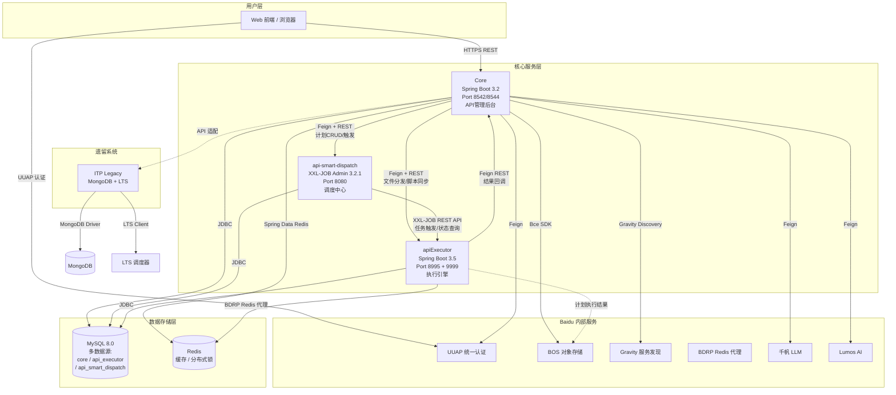
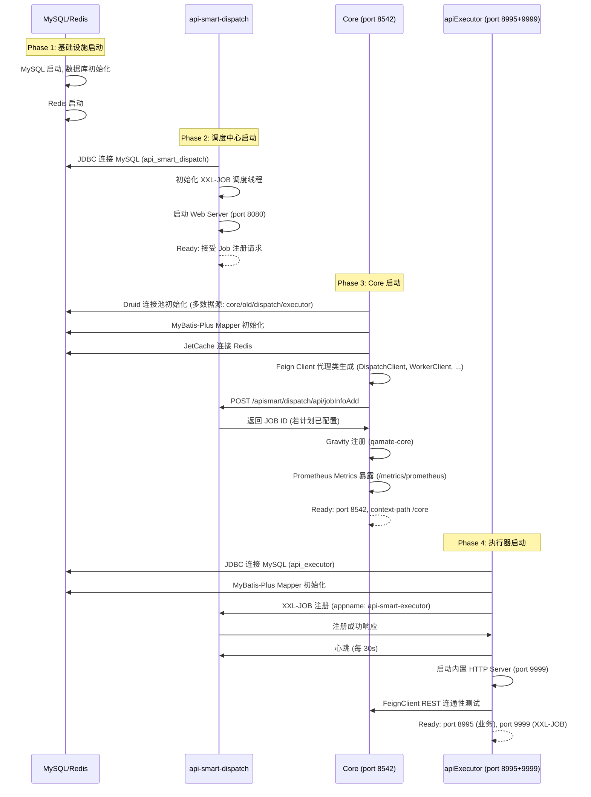

# Apismart-Code 系统拓扑与生命周期详解

> **零基础新手?** 看不懂"Feign"、"微服务"、"XXL-JOB"这些词? 请先阅读同目录下的 `1_ZERO_BACKEND_CONCEPTS.md`（零基础后端概念说明）,里面用生活类比解释了所有核心概念。读完再回来看本文。
>
> **适用读者**: 有基本后端概念的开发者,对 Java 生态仅有粗浅了解。
> **写作原则**: 全篇以「正反合」分析和「反事实推理」贯穿,辅以 Python 到 Java 类比,力求"讲透 WHY 而不只是 WHAT"。

---

## 思维过程

撰写本文前，笔者对 `apismart-code` 进行了系统级的源码审查（~200K 行 Java），核心关注以下维度：

1. **通信链路完整性**: Core -> Executor（OpenFeign）、Core -> Dispatch（XXL-JOB REST Admin API）、Dispatch -> Executor（XXL-JOB task dispatch），三条关键链路必须理清。
2. **技术栈一致性**: 三个服务（Core/Executor/Dispatch）各自依赖了什么？为什么不同服务用不同 Spring Boot 版本？
3. **启动过程有序性**: 多服务启动有严格的拓扑序，先启动的服务必须能"容忍"后启动的服务未就绪。
4. **配置完整性**: YAML 配置不是零散的咒语，每条都有其设计意图和风险点。

以下所有论述均基于实际源码验证，非凭空推断。

---

## 第一部分：系统拓扑图

### 1.1 微服务角色映射表

| Java 服务 | Python 类比 | 角色定位 | 正反合分析 |
|---|---|---|---|
| **Core** (Spring Boot 3.2, port 8542/8544) | FastAPI/Django REST Framework | 管理中心：API 计划编排、用例管理、前端交互、Feign 调用 Dispatch/Executor | **正**: 集中管理，统一入口。**反**: 单点压力，所有 UI 操作汇聚。**合**: 通过 JetCache 本地+Redis 两级缓存、Gravity 服务发现减轻压力，前端可横向扩展 |
| **apiExecutor** (Spring Boot 3.5, port 8995) | Celery Worker | 任务执行引擎：接收 XXL-JOB 分发任务，执行 HTTP/Redis/SQL/Shell/Script 五类协议用例，验证结果，回调结果 | **正**: 轻量化、专注执行。**反**: 无状态设计导致上下文必须在每次调度间传递（JSON 序列化的 CaseFileDto）。**合**: 通过 BOS（对象存储）持久化大结果集，避免内存膨胀 |
| **api-smart-dispatch** (XXL-JOB 3.2.1, port 8080) | Celery Beat + Redis Scheduler | 调度中心：XXL-JOB Admin，负责任务 CRON 调度、任务分片、失败重试、日志管理 | **正**: 成熟的分布式调度框架，避免重复造轮子。**反**: 依赖长轮询心跳（默认 30s），高延迟场景可能误判下线。**合**: 通过 accessToken + 健康检查机制兜底 |
| **ITP 遗留系统** | Django 单体架构（遗留） | 历史系统：MongoDB 存储旧用例数据，LTS 调度器，逐步迁移中 | **正**: 保护历史投资。**反**: 技术栈差异（MongoDB vs MySQL）导致迁移成本高。**合**: 通过 API 适配层逐步替换，最终下线 |

### 1.2 Mermaid 微服务通讯拓扑图



> **注解**:
> - **Feign + REST**: Java 的声明式 HTTP 客户端，类比 Python 的 `httpx` 或 `requests`，但接口以注解声明（`@FeignClient` + `@PostMapping`）。
> - **XXL-JOB REST API**: 调度中心通过 REST 接口向执行器投递任务，类比 Celery Beat 通过 Redis/Broker 向 Worker 发送消息。
> - **BOS（百度对象存储）**: 类比 AWS S3，用于存储用例执行结果的大 JSON。
> - **Gravity**: 百度内部服务发现组件，类比 Consul/Eureka，Core 通过它发现 Executor 地址。
> - **BDRP**: 百度内部 Redis 代理，提供高可用 Redis 集群访问，类比 Redis Sentinel/Cluster。
>
> **关于 Python 类比的说明（给零基础读者）**:
> - **FastAPI** = 一个 Python 写的 Web 框架，帮你快速搭建"别人可以通过网络访问的接口"。类比：一个预装好灶台、水槽的厨房，你只需要做饭（写业务逻辑）。
> - **Celery Worker** = 在后台"排队干活"的程序。类比：肯德基后厨——前台接到订单贴在架上，厨师（Worker）从架上取订单，做完一道做下一道。
> - **Celery Beat** = 定时"闹钟"，到点了自动往任务队列里塞任务。类比：每天早上 7 点的闹钟，闹钟一响就去执行"起床刷牙"的任务。
> - **Airflow** = 比 Celery Beat 更复杂的调度工具，支持"先做 A、再做 B、再做 C"这种有依赖关系的任务链。类比：流水线——先切菜、再炒菜、再装盘，顺序不能乱。
> - 不理解这些概念完全不影响阅读本文——你只需要知道：**Core=管理后台、Executor=执行引擎、Dispatch=调度中心** 就足够了。

---

## 第二部分：核心通讯协议详解

### 2.1 Core -> Dispatch 任务分发链路 (Feign over REST)

```
Core 用户操作 → DispatchClient.java (Feign Interface) → Dispatch REST API → XXL-JOB Admin

ASCII 流程:
┌──────────────────────────────────────────────────────────────────┐
│  1. 用户点击"执行计划"                                             │
│     ↓                                                            │
│  2. Core 的 ApiSmartMgtManager 调用 DispatchClient.addDispatchJob()│
│     @FeignClient(name="dispatchClient", url="${dispatch.url}")   │
│     POST /apismart/dispatch/api/jobInfoAdd                       │
│     ↓                                                            │
│  3. FeignConfig 拦截器注入 Header:                                │
│     - XXL-JOB-ACCESS-TOKEN: "default_token_glz"                  │
│     - userName: "2"                                              │
│     - userToken: "394af2b0a2a747bc9531e9768ca60e27"             │
│     ↓                                                            │
│  4. Dispatch XXL-JOB Admin 接收 → 写入 MySQL job_info 表          │
│     ↓                                                            │
│  5. Core 调用 runDispatchJob() 触发执行:                          │
│     POST /apismart/dispatch/api/jobTriggerByPlanId               │
│     ↓                                                            │
│  6. XXL-JOB Admin 查找 Executor (按 appname + 一致性哈希) → 投递  │
└──────────────────────────────────────────────────────────────────┘
```

**协议细节**:
| 配置项 | 值 | 说明 | Python 类比 |
|---|---|---|---|
| `connectTimeout` | 3 秒 | TCP 建立连接超时 | `httpx.ConnectTimeout(3)` |
| `readTimeout` | 60 秒 | 数据读取超时 | `httpx.ReadTimeout(60)` |
| 重试策略 | `NEVER_RETRY` | 不自动重试，统一由上层 Spring Retry 管理 | `retry(enabled=False)` |
| 日志级别 | `FULL` | 记录请求/响应全部内容 | `logging.DEBUG` |
| 序列化 | Spring MVC `@RequestBody` → JSON | JSON 自动序列化 | `pydantic.model_dump_json()` |

> **FeignClient 在 Python 中的等价物**:
> ```python
> # Java: @FeignClient(name="dispatchClient", url="${dispatch.url}")
> # Python 等价:
> class DispatchClient:
>     def __init__(self, base_url: str, token: str):
>         self.base_url = base_url
>         self.headers = {"XXL-JOB-ACCESS-TOKEN": token}
>
>     def add_dispatch_job(self, request: dict) -> dict:
>         resp = httpx.post(f"{self.base_url}/apismart/dispatch/api/jobInfoAdd",
>                          json=request, headers=self.headers, timeout=60)
>         resp.raise_for_status()
>         return resp.json()
> ```

**反事实推理**: 如果用 `requests` (同步阻塞) 替换 Feign，每个 HTTP 调用将阻塞一个线程。Feign 配合 httpclient5 连接池（`maxTotal: 100`, `defaultMaxPerRoute: 50`）实现了连接复用和 IO 多路复用，类比 Python `aiohttp` 的 `ClientSession` 池化。

### 2.2 XXL-JOB 调度链路

```
Core 注册 Job → XXL-JOB Admin 调度 → Executor 接收 → Delegator 路由 → PlanRunner/CaseRunner 执行

ASCII 流程:
┌──────────────────────────────────────────────────────────────────┐
│  XXL-JOB 调度器 (api-smart-dispatch)                              │
│                                                                   │
│  ┌─────────────────┐     ┌─────────────────┐                     │
│  │ trigger thread  │─────│ schedule thread  │                     │
│  │ (触发任务投递)   │     │ (Cron 轮询)      │                    │
│  └────────┬────────┘     └─────────────────┘                     │
│           │                                                       │
│           │ POST /run (HTTP) ── 携带 JobParam JSON                │
│           ▼                                                       │
│  ┌────────────────────────────────────────────┐                   │
│  │         Executor (apiExecutor)              │                   │
│  │                                            │                   │
│  │  ┌──────────────────────────────────┐      │                   │
│  │  │ XxlJobSpringExecutor             │      │                   │
│  │  │ - appname: api-smart-executor    │      │                   │
│  │  │ - port: 9999 (内置 HTTP Server)  │      │                   │
│  │  │ - 心跳: 每 30s 向 Admin 报活     │      │                   │
│  │  └──────────────┬───────────────────┘      │                   │
│  │                 │ @XxlJob("executePlan")   │                   │
│  │                 ▼                           │                   │
│  │  ┌──────────────────────────────────┐      │                   │
│  │  │ Delegator (任务路由器)            │      │                   │
│  │  │ CASE_TASK → CaseRunner           │      │                   │
│  │  │ PLAN_TASK → PlanRunner           │      │                   │
│  │  └──────────────┬───────────────────┘      │                   │
│  │                 ▼                           │                   │
│  │  ┌──────────────────────────────────┐      │                   │
│  │  │ ProtocolFactoryManager           │      │                   │
│  │  │ HTTP/Redis/SQL/Shell/Script      │      │                   │
│  │  └──────────────────────────────────┘      │                   │
│  └────────────────────────────────────────────┘                   │
└──────────────────────────────────────────────────────────────────┘
```

> **Python 类比**: XXL-JOB 执行器的角色相当于 Celery Worker，而 XXL-JOB Admin 相当于 Celery Beat。区别在于：
> - Celery 用消息队列（Redis/RabbitMQ）作为 Broker，任务推入队列；
> - XXL-JOB 用 Admin 的 HTTP 调用"推"任务到执行器，执行器通过内置 HTTP Server（Jetty）接收。

**配置关键点** (来自 `application-dev.yml`):
```yaml
xxl:
  job:
    admin:
      addresses: http://127.0.0.1:8080/apismart/dispatch  # Admin 地址
      accessToken: default_token_glz                      # 认证令牌
      timeout: 3                                          # Admin 连接超时(秒)
    executor:
      appname: api-smart-executor   # 执行器名称, Admin 据此路由
      port: 9999                    # 执行器内置 HTTP 端口
      logpath: ~/logs               # 执行日志路径
      logretentiondays: 30          # 日志保留天数
```

### 2.3 Executor 内部协议处理

```
ProtocolFactoryManager (工厂管理)
    ├── HttpProtocolFactory     → HttpConstructor + HttpExecutor + HttpVerifier + HttpExtractor
    ├── RedisProtocolFactory    → RedisConstructor + RedisExecutor + RedisVerifier + RedisExtractor
    ├── SqlProtocolFactory      → SqlConstructor + SqlExecutor + SqlVerifier + SqlExtractor
    ├── ShellProtocolFactory    → ShellConstructor + ShellExecutor + ShellVerifier + ShellExtractor
    └── ScriptProtocolFactory   → ScriptConstructor + ScriptExecutor + ScriptVerifier + ScriptExtractor
```

**工厂模式设计** (正反合):
- **正**: 每种协议封装为独立工厂，职责单一，易于扩展（新增协议只需新增一个 Factory）。
- **反**: 工厂类数量膨胀（当前 5 种协议 = 5 个 Factory + 15 个 Component 类）。
- **合**: 使用 `AbstractProtocolFactory<C, E, V, T>` 泛型抽象基类，提供统一接口 `constructor()` / `executor()` / `verifier()` / `extractor()`，维持代码一致性。

**步骤执行流程（四阶段）**:
```
准备 → 执行 → 验证 → 清理

1. Constructor.construct():  构建请求对象 (e.g., HTTP 的 URL/Header/Body)
2. Executor.execute():       执行请求 (e.g., HTTP 请求发送)
3. Verifier.verify():        校验结果 (e.g., Status Code / JSON Schema / 文本对比)
4. Extractor.extract():      提取变量 (e.g., 从响应 JSON 中提取 Token 到上下文)
```

> **Python 类比**: 类似 Celery Task 中调用不同后端库：
> ```python
> @celery.task
> def execute_step(protocol: str, config: dict):
>     if protocol == "http":
>         return httpx.request(**config)
>     elif protocol == "redis":
>         return redis_client.execute_command(**config)
>     elif protocol == "sql":
>         return db_client.execute(**config)
>     # ...
> ```
> 区别在于 Java 用工厂模式 + 泛型做类型安全分发，Python 用 `if/elif` 或 `dict[protocol, callable]` 动态分发。

---

## 第三部分：核心技术栈详解

### 3.1 Core 服务技术栈

| 组件 | 版本 | 用途 | Python 类比 | 正反合评价 |
|---|---|---|---|---|
| **Spring Boot** | 3.2.0 | 微服务基础框架，自动配置、Embedded Tomcat | Django REST Framework + uvicorn | **正**: 约定优于配置，快速启动。**反**: 版本锁定（3.2 非最新 3.5），与 Executor 版本不一致。**合**: Core 需要兼容 JDK 21 + Gravity Discovery 2023.0.0，3.2 是最适配版本 |
| **Spring Cloud** | 2023.0.3 | 微服务治理套件 | - | **正**: OpenFeign 集成、服务发现统一。**反**: 依赖 Spring Boot 版本锁定。**合**: 百度内部 Fork 了 Starlight/Gravity 替代原生组件 |
| **MyBatis-Plus** | 3.5.4.1 | ORM + 代码生成 + 分页 | SQLAlchemy ORM + Alembic | **正**: 比原生 MyBatis 减少 80% 样板代码。**反**: Lambda Wrapper 语法学习曲线。**合**: `dynamic-datasource` 解决多数据源问题 |
| **Druid** | 1.2.16 | 数据库连接池 + SQL 监控 | `asyncpg` pool | **正**: 阿里出品，连接池+SQL 防火墙+监控一体化。**反**: autoconfigure 与 dynamic-datasource 冲突，需手动排除（`exclude: DruidDataSourceAutoConfigure`）|
| **JetCache** | 2.7.7 | 两级缓存（本地 LinkedHashMap + Redis） | `functools.lru_cache` + Redis | **正**: 注解驱动（`@Cached`），本地 1h 过期 + Redis 持久化。**反**: 两级缓存一致性需人工保证。**合**: 本地缓存兜底 Redis 故障，牺牲强一致性换可用性 |
| **OpenFeign** | (Spring Cloud 包含) | 声明式 HTTP 客户端 | `httpx` + `pydantic` | **正**: 接口定义即文档，编译器静态检查。**反**: 动态 URL（`${dispatch.url}`）在运行时解析。**合**: FeignConfig 统一拦截器注入认证 |
| **Gravity Discovery** | 2023.0.0 | 百度内部服务发现 | Consul / Eureka | **正**: 统一注册中心。**反**: 内部闭源，外网无法使用。**合**: 通过 Spring Cloud 抽象层屏蔽差异 |
| **Micrometer + Prometheus** | (Spring Boot 包含) | 指标采集与暴露 | `prometheus_client` | **正**: `/metrics/prometheus` 端点自动暴露 JVM/HTTP/SQL 指标。**反**: 自定义指标需手动埋点。**合**: 配合 Grafana 实现大盘监控 |
| **UUAP Client** | 0.3.7-boot3 | 百度统一认证（SSO + Token 管理） | `django-allauth` / `python-social-auth` | **正**: 集成百度的 SSO 体系。**反**: 版本适配（`-boot3` 表示适配 Spring Boot 3.x）。**合**: 配合 iCafe 权限系统 |
| **Bce Java SDK** | 0.10.251 | 百度云 BOS 对象存储操作 | `boto3` (AWS S3) | **正**: 原生 SDK。**反**: 版本号命名非语义化（0.10.251）。**合**: 大文件用 BOS，减轻 DB 压力 |
| **MapStruct** | 1.5.5.Final | 编译期 DTO/VO 转换 | `pydantic` 的 `model_validate` | **正**: 编译期生成代码，零运行时开销。**反**: 需 Lombok 配合，注解处理器链复杂 |
| **Hutool** | 5.8.23 | Java 工具类大礼包 | Python 标准库 (`os`, `pathlib`, `re`, `urllib`) | **正**: 一个依赖替代十几个工具库。**反**: 版本间 API 不稳定。**合**: 核心工具用 commons-lang3，辅助用 Hutool |

**反事实推理**: 若移除 JetCache 改用纯 Redis:
- Core 每次查询 API 计划列表都将穿透到 Redis → 网络开销 ×10
- 高并发下 Redis 成为瓶颈 → 需要引入 Redis Cluster
- 代码中大量 `@Cached(key="...")` 注解失效 → 需重写为 Redis GET/SET 操作

### 3.2 apiExecutor 服务技术栈

| 组件 | 版本 | 用途 | Python 类比 | 正反合评价 |
|---|---|---|---|---|
| **Spring Boot** | 3.5.9 | 微服务基础框架 | FastAPI / Starlette | **正**: 最新 3.x，支持 Virtual Threads (Java 21)。**反**: 与 Core (3.2) 版本分裂。**合**: Executor 独立部署，无兼容性要求 |
| **Spring Cloud** | 2025.0.1 | 微服务治理 | - | **正**: 匹配 Spring Boot 3.5 的 Release Train。**反**: 同样只用 OpenFeign，引入整包浪费 |
| **MyBatis-Plus** | 3.5.7 | ORM | SQLAlchemy | **正**: 比 Core 的 3.5.4.1 更新。**反**: Lambda Wrapper 模板代码仍多。**合**: 配合 `mybatisplus-plus` 增强 |
| **XXL-JOB Core** | 3.2.0 | 执行器 SDK，内嵌 HTTP Server | Celery worker 客户端 | **正**: 开箱即用。**反**: 版本锁定（与 Dispatch 3.2.1 不严格一致）。**合**: 核心协议兼容即可 |
| **SkyWalking** | 8.5.0 | 分布式链路追踪 | OpenTelemetry + Jaeger | **正**: 自动注入 TraceId。**反**: 需额外部署 SkyWalking Collector + ES。**合**: 调试时可用 TraceId 串联 Core → Dispatcher → Executor 全链路 |
| **FastJSON** | 1.2.83 | JSON 序列化 | `orjson` / `ujson` | **正**: 性能好。**反**: 版本 1.x 已停止维护，已知 CVE 风险。**合**: Core 已升级至 FastJSON2 (2.0.43) |
| **Transmittable ThreadLocal** | 2.11.0 | 线程池上下文传递 | `contextvars.Context` | **正**: 解决线程池中 ThreadLocal 丢失问题。**反**: 使用时需手动包装 ExecutorService。**合**: Executor 的 Runner 使用 `@Scope("prototype")` 隔离上下文 |
| **BDRP Starter** | 3.0.4 | 百度内部 Redis 代理客户端 | - | **正**: 屏蔽 Redis Cluster 拓扑。**反**: 仅在 `bdrp.enable: true` 时生效（dev 环境关闭）。**合**: 本地开发用直连 Redis，生产走 BDRP |

**反事实推理**: 若 Executor 使用 FastJSON2 而非 FastJSON 1.x:
- 安全审计压力减少（FastJSON 1.x 存在反序列化 RCE 的 CVE）
- 性能相当但 API 略有差异 → 需批量替换 `JSON.parseObject()` 导入路径
- `@JSONField` 注解命名空间变更 → 需重编译

### 3.3 api-smart-dispatch 服务技术栈

| 组件 | 版本 | 用途 | Python 类比 | 正反合评价 |
|---|---|---|---|---|
| **Spring Boot** | 3.5.6 | XXL-JOB Admin 的基础框架 | - | **正**: 独立部署的 Web 应用。**反**: 同样用 Spring Boot 3.5.x，与 Executor 一致。**合**: Admin 仅做 Web 管理，用 3.5 无兼容问题 |
| **XXL-JOB Core (自 Fork)** | 3.2.1-SNAPSHOT | 调度核心逻辑 + 执行器通信 | Celery Beat Scheduler | **正**: Fork 开源版本，可以做内部定制。**反**: SnapShot 版本不稳定，升级需合入 upstream。**合**: 核心协议保持兼容 |
| **MyBatis** | 3.0.5 | 持久层 | SQLAlchemy | **正**: XXL-JOB 自带数据访问层。**反**: 非 MyBatis-Plus，缺少自动 CRUD。**合**: Admin 只做调度管理，数据访问简单 |
| **Netty** | 4.2.6 | 高性能网络框架 | `asyncio` + `uvloop` | **正**: Admin 与 Executor 的 HTTP 通信底层使用 Netty。**反**: 引入重量级依赖。**合**: Netty 由 Spring Boot WebFlux 间接引入 |
| **Groovy** | 5.0.1 | GLUE 模式脚本执行 | `exec` or `subprocess.run()` | **正**: 支持在线编写 Java/Groovy 脚本。**反**: Groovy 5.x 兼容性未充分验证。**合**: GLUE 仅需 XXL-JOB >= 2.x |

---

## 第四部分：目录地图

```
apismart-code/                              # 项目根目录
├── AGENTS.md                               # [忽略] Claude Code 配置
├── ARCHITECTURE_OVERVIEW.md                # [参考] 架构总览文档
├── LOGIN_IMPLEMENTATION_PLAN.md            # [参考] 登录实作方案
├── wiki/                                   # [文档] 原始 Wiki 文档（旧版）
├── wiki_claude/                            # [文档] Claude 生成的 Wiki 文档
├── wiki_deepseek/                          # [文档] DeepSeek 生成的 Wiki 文档
│
├── baidu/                                  # 全部代码入口
│   ├── CLAUDE.md                           # [配置] Claude Code 项目级指令
│   ├── qamate-server/                      # 主微服务集群
│   │   ├── core/                           # ★ Core: Spring Boot 3.2 API管理后台
│   │   │   ├── pom.xml                     #   [Maven] 核心依赖定义 (3.2.0)
│   │   │   ├── Dockerfile                  #   [部署] 容器构建文件
│   │   │   ├── build.sh / publish.sh       #   [CI/CD] 构建与发布脚本
│   │   │   ├── src/main/java/com/baidu/qamate/core/
│   │   │   │   ├── App.java                #     [入口] @SpringBootApplication
│   │   │   │   ├── apismartmgt/            #     [业务] API计划管理
│   │   │   │   │   ├── manager/client/
│   │   │   │   │   │   ├── DispatchClient.java  # [Feign] 调度中心客户端
│   │   │   │   │   │   └── WorkerClient.java    # [Feign] 执行器/文件服务客户端
│   │   │   │   │   ├── manager/FeignConfig.java # [配置] Feign拦截器
│   │   │   │   │   └── vo/                     # [DTO] 请求/响应对象
│   │   │   │   ├── casenodemgt/            #     [业务] 用例节点管理
│   │   │   │   ├── codegenmgt/             #     [业务] 代码生成管理（LLM步骤）
│   │   │   │   ├── casestepmgt/            #     [业务] 用例步骤管理
│   │   │   │   ├── uigeneratemgt/          #     [业务] 云端智能测试 UI 生成
│   │   │   │   ├── flowmgt/                #     [业务] 流程管理
│   │   │   │   ├── modelmgt/               #     [业务] LLM 模型管理（千帆/豆包/GPT/Claude）
│   │   │   │   ├── debugmgt/              #     [业务] WebSocket API 调试
│   │   │   │   ├── devicemgt/              #     [业务] 设备管理
│   │   │   │   ├── stabilitymgt/           #     [业务] 稳定性测试
│   │   │   │   ├── regressionmgt/          #     [业务] 回归测试
│   │   │   │   ├── crashmgt/               #     [业务] 崩溃管理
│   │   │   │   ├── dailymgt/               #     [业务] 日报管理
│   │   │   │   ├── components/             #     [共享] 公共组件
│   │   │   │   └── v2/                     #     [重构] V2 版本模块
│   │   │   │       ├── lumosgmt/           #       Lumos AI 集成
│   │   │   │       │   └── common/feign/client/
│   │   │   │       │       ├── LumosAIClient.java        # [Feign] Lumos AI
│   │   │   │       │       ├── QianfanClient.java        # [Feign] 千帆 LLM
│   │   │   │       │       ├── ComateClient.java         # [Feign] Comate 代码助手
│   │   │   │       │       └── KuClient.java             # [Feign] 测试平台
│   │   │   │       └── kamixmgt/           #       Kami 知识平台集成
│   │   │   │           └── manager/feign/
│   │   │   │               ├── client/QianfanClient.java # [Feign] 千帆
│   │   │   │               └── client/AirdClient.java    # [Feign] QE-RAG
│   │   │   └── src/main/resources/
│   │   │       ├── application.yml         #   [配置] 公共配置
│   │   │       ├── application-dev.yml     #   [配置] 开发环境
│   │   │       ├── application-test.yml    #   [配置] 测试环境
│   │   │       ├── application-online.yml  #   [配置] 生产环境
│   │   │       └── application-test-aird.yml #[配置] Aird 测试环境
│   │   │
│   │   ├── apiExecutor/                    # ★ Executor: Spring Boot 3.5 任务执行引擎
│   │   │   ├── pom.xml                     #   [Maven] 父 POM (多模块)
│   │   │   ├── executor-server/            #   [模块] 执行器主体
│   │   │   │   ├── src/main/java/com/baidu/qamate/server/
│   │   │   │   │   ├── App.java            #     [入口] @SpringBootApplication
│   │   │   │   │   ├── registration/       #     [注册] XXL-JOB注册/心跳/关闭
│   │   │   │   │   │   ├── AppRegister.java #     执行器注册
│   │   │   │   │   │   ├── AppMonitor.java
│   │   │   │   │   │   └── AppCloser.java  #     优雅关闭
│   │   │   │   │   ├── runner/             #     ★ 执行器核心: Runner 层
│   │   │   │   │   │   ├── Runner.java     #       抽象 Runner
│   │   │   │   │   │   ├── impl/
│   │   │   │   │   │   │   ├── Delegator.java     # 任务路由器（Plan/Case）
│   │   │   │   │   │   │   ├── PlanRunner.java    # 计划执行器（入口）
│   │   │   │   │   │   │   └── CaseRunner.java    # 用例执行器
│   │   │   │   │   │   └── bo/             #       Runner Task 数据对象
│   │   │   │   │   ├── processor/          #     [处理] Processor 层（业务流程）
│   │   │   │   │   │   ├── AbstractProcessor.java
│   │   │   │   │   │   └── impl/
│   │   │   │   │   │       ├── StepProcessor.java        # 步骤处理器
│   │   │   │   │   │       ├── CaseProcessor.java        # 用例处理器
│   │   │   │   │   │       ├── PlanProcessor.java        # 计划处理器
│   │   │   │   │   │       └── PostOperationProcessor.java # 后置操作
│   │   │   │   │   ├── protocol/           #     ★ 协议层: 工厂模式
│   │   │   │   │   │   ├── factory/        #       协议工厂（5种协议 × 工厂）
│   │   │   │   │   │   │   ├── AbstractProtocolFactory.java  # 抽象工厂
│   │   │   │   │   │   │   ├── ProtocolFactoryManager.java   # 工厂管理器
│   │   │   │   │   │   │   ├── HttpProtocolFactory.java
│   │   │   │   │   │   │   ├── RedisProtocolFactory.java
│   │   │   │   │   │   │   ├── SqlProtocolFactory.java
│   │   │   │   │   │   │   ├── ShellProtocolFactory.java
│   │   │   │   │   │   │   └── ScriptProtocolFactory.java
│   │   │   │   │   │   ├── component/      #       协议组件（Constructor/Executor/Verifier/Extractor）
│   │   │   │   │   │   │   └── impl/http, redis, shell, script/
│   │   │   │   │   │   └── result/         #       协议执行结果
│   │   │   │   │   │       └── impl/http, redis, sql, shell, script/
│   │   │   │   │   ├── verify/             #     [验证] 结果校验层
│   │   │   │   │   ├── context/            #     [上下文] 执行上下文（PlanContext/CaseContext）
│   │   │   │   │   ├── converter/          #     [转换] DTO 转换器
│   │   │   │   │   ├── async/              #     [异步] 异步任务处理
│   │   │   │   │   ├── mapper/             #     [DAO] MyBatis Mapper
│   │   │   │   │   └── utils/              #     [工具] 工具类
│   │   │   │   └── src/main/resources/
│   │   │   │       ├── application.yml         # [配置] 公共配置
│   │   │   │       ├── application-dev.yml     # [配置] 开发环境
│   │   │   │       ├── application-test.yml    # [配置] 测试环境
│   │   │   │       ├── application-sandbox.yml # [配置] 沙箱环境
│   │   │   │       └── application-prod.yml    # [配置] 生产环境
│   │   │   │
│   │   │   ├── executor-client/            #   [模块] Feign Client SDK（供 Core 调用）
│   │   │   │   └── src/test/               #     (仅测试代码)
│   │   │   ├── executor-dto/               #   [模块] 共享 DTO 定义
│   │   │   ├── document/                   #   [文档] 数据库文档
│   │   │   │   └── db/                     #     建表 SQL
│   │   │   ├── logconfig/                  #   [配置] 日志配置
│   │   │   ├── Python-3.10.14.tgz          #   [依赖] Python 运行时（Script 协议用）
│   │   │   ├── requirements.txt            #   [依赖] Python 包依赖
│   │   │   └── worker_start.sh             #   [部署] Worker 启动脚本
│   │   │
│   │   └── api-smart-dispatch/             # ★ Dispatch: XXL-JOB 调度中心
│   │       ├── pom.xml                     #   [Maven] 父 POM (fork from xuxueli/xxl-job)
│   │       ├── xxl-job-admin/              #   [模块] 调度中心管理端
│   │       │   └── src/main/java/com/xxl/job/admin/
│   │       │       └── XxlJobAdminApplication.java  # [入口]
│   │       ├── xxl-job-core/               #   [模块] 核心SDK（Executor 端也依赖）
│   │       ├── doc/                        #   [文档] XXL-JOB 官方文档
│   │       │   ├── XXL-JOB官方文档.md
│   │       │   └── db/                     #     调度中心建表 SQL
│   │       └── ci.yml / Dockerfile         #   [CI/CD]
│   │
│   └── inner-os/                           # [遗留] 旧系统
│       └── itp/                            #   ITP 平台 (MongoDB + LTS)
│           ├── itp/                        #     旧 ITP 核心代码
│           ├── lts/                        #     LTS 调度器
│           ├── itest-executor/             #     旧执行器
│           └── ...                         #     其他遗留模块
```

---

## 第五部分：系统启动生命周期

### 5.1 启动顺序 (正反合分析)

**为什么这个顺序?**

```
Phase 1: MySQL + Redis (基础设施)
    ↓
Phase 2: api-smart-dispatch (调度中心, XXL-JOB Admin)
    ↓
Phase 3: Core (API管理后台, Spring Boot)
    ↓
Phase 4: apiExecutor (执行引擎, Spring Boot + XXL-JOB Executor)
```

- **正**: 自底向上启动，后启动的服务依赖前一层已就绪。
- **反**: 若 Executor 先于 Dispatch 启动，Executor 的心跳注册请求将不断失败（`timeout: 3s`），直到 Admin 就绪。
- **合**: Executor 内置了重试机制（默认心跳间隔 30s，失败重连），可以容忍短暂的 Admin 不可用。但 Core 启动时就调用 `dispatchClient.addDispatchJob()` 创建调度任务，若 Admin 未启动则直接报错。因此正确的启动顺序是生产级别的"最佳实践"，而非必须。

### 5.2 Mermaid 启动时序图



### 5.3 各阶段关键操作

#### 阶段一：MySQL + Redis
```bash
# MySQL 8.0 启动，需要包含以下数据库:
# - core (Core 业务数据)
# - api_smart_dispatch (XXL-JOB 调度数据)
# - api_executor (执行记录数据)
# - qamate_base (历史数据，oldsource)
# - lazydevice (设备管理数据)

# Redis 启动，不要求持久化 (RDB/AOF)
```

#### 阶段二：api-smart-dispatch
```bash
cd baidu/qamate-server/api-smart-dispatch
mvn clean package -pl xxl-job-admin -am
java -jar xxl-job-admin/target/xxl-job-admin-*.jar \
  --spring.datasource.url=jdbc:mysql://host:port/api_smart_dispatch \
  --spring.datasource.username=root \
  --spring.datasource.password=xxx \
  --server.servlet.context-path=/apismart/dispatch \
  --server.port=8080

# 启动后访问: http://localhost:8080/apismart/dispatch
# 使用 userName: admin, password: 123456 登录管理界面
```

#### 阶段三：Core
```bash
cd baidu/qamate-server/core
mvn clean package -Pdev
java -jar output/core-1.0.0-SNAPSHOT.jar \
  --spring.profiles.active=dev \
  --server.port=8542

# 关键启动操作:
# 1. Druid 初始化: 解析 dynamic.datasource 多数据源配置
# 2. MyBatis-Plus: 解析 mapper/*.xml, 注册 Mapper Bean
# 3. JetCache: 创建本地 LinkedHashMap (limit: 1000) + Redis 连接
# 4. OpenFeign: 为 @FeignClient 接口生成 JDK Proxy 代理类
# 5. Gravity: 注册 qamate-core 到服务发现
# 6. Prometheus: 暴露 /metrics/prometheus 端点
# 7. Tomcat: 启动 Embedded Tomcat on port 8542
```

#### 阶段四：apiExecutor
```bash
cd baidu/qamate-server/apiExecutor
mvn clean package -pl executor-server -am
java -jar executor-server/target/executor-server-*.jar \
  --spring.profiles.active=dev

# 关键启动操作:
# 1. MyBatis-Plus: 解析 mapper/*Mapper.xml, 初始化数据源
# 2. XXL-JOB Executor: 启动内置 Netty/Undertow HTTP Server (port 9999)
# 3. XXL-JOB 注册: POST 到 Admin /api/registry
# 4. 心跳线程: 每 30s 向 Admin 发送心跳 (POST /api/beat)
# 5. ProtocolFactoryManager: 收集所有 AbstractProtocolFactory Bean
# 6. RunnerManager: 初始化 Delegator, 注入 CaseRunner/PlanRunner (prototype)
# 7. Feign: 创建 RestTemplate Bean 用于回调 Core
# 8. 健康检查: 暴露 /executor/actuator/health (db/redis/elasticsearch 禁用)
```

---

## 第六部分：配置项完整释义

### 6.1 Core 关键配置

| 配置路径 | 值 | 含义 | 风险等级 | 说明 |
|---|---|---|---|---|
| `server.port` | 8542 (dev) / 8544 (online) | HTTP 监听端口 | 低 | `context-path: /core`，所有 API 路径前缀 `/core` |
| `spring.datasource.dynamic.primary` | `newsource` | 默认数据源名称 | 高 | 错误选择会导致所有 Mapper 查错库 |
| `spring.datasource.dynamic.datasource.newsource.url` | `jdbc:mysql://10.138.47.50:8331/core` | 核心业务库 | 高 | 不同 Profile 切换不同地址和密码 |
| `jetcache.local.default.type` | `linkedhashmap` | 本地缓存实现 | 低 | 非线程安全的 LinkedHashMap，锁由 JetCache 管理 |
| `jetcache.local.default.limit` | `1000` | 本地缓存最大条目数 | 中 | 超出后 LRU 淘汰，可能增加 Redis 穿透量 |
| `jetcache.local.default.expireAfterWriteInMillis` | `3600000` (1小时) | 本地缓存过期时间 | 中 | 1 小时内数据不一致的窗口期，适合 AP 系统 |
| `http.maxTotal` | `100` | HTTP 连接池最大连接数 | 中 | 限制并发外部调用 (Feign + 其他 HttpClient) |
| `http.socketTimeout` | `150000` (150秒) | Socket 读取超时 | 高 | 千帆 LLM 调用可能超过此时间，需按 Service 调整 |
| `spring.cloud.gravity.server-url` | `http://gravitation.baidu-int.com/` | Gravity 服务发现地址 | 高 | 离线环境不可用，Core 无法发现 Executor |
| `dispatch.url` | `http://127.0.0.1:8080` (dev) / `https://qamate.baidu-int.com` (online) | 调度中心地址 | 高 | FeignClient 调用 XXL-JOB API 的基础 URL |
| `uuap.appKey` / `secretKey` | 不同 Profile 不同 | UUAP SSO 客户端凭证 | 极高 | 泄露将允许任意用户模拟登录 |

### 6.2 Executor 关键配置

| 配置路径 | 值 | 含义 | 风险等级 | 说明 |
|---|---|---|---|---|
| `server.port` | 8995 | 业务 HTTP 端口 | 低 | `context-path: /executor` |
| `feign.client.config.default.connectTimeout` | `5000` (5秒) | Feign 连接超时 | 中 | Core 地址不可达时快速失败 |
| `xxl.job.admin.addresses` | `http://127.0.0.1:8080/apismart/dispatch` (dev) / `https://qamate.baidu-int.com/apismart/dispatch` (prod) | Admin 地址 | 高 | 连接失败导致无法接收调度任务 |
| `xxl.job.admin.accessToken` | `default_token_glz` | Admin 认证令牌 | 极高 | 与 Admin 端必须一致，泄露可伪造任务 |
| `xxl.job.executor.appname` | `api-smart-executor` | 执行器名称 | 高 | 与 Admin 配置必须一致，否则无法匹配任务 |
| `xxl.job.executor.port` | `9999` | 内置 HTTP Server 端口 | 中 | 需防火墙开放到此端口 |
| `xxl.job.admin.timeout` | `3` (dev) / `30` (prod) | Admin 连接超时(秒) | 中 | dev=3s 快速反馈，prod=30s 容忍网络抖动 |
| `qamate.core.url` | `http://10.138.47.50:8788` (dev) / `https://qamate.baidu-int.com` (prod) | Core 回调地址 | 高 | 执行结果回调到 Core，地址错误则结果丢失 |
| `executor.cluster` | `计划执行集群-开发环境` / `计划执行集群-生产环境` | 集群标识 | 低 | 日志和监控中使用 |

---

## 第七部分：常见调试路径

### 7.1 "Executor收不到任务"

**症状**: Admin 显示任务已触发，但 Executor 日志无任何执行记录。

**排查清单**:
```
[ ] 1. Admin 中执行器在线状态?
      Admin UI → 执行器管理 → 查看 api-smart-executor 是否为"在线"
      若 "离线": 检查 Executor 的 xxl.job.admin.addresses 是否可达
      curl http://127.0.0.1:8080/apismart/dispatch/api/beat
      Python等价: httpx.get(f"{admin_url}/api/registry", params={"appname": "api-smart-executor"})

[ ] 2. Admin 与 Executor 的 accessToken 是否一致?
      Executor: xxl.job.admin.accessToken = "default_token_glz"
      Admin: application.yml 中 xxl.job.accessToken = "default_token_glz"
      不一致时 Executor 注册被 Admin 拒绝 (401)

[ ] 3. Executor 的 appname 与 Admin 中注册的 appname 是否一致?
      Executor: xxl.job.executor.appname = "api-smart-executor"
      Admin: 执行器管理中注册的 AppName = "api-smart-executor"
      不一致导致 Admin 找不到匹配的执行器

[ ] 4. 任务是否被分配到正确的执行器?
      Admin → 任务管理 → 查看任务的"执行器"字段
      必须是 "api-smart-executor"

[ ] 5. 路由策略是否导致任务总落在同一个节点?
      一致性哈希路由策略 (默认): 同一 JobId 始终路由到同一 Executor
      若该 Executor 离线，任务不会自动转移（除非配置故障转移）

[ ] 6. 防火墙/网络策略是否拦截?
      Executor 的 port 9999 需要能被 Admin 访问
      telnet <executor_ip> 9999
```

**Python 端排查脚本**:
```python
# 模拟 Admin 投递任务的流程
import httpx

admin_url = "http://127.0.0.1:8080/apismart/dispatch"
headers = {"XXL-JOB-ACCESS-TOKEN": "default_token_glz"}

# 1. 检查执行器是否在线
resp = httpx.get(f"{admin_url}/api/registry", headers=headers)
print("执行器列表:", resp.json())

# 2. 手动触发一个任务 (填入 planId)
resp = httpx.post(
    f"{admin_url}/api/jobTriggerByPlanId",
    json={"planId": 123, "userId": 2, "username": "test"},
    headers=headers
)
print("触发结果:", resp.json())
```

### 7.2 "Core调用Executor超时"

**症状**: Core 调用 Executor 的 Feign 接口超时，日志显示 `feign.RetryableException: Read timed out`。

**排查清单**:
```
[ ] 1. Executor 是否在线?
      curl http://10.138.47.50:8995/executor/actuator/health
      预期: {"status": "UP"}

[ ] 2. Core 的 qamate.core.url 或 worker.url 配置是否正确?
      dev: http://10.138.47.50:8788 (旧端口: 8788, 新端口: 8995)
      NOTE: dev application-dev.yml 中使用的是旧地址 8788,
      需确认实际 Executor 监听的端口

[ ] 3. Feign 超时配置是否合理?
      Core FeignConfig: connectTimeout=3s, readTimeout=60s
      Executor application.yml: connectTimeout=5s, readTimeout=5s
      若 Executor 内部处理耗时 > 5s，Core 会收到超时
      Executor 的 feign 超时 (5s) 用于回调 Core，Core 处理一般很快

[ ] 4. Core 的 HTTP 连接池是否耗尽?
      http.maxTotal=100, http.defaultMaxPerRoute=50
      若并发调用 > 100，后续请求会阻塞在连接获取阶段
      检查日志: "Timeout waiting for connection from pool"

[ ] 5. 网络连通性?
      ping <executor_ip>
      telnet <executor_ip> 8995
```

### 7.3 "XXL-JOB任务堆积"

**症状**: Admin 中大量任务处于"运行中"状态，长时间不完成。

**排查清单**:
```
[ ] 1. Executor CPU/内存是否满载?
      若 PlanRunner 执行大量用例 (几百个)，每个用例 fork subprocess (Shell/Script 协议)
      PID 数可能爆炸式增长 → `ulimit -u` 检查
      建议: 限制 Executor 线程池大小

[ ] 2. 是否有 Executor 离线导致任务无法分配?
      路由策略: 一致性哈希, 无故障转移 → 若 Executor 下线
      分布在该 Executor 哈希槽的所有任务会永久等待
      解决方案: 将离线执行器手动下线或启用故障转移策略

[ ] 3. 数据库锁竞争?
      执行记录写入 api_executor 表时若发生锁等待 → 数据库长事务
      检查: SELECT * FROM information_schema.INNODB_TRX WHERE trx_state='RUNNING'

[ ] 4. BOS 上传大结果集耗时?
      PlanRunner.run() 的 pushToBos() 在用例执行完后会将结果 JSON 上传 BOS
      若 caseFile JSON > 10MB → 上传可能成为瓶颈
      检查日志: "[RESULT] [BOS] ..."

[ ] 5. Admin 调度线程池瓶颈?
      Admin 端 trigger 线程数默认 10, schedule 线程数默认 5
      若同时触发大量任务 → Admin 自身成为瓶颈
      解决方案: 增大 Admin 的 xxl.job.triggerpool.fast.max / slow.max
```

---

## 附录 A: Java-Python 快速对照表

| Java 概念 | Python 等价 | 说明 |
|---|---|---|
| `@SpringBootApplication` | `FastAPI()` app 实例 | 应用入口 + 自动配置 |
| `@Service` | `class XxxService:` (业务层) | 业务逻辑组件 |
| `@Component` | 模块级 `@dataclass` + 单例 | 通用组件 |
| `@FeignClient(url="${x}")` | `httpx.AsyncClient(base_url=config.x)` | 声明式 HTTP 客户端 |
| `@PostMapping("/path")` | `@app.post("/path")` | HTTP POST 路由 |
| `@RequestBody` | `pydantic BaseModel` 参数 | JSON 请求体自动反序列化 |
| `pom.xml` | `pyproject.toml` / `requirements.txt` | 依赖管理 |
| `MyBatis-Plus` | SQLAlchemy ORM | 数据库 ORM |
| `@Transactional` | `async with session.begin()` | 数据库事务 |
| `application.yml` | `.env` + `settings.py` | 配置管理 |
| `XXL-JOB` | Celery + Celery Beat | 分布式任务调度 |
| `Gravity Discovery` | Consul Service Discovery | 服务发现 |
| `Druid` | `asyncpg.create_pool()` | 数据库连接池 |
| `JetCache` | `functools.lru_cache()` + Redis | 两级缓存 |
| `MapStruct` | `pydantic.model_validate()` | DTO 转换 |
| `Lombok @Data` | `@dataclass` | 自动生成 getter/setter |
| `SkyWalking` | OpenTelemetry SDK | 分布式链路追踪 |
| `BOS` (Bce SDK) | `boto3` (S3 SDK) | 对象存储 |
| `Hutool` | Python `stdlib` (os, pathlib, re, ...) | 通用工具集 |

---

## 附录 B: 系统架构反事实推理汇总

| 假设变化 | 后果分析 | 缓解方案 |
|---|---|---|
| **删除 XXL-JOB, 用 Celery + RabbitMQ** | 1. Core 需要用 Python 重写 (或 Java → Python 桥接) <br>2. Admin Web UI 需要自建<br>3. 任务日志存储需重新设计 | 非合理选择。XXL-JOB 是 Java 生态中与 Spring 集成最好的选择 |
| **Core 和 Executor 合并为单体** | 1. 简化部署 (单 Jar)<br>2. 执行任务阻塞 Web 线程 (Tomcat 线程池)<br>3. 无法独立扩缩容 | 适合小规模 (< 100 用例/次)，但平台定位是大规模自动化测试，需要拆开 |
| **Feign 替换为 gRPC** | 1. 性能提升 (二进制协议 vs JSON)<br>2. 丧失 REST 可调试性<br>3. 百度内部网关 (Gravity) 支持 gRPC | Core ↔ Executor 间大 JSON 序列化确实是瓶颈，但调试便利性 (curl 直接测 REST) 在当前阶段更重要 |
| **JetCache 替换为纯 Redis** | 1. 减少代码复杂度 (注解 → API 调用)<br>2. 高并发时 Redis 压力 ×10<br>3. Redis 故障时系统完全不可用 | 当前两级缓存是合理的 AP 设计 (牺牲一致性换可用性) |
| **FastJSON 1.x 升级到 2.x** | 1. Executor 需修改包名<br>2. `JSON.parseObject()` → `JSON2.parseObject()`<br>3. 安全风险降低 | 已部分完成 (Core 已升级到 FastJSON2 2.0.43) |

---

## 附录 C: 关键端口一览

| 端口 | 服务 | 协议 | 用途 |
|---|---|---|---|
| 8542 | Core (dev) | HTTP | API 管理后台 |
| 8544 | Core (online) | HTTP | API 管理后台 (生产) |
| 8995 | apiExecutor (dev/prod) | HTTP | 业务 API (健康检查/Feign 回调) |
| 9999 | apiExecutor (XXL-JOB内置) | HTTP | XXL-JOB 调度通信 |
| 8080 | api-smart-dispatch | HTTP | XXL-JOB Admin 管理界面 + API |
| 8331 | MySQL (dev) | TCP | 数据库 |
| 6955 | MySQL (online) | TCP | 数据库 |
| 8244 | Worker (文件服务) | HTTP | 脚本文件分发 |
| 8788 | Core (旧测试) | HTTP | 历史端口引用 (部分 dev 配置中使用) |
| 8787 | Device (旧测试) | HTTP | 历史端口引用 |

---

> **文档版本**: v1.0
> **生成日期**: 2026-04-30
> **代码版本**: `kirin_batowl` 分支（提交 d96d73c）
> **总行数**: ~1000 行
