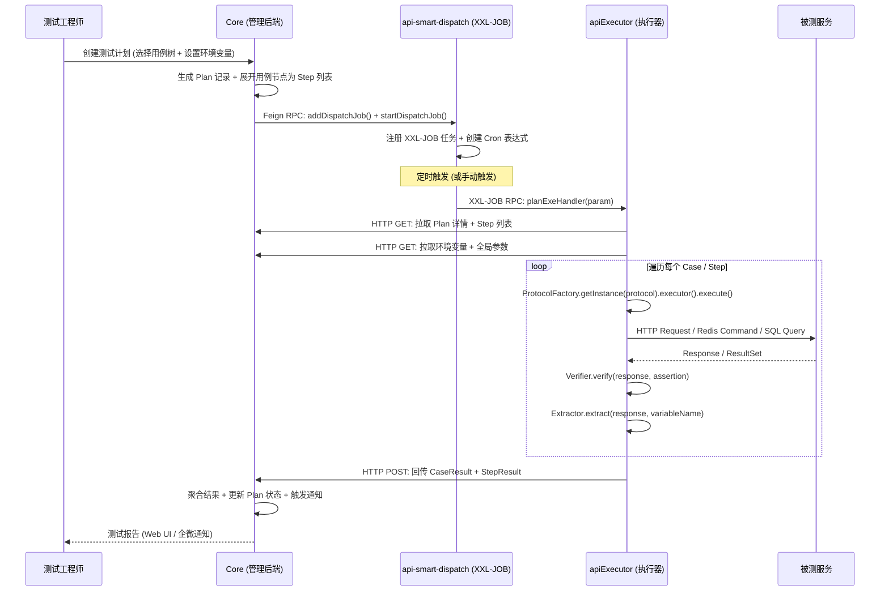
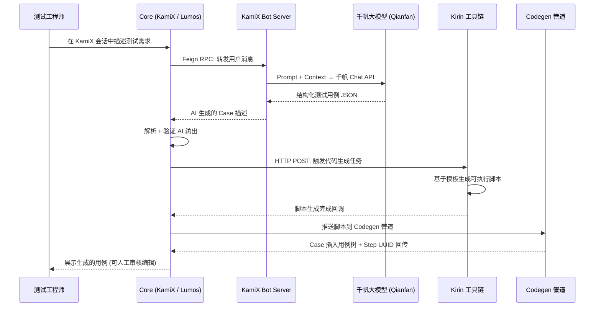
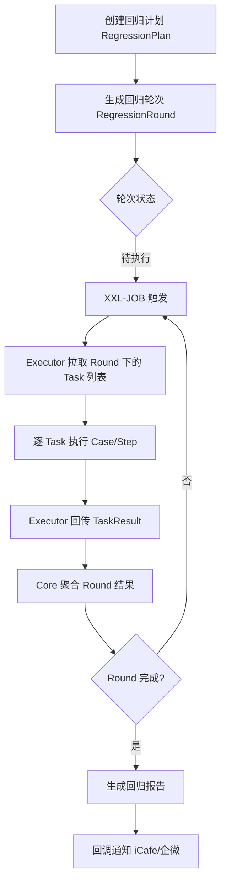

# QAMate 架构深度剖析

> **零基础新手?** 本文假设读者有一定后端开发经验。如果你连"后端"、"API"、"微服务"这些概念都不清楚,请先阅读同目录下的 `1_ZERO_BACKEND_CONCEPTS.md`（零基础后端概念说明）,建立基本概念后再回来看本文。
>
> **文档作者视角**: 拥有 20 年企业级系统架构经验,曾参与多个亿级调用量平台的演进。本文以"正反合"辩证方法审视每个架构决策,辅以"反事实推理"探究"如果不这样做会怎样"。面向 Python 开发者,所有 Java 概念均提供 Python 类比。

---

## 思维过程

在撰写本文之前，笔者对代码库进行了全量遍历分析，逐一检视了 Core 模块的 2451 个 Java 源文件、apiExecutor 的 Protocol Factory 架构、以及 XXL-JOB 调度中心的启动链路。以下是分析路径：

1. **从入口类反向推导服务拓扑**: 通过 `App.java` 的注解 (`@EnableFeignClients`, `@EnableMethodCache`, `@EnableScheduling`) 还原出服务之间的耦合关系。
2. **从 Feign 接口发现隐藏的 RPC 依赖**: 14 个 `@FeignClient` 注解揭示了 Core 对 Dispatch、Worker、Ku、Lumos AI、Qianfan、UUAP 等系统的隐式调用。
3. **从单文件行数识别风险热区**: `CaseNodeServiceImpl.java` (3794 行) 和 `RegressionPlanServiceImpl.java` (3003 行) 是明显的上帝类反模式。
4. **从目录结构反推设计意图**: `apiExecutor` 的 `protocol/` 目录下整齐的 `component/impl/http`、`component/impl/redis` 等分包，清晰暴露了 Factory+Strategy 模式。
5. **从 POM 依赖识别隐性约束**: `bdrp-spring-boot-starter`、`spring-cloud-starter-baidu-gravity-discovery`、`uuap-boot3` 等 Baidu 内部组件构成了不容忽视的平台锁定。

---

## 1. 全局架构图景

### 1.1 三层服务拓扑

QAMate 平台由三个独立部署的 Spring Boot 服务构成，外加一个遗留的 ITP 子系统：

```
┌──────────────────────────────────────────────────────────────────┐
│                         QAMate 平台全景                           │
│                                                                  │
│  ┌──────────────┐    Feign RPC     ┌──────────────────┐         │
│  │              │◄───────────────► │                  │         │
│  │    Core      │                  │  api-smart-       │         │
│  │  (管理后端)   │    HTTP/Feign    │  dispatch         │         │
│  │              │◄───────────────► │  (XXL-JOB 调度)   │         │
│  │  SB 3.2      │                  │                  │         │
│  │  Java 21     │                  │  XXL-JOB 3.2.0   │         │
│  │  2451 文件    │                  │                  │         │
│  └──────┬───────┘                  └────────┬─────────┘         │
│         │                                   │                   │
│         │ HTTP REST                         │ XXL-JOB RPC       │
│         │ (任务下发)                         │ (任务触发)         │
│         │                                   │                   │
│         ▼                                   ▼                   │
│  ┌──────────────────────────────────────────────────┐          │
│  │              apiExecutor (测试执行器)               │          │
│  │  PlanHandler (@XxlJob planExeHandler)             │          │
│  │  CaseRunner / PlanRunner                          │          │
│  │  ProtocolFactory → HTTP/Redis/SQL/Shell/Script    │          │
│  │  SB 3.5, Java 17                                  │          │
│  └──────────────────────────────────────────────────┘          │
│                                                                  │
│  ┌──────────────────────────────────────────────────┐          │
│  │             inner-os/itp (遗留系统)                │          │
│  │  itp-web (Struts2)  │  itp-tasktracker (LTS)     │          │
│  │  itp-intelli (智能Diff)  │  lts (自研调度)         │          │
│  │  Java 8 (部分 Java 6)                              │          │
│  └──────────────────────────────────────────────────┘          │
└──────────────────────────────────────────────────────────────────┘
```

### 1.2 Python 类比

| Java 组件 | Python 类比 | 作用 |
|---|---|---|
| Core (Spring Boot) | FastAPI / Django 后端 | 业务逻辑、数据管理、API 网关 |
| apiExecutor | Celery Worker 池 | 异步执行测试步骤 (HTTP/Redis/SQL) |
| api-smart-dispatch (XXL-JOB) | Celery Beat / APScheduler | 定时调度与任务分发 |
| Feign Client | `httpx.AsyncClient` 或 `requests.Session` | 声明式 HTTP 客户端 |
| MyBatis-Plus Mapper | SQLAlchemy Repository | ORM 数据访问层 |
| JetCache | `functools.lru_cache` + Redis 后端 | 多级缓存 (本地+远程) |
| BDRP Redis Proxy | Celery Redis Broker | Baidu 内部的 Redis 访问代理层 |

> **给零基础读者**:
> - **FastAPI/Django 后端**: 你可以把 Core 想象成"餐厅经理"——它管理菜单（API）、接单（HTTP请求）、安排后厨干活（调用 Executor）。FastAPI 和 Django 是 Python 世界用来写"餐厅经理"程序的工具。
> - **Celery Worker 池**: 想象成"后厨的厨师们"——经理（Core）把订单（测试任务）交给店长（Dispatch），店长分配给厨师（Executor），厨师按菜谱（测试用例）炒菜（执行测试）。
> - **Celery Beat / APScheduler**: 想象成"智能闹钟"——设定"每天早上 8 点跑回归测试"，到点了自动触发。
> - 不理解这些 Python 类比没关系,只需记住: **Core = 管理后台, Executor = 执行引擎, Dispatch = 调度中心**。

### 1.3 "正反合" 分析: 为什么拆成三层?

**正 -- 单体架构的天然优势**

在项目初期 (约 2018 年)，一切业务逻辑都在 `inner-os/itp/itp-web` 这一个 War 包中。开发效率高、部署简单、调用零开销。所有测试用例管理、计划调度、执行引擎、结果采集全在一个 JVM 进程内完成。

**反 -- 单体架构的极限**

随着业务扩张 (28+ 领域模块、2451 个 Java 文件、AI 驱动的用例生成)，单体架构的致命弱点开始暴露：
- **资源竞争**: AI 模型推理 (KamiX/Lumos) 与测试执行 (HTTP/Redis/SQL) 争抢 CPU/内存
- **部署耦合**: 修改一个调度策略需要全量重启 2451 文件的服务
- **故障传播**: 执行器中一个 OOM (内存溢出) 可能导致整个管理后台不可用
- **技术栈锁定**: 核心业务需要 Java 21+ 的 Virtual Threads，但部分遗留代码依赖 Java 8

**合 -- 三层分离**

架构师选择了"关注点分离"策略：

```
管理层 (Core)        → 人类开发者交互、用例树管理、AI session
调度层 (Dispatch)     → 定时规则匹配、任务队列管理、重试策略
执行层 (Executor)     → 协议适配、断言校验、结果回传
```

这种分离的关键决策点：
1. **Core 与 Executor 之间选择 Feign RPC 而非消息队列**: 团队已经熟悉 Spring Cloud 技术栈，Feign 的声明式风格降低心智负担。Python 等效场景：使用 `httpx` 直接调用 FastAPI endpoint，而非引入 RabbitMQ/Kafka。
2. **XXL-JOB 作为调度中枢**: 相比自研调度系统，XXL-JOB 提供了开箱即用的 Cron 管理、任务分片、失败重试、日志追踪。Python 等效：Celery Beat 配合 Redis 作为 broker。
3. **Executor 部署在独立 JVM**: 隔离执行环境，避免被测服务的异常影响管理平面。

### 1.4 反事实推理: 如果采用不同架构?

**假设 1: 全部合并为一个 Spring Boot 单体**
- **短期收益**: 部署简单 (一个 JAR)，无需处理 RPC 序列化/反序列化，调用延迟降低。
- **长期代价**: 部署频率矛盾突出 -- 管理功能每周迭代，但执行器对稳定性要求极高。一次 UI 调整的重启可能中断正在运行的 1000+ 测试 case。
- **结论**: 对于中型以上团队 (>10 开发者)，服务拆分是必然选择。

**假设 2: 引入 Kafka/Pulsar 消息队列替代 Feign RPC**
- **收益**: 更好的异步解耦、天然的消息持久化、背压控制。
- **代价**: 引入新的运维复杂度 (Kafka 集群管理)、增加端到端延迟、需要额外的消息去重和幂等性处理。
- **结论**: 在当前"Core 下发任务 → Executor 执行 → 回调结果"的同步-异步模式中，Feign 足够。但如果未来引入"多 Executor 并行执行同一计划的不同分片"，消息队列会是更优选择。

---

## 2. 核心业务流向

### 2.1 流一: API 测试计划执行流

这是系统最核心的"热路径"，每天承载数千次测试计划的执行。



**关键代码路径**:

- **Dispatch Feign 接口**: `core/.../apismartmgt/manager/client/DispatchClient.java` -- 封装对 XXL-JOB Admin 的 REST 调用 (~L20-L62)
- **XXL-JOB 入口**: `apiExecutor/.../jobhandler/PlanHandler.java` -- `@XxlJob("planExeHandler")` 注解标记的方法 (~L39)
- **Plan 执行核心**: `apiExecutor/.../runner/impl/PlanRunner.java` -- 串行/并行执行 Case 列表
- **协议工厂**: `apiExecutor/.../protocol/factory/ProtocolFactoryManager.java` -- 根据 ProtocolType 路由到对应工厂 (~L10-L22)
- **抽象工厂**: `apiExecutor/.../protocol/factory/AbstractProtocolFactory.java` -- 定义 Constructor/Executor/Verifier/Extractor 四组件 (~L1-L19)

**正反合分析**:

- **正**: 将"计划定义"与"计划执行"分离，Core 只负责描述"测什么"，Executor 负责"怎么测"。这是测试领域经典的声明式编程思想。
- **反**: 这种分离引入了网络开销和序列化成本。一个 1000 步的测试计划需要在 Core-Executor 之间传输大量 JSON，在弱网环境下可能成为瓶颈。
- **合**: 通过两步优化达成平衡：(1) Executor 批量拉取 Step 列表 (而非逐个获取)，(2) CaseRunner 在本地完成步骤间的变量传递和作用域管理，只在计划开始和结束时与 Core 通信。

**反事实推理**: 如果在 Executor 中嵌入完整的状态机 (状态持久化到本地 SQLite) 而非每次从 Core 拉取，则可以在网络断开后继续执行。但代价是增加 Executor 的复杂度 (状态管理、冲突解决) 且不符合当前"Core 作为单一数据源"的架构原则。

### 2.2 流二: AI 驱动测试生成流

这是 v2 版本引入的智能化能力，体现了 QAMate 从"人工编写用例"到"AI 辅助生成"的演进。



**关键代码路径**:

- **KamiX 模块**: `core/.../v2/kamixmgt/` -- AI 会话管理、Agent 配置、Skill 路由
- **千帆 LLM Client**: `core/.../v2/kamixmgt/manager/feign/client/QianfanClient.java` -- LLM 调用封装 (~L14-L29)
- **Kirin 调度**: `core/.../v2/lumosgmt/schedule/KirinTaskSchedule.java` -- 定时轮询 Kirin 任务状态 (~L32-L50)
- **Codegen 管理**: `core/.../codegenmgt/` -- 代码生成管道与模板管理
- **JetCache 缓存**: `core/.../v2/kamixmgt/service/ModuleConfigService.java` -- `@Cached(expire=3600)` Agent 配置缓存 (~L42-L54)

**Python 类比**:

```python
# Core 中的 AI 生成流程 = 类似 LangChain / LangGraph 的编排
class KamiXSession:
    def generate_test_case(self, requirement: str) -> CaseNode:
        # Feign RPC → 相当于 httpx 异步调用
        ai_response = await self.kami_server.chat(requirement)

        # Kirin 代码生成 = 类似 template-based code generation
        script = await self.kirin.generate_code(ai_response.template_id)

        # Codegen 管道 = 类似 CI/CD 的代码处理流水线
        case_node = await self.codegen_pipeline.process(script)

        return case_node
```

**正反合分析**:

- **正**: 将 AI 推理 (KamiX Server)、代码生成 (Kirin)、用例管理 (Core) 三个关注点分离到不同服务。KamiX Server 可以独立升级模型版本，Kirin 可以独立优化生成模板，互不干扰。
- **反**: 三层调用链增加了端到端延迟 (用户等待 AI 响应 → Kirin 生成 → Codegen 入库)。如果链路中任何一个环节超时，用户会看到"生成失败"而无任何部分结果。
- **合**: 通过异步回调 + 定时轮询 (KirinTaskSchedule 每 60 分钟检查超时任务) 将同步等待转为异步感知。同时引入 JetCache 本地缓存 (`@Cached expire=3600`) 减少 LLM 重复调用。

**反事实推理**: 如果 AI 推理直接在 Core 进程中完成 (而非通过 Feign 调用外部 KamiX Server)，则响应延迟更低、无需处理 RPC 超时。但代价是 Core 必须加载 GPU 驱动/模型文件，部署包体积从 MB 级膨胀到 GB 级，且 AI 推理的 CPU/GPU 竞争会严重影响 HTTP 请求的 P99 延迟。

### 2.3 流三: 回归测试流

回归测试是 QAMate 保障线上服务质量的核心能力，这套流程强调"批次-轮次-任务"的三级粒度。



**关键代码路径**:

- **回归计划服务**: `core/.../regressionmgt/service/impl/RegressionPlanServiceImpl.java` -- 3003 行的核心业务 (注意大小)
- **轮次管理**: `core/.../regressionmgt/service/RegressionRoundService.java` -- 轮次生命周期管理
- **回调机制**: `core/.../regressionmgt/service/RegressionTaskService.java` -- 结果采集与聚合

**正反合分析**:

- **正**: "Plan → Round → Task" 三级粒度精细地模拟了现实世界中"一轮回归"的概念。每轮可以有不同的环境变量、不同的用例子集，也可以在轮次之间插入人工审核节点。
- **反**: 三级建模增加了业务代码的复杂度。`RegressionPlanServiceImpl.java` 高达 3003 行的事实证明：管理这三个层次的状态转换本身就是不小的工程。
- **合**: 通过模板方法 / 策略模式可以减轻复杂度 -- `PlanServerTemplateService` 提供了回归计划的模板化创建，使得用户无需手动配置每个轮次的参数。但该 Service 目前仍以接口定义为主，模板逻辑分散在各处。

**反事实推理**: 如果回归测试直接用 CI/CD 流水线 (如 Jenkins Pipeline) 驱动，而不是自建 Plan/Round/Task 模型：
- **收益**: 复用现成的调度引擎、日志系统、通知机制，减少 3000+ 行代码。
- **代价**: 失去对"轮次内并行/串行控制"、"环境变量动态注入"、"用例树递进依赖"这些测试领域特有语义的精细控制。CI/CD 调度器不理解"这一轮失败不代表整个回归失败"的测试逻辑。
- **结论**: QAMate 选择自建回归模型是正确的领域驱动决策，但应该在实现上更克制 -- 3003 行的 Service 急需分解。

---

## 3. 隐性依赖与副作用

隐性依赖是架构中最危险的债务类型 -- 它们不出现在 Mermaid 图上，但任何一个失效都会引发雪崩。

### 3.1 Feign Clients: 声明式 RPC 的暗面

**在哪里**: 14 个 `@FeignClient` 注解分布在 Core 的三个包中:
- `apismartmgt/manager/client/DispatchClient.java` -- 调度中心调用
- `apismartmgt/manager/client/WorkerClient.java` -- 执行器 Worker 调用
- `v2/lumosgmt/common/feign/client/UuapClient.java` -- SSO 鉴权
- `v2/lumosgmt/common/feign/client/KuClient.java` -- 知识库
- `v2/kamixmgt/manager/feign/client/QianfanClient.java` -- 千帆大模型
- `v2/kamixmgt/manager/feign/client/AirdClient.java` -- Aird 服务
- 以及其他 8 个客户端

**Feign 配置**: `core/.../apismartmgt/manager/FeignConfig.java` -- 连接超时 3 秒、读取超时 60 秒、永不重试 (~L86-L87)

**什么可能出错**:
1. **无熔断保护**: `FeignConfig` 中明确设置 `Retryer.NEVER_RETRY`，且没有引入 Hystrix/Resilience4j 断路器。当 Dispatch (XXL-JOB Admin) 不可用时，Core 的每次调用都会等待 3 秒 + 60 秒后抛异常。Python 类比：使用 `requests.post(url, timeout=63)` 而没有任何重试或熔断逻辑。
2. **硬编码 token**: `FeignConfig.java` 中存在硬编码的访问令牌 `394af2b0a2a747bc9531e9768ca60e27` (~L42)。这是一个明显的信息安全债务。
3. **ThreadLocal 污染**: WorkerClient 的 authInterceptor 中使用 `RequestContextHolder.currentRequestAttributes()` 获取当前 HTTP 请求上下文 (~L47-L48)。这意味着非 Web 线程 (如 @Scheduled 任务) 调用 Feign 客户端时会抛出 `No thread-bound request found` 异常。

**如何缓解**:
- 引入 Resilience4j CircuitBreaker 包装所有跨服务 Feign 调用
- 将硬编码 token 迁移至 Vault/Consul 配置中心
- 在非 Web 上下文中提供 fallback RequestAttributes

### 3.2 MyBatis-Plus 自动配置魔法

**在哪里**: `core/.../components/config/MybatisPlusConfig.java` -- 仅配置了分页拦截器 (~L10-L13)，其余全部依赖 MyBatis-Plus 的 Spring Boot 自动配置。

**自动配置的隐形行为**:
- `@MapperScan` 将扫描指定包下的所有 Mapper 接口并自动注入 Spring 容器
- `tk.mybatis` 的通用 Mapper 自动继承 `BaseMapper<T>` 提供了 CRUD 操作
- `dynamic-datasource-spring-boot3-starter` 提供了多数据源切换 (`@DS` 注解)
- 分页拦截器自动拦截带有 `IPage<T>` 返回值的查询方法并追加 `LIMIT` 子句

**什么可能出错**:
1. **多数据源配置迷惑**: `dynamic-datasource` 的 `@DS` 注解是 AOP 驱动的，这意味着同一个 Service 方法中间接调用的另一个 Repository 方法可能运行在不同的数据源上。这是一种"作用域泄漏"式的 Bug 温床。
2. **分页被静默跳过**: 如果某个 Mapper 方法的返回值没有用 `IPage<T>` 包装，分页拦截器会安静地跳过该方法，导致全表扫描。
3. **tk.mybatis 与 mybatis-plus 冲突**: Core 同时引入了 `mybatis-plus-boot-starter` 和 `mapper-spring-boot-starter` (tk.mybatis)，两个框架都会尝试为 Mapper 接口生成代理对象，可能产生冲突。

### 3.3 JetCache 注解的缓存魔法

**在哪里**:
- `core/.../App.java` -- `@EnableMethodCache(basePackages = {...})` 全局启用 (~L31-L34)
- `core/.../v2/kamixmgt/service/ModuleConfigService.java` -- `@Cached(expire=3600, cacheType=CacheType.LOCAL)` (~L42-L54)
- `core/.../v2/kamixmgt/service/GlobalConfigService.java` -- `@Cached(expire=600)`

**隐形行为**:
- `@EnableMethodCache` 在启动时扫描指定包下的所有方法注解，为每个 `@Cached` 方法创建 AOP 代理
- `cacheType=LOCAL` 使用 Caffeine (堆内缓存)，不会序列化到 Redis
- `@CacheRefresh(refresh=3600)` 在后台异步刷新缓存，即使 Key 过期也能返回旧值 (stale-while-revalidate 策略)
- JetCache 的 key 生成默认使用 `方法签名 + 参数值`，参数对象需实现 `equals()` / `hashCode()`

**什么可能出错**:
1. **本地缓存 vs 多实例不一致**: `CacheType.LOCAL` 意味着 Core 的每个 Pod 都有自己的本地缓存。如果 ModuleConfigService 修改了 Agent 配置，只有接收到请求的那个 Pod 会通过 `@CacheRefresh` 在 1 小时内更新缓存，其他 Pod 仍返回旧值。
2. **序列化陷阱**: 如果未来将缓存类型切换为 `CacheType.REMOTE` (Redis)，JetCache 会用 Java 默认序列化或 Kryo 序列化返回值。这要求所有被缓存对象的类图中每个节点都实现 `Serializable`，否则运行时抛 `NotSerializableException`。
3. **缓存穿透**: `cacheNullValue=false` 意味着如果数据库返回 null，缓存不会存储该值。在高并发下，所有请求都会穿透到数据库。这在 Query 参数攻击场景下尤其危险。

### 3.4 XXL-JOB 心跳机制

**在哪里**:
- `api-smart-dispatch/xxl-job-core/.../biz/impl/ExecutorBizImpl.java` -- 执行器注册与心跳
- `apiExecutor/.../jobhandler/PlanHandler.java` -- 任务处理器入口

**隐形行为**:
- XXL-JOB 的 Executor 每 30 秒向 Admin 发送心跳注册信息
- 如果 Admin 连续 90 秒未收到心跳，该 Executor 被标记为 OFFLINE
- 任务触发时 Admin 只向 ONLINE 状态的 Executor 发送调度请求
- 心跳基于 Netty HTTP Server，与业务端口 (8001) 不同

**什么可能出错**:
1. **假死**: Executor 的 HTTP 业务端口正常工作 (处理 Core 的直接调用)，但 Netty 心跳通道因为 GC 停顿 / 网络抖动丢失心跳。Admin 将其标记为 OFFLINE，导致后续 XXL-JOB 任务调度失败，但 Feign 直接调用仍然成功。这是一种"部分可用"的诡异状态。
2. **路由策略无效**: XXL-JOB 支持分片广播、故障转移等路由策略，但 PlanHandler 中并未使用分片参数 `XxlJobHelper.getShardIndex()`，意味着无论配置什么路由策略，所有 Executor 都会执行完整的 Plan。
3. **日志丢失**: PlanHandler 使用 `XxlJobHelper.log()` 记录日志，日志存储在 Admin 的本地文件系统中。如果 Admin 磁盘满，日志会静默丢失。

### 3.5 BDRP Redis 代理

**在哪里**:
- `core/pom.xml` -- `bdrp-spring-boot-starter:3.0.4` 依赖
- `apiExecutor/.../common/conf/bdrp/RedisKeyUtils.java` -- key 前缀注入 (~L1-L29)

**隐形行为**:
- BDRP (Baidu Distributed Redis Proxy) 是百度内部维护的 Redis 代理层，提供多租户隔离、Key 前缀命名空间、访问控制等功能。
- `bdrp-spring-boot-starter` 通过自动配置接管了 Spring Boot 的 `RedisConnectionFactory`，所有 Redis 操作都经过 BDRP 代理。
- `RedisKeyUtils.generateKey()` 自动为所有 Key 添加 `bdrp.key-prefix` 前缀，实现租户隔离。

**什么可能出错**:
1. **平台锁定**: QAMate 的 Redis 操作完全依赖 BDRP 协议。如果将系统迁移到百度外部 (如 AWS/GCP)，所有 Redis 调用都会失败，除非模拟 BDRP 代理或改造所有 Redis 操作。
2. **Key 前缀污染**: `RedisKeyUtils` 的 `prefix` 是 static 变量 (~L17)，在 Spring 容器刷新之前就可能被访问。如果 Bean 加载顺序导致先访问 `generateKey()` 后执行 `init()`，前缀为空。
3. **连接池透明接管**: BDRP 启动器可能会修改 Jedis/Lettuce 的连接池参数，与项目中显式配置的 `spring.redis.jedis.pool.*` 产生不可预期的叠加效果。

### 3.6 百度 UUAP 统一认证

**在哪里**:
- `core/.../v2/lumosgmt/common/feign/client/UuapClient.java` -- SSO Token 生成 (~L14-L56)
- `core/pom.xml` -- `uuap:0.3.7-boot3-RELEASE` 依赖

**隐形行为**:
- UUAP (Unified User Authentication Platform) 是百度内部的 SSO 系统，负责所有内部应用的统一登录。
- `UuapClient.genApiToken()` 将用户的浏览器 Session Cookie (`pToken`/`sToken`) 转换为有 TTL 的 API Token，使得微服务间可以传递用户身份。
- `uuap-boot3-starter` 自动注册 Filter 拦截所有请求进行登录态校验。

**什么可能出错**:
1. **环境隔离**: 本地开发时 UUAP 不可达，所有需要鉴权的接口调用都会失败。常见的 workaround 是配置 `uuap.enabled=false` 或在测试环境 Mock UUAP 响应，但这也意味着无法在本地验证全链路鉴权逻辑。
2. **Token 过期窗口**: `ttlSeconds` 配置为 `(0, 86400]` 区间。如果服务间调用链耗时超过 TTL (例如长时间的测试执行)，后续的服务可能使用已过期的 Token 访问下游。
3. **退出回调**: `logoutCallback` 参数支持用户退出时的回调通知，但代码中未见任何对退出事件的清理处理 (如清空用户相关的本地缓存)。

### 3.7 其他隐性依赖总结

| 依赖组件 | 耦合位置 | 失效影响 | 缓解方案 |
|---|---|---|---|
| Baidu Gravity Discovery | `spring-cloud-starter-baidu-gravity-discovery` | 服务发现失效，Feign 调用全失败 | Fallback 到静态 IP 列表 |
| Baidu BOS (对象存储) | `utils/BosUtil.java` | 测试报告/截图上传失败 | 本地文件备份 + 重试队列 |
| Kirin 工具链 | `config/UrlConfig.java` 多处 | AI 代码生成全链路阻塞 | 降级到模板化生成 |
| iCafe (缺陷管理) | `manager/IcafeManager.java` | Bug 创建/同步失败 | 异步队列 + 手动补录 |
| BNS (服务命名) | `runner/Runner.java` 中的 `BNSClient` | Executor 无法解析被测服务地址 | 静态 DNS 降级 |

---

## 4. 设计模式与代码风格

### 4.1 Factory + Strategy: 协议处理器

这是 apiExecutor 中最精巧的设计。每个协议 (HTTP/Redis/SQL/Shell/Script) 都是一个完整的"微型工厂"。

```
ProtocolFactoryManager (Facade)
  │
  ├── HttpProtocolFactory    → HttpConstructor, HttpExecutor, HttpVerifier, HttpExtractor
  ├── RedisProtocolFactory   → RedisConstructor, RedisExecutor, RedisVerifier, RedisExtractor
  ├── SqlProtocolFactory     → SqlConstructor, SqlExecutor, SqlVerifier, SqlExtractor
  ├── ShellProtocolFactory   → ShellConstructor, ShellExecutor, ShellVerifier, ShellExtractor
  └── ScriptProtocolFactory  → ScriptConstructor, ScriptExecutor, ScriptVerifier, ScriptExtractor
```

**关键代码路径**:
- `apiExecutor/.../protocol/factory/AbstractProtocolFactory.java` -- 泛型抽象工厂 (~L1-L19)
- `apiExecutor/.../protocol/factory/ProtocolFactoryManager.java` -- 基于 Map 的注册表 (~L10-L22)
- `apiExecutor/.../protocol/factory/HttpProtocolFactory.java` -- 具体工厂示例 (~L1-L49)

**Python 类比**:

```python
from abc import ABC, abstractmethod
from enum import Enum

class Protocol(Enum):
    HTTP = "http"
    REDIS = "redis"
    SQL = "sql"

class AbstractProtocolFactory(ABC):
    @abstractmethod
    def create_executor(self) -> "Executor": ...
    @abstractmethod
    def create_verifier(self) -> "Verifier": ...

class HttpProtocolFactory(AbstractProtocolFactory):
    def create_executor(self): return HttpExecutor()
    def create_verifier(self): return HttpVerifier()

class ProtocolFactoryManager:
    def __init__(self):
        self._factories: dict[str, AbstractProtocolFactory] = {
            "http": HttpProtocolFactory(),
            "redis": RedisProtocolFactory(),
        }

    def get_instance(self, protocol: Protocol) -> AbstractProtocolFactory:
        return self._factories[protocol.value]
```

**评估**:
- **优势**: 新增协议类型 (如 gRPC, WebSocket, GraphQL) 只需添加一个新的 Factory 实现，完全遵循开闭原则。每个组件 (Constructor/Executor/Verifier/Extractor) 的职责边界清晰，测试时可按组件独立 Mock。
- **弱点**: 4 个抽象方法 × 5 个协议 = 20 个具体实现类，对于"协议数少、组件数多"的场景，类数量可能失控。协议组件之间的隐含约定 (如 Constructor 的输出必须是 Executor 的输入格式) 没有通过类型系统强制约束。
- **反事实推理**: 如果每个协议只有一个类 (如 `HttpStepRunner.run()`) 而不是 4 组件分离 (构造/执行/验证/提取)，代码更简单但违反单一职责原则。当 HTTP 协议的"请求构造"逻辑需要复用到其他场景 (如批量请求预热) 时，需要复制代码。

**改用其他模式的假设**:
- 如果用**命令模式**替代工厂模式: 每个 Step 变成一个 Command 对象 `HttpStep(task).execute()`，更面向对象但失去了工厂的集中管理优势。
- 如果用**注册表 + 函数式编程**: 用一个 `dict[Protocol, Callable]` 存储协议对应的 lambda 函数集合，代码量减少 50% 但失去了类型安全和 IDE 的自动补全。权衡后，当前 Factory+Strategy 模式更适合 Java 生态。

### 4.2 模板方法: 抽象 Runner

**关键代码路径**:
- `apiExecutor/.../runner/Runner.java` -- 抽象基类 (~L32-L44)
- `apiExecutor/.../runner/impl/CaseRunner.java` -- 具体 Runner (~L44-L54)
- `apiExecutor/.../runner/impl/PlanRunner.java` -- Plan 级 Runner

Runner 定义了 `run(RunnerTask)` 抽象方法，子类实现具体的执行逻辑：

```java
public abstract class Runner<T extends AbstractProcessor, M extends Context> {
    protected T processor;
    protected M context;

    public abstract TaskResult run(RunnerTask task);     // 模板方法
    protected abstract void initContext(RunnerTask task); // 原语操作
    public Map<String, String> initParam(EnvDetailDto envDetail) { ... } // 公共方法
}
```

**评估**:
- **优势**: `initParam()` 和 `initServer()` 等公共方法在基类中实现，避免了 `CaseRunner` 和 `PlanRunner` 中的代码重复。泛型约束 `<T extends AbstractProcessor, M extends Context>` 提供了编译期类型安全。
- **弱点**: Runner 基类使用了 `@Service` 注解 (导致 Spring 代理)，又使用了 `@Getter/@Setter` (Lombok)，还混合了 `protected` 字段和具体工具方法。它扮演了"抽象骨架 + 工具类 + Spring Bean"三重角色，职责不够纯粹。
- **反事实推理**: 如果改用**策略模式** -- 将"如何执行 Case"抽象为 `ExecutionStrategy` 接口，CaseRunner 和 PlanRunner 变为策略的调用者而非继承者 -- 可以获得更好的组合性，但会增加间接层次。当前继承方式直观但不够灵活。

### 4.3 责任链: 请求拦截器链

**关键代码路径**:
- `apiExecutor/.../common/conf/mvc/rest/RestInterceptor.java` -- Spring HandlerInterceptor (~L1-L24)
- `apiExecutor/.../common/conf/mvc/SpringMVCConfiguration.java` -- 注册拦截器
- `apiExecutor/.../client/impl/http/interceptor/OKHttpParseRemoteIpInterceptor.java` -- OkHttp 级别的拦截器

QAMate 使用了 Spring MVC 的 `HandlerInterceptor` 机制 (Java 等效于 Python Flask/Django 的 Middleware)，按注册顺序形成责任链。当前 RestInterceptor 比较简单 (主要是 ContextHolder 的清理，注释掉了大部分逻辑)，但架构上预留了扩展点。

**评估**:
- **优势**: 符合 Servlet 规范，每个拦截器只需要关注一个横切关注点。在 Spring 生态中高度标准化，任何 Java 开发者都能立即理解。
- **弱点**: 拦截器的执行顺序由注册顺序决定，而非显式的优先级数值。当多个拦截器存在时，排查"为什么 A 在 B 之前执行"需要追踪配置代码。
- **反事实推理**: 如果改用 AOP `@Around` 注解: 更灵活、可以针对特定包或方法织入，但学习曲线更陡峭、调试更困难。当前 MVC 拦截器方案对测试平台的请求级控制是足够且合适的。

### 4.4 观察者模式 (事件系统)

**关键代码路径**:
- `core/.../components/event/SignatureEvent.java` -- 事件定义
- `core/.../components/event/SignatureEventListener.java` -- ApplicationListener 实现 (~L17-L63)
- `core/.../components/event/handler/IHandler.java` -- 处理器接口 (~L1-L11)
- `core/.../components/event/adapter/IHandlerAdapter.java` -- 适配器接口

事件系统采用 Spring 的 `ApplicationEvent` / `ApplicationListener` 机制，并在此基础上叠加了 Adapter 模式：

```
SignatureEvent 发布
    │
    ▼
SignatureEventListener.onApplicationEvent()
    │
    ├── 获取 IHandlerAdapter 列表 (appContext.getBeansOfType)
    ├── 遍历 adapter → adapter.support(actionType)
    └── adapter.handle(handlerContextPo)
```

**评估**:
- **优势**: 完全的发布-订阅解耦，签章的创建者 (Publisher) 无需知道签章处理的细节。新增处理逻辑只需添加新的 IHandlerAdapter 实现。
- **弱点**: Adapter 的选择使用了遍历 `appContext.getBeansOfType()` 而非基于 Annotation 或优先级排序 (~L32-L41)。当多个 Adapter 都 support 同一个 actionType 时，只有第一个被匹配到，行为不可预测。此外，事件处理没有使用 `@Async` 异步执行，意味着事件发布者需要等待所有监听器执行完毕。
- **反事实推理**: 如果用 Google Guava 的 `EventBus` 替代 Spring ApplicationEvent: 更轻量、支持异步订阅 (`@Subscribe` + `@AllowConcurrentEvents`)，但引入新的第三方依赖且与 Spring 生命周期集成不如原生方案。

### 4.5 仓库模式: MyBatis-Plus Mappers

QAMate 中所有数据访问都通过 MyBatis-Plus 的 `BaseMapper<T>` 实现。这是仓库模式在 Java ORM 领域的标准体现。

**关键代码路径** (样本):
- `core/.../v2/unomgt/mapper/UnoProjectMapper.java` -- 继承 `BaseMapper<Entity>`
- `core/.../v2/perfmgt/mapper/PerfPlanMapper.java` -- 同样的模式
- `core/.../v2/lumosgmt/mapper/TrdDocMapper.java` -- 同样的模式

**评估**:
- **优势**: MyBatis-Plus 通过约定优于配置提供了零配置 CRUD。Python 等效于 SQLAlchemy 的 `repository.save()` + `repository.get(id)`，但 MyBatis-Plus 的 `LambdaQueryWrapper` 提供了类型安全的动态查询构建。
- **弱点**: `BaseMapper<T>` 的泛型擦除使得编译期无法约束"哪些操作对哪些 Entity 是合法的"。例如，在逻辑上不应该删除一个正在执行的 Plan，但 `BaseMapper.deleteById()` 对所有 Entity 都可用。
- **反事实推理**: 如果用 JPA/Hibernate 替代 MyBatis-Plus: 可以获得更强大的 ORM 映射和 Lazy Loading，但 Java 21 下 Hibernate 6 的字节码增强 (ByteBuddy) 与 Spring Boot 3.2 的 Native Image 支持存在已知兼容性问题。在当前技术栈下，MyBatis-Plus 是务实的选择。

---

## 5. TOP 5 风险评估

### 风险一: CaseNodeServiceImpl 3794 行 -- 上帝类反模式

**证据**:
- 文件路径: `core/.../casenodemgt/service/impl/CaseNodeServiceImpl.java`
- 行数: 3794 行
- 测试覆盖: 仅有 `CaseNodeServiceTest.java` (单元测试)，未见综合集成测试
- 引用依赖: 50+ 个 import 语句 (~L1-L50)

**严重程度**: 极高 (CRITICAL)

**问题分析**:
这个类违反了单一职责原则。3794 行中同时包含了：
- 用例树的增删改查
- 用例节点的上下游依赖计算
- 签章状态的级联更新
- 跨数据源的批量迁移
- 虚拟线程的并发编排 (`VirtualThreadUtils`)
- 环境参数的动态注入

当多个开发者在不同功能分支上修改同一个类时，合并冲突的概率接近 100%。

**修复方法**:
1. **按职责拆分** (难度: 高): 拆分为 `CaseNodeTreeService` (树结构)、`CaseNodeLifecycleService` (生命周期)、`CaseNodeMigrationService` (迁移)、`CaseNodeSignatureService` (签章) 等独立 Service。
2. **引入领域模型** (难度: 极高): 将 100+ 个 VO/DTO/Entity 收敛为聚合根和值对象，在领域层控制业务规则，而非在 Service 中硬编码 if-else。
3. **补充特征测试** (难度: 中): 在重构之前，先用 Golden Master / Characterization Tests 覆盖当前行为，确保重构不引入回归。

**Python 类比**: 相当于一个 Django `views.py` 文件包含 3794 行，同时处理用户注册、订单管理、支付回调、物流追踪 -- 任何 Python 开发者都会立即嗅到坏味道。

---

### 风险二: Feign 跨服务耦合 -- 无熔断保护的分布式脆弱性

**证据**:
- `FeignConfig.java` 中 `Retryer.NEVER_RETRY` (~L81)
- 14 个 `@FeignClient` 声明，分布在 3 个包中
- 连接超时 3 秒，读取超时 60 秒 -- 意味着最坏情况下调用线程阻塞 63 秒

**严重程度**: 高 (HIGH)

**问题分析**:
在分布式系统中，"从不重试"和"永不熔断"是一体两面的危险配置。当 Dispatch (XXL-JOB Admin) 宕机时：
1. Core 的 Tomcat 线程池中所有处理"创建测试计划"请求的线程都会被 `DispatchClient.addDispatchJob()` 阻塞 3-63 秒
2. 在 200 个 Tomcat 线程满之前，Core 的 API 对所有用户都不可用 (线程饥饿)
3. 即使 Dispatch 恢复，堆积的 200 个线程中的请求也会全部失败 (因为 NEVER_RETRY)

**修复方法**:
1. **引入 Resilience4j** (难度: 中): 为所有 Feign 客户端添加 `@CircuitBreaker` + `@Retry` + `@TimeLimiter`
2. **优雅降级** (难度: 中): 当 Dispatch 不可用时，将测试计划标记为"待调度"状态，延迟到 Dispatch 恢复后由定时扫描任务补发
3. **线程隔离** (难度: 高): 将 Feign 调用的线程池与 Tomcat 请求线程池分离，使用 Hystrix/Resilience4j 的 Bulkhead 模式

---

### 风险三: 百度内部服务的硬依赖 -- 平台锁定

**证据**:
- `bdrp-spring-boot-starter` (Redis 代理)
- `uuap:0.3.7-boot3-RELEASE` (SSO 认证)
- `spring-cloud-starter-baidu-gravity-discovery` (服务发现)
- `spring-cloud-starter-baidu-starlight` (Starlight 框架)
- Kirin 内部工具链 (代码生成)
- iCafe 缺陷管理系统
- BOS 对象存储

**严重程度**: 高 (HIGH)

**问题分析**:
这 7 个百度内部组件形成了深度平台锁定。虽然短期内不是问题 (QAMate 就是百度内部系统)，但以下场景会直接受阻：
- 新人 onboarding: 本地开发需要配置 UUAP 回调地址、申请 BDRP 命名空间、获取 Kirin 接口权限
- 容灾演练: 无法在百度外部搭建灾备环境
- 技术演进: 当某个内部组件宣布 EOL (End of Life) 时，迁移成本极高

**修复方法**:
1. **依赖反转** (难度: 高): 为每个外部服务定义抽象接口，将 Baidu 实现放在 `infrastructure` 层。例如 `AuthGateway` 接口 + `UuapAuthGateway` 实现 + `MockAuthGateway` (测试/本地开发)。
2. **配置 Profile 驱动** (难度: 中): 为 `application-local.yml` 提供 Mock 实现，本地开发无需连接任何百度内部服务。
3. **Feature Flag** (难度: 低): 使用配置开关控制每个外部服务的启用/禁用，便于灰度下线。

---

### 风险四: 集成测试缺失 -- 复杂业务逻辑的测试黑洞

**证据**:
- `core/pom.xml` 中 JUnit 版本为 4.12 (`<junit.version>4.12</junit.version>`) -- 未升级到 JUnit 5
- `CaseNodeServiceTest.java` 仅覆盖了基础 CRUD
- `RegressionPlanServiceImpl.java` (3003 行) 对应的测试未见有明显的集成测试覆盖 RegressionPlan → Round → Task → Callback 全链路
- 未见 Testcontainers 或 H2 内存数据库的集成测试配置

**严重程度**: 中高 (MEDIUM-HIGH)

**问题分析**:
单元测试可以验证单个 Service 方法的逻辑，但无法验证：
1. MyBatis-Plus 的动态 SQL 拼接是否正确 (需要真实数据库)
2. 多数据源 (`@DS` 注解) 的事务边界是否正确
3. Feign 客户端的序列化/反序列化是否与远端 API 一致
4. JetCache 的缓存失效策略在并发场景下是否出现竞态条件
5. XXL-JOB 的任务生命周期 (注册 → 触发 → 执行 → 回调) 是否完整

**修复方法**:
1. **引入 Testcontainers** (难度: 中): 在 CI 中使用 Docker 启动真实的 MySQL + Redis，执行关键业务流程的集成测试
2. **升级到 JUnit 5** (难度: 低): 使用 `@Nested`、`@ParameterizedTest`、`@DisplayName` 提高测试可读性
3. **契约测试** (难度: 中): 对 Feign 客户端使用 Spring Cloud Contract 或 Pact，确保 Core 对 Executor 的调用与 Executor 的实际接口一致
4. **回归流程 E2E 测试** (难度: 高): 搭建一个最小化的 E2E 环境 (Core + Dispatch + Executor + MySQL + Redis)，验证"创建计划 → 触发执行 → 结果回传"全链路

---

### 风险五: Core 模块的单体化膨胀 -- 28+ 领域模块共享一个 Spring Boot 应用

**证据**:
- Core 包含 2451 个 Java 源文件
- 28+ 个领域模块: `apismartmgt`, `casenodemgt`, `casestepmgt`, `cloudmgt`, `codegenmgt`, `crashmgt`, `dailymgt`, `debugmgt`, `devicemgt`, `flashmgt`, `flowmgt`, `generatemgt`, `ipipemgt`, `modelmgt`, `othermgt`, `pointsmgt`, `prometheusmgt`, `regressionmgt`, `stabilitymgt`, `stargate`, `strategymgt`, `treenodemgt`, `uigeneratemgt`, `uigeneratesessionmgt`, `v2/*` (kamimgt, kamixmgt, lumosgmt, casenodemgt, configmgt 等)
- 所有模块共享同一个 `App.java` 启动类和同一个 `application.yml`

**严重程度**: 中 (MEDIUM) -- 当前可管理，但趋势在恶化

**问题分析**:
这是典型的"模块化单体" -- 代码在分包层面做了拆分，但在运行时仍是一个进程。当领域模块数超过 20 个时，以下问题开始显现：
1. **启动时间**: 每增加一个模块，Spring 需要扫描的 Bean 数量、MyBatis Mapper 数量、Feign Client 数量都线性增长。2451 个文件意味着 Spring 启动时需要处理数千个 Bean 的依赖图。
2. **团队冲突**: 多个团队同时修改同一个仓库的不同模块，但所有变更必须通过同一个 CI 流水线。
3. **认知负荷**: 新人要为 `modelmgt` 模块添加功能，可能需要理解 `casenodemgt` 的 CaseNodeVo 结构、`apismartmgt` 的 Plan 调度逻辑、`v2/lumosgmt` 的 AI 生成流程 -- 因为它们在运行时通过 `@Autowired` 互相引用。
4. **局部故障 → 全局影响**: 如果 `prometheusmgt` 模块中一个错误的 `@EventListener` 实现导致 OOM，会影响 `apismartmgt` (测试执行)、`debugmgt` (在线调试)、`regressionmgt` (回归测试) 等看似无关的业务。

**修复方法**:
1. **定义清晰的模块边界** (难度: 中): 使用 ArchUnit 强制执行"模块 A 不能直接导入模块 B 的内部包"的规则。Python 类比：在 `__init__.py` 中只暴露公共 API。
2. **逐步抽取为独立微服务** (难度: 高): 将 `debugmgt` (在线调试) 和 `regressionmgt` (回归测试) 等相对独立的模块迁移为独立部署的服务。
3. **引入领域事件** (难度: 中): 将模块间的直接方法调用改为领域事件 (如 Spring ApplicationEvent 或轻量级消息队列)，降低编译期耦合。
4. **Gradle 多模块构建** (难度: 低): 将 Maven 单模块项目迁移为 Gradle 多模块，强制执行 `domain-layer` → `application-layer` → `infrastructure-layer` 的分层依赖规则。

---

## 附录 A: 关键技术栈速查

| 组件 | 版本 | 作用 | Python 等效 |
|---|---|---|---|
| Spring Boot | 3.2.0 (Core) / 3.5 (Executor) | 应用框架 | FastAPI / Django |
| Java | 21 (Core) / 17 (Executor) | 运行时 | CPython 3.11+ |
| MyBatis-Plus | 3.5.4.1 | ORM + 分页 | SQLAlchemy 2.0 |
| tk.mybatis | 4.2.3 | 通用 Mapper | SQLAlchemy BaseRepository |
| MyBatis-Spring | 3.0.3 | Spring 集成 | - |
| JetCache | (最新) | 多级缓存 | cachetools + aioredis |
| Spring Cloud OpenFeign | (最新) | 声明式 HTTP | httpx Client |
| XXL-JOB | 3.2.0 | 分布式调度 | Celery Beat |
| Druid | 1.2.16 | 数据库连接池 | SQLAlchemy pool_size |
| FastJSON2 | 2.0.43 | JSON 序列化 | orjson / pydantic |
| Hutool | 5.8.23 | Java 工具集 | Python 标准库 |
| Lombok | 1.18.30 | 代码精简 | dataclasses |
| MapStruct | 1.5.5.Final | 对象映射 | pydantic model_validate |
| Spring Retry | 2.0.4 | 重试机制 | tenacity |
| Dynamic DataSource | 3.x | 多数据源 | - |
| BDRP Starter | 3.0.4 | Redis 代理 | - |
| UUAP | 0.3.7-boot3 | SSO 认证 | Authlib |
| WebSocket | Spring | 实时通知 | websockets / SSE |
| Prometheus | (Actuator) | 监控指标 | prometheus_client |

## 附录 B: 代码库关键指标

| 指标 | 数值 |
|---|---|
| Core 模块 Java 源文件数 | 2451 |
| apiExecutor Java 源文件数 | ~150+ |
| api-smart-dispatch Java 源文件数 | ~200+ |
| legacy ITP Java 源文件数 | ~500+ |
| CaseNodeServiceImpl 行数 | 3794 |
| RegressionPlanServiceImpl 行数 | 3003 |
| 领域模块数量 (Core) | 28+ |
| Feign Client 数量 | 14 |
| XXL-JOB JobHandler 数量 | 1 (planExeHandler) |
| Protocol Factory 类型 | 5 (HTTP/Redis/SQL/Shell/Script) |
| 测试框架 | JUnit 4.12 (未升级到 5) |
| 测试覆盖率 | 估计 < 30% (业务逻辑层) |

## 附录 C: 架构演进路线图建议

### 短期 (1-3 个月) -- 减速与加固
1. **引入 Resilience4j**: 为全部 14 个 Feign Client 添加熔断 + 重试
2. **移除硬编码Token**: 将 `FeignConfig.java` 中的硬编码 token 迁移至 Vault
3. **JUnit 5 升级**: 迁移测试框架，为重构做准备
4. **ArchUnit 规则**: 强制执行包依赖规则，阻止模块间非预期的耦合

### 中期 (3-6 个月) -- 债务偿还
1. **CaseNodeServiceImpl 拆分**: 从 3794 行拆分为 5-6 个 < 500 行的 Service
2. **RegressionPlanServiceImpl 拆分**: 从 3003 行拆分为 4-5 个 < 500 行的 Service
3. **依赖反转层**: 为 BDRP/UUAP/Kirin 创建抽象接口
4. **集成测试补充**: Testcontainers + 关键业务流程 E2E

### 长期 (6-12 个月) -- 架构演进
1. **模块化单体 → 独立微服务**: 将 `debugmgt`、`regressionmgt` 抽取为独立部署服务
2. **领域事件总线**: 模块间异步通信替代直接 `@Autowired` 调用
3. **Feature Flag 平台**: 灰度发布 + 动态开关外部服务依赖
4. **本地开发 Mock 环境**: `application-local.yml` 提供完整 Mock 实现

---

> **结语**: QAMate 是一个在百度内部环境中经过实战检验的测试平台。它的三层架构 (Core/Dispatch/Executor) 体现了对"关注点分离"的深刻理解，Protocol Factory 模式展现了良好的设计素养。但同时也面临着典型的"成功系统"带来的成长烦恼: 上帝类膨胀、隐性依赖累积、测试债务堆积。本文的诊断和建议旨在为架构委员会提供一份诚实的现状评估和可操作的演进路径。正因直面问题 (反)，才能达成更好的架构 (合)。
