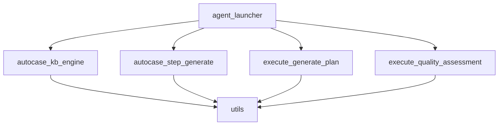

# 代码库分析报告

## 1. 系统架构分析

### 主要模块划分及功能
- **入口层**(agent_launcher.py)：负责路由和初始化
- **知识生成引擎**(autocase_kb_engine)：自动化知识提取和存储
- **用例生成**(autocase_step_generate)：测试用例步骤生成
- **执行计划**(execute_generate_plan)：测试执行计划生成
- **质量评估**(execute_quality_assessment)：测试结果质量评估
- **工具层**(utils)：提供公共能力和大模型集成

### 模块依赖关系

## 2. 核心业务实现

### 用例生成模块
- 核心类：`AutoCaseStepGenerate`和`GuideAgent`
- 主要流程：
  - 接收测试用例、设备信息等参数
  - 通过大模型生成操作指导
  - 解析并格式化结果

### 大模型集成
- 支持平台：通义千问/百炼、文心一言、GPT、火山豆包
- 核心功能：
  - 统一调用接口`QAMateLLM`
  - JSON格式返回支持
  - 内置重试机制

### 执行计划生成
- 核心功能：
  - 解析大模型生成的action
  - 可视化执行步骤
  - 与设备交互执行测试

## 3. 业务流程

## 4. 关键代码位置
- 入口：`agent_launcher.py`
- 核心业务：
  - 用例生成：`autocase_kb_engine/`
  - 执行计划：`execute_generate_plan/`
  - 质量评估：`execute_quality_assessment/`
- 工具类：`utils/large_model.py`
https://app.roocode.com/share/23f47020-3a67-4d8a-8cb6-14b4f8c32f59